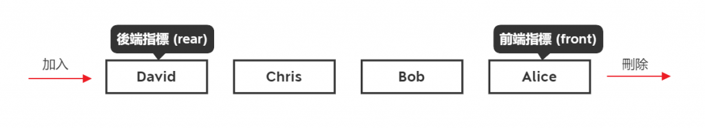

> 關聯：[[csharp]]

# C# Framwork

## ToolTip

[https://learn.microsoft.com/zh-tw/dotnet/api/system.windows.forms.tooltip?view=windowsdesktop-7.0](https://learn.microsoft.com/zh-tw/dotnet/api/system.windows.forms.tooltip?view=windowsdesktop-7.0)

- 若要明確指定容器，使用[ToolTip(IContainer)](https://learn.microsoft.com/zh-tw/dotnet/api/system.windows.forms.tooltip.-ctor?view=windowsdesktop-7.0#system-windows-forms-tooltip-ctor(system-componentmodel-icontainer))構函式。
- [ToolTip](https://learn.microsoft.com/zh-tw/dotnet/api/system.windows.forms.tooltip?view=windowsdesktop-7.0) 單一元件通常用來為單一表單上的多個控制項建立工具提示。
- 建立 [ToolTip](https://learn.microsoft.com/zh-tw/dotnet/api/system.windows.forms.tooltip?view=windowsdesktop-7.0) 之後，請使用方法的個別呼叫 [SetToolTip](https://learn.microsoft.com/zh-tw/dotnet/api/system.windows.forms.tooltip.settooltip?view=windowsdesktop-7.0)，將 ToolTip 顯示文字與個別控制項產生關聯。

> 游標移動至物件時的說明
> 
> 
>
> 

```csharp
private void frmMain_Load(object sender, EventArgs e)
{
    ToolTip toolTip1 = new ToolTip();
    toolTip1.AutomaticDelay = 5000;
    toolTip1.InitialDelay = 1000;
    toolTip1.ReshowDelay = 500;
    toolTip1.ShowAlways = true;

    toolTip1.SetToolTip(this.button1, "看啥");
    
}
```

##