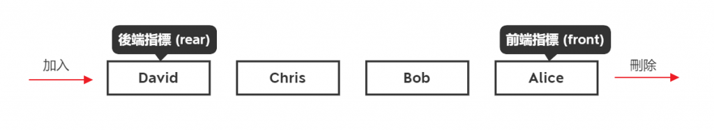

> 關聯：[[csharp]]

# 進階語法

# Dictionary

包含keys list 及 value list 的一個集合. 在集合中, 每一行的key也會Map在Value上, 只需要加入Key就可取得Vlaue.

> 使用時機：
不需把一批資料作批次處理, 只需要把一個或一堆資料拿出來便可了, 這樣的話, 用List或Array會比較不便, 可能要加上Linq或for迴圈等, 程序碼會變長, 而也許會變慢. 這時, 這適合用Dictionary了.
> 

## 程式範例

```csharp
using System;
using System.Collections.Generic;
using System.Linq;

public class Program
{
	public static void Main()
	{
		//==初始化==
		Dictionary<string, string> names = new Dictionary<string, string>(){ };
		
		//==加入值==
		names.Add("Tim", "Clerk");
		names.Add("John", "Manager");
		names.Add("Mary", "Boss");
		Console.WriteLine(names["Tim"]);
		//Result: Clerk 

		//==有沒有存在KEY 加入或更新值前用==
		bool isContainsTim = names.ContainsKey("Tim");
		Console.WriteLine(isContainsTim.ToString());
		//Result: true

		//== 更新值 ==
		if (names.ContainsKey("Tim")){
			names["Tim"] = "Cooker";
		} 
		Console.WriteLine(names["Tim"]);
		//Result: Cooker

		//== 刪除值 ==
		names.Remove("Tim");
		Console.WriteLine(names.Count() + "");
		//Result: 2

		//==拿Keys List==
		List<string> keys = names.Keys.ToList<string>(); 
		Console.WriteLine(string.Join(",", keys)); 
		//Result: John,Mary

		//==拿Values List==
		List<string> values = names.Values.ToList<string>();
		Console.WriteLine(string.Join(",", values)); 
		//Result: Manager, Boss

		//==foreach迴圈1==
		 foreach(KeyValuePair<string, string> kvp in names)
		{
		 Console.WriteLine(kvp.Key + " " + kvp.Value); 
		}
		//Result:
		//John - Manager
		//Mary - Boss

		//==foreach迴圈2==
		foreach(var kvp in names)
		{
		 Console.WriteLine(kvp.Key + " " + kvp.Value); 
		}
		//Result:
		//John - Manager
		//Mary - Boss
	}
}
```

> Output: Clerk
True
Cooker
2
John,Mary
Manager,Boss
John Manager
Mary Boss
John Manager
Mary Boss
> 

# Linked List

[http://alrightchiu.github.io/SecondRound/linked-list-xin-zeng-zi-liao-shan-chu-zi-liao-fan-zhuan.html](http://alrightchiu.github.io/SecondRound/linked-list-xin-zeng-zi-liao-shan-chu-zi-liao-fan-zhuan.html)

# **Queue**

## 特性

- 有兩個端點，分為`前端`與`後端`
- 後端只可`新增`資料
- 前端只可`刪除`與`讀取`資料
- 資料的存取必須符合`先進先出`(First In First Out, FIFO)



## **佇列的 ADT**

- Create : 可建立一個空的佇列
- Add : 可在`後端`新增資料，並得到一個新的佇列
- Delete : 可刪除`前端`資料，並得到一個新的佇列
- Front : 回傳`前端`的資料

## **實作**

- 程式
    
    ```csharp
    Queue<string> numbers = new Queue<string>();
    numbers.Enqueue("1"); //將資料加入的後端
    numbers.Enqueue("2");
    numbers.Enqueue("3");
    numbers.Enqueue("4");
    numbers.Enqueue("5");
    
    foreach( string number in numbers )
    {
        Console.WriteLine(number);
    }
    
    //從的前端頭移除最早加入的元素
    Console.WriteLine("\n取出前端的資料 : "+ numbers.Dequeue());
    ```
    
    > 輸出結果：
    1
    2
    3
    4
    5
    > 
    > 
    > 取出前端的資料 : 1
    > 

# 例外提示

```csharp
throw new Exception("No two sum solution");
```

# 一些有趣的語法

- count()

```csharp
var x = new[] { 1, 2, 3, 4, 5, 6, 7, 8, 9, 10 };
var count = x.Count(); //Output:10

//更精簡的寫
var x = new[] { 1, 2, 3, 4, 5, 6, 7, 8, 9, 10 }.Count(); //Output:10

//加Lambda
var x = new[] { 1, 2, 3, 4, 5, 6, 7, 8, 9, 10 };
var count = x.Count(i => i % 2 == 0); //Output:5
```

- 記憶體回收

```csharp
GC.Collect();
```

- 轉型
    - Convert(轉型):是將值轉換成最接近的 32 位元帶正負號的整數
        
        ```csharp
        Console.WriteLine(Convert.ToInt32("4.5")); //result = 4
        Console.WriteLine(Convert.ToInt32("4.51"));//result = 5
        Console.WriteLine(Convert.ToInt32("5.4")); //result = 5
        Console.WriteLine(Convert.ToInt32("5.5")); //result = 6
        ```
        
    - Parse(強制轉型):則是無條件捨去( long、float、double、或 decimal )
        
        ```csharp
        Console.WriteLine((int)(4.5)); //result = 4
        Console.WriteLine((int)(4.51));//result = 4
        Console.WriteLine((int)(5.4)); //result = 5
        Console.WriteLine((int)(5.5)); //result = 5
        ```
        
    - TryParse(安全轉型)會回傳一布林值來判斷是否轉換成功
        
        ```csharp
        string s1 = "1234"; 
        string s2 = "1234.65"; 
        string s3 = null; 
        string s4 = "123456789123456789123456789123456789123456789"; 
        bool success = false;    
        int result = 0; 
        success = Int32.TryParse(s1, out result); //-- success => true;  result => 1234 
        success = Int32.TryParse(s2, out result); //-- success => false; result => 0 
        success = Int32.TryParse(s3, out result); //-- success => false; result => 0 
        success = Int32.TryParse(s4, out result); //-- success => false; result => 0
        ```
        
    - 運算子 – as
        
        > 若轉型失敗會回傳null，且只能用於參考類型，不能應用於值類型(除非是Nullable的值類型)。
        > 
        
        ```csharp
        CustomModel model = obj as CustomModel;
        if(model != null)
        {
            //轉型成功
        }
        else
        {
            //轉型失敗
        }
        ```
        
    - 運算子 – is
        
        > is 若轉型失敗則會跳Exception
        > 
        
        ```csharp
        try
        {
            CustomModelt = obj is CustomModel;
        }
        catch
        {
            //轉型失敗
        }
        ```
        
    - ? 與 ??
        
        > ? 的運算子是指：**可以為 null 的型別。**
        將 null 賦值給**數值型別**或**布林型**以及**日期型別**的功能特別有用。
        例如，資料庫中的布林型欄位可以儲存值 true 或 false，或者該欄位也可以未定義。
        > 
        
        > ?? 運算子稱為 null 合併運算子，用於定義可以為 null 值的型別和引用型別的預設值。如果此運算子的左運算元不為 null，則此運算子將返回左運算元（左邊表示式）；否則當左運算元為 null，返回右運算元（右邊表示式）。
        > 
        
        ```csharp
        int? x = null; //定義可空型別變數
        int? y = x ?? 1000;//使用合併運算子，當變數x為null時，預設賦值100
        ```
        
        ```csharp
        int? x = null;//定義可空型別變數
        int? y = x ?? 1000;//使用合併運算子，當變數x為null時，預設賦值1000
        
        Console.WriteLine(y.ToString()); //1000
        
        /// <summary>
        /// Gets a single instance
        /// </summary>
        public static Log LogInstance
        {
              get
              {
        
                   return _log ?? (_log = new Log()); //如果此運算子的左運算元不為 null，則此運算子將返回左運算元；否則返回右運算元。
               }
        }
        ```
        
    - 例外
        
        ```csharp
        try
        {
            int[] ary = new int[] { 1, 2, 3 };
            Console.Write(ary[11]);
        }
        catch (OutOfMemoryException e) {
          Console.WriteLine("Out of Memory");
        }
        catch (Exception e)
        {
            Console.WriteLine(e.Message);
        }
        finally {
          Console.WriteLine("一定會執行");
        }
        ```