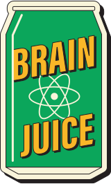
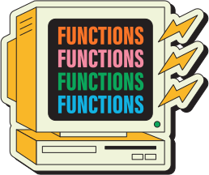
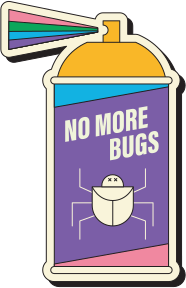
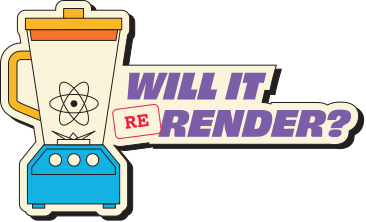

# React Visualized

> 來源：https://react.gg/visualized


---

## 1. Web 的歷史背景

這個章節追溯 JavaScript UI 框架的演進，說明 React 為何誕生。

### jQuery 時代

jQuery 把網頁視為「一棵 DOM 節點樹」。開發者用命令式（imperative）的方式走訪 DOM、找到特定節點、直接修改它。應用程式的狀態（state）住在 DOM 結構本身裡，導致程式碼難以理解與維護。

### Backbone.js

Backbone 把 MVC（Model-View-Controller）模式帶進前端。最關鍵的創新是**把狀態從 DOM 中分離出來**——狀態現在住在 Model 裡，只要 Model 改變，對應的 View 就會自動重新渲染。這讓程式碼組織大幅改善。

### AngularJS

Angular 擁抱雙向資料綁定（two-way data binding），自動同步 Model ↔ View。概念上很優雅，但這種方式製造了「隱性的狀態變化」，很難追蹤、很難除錯，加上需要持續掃描狀態，也帶來效能問題。

### 核心教訓

這些框架都在跟「mutation（狀態突變）」奮戰——無法控制的狀態變化讓應用程式難以推理與除錯。

---

## 2. React 的核心思想


React 透過一個根本創新解決了 mutation 問題：**讓 View 成為 State 的函數**。

### 核心公式

```
v = f(s)
```

**View 等於 State 的函數（function）。** 你只管理 state 的變化，React 負責自動更新畫面。

### Component 架構

把這個原則封裝進 Component 後，開發者可以像組合函數一樣組合 Component，用可重用的小零件建構出整個 UI。

> 「你對建立與組合函數的直覺，可以直接套用在建立與組合 component 上。」

### 重新定義「關注點分離」

React 挑戰了傳統「HTML / CSS / JS 分開放」的做法。它不按技術類型分層，而是**按功能把相關的東西放在一起**——和渲染有關的 state、UI、樣式，全部住在同一個 component 裡。

### JSX

React 需要一種在 JavaScript 裡描述 UI 的方式。JSX 把類 HTML 語法與 JavaScript 結合，讓開發者直接在程式碼裡寫 component 結構，不需要在不同語言間來回切換。

---

## 3. 傳遞 Props


Props 是 component 接收外部資料的介面，是以組合（composition）為基礎的系統的核心。

### 核心類比

> 「Props 之於 Component，就像 Arguments 之於 Function。」

就像函數接收參數，Component 透過 props 接收父 component 傳來的設定與資料。

### 傳遞方式

父 component 把資料當作屬性傳給子 component，在整個 component 樹中維持可預測的資料流向。

### Children Prop

Component 也可以透過開頭和結尾標籤中間的內容接收資料，也就是 `props.children`。這創造了「佔位符」的功能：`{props.children}` 代表由父 component 提供的內容。

這個模式讓 Layout component 得以實現——**封裝排版與樣式邏輯，但把內容的決定權留給使用者**。

```jsx
function Card({ children }) {
  return <div className="card">{children}</div>
}

// 使用者決定卡片內容
<Card>
  <p>這是卡片內容</p>
</Card>
```

---

## 4. 管理 State


State 讓每個 component 能自主管理資料，但當多個 component 需要共享同一份資料時，就會出現挑戰。

### useState Hook

一般的變數不會在函數呼叫（渲染）之間保留值。`useState` Hook 讓值能在渲染之間持久保存，而且當 state 改變時，React 會觸發重新渲染。

> 「只要 React 發現某個 component 的 state 改變了，它就會觸發重新渲染並更新 UI。」

```jsx
const [count, setCount] = useState(0)
```

### Lifting State（提升 State）

當多個 component 依賴同一份 state，就把那份 state 移到它們最近的共同父 component，再透過 props 傳下去。

```
父（state 在這裡）
├─ 子A（透過 props 取得資料）
└─ 子B（透過 props 取得資料 + callback 觸發更新）
```

### 更新提升後的 State

父 component 建立更新函數，透過 props 傳給子 component。當子 component 觸發事件時，呼叫這些函數來修改父 component 的 state。

**範例：** Todo 應用程式中，`TodoList` 父 component 擁有所有 todo 的 state，並提供更新函數給各個 `Todo` 子 component。子 component 可以觸發更新，而不需要自己管理 state。

---

## 5. Rendering（渲染）



Rendering 是 React 呼叫函數 component 來更新畫面的過程。

### 兩個步驟

1. React 建立一個**快照（snapshot）**，捕捉當下的 props、state、事件處理器和 UI 描述。
2. React 用那份 UI 描述更新實際的畫面。

### 重新渲染的觸發條件

React 只在 component 的 state 改變時重新渲染。當事件處理器用不同的值呼叫 `useState` 的更新函數時，React 就會觸發重新渲染。

### 快照機制

事件處理器存取的是快照當下那個時刻的 state 值。如果更新產生了不同的 state，React 就建立新快照並刷新畫面。

### 子 Component 的重新渲染

當父 component 的 state 改變時，React 會重新渲染該 component **以及它所有的子 component**，「不管那些子 component 有沒有接收任何 props」。雖然看起來沒效率，但這個預設行為能處理現實世界中複雜的渲染依賴關係。

### React.memo 優化

對於耗費資源的 component，可以用 `React.memo` 來選擇退出預設行為——只有當 props 真的改變時，component 才重新渲染。

---

## 6. 管理 Effects



Side effect（副作用）必須謹慎管理，才能維持 React 快速且可預測的渲染。

### 核心原則

> 「Component 在渲染時，不應該執行任何 side effect。」這讓渲染保持快速且純粹。

### Rule 1：事件觸發的 Effect → 放在事件處理器

由使用者事件觸發的 side effect，要放在事件處理器裡，與使用者互動保持耦合。

### Rule 2：與外部系統同步 → useEffect

`useEffect` 讓 component 在渲染完成後與外部系統同步。它「把 side effect 從 React 的渲染流程中移出，延遲到 component 渲染完後才執行」。

範例：state 改變後更新瀏覽器的 favicon。

```jsx
useEffect(() => {
  document.title = `(${count}) 未讀訊息`
}, [count])
```

### Rule 3：繪製前執行的 Effect → useLayoutEffect

當 side effect 必須在瀏覽器繪製（paint）之前執行時（例如調整元素尺寸），用 `useLayoutEffect` 取代 `useEffect`。

### Rule 4：訂閱外部 Store → useSyncExternalStore

`useSyncExternalStore` 用來管理訂閱外部狀態 store 的情況。

### 概念效益

透過強制執行這些規則，React 把渲染速度和可預測性最大化，同時為必要的 side effect 提供了有結構的處理方式。

---

## 7. 非視覺值（useRef）



Ref 讓你能在渲染之間保留值，且不會觸發重新渲染。

### 核心區別

> 「在 React 中，ref 讓你能在渲染之間保留值，而當那個值改變時，不會觸發重新渲染。」

- **State**：保留值，改變時觸發重新渲染
- **Ref**：保留值，改變時**不**觸發重新渲染

### useRef 的用法

用 `useRef` 建立 ref，透過 `ref.current` 存取值。對 `ref.current` 的修改會在渲染之間持久保存，不會讓 React 重新渲染 component。

```jsx
const timerRef = useRef(null)

// 存值，不觸發 re-render
timerRef.current = setTimeout(doSomething, 1000)

// 清除
clearTimeout(timerRef.current)
```

### 使用情境

Ref 用來處理非視覺的 state，例如計時器 ID、interval ID，或是 DOM 節點的參照。當你需要持續追蹤某個東西，但改變不應影響 UI 時就適合使用。

```jsx
// 存取真實 DOM 節點
const inputRef = useRef(null)
<input ref={inputRef} />
inputRef.current.focus()
```

---

## 8. 傳送資料（Context）


Context 解決了資料需要穿過很多中間 component 才能到達目的地的問題。

### 問題：Prop Drilling

把 state 提升到父 component 並透過 props 往下傳，一開始沒問題，但在深度巢狀的 component 樹裡，資料必須穿過很多根本不使用它的中間 component——這就是所謂的 **prop drilling**。

### Context 的解決方案

Context 讓你能「把資料傳送到 component 樹的任何地方，不需要透過 props」。父 component 提供資料，深層的子 component 可以直接存取，完全跳過中間 component。

### 適合的使用情境

Context 最適合多個不同巢狀層級的 component 都需要的資料，特別是全應用程式的資料，例如：主題（theme）、使用者偏好、登入狀態。

```jsx
const ThemeContext = createContext('light')

function App() {
  return (
    <ThemeContext.Provider value="dark">
      <DeepChild />
    </ThemeContext.Provider>
  )
}

function DeepChild() {
  const theme = useContext(ThemeContext)
  return <div className={theme}>...</div>
}
```

---

## 9. Concurrent Rendering（並行渲染）


並行渲染從根本上改變了 React 處理任務優先度的方式，讓 transition 和 action 等現代功能成為可能。

### React 17 的限制

React 在 main thread 上循序處理所有工作。如果正在渲染，使用者輸入等高優先度事件必須等到渲染結束才能處理，可能造成 UI 無回應。

### React 18 的創新

React 18 引入了區分低優先度任務（渲染列表）和高優先度任務（使用者輸入、動畫）的能力，讓 React 能暫停低優先度的工作，立即處理高優先度事件。

### useDeferredValue

這個 Hook 延遲更新一個值，直到高優先度的渲染完成後才更新。它讓現有 UI 繼續顯示，同時 React 優先處理更重要的更新。

> 「一種告訴 React 延遲更新某個值，直到所有高優先度渲染工作完成後才執行的方式。」

### startTransition

把 state 更新包在 `React.startTransition` 裡，告訴 React 這個更新可能很耗費計算資源。React 每 5ms 檢查一次有沒有更高優先度的事件，如有就暫停 transition 的工作。

> 「React 在處理 transition 時，會繼續讓使用者看到他們原本看到的畫面，同時每 5ms 檢查有沒有其他更高優先度的事件。」

### useTransition Hook

回傳 `[isPending, startTransition]`。`isPending` 在 transition 處理中為 `true`，讓你可以顯示 loading 指示器等 UI。

```jsx
const [isPending, startTransition] = useTransition()

startTransition(() => {
  setSearchResults(results)
})
```

### React 19：Actions

把 transition 延伸到網路操作，action 支援 async 函數。React 把所有 transition 批次合併，等全部完成後才更新最終 UI，避免因各自獨立的 state 更新在不同時間完成而造成畫面閃爍。

---

## 10. Server Components



Server Component 在打包之前就在獨立的環境（伺服器）中渲染，在伺服器端計算 UI，再把結果送給客戶端。

### 核心概念

Server Component 就像「精緻的、可序列化的 HTML 模板產生器。它們的全部工作就是計算 UI 並把它送到客戶端。」只有計算結果會送到使用者那裡，component 的程式碼本身不會。

### 優點

由於 component 的程式碼永遠不會到達客戶端，**bundle size 大幅縮小**。更重要的是，Server Component 透過 Suspense 支援，在跨越網路邊界的情況下也融入了 React 的心智模型。

### 與 Suspense 的整合

Server Component 遵守 Suspense 邊界，讓 UI 能漸進式地交付。例如：一個 Layout component 包含一個被 Suspense 包住的 Content component，頁面立即渲染並顯示 placeholder，Content 準備好後再串流（stream）到客戶端。

### use client 指令

當需要互動性時，用 `'use client'` 標記 component，讓它成為客戶端 component，接收 JavaScript bundle。它可以透過 props 接收來自 server component 的 promise，並用 `React.use` 解開它。

### Slot Pattern（最佳實踐）

不要讓互動性 component 負責資料抓取，而是把抓取移到 server component。Server component 建立模板，再把它當作 `children` 傳給客戶端 component。

> 「你用伺服器建立盡可能多的模板，然後透過 `use client` 在必要處加上互動性。組合，跨越網路。」

```jsx
// Server Component：負責資料
async function Page() {
  const data = await fetchData()
  return (
    <InteractiveClient>
      <Content data={data} />  {/* 作為 children 傳入 */}
    </InteractiveClient>
  )
}

// Client Component：負責互動
'use client'
function InteractiveClient({ children }) {
  const [open, setOpen] = useState(false)
  return <div onClick={() => setOpen(!open)}>{children}</div>
}
```

---

## 概念總覽


```
State 改變
    → Component 函數重新執行（建立快照）
    → 新的 Virtual DOM
    → Diffing（比對差異）
    → 只更新必要的真實 DOM
    → 使用者看到新畫面
```

| 概念 | 核心用途 |
|---|---|
| JSX / Component | 描述 UI 結構 |
| Props | 父傳子資料 |
| `useState` | component 自身狀態，改變觸發重新渲染 |
| `useEffect` | 處理 side effect，渲染後執行 |
| `useLayoutEffect` | side effect，繪製前執行 |
| `useRef` | 不觸發渲染的值 / DOM 節點存取 |
| Context | 跨層級共享資料，避免 prop drilling |
| `startTransition` | 標記低優先度更新 |
| `useDeferredValue` | 延遲更新，優先處理高優先度渲染 |
| Server Components | 伺服器端預渲染，減少 bundle size |
