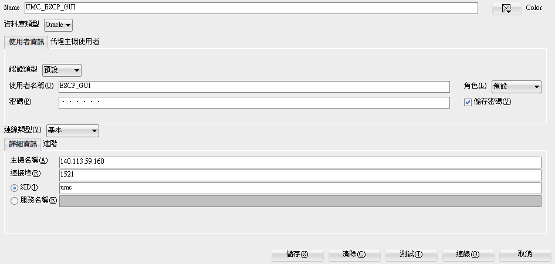

# Client端表格建立

參考：[https://cloud.tencent.com/developer/article/1337082](https://cloud.tencent.com/developer/article/1337082)

1. **SQL Developerg連線設定**



| **使用者名稱** | ESCP_GUI |
| --- | --- |
| **角色** | 預設 |
| **密碼** | 123456 |
| **主機名稱** | 140.113.59.168 |
| **連接埠** | 5121 |
| **SID** | umc |

<aside>
💡 Name 可以隨便取

</aside>

1. **新建立 Table Space**
    
    ```sql
    CREATE TABLESPACE GEMS_DAT3
    DATAFILE 'C:\oraclexe\app\oracle\oradata\UMC\GEMS_DAT3.dbf'
    SIZE 100M
    AUTOEXTEND ON
    NEXT 10M
    MAXSIZE UNLIMITED;
    
    CREATE TABLESPACE GEMS_DAT4
    DATAFILE 'C:\oraclexe\app\oracle\oradata\UMC\GEMS_DAT4.dbf'
    SIZE 100M
    AUTOEXTEND ON
    NEXT 10M
    MAXSIZE UNLIMITED;
    ```
    
    - 'C:\oraclexe\app\oracle\oradata\UMC\' 為Server端安裝Oracle存放dbf檔案的位置
    - GEMS_DAT3 與 GEMS_DAT4 為 UMC 提供 DDL 所需的 Table Space 名稱

1. **執行DDL的SQL指令**
    
    [STATIC_CAPACITY_DDL_20230825.sql](STATIC_CAPACITY_DDL_20230825.sql)