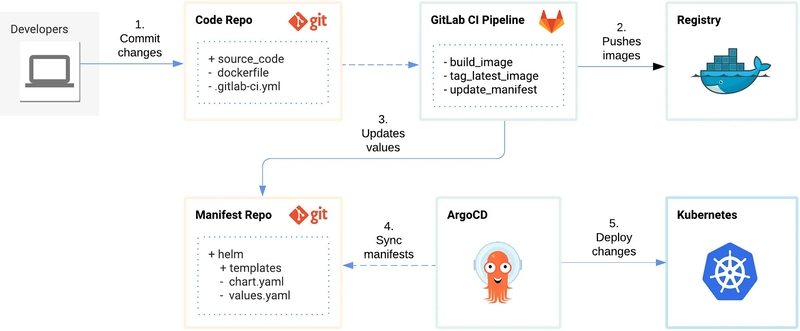

# 部署筆記

工具: GitLab + Azure DevOps + Argo CD + Harbor + Helm CI/CD 

# 各工具在流程中的角色與責任

- **GitLab**：作為**程式碼版本庫與協作平台**，開發人員將原始碼推送到 GitLab。GitLab 也可作為 CI 的觸發核心（例如使用 GitLab CI Runner 來執行 Pipeline）。每次程式碼提交時，GitLab 觸發 CI Pipeline，進行建置與測試。GitLab 專案內也會定義 CI/CD Pipeline 配置（.gitlab-ci.yml），協調後續的構建、發行步驟。
- **Azure DevOps**：在此流程中可充當**CI/CD 管線執行引擎或整合平台**。例如，如果不使用 GitLab CI，也可以使用 Azure DevOps Pipelines 來定義與執行相同的構建與部署步驟。Azure DevOps Pipeline 可以透過服務連線存取 GitLab 原始碼，執行自動化測試、打包映像、並調用後續部署流程。除此之外，Azure DevOps 還可用於專案管理（Boards）、工件儲存（Artifacts）等，但在這套流程中其主要責任是**實現持續整合階段**（如編譯、測試、建置映像）。請注意，在具備 GitLab CI 的情況下，兩者選其一即可，重點是利用現有工具實現自動化流程的一致性。
- **Docker**：提供**容器化建置環境**。Pipeline 中會使用 Docker 引擎將原始碼打包成容器映像，例如透過 `Dockerfile` 定義應用如何構建。在 CI 階段執行 `docker build`、`docker push` 等命令，把應用程式封裝進映像檔。Docker 也是日常開發測試的基礎，確保在開發、CI 和部署時都有一致的運行環境。
- **Harbor**：企業內部的**私有容器映像倉庫**，負責存放 CI 產生的映像檔供後續部署使用。Pipeline 成功建置映像後，會將其推送到 Harbor（包含標記版本或 commit SHA 的 Tag）。Harbor 提供存取控制和鏡像管理，確保只有授權的 Pipeline 和 Kubernetes 節點能拉取映像。部署時 Kubernetes 透過該映像倉庫取得應用容器映像。
- **Helm**：作為 Kubernetes **應用部署打包工具**，Helm Chart 定義了應用在 K8s 中的各種資源模板和參數化配置。開發團隊利用 Helm 撰寫 Chart（包含 Deployment、Service 等 YAML 模板），以宣告式方式描述應用應如何部署。透過 Helm 的 values 機制，可為不同環境定制配置（如連線字串或 replica 數）。在本流程中，Helm Chart 是部署單位，Argo CD 會使用它來渲染出實際的 Kubernetes 資源清單。
- **Argo CD**：擔任**持續部署/CD 的自動化控制器**，遵循 GitOps 原則監控配置庫的狀態並同步到 Kubernetes。當 CI 流程準備好新的部署設定（例如更新 Helm Chart 的映像版本）後，Argo CD 會偵測到 Git 庫中的變更，並在儀表板中提供視覺化的對比與同步按鈕。Argo CD 自動將**宣告式配置**套用到目標 Kubernetes 環境，使叢集狀態與 Git 定義的期望狀態一致。它負責在 dev、staging、prod 等不同環境中執行部署，同時提供回溯、佈署歷程記錄及健康狀態監控等功能。總之，Argo CD 實現了「所見即所定義」的部署流程，用戶可透過其 UI 清楚地瞭解每個環境的部署狀況。

# 準備項目

## **Code Repo 訪問權限**

- GitLab 的 Personal Access Token 或部署用 SSH 金鑰，供 CI/CD 流程存取及修改程式碼庫。
- 如需讓 pipeline 自動更新另一個 Git repo（例如儲存 K8s 部署清單的 repo），也需對該 repo 設定 SSH 部署金鑰或Personal Access Token

## **CI 執行環境認證**

- 設定 GitLab CI Runner 或 Azure Pipelines Agent 提供必要憑證
    - 例如 Harbor 的**容器登錄帳號密碼**（可在 CI/CD 變數中設定 `HARBOR_USERNAME` 和 `HARBOR_PASSWORD`），以便 pipeline 可登入 Harbor 私有映像倉庫進行 push/pull
    - 若採用 Azure Pipelines，也需在其「Service Connection」中配置 Harbor 的憑證或在腳本中執行 `docker login`。

## **Kubernetes 連線與命名空間**

準備 Kubernetes 集群的存取金鑰（例如 kubeconfig 檔案或 Kubernetes API Token）。CI 流程若需直接部署或執行 kubectl/helm 命令，需要配置這些認證（可透過 CI 變數或安全憑證庫儲存）。

預先建立各環境所需的 Kubernetes **Namespace**（如 dev、staging、prod），確保部署時命名空間已存在。

## **Image repo 與拉取權限**

在 Harbor 上建立專案以保存映像，並創建機器人帳戶或使用者帳戶用於 CI 推送映像。

還需要在 Kubernetes 集群中為 Harbor 註冊密碼創建**ImagePull Secret**，使 Kubernetes Pod 能順利從私有 Harbor 拉取映像（若cluster啟用了對應的新功能亦可考慮免密拉取）。

請確認 Kubernetes 節點信任 Harbor 的憑證（如使用自簽憑證，需要將 CA 證書匯入節點或將 Harbor 設為不驗證模式）。

## **Argo CD 設定**

安裝 Argo CD（可在自建 K8s 環境的 argocd namespace 中部署），並取得 Argo CD 的管理密碼或設定 SSO 整合。

將 GitLab 的程式碼/清單庫**連接到 Argo CD**：例如在 Argo CD 中新增 Repository，提供 GitLab 的 SSH 金鑰或 HTTP Token，以讓 Argo CD 有權讀取 Helm Chart 或 Kubernetes 清單。

若 Argo CD 需要部署到多個cluster，還需使用 `argocd cluster add` 或在 Argo CD 的設定中添加目標cluster的存取憑證。

## **環境變數與配置**

制定各環境/廠區的參數設定，例如 Helm Chart 不同環境對應的數值檔（values.yaml）、部署時需覆蓋的設定值（如連線字串、資源限制等）。

確保 CI/CD 流程能區分 dev/staging/prod，例如透過 Git 分支、目錄或 Helm values 檔來對應各環境。

# 關鍵的前置作業

**CI 執行個體與權限設定**：如果使用 GitLab Runner，需要確認 Runner 的執行環境具備建置映像的能力。常見做法是在 Runner 啟用 **Docker DinD（Docker-in-Docker）** 模式（需設定 `privileged = true`），或者使用替代工具如 Kaniko 來建置映像，以避免權限問題。此外，Runner 帳號需要對 GitLab 專案有讀寫權限（至少讀取程式碼，用於 clone；若 Pipeline 會 push 回 repo，還需寫入權限）。若 Runner 部署在 Kubernetes 集群中（使用 Kubernetes executor），記得為其 Service Account 配置適當的 RBAC，允許其在叢集啟動Pod執行任務。使用 Azure Pipelines 時，也要確保代理機器安裝了 Docker 且擁有 push 到 Harbor 的權限，以及對 Kubernetes 執行部署的憑證。
**Helm Chart 結構規範**：在開始部署前，務必設計好 Helm Chart 的目錄結構與檔案內容。例如，`Chart.yaml` 應包含名稱、版本等中繼資料；`values.yaml` 提供可覆寫參數（如映像路徑、replica 數）；`templates/` 資料夾下撰寫 Deployment、Service 等模板。確保 Chart 能覆蓋**多環境差異**（可以透過為 dev/staging/prod 準備不同的 values 檔或使用 --set 參數）。Helm Chart 結構清晰將方便日後維護和 Argo CD 的正確渲染。
**Argo CD 權限與項目設定**：安裝 Argo CD 後，不要使用預設帳戶進行長期操作，應變更預設密碼並設定 RBAC。

為團隊成員建立對應的 Argo CD 帳戶或整合企業 SSO，並透過 Argo CD 的**AppProject**和 RBAC 規則限制各使用者/應用只能操作授權範圍內的資源。例如，可建立不同 AppProject 對應 dev、staging、prod，限制各環境只能部署指定 namespace 的應用。同時，若 Argo CD 需管理多個 Kubernetes 叢集，請提前在 Argo CD 中新增那些叢集的憑證並分類命名，避免部署時指錯目標。
**映像拉取與部署前置**：在 Kubernetes 叢集內為 Harbor **配置 ImagePullSecrets** 十分重要。如果忘記此步驟，部署到集群時將因無法驗證私有映像倉庫而遇到 ImagePullBackOff 錯誤。建議在每個目標 namespace 中預先創建對應的 secret，並在 Helm Chart 的 templates（如 Deployment）中引用它。例如：

```yaml
spec:
  imagePullSecrets:
    - name: harbor-registry-secret
```

如此，K8s Pod 部署時會附帶憑證去 Harbor 抓取映像。若有使用自簽憑證的 Harbor，別忘了在 K8s 節點上配置信任該 CA。

**Pipeline 憑證變數管理**：確保在 CI/CD 系統中已正確設置所有**敏感信息為保護變數**。例如，在 GitLab CI 中將 Harbor 憑證、Git SSH 金鑰、K8s kubeconfig 等設定為 *Protected Variables* 或 *Masked*，以避免隨意曝光。同時，根據環境使用情境將變數分組：比如 HARBOR_USERNAME/PASSWORD 用於 build 階段，KUBE_CONFIG 用於部署階段等。Azure Pipelines 亦類似，利用變數群組或 KeyVault 整合來安全儲存機密。
**環境配置的一致性**：預先檢查各環境（dev/staging/prod）的 Kubernetes 資源是否齊備，如 Namespace 是否創建、是否有基本的 ConfigMap/Secret（例如應用需要的環境變量配置），以及資源配額是否足夠。特別地，如果應用需要其他共用服務（資料庫、快取等），在不同環境應有對應的連線設定並寫入 Helm values。只有環境本身準備就緒，自動部署才能順利進行。

# **流程的運作步驟（從程式碼到部署）**



圖：GitLab CI/CD 與 Argo CD 結合的 GitOps 部署流程示意圖。開發提交程式碼觸發 Pipeline（執行測試→建置映像→推送Harbor→更新Helm設定），Git 庫變更經 Argo CD 監控後自動部署至 K8s。

> 即使應用程式本身較為簡單（僅純粹商業邏輯，無特殊外部依賴），上述 CI/CD 流程仍能串聯起**建置映像、推送 Registry、Helm 套件部署**的完整循環。
> 
1. **開發提交程式碼**：開發人員將更新後的原始碼推送到 GitLab 程式庫（例如 main 或特定 feature 分支）。這次提交觸發 GitLab CI 或 Azure Pipeline，開始進行整合流程。
2. 自動單元測試：CI Pipeline 首先執行自動化測試階段，例如單元測試或靜態程式碼分析。確保程式碼邏輯正確無誤後，再進入下一步驟。如果測試失敗，Pipeline 會中斷並回報結果。
3. 建置與打包映像：在構建階段，Pipeline 使用 Docker 將應用程式打包成容器映像。
    - 例如，執行 docker build -t [harbor.example.com/專案/應用:$CI_COMMIT_SHA](http://harbor.example.com/%E5%B0%88%E6%A1%88/%E6%87%89%E7%94%A8:$CI_COMMIT_SHA) . 建置映像，然後登入 Harbor 並推送映像（包括帶上 commit 雜湊或版本號的標籤）到 Harbor 私有映像倉庫。這確保每次提交都有對應版本的容器映像存檔。
4. 更新部署設定（GitOps）：映像推送後，Pipeline 隨即更新 Kubernetes 的部署配置。例如，透過修改 Helm Chart 的 values.yaml 中的映像標記（tag）為新版本，或更新 Kubernetes manifest 清單中的映像欄位。這一步通常透過程式自動完成：Pipeline 克隆儲存部署設定的 Git 庫，修改相應檔案後提交變更。例如，在 CI 腳本中執行類似 git clone → yq 或 sed 更新 values.yaml → git commit && git push 的動作，將新映像版本寫入版本控制。這意味著部署所需的所有改動（映像版本、配置調整）都有跡可循地記錄在 Git 中。
5. Argo CD 同步部署：當部署配置庫出現更新（如步驟4所提交的新映像標記）後，Argo CD 會持續監控該 Git 庫並檢測變更。Argo CD 看到更新後，會將新的宣告式配置與當前叢集狀態進行比對，然後自動或經人工確認後進行同步。它使用 Helm 將更新後的 Chart 渲染成 Kubernetes 資源（Deployment、Service 等），並套用到對應的叢集環境（dev/staging/prod 的 namespace 或叢集）中。
6. 各環境部署與驗證：隨著 Argo CD 完成同步，Kubernetes 集群中相應環境的應用會自動更新為新版本映像。Argo CD 提供視覺化界面，可檢視每個環境中的應用健康狀態和同步情形。團隊可以在 Argo CD 介面上看到 dev、staging、prod 等環境的部署是否成功（綠燈/紅燈狀態），也可以透過 Argo CD 進行回滾操作（因為每次變更都版本控管）。

# 流程各階段的設定檔撰寫與組織方式

## **原始碼與 Dockerfile**

在應用程式的 GitLab 專案中，保存應用原始碼的同時包含一份 Dockerfile（通常置於專案根目錄）。此 Dockerfile 定義了如何從程式碼生成容器映像。例如，基於官方 runtime 映像（node/python 等）進行複製程式碼、安裝套件並執行 `ENTRYPOINT` 等。Dockerfile 應盡量與程式碼放在一起，方便開發者更新時同步修改。

## CI/CD Pipeline 定義

將 Pipeline 腳本以 YAML 檔形式納入版本控制。例如對於 GitLab，可以在專案根目錄添加 `.gitlab-ci.yml`，定義各階段 Job；對於 Azure DevOps，則使用 `azure-pipelines.yml`（可放在專案根或專門目錄）。Pipeline 檔案中應清楚劃分階段：
*測試階段*：執行單元測試或代碼品質檢查（以下僅示例，實際根據程式語言調整測試指令）如：

```yaml
test:
  stage: test
  script: 
    - npm install
    - npm run test
```

*建置階段*：負責建構並推送 Docker 映像。例如使用 Docker-in-Docker 服務：

```yaml
build:
  stage: build
  image: docker:20.10.16
  services:
    - docker:20.10.16-dind
  variables:
    DOCKER_DRIVER: overlay2
  script:
    - echo "$HARBOR_PASSWORD" | docker login -u "$HARBOR_USERNAME" --password-stdin harbor.example.com
    - docker build -t harbor.example.com/myproj/myapp:${CI_COMMIT_SHA} .
    - docker push harbor.example.com/myproj/myapp:${CI_COMMIT_SHA}

```

上述 Script 透過 CI 變數進行 Harbor 認證，然後建置並推送帶有 Commit SHA 標記的映像（可另行標記版本號如 `:latest`）。

*部署階段*：如果採用 GitOps 模式，這階段主要是更新部署設定而非直接 kubectl 部署。例如：

```yaml
deploy:
  stage: deploy
  image: alpine:3.18
  before_script:
    - apk add --no-cache git yq
  script:
    - git clone git@gitlab.com:myteam/myapp-manifest.git
    - cd myapp-manifest
    - yq -i '.image.tag = "${CI_COMMIT_SHA}"' helm/values-dev.yaml 
    - git commit -am "Update image tag to ${CI_COMMIT_SHA} [skip ci]"
    - git push

```

這段示例腳本將 Helm values 檔中的映像標記更新為新的 Commit SHA，並推送回儲存庫（使用 `yq` 工具編輯 YAML，`[skip ci]` 確保該提交不再次觸發 pipeline）。如果有多個環境，可在 pipeline 中按分支或變數決定更新哪個 values 檔（例如 dev 對應 values-dev.yaml，prod 對應 values-prod.yaml）。

## **Helm Chart 與配置**：

將 Helm Chart 相關檔案納入 Git 版本控制。常見做法有兩種：

1. **與應用程式同庫(monorepo)**：在程式碼庫中建立 `helm/` 或 `deploy/` 目錄，包含 Chart.yaml、values.yaml、templates/ 等。這種方式將程式碼與部署配置集中在一處，方便管理單一版本庫。但需註意權限控管（可能不想所有開發人員都改動部署配置）。
    
    ```yaml
    myapp/
    ├── src/...               # 應用原始碼
    ├── Dockerfile
    ├── helm/                 # Helm 部署定義
    │   ├── Chart.yaml
    │   ├── values.yaml       # 預設值
    │   ├── values-dev.yaml   # 開發環境覆寫值
    │   ├── values-prod.yaml  # 生產環境覆寫值
    │   └── templates/       # Kubernetes YAML 模板
    │       ├── deployment.yaml
    │       ├── service.yaml
    │       └── ...
    └── .gitlab-ci.yml        # CI/CD 定義
    ```
    
2. **應用程式與部署配置分庫(separate repos)**：建立獨立的 GitLab 專案保存部署相關的 Helm Chart 或 K8s 清單。例如有 **myapp** 原始碼庫，另有 **myapp-config** 部署配置庫。CI Pipeline 在建置映像後，會自動把新版本寫入部署配置庫。這種**分庫 GitOps** 模式清晰區隔了應用程式與基礎設施配置，Argo CD 將只監控部署配置庫，安全性和穩定性更高（應用開發和運維部署各自演進）。然而需要處理好跨庫觸發（例如用 GitLab Webhook 通知 Argo CD 或減少過頻的同步）。

## **Argo CD 應用定義**

儘管可以直接在 Argo CD 介面上手動新增應用（指定來源 repo、路徑、目標叢集/namespace 等），更好的做法是**將 Argo CD Application 本身也聲明化**。您可以建立一個配置檔（YAML）來定義每個環境的 Argo 應用，並將這些檔案放入 Git 追蹤。例如建立一個 `argo-apps/` 專案，其中有 `myapp-dev.yaml`, `myapp-prod.yaml` 等，內容包括：

```yaml
apiVersion: argoproj.io/v1alpha1
kind: Application
metadata:
  name: myapp-dev
  namespace: argocd
spec:
  project: default
  source:
    repoURL: git@gitlab.com:myteam/myapp-manifest.git
    targetRevision: main
    path: helm         # 指向 Helm Chart 所在路徑
    helm:
      valueFiles:
        - values-dev.yaml
  destination:
    server: https://<dev-cluster-api>   # 或使用 name: 表示預先註冊的叢集
    namespace: dev
```

將上述 Application 清單提交至 Argo CD 配置庫後，Argo CD 也能自動將這些應用同步至自身系統中，使得 Argo CD 的狀態也在 Git 監控之下（防止人工誤操作）。這種**宣告式管理 Argo 應用**的方式能確保不同環境的 Argo CD 設定保持一致，且便於複製環境。

## **配置檔組織與範本**

在維護多環境配置時，建議充分利用 Helm 的 values 機制或 Kustomize 等工具將共用部分抽出。比如 values.yaml 保存共用預設值，values-prod.yaml 等只覆蓋差異部分，避免重複。對於敏感配置（密碼、密鑰），可使用 Helm Secrets 或 SOPS 進行加密保存到 Git 庫，以保障安全。

## **版本與文件**：

將整套 CI/CD 流程的關鍵設定（如 .gitlab-ci.yml、Helm Chart、Argo CD Application YAML）寫入專案文件或 Wiki，說明各部分的用途和修改方法。定期檢視這些設定檔，隨著系統升級（例如 Argo CD 或 Kubernetes 版本變更）進行相應調整，確保整個流程持續穩定運行。透過良好組織的設定與文檔，團隊成員可以快速理解並上手維護這套以 GitLab 為核心、整合 Azure DevOps、Argo CD、Harbor、Helm、Kubernetes 的 CI/CD 流程，充分發揮持續整合與部署的效益。