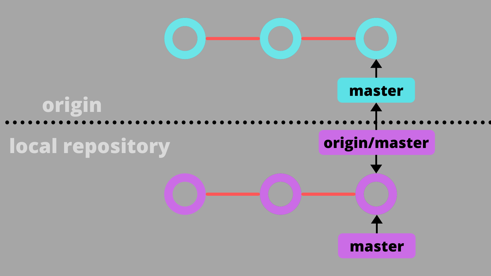

> 關聯：[[git]]

# Git 指令筆記

# Git 基本概念




> 註: 由於 tree 的概念跟 directory 很像，所以 working directory 也經常被寫成 working tree！
> 

## 「工作目錄」

- Local 電腦有 .git 檔案的資料夾就是「工作目錄」 (working directory)
- 新增檔案、修改檔案、刪除檔案、檔案更名以及所有其他 Git 相關的操作，都會在這個目錄下完成

## 「物件」與「索引」

物件類型

1. **blob 物件**：就是工作目錄中某個檔案的 "內容"，且只有內容而已，當你執行 git add 指令的同時，這些新增檔案的內容就會立刻被寫入成為 blob 物件，檔名則是物件內容的雜湊運算結果，沒有任何其他其他資訊，像是檔案時間、原本的檔名或檔案的其他資訊，都會儲存在其他類型的物件裡 (也就是 tree 物件)。
2. **tree 物件**：這類物件會儲存特定目錄下的所有資訊，包含該目錄下的檔名、對應的 blob 物件名稱、檔案連結(symbolic link) 或其他 tree 物件等等。由於 tree 物件可以包含其他 tree 物件，所以瀏覽 tree 物件的方式其實就跟檔案系統中的「資料夾」沒兩樣。簡單來說，tree 物件這就是在特定版本下某個資料夾的快照(Snapshot)。
3. **commit 物件**：用來記錄有哪些 tree 物件包含在版本中，一個 commit 物件代表著 Git 的一次提交，記錄著特定提交版本有哪些 tree 物件、以及版本提交的時間、紀錄訊息等等，通常還會記錄上一層的 commit 物件名稱 (只有第一次 commit 的版本沒有上層 commit 物件名稱。
4. **tag 物件**：是一個容器，通常用來關聯特定一個 commit 物件 (也可以關聯到特定 blob、tree 物件)，並額外儲存一些額外的參考資訊(metadata)，例如: tag 名稱。使用 tag 物件最常見的情況是替特定一個版本的 commit 物件標示一個易懂的名稱，可能是代表某個特定發行的版本，或是擁有某個特殊意義的版本。


四種檔案狀態：

- untracked (代表尚未被加入 Git 儲存庫的檔案狀態)
- unmodified (代表檔案第一次被加入，或是檔案內容與 HEAD 內容一致的狀態)
- modified (代表檔案已經被編輯過，或是檔案內容與 HEAD 內容不一致的狀態)
- staged (等待被 commit 的，代表下次執行 git commit 會將這些檔案全部送入版本庫)

# Git 基本指令

### 1. 初始化和設定

- **git init**: 在當前目錄初始化一個新的 Git 倉庫
    
    範例：git init
    
- **git config**: 設定 Git 配置
    
    範例：git config --global [user.name](http://user.name) "Lai Chung-sheng"
    
    範例：git config --global user.email "[laichungsheng@example.com](mailto:laichungsheng@example.com)"
    

### 2. 基本操作

- **git add**: 將文件添加到暫存區
    
    範例：git add filename.txt
    
    範例：git add . (添加所有檔案)
    
- **git rm**: 將文件從暫存區移除
    
    範例：git rm '*.txt'
    
    範例：git rm 'app/*.html'
    
    > `git rm` 只是從「工作目錄」中刪除而已，並沒有更新到索引檔
    要真正把「刪除」的狀態寫進索引檔的話，則要靠 `git rm filename` 更新索引檔
    > 
    
    <aside>
    💡
    
    若你只想刪除索引檔中的該檔，又要保留工作目錄下的實體檔案，那麼你可以在指令列加上 `--cached` 參數
    
    EX: `git rm --cached a.txt`
    
    </aside>
    
- **git mv**: 更改檔案名稱
    
    範例：git mv 'oldname' 'newname’
    
- **git commit**: 提交更改
    
    範例：git commit -m "Initial commit"
    
    > -m 讓 commit 有註解
    > 
- **git status**: **查看倉庫(Repository)狀態**
- **git ls-files: 列出所有目前已經儲存在「索引檔」中的那些檔案路徑**
    
    範例：git status
    
    範例：git status -s
    
    > -s 簡化輸出格式
    > 

### 3. 分支操作

- **git branch**:
    
    列出分支：git branch
    
    創建分支：git branch <branch_name>
    
    刪除分支：git branch -d <branch_name>
    
    <aside>
    💡
    
    不能刪除當前所在的分支
    
    </aside>
    
- 建立分支，並將目前工作目錄切換到新的分支:
    - git checkout -b [BranchName]
- **git branch -f <branch_name> <commit_hash>**:
    
    效果：強制將該分支指向正確的Commit，而不必先切換到該branch。
    
    範例：git branch -f main HEAD^3
    
    成效：（強制）移動 main 指向從 HEAD 往上數的第三個 parent commit。
    
    <aside>
    💡
    
    使用 `-f` 選項直接讓分支指向另一個 commit。
    
    </aside>
    
- **git checkout <切換過去的分支名稱/切換過去的Commit名稱>**: 切換分支或還原文件
    
    範例：git checkout new-feature
    
    如果是 Head 一個 Commit 則會出現 HEAD
    
    - **`git checkout <branch_name> <file_name>`**  可以還原特定被改壞的檔案
    
    範例：git checkout BranchA fileAt.txt
    
    > 僅復原 BranchA 的 fileAt.txt 檔案至最後 commit 的狀態，其他不動
    > 
- **git merge [-b] [被合併的分支名稱]**: 合併分支
    
    範例：git merge new-feature
    
    <aside>
    💡
    
    如果加入引數 -b 代表執行 branch 新建分支後再執行  checkout
    
    </aside>
    
- **git merge [被合併的分支名稱] —no-ff**: 合併分支
    
    範例：`git merge new-feature --no-ff`
    
    <aside>
    💡
    
    如果加入引數 `--no-ff` 代表執行 branch 新建分支時一定要建立一個 merge commit
    
    </aside>
    
- **git rebase [想要合併過去的分支名稱]**
    
    功能：取出一連串的 commit，"複製"它們，然後把它們接在別的地方。
    
    優點：可以建立更線性的 commit history。
    
    範例：git rebase new-feature
    
    範例：`git rebase A B`
    
    把 B 分支裡原本的 commits，全都搬到 A 分支的最新點上，形成新的 B。
    
- **相對引用**
    
    功能：commit 之間移動，`^` 向上移動一個 commit，`~<num>` 向上移動多個commit。
    
    範例：git checkout [Commit名稱]^
    
    範例：git checkout [Commit名稱]~[數字]
    
- **git reset 重置目前的工作目錄 (建議用在本地刪除)**
    
    功能：把分支的參考點退回到上一個 commit 來取消修改，原來的 branch 所指向的 commit 好像從來沒有存在過一樣。
    
    範例：git reset <Commit_Name>
    
    <aside>
    💡
    
    git branch -f <branch_name> HEAD^
    
    git reset HEAD^
    
    </aside>
    
    <aside>
    💡
    
    在 local branch 中使用 `git reset` 很方便，但是這種「改寫歷史」的方法對別人的 remote branch 是無效的！
    
    </aside>
    
    > `git reset` 只會重置目前工作目錄的索引狀態，那些用 `git rm` 刪除的目錄或檔案，還是用 `git mv` 更名的目錄或檔案，透過 `git reset` 都無法把「實體檔案」給救回來。
    > 
    
    如果想把整個工作目錄也給還原到目前的最新版，則必須輸入 `git reset --hard`
    
- **git revert 生成一個反修改的Commit (建議用在遠端刪除)**
    
    功能：在要取消的 commit 後面會多了一個新的 commit！這是因為新的 commit `C2'` 引入了*修改*——用來表示取消 `C2` 這個 commit 的修改。
    範例：git revert HEAD
    
- **git revert -i [branch_name]**
    
    功能：互動性rebase
    

### 4. 遠程操作

- **git remote**: 管理遠程倉庫
    
    範例：git remote add origin [https://github.com/username/repo.git](https://github.com/username/repo.git)
    
- **git push**: 將本地更改推送到遠程倉庫
    
    範例：git push origin master
    
- **git pull**: 從遠程倉庫拉取更改並合併
    
    範例：git pull origin master
    

### 5. 查看歷史

- **git log**: 查看提交Commit
    
    說明：每個Commit都會有一個 hash 值，可以從 git log 中察看
    
    範例：git log
    
    限制輸出：git log -10 (只顯示10筆資料)
    
    精簡輸出：git log --pretty=oneline
    
    極簡輸出：git log --pretty=oneline --abbrev-commit
    
- **git diff**: 查看更改的具體內容
    
    範例：git diff <commit ID 1> <commit ID 2>
    
    <aside>
    💡
    
    commit ID 不一定要全碼，五碼就可
    
    </aside>
    
    ```
    git diff                 => 工作目錄 vs 索引
    git diff HEAD            => 工作目錄 vs HEAD
    git diff --cached HEAD   => 索引     vs HEAD
    git diff --cached        => 索引     vs HEAD
    git diff HEAD^ HEAD	     => HEAD^   vs HEAD
    ```
    
    <aside>
    💡
    
    `git diff --cached` 直接去比對「索引」與「目前最新版」之間的差異，這有助於你在執行 `git commit` 之前找出那些變更的內容，也就是你將會有哪些變更被建立版本的意思。
    
    </aside>
    

### 5. 查看其他資訊

- git cat-file -p [object_id]
    - 顯示物件屬性
- 把任意「參考名稱」或「相對名稱」解析出「絕對名稱」
    - git rev-parse <object_id>
    - git rev-parse master
- `git cat-file -p [object_id]` 來取得 commit 物件屬性 (parent, tree, author)

# **相對名稱表示法**


關於 `~` 的意義，代表「第一個上層 commit 物件」的意思。

關於 `^` 代表的意思則是「擁有多個上層 commit 物件時，要代表第幾個第一代的上層物件」。

如果有一個「參照名稱」為 `C`，若要找到它的第一個上層 commit 物件，你可以有以下表達方式：

- `C^`
- `C^1`
- `C~`
- `C~1`

如果你要找到它的第二個上層 commit 物件 (在沒有合併的狀況下)，你可以有以下表達方式：

- `C^^`
- `C^1^1`
- `C~2`
- `C~~`
- `C~1~1`

但你不能用 `C^2` 來表達「第二個上層 commit 物件」！原因是在沒有合併的情況下，這個 `C` 只有一個上層物件而已，你只能用 `C^2` 代表｢上一層物件的第二個上層物件」。

# **暫存工作目錄與索引的變更狀態**

> **使用時機：**系統開發寫到一半不方便 Commit，但被要求緊急修正一個現有系統的 Bug 或添加一個功能，需要換到別的開發版本
> 

若要將這些開發到一半的檔案建立一個「暫存版 (也是一個 commit 物件)」，有兩個選擇：

- `git stash` 會將所有已列入追蹤 (tracked) 的檔案建立暫存版
- `git stash -u` 會包括所有已追蹤或未追蹤的檔案，全部都建立成暫存版
- `git stash pop`  取回暫存版本

> 事實上 Git 是透過「合併」的功能把這個名為 `stash` 的版本給合併回目前分支而已。最後，它還會自動將這個 `stash` 分支給刪除
> 

# **標籤 (Tag) 基本概念**

Git 標籤 (Tag) 擁有兩種型態，這兩種類型分別是：

- 輕量標籤 (lightweight tag)：可以說是某個 commit 版本的「別名」而已，是一種「相對名稱」。
- 標示標籤 (annotated tag)：Tag 物件。

> 在大部分的使用情境下，都會用「標示標籤」來建立「標籤物件」並且給予「版本訊息」，因為這種「標籤」才是 Git 儲存庫中「永久的物件」。(儲存到物件儲存庫中的 Git 物件都是不變的，只有索引才是變動的)
> 

輕量標籤指令：

- 列出所有標籤：`git tag`
- 建立輕量標籤：`git tag [tagname]`
- 刪除輕量標籤：`git tag [tagname] -d`

標示標籤指令：

建立輕量標籤：`git tag [tagname] -a`

# **復原意外地變更**

- `git reflog` 取出版本歷史紀錄的摘要資訊
- 如果接著輸入對應Log的指令會返回該命令
    
    
    

# 合併基本概念

> 在切換「分支」之前，請隨時查看並保持「工作目錄」的狀態是「乾淨的」，不要有任何檔案異動中的狀態。
> 

## 合併需要注意的細節

1. 合併之前，先看清楚自己在哪個分支
2. 合併之前，請確保工作目錄是乾淨的
3. 合併時請用 `git merge [另一個分支]` 來將另一個分支的變更合併回來
4. 合併成功後，你可以利用 `git log` 查看版本紀錄，你可以發現「合併」的過程會自動建立一個新 Commit！
- `git branch -d feature` 刪除「合併過」的分支
- 沒有執行過「合併」的分支改用 `git branch -D feature` 才能刪除該分支

## **救回誤刪的分支**

1. 先利用 `git reflog` 找出該分支 (`feature`) 最後一個版本的 object id (也就是 SHA1 格式的物件絕對名稱)
2. 執行 `git branch feature <SHA1>` 即可

## 衝突處理

- `git status` 可以看出目前發生衝突的檔案有哪些
- `git ls-files -u` 列出所有有衝突的檔案
    - 找到之後再用 `git diff [filepath]` 就可以僅比對其中一個檔案了
    
    
    
- `git diff` 自動比對出到底哪些檔案的哪幾行發生衝突了
    
    
    

從上圖你必須注意的是 `diff` 針對衝突內容的表示法，看的懂，你才容易知道怎樣改：

- 從 `<<<<<<< HEAD` 到 `=======` 的內容，代表 `HEAD` 裡 `a.txt` 的內容。**註**：`HEAD` 代表當前 `master` 分支的最新版。
- 從 `=======` 到 `>>>>>>> hotfixes` 的內容，代表 `hotfixes` 分支裡 `a.txt` 的內容

如果你很懶，遇到衝突什麼都不改，直接執行 `git add .` 再加上 `git commit` 的話，確實會「解決衝突」，但所 commit 的版本將會包含這些衝突的表示文字，如果你身處一個開發團隊，肯定會被罵翻到臭頭，請你千萬不要這麼做！

- 執行 `git reset --hard ORIG_HEAD` 就可以回復到上一版，然後再重新合併一次引發相同的衝突。

# **與遠端儲存庫有關的指令**

## **將本地儲存庫的變更上傳到遠端儲存庫的方法**

- 透過 `git clone` 取得遠端儲存庫，再建立版本後上傳
    - `git clone <url>`
    - 「**沒有版本**」的空白 Git 儲存庫，在 GitHub 上的遠端儲存庫是完全空的，連預設的 `master` 分支都沒有，所以在下達 `git push` 指令時必須加上 `-u` 參數，才能成功地把本地儲存庫上傳到 GitHub 上的遠端儲存庫，其指令是 `git push -u origin master`
- 直接將現有的本地 Git 儲存庫上傳到指定的 GitHub 專案
    
    輸入 `git remote add origin https://github.com/doggy8088/sandbox-empty2.git` 建立一個名為 `origin` 的參照名稱，並指向 `https://github.com/doggy8088/sandbox-empty2.git` 位址
    
- `git pull` 將遠端儲存庫的最新版下載回來，下載的內容包含完整的物件儲存庫(object storage)，並且將遠端分支合併到本地分支。(將 `origin/master` 遠端分支合併到 `master` 本地分支)
    
    > 所以一個 `git pull` 動作，完全相等於以下兩段指令：git fetch + git merge origin/master
    > 
- `git push`將本地儲存庫中目前分支的所有相關物件**推送**到遠端儲存庫中。
- `git fetch`將遠端儲存庫的最新版下載回來，下載的內容包含完整的物件儲存庫(object storage)。 這個命令**不包含**「合併」分支的動作。
- `git ls-remote`顯示特定遠端儲存庫的參照名稱。包含**遠端分支**與**遠端標籤**。

# **本地分支與遠端儲存庫之間的關係**

以 `https://github.com/doggy8088/frontend-tools.git` 這個遠端儲存庫為例，我複製下來後，預設就會有一個 `master` 本地分支，嘗試建立一個 `FixForCRLF` 本地分支，直接透過 `git push` 無法推送成功，你必須輸入完整的 `git push origin FixForCRLF` 指令才能將本地分支推送上去，原因就出在你並沒有設定「本地分支」與「遠端儲存庫」之間的預設對應。
要將**本地分支**建立起跟**遠端儲存庫**的對應關係，只要在 `git push` 的時候加上 `--set-upstream` 參數，即可將本地分支註冊進 `.git\config` 設定檔，之後再用 `git push` 就可以順利的自動推送上去。
---

## Merge Conflict

Merge conflict 發生在兩個 branch 對同一個檔案做了不同的修改，git 無法自動決定保留哪個版本。

| 類型 | 說明 |
| --- | --- |
| modify/modify | 兩邊都修改了同一個檔案（檔案內出現 `<<<<<<<` 標記） |
| rename/delete | 一邊 rename，另一邊 delete |
| rename/rename | 兩邊把同一個檔案 rename 成不同名稱 |
| modify/delete | 一邊修改，另一邊 delete |

```bash
# 查看衝突清單
git diff --name-only --diff-filter=U

# 採用 current branch（HEAD）的版本
git checkout HEAD -- <file>

# 採用 incoming branch 的版本
git checkout MERGE_HEAD -- <file>

# 標記解決並 commit
git add .
git commit -m "merge: ..."

# 放棄整個 merge
git merge --abort
```

| 術語 | 說明 |
| --- | --- |
| Current / ours / HEAD | 你目前所在 branch 的版本 |
| Incoming / theirs / MERGE_HEAD | 合併進來的 branch 版本 |

---

## 修改 Git 歷史

```bash
# 修改最後一個 commit（hash 會改變）
git commit --amend --no-edit      # 保留 message
git commit --amend -m "新訊息"    # 改 message

# 從所有歷史移除特定檔案
git filter-branch --force --index-filter \
  "git rm --cached --ignore-unmatch <file>" \
  --prune-empty --tag-name-filter cat -- --all

git push origin <branch> --force
```

> 已洩漏的 secret 即使從歷史移除也應立即輪換。
