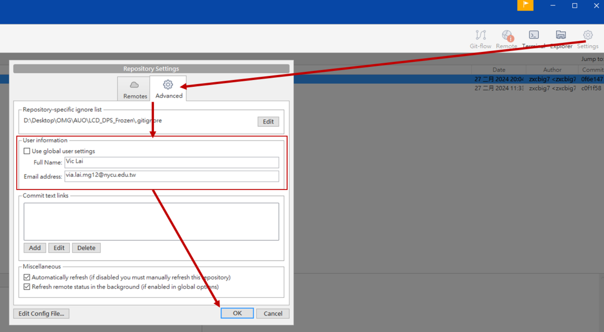

> 關聯：[[git]]

# SourseTree(Local) 筆記

---

# 1. 基礎環境設定

**設定 Information**

1. 點選視窗右上角的Settings
2. 切換到Advanced標籤頁，並且取消勾選 Use global user settings
3. 輸入 Full Name 與 Email address
4. 按下OK

**設定忽略檔案清單**

開啟上方工具列 Tools > Options，並且切換到Git標籤頁，然後點選Edit File。

此時會開啟一個記事本文件，在這個文件中的項目都將會被忽略而不會上傳git。

如果不希望某些資料夾名稱或者副檔被忽略，只要直接在文件刪除該項目並且儲存關閉後即可。

<aside>
💡 如果沒有txt檔案需要自己建立。

</aside>

# 2. 基本功能介紹

## **2-1 Commit**

Commit是Git系統最基本的單位，一個commit代表著一個專案的版本進度，可在不同的commit之間自由切換，概念類似於遊戲關卡的存檔紀錄。

> 點選WORKSPACE下的File Status可以看下方的Unstaged Files有一些項目，包括了經過變動的檔案。
> 

在Unstaged Files 中選擇的檔案會移到Staged Files的欄位之中。然後點選下方的Commit message文字框，針對每一次的commit做描述，方便日後的管理，確認之後按下Commit。

可以看到Branches的欄位中多了一個master的項目，在右方的圖表會看到多出了一個節點，每一個節點代表一個commit。

每當SourceTree偵測到當前專案狀態與最後的最後提交的commit出現了差異，Branch會多了一行Uncommitted changes，可以照著先前流程操作再次建立一個commit，因此圖表多了一個節點，帶有白色漸層的節點表示目前專案的狀態歸屬（當前正在看的版本）。

> **可以在不同的commit之間切換，只要點擊兩下左鍵即可，這種在不同commit之間互相切換的動作稱為checkout。**
> 

## **2-2 Branch**

先前建立第一個 commit之後，發現 Branches 的欄位多出了一個master的項目，master本身就是一個branch(分支)，master同時也是每一個repository中最基本的開發線軸，類似遊戲中主線關卡的概念。

可以依據當前的commit版本建立一個新的branch，在新增的branch上建立的任何commit都不會影響到master的狀態。可以使用branch來開發一些新的功能或者做一些測試，等到新功能完成之後再合併回master。

<aside>
💡 不管是程式測試或是Debug，為了避免爆改程式造成不可挽回的復原導致重寫，就需要用到Branch功能，讓原本可以跑的程式維持著，等到修改的內容是確定的後就可以併回原本的master，然後捨去該Branch，繼續開發。

</aside>

**流程**

確認專案版本處在master最後一個commit下，並且點選Branch按鈕。

在New Branch欄位上為新的branch命名，並且按下Create Branch。

可以看到Branches多了一個項目，此時兩個branch都處在同一個commit版本，這裡可以看到Branch2顯示為粗底，代表目前專案版本處在Branch2這個branch裡面。

我們希望開始在新的branch增加功能，首先確認目前專案處在新的branch（Branch2）路線上，接著更動任意檔案後，在SourceTree建立一個新的commit版本。可以從圖表中看到多出了一個新的節點，且這個節點附屬於Branch2這個branch。

接著切換到master branch，檔案架構則又回到了先前的狀態中。

在master branch下，隨便新增一個文件檔案後，從圖表中可以看到master的狀態與Branch2的狀態已經開始產生分歧，新的狀態變化依附在master branch。。

將當前的狀態建立一個commit版本。可以試著切換不同的branch來觀察專案版本之間的差異。

<aside>
💡 不只可以在master建立branch，也可以在其他的branch上分歧出新的branch。
隨著開發的功能越來越多，一個repository可能會同時存在很多個branch，如果在開發時沒有好好規劃，我們將會看到一堆複雜交錯的分歧線，這時候反而很難管理，這是使用branch必須要好好注意的地方。

</aside>

<aside>
💡 **總結：**

一個commit代表一個版本進度，我們可以在不同的commit之間切換。

</aside>

## 2-3 Merge

先前新增了一個branch並且開發了一些新功能，接下來將說明如何使用Merge把開發的新功能結合到master的commit上。

首先確認目前版本路線處在master branch，並且點擊Merge按鈕。

選擇要合併的branch之後按下OK，從圖表可以看到，Branch2 的版本已經接回到master branch路線下了。通常在merge之後會因為檔案的變化而衍生新的狀態，這時候只要將修復後的狀態再次commit一個新的版本即可。

<aside>
💡 可以依照這樣的特性將一個專案的多個功能個別獨立成不同的branch，等到某項功能完成後再merge回來，這樣的模式也很方便同時讓多位協同開發者獨立分工。

</aside>

## 2-4 **Rebase**

當兩個branch隨著時間各自有了不同版本的commit，branchB的新功能可能需要與branchA在分歧之後才開發出來的某個commit版本互相搭配才行。

> 最直接的方式就是merge兩個branch取得該特性之後，再個別開發新的功能。
雖然解決了取得其他branch中某個特性的需求，但是這邊的關係線就開始複雜了起來，如果常常使用這樣的作法會看到一堆錯綜複雜的線，反而很難分開彼此之間的關係，這時候可以使用rebase來替代頻繁使用merge造成的的複雜度。
> 

下面直接用一個範例來做說明，此時repository共有兩個branch - master, Branch2 與 Branch3。

隨著專案的開發，master branch的版本已經擁有了master5.txt的功能。

而other branch（Branch3）是從Branch3-1這個commit開始分歧出去的，所以僅支援到還沒分支之前的功能。

在other branch（Branch3）的開發線軸上，因為Branch3-2.txt 必須與 master5.txt結合才能繼續作用，因此我們將兩個branch做一次merge。

在merge之後兩個branch再各別獨立開發新功。因為兩個branch已經merge過一次，因此在開發過程中產生了一條交錯的關聯線，加上Branch3-4的分歧線總共有兩條關聯線。

如果我們將檢視模式改成Ancestor Order則會呈現更複雜的架構。

<aside>
💡  **Date Order** ( 以提交時間做排序 ) 是當開發人員單純想看提交的時間順序時才有用，只是這時的版本線圖就不一定準確了，這點要特別小心。
**Ancestor Order** 才是原本 Git 顯示圖形時該使用的排序方式，因為 Git 支援修改版本的機制，例如透過 Rebase (重新指定基礎版本位置) 就可以修改版本的順序，自然也不會照著提的順序顯示版本，圖形自然也畫不出來！

</aside>

接著使用rebase的方式，看會有什麼差異，先把repository再次回到merge之前的狀態。

<aside>
💡 使用”Reset current branch to this commit”可以退回到Commit的儲存進度

- **補充：Reset 的模式**
    
    Ref. :[https://gitbook.tw/chapters/using-git/reset-commit](https://gitbook.tw/chapters/using-git/reset-commit)
    
    > `git reset` 指令可以搭配參數使用，常見到的三種參數，分別是 `--mixed`、`--soft` 以及 `--hard`，不同的參數執行之後會有稍微不太一樣的結果。
    > 
    
    ### **mixed 模式**
    
    `-mixed` 是預設的參數，如果沒有特別加參數，`git reset` 指令將會使用 `-mixed` 模式。這個模式會把暫存區的檔案丟掉，但不會動到工作目錄的檔案，也就是說 Commit 拆出來的檔案會留在工作目錄，但不會留在暫存區。
    
    ### **soft 模式**
    
    這個模式下的 reset，工作目錄跟暫存區的檔案都不會被丟掉，所以看起來就只有 HEAD 的移動而已。也因此，Commit 拆出來的檔案會直接放在暫存區。
    
    ### **hard 模式**
    
    在這個模式下，不管是工作目錄以及暫存區的檔案都會丟掉。
    
    | **模式** | **mixed 模式** | **soft 模式** | **hard 模式** |
    | --- | --- | --- | --- |
    | 工作目錄 | 不變 | 不變 | 丟掉 |
    | 暫存區 | 丟掉 | 不變 | 丟掉 |
    
    | **模式** | **mixed 模式（預設）** | **soft 模式** | **hard 模式** |
    | --- | --- | --- | --- |
    | Commit 拆出來的檔案 | 丟回工作目錄 | 丟回暫存區 | 直接丟掉 |
</aside>

checkout到other branch（Branch3-4）。

對著master branch點選右鍵，並且選擇Rebase current changes onto master。

接著會出現一個詢問視窗，按下OK。

可以觀察到使用rebase作法之後branch的關聯線與先前merge的做法有一些差異。

接著兩個branch各自獨立開發出了新的功能，我們可以發現到兩個分歧的branch之間只有一條關聯線。切換到Ancestor Order模式來檢視一樣是非常簡潔的。兩個branch的commit版本內容與先前merge的做法結果也是一致的。

<aside>
💡 **可以這麼理解rebase的功能：**
將branch B的分歧點移動到branch A最後的commit版本，藉此取得branch A的新功能
範例就是Branch3移動到master，讓Branch3擁有master的新功能。

</aside>

rebase 的好處是，你可以清楚看到本地每個 commit 會遇到 conflict 的地方，相較於用 merge：一次解掉本地所有 commits 的 conflict，比較不容易出錯。

# 3. Git flow **開發流程**

最重要的只有兩個分支會永久存在：master 以及 develop，也就是圖上粗體字的那兩條。
其餘的支援型分支在完成任務後應刪除，包括 feature，release，hotfix。

- **主要分支**
    - master: 永遠處在 production-ready 狀態
    - develop: 最新的下次發佈開發狀態
- **支援性分支**
    - Feature branches: 開發新功能都從 develop 分支出來，完成後 merge 回 develop
    - Release branches: 準備要 release 的版本，只修 bugs。從 develop 分支出來，完成後 merge 回 master 和 develop
    - Hotfix branches: 等不及 release 版本就必須馬上修 master 趕上線的情況。會從 master 分支出來，完成後 merge 回 master 和 develop

**Feature 分支**

- 當準備開發新的功能時會建立，一定是從develop 分支拉出來。feature 分支只會被 merge 回 develop 分支。
- 命名的原則為 `前綴feature + / ＋功能名`，i.e `feature/myFeature`
    - `feature`前綴代表是一個 feature，`myFeature`題點 feature 的內容。
- merge / merge request 完記得刪除 feature 分支

**Release 分支**

- 當新的功能開發的差不多之後，可以開出一個 release 分支。這條分支只會修現在功能的 bug，而不應該有新功能的 commit。
- 命名的原則為 `前綴release + / ＋版本`，i.e `hotfix/1.0.1`
- Release 分支可以 merge 回 develop，也可以 merge develop 分支的新 commit 進來。等到版本內容確定無誤後，最後 merge 進 master，並發版本。
- 在 merge 回 develop 分支後刪除 release 分支

**Hotfix 分支**

- 命名的原則為 `前綴hotfix + / ＋版本`，i.e `hotfix/1.0.1`

當出版的版本如果有緊急的 bug 需要修復，就會用到 hotfix 分支。它必須從出版本的分支拉出來

該 hotfix 分支在 merge 進 master 後，記得也 merge 回 develop 分支。