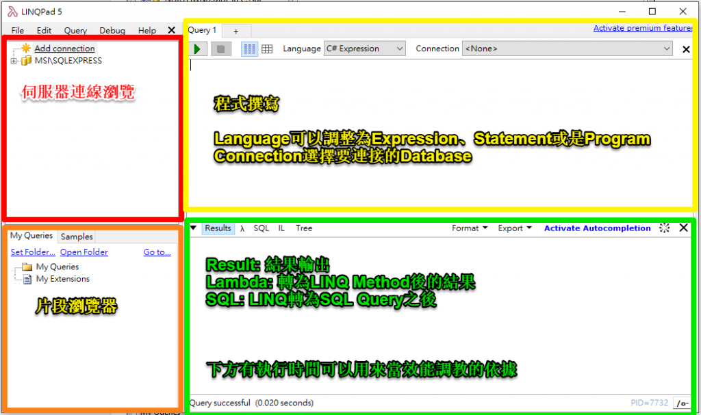

# LINQPad



- **伺服器連線瀏覽**: 跟SSMS的Object Explorer一樣，連線後可以看到各個Database的相關資訊
- **片段瀏覽器**: 個人儲存的程式碼片段及LINQPad提供的範例程式片段(本章會用到Samples中的範例)
- **程式撰寫**: 撰寫程式片段
- **執行結果**
    - Result: 查詢結果(LINQPad提供Dump來得到較好的顯示品質)
    - Lambda: LINQ轉為LINQ Method後的程式
    - SQL: LINQ轉出的SQL Query

# 壹、**用法**

對於C#，LINQPad有三種編寫方式:

- **Expression**: 單行程式或是單個LINQ陳述式
- **Statement(s)**: 多行的程式片段
- **Program**: 需要撰寫Class或是Method時

### **Expression**

- **使用場景**: 演練某個剛認識的Method時或是要以LINQ取得想要的資料時...等
- **使用方式**: 以單行程式碼的方式撰寫，最後不用加分號(`;`)
- **範例**
    
    > 想要輸出期望的日期格式時
    > 
    > 
    > ```csharp
    > DateTime.Now.ToString("yyyy/MM/dd")
    > ```
    > 
    > 
    > 
    
    > 以LINQ查詢一段句子的每個字的長度時
    > 
    > 
    > ```csharp
    > from word in "The quick brown fox jumps over the lazy dog".Split()
    > orderby word.Length
    > select word
    > ```
    > 
    > 
    > 

### **Statement(s)**

- **使用場景**: 有段程式碼需要做測試或是順一下程式的邏輯時...
- **使用方式**: 不用加上`class`，直接寫入程式碼片段，每行程式碼結束時要加上分號(`;`)
- **範例**
    
    > 用多個LINQ查詢資料時
    > 
    > 
    > ```csharp
    > var words =
    > 	from word in "The quick brown fox jumps over the lazy dog".Split()
    > 	orderby word.ToUpper()
    > 	select word;
    > 	
    > var duplicates =
    > 	from word in words
    > 	group word.ToUpper() by word.ToUpper() into g
    > 	where g.Count() > 1
    > 	select new { g.Key, Count = g.Count() };
    > 
    > words.Dump();
    > duplicates.Dump();
    > ```
    > 
    > 
    > 

### **Program**

- **使用場景**: 需要演練Method、Function或是Class時
- **使用方式**: 跟寫Console App一樣的方式
- **範例:**
    
    > 有個Method/Class要做測試時
    > 
    > 
    > ```csharp
    > void Main()
    > {
    > 	Test t = new Test();
    > 	t.Hello().Dump();
    > 	World().Dump();
    > }
    > 
    > string World(){
    > 	return "World";
    > }
    > 
    > class Test{
    > 	public string Hello(){
    > 		return "Hello";
    > 	}
    > }
    > ```
    > 
    > 
    > 
    > 最外面是不需要再一層Class的，可以直接寫所需的程式碼。
    > 

# **Extension Methods**

有時候我們會想要寫個可以在全部的程式碼片段使用的通用Method，在`MyExtensions`這個Class中撰寫Method就可以在每個程式碼片段中做使用(就像是LINQPad內建的Dump一樣)。

1. 程式碼區`MyExtensions`的Class
    
    ```csharp
    void Main()
    {
    	MyExtensins.Hello();
    	" LINQ.Pad".ConsoleWriteLine();
    }
    
    public static class MyExtensins
    {
    	public static void Hello()
    	{
    		Console.Write("Hello");
    	}
    
    	public static void ConsoleWriteLine(this string str)
    	{
    		Console.WriteLine(str);
    	}
    }
    ```
    
    > Hello LINQPad
    >