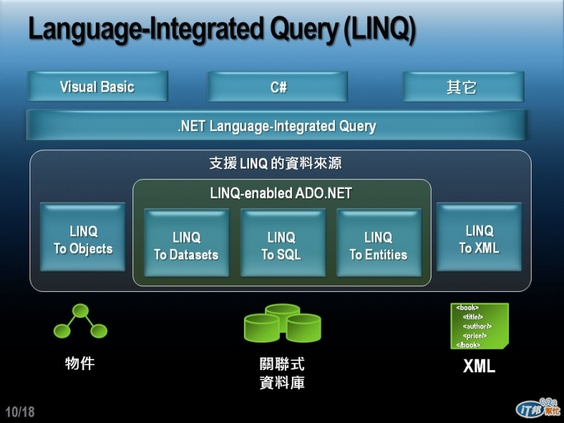

# 區域型別推斷

**語法範例**

```csharp
//資料來源
string[] words = { "Hello", "wonderful", "LINQ", "beautiful", "World" };

//LINQ查詢表達式
var shortWords =
  from word in words
  where word.Length <= 5
  select word;

//顯示查詢結果
foreach (var e in shortWords)
{
    Console.WriteLine(e.ToString());
}
//輸出：Hello LINQ World
```

MSDN C#：可以給予區域變數推斷「型別」var，而非明確型別。 

var 關鍵字會指示編譯器從初始化陳述式右側的運算式推斷變數的型別。 

推斷的型別可能是內建型別、匿名型別、使用者定義型別，或 .NET Framework 類別程式庫中定義的型別。

<aside>
💡 在 C# 中，不使用「區域型別推斷」這個名詞，而是用「隱含型別區域變數（Implicitly Typed Local Variables）」，查詢關鍵字要下對喔！

</aside>

**概念**



1. LINQ 可以用 VB、C# 或「其他」語言撰寫。
2. LINQ 可以支援查詢物件、關聯式資料庫、XML 三種資料來源。
3. 針對三種資料來源，LINQ 也對應分為三種類型：LINQ to Objects、LINQ to XML、LINQ-enabled ADO.NET。

**【區域變數概念】**

在 C# 若定義一個區域變數同時賦予值，就可以省略型別宣告，讓編譯器在編譯時期決定變數的型別，只要在寫變數型別的地方改用 var 關鍵字即可。因為編譯時期就會推斷出變數的型別，所以其實是「強型別」的變數。

型別推斷只適用於下述三種情況：

1. 區域變數（方法範圍中宣告的變數）。
2. 迴圈控制變數的型別（For、Foreach）。
3. Using 陳述式中，用來建立資源名稱的型別。

不可以把方法參數的型別用 var 來取代！方法參數並非區域變數。


```csharp
var i = 5; 
var s = "Hello"; 
var a = new[] { 0, 1, 2 }; 
var list = new List<int>();
	
i.GetType().Dump(); 
s.GetType().Dump(); 
a.GetType().Dump(); 
list.GetType().Dump();
```


可以發現定義區域變數時，都沒有宣告型別，但是最後輸出的型別卻是正確的

<aside>
💡 Dump 方法等同於 Console.WriteLine

</aside>