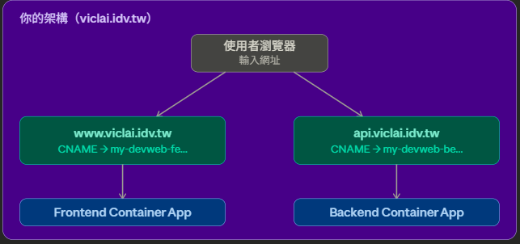

# 網域小知識

## 基本

- domain = 名字
- IP = 地址
- Name Server (NS) = 是指定誰來管這個 domain 的 DNS
    - 在中華電信買了 `viclai.idv.tw`，所以中華電信就是 NS
    - 全世界的 DNS 查 `viclai.idv.tw` 任何 record，都會被導向去問 `ns1.hinet.net`
    - 除非在中華電信把 Server 轉成 Azure DNS Zone 的 Server
        - 這時候只要去設定 Azure DNS Zone 裡面的東西就好
- 

你目前用到的只有 CNAME 和 TXT，其他了解概念就夠了。

## DNS 是什麼

DNS 就是**電話簿**，把 domain 對應到 IP 或其他目標。

---

## Record 是什麼

| Record | 一句話 |
| --- | --- |
| A | 名字 → IPv4 位址 |
| AAAA | 名字 → IPv6 位址 |
| CNAME | 名字 → 另一個名字 |
| MX | 收信要送到哪台伺服器 |
| TXT | 放任意文字，通常用來驗證身份 |
| NS | 這個 domain 由哪台 DNS 伺服器管理 |
| SOA | 這個 domain 的基本管理資訊 |
| PTR | IP → 名字（反查，A 的反向） |
| SRV | 指定某個服務跑在哪個 host 和 port |
| CAA | 哪家 CA 可以幫這個 domain 核發憑證 |

---

## CNAME 是什麼

- CNAME 是**轉址標籤**，意思是「把名字指向另一個名字」。
- 用途：流量走的路
- 範例：www → Azure endpoint
- CNAME 不能共存，同一 hostname 有 CNAME 就不能再加任何其他 record
    - 其他 record 像是 A 或者 MX

`www.viclai.idv.tw  →  my-devweb-fe.orangedune-391f032d.eastasia.azurecontainerapps.io`

使用者輸入 `www.viclai.idv.tw`，DNS 說「去找 Azure 那個地址」，瀏覽器就連過去了。

---

## TXT 是什麼

- 放一段驗證暗號文字
- 用途：Azure 確認你擁有此域名，
- 範例：asuid.www → token
- TXT 可以一對多，同一 hostname 可以掛多筆 TXT，合法有效

TXT 是**備註欄**，放一段文字，給第三方服務(Azure)讀取用，使用者看不到，瀏覽器也不會用它來連線。

Azure 用它來**確認你真的擁有這個 domain**，邏輯是：

`Azure 給你一串暗號  →  你填進 DNS TXT  →  Azure 去查 DNS 看到暗號  →  確認你是 domain 擁有者`

---

## 設定用途總結

> CNAME 是給流量走的路，TXT 是給 Azure 驗證身份用的
> 

| Record | 用途 |
| --- | --- |
| `www` CNAME | 讓瀏覽器找到你的前端 |
| `api` CNAME | 讓瀏覽器找到你的後端 |
| `asuid.www` TXT | 讓 Azure 確認你擁有 www 這個子域名 |
| `asuid.api` TXT | 讓 Azure 確認你擁有 api 這個子域名 |

我的網站架構

## A Record

**把名字直接對應到 IP 位址。**

`example.com    A    93.184.216.34`

使用者輸入 `example.com`，DNS 直接回傳 IP，瀏覽器連過去。

CNAME 是「去找別人」，A 是「直接給答案」。

---

## MX Record

**指定這個 domain 的信件要送到哪裡。**

`example.com    MX    mail.example.com`

有人寄信到 `xxx@example.com`，郵件系統查 MX，知道要把信送到 `mail.example.com`。

MX 只跟**收信**有關，跟網站瀏覽完全無關。

## TLS/SSL Binding 概念

- **把憑證跟你的網域名稱綁在一起**，告訴伺服器「當有人連到 `www.viclai.idv.tw`，用這張憑證來加密」。
- 網站有 https 的關鍵，**告訴伺服器，這個網址用這張憑證加密**，少了這一步 HTTPS 就不會動。

### 沒有 Binding 會怎樣

`使用者連到 https://www.viclai.idv.tw → 伺服器不知道要用哪張憑證 → 瀏覽器顯示「不安全」或連線失敗`

### 有 Binding 會怎樣

使用者連到 [https://www.viclai.idv.tw](https://www.viclai.idv.tw/) → 伺服器找到對應的憑證 → 建立加密連線 → 瀏覽器顯示鎖頭