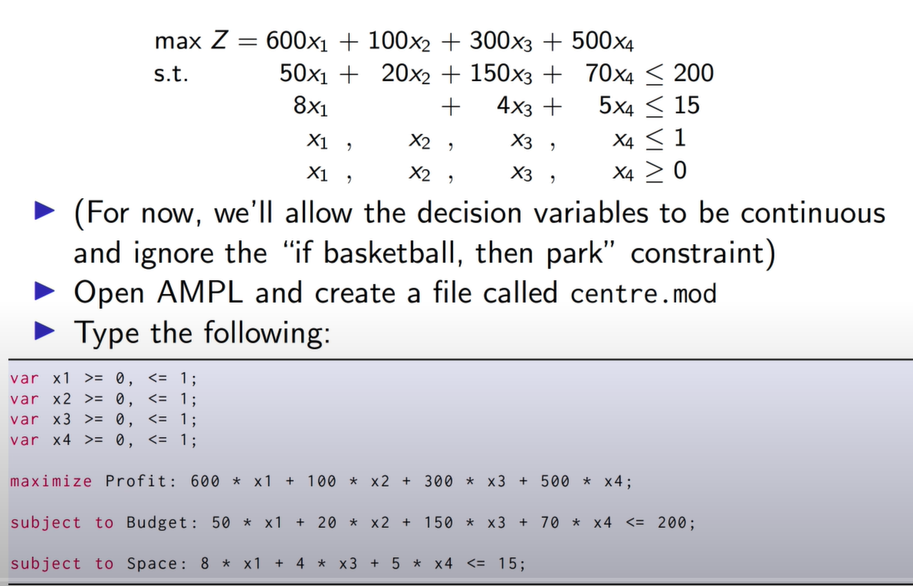

# AMPL

---

每一個題目都有三個檔案

1. Model file: 放問題的
2. Data file: 放參數的
3. Command file: 放要用甚麼solver與該怎麼顯示結果

流程上：先讀取model與data，透過command得到解後給solution

輸入指令可以跑出結果

ampl:  `include example1.run;`

# Solver

---

cplex for linear programming

minos for nonlinear programming

# 語法整理(.mod)

---

## 基本(少變數模型)

### 創建變數

1. 小數變數
    
    > var `變數名稱` >=0, <=1;
    > 
2. 二元變數
    
    > var `變數名稱` binary;
    > 

### 目標式

1. 最大化
    
    > maximize `目標式名稱`: `變數1`+`變數2`;
    > 
2. 最小化
    
    > minimize `目標式名稱`: `變數1`+`變數2`;
    > 

### 限制式

1.基本 

> subject to `限制式名稱`: `變數1` + `變數2` <= `限制值`;
> 

<aside>
💡 可以用s.t.替代subject to

</aside>

> s.t. Budget: x1 + x2 <= 200;
> 
1. 如果…就… 限制式表示法
    
    > var x1 binary;
    var x2 binary;
    s.t. `限制式名稱`: x2 <= x1;
    > 

## 進階(多變數模型)

1. set `資源名稱`;用來表示有多少變數;
2. param  `參數名稱` {`數量`}; 用來表示參數;
3. var `變數名稱` {`數量`}; 表示變數;
4. maximize `目標式名稱`: sum{j in `資源名稱`} `參數名稱`[j] * `變數名稱`[j]; 
5. s.t. `限制式名稱`: sum{j in `資源名稱`} `參數名稱`[j] * `變數名稱`[j] <= `限制值`; 

# 語法整理(.dat)

---

- := 是實際宣告變數

- 也可以這樣設變數

- 不一定

> 如果有籃球就必須要有公園，但有公園不一定有籃球。
> 

- 如果每一個變數都有相同的限制

- 

 

# 語法整理(.run)

---

1. 如果改變.mod檔案就需要執行reset;
2. 使用 model `模型檔案名稱`; 選擇要跑的模型
3. 使用 data `變數檔案名稱`; 選擇要引入的參數
4. solve; 計算結果
5. display `變數1`, `變數2`, `Z`;

# 一些Bug

1. 目標式沒有sum
    
    
    
2. 限制式沒有sum
    
    
    
3. 同樣的Index
    
    
    

 4. 有些再跑solve前都不會出現錯誤(如下少一個指派的項目)

# 範例

# 其他補充

---

影片範例

---

[https://portal.ampl.com/docs/archive/first-website/BOOK/EXAMPLES/EXAMPLES2/index_files.html](https://portal.ampl.com/docs/archive/first-website/BOOK/EXAMPLES/EXAMPLES2/index_files.html)