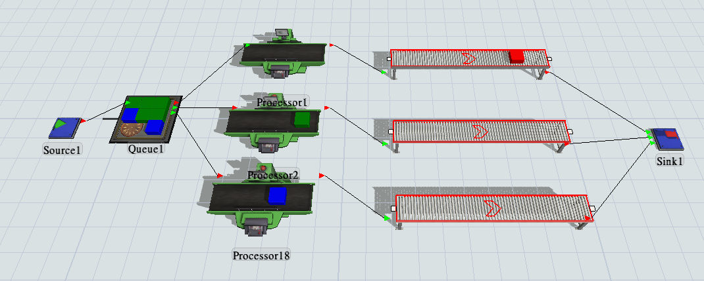

# Flexsim

設施規劃

[筆記](Flexsim/%E7%AD%86%E8%A8%98%202c98fda15f6f81ee998adb327964697c.md)

# Example 1

---

- 概念：3種物件，物件1就到機台1，以此類推
    
    
    

**Source**

- inter-arrival time： normal(mean = 20,sd = 2)
- Triggers - add “On Creation”： Set Item Type and Color (duniform(1,3,getstream(current)))

**Queue**

- Maximum Content： 25
- Flow - Send To Port： By Expression (此設定目的為不同產品對應不同機器)

**Processor**

- Process Time： exponential(Location = 0.0, Scale = 30, stream =0)

**Straight Conveyor**

- Speed：1 m/s

# Example 2

---

- 概念：派工人與機器執行搬運動作
    
    
    
    操作：
    
    Dispatcher to Queue ：Ｓ＋滑鼠左鍵
    
    Dispatcher to Operator ：Ａ＋滑鼠左鍵
    
    Dispatcher to Operator ：S＋滑鼠左鍵
    
    如果只有一個Operator，就無法用Dispatcher
    

**Processor**

- Process Time： 10 sec

**Queue**

- Products carrying: 作業員從站存區到測試器，堆高機從輸送帶的暫存區到離開。
    - Flow - Use Transport : 打勾
- 輸送帶後面的暫存區(Queue 2)：容量(Maximum Content) = 10
    
    

[線上課](Flexsim/%E7%B7%9A%E4%B8%8A%E8%AA%B2%202c98fda15f6f818aaf01e928d286df2b.md)

[Code Record](Flexsim/Code%20Record%202c98fda15f6f812187ead939039592be.md)