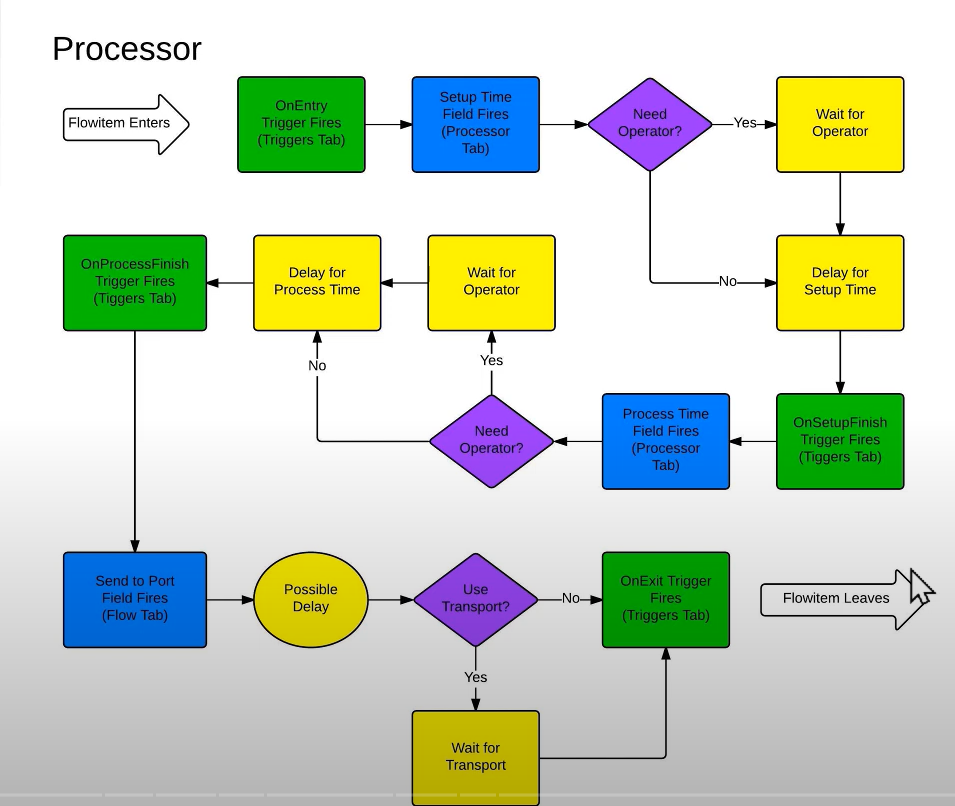

# 筆記

- **3D object events**

流程圖中綠色方格為事件結束後的觸發點，決定下一個步驟的決策。

- **Object Classification**
    
    
    
    
    
- Object Port Connections
    
    
    
    上針對物品流向(快捷鍵A、取消Q+滑鼠點擊)
    
    下針對任務指派(快捷鍵S、取消W+滑鼠點擊)
    
    快捷鍵
    
    
    
    設定改變port order順序
    
    
    
    設定輸出模式與是否使用Transport功能，命令Task Executer object送出貨物
    
    
    
    Model1(Phase1)
    
    
    
    
    
    設定Seplit分割，分成4個。
    
    Model1(Phase2)
    
    
    
    
    
    *可能發生重新process狀況
    
    
    
    
    
    
    
    
    
    
    
    process 20%重新做送回source → 會變成Type2
    
    # Labels
    
    ---
    
    
    
    
    
    透過Processor1的Trigger功能設定(When “On Exit”, “Set Label”)，被送回去的Box，label頁面參數Type 是 “2”
    
    
    
    綠色框是各種label
    
    紅色框是各label的值，資料型別可以是「numeric value(5)、 serial number(XYZ-123)，呼叫某個物件(/Operator1，紫色文字)、Array」
    
    
    
    透過Trigger指派label(此當item 離開 processor 後set label 為例)
    
    
    
    第一個是給中央控制
    
    二、三個是給輸入輸出端，其中duniform是隨機給1~5
    
    # Global Tables
    
    ---
    
    
    
    可以匯入/輸出Excel資料
    
    
    
    
    

**操作範例**

1. 建立一個Global Table
2. 改Table名稱
3. 設定2 row 
4. 第一個column名稱為”processTime”
5. 設定裡面表中數字
6. 新建立一個processor
7. 設定以下參數
    
    
    
    
    
    其中Row看物品有沒有Type標籤，如果物品Type標籤數值是多少就是第幾個row
    
    其中column可以輸入數字，也可以直接打column name(在這範例中 輸入1也一樣)
    

# Model 1(Phase 3)

---

設定ㄣSeparator

基於PartNumbe Label建立

然後用item的PartNumber去給數字就可以指定顏色

設定Processor

Mean: Table("Phase3PartNums")[item.PartNumber]["Mean"]

Std Dev: Table("Phase3PartNums")[item.PartNumber]["StDv"]

建立新的圖表

輸出輸入端都是Processor 1

# Model 1 Phase4

---

如果label value有”空格”需要用第三個語法來指定

如果label value沒有”空格”則只要打item.StockingNumber

**Combiner**

