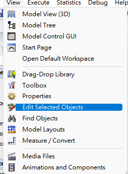

# 線上課

[DAY1系統模擬概念.pdf](DAY1系統模擬概念.pdf)

[DAY1品質檢驗站.pdf](DAY1品質檢驗站.pdf)

# 快速對齊

---

點開功能

shift+左鍵選機台 

點擊要對齊的機台

按X對齊

# combiner

---

一個容器要裝五個item

# 配送邏輯

---

1.

2.

可以查看程式碼得知配送程式邏輯

派工邏輯影響工人工作時間

# Day2

---

針對被偵測到的物件貼上item的標籤

# 指定item顏色

---

# Globle LIST

# 搶佔功能

---

要把Value用滴管滴Work

wait for event 設定

---

零件組合以第一條線的Type為主

下面兩個要打勾!!

才能讓list繼續流下去，而且保存資料

Label Access on Parent Only取消勾選

讓流程可以跑到subtask