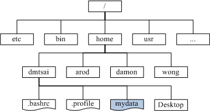
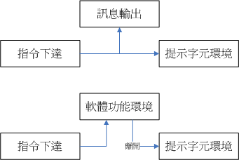

> 關聯：[[linux]]

# Linux 觀念

# 目錄樹結構(Directory  tree)

- Linux內的所有資料都是以檔案的形態來呈現
- 整個目錄樹架構最重要的就是根目錄(root directory)，這個根目錄的表示方法為一條斜線『**/**』



上圖中長方形為目錄， 波浪形則為檔案。那當我們想要取得mydata那個檔案時，系統就得由根目錄開始找，然後找到home接下來找到dmtsai， 最終的檔名為：/home/dmtsai/mydata的意思。

掛載(mount)

目的：結合目錄數的架構與磁碟內的資料

概念：利用一個目錄當成進入點，將磁碟分割槽的資料放置在該目錄下； 也就是說，進入該目錄就可以讀取該分割槽。此動作稱為『掛載』，進入點的目錄稱作『掛載點』。
)

上圖中假設硬碟分為兩槽，partition 1是掛載到根目錄，至於partition 2則是掛載到/home這個目錄。 這也就是說，當我的資料放置在/home內的各次目錄時，資料是放置到partition 2的，如果不是放在/home底下的目錄， 那麼資料就會被放置到partition 1了！

反向追蹤檔案在哪一個Partition：

當想要知道/home/vbird/test這個檔案在哪個partition時，由test --> vbird --> home --> /，看那個『進入點』先被查到那就是使用的進入點了。 所以test使用的是/home這個進入點而不是/喔！

磁碟分割與目錄樹的掛載

最簡單的分割方法：

這個在上面第二節已經談過了，就是僅分割出根目錄與記憶體置換空間( / & swap )即可。 然後再預留一些剩餘的磁碟以供後續的練習之用。不過，這當然是不保險的分割方法(所以鳥哥常常說這是『懶人分割法』)！ 因為如果任何一個小細節壞掉(例如壞軌的產生)，你的根目錄將可能整個的損毀～挽救方面較困難！

比較麻煩的做法

先分析這部主機的未來用途，然後根據用途去分析需要較大容量的目錄， 以及讀寫較為頻繁的目錄，將這些重要的目錄分別獨立出來而不與根目錄放在一起， 那當這些讀寫較頻繁的磁碟分割槽有問題時，至少不會影響到根目錄的系統資料，那挽救方面就比較容易啊！ 

# 指令下達

```
[dmtsai@study ~]$command  [-options]  parameter1  parameter2 ...                     
                   指令       選項       參數(1)     參數(2)
```

1. 一行指令中第一個輸入的部分絕對是『指令(command)』或『可執行檔案(例如批次腳本,script)』
2. command 為指令的名稱，例如變換工作目錄的指令為 cd 等等；
3. 中刮號[]並不存在於實際的指令中，而加入選項設定時，通常選項前會帶 - 號，例如 -h；有時候會使用選項的完整全名，則選項前帶有 -- 符號，例如 --help；
4. parameter1 parameter2.. 為依附在選項後面的參數，或者是 command 的參數；
5. 指令, 選項, 參數等這幾個咚咚中間以空格來區分，不論空幾格 shell 都視為一格。所以空格是很重要的特殊字元！；
6. 按下[Enter]按鍵後，該指令就立即執行。[Enter]按鍵代表著一行指令的開始啟動。
7. 指令太長的時候，可以使用反斜線 (\) 來跳脫[Enter]符號，使指令連續到下一行。注意！反斜線後就立刻接特殊字符，才能跳脫！
8. 第一個被輸入的資料絕對是指令或者是可執行的檔案

下達指令時，會有兩種主要的情況：

- 一種是該指令會直接顯示結果然後回到命令提示字元等待下一個指令的輸入；
- 一種是進入到該指令的環境，直到結束該指令才回到命令提示字元的環境。



上方指令下達後立即顯示訊息且立刻回到命令提示字元的環境。 如果有進入軟體功能的環境(例如上面的bc軟體)，那麼就得要使用該軟體的結束指令 (例如在bc環境中輸入quit)才能夠回到命令提示字元中！

<aside>
💡

看到游標是在『[dmtsai@study ~]$ 』這種提示字元後面， 那就是等待輸入指令的環境了。

</aside>

# 快捷鍵

- 按[tab]按鍵的地方如果是在command(第一個輸入的資料)後面時，他就代表著 『命令補全』，如果是接在第二個字以後的，就會變成『檔案補齊』的功能了！
    - [Tab] 接在一串指令的第一個字的後面，則為『命令補全』；
    - [Tab] 接在一串指令的第二個字以後時，則為『檔案補齊』！
    - 若安裝 bash-completion 軟體，則在某些指令後面使用 [tab] 按鍵時，可以進行『選項/參數的補齊』功能！
    
    指令輸入到一半後再按兩次 [tab] 按鍵，該指令開頭的相關指令都被顯示出來。
    
    ```
    [dmtsai@study ~]$ca[tab][tab]    <==[tab]按鍵是緊接在 a 字母後面！
    cacertdir_rehash     cairo-sphinx         cancel               case
    cache_check          cal                  cancel.cups          cat
    cache_dump           calibrate_ppa        capsh                catchsegv
    cache_metadata_size  caller               captoinfo            catman
    # 上面的 [tab] 指的是『按下那個tab鍵』，不是要你輸入中括號內的tab啦！
    ```
    
    如果只該目錄下面所有以 .bash 為開頭的檔案名稱都會被顯示出來
    
    ```
    [dmtsai@study ~]$ls -al ~/.bash[tab][tab]
    .bash_history  .bash_logout   .bash_profile  .bashrc
    ```
    
- [ Ctrl ] + C
    - 中斷目前程式
- [ Ctrl ] + D
    - 鍵盤輸入結束(End Of File, EOF 或 End Of Input)
    - 想要直接離開文字介面，可以直接按下[Ctrl]-d就能夠直接離開了(用來取代exit的輸入！)
- **[shift]+{[PageUP]|[Page Down]}**
    - [Shift]+[Page Up] 來往前翻頁
    - [Shift]+[Page Down] 來往後翻頁

# 錯誤訊息查看

```
[dmtsai@study ~]$DATE
bash: DATE: command not found...  # 這裡顯示錯誤的訊息
Similar command is: 'date'        # 這裡竟然給你一個可能的解決方案耶！
```

- bash:表示的是我們的Shell的名稱

# Manual Page

- man page的資料童常放在/usr/share/man目錄裡頭

代號與其代表內容，下表中的 1, 5, 8 這三個號碼特別重要。

| 代號 | 代表內容 |
| --- | --- |
| 1 | 使用者在shell環境中可以操作的指令或可執行檔 |
| 2 | 系統核心可呼叫的函數與工具等 |
| 3 | 一些常用的函數(function)與函式庫(library)，大部分為C的函式庫(libc) |
| 4 | 裝置檔案的說明，通常在/dev下的檔案 |
| 5 | 設定檔或者是某些檔案的格式 |
| 6 | 遊戲(games) |
| 7 | 慣例與協定等，例如Linux檔案系統、網路協定、ASCII code等等的說明 |
| 8 | 系統管理員可用的管理指令 |
| 9 | 跟kernel有關的文件 |

man page大致分成底下這幾個部分：

| 代號 | 內容說明 |
| --- | --- |
| NAME | 簡短的指令、資料名稱說明 |
| SYNOPSIS | 簡短的指令下達語法(syntax)簡介 |
| DESCRIPTION | 較為完整的說明，這部分最好仔細看看！ |
| OPTIONS | 針對 SYNOPSIS 部分中，有列舉的所有可用的選項說明 |
| COMMANDS | 當這個程式(軟體)在執行的時候，可以在此程式(軟體)中下達的指令 |
| FILES | 這個程式或資料所使用或參考或連結到的某些檔案 |
| SEE ALSO | 可以參考的，跟這個指令或資料有相關的其他說明！ |
| EXAMPLE | 一些可以參考的範例 |

如果要向下翻頁的話，可以按下鍵盤的空白鍵，也可以使用[Page Up]與[Page Down]來翻頁呢！

同時，如果知道某些關鍵字的話， 那麼可以在任何時候輸入『/word』，來主動搜尋關鍵字！例如在man date的搜尋當中輸入了『/date』，man page就會開始搜尋跟date有關的字串。

**快捷鍵整理**

| 按鍵 | 進行工作 |
| --- | --- |
| 空白鍵 | 向下翻一頁 |
| [Page Down] | 向下翻一頁 |
| [Page Up] | 向上翻一頁 |
| [Home] | 去到第一頁 |
| [End] | 去到最後一頁 |
| /string | 向『下』搜尋 string 這個字串，如果要搜尋 vbird 的話，就輸入 /vbird |
| ?string | 向『上』搜尋 string 這個字串 |
| n, N | 利用 / 或 ? 來搜尋字串時，可以用 n 來繼續下一個搜尋 (不論是 / 或 ?) ，可以利用 N 來進行『反向』搜尋。舉例來說，我以 /vbird 搜尋 vbird 字串， 那麼可以 n 繼續往下查詢，用 N 往上查詢。若以 ?vbird 向上查詢 vbird 字串， 那我可以用 n 繼續『向上』查詢，用 N 反向查詢。 |
| q | 結束這次的 man page |

# 正確關機方法

- **觀察系統的使用狀態**：如果要看目前有誰在線上，可以下達『who』這個指令，而如果要看網路的連線狀態，可以下達 『 netstat -a 』這個指令，而要看背景執行的程序可以執行『 ps -aux 』這個指令。使用這些指令可以讓你稍微瞭解主機目前的使用狀態！當然囉，就可以讓你判斷是否可以關機了 （這些指令在後面Linux常用指令中會提及喔！）
- **通知線上使用者關機的時刻**：要關機前總得給線上的使用者一些時間來結束他們的工作，所以，這個時候你可以使用 shutdown 的特別指令來達到此一功能。
- **正確的關機指令使用**：例如 shutdown 與 reboot 兩個指令！

- 將資料同步寫入硬碟中的指令： sync
- 慣用的關機指令： shutdown
- 重新開機，關機： reboot, halt, poweroff

shutdown可以達成如下的工作：

- 可以自由選擇關機模式：是要關機或重新開機均可；
- 可以設定關機時間: 可以設定成現在立刻關機, 也可以設定某一個特定的時間才關機。
- 可以自訂關機訊息：在關機之前，可以將自己設定的訊息傳送給線上 user 。
- 可以僅發出警告訊息：有時有可能你要進行一些測試，而不想讓其他的使用者干擾，或者是明白的告訴使用者某段時間要注意一下！這個時候可以使用 shutdown 來嚇一嚇使用者，但卻不是真的要關機啦！

```
[root@study ~]#/sbin/shutdown [-krhc] [時間] [警告訊息]選項與參數：
-k     ： 不要真的關機，只是發送警告訊息出去！
-r     ： 在將系統的服務停掉之後就重新開機(常用)
-h     ： 將系統的服務停掉後，立即關機。 (常用)
-c     ： 取消已經在進行的 shutdown 指令內容。
時間   ： 指定系統關機的時間！時間的範例底下會說明。若沒有這個項目，則預設 1 分鐘後自動進行。
範例：
[root@study ~]#/sbin/shutdown -h 10 'I will shutdown after 10 mins'
Broadcast message from root@study.centos.vbird (Tue 2015-06-02 10:51:34 CST):

I will shutdown after 10 mins
The system is going down for power-off at Tue 2015-06-02 11:01:34 CST!
```

```
[root@study ~]#shutdown -h now立刻關機，其中 now 相當於時間為 0 的狀態
[root@study ~]#shutdown -h 20:25系統在今天的 20:25 分會關機，若在21:25才下達此指令，則隔天才關機
[root@study ~]#shutdown -h +10系統再過十分鐘後自動關機
[root@study ~]#shutdown -r now系統立刻重新開機
[root@study ~]#shutdown -r +30 'The system will reboot'再過三十分鐘系統會重新開機，並顯示後面的訊息給所有在線上的使用者
[root@study ~]#shutdown -k now 'This system will reboot'僅發出警告信件的參數！系統並不會關機啦！嚇唬人！

```

**重新開機，關機： reboot, halt, poweroff**

 其實這三個指令呼叫的函式庫都差不多，所以當你使用『man reboot』時，會同時出現三個指令的用法給你看呢。 一般在重新開機時，都會下達如下的指令喔：

```
[root@study ~]#sync; sync; sync; reboot
```

既然這些指令都能夠關機或重新開機，那他有沒有什麼差異啊？基本上，在預設的情況下， 這幾個指令都會完成一樣的工作！(全部的動作都是去呼叫 systemctl 這個重要的管理命令！) 所以，你只要記得其中一個就好了！重點是，你自己習慣即可！

```
[root@study ~]#halt  # 系統停止～螢幕可能會保留系統已經停止的訊息！
[root@study ~]#poweroff  # 系統關機，所以沒有提供額外的電力，螢幕空白！

```

**實際使用管理工具 systemctl 關機**

目前系統中所有服務的管理是使用哪個指令呢？那就是 systemctl 啦！這個指令相當的複雜！我們會在很後面系統管理員部份才講的到！ 目前你只要學習 systemctl 當中與關機有關的部份即可。

要注意，上面談到的 halt, poweroff, reboot, shutdown 等等，其實都是呼叫這個 systemctl 指令的喔！ 這個指令跟關機有關的語法如下：

```
[root@study ~]#systemctl [指令]指令項目包括如下：
halt       進入系統停止的模式，螢幕可能會保留一些訊息，這與你的電源管理模式有關
poweroff   進入系統關機模式，直接關機沒有提供電力喔！
reboot     直接重新開機
suspend    進入休眠模式

[root@study ~]#systemctl reboot  # 系統重新開機
[root@study ~]#systemctl poweroff  # 系統關機
```

# **5.1 使用者與群組**

所有的系統上的帳號與一般身份使用者，還有那個root的相關資訊， 都是記錄在/etc/passwd這個檔案內的。

個人的密碼則是記錄在/etc/shadow這個檔案下。 

所有的群組名稱都紀錄在/etc/group內！

這三個檔案可以說是Linux系統裡面帳號、密碼、群組資訊的集中地囉！ 不要隨便刪除這三個檔案啊！ ^_^

## **Linux 檔案權限概念**

```
[dmtsai@study ~]$su -  # 先來切換一下身份看看
Password:
Last login: Tue Jun  2 19:32:31 CST 2015 on tty2
[root@study ~]#ls -altotal 48
dr-xr-x---.  5    root     root    4096  May 29 16:08 .
dr-xr-xr-x. 17    root     root    4096  May  4 17:56 ..
-rw-------.  1    root     root    1816  May  4 17:57 anaconda-ks.cfg
-rw-------.  1    root     root     927  Jun  2 11:27 .bash_history
-rw-r--r--.  1    root     root      18  Dec 29  2013 .bash_logout
-rw-r--r--.  1    root     root     176  Dec 29  2013 .bash_profile
-rw-r--r--.  1    root     root     176  Dec 29  2013 .bashrc
drwxr-xr-x.  3    root     root      17  May  6 00:14 .config               <=範例說明處
drwx------.  3    root     root      24  May  4 17:59 .dbus
-rw-r--r--.  1    root     root    1864  May  4 18:01 initial-setup-ks.cfg  <=範例說明處
[    1    ][  2 ][   3  ][  4 ][    5   ][    6     ] [       7          ]
[  權限   ][連結][擁有者][群組][檔案容量][ 修改日期 ] [      檔名        ]
```

ls是『list』的意思，重點在顯示檔案的檔名與相關屬性。而選項『-al』則表示列出所有的檔案詳細的權限與屬性 (包含隱藏檔，就是檔名第一個字元為『 . 』的檔案)。如上所示，在你第一次以root身份登入Linux時， 如果你輸入上述指令後，應該有上列的幾個東西，先解釋一下上面七個欄位個別的意思：


• **第一欄代表這個檔案的類型與權限(permission)：**


- 第一個字元代表這個檔案是『目錄、檔案或連結檔等等』：
    - 當為[ **d** ]則是目錄，例如[上表](https://linux.vbird.org/linux_basic/centos7/0210filepermission.php#table2.1.1)檔名為『.config』的那一行；
    - 當為[ **-** ]則是檔案，例如[上表](https://linux.vbird.org/linux_basic/centos7/0210filepermission.php#table2.1.1)檔名為『initial-setup-ks.cfg』那一行；
    - 若是[ **l** ]則表示為連結檔(link file)；
    - 若是[ **b** ]則表示為裝置檔裡面的可供儲存的周邊設備(可隨機存取裝置)；
    - 若是[ **c** ]則表示為裝置檔裡面的序列埠設備，例如鍵盤、滑鼠(一次性讀取裝置)。
- 接下來的字元中，以三個為一組，且均為『rwx』 的三個參數的組合。其中，[ r ]代表可讀(read)、[ w ]代表可寫(write)、[ x ]代表可執行(execute)。 要注意的是，這三個權限的位置不會改變，如果沒有權限，就會出現減號[ - ]而已。
    - 第一組為『檔案擁有者可具備的權限』，以『initial-setup-ks.cfg』那個檔案為例， 該檔案的擁有者可以讀寫，但不可執行；
    - 第二組為『加入此群組之帳號的權限』；
    - 第三組為『非本人且沒有加入本群組之其他帳號的權限』。
- **第二欄表示有多少檔名連結到此節點(i-node)：**
    
    每個檔案都會將他的權限與屬性記錄到檔案系統的i-node中，不過，我們使用的目錄樹卻是使用檔名來記錄， 因此每個檔名就會連結到一個i-node囉！這個屬性記錄的，就是有多少不同的檔名連結到相同的一個i-node號碼去就是了。
    
- **第三欄表示這個檔案(或目錄)的『擁有者帳號』**
- **第四欄表示這個檔案的所屬群組**
    
    在Linux系統下，你的帳號會加入於一個或多個的群組中。舉剛剛我們提到的例子，class1, class2, class3均屬於projecta這個群組，假設某個檔案所屬的群組為projecta，且該檔案的權限如[圖5.2.2](https://linux.vbird.org/linux_basic/centos7/0210filepermission.php#fig5.2.2)所示(-rwxrwx---)， 則class1, class2, class3三人對於該檔案都具有可讀、可寫、可執行的權限(看群組權限)。 但如果是不屬於projecta的其他帳號，對於此檔案就不具有任何權限了。
    
- **第五欄為這個檔案的容量大小，預設單位為bytes；**
- **第六欄為這個檔案的建檔日期或者是最近的修改日期：**
    
    這一欄的內容分別為日期(月/日)及時間。如果這個檔案被修改的時間距離現在太久了，那麼時間部分會僅顯示年份而已。 如下所示：
    
    ```dart
    [root@study ~]#ll /etc/services /root/initial-setup-ks.cfg
    -rw-r--r--. 1 root root 670293 Jun  7  2013 /etc/services
    -rw-r--r--. 1 root root   1864 May  4 18:01 /root/initial-setup-ks.cfg
    # 如上所示，/etc/services 為 2013 年所修改過的檔案，離現在太遠之故，所以只顯示年份；
    # 至於 /root/initial-setup-ks.cfg 是今年 (2015) 所建立的，所以就顯示完整的時間了。
    ```
    
    如果想要顯示完整的時間格式，可以利用ls的選項，亦即：『ls -l --full-time』就能夠顯示出完整的時間格式了！包括年、月、日、時間喔。 另外，如果你當初是以繁體中文安裝你的Linux系統，那麼日期欄位將會以中文來顯示。 可惜的是，中文並沒有辦法在純文字的終端機模式中正確的顯示，所以此欄會變成亂碼。 那你就得要使用『export LC_ALL=en_US.utf8』來修改語系喔！
    
    如果想要讓系統預設的語系變成英文的話，那麼你可以修改系統設定檔『/etc/locale.conf』，利用第四章談到的[nano](https://linux.vbird.org/linux_basic/0160startlinux.php#nano)來修改該檔案的內容，使LANG這個變數成為上述的內容即可。
    
- **第七欄為這個檔案的檔名**
    
    這個欄位就是檔名了。比較特殊的是：如果檔名之前多一個『 . 』，則代表這個檔案為『隱藏檔』，例如[上表中的.config那一行](https://linux.vbird.org/linux_basic/centos7/0210filepermission.php#table2.1.1)，該檔案就是隱藏檔。 你可以使用『ls』及『ls -a』這兩個指令去感受一下什麼是隱藏檔囉！
    

## **5.2.2 如何改變檔案屬性與權限**

**改變所屬群組, chgrp**

直接以chgrp來改變即可，咦！這個指令就是change group的縮寫嘛！請記得，要被改變的群組名稱必須要在/etc/group檔案內存在才行，否則就會顯示錯誤！

假設你已經是root的身份了，那麼在你的家目錄內有一個名為 initial-setup-ks.cfg 的檔案， 如何將該檔案的群組改變一下呢？假設你已經知道在/etc/group裡面已經存在一個名為users的群組， 但是testing這個群組名字就不存在/etc/group當中了，此時改變群組成為users與testing分別會有什麼現象發生呢？

```
[root@study ~]#chgrp [-R] dirname/filename ...選項與參數：
-R : 進行遞迴(recursive)的持續變更，亦即連同次目錄下的所有檔案、目錄
     都更新成為這個群組之意。常常用在變更某一目錄內所有的檔案之情況。
範例：
[root@study ~]#chgrp users initial-setup-ks.cfg
[root@study ~]#ls -l
-rw-r--r--. 1 root users 1864 May  4 18:01 initial-setup-ks.cfg
[root@study ~]#chgrp testing initial-setup-ks.cfg
chgrp: invalid group:  `testing' <== 發生錯誤訊息囉～找不到這個群組名～

```

發現了嗎？檔案的群組被改成users了，但是要改成testing的時候， 就會發生錯誤～注意喔！發生錯誤訊息還是要努力的查一查錯誤訊息的內容才好！ 將他英文翻譯成為中文，就知道問題出在哪裡了。

**改變檔案擁有者, chown**

既然改變群組是change group，那麼改變擁有者就是change owner囉！那就是chown這個指令的用途，要注意的是， 使用者必須是已經存在系統中的帳號，也就是在/etc/passwd 這個檔案中有紀錄的使用者名稱才能改變。

chown的用途還滿多的，他還可以順便直接修改群組的名稱呢！此外，如果要連目錄下的所有次目錄或檔案同時更改檔案擁有者的話，直接加上 -R 的選項即可！我們來看看語法與範例：

```
[root@study ~]#chown [-R] 帳號名稱 檔案或目錄
[root@study ~]#chown [-R] 帳號名稱:群組名稱 檔案或目錄選項與參數：
-R : 進行遞迴(recursive)的持續變更，亦即連同次目錄下的所有檔案都變更範例：將 initial-setup-ks.cfg 的擁有者改為bin這個帳號：
[root@study ~]#chown bin initial-setup-ks.cfg
[root@study ~]#ls -l
-rw-r--r--. 1 bin  users 1864 May  4 18:01 initial-setup-ks.cfg

範例：將 initial-setup-ks.cfg 的擁有者與群組改回為root：
[root@study ~]#chown root:root initial-setup-ks.cfg
[root@study ~]#ls -l
-rw-r--r--. 1 root root 1864 May  4 18:01 initial-setup-ks.cfg
```

那麼什麼時候要使用chown或chgrp呢？ 是的，確實有時候需要變更檔案的擁有者的，最常見的例子就是在複製檔案給你之外的其他人時， 我們使用最簡單的cp指令來說明好了：

```
[root@study ~]#cp 來源檔案 目的檔案
```

假設你今天要將.bashrc這個檔案拷貝成為.bashrc_test檔名，且是要給bin這個人，你可以這樣做：

```
[root@study ~]#cp .bashrc .bashrc_test
[root@study ~]#ls -al .bashrc*
-rw-r--r--. 1 root root 176 Dec 29  2013 .bashrc
-rw-r--r--. 1 root root 176 Jun  3 00:04 .bashrc_test   <==新檔案的屬性沒變
```

由於複製行為(cp)會複製執行者的屬性與權限，所以！怎麼辦？.bashrc_test還是屬於root所擁有， 如此一來，即使你將檔案拿給bin這個使用者了，那他仍然無法修改的(看屬性/權限就知道了吧)， 所以你就必須要將這個檔案的擁有者與群組修改一下囉！知道如何修改了吧？

**改變權限, chmod**

檔案權限的改變使用的是chmod這個指令，但是權限的設定方法有兩種， 分別可以使用數字或者是符號來進行權限的變更。

**數字類型改變檔案權限**

Linux檔案的基本權限就有九個，分別是owner/group/others三種身份各有自己的read/write/execute權限， 先複習一下剛剛上面提到的資料：檔案的權限字元為：『-rwxrwxrwx』， 這九個權限是三個三個一組的！其中，我們可以使用數字來代表各個權限，各權限的分數對照表如下：

> r:4 w:2 x:1
> 

每種身份(owner/group/others)各自的三個權限(r/w/x)分數是需要累加的，例如當權限為： [-rwxrwx---] 分數則是：

> owner = rwx = 4+2+1 = 7
> 
> 
> group = rwx = 4+2+1 = 7
> 
> others= --- = 0+0+0 = 0
> 

所以等一下我們設定權限的變更時，該檔案的權限數字就是770啦！變更權限的指令chmod的語法是這樣的：

```
[root@study ~]#chmod [-R] xyz 檔案或目錄選項與參數：
xyz : 就是剛剛提到的數字類型的權限屬性，為 rwx 屬性數值的相加。
-R : 進行遞迴(recursive)的持續變更，亦即連同次目錄下的所有檔案都會變更
```

舉例來說，如果要將.bashrc這個檔案所有的權限都設定啟用，那麼就下達：

```
[root@study ~]#ls -al .bashrc-rw-r--r--. 1 root root 176 Dec 29  2013 .bashrc
[root@study ~]#chmod 777 .bashrc
[root@study ~]#ls -al .bashrc-rwxrwxrwx. 1 root root 176 Dec 29  2013 .bashrc
```

**符號類型改變檔案權限**

還有一個改變權限的方法呦！從之前的介紹中我們可以發現，基本上就九個權限分別是(1)user (2)group (3)others三種身份啦！那麼我們就可以藉由

**「u, g, o」**來代表三種身份的權限！此外，「**a**」則代表 all 亦即全部的身份！那麼讀寫的權限就可以寫成r, w, x囉！也就是可以使用底下的方式來看：

| chmod | ugoa | +(加入)-(除去)=(設定) | rwx | 檔案或目錄 |
| --- | --- | --- | --- | --- |

來實作一下吧！假如我們要『設定』一個檔案的權限成為『-rwxr-xr-x』時，基本上就是：

- user (u)：具有可讀、可寫、可執行的權限；
- group 與 others (g/o)：具有可讀與執行的權限。

所以就是：

```
[root@study ~]#chmod  u=rwx,go=rx  .bashrc# 注意喔！那個 u=rwx,go=rx 是連在一起的，中間並沒有任何空白字元！
[root@study ~]#ls -al .bashrc-rwxr-xr-x. 1 root root 176 Dec 29  2013 .bashrc
```

而如果是要將權限去掉而不更動其他已存在的權限呢？例如要拿掉全部人的可執行權限，則：

```
[root@study ~]#chmod  a-x  .bashrc
[root@study ~]#ls -al .bashrc-rw-rw-rw-. 1 root root 176 Dec 29  2013 .bashrc
[root@study ~]#chmod 644 .bashrc  # 測試完畢得要改回來喔！

```

知道 +, -, = 的不同點了嗎？ + 與 – 的狀態下，只要是沒有指定到的項目，則該權限『不會被變動』， 例如上面的例子中，由於僅以 – 拿掉 x 則其他兩個保持當時的值不變！多多實作一下，你就會知道如何改變權限囉！ 這在某些情況底下很好用的～舉例來說，你想要教一個朋友如何讓一個程式可以擁有執行的權限， 但你又不知道該檔案原本的權限為何，此時，利用『chmod a+x filename』 ，就可以讓該程式擁有執行的權限了。

對一般檔案來說，rwx 主要是針對『檔案的內容』來設計權限，對目錄來說，rwx則是針對『目錄內的檔名列表』來設計權限。 其中最有趣的大概就屬目錄的 x 權限了！『檔名怎麼執行』？沒道理嘛！其實，這個 x 權限設計，就相當於『該目錄，也就是該抽屜的 "鑰匙" 』啦！ 沒有鑰匙你怎麼能夠打開抽屜呢？

| 元件 | 內容 | 疊代物件 | r | w | x |
| --- | --- | --- | --- | --- | --- |
| 檔案 | 詳細資料data | 文件資料夾 | 讀到文件內容 | 修改文件內容 | 執行文件內容 |
| 目錄 | 檔名 | 可分類抽屜 | 讀到檔名 | 修改檔名 | 進入該目錄的權限(key) |

例題：

有個目錄的權限如下所示：
`drwxr--r--  3  root  root  4096   Jun 25 08:35   .ssh`系統有個帳號名稱為vbird，這個帳號並沒有支援root群組，請問vbird對這個目錄有何權限？是否可切換到此目錄中？

答：

vbird對此目錄僅具有r的權限，因此vbird可以查詢此目錄下的檔名列表。因為vbird不具有x的權限，亦即 vbird 沒有這個抽屜的鑰匙啦！ 因此vbird並不能切換到此目錄內！(相當重要的概念！)

# **Linux目錄配置的依據--FHS**

FHS依據檔案系統使用的頻繁與否與是否允許使用者隨意更動， 而將目錄定義成為四種交互作用的形態，用表格來說有點像底下這樣：

|  | 可分享的(shareable) | 不可分享的(unshareable) |
| --- | --- | --- |
| 不變的(static) | /usr (軟體放置處) | /etc (設定檔) |
|  | /opt (第三方協力軟體) | /boot (開機與核心檔) |
| 可變動的(variable) | /var/mail (使用者郵件信箱) | /var/run (程序相關) |
|  | /var/spool/news (新聞群組) | /var/lock (程序相關) |

上表中的目錄就是一些代表性的目錄，該目錄底下所放置的資料在底下會談到，這裡先略過不談。 我們要瞭解的是，什麼是那四個類型？

- 可分享的：可以分享給其他系統掛載使用的目錄，所以包括執行檔與使用者的郵件等資料， 是能夠分享給網路上其他主機掛載用的目錄；
- 不可分享的：自己機器上面運作的裝置檔案或者是與程序有關的socket檔案等， 由於僅與自身機器有關，所以當然就不適合分享給其他主機了。
- 不變的：有些資料是不會經常變動的，跟隨著distribution而不變動。 例如函式庫、文件說明檔、系統管理員所管理的主機服務設定檔等等；
- 可變動的：經常改變的資料，例如登錄檔、一般用戶可自行收受的新聞群組等。

事實上，FHS針對目錄樹架構僅定義出三層目錄底下應該放置什麼資料而已，分別是底下這三個目錄的定義：

- / (root, 根目錄)：與開機系統有關；
- /usr (unix software resource)：與軟體安裝/執行有關；
- /var (variable)：與系統運作過程有關。

為什麼要定義出這三層目錄呢？其實是有意義的喔！每層目錄底下所應該要放置的目錄也都又特定的規定喔！ 由於我們尚未介紹完整的Linux系統，所以底下的介紹你可能會看不懂！沒關係，先有個概念即可， 等到妳將基礎篇全部看完後，就重頭將基礎篇再看一遍！到時候你就會豁然開朗啦！^_^

# **根目錄 (/) 的意義與內容：**

