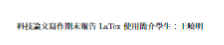

# LaTex

教學：[https://www.youtube.com/watch?v=mQamBS6uTOc&t=683s](https://www.youtube.com/watch?v=mQamBS6uTOc&t=683s)

### 快捷鍵

編譯：Control + Enter

### 指定文件類型

```latex
\documentclass[11pt]{article}
```

- 大括號{} 可以輸入的種類有
    - article 文章
    - report 論文
    - book 書籍
    - letter 信件
    - beamer 簡報
- 中括號[] 可以輸入輔助性的語法
    - 字形大小：10、11、12pt

### 主要內容架構

```latex
\begin{document}
\begin{titlepage}
\begin{center}
This is the content of the title.
\end{center}
\end{titlepage}
Type the content here.
\end{document}
```

1. begin 與 end 是一組(同一組大括號要相同)
    1. titlepage：標題
    2. center：置中
- 補充：如果沒有特別斷行，預設會變成一排
    
    ```latex
    \begin{titlepage}
    科技論文寫作期末報告
    LaTex 使用簡介
    學生：王曉明
    \end{titlepage}
    ```
    
    
    
    - 斷行或者可以讓他跳下一個”段落”
    
    ```latex
    \begin{titlepage}
    科技論文寫作期末報告
    
    LaTex 使用簡介
    
    學生：王曉明
    \end{titlepage}
    ```
    
    
    
    - 在後面加兩個反斜線能跳下一”行”，但是因為屬於同一段落，所以格式會有點跑掉
    
    ```latex
    \begin{titlepage}
    科技論文寫作期末報告\\
    LaTex 使用簡介\\
    學生：王曉明
    \end{titlepage}
    ```
    
    
    

### 安裝套件並設定-xeCJK顯示中文套為例

```latex
\usepackage{xeCJK}
\setCJKmainfont{Noto Serif CJK TC}
```

- 安裝xeCJK套件
- 可以從[官網](https://www.overleaf.com/learn/latex/Questions%2FWhich_OTF_or_TTF_fonts_are_supported_via_fontspec%3F#Fonts_for_CJK)查詢可用中文字體
- 將字形輸入至setCJKmainfont的大括號中
- 設定Compiler為XeLaTex

### geometry 套件-邊界設定

```latex
\usepackage[top=2cm, bottom=2cm, left=3cm, right=3cm, a4papper]{geometry}
```

- 設定參數：
    - 上下左右邊界(以cm或pt為單位)
    - 紙張大小：a4papper、

### setspace 套件-段落間距

```latex
\usepackage{setspace}
\doublespacing
\onehalfspacing
\setlength{\parskip}{6pt}

```

- 2 倍行高：\doublespacing
- 1.5 倍行高：\onehalfspacing
- 增加每一段之間的行距：\setlength{\parskip}{6pt}

### 段落內容

```latex
\begin{document}
\section{前言}
\section{基本格式與法}
\subsection{註腳標示}
\subsection{清單建立}
\section{圖表設定}
\section{數學公式}
\end{document}
```

- 會自動建立清單與子清單

### 註解 %

```latex
% 使用%符號來註解code
```

### 修改文字樣式

```latex
\begin{center}
\Large 科技論文寫作期末報告\\
\Huge LaTex 使用簡介\\
\Large 學生：王曉明
\end{center}
```

- 可以從[官網](https://www.overleaf.com/learn/latex/Font_sizes%2C_families%2C_and_styles)查詢可用的字型大小

### moresize 套件-更多字型

```latex
\usepackage{moresize}

\begin{center}
\vspace*{0.5 cm}
\Large 科技論文寫作期末報告\\
\vspace{2cm}
\HUGE \textbf{LaTex 使用簡介}\\
\Large 學生：王曉明
\vfill
指導教授：林小玉\\[0.2cm]
學系：資訊工程系\\[3cm]
\end{center}
```

- 從原本的\huge 變成 \HUGE 會有更大的字形
- \textbf{文字內容可以加粗字體}
- 增加文字距離：\vspace{2cm}
    - 如果上方沒有任何段落需要在語法後面加*符號：\vspace*{0.5 cm}
- 在反斜線後面加方框號可以改行距
- 將文字推到頁面邊界位置：\vfill

### graphicx 套件-放置圖片

```latex
\usepackage{graphicx}

\includegraphics[width=4.5cm]{NTUST.png}\\[2cm]
```

- 需要上傳檔案至Overleaf
- 可以更改圖片尺寸與段落間距

### enumerate 套件-清單套件

```latex
\usepackage{enumerate}

\begin{enumerate}[i.]
    \item First item
    \item Second item
\end{enumerate}

\begin{enumerate}[(a)]
    \item First item
    \item Second item
\end{enumerate}
```

- 只有安裝套件後，\begin{enumerate}[]才能加方框

### 註腳

- 方法一：直接在段落後面加 \footnote{文字} 的語法即可
    
    ```latex
    \section{基本格式與法}
    Meanwhile, Russian state media said a drone strike caused a large fire.\footnote{This is first Footnote Text.}
    ```
    
- 方法二：使用/footnotemark標記在任意地方
    
    ```latex
    \section{基本格式與法}
    Meanwhile, Russian state media\footnotemark said a drone strike caused a large fire.
    
    \footnote{This is second Footnote Text.}
    ```
    

### 建立清單

```latex
% 圓點清單
\begin{itemize}
    \item First item
    \item Second item
    \item Third item
\end{itemize}

% 數字清單
\begin{enumerate}
    \item First item
    \item Second item
    \item Third item
\end{enumerate}
```

### 插入圖表

```latex
\section{圖表設定}
Separately, Biden (See figure \ref{fig:my_label} on page \pageref{fig:my_label}) marked World Press Freedom Day on Wednesday by calling for the release of Gershkovich, as well as Austin Tice, who disappeared over a decade ago in Syria.
\begin{figure}
    \centering
    \includegraphics[width=4cm]{Chart.png}
    \caption{This is a chart}
    \label{fig:my_label}
\end{figure}

The top US diplomat said Wednesday that the US is also trying to get Russia to provide consular access to Gershkovich, which they've only done once.
```

- 如果圖表太大超過該頁面，會跳到下一頁的中間
- 加[h]表示here，圖表會被放到文字指定位置，沒加這個可能會亂跑
- \label 通常與\ref{圖片}搭配，用於標記如圖…所示的文字
    - \pageref{圖片} 可以標記該圖片在哪一頁

### 表格

```latex
\begin{table}[h]
    \centering
    \begin{tabular}{c||ll|rr}
         A & B & C & D & E \\
         \hline
         X & 1 & 2 & 3 & 4 \\ 
         Y & 100 & 200 & 300 & 400
    \end{tabular}
    \caption{This is a Table.}
    \label{tab:my_label}
\end{table}
```

- 用「|」符號可以畫垂直線
- 用\hline語法可以畫水平線
- c：置中，l：靠左，r：靠右
- 每一筆資料之間用 & 分隔
- 可以用[h]來設定表格位置

<aside>
💡 可以用此[表格生產器網站](https://www.tablesgenerator.com/)快速生成表格的語法

</aside>

### 數學公式

方法1：金錢符號，直接加在文字後

```latex
\section{數學公式}
"Courageous journalists around the world have shown time and again. 
$x^2+y^2=z^2$
```

方法2：斜線方括號，獨立一行公式（會自動置中對齊）

```latex
\[
a = \sum_{i=1}^5{\frac{\sqrt{x_i^2+1}}{2}}
\]
```

- \sqrt{}：根號
- \frac{分子}{分母}：分數
- \sum_{i=1}^：sigma符號，^表示加總到5
- x_i：x有下標i

### apacite 套件 - 參考文件

```latex
\usepackage[notocbib]{apacite}

\section{數學公式}
"Courageous\cite{汪德根2015区域旅游流空间结构的高铁效应及机理} journalists around the world have shown time and again that they will not be silenced or intimidated. The United States sees them and stands with them," Biden said. $x^2+y^2=z^2$

\[
a = \sum_{i=1}^5{\frac{\sqrt{x_i^2+1}}{2}}
\]

\pagebreak
\bibliography{ref}
\bibliographystyle{apacite}
```

- 要另外開一個ref.bib檔案
- 把引用的論文依照BibTeX格式填入ref.bib
- \bibliography{引用檔案}
- \bibliographystyle[notocbib]{引用風格}
    - 此地方用apacite為例
    - notocbib：可以避免被\tableofcontents讀取到
- 用\cite{著作} 來做引用

### 摘要

```latex
\pagebreak
\section*{摘要}
\pagenumbering{roman}
I love solving programming contest (algorithm) problems. Back in year 2000, the only authoritative.

\pagebreak
\renewcommand\contentsname{目錄}
\tableofcontents
\pagebreak

\pagenumbering{arabic}
\setcounter{page}{1}
```

- \tableofcontents：抓所有section
    - 在section加*符號，可以避免被摘要讀取（摘要被無視）
- \renewcommand\contentsname{目錄}：修改目錄文字
- \pagenumbering{頁碼格式}
    - 阿拉伯數字：arabic
    - 羅馬符號：roman
- \setcounter{page}{1}：設定頁數