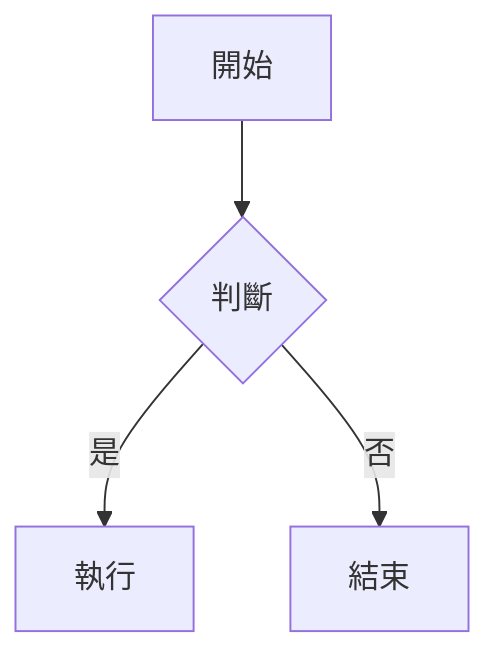

# Markdown

## 什麼是 Markdown?

`Markdown` 是一種文本格式。你可以用它來控制文檔的顯示。使用 markdown，你可以創建粗體的文字，斜體的文字，添加圖片，並且創建列表 等等。基本上來講，Markdown 就是普通的文字加上 `#` 或者 `*` 等符號。

## 設計哲學

Markdown 的目標是實現「易讀易寫」。Markdown 文件應該要能直接以純文字發佈，而不像 HTML 充滿了標籤與格式指令。Markdown 的語法受到幾種純文字電子郵件格式影響，並以成為 HTML 的轉換工具為目標。

---

## 區塊元素

### 段落與換行

段落由一個或多個空白行分隔。若要在段落內換行（`<br>`），在行末插入兩個以上的空白再按 Enter。

```markdown
第一段文字。

第二段文字。

同一段的第一行
同一段的第二行（行末有兩個空白）
```

---

### 標題

```markdown
# H1 標題
## H2 標題
### H3 標題
#### H4 標題
##### H5 標題
###### H6 標題
```

行尾的 `#` 可省略，純粹為了美觀。

**自訂錨點 ID（Extended）**：

```markdown
### 我的標題 {#custom-id}

[跳到該標題](#custom-id)
```

---

### 區塊引言

使用 `>` 符號，類似電子郵件的引言格式：

```markdown
> 這是一段引言。
>
> 這是第二段。
```

> 這是一段引言。
>
> 這是第二段。

引言可以巢狀：

```markdown
> 第一層引言
>
> > 第二層引言
```

> 第一層引言
>
> > 第二層引言

引言內可包含其他 Markdown 語法（標題、清單、程式碼等）。

---

### 清單

**無序清單**，使用 `*`、`+` 或 `-`：

```markdown
* Red
* Green
* Blue
```

**有序清單**，使用數字加句點：

```markdown
1. Bird
2. McHale
3. Parish
```

數字本身不影響輸出順序，全部寫 `1.` 結果相同。

**巢狀清單**，縮排 4 個空白或 1 個 tab：

```markdown
1. 第一項
    * 子項 A
    * 子項 B
2. 第二項
```

**任務清單（GFM）**：

```markdown
- [x] 已完成的任務
- [ ] 未完成的任務
- [ ] 另一項待辦
```

- [x] 已完成的任務
- [ ] 未完成的任務

---

### 表格（GFM）

用 `|` 分隔欄位，第二行設定對齊方式：

```markdown
| 名稱       | 說明         | 預設值 |
| ---------- | ------------ | ------ |
| name       | 使用者名稱   | null   |
| age        | 年齡         | 0      |
```

對齊語法：

```markdown
| 名稱     | 類型   | 數量 |
| :------- | :----: | ---: |
| 蘋果     | 水果   |   10 |
| 牛奶     | 飲料   |    3 |
```

| 名稱     | 類型   | 數量 |
| :------- | :----: | ---: |
| 蘋果     | 水果   |   10 |
| 牛奶     | 飲料   |    3 |

| 寫法    | 效果     |
| ------- | -------- |
| `:---`  | 靠左對齊 |
| `:---:` | 置中對齊 |
| `---:`  | 靠右對齊 |

---

### 程式碼區塊

縮排 4 個空白或 1 個 tab，會被視為程式碼區塊。

或使用圍欄式（fenced code block），並指定語言：

````markdown
```python
def hello():
    print("Hello, world!")
```
````

```python
def hello():
    print("Hello, world!")
```

```csharp
public async Task<IActionResult> GetUser(int id)
{
    var user = await _userService.GetByIdAsync(id);
    return Ok(user);
}
```

```typescript
const fetchData = async (url: string): Promise<Response> => {
    const res = await fetch(url);
    if (!res.ok) throw new Error(`HTTP ${res.status}`);
    return res.json();
};
```

---

### 分隔線

三個以上的 `*`、`-` 或 `_`（可加空白）表示分隔線：

```markdown
---
***
___
```

---

### 定義清單（Extended）

> ⚠️ 僅部分工具支援（MultiMarkdown、Pandoc），GitHub 與 Obsidian **不支援**。實務上用粗體 + 縮排取代。

```markdown
DNS
: Domain Name System，將網域名稱解析為 IP 位址的系統。

HTTP
: HyperText Transfer Protocol，無狀態的應用層協定。
: 預設 port 80，HTTPS 為 443。
```

DNS
: Domain Name System，將網域名稱解析為 IP 位址的系統。

HTTP
: HyperText Transfer Protocol，無狀態的應用層協定。
: 預設 port 80，HTTPS 為 443。

---

### 數學公式

行內公式用 `$...$`，區塊公式用 `$$...$$`：

```markdown
行內：$E = mc^2$

區塊：
$$
\sum_{i=1}^{n} x_i = x_1 + x_2 + \cdots + x_n
$$
```

> **語法限制**：Markdown 本身不內建數學公式，由底層引擎（MathJax / KaTeX）渲染 LaTeX 子集。
>
> | 工具      | 支援度              |
> | --------- | ------------------- |
> | Obsidian  | ✅ 完整（MathJax）  |
> | GitHub    | ⚠️ 新版有限支援     |
> | VS Code   | ⚠️ 需安裝外掛       |
> | Typora    | ✅ 完整（MathJax）  |

常用語法速查：

```markdown
$\frac{a}{b}$               ← 分數
$\sqrt{x}$                  ← 根號
$x^{2}$、$x_{i}$            ← 上下標（超過一字元須加 {}）
$\sum_{i=0}^{n}$            ← 加總
$\int_{0}^{\infty}$         ← 積分
$\alpha\ \beta\ \gamma$     ← 希臘字母
$\vec{v}$、$\hat{n}$        ← 向量符號
$\begin{matrix}a & b \\ c & d\end{matrix}$  ← 矩陣
```

不支援：`\usepackage`、`\newcommand`、`tikz` 圖形、完整 LaTeX 排版指令。

---

### Mermaid 圖表

在程式碼區塊指定語言為 `mermaid`：

````markdown

````


其他常用圖表類型：`sequenceDiagram`、`classDiagram`、`flowchart`、`gantt`、`erDiagram`

---

## 行內元素

### 連結

**行內形式**：

```markdown
[連結文字](https://example.com/ "選填的標題")
```

[連結文字](https://example.com/ "選填的標題")

**參考形式**：

```markdown
[連結文字][id]

[id]: https://example.com/ "選填的標題"
```

[連結文字][id]

[id]: https://example.com/ "選填的標題"

> 參考 id 不分大小寫，也可省略 id 直接用文字本身：

```markdown
[Google][]

[Google]: https://google.com/
```

---

### 強調

```markdown
*斜體*   或  _斜體_
**粗體** 或  __粗體__
***粗斜體***
```

*斜體文字*、**粗體文字**、***粗斜體文字***

---

### 刪除線（GFM）

```markdown
~~這段文字被刪除了~~
```

~~這段文字被刪除了~~

---

### 螢光標記（Extended）

```markdown
==重要文字==
```

==重要文字==

---

### 上標 / 下標（Extended）

```markdown
H~2~O      ← 下標
X^2^       ← 上標
```

H~2~O      ← 下標
X^2^       ← 上標


---

### 行內程式碼

用反引號 `` ` `` 包覆：

```markdown
使用 `printf()` 函式。
```

如果程式碼內含反引號，用多個反引號包覆：

```markdown
`` There is a literal backtick (`) here. ``
```

> **如果不這樣做會怎樣？**
> 單個反引號會與內容裡的反引號提前配對，中斷 inline code：
>
> ```markdown
> `There is a literal backtick (`) here.`
> ```
>
> 渲染結果：`There is a literal backtick (` ) here.`（括號後的內容跑到 code 外面）

---

### 圖片

語法與連結相同，前面加上 `!`：

**行內形式**：

```markdown

```

**參考形式**：

```markdown
![替代文字][id]

[id]: 圖片路徑 "選填標題"
```

---

### 腳注（Extended）

腳注由兩個部分組成：

- **引用標記**：寫在行文中，`[^id]`
- **定義**：寫在文件任意位置（通常放最後），`[^id]: 內容`

`id` 可以是數字或文字，不影響最終顯示的編號（渲染時自動按出現順序重新編號）。

```markdown
這句話需要引用來源。[^1]
另一句話也有來源。[^note]

[^1]: 第一個腳注，渲染後顯示為 1。
[^note]: 第二個腳注，渲染後顯示為 2。
```

渲染結果：

- 行文中的 `[^1]` 變成可點擊的上標數字 ¹
- 文件底部自動生成腳注區塊，點擊數字可跳回原文

腳注可以是多行（需續行縮排 4 個空白）：

```markdown
[^long]: 第一行。
    第二行（縮排 4 個空白）。
```

> ⚠️ **Obsidian 不支援多行腳注**，只支援單行。多行版本在 Pandoc、MultiMarkdown 等工具中才有效。

---

## 其他

### 自動連結

用角括號包覆 URL 或 email，會自動轉為連結：

```markdown
<https://example.com/>
<user@example.com>
```

---

### 跳脫字元

在特殊符號前加 `\` 可輸出字面符號：

```markdown
\*不是斜體\*
\# 不是標題
```

支援跳脫的字元：

```text
\   反斜線       `   反引號       *   星號
_   底線         {}  大括號       []  方括號
()  括號         #   井字號       +   加號
-   減號         .   句點         !   驚嘆號
```

---

### 行內 HTML

可以直接在 Markdown 文件中插入 HTML 標籤：

> 區塊標籤（如 `<div>`、`<table>`）必須與前後文有空白行分隔，且開始與結束標籤不可縮排。

```html
<table>
    <tr>
        <td>Foo1</td>
        <td>Foo2</td>
    </tr>
</table>
```

行內標籤（如 `<span>`、`<em>`）可直接用在段落中：

```html
這是 <em>強調</em> 的文字。
```

---

## Obsidian 專屬語法

### YAML Frontmatter（Properties）

放在檔案最開頭，用 `---` 包覆，儲存 metadata：

```yaml
---
tags: [tag1, tag2, devops]
aliases: [別名, 另一個搜尋名]
cssclasses: [wide-page]
created: 2026-05-09
updated: 2026-05-09
---
```

tags 也可以寫成縮排列表：

```yaml
tags:
  - docker
  - devops
```

常用欄位：

| 欄位          | 說明                              |
| ------------- | --------------------------------- |
| `tags`        | 標籤，供 Graph view 與搜尋使用    |
| `aliases`     | 別名，`[[別名]]` 也能連到此頁     |
| `cssclasses`  | 套用自訂 CSS class                |
| `publish`     | Obsidian Publish 是否公開         |

---

### Wikilinks（內部連結）

```markdown
[[筆記名稱]]
[[筆記名稱|顯示文字]]
[[筆記名稱#標題]]
[[筆記名稱#標題|顯示文字]]
```

Obsidian 依檔案名稱全域解析，不需要寫完整路徑。

---

### 嵌入（Embed）

```markdown
![[圖片.png]]
![[圖片.png|300]]           ← 指定寬度
![[另一篇筆記]]
![[筆記名稱#標題]]           ← 只嵌入某個章節
```

---

### Callout（提示方塊）

```markdown
> [!note]
> 這是一般提示。

> [!warning] 自訂標題
> 這是警告。

> [!tip]- 可折疊（預設收起）
> 點擊展開。
```

常用類型：

| 類型          | 顏色 / 用途     |
| ------------- | --------------- |
| `note`        | 藍色，一般說明  |
| `tip`         | 綠色，小技巧    |
| `warning`     | 橘色，注意事項  |
| `danger`      | 紅色，嚴重警告  |
| `info`        | 藍色，補充資訊  |
| `quote`       | 灰色，引言      |
| `example`     | 紫色，範例      |
| `abstract`    | 藍色，摘要      |

在類型後加 `-` 表示預設折疊，加 `+` 表示預設展開（`+` 為預設）。

---

### 註解（隱藏文字）

`%%` 包覆的內容不會被渲染，僅在編輯器中可見：

```markdown
%% 這段文字不會出現在預覽中 %%

%%
多行註解也可以
這樣寫
%%
```

---

## 參考資料

- [Markdown 語法說明（繁體中文）](https://markdown.tw/)
- [Markdown Guide — Extended Syntax](https://www.markdownguide.org/extended-syntax/)
- [Obsidian — Basic formatting syntax](https://help.obsidian.md/Editing+and+formatting/Basic+formatting+syntax)
- [Obsidian — Properties](https://help.obsidian.md/Editing+and+formatting/Properties)
- [Mermaid — 官方文件](https://mermaid.js.org/)
