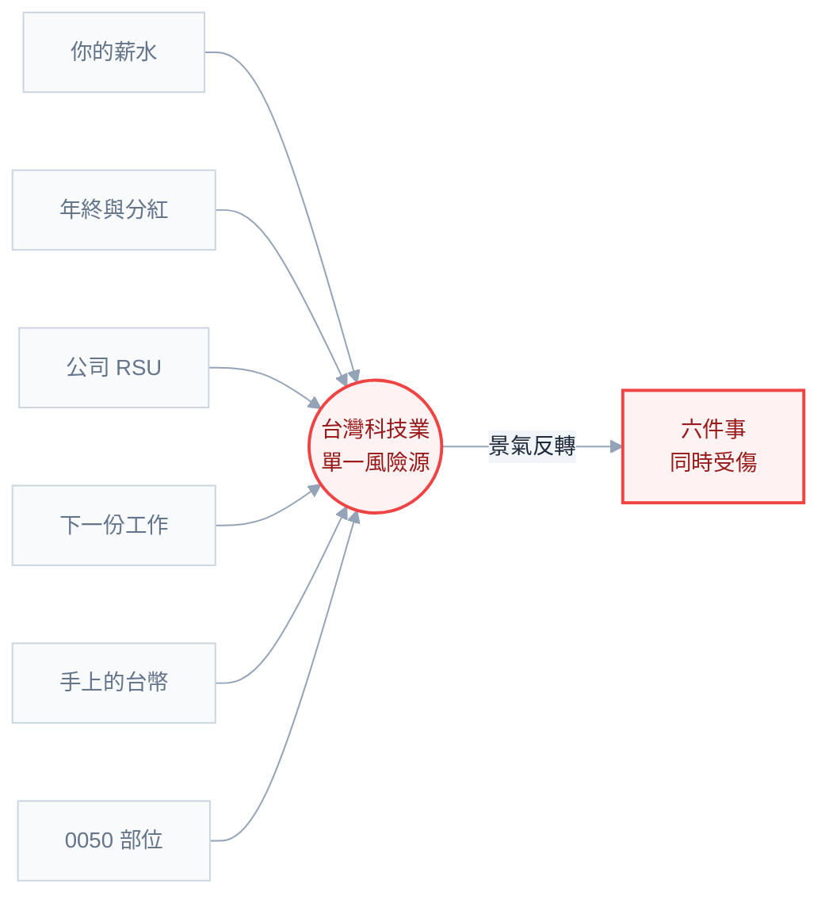

# 第 0 章：你已經是個重倉科技業的投資人了

## 從一個你沒意識到的部位講起

假設有人跑來跟你說：「我幫你規劃了一個投資組合。你所有的錢——包含未來三十年會賺到的每一塊——全部押在同一個產業。而且這個產業景氣循環明顯、技術迭代快、一次裁員潮就可能讓你的現金流歸零。你覺得怎樣？」

你當然覺得瘋了。但這就是你現在的狀態。

停下來想一下你的錢從哪來、往哪去：

- 你的**薪水**來自一家科技公司。
- 你的**年終與分紅**跟這家公司的獲利連動，而獲利跟整個產業景氣連動。
- 如果你有 **RSU（限制型股票）或員工認股**，那你手上的股票就是這家公司的股票。
- 你的**下一份工作**，八成也在同一個產業裡。
- 你手上的**現金是新台幣**，而新台幣的匯率、台灣的經濟、甚至你家房價，都跟這個產業高度相關。
- 然後你打開券商 App，買了 **0050**——一檔權值股中半導體佔比極高、單一個股（台積電）就可能佔一半的 ETF。

六件事，同一個方向。這不叫投資組合，這叫**加碼**。



**你以為左邊那六格是六個部位，實際上它們是同一個部位的六種形式。**

這就是本書的起點：在你決定買什麼之前，你得先看清楚**你手上已經有什麼部位**。而對科技業工程師來說，那個部位大到會讓後面所有的決定都不一樣。

## 人力資本：你最大的資產不在券商戶頭裡

金融學裡有個概念叫 **人力資本（human capital）**——你未來所有工作收入的現值總和。白話講就是：「如果把你從現在到退休會賺到的錢，全部折算成今天的一筆錢，那是多少？」

粗略算一下。假設你今年 30 歲，年收入 150 萬（含年終），打算工作到 60 歲，收入大致跟上通膨。用一個保守的折現率簡化計算，你的人力資本大約是**兩千萬到三千萬新台幣**這個量級。

現在看你的券商帳戶。裡面有多少？兩百萬？五十萬？

| 資產 | 粗估規模 | 你有多分散？ |
| --- | --- | --- |
| 人力資本（未來薪水） | 2,000 萬 ~ 3,000 萬 | 完全不分散：一個產業、一家公司 |
| 金融資產（帳戶裡的錢） | 50 萬 ~ 300 萬 | 你正在煩惱的就是這一小塊 |

**你 90% 以上的財富，是一個未分散、不能賣出、無法對沖的單一產業部位。** 你只是看不到它，因為它沒有出現在任何一張對帳單上。

這個視角一旦裝上去，很多事情的答案就變了：

- 「我年輕，可以承受風險，要不要 100% 股票？」——年輕確實是本錢，但你的人力資本已經**長得像股票**（跟景氣連動、會被裁員、有波動），所以你的金融資產不該再是同一種東西的加倍。
- 「公司股票給我打八折買 ESPP，超划算，全買啊？」——划算是真的，但你正在把**已經是全押的部位再往上疊**。第 9 章會給你具體的處理規則。
- 「我要不要買半導體 ETF？我懂這個產業啊。」——你懂，所以你有資訊優勢？未必。但你確定的是：**你已經有這個部位了**，而且是用你的職涯持有的。

### 反過來說：不同職業，不同配置

這也解釋了為什麼「一體適用的配置」不存在。

一個公務員的人力資本**長得像債券**：收入穩定、幾乎不受景氣影響、退休金確定。他的金融資產可以承擔比較多股票風險，因為他的「底層部位」已經很穩了。

一個科技業工程師的人力資本**長得像高波動的科技股**：多頭時薪水漲得快、有分紅有 RSU；空頭時凍薪、砍分紅、甚至裁員。而且最糟的是——**這兩件事會同時發生**：股市大跌的那一年，往往就是你被減薪或失業的那一年。這叫**相關性**，是第 6 章的主題，也是資產配置真正的核心。

一個接案的自由工作者，人力資本更像是波動更大的小型股。

所以，如果本書從頭到尾只有一個 takeaway，是這句：

> **資產配置不是決定「怎麼投資你帳戶裡的錢」，是決定「加上你的職涯之後，整體風險長什麼樣子」。**

## 那「資產配置」到底在配什麼

很多人第一次聽到這個詞，以為它是「選股票」的高級講法。不是。

**資產配置（asset allocation）是決定你的錢分佈在哪幾類資產、各佔多少百分比。** 就這樣。它處理的是「類別與比例」，不是「哪一檔」。

舉個具體的例子。下面兩件事完全不同層級：

```text
資產配置的決定：
  股票 70% / 債券 25% / 現金 5%
  股票裡面：台股 20% / 美股 60% / 其他已開發市場 20%

選標的的決定：
  台股那 20% 要買 0050 還是 006208？
```

第一個決定會影響你未來三十年報酬與波動的**絕大部分**。第二個決定的影響小到，多數情況下你丟銅板決定也不會有事（0050 與 006208 追蹤同一個指數，差別在費用率與規模）。

新手幾乎都把注意力放在第二個問題上，因為它比較刺激、比較有「在做事」的感覺。這是本書要糾正的第一個習慣。

> **常被誤引的一個研究**：1986 年 Brinson 等人的論文常被說成「資產配置決定 90% 的報酬」。原文說的其實是：在他們研究的那批退休基金裡，**配置政策解釋了報酬「隨時間波動」的約 90%**——這是在解釋「波動的來源」，不是在說「你 90% 的獲利來自配置」。這兩件事不一樣。但即使把結論打折，方向仍然成立：**配置比選標的重要得多**。看到有人拿 90% 這個數字亂用的時候，你現在知道它原本在講什麼了。

## 為什麼不能只買一種東西就好

如果股票長期報酬最高，為什麼不 100% 股票？這是新手最常見、也最合理的問題。答案有三層。

**第一層：因為你會賣掉。**

這是最現實的理由。一個 100% 股票的組合，歷史上經歷過的最大回撤（從高點跌到低點的幅度）超過 50%——2008 年金融海嘯就是。紙上談兵的時候人人都說「跌 50% 我加碼」，實際發生時，新聞每天在講經濟要完蛋、你公司在裁員、你戶頭裡的兩百萬變成一百萬。那一刻的壓力跟你在試算表上看到的 `-50%` 完全不是同一件事。

**一個你撐不住的配置，即使數學上最優，實際報酬也會是負的**——因為你會在最低點賣出。第 3 章會教你怎麼誠實估計自己撐得住多少。

**第二層：因為你不確定何時需要用錢。**

「長期」是個滑溜的詞。股票的長期報酬要用**十年以上**才可靠。但你可能三年後要結婚、五年後要買房、明年可能想離職進修。這些錢如果放在股票裡，你就是在賭「需要用錢的那年市場剛好不是低點」。

**第三層：因為「長期一定會漲」是倖存者偏誤。**

美股從 1926 年到現在的年化報酬約 10%（名目），這個數字被引用了無數次。但這是**美國**的數字，而美國是二十世紀最成功的股市。同一段期間，日本股市 1989 年的高點，直到 2024 年才真正收復——中間三十幾年。買在 1989 年日本高點的日本上班族，用他的整個職涯驗證了「長期一定會漲」這句話的極限。

分散到全世界能降低這個風險，但降低不等於消除。承認這件事，才有資格談配置。

## 工程師的優勢與陷阱

你的技術背景在這件事上，一半是助力一半是阻力。誠實面對兩邊。

### 優勢

- **你看得懂數學**。標準差、相關係數、複利公式對你不是障礙，這讓你可以直接理解機制，不用停留在「別人說」的層次。
- **你會寫程式**。第 13 章你會親手算出配置的預期報酬與風險，這種「自己驗證過」的信心，在市場大跌時值錢得多。
- **你習慣系統化**。投資的長期勝負很大一部分是「有沒有一套規則並且遵守」，這正是工程師擅長的。
- **你的收入高且穩定**。儲蓄率是前十年最大的變數，這方面你的起跑點很好。

### 陷阱

- **過度最佳化**。你會想找出「最佳配置比例」。但金融資料的雜訊遠大於訊號，回測出來的最佳解通常只是對歷史雜訊做曲線擬合。**在投資裡，「夠好且你守得住」勝過「最優且你會亂改」**。
- **把它當工程問題**。工程問題有正確答案，投資沒有。同一個決定在不同的世界線會有不同結果，而你只會看到一條世界線——**你無法從單一結果反推決策品質**。賺錢的決定不一定是好決定，賠錢的決定不一定是壞決定。
- **高估自己的資訊優勢**。你在半導體公司上班，覺得自己懂這個產業。但股價反映的是**全市場的預期**，包含幾千個全職研究這個產業的分析師的看法。你知道的事，多半已經在價格裡了。而且如果你真的知道未被公開的資訊——那叫內線交易，是刑事責任。
- **愛做事**。工程師的本能是「看到問題就修」。但投資裡最有價值的技能之一是**忍住不動**。你的配置不需要每季調整，也不需要因為新聞而改。

## 這本書怎麼用

接下來的路線是這樣：

**第一部（第 0-3 章）先不談任何產品。** 你會先盤點自己的財務現況、理解報酬從哪來、學會誠實估計自己的風險承受度。這部分不刺激，但跳過的話，後面的每個決定都會沒有依據。

**第二部（第 4-6 章）介紹積木。** 各類資產的角色、ETF 是什麼、相關性與再平衡的原理。

**第三部（第 7-10 章）組裝。** 選出你的配置比例、在台灣的實際落地（券商、稅、匯率）、處理 RSU、寫出執行計畫。

**第四部（第 11-14 章）長期作戰。** 心理陷阱、稅與保險、用程式自己算、一頁式行動清單。

## 本章重點回顧

1. 你最大的資產是**人力資本**（未來薪水的現值），對工程師來說它是一個未分散的科技業部位，規模是你金融資產的十倍以上。
2. 你的人力資本**長得像股票**，而且它跟股市**同時受傷**——這是配置時必須考慮的相關性。
3. **資產配置 = 決定類別與比例**，不是選標的。它的重要性遠大於選標的。
4. 不能 100% 股票的三個理由：你會撐不住、你不確定何時要用錢、「長期一定漲」有倖存者偏誤。
5. 工程師的最大陷阱是**過度最佳化**與**愛做事**。夠好且守得住 > 最優且會亂改。

## 下一步

在決定買什麼之前，先看清楚你現在站在哪裡。下一章帶你做一次完整的財務盤點，並釐清「投資之前必須先做完的四件事」。

## 連結

- [[資產配置與投資]] — 全書總目錄
- [[01-money-map]] — 下一章：先盤點你的財務地圖
- [[03-what-risk-really-means]] — 風險承受度怎麼誠實估計
- [[06-correlation-and-rebalancing]] — 相關性為什麼是核心
- [[09-rsu-and-concentration]] — RSU 與集中風險的具體解法
