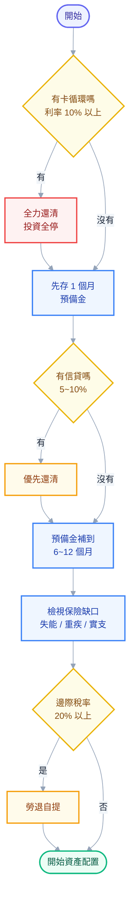

# 第 1 章：先盤點 — 你的財務地圖與那四件必須先做完的事

## 為什麼不能直接開始買

上一章講了你的處境。這一章要做的事更不刺激：**在買任何東西之前，先把你的財務現況攤開來看一次**。

工程師應該很習慣這個道理。你不會在沒讀過現有架構的情況下就開始改一個陌生系統；你會先看目前有哪些服務、資料怎麼流、哪裡有技術債。理財也一樣，只是多數人跳過了這一步，直接從「買什麼」開始——結果就是三年後帳戶裡躺著七檔莫名其妙的東西，沒有一檔說得出當初為什麼買。

而且有個更實際的理由：**如果你的基礎沒打好，投資報酬會被抵銷掉，甚至變成負的。**

想像一下這個情境：你把 50 萬全部投入市場，年化報酬 7%，看起來很棒。但你身上有一筆 40 萬的信貸，利率 5%。而且你沒有緊急預備金，所以三個月後車子壞了要花 8 萬，你被迫在市場下跌 15% 的時候賣股票。

算一下實際發生了什麼：你付了 5% 的利息去賺 7%（實際淨賺 2%，而且你承擔了全部的股票風險），然後被迫實現了 15% 的虧損。**這不是投資，這是在用高風險部位當提款機。**

所以本章的結構是：先盤點（你在哪裡），再排序（先做什麼），最後才是後面的章節（怎麼配置）。

## 第一步：畫出你的資產負債表

拿一張紙或開一個試算表，列兩欄。這件事大概花你 20 分鐘，但多數人一輩子沒做過。

### 資產：你擁有的

| 項目 | 說明 | 你的金額 |
| --- | --- | --- |
| 活存 / 數位帳戶 | 隨時可動用的現金 | |
| 定存 | 注意到期日與解約損失 | |
| 股票 / ETF | 用**現值**算，不是成本 | |
| 基金 / 保單現金價值 | 投資型保單看「解約金」不是「已繳保費」 | |
| 公司股票（RSU 已歸屬） | 這一欄要特別標記，第 9 章會處理 | |
| 公司股票（RSU 未歸屬） | **先不要算進資產**，它還不是你的 | |
| 勞退專戶 | 勞保局網站或勞保局行動服務 App 查得到 | |
| 加密貨幣 | 用現值 | |
| 房產 | 用保守的市價估，不要用你希望的價格 | |
| 車 | 大部分人會高估，它是消耗品 | |

### 負債：你欠的

| 項目 | 餘額 | **利率** | 說明 |
| --- | --- | --- | --- |
| 信用卡循環 | | 約 15% 上下 | 如果這欄有數字，本章後面所有討論都先暫停 |
| 信貸 / 現金卡 | | 通常 3%~8% | |
| 學貸 | | 通常很低 | |
| 房貸 | | 通常 2% 上下 | |
| 車貸 | | | 注意「零利率」通常包在車價裡 |
| 跟家人借的錢 | | 0% 但有情緒成本 | 很多人會漏掉這欄 |

**淨資產 = 資產總和 − 負債總和。**

這個數字可能比你想的小很多，甚至是負的。沒關係，**這是起點不是成績**。重點是從今天起你有一個可以追蹤的基準線；一年後再算一次，你就知道自己是往前還是原地踏步。

> 💡 **一個常見的自我欺騙**：把「未歸屬的 RSU」和「今年預期的年終」算進資產。它們是**預期**，不是資產。RSU 沒歸屬前公司可以裁掉你，年終可以砍。財務規劃要建立在確定的東西上，把不確定的東西當成上檔驚喜。

## 第二步：算出你的儲蓄率（前十年最重要的數字）

資產負債表是**存量**，它告訴你現在的狀態。但決定你未來十年會走多遠的，是**流量**——也就是每個月留下多少錢。

```text
儲蓄率 = (稅後總收入 − 總支出) ÷ 稅後總收入
```

用年為單位算（把年終、分紅、RSU 都算進去），不要只看單月，否則發年終的那個月會讓你的數字失真。

### 為什麼儲蓄率在前期比報酬率重要

這是本書最重要的算術之一，值得你自己在試算表上跑一次。

假設一個年收 150 萬的工程師，起始資產 0，年化報酬 7%：

| 儲蓄率 | 年存 | 10 年後資產 | 20 年後資產 |
| --- | --- | --- | --- |
| 10% | 15 萬 | 約 207 萬 | 約 615 萬 |
| 25% | 37.5 萬 | 約 518 萬 | 約 1,538 萬 |
| 40% | 60 萬 | 約 829 萬 | 約 2,461 萬 |

再看另一組對照。同樣年存 37.5 萬，比較不同報酬率：

| 年化報酬 | 10 年後 | 20 年後 |
| --- | --- | --- |
| 4% | 約 450 萬 | 約 1,117 萬 |
| 7% | 約 518 萬 | 約 1,538 萬 |
| 10% | 約 598 萬 | 約 2,146 萬 |

看出來了嗎？**在前十年，把儲蓄率從 10% 提到 25%，效果遠大於把報酬率從 4% 提到 10%。** 而且前者你完全能控制，後者你完全不能控制。

這個關係會隨時間翻轉——當你的資產累積到「一年的報酬 > 一年的儲蓄」時，報酬率就變成主角了。以上面的例子，大概發生在第 15 到 20 年之間。但在那之前，**存錢比選標的重要得多**，而這正是多數新手花最少時間思考的部分。

> 🔧 **工程師視角**：這就像效能最佳化。你在花三天調一個佔總耗時 5% 的函式，還是花一小時把佔 60% 的那段拿掉？儲蓄率就是那個 60%。

### 提高儲蓄率的兩個方向

**降低支出**這件事有天花板，而且會影響生活品質。實務上最有效的是砍掉「經常性、金額大、但快樂感低」的支出——通常是房租的等級、車、以及一堆忘了取消的訂閱。一次性檢查所有自動扣款，多數人會找出每月一兩千塊的殭屍訂閱。

**提高收入**對工程師來說天花板高很多。換工作的加薪幅度通常遠大於年度調薪，而且複利效應會跟著你整個職涯。這聽起來像廢話，但值得明說：**對三十歲的工程師來說，花時間提升技能與談薪水的期望值，通常高於花同樣時間研究投資標的。**

## 第三步：投資之前必須先做完的四件事

現在進到本章的核心。下面四件事有**明確的優先順序**，做完才進入投資。理由不是道德教條，是純粹的數學。

### 地基 1：清掉高利率債務

**判準很簡單：把「還債」看成一筆保證報酬率等於債務利率、且免稅的投資。**

你的信用卡循環利率大概 15%。市場上有任何東西能保證給你 15% 且零風險嗎？沒有。所以還卡債的期望值，遠遠打敗你能做的任何投資。

一個實用的分界線：

| 債務利率 | 建議 |
| --- | --- |
| 10% 以上（卡循環、現金卡） | **無條件優先還清**。在還清之前不要投資。 |
| 5% ~ 10%（多數信貸） | 優先還。這個利率超過股票的合理長期實質報酬預期。 |
| 2% ~ 5%（低利信貸、部分學貸） | 灰色地帶。看你的風險承受度與心理負擔。 |
| 2% 以下（多數房貸、政府學貸） | 通常不急著提前還，這筆錢投資的期望值較高。但這是**期望值**，不是保證。 |

> ⚠️ **注意這裡有個心理維度不能忽略**：數學上房貸利率 2% 而股票預期 7%，所以不該提前還。但如果那筆房貸讓你每晚睡不好、讓你在市場下跌時做出蠢決定，那提前還的「心理報酬」是真實的。**財務決策要能執行才算數。**

### 地基 2：建立緊急預備金

緊急預備金的用途只有一個：**讓你在意外發生時，不必被迫賣掉投資部位。**

它不是為了賺錢，所以不要拿它去追求報酬。它的規格是「隨時可動用、本金不會變少」。

**該存多少？** 常見說法是 3 到 6 個月支出，但這個數字要依你的處境調整：

| 你的情況 | 建議月數 | 理由 |
| --- | --- | --- |
| 雙薪、產業穩定、無房貸小孩 | 3 個月 | 現金流有備援 |
| 單薪、科技業、有房貸 | **6 ~ 12 個月** | 裁員與市場下跌會同時發生 |
| 接案 / 自營 | 12 個月以上 | 收入本身就是波動的 |
| 產業景氣正在轉差 | 往上加 | 找工作的時間會拉長 |

科技業工程師該偏保守那一側，原因就是第 0 章講的：**你失業的那年，很可能就是你的投資組合最慘的那年**。緊急預備金的價值恰恰在那一刻兌現。

**注意是「幾個月的支出」不是「幾個月的收入」。** 先算出你每月的必要支出（房租/房貸、伙食、交通、保險、水電、貸款），這個數字通常比你以為的低。

**放在哪裡？**

| 工具 | 特性 | 適合度 |
| --- | --- | --- |
| 數位帳戶高利活存 | 有額度上限的較高利率、隨時提領 | ⭐ 主力 |
| 一般活存 | 利率極低但完全流動 | 放一部分 |
| 定存（可分拆成多筆小額） | 利率略高，中途解約只損失利息 | 可放一部分 |
| 貨幣市場基金 / 超短債 ETF | 利率再高一點，但有 T+N 的贖回時間 | 進階選項 |
| 股票、加密貨幣 | **不行** | ❌ 它會在你最需要錢的時候剛好變少 |

一個實務技巧：把定存拆成多筆（例如 5 筆 10 萬而不是 1 筆 50 萬），需要用 12 萬時只解約兩筆，不會損失整筆的利息。

### 地基 3：把保險買對（不是買多）

保險的功能是**把「機率低但會毀掉你」的風險轉移出去**，不是投資工具。這句話能幫你過濾掉市面上八成的產品。

判準：**這件事發生的話，我的財務會不會崩掉？** 會 → 保險。不會 → 自己承擔（那就是緊急預備金的工作）。

對一個三十歲的科技業工程師，缺口通常在這幾塊：

| 風險 | 為什麼重要 | 常見狀況 |
| --- | --- | --- |
| **失能** | 你最大的資產是人力資本。失能 = 這個資產歸零，但支出還在，甚至增加 | 最常被忽略 |
| **重大傷病 / 癌症** | 健保有給付但自費項目與收入中斷是缺口 | 常有但額度不足 |
| **意外 / 意外醫療** | 便宜，槓桿高 | 通常有 |
| **壽險** | 只有在「有人依賴你的收入」時才需要（配偶、小孩、要養的父母、房貸） | 單身無扶養者通常不需要大額壽險 |
| **實支實付醫療** | 補健保沒給付的自費醫材與病房差額 | 值得檢視額度與副本理賠 |

> ⚠️ **投資型保單（投資型壽險、儲蓄險）為什麼通常不建議**：它把「保障」和「投資」綁在一起，結果兩件事都不夠好。你付的錢有一部分被拿去當保險成本與各種費用（前置費用、帳戶管理費、保單維持費），實際投入市場的比例可能只有七八成，而且內部的基金費用率遠高於 ETF。第 5 章會用具體數字算給你看 1% 的費用差在三十年後是多少錢。**要保障就買定期險（便宜、純保障），要投資就買低成本的指數型工具，分開處理。**

如果你不確定自己的保單內容——很多人是父母幫忙買的，自己沒看過——**去把保單條款調出來看**，或請保險公司提供保障內容明細。你至少要知道：保什麼、保額多少、保到幾歲、每年繳多少。

### 地基 4：用掉「政府補貼」的額度

在投入一般帳戶之前，先確認有沒有「同樣的錢放進去會變多」的地方。台灣的選項不像美國那麼多，但有一個值得認真看：

**勞退自願提繳（勞退自提）。** 制度上你可以在法定的雇主提繳 6% 之外，自己再提繳最高 6% 的月提繳工資到勞退專戶。關鍵在於：**自提的金額可以從當年度個人綜合所得總額中全數扣除**——也就是說你這部分收入當年不課稅。

用直覺理解：如果你的邊際稅率是 20%，自提 10 萬等於當年少繳 2 萬的稅。這是**確定的、當下就發生的 20% 報酬**，市場上沒有任何投資能給你這種東西。

要權衡的地方也要講清楚，不要只講好處：

- **流動性差**：這筆錢原則上要到請領年齡（目前 60 歲）才能領，中間動不了。
- **報酬受限**：勞退基金由政府統一運用，有「保證收益不低於當地銀行二年定期存款利率」的保障，但長期報酬通常低於全球股票市場。
- **稅是遞延不是消失**：領的時候仍有相關課稅規定（有一定的免稅額度與計算方式），只是多數人退休後的稅率低於工作期間。

所以它適合誰？**邊際稅率高（20% 以上）、緊急預備金已經備妥、且確定這筆錢在退休前不會用到**的人。如果你邊際稅率只有 5%，那個節稅誘因就小很多，流動性的代價相對變大。

> 📌 制度細節（提繳上限、請領年齡、課稅方式）會修法調整，**執行前請查勞動部勞工保險局的當年度公告**，不要照抄本文或任何部落格的數字。

## 順序整理：一張決策圖

把上面四件事串起來，你的執行順序是：



注意第 2 步：**在還債之前先存一個月的預備金**。純數學上應該全力還債，但沒有任何緩衝的人一遇到意外就會再刷卡，重新回到起點。這一步是為了打斷那個循環。

## 第四步：建立追蹤機制

盤點做一次沒用，你需要能持續看到數字。但也不要做得太重——**能持續三年的粗略系統，勝過用兩個月就放棄的精美系統**。

最小可行的做法：

- **一個試算表，每季更新一次**。欄位：日期、各帳戶餘額、總資產、總負債、淨資產。就這五欄。
- **記帳只在「不知道錢花去哪」的時候做**，而且只做兩三個月，找出漏洞後就可以停。長期記帳的邊際效益遞減。
- **設定自動化**：薪水入帳後自動轉出固定金額到投資帳戶與預備金帳戶。**先付給自己**，剩下的才是可花的錢。這比「月底看看剩多少再存」有效得多，因為它把意志力從流程中拿掉了。

> 🔧 **工程師視角**：自動轉帳就是把「儲蓄」從 runtime 的判斷移到 deploy 時的設定。你不會希望一個關鍵流程每個月都要人工決策一次。

## 本章重點回顧

1. **先畫資產負債表**：資產用現值，負債要標利率，未歸屬 RSU 不算資產。
2. **儲蓄率在前十年比報酬率重要**，而且它是你唯一能控制的變數。
3. 投資前的四件事有嚴格順序：**清高利債 → 緊急預備金 → 保險買對 → 用掉稅優額度**。
4. 緊急預備金是「不被迫賣股票」的保險，科技業建議 **6~12 個月支出**，理由是失業與股災會同時發生。
5. 保險是轉移「會毀掉你」的風險，**保障與投資要分開**；投資型保單通常兩邊都不夠好。
6. 追蹤系統要**簡單到你會持續做**，並用自動轉帳把意志力移出流程。

## 下一步

地基打好之後，才輪到「投資本身」。下一章從最根本的問題開始：**報酬到底從哪裡來？** 這個問題你如果答不出來，就沒辦法分辨哪些投資是有道理的、哪些只是在賭。

## 連結

- [[資產配置與投資]] — 全書總目錄
- [[00-why-asset-allocation]] — 上一章：你已經重倉科技業了
- [[02-return-and-compounding]] — 下一章：報酬從哪裡來
- [[05-etf-and-indexing]] — 費用率的殺傷力（投資型保單那筆帳）
- [[12-tax-and-safety-net]] — 稅務與保險的完整討論
