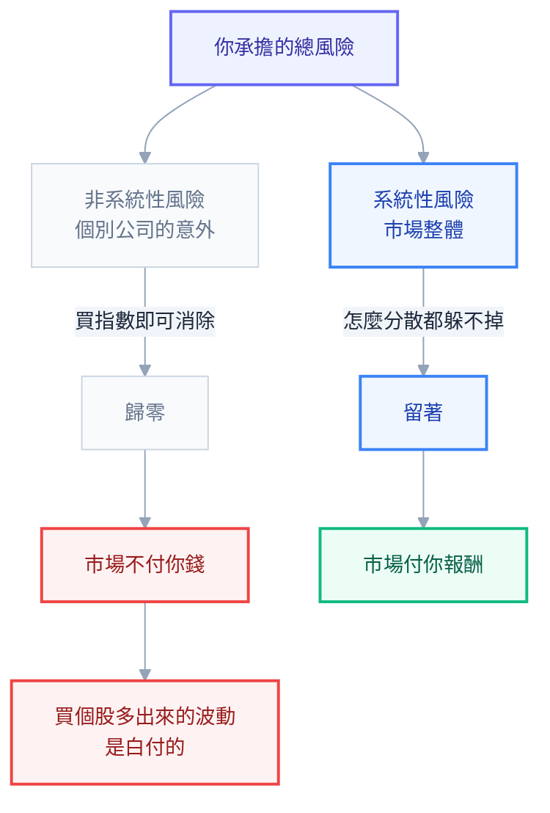

# 第 6 章：相關性與再平衡 — 資產配置真正的機制

## 為什麼 1 + 1 可以大於 2

前面五章講了要買什麼、用什麼工具買。但還沒回答最核心的問題：

> **為什麼把幾個東西「組合」起來，會比單獨持有更好？**

如果答案只是「雞蛋不要放同一個籃子」，那你會得出一個錯誤的推論：買越多檔越好、買越多種類越好。這是很多人的實際做法——帳戶裡躺著十幾檔東西，然後以為自己很分散。

真正的機制比這精確得多，而且它有一個相當漂亮的數學結果。這一章要講清楚它，因為理解它之後，你才會知道**哪些分散是有效的、哪些只是心理安慰**。

## 相關係數：兩個資產是不是一起動

先建立工具。**相關係數（correlation, ρ）** 衡量兩個資產的報酬「一起變動」的程度，範圍是 −1 到 +1：

| ρ 值 | 意思 | 例子 |
| --- | --- | --- |
| **+1** | 完全同步，一個漲另一個必漲 | 0050 和 006208（追蹤同一指數） |
| **+0.7 ~ +0.9** | 高度正相關 | 台股與美股、台股與科技股 |
| **+0.3 ~ +0.6** | 中度正相關 | 已開發股市與新興市場（其實比想像的高） |
| **0** | 無關 | 理論上的理想分散對象 |
| **−0.3 ~ 0** | 微弱負相關 | 股票與高品質公債（多數時期） |
| **−1** | 完全反向 | 現實中幾乎不存在（除了刻意設計的反向產品） |

> 🔧 **工程師視角**：這就像看兩個服務的 metric 曲線。如果 CPU 和 latency 總是一起飆，那監控兩個等於監控一個——它們攜帶的是同一份資訊。分散投資的目標，就是找出**曲線形狀不一樣**的資產。

## 核心數學：期望報酬是線性的，風險不是

現在來看那個漂亮的結果。假設你把兩個資產按權重 w₁、w₂ 組合起來。

**組合的期望報酬**是單純的加權平均：

```text
E(組合) = w₁ × E₁ + w₂ × E₂
```

這裡沒有魔法。你不能靠組合憑空生出報酬。

**組合的風險（變異數）**就不一樣了：

```text
σ²(組合) = w₁²σ₁² + w₂²σ₂² + 2·w₁·w₂·ρ·σ₁·σ₂
                                    ↑
                            關鍵在這個 ρ
```

注意最後一項乘了 ρ。**如果 ρ 小於 1，這一項就會變小，整個組合的風險就會低於「兩者風險的加權平均」。**

這就是全部的秘密。**報酬是線性相加的，風險不是。**

### 用具體數字看

假設：

- **股票**：期望報酬 7%，標準差 18%
- **債券**：期望報酬 3%，標準差 6%
- 配置：**股票 60% / 債券 40%**

組合的期望報酬固定是 `0.6 × 7% + 0.4 × 3% = 5.4%`，**不管相關係數是多少**。

但組合的標準差會隨 ρ 改變：

| 相關係數 ρ | 組合標準差 | 說明 |
| --- | --- | --- |
| **+1.0** | **13.2%** | 完全同步 = 加權平均，**沒有任何分散效果** |
| +0.5 | 12.2% | |
| **0** | **11.1%** | 完全無關 |
| −0.3 | 10.3% | |
| −0.5 | 9.8% | |

看最上面和最下面那兩列：**同樣的 5.4% 期望報酬**，風險從 13.2% 降到 9.8%。你什麼都沒犧牲，只是因為兩個資產不同步。

**這就是被 Harry Markowitz 稱為「投資裡唯一的免費午餐」的東西。** 它免費在：你不需要放棄任何期望報酬，就能降低風險。所有其他提高報酬的方法都要付出代價（承擔更多風險、花更多時間、付更多費用），只有這一項不用。

> 📌 再串回第 2 章：降低波動會**直接提高長期複利報酬**（波動拖累）。所以這頓午餐不只免費，它還可能加菜——同樣的算術平均報酬，波動小的組合終值更高。

## 分散消除得了什麼、消除不了什麼

免費午餐有上限。這是新手最需要搞清楚的一條界線。

風險可以拆成兩塊：

| 類型 | 別名 | 例子 | 能不能靠分散消除 |
| --- | --- | --- | --- |
| **非系統性風險** | 個別風險、可分散風險 | 某公司財報造假、某工廠失火、某執行長被抓 | **可以** |
| **系統性風險** | 市場風險、不可分散風險 | 升息、戰爭、全球衰退、疫情 | **不行** |

你持有的股票越多，個別公司的意外會互相抵銷，非系統性風險趨近於零。但**整個市場一起跌的風險，你怎麼分散都躲不掉**——因為所有股票都泡在同一個經濟環境裡。

這條界線推出一個非常重要的結論，也是第 4 章那句話的來源：

> **市場只為「無法分散的風險」付你報酬。**

為什麼？因為非系統性風險是**你自己選擇承擔的**。既然任何人都可以用零成本（買指數）消除它，市場就沒有理由為它付溢酬。

**所以：買一檔個股，你承擔了「市場風險 + 該公司的個別風險」，但你只會因為前者得到報酬。** 那個額外的波動是白付的。



這就是為什麼「我全押台積電，反正它很強」在期望值上是不划算的——不是因為台積電不好，而是因為你多承擔了一份沒有人會付錢給你的風險。

## 相關性的三個陷阱

理論很漂亮，但實務上有三個地方會咬人。誠實講清楚，不然你會對分散有過高的期待。

### 陷阱 1：相關性不是常數，而且它在你最需要的時候會變高

這是最重要的一個。

**危機時，資產之間的相關性會趨近 +1。**

原因是行為性的：恐慌時投資人不分青紅皂白地賣出一切換現金；而且很多機構有槓桿，被追繳保證金時必須賣掉還賣得掉的東西。結果是——你精心挑選的、平常不同步的資產，在崩盤那幾週一起跌。

2008 年大量「分散良好」的組合同時重挫，就是這個現象。

**推論**：你不能假設「歷史相關係數 0.2」在危機時還是 0.2。分散在**平常**很有效，在**極端事件**時效果打折。真正在危機中還站得住的，只有極少數東西（主要是高品質公債與現金）。

### 陷阱 2：2022 年的教訓 —— 股債同跌

長期以來「股債負相關」幾乎被當成常識。但 2022 年股票跌、債券也跌。

原因不難理解：**過去二十年的股債負相關，很大程度是「低通膨環境」的產物。** 在低通膨時，經濟差 → 央行降息 → 債券漲，所以債券在股災時上漲。

但當**通膨本身**是問題的時候，邏輯反過來：通膨高 → 央行升息 → 股票跌（估值壓縮）**且**債券跌（利率上升）。兩邊同時受害。

**這不代表債券沒用**，它代表：

1. 你要理解你的穩定器在「什麼情況下」有效
2. **持有現金作為第三支柱是有理由的**——它是唯一在任何情境下都不會名目虧損的東西
3. 不要對任何單一避險工具有信仰

### 陷阱 3：相關係數是線性度量，且是後照鏡

相關係數只捕捉線性關係，捕捉不到非線性的共同行為。而且所有相關矩陣都是用**歷史資料**算的——它描述過去，不保證未來。

**實務建議**：用相關性當**方向性的判斷工具**（「這兩個東西性質不同嗎？」），不要當**精確的最佳化輸入**。用歷史相關矩陣跑出來的「最佳配置」對輸入極度敏感，改一點點假設答案就大不同。這是工程師最容易掉進去的坑——第 13 章會實際算給你看這個敏感度。

## 再平衡：讓配置維持在你決定的樣子

### 為什麼配置會自己跑掉

你決定 60% 股票 / 40% 債券。一年後股票大漲、債券持平，現在變成 70% / 30%。

**你沒有做任何決定，但你的風險水位變高了。** 而且是在市場漲了很多之後才變高——換句話說，你在越貴的時候持有越多。

反過來也一樣：股票大跌後，你的股票佔比變低，你在最便宜的時候持有最少。

**再平衡就是把比例調回你原本決定的樣子。** 它的本質是：

> **賣掉漲多的，買進跌多的。**

這是一個**機械式的、逆向的**動作。它不需要你判斷市場，只需要你遵守規則。

### 具體走一遍

起點：總資產 1,000 萬，股 600 萬（60%）/ 債 400 萬（40%）。

**發生崩盤**：股票 −40%，債券 +5%。

```text
股票：600 → 360 萬
債券：400 → 420 萬
總計：780 萬   →  現在的比例是 46% / 54%
```

**執行再平衡**（調回 60/40）：

```text
目標：股 468 萬 / 債 312 萬
動作：賣掉 108 萬債券，買進 108 萬股票
```

**兩年後市場反彈**，股票 +50%、債券 +2%：

| | 有再平衡 | 沒再平衡 |
| --- | --- | --- |
| 股票 | 468 × 1.5 = 702 萬 | 360 × 1.5 = 540 萬 |
| 債券 | 312 × 1.02 = 318 萬 | 420 × 1.02 = 428 萬 |
| **總計** | **1,020 萬** | **968 萬** |

差了 52 萬。因為再平衡讓你在低點買進了更多股票。

### 但不要對「再平衡紅利」有過高期待

上面的例子很漂亮，但要誠實：**再平衡不保證提高報酬。**

在一個**單邊上漲**的市場裡（股票連漲十年），再平衡會讓你持續賣掉表現最好的資產，最終報酬會**低於**不再平衡。這種情況真實發生過。

所以請把再平衡的兩個效果分清楚：

| 效果 | 確定性 | 說明 |
| --- | --- | --- |
| **控制風險水位** | **確定** | 這是主要目的，也是它唯一保證做到的事 |
| 提高報酬（買低賣高） | 不保證 | 在震盪或均值回歸的市場有效，在單邊行情無效甚至有害 |

**把再平衡當作風險管理工具，不要當作報酬增強工具。** 它保證的是「你的組合一直長得像你當初決定的樣子」，這本身就夠有價值了——因為那個決定是你在冷靜時做的，而漂移是市場情緒推著走的。

## 再平衡的規則：多久一次、什麼條件

三種常見做法：

### 做法 1：時間法（calendar rebalancing）

固定週期檢查並調整，例如**每年一次**。

- ✅ 簡單、可預測、不需要盯盤
- ✅ 不會被短期波動誘發過度交易
- ❌ 大事件發生在週期中間時反應較慢

### 做法 2：閾值法（threshold rebalancing）

偏離目標超過某個幅度才動，例如**任一資產偏離 5 個百分點**（60% 變成 65% 或 55% 就動）。

- ✅ 只在真正需要時才交易
- ✅ 大幅波動時能及時反應
- ❌ 需要定期監看
- ❌ 劇烈震盪期可能觸發多次交易

### 做法 3：混合（實務上最推薦）

**每年檢查一次（或每半年），但只有在偏離超過門檻時才動手。**

```text
規則範例：
  每年 1 月與 7 月檢查一次
  若任一大類偏離目標超過 5 個百分點 → 調回目標
  否則什麼都不做
```

這個做法兼顧簡單與效率，而且**大部分年份你會什麼都不用做**——這正是重點。

### 頻率不是越高越好

再平衡有成本：

| 成本 | 說明 |
| --- | --- |
| **稅** | 賣出可能實現資本利得（台股目前無資本利得稅，但海外所得有相關規定，見第 12 章） |
| 手續費與價差 | 每次交易都在漏水 |
| **動能效應** | 短期內資產有輕微的動能傾向，太頻繁的再平衡可能持續賣在半路 |

研究普遍顯示，**每年一次到每兩年一次，配合 5% 門檻**，在成本與效果之間是不錯的平衡。每月再平衡不會讓你更好，只會讓你更忙、成本更高。

## 最好的再平衡工具：新資金

如果你還在累積期（每個月都有新錢投入），你有一個比買賣更好的工具：

> **不要賣任何東西。把每個月的新資金，全部投入「目前佔比低於目標」的那個資產。**

用前面的例子：崩盤後你的比例是 46/54，那接下來幾個月的投入就全部買股票，直到比例回到 60/40。

好處：

- **零賣出成本、零稅務事件**
- 心理上比「賣掉賺錢的去買虧錢的」容易得多
- 自然地達成「在低點買更多」

只有在新資金不足以拉回比例時（通常是資產規模已經遠大於年度投入額，或市場波動極大），才需要真的賣出調整。

## 再平衡最難的部分不是計算

計算很簡單。難的是**它要求你做違反直覺的事**。

- 股票崩盤 40%、新聞說世界要完蛋的時候，規則叫你**買進更多股票**
- 股票連漲三年、所有人都在賺錢的時候，規則叫你**賣掉一部分**

這兩件事在當下都會讓你覺得自己是笨蛋。

**這就是為什麼「事先寫下規則」如此重要。** 你在冷靜的時候制定規則，在情緒的時候只負責執行。這跟你在系統裡寫 runbook 是同一個道理——**事故當下不是設計流程的時候**，你只想照著已經想清楚的步驟做。

第 14 章的「投資政策聲明（IPS）」就是這份 runbook。

## 本章重點回顧

1. **報酬是線性加權的，風險不是。** 只要相關係數小於 1，組合的風險就低於成員風險的加權平均——這是「唯一的免費午餐」，你不需要犧牲期望報酬。
2. 分散只能消除**非系統性風險**（個別公司的意外），消不掉**系統性風險**（市場整體）。推論：**市場只為不可分散的風險付錢**，所以持有個股多出來的波動是白付的。
3. 三個陷阱：**危機時相關性趨近 1**（分散在你最需要時效果打折）、**2022 股債同跌**（過去的負相關是低通膨環境的產物，現金是第三支柱）、相關矩陣是後照鏡且對最佳化極度敏感。
4. **再平衡 = 賣漲多的、買跌多的**，是機械式的逆向動作。它**確定**能做到的是控制風險水位；提高報酬**不保證**（單邊上漲的市場反而有害）。
5. 實務規則：**每年（或半年）檢查一次 + 偏離 5 個百分點才動手**。頻率越高不會越好。
6. **累積期最好的再平衡工具是新資金**——把每月投入導向佔比不足的資產，零成本、零稅務事件、心理阻力最小。
7. 再平衡最難的是心理。**規則要在冷靜時寫下來**，情緒時只負責執行。

## 下一步

第二部結束。你現在有了全部的零件與組裝原理。

第三部開始動手：下一章把你在第 3 章寫下的那五題答案，轉換成一組具體的百分比。我們會巡覽幾個經典配置模型，看它們各自的假設與適用對象，然後給你一個可以直接開始的起點。

## 連結

- [[資產配置與投資]] — 全書總目錄
- [[05-etf-and-indexing]] — 上一章：ETF 與指數化
- [[07-choose-your-allocation]] — 下一章：決定你的配置比例
- [[02-return-and-compounding]] — 波動拖累（免費午餐為什麼還會加菜）
- [[04-asset-classes]] — 「未分散的風險市場不付錢」的第一次出現
- [[13-compute-it-yourself]] — 用 Python 算相關矩陣與組合波動
- [[14-action-checklist]] — 把規則寫成投資政策聲明
