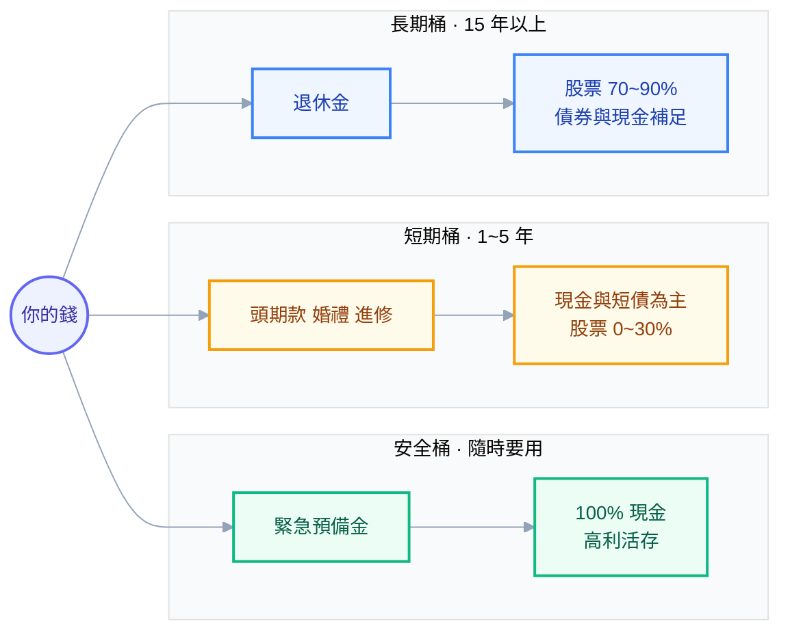

# 第 7 章：決定你的配置比例

## 從輸入到輸出

前面六章都是在準備輸入。現在要產出一個具體的東西：**一組加起來等於 100% 的百分比**。

先把手上的輸入攤開來。你在第 3 章寫下的五題答案：

1. 這筆錢幾年後用、用來做什麼？（→ 承受**能力**）
2. 跌到 ___ 萬我睡得著嗎？（→ 承受**意願**）
3. 失業能撐幾個月？（→ 承受**能力**）
4. 需要多少年化報酬才能達標？（→ **需要**承擔多少）
5. 上次大跌你實際做了什麼？（→ 意願的**校準**）

如果你跳過了那五題，現在回去寫。沒有它們，這一章你只能抄一個數字，而抄來的數字在市場下跌時撐不住——因為你不知道它為什麼是那個數字。

## 最重要的單一決定：股債比

你的配置有很多層決定，但它們的重要性差距極大：

```text
影響力
  ↑
  │  ①  股票 vs 非股票的比例          ← 這一個決定佔了絕大部分
  │
  │  ②  股票內部怎麼切（地理、規模）  ← 影響中等
  │
  │  ③  用哪一檔 ETF 實作             ← 影響很小
  ↓
```

**先把 ① 做對，② 做得合理，③ 不要花超過一個晚上。** 新手的時間分配通常剛好相反。

### 三個常見的「公式」與它們的問題

**公式 1：「100 減年齡 = 股票比例」**

30 歲 → 70% 股票。這個規則的優點是簡單，缺點是**它只考慮一個變數**（年齡），完全忽略了你的收入穩定度、目標、緊急預備金、心理承受度。

而且這條規則誕生時的預期壽命與利率環境跟現在不同，所以後來出現了「110 減年齡」「120 減年齡」的版本——**當一個規則有三個版本而且沒人說得出哪個對，那它就不是規則，是猜測**。

**公式 2：「年輕就該 100% 股票」**

理論根據是「時間長，波動會被平均掉」。第 3 章已經拆解過這個迷思：時間縮小的是**年化報酬**的離散度，放大的是**最終金額**的離散度。

而且對科技業工程師來說還有第 0 章那個理由：你的人力資本已經很像股票了。

**公式 3：直接抄某個 YouTuber 的配置**

最大的問題不是那個配置好不好，是**你不知道它的假設**。他 45 歲、有兩間房收租、配偶是公務員——他的 90% 股票配置，對他是合理的，對你可能不是。

### 一個比較誠實的推導方式：用最壞情況反推

比起套公式，我建議用這個方法，因為它直接連結到你真正會經歷的事。

**步驟 1：估計你的組合在崩盤時大概會跌多少。**

一個粗略但夠用的近似（假設非股票部位是高品質債券與現金）：

```text
組合的最大回撤 ≈ 股票比例 × 50%
```

（用 50% 是因為歷史上全球股票的重大回撤大約在 −45% 到 −55% 之間。）

| 股票比例 | 預估最壞回撤 | 100 萬會變成 | 500 萬會變成 |
| --- | --- | --- | --- |
| 100% | −50% | 50 萬 | 250 萬 |
| 80% | −40% | 60 萬 | 300 萬 |
| **60%** | **−30%** | 70 萬 | **350 萬** |
| 40% | −20% | 80 萬 | 400 萬 |
| 20% | −10% | 90 萬 | 450 萬 |

**步驟 2：把「你的實際金額」代進去，然後誠實回答。**

不要看百分比，看金額。假設你現在有 300 萬，五年後會有 800 萬：

> 「我的 800 萬變成 480 萬，而且新聞說還要再跌。我的公司在裁員。我要繼續每個月投入 4 萬。**我做得到嗎？**」

如果答案是「應該可以吧」——那就再降一級。**「應該可以」在真實壓力下通常等於「不行」。**

**步驟 3：跟你的「需要」對照。**

算出這個股票比例對應的預期報酬，看它能不能達成你的目標（第 3 章的維度 3）。

粗略對照表（名目報酬，股票假設 7%、債券 3%、現金 1.5%）：

| 配置 | 預期年化（名目） | 預期年化（實質，扣 2.5% 通膨） |
| --- | --- | --- |
| 100% 股 | 7.0% | 4.5% |
| 80/20 | 6.2% | 3.7% |
| 60/40 | 5.4% | 2.9% |
| 40/60 | 4.6% | 2.1% |
| 20/80 | 3.8% | 1.3% |
| 100% 現金 | 1.5% | **−1.0%** |

如果你的目標需要 5% 名目報酬，那 60/40 大致夠。如果需要 8%，那**任何合理配置都到不了**——你要調整的是目標或儲蓄率，不是把配置推到極端。

> ⚠️ **這是很多人搞錯的地方**：目標達不到時，多數人的反應是「那我配置積極一點」。但把股票從 80% 拉到 100%，預期報酬只多了 0.8%，最壞回撤卻多了 10 個百分點。**用配置去追缺口的效率很差，用儲蓄率去追效率高得多。**

## 分桶：一個人可以有好幾個配置

前面談的是「一筆錢」。但你其實有好幾筆錢，用途不同、期限不同，**它們該有不同的配置**。

這叫**分桶（bucketing）**，是我認為對新手最有用的一個心智工具。

| 桶 | 用途 | 期限 | 建議配置 |
| --- | --- | --- | --- |
| **安全桶** | 緊急預備金 | 隨時 | 100% 現金 / 高利活存 |
| **短期桶** | 結婚、買車、進修、頭期款 | 1~5 年 | 現金與短債為主，股票 0%~30% |
| **中期桶** | 換屋、小孩教育 | 5~15 年 | 股票 40%~60% |
| **長期桶** | 退休 | 15 年以上 | 股票 70%~90% |



**分桶的好處是心理上的，而且很強大。**

當市場崩盤時，你可以指著安全桶跟短期桶說：「我三年內要用的錢都在這裡，完全沒受影響。跌的是我十五年後才要用的那桶。」

這句話會救你。**一個「總資產跌 30%」的敘事會讓你恐慌；一個「我明後年的生活完全不受影響，只有退休金部位在波動」的敘事不會。** 同一筆錢、同一個數字，不同的框架導向完全不同的行為。

> 🔧 **工程師視角**：這就是把單一大服務拆成幾個有明確 SLO 的小服務。整體「有問題」很難處理，但「批次服務延遲上升、線上服務完全正常」你就知道要不要緊張。

## 經典配置模型巡禮

現在來看幾個被廣泛使用的配置。重點不是照抄，是**看懂它們各自的假設**。

### 模型 1：三基金組合（Three-Fund Portfolio）

```text
本國股票   ─┐
國際股票   ─┼─ 股票部位
債券       ─┘
```

**假設**：市場有效率、費用是最大的可控敵人、簡單勝過複雜。

**優點**：極度簡單（三檔就結束）、費用極低、涵蓋全球、容易再平衡、你隨時說得出自己持有什麼。

**缺點**：沒有黃金等其他資產、股債同跌時沒有第三條腿。

**適合**：**幾乎所有新手**。如果你只想記住一個模型，記這個。

### 模型 2：60/40

```text
股票 60% / 債券 40%
```

**假設**：股債負相關、債券在股災時提供保護。

**優點**：歷史上長期表現穩健、是機構法人的傳統基準、平衡感直覺。

**缺點**：2022 年證明了它的核心假設（股債負相關）在通膨環境下會失效。

**適合**：中等風險承受度、期限 10 年以上的人。它是一個好的**起點**，但不要把它當成不會失效的鐵律。

### 模型 3：全天候 / 風險平價（All Weather，Ray Dalio）

```text
概念上：股票 30% / 長債 40% / 中債 15% / 黃金 7.5% / 商品 7.5%
```

**假設**：不預測經濟環境，而是讓組合在**四種環境**（成長高/低 × 通膨高/低）下都有一條腿站著。核心概念是**按風險而非金額分配權重**。

**優點**：思想深刻、歷史回撤較小、對「不知道未來會怎樣」這件事很誠實。

**缺點**：

- 債券部位很重，在升息期表現差（2022 全天候組合也跌得不輕）
- 需要更多商品與黃金，實作複雜、費用較高
- **原始版本使用槓桿與衍生品**，散戶版是簡化模擬，不等於原策略
- 長期報酬預期低於高股票配置

**適合**：資產已有一定規模、極度重視回撤控制、且理解它為何這樣配的人。**不建議當作新手的第一個組合**——因為你多半會在它連續三年落後 S&P 500 的時候放棄它，而那正是它設計上會發生的事。

### 模型 4：目標日期 / 生命週期（Target Date）

```text
年輕時股票高，隨著接近目標年份自動降低股票比例（glide path）
```

**假設**：風險承受能力隨年齡下降，而且投資人不擅長自己調整。

**優點**：全自動、內建再平衡、內建隨年齡降風險，是「懶人方案」的極致。

**缺點**：台灣可得的產品有限且費用不一定低；下滑路徑是標準化的，不見得符合你的狀況。

**適合**：完全不想管的人。理念本身值得學習——**即使你自己配置，也該有一個隨年齡調整的計畫**（例如每五年把股票比例降 5 個百分點）。

### 模型 5：永久組合（Permanent Portfolio，Harry Browne）

```text
股票 25% / 長期公債 25% / 現金 25% / 黃金 25%
```

**假設**：四種經濟情境（繁榮/衰退/通膨/通縮）各有一個對應的資產表現最好。

**優點**：概念清晰、回撤小、極度簡單。

**缺點**：長期報酬明顯較低（只有 25% 在成長引擎上）、對還在累積期的年輕人來說過度保守。

**適合**：以保本為主要目標、資產已足夠的人。**不適合三十歲、需要資產成長的工程師。**

### 一張對照表

| 模型 | 股票比例 | 複雜度 | 預期報酬 | 最壞回撤（概念上） | 適合新手嗎 |
| --- | --- | --- | --- | --- | --- |
| 三基金 | 可調（60~90%） | ⭐ 極簡 | 中高 | 中高 | ✅ **最推薦** |
| 60/40 | 60% | ⭐ 極簡 | 中 | 中 | ✅ |
| 全天候 | 30% | ⭐⭐⭐ 複雜 | 中低 | 低 | ⚠️ 需先懂原理 |
| 目標日期 | 自動調整 | ⭐ 極簡 | 中 | 中 | ✅ 如果買得到 |
| 永久組合 | 25% | ⭐⭐ | 低 | 低 | ❌ 太保守 |

## 股票內部怎麼切：本國要放多少

決定完股債比之後，第二個決定是股票部位怎麼分配到不同地區。

**三個參考點：**

**參考點 1：全球市值權重。** 台灣約 2%。這是「純理論」的答案——市值權重代表全世界投資人集體定價的結果，任何偏離都是你在下一個主動的賭注。

**參考點 2：多數台灣人的實際做法。** 接近 100% 台股。這是嚴重的本國偏誤。

**參考點 3：一個折衷的思考框架。** 加重本國有幾個**真實**的理由：

| 加重台股的理由 | 是否成立 |
| --- | --- |
| 你用台幣生活，未來的支出是台幣 | ✅ 成立（降低匯率不匹配） |
| 台股交易成本低、稅務簡單 | ✅ 成立 |
| 沒有海外遺產稅問題 | ✅ 成立 |
| 我比較懂台股 | ❌ 不成立（懂 ≠ 有優勢） |
| 台灣公司比較強 | ❌ 不成立（那已經在價格裡了） |

**降低台股的理由**：極度集中於單一公司與單一產業，且**與你的人力資本高度重疊**（第 0 章）。

綜合這些，我給的**思考框架**（不是標準答案）：

```text
台股比例的合理範圍：占股票部位的 10% ~ 40%

往低端靠攏，如果：
  - 你有大量公司 RSU（曝險已經很集中）
  - 你在半導體/電子業（人力資本與台股高度重疊）
  - 你的資產規模大（值得處理海外配置的複雜度）

往高端靠攏，如果：
  - 資產規模還小（海外管道的固定成本佔比高）
  - 你確定會在台灣退休、支出全是台幣
  - 你需要簡單、不想處理匯率與海外稅務
```

> 📌 **重點是「有意識地決定」**。10% 和 40% 都可以是好答案；0% 和 100% 通常都不是。前者是完全忽略你的支出貨幣，後者是完全忽略分散。

## 給工程師的一個起點

本書不推薦標的，但可以給一個**結構起點**——你可以從這裡開始，然後根據自己的答案調整：

```text
【安全桶】
  緊急預備金 6~12 個月支出  → 現金 / 高利活存 / 定存

【短期桶】（3 年內要用的錢）
  → 現金與短期債券

【長期桶】（退休金，15 年以上）
  股票  70%  ┬─ 全球股票（含美國與已開發市場）  75%~90% 的股票部位
             └─ 台股                             10%~25% 的股票部位
  債券/現金 30%  ─ 高品質短中天期債券 或 台幣定存

  ※ 如果你有大量公司 RSU，把它算進「股票」欄位，並優先減碼台股與科技類部位
```

**這是一個起點，不是答案。** 三件事你必須自己填：

1. 那個 **70/30** 要根據你的三維度調整（可能是 50/50，也可能是 85/15）
2. **RSU 要先算進去**（第 9 章會給具體做法）
3. 台股比例要根據上一節的框架決定

## 常見的過度設計

工程師在這一步最容易做的事，是把配置搞得太複雜。幾個警訊：

| 症狀 | 問題 |
| --- | --- |
| 持有 12 檔 ETF | 很多是重疊的。你可能同時透過三檔持有同一批公司 |
| 用歷史資料最佳化出「效率前緣上的最佳點」 | 對輸入極度敏感，是在擬合雜訊（第 13 章實測） |
| 每個資產類別都要 3% ~ 5% 的小部位 | 對整體影響微乎其微，但增加了維護成本與犯錯機會 |
| 頻繁調整目標比例 | 那不是配置，是擇時 |

**判準**：如果你說不出某個持股「拿掉會怎樣」，那就拿掉。

一個由 3 到 5 個部位組成的組合，能達成一個 15 個部位組合 95% 的效果，而維護成本只有十分之一。**在投資裡，可維護性是真實的價值**——因為維護者是二十年後、可能已經失去熱情的你。

## 決定完之後：寫下來

配置比例決定後，最後一個動作是**把它寫成文件**，包含：

- 目標比例（每個資產類別的百分比）
- 再平衡規則（多久檢查、偏離多少才動）
- 什麼情況下**允許**修改配置（例如：結婚、生小孩、換工作、目標改變）
- 什麼情況下**不允許**修改（例如：市場下跌、看了某支影片、朋友推薦）

最後兩項是重點。第 14 章會給你一份完整的模板（投資政策聲明，IPS）。

## 本章重點回顧

1. 決定的重要性排序：**股債比 >> 股票內部切分 >> 選哪一檔 ETF**。時間要照這個順序分配。
2. 「100 減年齡」這類公式**只看一個變數**，不可靠。改用**最壞情況反推**：組合最大回撤 ≈ 股票比例 × 50%，把實際金額代進去問自己撐不撐得住。
3. 用配置追報酬缺口的效率很差（80% → 100% 股票只多 0.8% 預期報酬，卻多 10 個百分點回撤），**用儲蓄率追效率高得多**。
4. **分桶**是最有用的心智工具：不同期限的錢用不同配置，並在崩盤時提供「我近期要用的錢完全沒事」的正確敘事。
5. 五個經典模型各有假設：三基金最適合新手；60/40 的核心假設在 2022 失效；全天候與永久組合對累積期的年輕人過於保守。
6. 台股比例的合理範圍大約是股票部位的 **10%~40%**，關鍵是**有意識地決定**——0% 忽略了你的支出貨幣，100% 忽略了分散與人力資本重疊。
7. **過度設計是工程師的通病**。3~5 個部位能達成 15 個部位 95% 的效果。說不出「拿掉會怎樣」的持股就拿掉。

## 下一步

比例決定了。下一章處理台灣人的實際問題：**這些東西到底要在哪裡買？** 台股 ETF、複委託、海外券商各有什麼成本與風險？稅怎麼算？匯率怎麼辦？那個很少人提但很重要的美國遺產稅是什麼？

## 連結

- [[資產配置與投資]] — 全書總目錄
- [[06-correlation-and-rebalancing]] — 上一章：相關性與再平衡
- [[08-taiwan-implementation]] — 下一章：在台灣怎麼實際買
- [[03-what-risk-really-means]] — 三個維度（本章的輸入）
- [[09-rsu-and-concentration]] — RSU 要怎麼算進配置
- [[13-compute-it-yourself]] — 最佳化為什麼是在擬合雜訊
- [[14-action-checklist]] — 投資政策聲明模板
