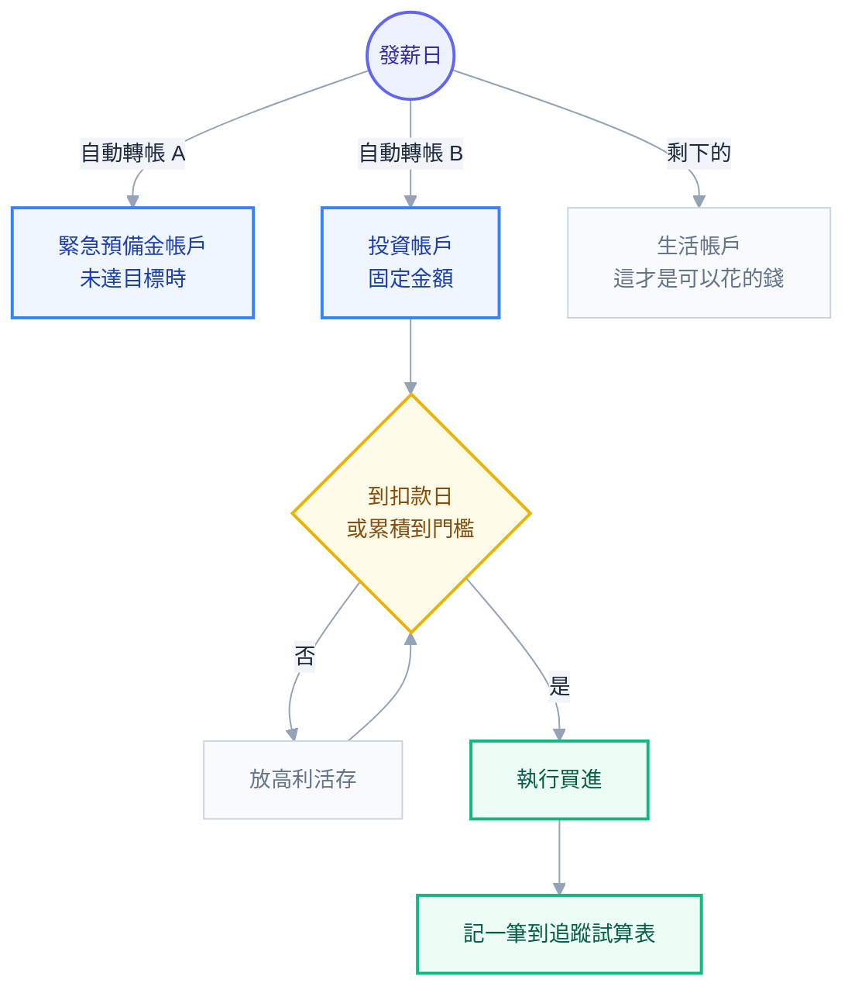

# 第 10 章：執行計畫 — 讓它跑起來，而且不需要意志力

## 計畫與執行之間的落差

到這裡你有一個配置比例、一個管道、一套處理公司股票的規則。理論上該結束了。

但實務上，**大部分投資計畫不是死於設計錯誤，是死於執行**。常見的死法：

- 開了戶，研究了三個月，一直沒有真的買
- 買了兩個月，市場跌了，「先觀望一下」，然後就沒有然後了
- 每個月月底看剩多少再投，結果多數月份剩不到
- 一年後想再平衡，但發現要賣掉賺錢的部位，下不了手
- 兩年後完全不記得當初為什麼是這個比例

這一章要做的是把計畫變成**一個不依賴意志力的系統**。這是工程師該有的直覺：**如果一個流程的正確執行需要人每次都做對，那它遲早會出錯。**

## 第一個問題：一次投入還是分批投入

你手上有一筆錢（例如年終、賣掉 RSU 的錢、或是原本放定存的積蓄）。要一次全部投入，還是分成十二個月慢慢投？

### 數學上的答案

**一次投入（lump sum）的期望報酬較高。**

理由很簡單：市場長期是上漲的，所以「越早進場、待在市場裡的時間越長」期望值越好。分批投入的期間，你有一部分錢是閒置的，賺的是接近零的利息。

研究普遍顯示，一次投入在大約 **三分之二** 的歷史期間裡贏過分批投入。

### 但這不是全部的答案

一次投入也**最大化了「最糟時機」的痛**。如果你在高點一次投入 300 萬，接著市場跌 30%，你要面對的是一次 90 萬的帳面損失，而且是在你剛做完決定之後——**這種悔恨感是最強的**，因為你會不斷回想「如果我等一下就好了」。

**分批投入的價值不在報酬，在於它是一種心理保險。** 它降低了「我剛好買在最高點」的極端後悔，而那個後悔是很多人放棄投資的原因。

### 實用的決策規則

```text
這筆錢佔你金融資產的比例？

  < 10%   → 一次投入。金額小，不值得複雜化。

  10~30%  → 一次投入，或分 3~6 個月。看你的心理承受度。

  > 30%   → 分 6~12 個月投入。
            理由：單一時點的風險太大，而且如果你買在高點又崩盤，
                  你放棄整個計畫的機率很高。

【任何情況】
  分批的期間要「事先訂好、機械執行」，不可以中途因為市場漲跌而改。
  否則它就從「分批投入」變成「擇時」。
```

> ⚠️ **不要把「分批投入」偷換成「等跌了再進場」。** 這是兩件完全不同的事。前者有明確的結束時間，後者沒有——而「等跌」的人，通常在市場漲了 20% 之後還在等，然後在漲了 50% 之後受不了全部買進。

### 至於每月薪水的投入

這根本不是問題——**你的薪水本來就是分批進來的**，所以你只能分批投入。這叫定期定額（DCA），而在這個情境下它不是策略選擇，是現實。

**每月固定投入的好處是真的**：

- 完全不用判斷時機
- 市場低時自動買到較多單位
- 心理負擔最小
- 可以自動化

## 第二個問題：多久投一次

| 頻率 | 適合誰 | 注意 |
| --- | --- | --- |
| **每月** | 台股 ETF、有定期定額服務的管道 | 最順、最無感 |
| **每季** | 複委託（有低消）、海外券商（有匯費） | 累積到一定金額再一次投入，攤薄固定成本 |
| 每半年 / 每年 | 海外券商 + 電匯成本高 | 資金閒置期較長 |

**判準是固定成本佔比：**

```text
每次投入的固定成本 ÷ 投入金額 < 0.5%  → 可接受
```

例如複委託低消 20 美元，那你每次至少要投入 4,000 美元以上才划算。如果你月存 3 萬台幣（約 1,000 美元），那就**每季投一次**（3,000 美元）或**每四個月一次**。

> 📌 **在等待累積的期間，錢要放在有利息的地方**（高利活存、短天期定存），不要放活存生鏽。

## 第三個問題：怎麼自動化到不需要意志力

這一節是本章的核心。**你要建的不是一套投資策略，是一條流水線。**

### 理想的流程



**這條線上唯一需要你動手的只有「執行買進」，而且它多半也能自動化。**

**關鍵設計：「先付給自己」。** 錢在你看到之前就被轉走，你的消費決策自然發生在剩下的錢上面。這比「月底看剩多少再存」有效得多，因為它**把意志力從流程中移除了**。

> 🔧 **工程師視角**：這是把 runtime 的判斷移到 deploy 時的設定。你不會希望一個關鍵流程每個月都要人工核准一次——那不是流程，那是待辦事項，而待辦事項會被跳過。

### 能自動化的與不能自動化的

| 步驟 | 能自動化嗎 | 做法 |
| --- | --- | --- |
| 存錢 | ✅ 完全可以 | 銀行自動轉帳，設在發薪日隔天 |
| 台股 ETF 買進 | ✅ 可以 | 券商定期定額服務 |
| 複委託買進 | ⚠️ 部分 | 部分券商有，否則設行事曆提醒 |
| 海外券商買進 | ❌ 通常要手動 | 設行事曆 + 檢查清單 |
| 換匯與匯款 | ❌ 手動 | 拉長週期，減少次數 |
| **再平衡** | ❌ 手動 | 設固定日期（例如每年 1 月第一週） |
| **RSU 賣出** | ⚠️ 看公司 | 有自動賣出設定就開啟 |

**不能自動化的部分，就用行事曆與檢查清單補。** 把「每年 1 月第一個週末：投資年度檢視」設成重複行程，附上要做的三件事。這比記在腦子裡可靠一百倍。

## 第四個問題：再平衡怎麼實際做

第 6 章講了原理，這裡講操作。

### 年度檢視的完整流程（30 分鐘）

```text
【每年固定一次，例如 1 月第一個週末】

1. 打開追蹤試算表，更新所有帳戶餘額
   （含台股、海外、公司股票、現金、勞退專戶）

2. 計算目前各類別的實際比例

3. 與目標比例比較
   偏離 < 5 個百分點 → 什麼都不用做，關掉試算表 ✅
   偏離 ≥ 5 個百分點 → 進入步驟 4

4. 優先用「新資金導流」修正：
   接下來幾個月的投入，全部買進佔比不足的類別
   → 這是零成本、零稅務事件的做法

5. 新資金不夠時，才賣出調整
   賣出優先順序：
     ① 公司股票超過上限的部分（第 9 章）
     ② 台灣掛牌部位（無資本利得稅）
     ③ 海外部位（會產生海外所得，見第 8 章）

6. 順便檢查四件事：
   □ 緊急預備金是否仍足夠（支出變高了嗎？）
   □ 保險有沒有需要調整（結婚、生小孩、買房）
   □ 目標比例還適合嗎（人生階段變了嗎？）
   □ W-8BEN 是否快到期
```

**注意步驟 3 的「什麼都不用做」。** 大部分年份你會停在這裡，這是正常且正確的。

> ⚠️ **不要每季再平衡，更不要每月。** 成本會吃掉效果，而且你會給自己太多做決定的機會——每一次決定都是一次犯錯的機會。

### 什麼時候可以改「目標比例」本身

再平衡是「調回目標」，改目標是另一回事，要嚴格得多。

**允許改的情況：**

- 人生階段變了（結婚、生小孩、買房、換到穩定度不同的產業）
- 目標變了（提早退休、要準備一筆大額支出）
- 你發現自己在下跌時撐不住（**這是合法的理由**，代表你當初高估了承受意願）
- 資產規模跨越了某個門檻，讓新的管道/工具變得合理（第 8 章）

**不允許改的情況：**

- 市場漲了很多，想加碼
- 市場跌了，想減碼
- 看了一部影片 / 朋友推薦
- 某個資產「表現不好」（那正是再平衡要買進它的時候）

**把這兩份清單寫下來。** 這是第 14 章 IPS 的核心內容，也是你在情緒上頭時唯一的煞車。

## 第五個問題：怎麼追蹤而不會變成每天看盤

### 該追蹤什麼

| 追蹤項目 | 頻率 | 為什麼 |
| --- | --- | --- |
| **各帳戶餘額與總淨資產** | 每季 | 看趨勢，不看波動 |
| 各類別實際比例 | 每年（再平衡時） | 判斷要不要調整 |
| **儲蓄率** | 每年 | 這是你最能控制的變數（第 1 章） |
| 費用率 | 買進新標的時 | 一次性檢查 |
| 每日/每週報酬率 | **不要追蹤** | 純粹的噪音，只會誘發交易 |

### 一個夠用的試算表

不需要複雜的工具。五個欄位就夠：

```text
日期 | 帳戶 | 類別（股/債/現金/公司股票） | 金額 | 備註
```

每季更新一次，加一列。三十年後你會有一份完整的財務歷史，而且你會發現**看得到長期曲線**這件事本身就很有幫助——它讓你在單季下跌時看到更大的圖。

### 查看頻率的一個經驗法則

> **查看帳戶的頻率，應該跟你的投資期限成反比。**

如果你的錢是二十年後才用的，那每天看它有什麼意義？你看到的 99% 都是噪音，而每次看到紅字都在消耗你的心理資本。

**研究上有個叫「短視損失趨避」（myopic loss aversion）的現象**：檢視投資組合越頻繁的人，因為看到虧損的次數越多，越傾向於降低風險部位，最終長期報酬越差。

**建議**：把券商 App 從手機首頁移走，關掉價格推播。**每季看一次就夠了。**

## 一份可以直接照做的執行計畫範本

```text
【每月】
  □ 發薪日隔天：自動轉帳 X 元到投資帳戶（已設定，不需動作）
  □ 若有定期定額服務：自動扣款買進（已設定，不需動作）
  → 本月需要人工動作：0 次

【每季】
  □ 更新追蹤試算表（15 分鐘）
  □ 若採季度投入：執行買進
  □ 檢查公司股票佔比是否超過上限

【每年（1 月）】
  □ 年度檢視流程（見上，約 30 分鐘）
  □ 檢查保險、緊急預備金、W-8BEN
  □ 重讀一次自己的 IPS

【每次 RSU 歸屬】
  □ 依規則賣出（最好是自動）
  □ 賣出資金投入正常配置

【市場大跌時】
  □ 什麼都不做
  □ 照原計畫繼續投入
  □ 如果偏離超過門檻，執行再平衡（買進跌多的）
  □ 不要打開試算表算自己虧了多少
```

最後一項不是玩笑。**在下跌期間頻繁確認損失金額，是導致投資人放棄計畫的最主要行為之一。**

## 本章重點回顧

1. 多數投資計畫**死於執行而非設計**。目標是建一條不依賴意志力的流水線。
2. **一次投入的期望報酬較高**（約三分之二的歷史期間勝出），但**分批是心理保險**。決策規則看金額佔資產的比例：>30% 就分 6~12 個月，且**期間必須事先訂好、機械執行**。
3. 不要把「分批投入」偷換成「等跌了再進場」——前者有結束時間，後者沒有。
4. 投入頻率的判準是**固定成本佔比 < 0.5%**。有低消或匯費的管道要拉長週期。
5. **「先付給自己」**：自動轉帳在發薪日隔天，把意志力移出流程。不能自動化的部分用行事曆與檢查清單補。
6. 年度檢視 30 分鐘，**大部分年份的結論是「什麼都不用做」**。再平衡優先用新資金導流，賣出順序是公司股票 → 台灣部位 → 海外部位。
7. **嚴格區分「再平衡」與「改目標比例」**，並事先寫下允許/不允許改的情況。
8. **查看頻率應與投資期限成反比**。短視損失趨避會讓頻繁檢視的人長期報酬更差。每季一次就夠。

## 下一步

第三部結束——你現在有一份完整的、可執行的計畫。

第四部處理長期作戰會遇到的事。下一章是這本書裡我認為最重要的一章：**心理陷阱**。因為到目前為止講的每一件事，都可能被你自己的大腦破壞掉。

## 連結

- [[資產配置與投資]] — 全書總目錄
- [[09-rsu-and-concentration]] — 上一章：RSU 與集中風險
- [[11-behavioral-traps]] — 下一章：心理陷阱
- [[06-correlation-and-rebalancing]] — 再平衡的原理
- [[08-taiwan-implementation]] — 賣出順序背後的稅務理由
- [[14-action-checklist]] — 投資政策聲明模板
