# UIUX Design Cheat Book

**遇到什麼情境，就採用什麼設計。** 本書以 Web app、SaaS 後台與一般服務流程為主，也涵蓋行動介面；不要求先讀理論。先查情境索引，再按規則選元件、補狀態與驗證任務。

來源查證日期：2026-10-30；成書日期：2026-10-31。「主流」指本次可核實的成熟設計系統模式，並非市場採用率排行，也不是某種視覺風格的流行榜。例子中的產品名稱、數量與流程為原創設計情境，沒有實測提升百分比。

## Reading Rules

- **綜合建議**：本書依任務推導的做法。來源 ID 指向相關基礎原則，不表示官方逐條背書；產品情境變了，就重新測試。
- **平台慣例**：特定設計系統或平台的選擇，跨平台時先確認是否適用。
- **標準落地**：有 WCAG 成功準則作依據的實作檢查。A、AA、AAA 與例外分開看；本書不是完整合規稽核。
- **例／避免／邊界**：先看正例套用，再用反例排錯；出現邊界時不把建議當絕對規定。除標準明列的數值外，案例數字不是通用門檻。

本書每章附一張原創介面示意，呈現特定情境下的設計對照；案例數值不是通用門檻。圖下列出對應 UX 規則，可接著查閱適用條件與例外。

## Situation Index

| 當你正在處理 | 直接查 |
|---|---|
| 畫面很亂、不知道先強調什麼 | [[#01 Hierarchy]]、[[#02 Spacing]]、[[#03 Typography]] |
| 顏色、dark mode 或圓角不協調 | [[#04 Color]]、[[#05 Shape]] |
| 桌面好用、手機壞掉 | [[#06 Responsive Layout]]、[[#25 Touch and Motion]] |
| 使用者找不到功能或不知道在哪 | [[#07 Navigation]]、[[#08 Tabs and Disclosure]] |
| 找資料、篩資料卻結果不對 | [[#09 Search]]、[[#10 Filters]] |
| 不知道該選哪種元件 | [[#Component Selection]]、[[#11 Actions]]、[[#12 Choice Controls]] |
| 表單難填、錯誤難修 | [[#13 Fields]]、[[#14 Validation]]、[[#15 Dates and Time]] |
| 長流程、登入、初次使用 | [[#16 Multi-step Work]]、[[#17 Identity and Onboarding]] |
| 要開 modal、顯示提示或等待 | [[#18 Overlays]]、[[#19 Feedback and Waiting]] |
| 沒資料、要刪除、要復原 | [[#20 Empty and Destructive States]] |
| 上傳、autosave、離線與衝突 | [[#21 Files and Persistence]] |
| 資料表、批次、分頁與即時資料 | [[#22 Tables and Bulk Actions]]、[[#23 Pagination and Live Data]] |
| 指標與圖表容易誤讀 | [[#24 Dashboards and Charts]] |
| 鍵盤、對比、縮放與 screen reader | [[#26 Accessible Interaction]] |
| AI 生成、查證、修改與執行 | [[#27 AI Interaction]] |
| 做 design system、測試或交付 | [[#28 Systems and Validation]]、[[#Page Recipes]] |

## Contents

- [[#01 Hierarchy|01 Hierarchy]] — 頁面應先讓人看到什麼？
- [[#02 Spacing|02 Spacing]] — 資訊要靠近、分開，還是提高密度？
- [[#03 Typography|03 Typography]] — 文字如何讓人讀懂、掃描與比較？
- [[#04 Color|04 Color]] — 顏色如何表達狀態而不造成誤解？
- [[#05 Shape|05 Shape]] — 何時應計算圓角，何時只需遵循元件角色？
- [[#06 Responsive Layout|06 Responsive Layout]] — 空間改變後，如何保住同一個任務？
- [[#07 Navigation|07 Navigation]] — 人在哪裡、能去哪裡、如何回來？
- [[#08 Tabs and Disclosure|08 Tabs and Disclosure]] — 哪些內容可藏起來，哪些必須同時看到？
- [[#09 Search|09 Search]] — 如何讓搜尋範圍、結果與查詢字詞一致？
- [[#10 Filters|10 Filters]] — 篩選何時生效，會影響哪些資料？
- [[#11 Actions|11 Actions]] — 按下後究竟會發生什麼？
- [[#12 Choice Controls|12 Choice Controls]] — 單選、多選與立即開關該用什麼？
- [[#13 Fields|13 Fields]] — 如何讓使用者少猜格式、少重填資料？
- [[#14 Validation|14 Validation]] — 何時指出錯誤，如何讓人修好？
- [[#15 Dates and Time|15 Dates and Time]] — 選日期、時段與跨時區時如何避免歧義？
- [[#16 Multi-step Work|16 Multi-step Work]] — 長流程如何保存進度並確認真正完成？
- [[#17 Identity and Onboarding|17 Identity and Onboarding]] — 登入、授權與首次使用如何接回原任務？
- [[#18 Overlays|18 Overlays]] — 何時用浮層，如何維持操作上下文？
- [[#19 Feedback and Waiting|19 Feedback and Waiting]] — 如何區分成功、處理中與真正失敗？
- [[#20 Empty and Destructive States|20 Empty and Destructive States]] — 沒資料與要刪資料時，下一步是什麼？
- [[#21 Files and Persistence|21 Files and Persistence]] — 檔案、草稿與同步失敗時如何保住工作？
- [[#22 Tables and Bulk Actions|22 Tables and Bulk Actions]] — 如何比較資料並安全地批次處理？
- [[#23 Pagination and Live Data|23 Pagination and Live Data]] — 如何定位、返回與處理持續變動的資料？
- [[#24 Dashboards and Charts|24 Dashboards and Charts]] — 圖表是否能支持下一個判斷？
- [[#25 Touch and Motion|25 Touch and Motion]] — 手指、手勢與動畫如何不阻礙操作？
- [[#26 Accessible Interaction|26 Accessible Interaction]] — 不靠滑鼠、顏色或固定尺寸能否完成任務？
- [[#27 AI Interaction|27 AI Interaction]] — 生成結果如何查證、修正與控制執行？
- [[#28 Systems and Validation|28 Systems and Validation]] — 如何讓設計可重用、可測試且不誤導？

# Part I — Visual Structure

## 01 Hierarchy

頁面應先讓人看到什麼？

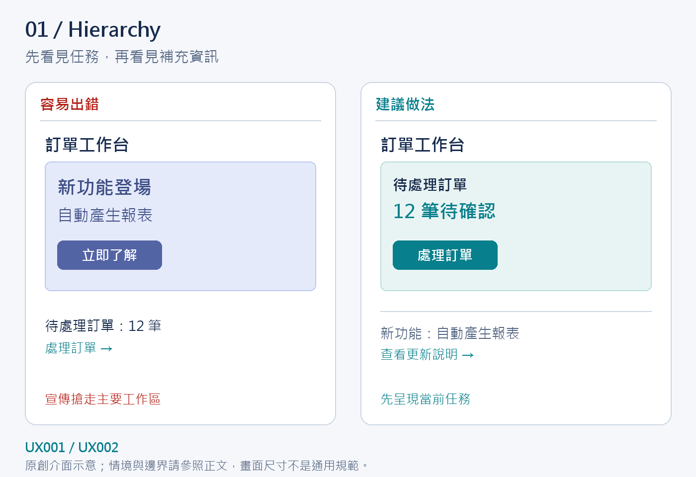

圖說：當使用者來完成工作時，就應該讓工作入口優先於宣傳資訊。 參照 [[#UX001]]、[[#UX002]]。

### UX001

**當一頁同時有「完成工作」與「介紹功能」時，就應該把目前工作的入口放在主視區。**

例：待處理訂單在前；避免：大幅宣傳圖推走訂單。邊界：首次造訪的行銷頁另訂轉換目標。

【綜合建議】依據：[[#V1|V1]]、[[#V3|V3]]。

### UX002

**當每個區塊都在搶注意力時，就應該先降低次要區塊的視覺強度。**

例：附加說明改一般字重；避免：所有標題都加色塊與陰影。邊界：多個同等緊急告警仍須完整呈現。

【綜合建議】依據：[[#V1|V1]]、[[#V3|V3]]。

### UX003

**當卡片只是把連續文章切碎時，就應該回到標題與段落的結構。**

例：政策說明連續閱讀；避免：每一段都加框成卡。邊界：獨立可操作的項目可用卡片。

【綜合建議】依據：[[#V1|V1]]、[[#V2|V2]]。

### UX004

**當圖片是理解或辨識的主要依據時，就應該給圖片足夠空間並維持可比較的比例。**

例：商品列表統一預覽比例；避免：只因排版整齊而裁掉產品關鍵部位。邊界：藝術作品需保留原比例。

【綜合建議】依據：[[#V1|V1]]、[[#V2|V2]]。

### UX005

**當使用者必須上下對照明細與總額時，就應該讓摘要接近明細，必要時固定在可見區。**

例：購物車旁顯示總額；避免：總額只出現在另一個 tab。邊界：窄螢幕採正常文流以免固定區擋住內容。

【綜合建議】依據：[[#V4|V4]]。

### UX006

**當用戶會反覆掃描相同清單時，就應該維持欄位及動作位置穩定。**

例：每列狀態都在同欄；避免：依字串長短讓動作自由漂移。邊界：手機可重排，但重排後仍有一致模板。

【綜合建議】依據：[[#V1|V1]]、[[#V2|V2]]。

## 02 Spacing

資訊要靠近、分開，還是提高密度？

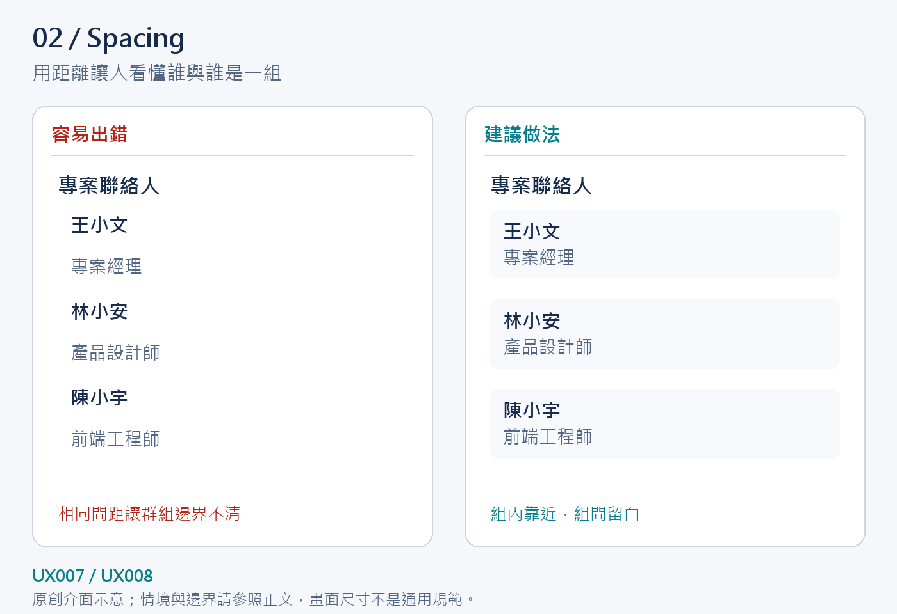

圖說：當資訊屬同一組時，就應該縮小組內距離、拉開組間距離。 參照 [[#UX007]]、[[#UX008]]。

### UX007

**當兩項資訊屬同一組時，就應該讓組內距離小於組間距離。**

例：姓名與職稱靠近、不同人分開；避免：所有間距一樣。邊界：分隔線與語義結構可共同補強群組。

【綜合建議】依據：[[#V2|V2]]。

### UX008

**當團隊一直微調孤立的 px 值時，就應該先建立少量 spacing tokens。**

例：標準 gap 套同一 token；避免：每個表單都各自寫 15、17、19。邊界：光學修正可記錄理由，不硬湊倍數。

【綜合建議】依據：[[#V2|V2]]。

### UX009

**當後台必須同時閱讀大量紀錄時，就應該提供適合資料密度的布局。**

例：讓桌面表格可切 compact；避免：所有列塞入巨幅留白。邊界：compact 仍需保留可辨識、可操作的目標。

【綜合建議】依據：[[#V1|V1]]、[[#V2|V2]]。

### UX010

**當資訊太擠時，就應該先刪除重複內容與分組，再加大所有間距。**

例：欄名統一移到表頭；避免：每格重複「訂單編號」。邊界：轉成手機卡片後可能需要重複標籤。

【綜合建議】依據：[[#V1|V1]]、[[#V2|V2]]。

### UX011

**當 icon 與文字共同構成一個動作時，就應該把它們視為同一個點擊區。**

例：加號與「新增」一起可按；避免：只有圖示有效。邊界：文字是說明而非動作時需明確區別。

【綜合建議】依據：[[#V2|V2]]。

### UX012

**當按鈕周圍容易誤觸時，就應該增加動作之間的分隔，而非只縮小圖示。**

例：刪除和編輯分開；避免：兩個微型圖示緊貼。邊界：工具列需要密集時可移走低頻操作。

【綜合建議】依據：[[#V2|V2]]、[[#V8|V8]]。

### UX013

**當版面在寬螢幕變得稀疏時，就應該限制閱讀區寬度或增加並列資訊。**

例：文章保持可掃讀寬度；避免：一行文字橫跨整面大螢幕。邊界：時間軸或繪圖工作區可利用全寬。

【綜合建議】依據：[[#V1|V1]]。

### UX014

**當容器縮窄時，就應該優先調整排列與分組。**

例：水平控制列換行；避免：字體一路縮小直到塞得下。邊界：極少量次要標示可使用較小樣式，但須可讀。

【綜合建議】依據：[[#V1|V1]]、[[#V8|V8]]。

## 03 Typography

文字如何讓人讀懂、掃描與比較？

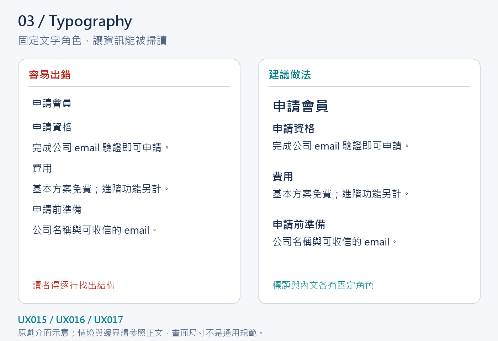

圖說：當內容需要掃讀時，就應該建立標題、區塊與內文的固定角色。 參照 [[#UX015]]、[[#UX016]]、[[#UX017]]。

### UX015

**當標題、內文、輔助說明無法區分時，就應該建立固定的文字角色。**

例：頁標題、區塊標題、本文各用一致 style；避免：每段自行猜字級。邊界：數據視覺化可另訂數字角色。

【綜合建議】依據：[[#V1|V1]]。

### UX016

**當頁面包含很長的說明時，就應該用可掃描的小標拆分內容。**

例：依問題分「資格」「費用」；避免：整頁連續粗體。邊界：需要完整法律語義的文本仍保留原段落關係。

【綜合建議】依據：[[#V1|V1]]。

### UX017

**當要突出一句話時，就應該只強調決策必要的部分。**

例：加粗「今天到期」；避免：整段全粗全紅。邊界：短警告可整句突出，但不能讓其他告警失去層級。

【綜合建議】依據：[[#V1|V1]]、[[#V3|V3]]。

### UX018

**當產品以長時間閱讀為主時，就應該用真實內容測試字體與行距。**

例：測中文、英文與數字混排；避免：只用 Lorem ipsum 決定所有規格。邊界：既有平台字體角色可作起點而非免測理由。

【綜合建議】依據：[[#V1|V1]]。

### UX019

**當同一欄含有編號與自然語句時，就應該分別處理截斷。**

例：編號保留可複製全文；避免：重要流水號只能看到前三碼。邊界：純展示縮寫需有另一個完整檢視途徑。

【綜合建議】依據：[[#V1|V1]]。

### UX020

**當使用者需要比較時間與金額時，就應該先固定格式。**

例：同頁使用一致日期順序；避免：10/11 同時可能指月日或日月。邊界：多地協作需額外顯示時區或 locale。

【綜合建議】依據：[[#V1|V1]]。

### UX021

**當一句標籤換行後破壞布局時，就應該允許容器長高。**

例：按鈕文字完整呈現；避免：把所有譯文縮成難懂縮寫。邊界：極窄 toolbar 可改含名稱的 overflow menu。

【綜合建議】依據：[[#V1|V1]]、[[#V8|V8]]。

### UX022

**當頁面主要供操作而非宣傳時，就應該控制大型標題的使用範圍。**

例：工作台保留主要空間給工作；避免：每個區塊都像廣告 hero。邊界：數據重點展示可刻意突出單一指標。

【綜合建議】依據：[[#V1|V1]]。

### UX023

**當一段文字混有自然語句、網址與長識別碼時，就應該分別決定斷行與完整查看方式。**

例：說明文字自然換行，長 URL 可在容器內換行，識別碼另有複製全文；避免：對所有內容強制逐字拆開，讓英文單字難讀。邊界：不可換行的技術內容可局部捲動，但不應撐破整頁。

【綜合建議】原創情境判斷，須以實際任務驗證。

## 04 Color

顏色如何表達狀態而不造成誤解？

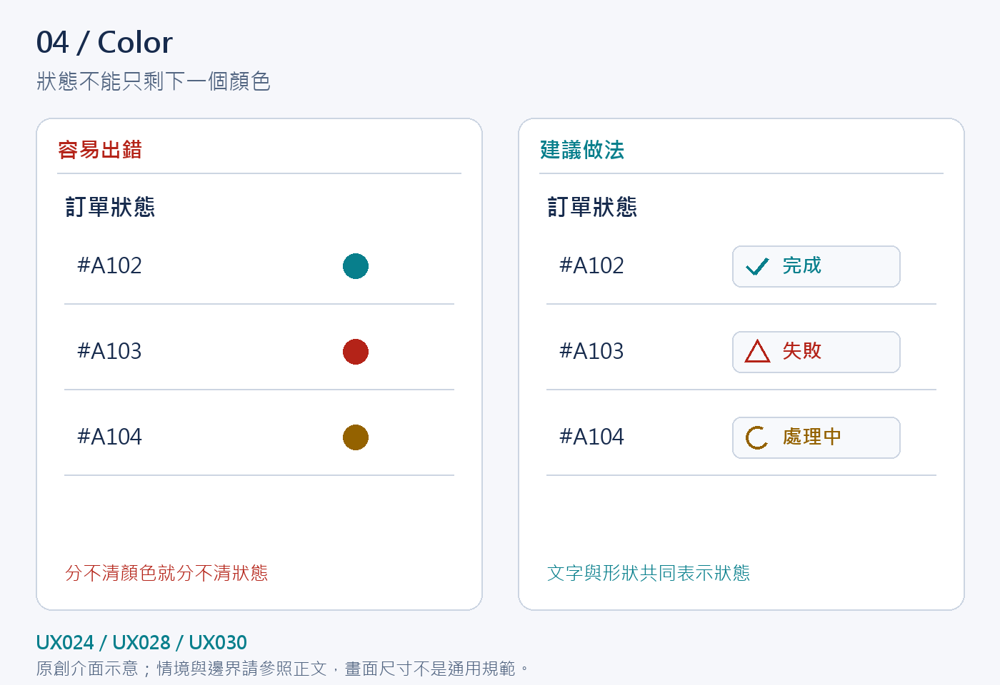

圖說：當顏色表示狀態時，就應該同時提供文字或形狀。 參照 [[#UX024]]、[[#UX028]]、[[#UX030]]。

### UX024

**當顏色表示狀態時，就應該同時顯示文字或形狀。**

例：紅點加「失敗」；避免：只靠紅綠區別。邊界：純裝飾色不需硬塞狀態文字。

【綜合建議】依據：[[#V3|V3]]。

### UX025

**當品牌色也是錯誤色時，就應該分離品牌裝飾與錯誤訊息的語義。**

例：錯誤另有 icon、標題及區域；避免：所有紅色區塊都看似故障。邊界：品牌不必改色，須讓角色清楚。

【綜合建議】依據：[[#V3|V3]]。

### UX026

**當要支援 dark mode 時，就應該依 surface、text、border 等角色建立映射。**

例：同一語義 token 換對應值；避免：對整頁套 invert。邊界：圖片及插圖需獨立判斷。

【綜合建議】依據：[[#V3|V3]]。

### UX027

**當深色背景讓陰影失去區隔作用時，就應該檢查 surface 與邊界辨識。**

例：浮層用可辨識底色及邊框；避免：一味加黑陰影。邊界：層次不可只靠顏色，還需布局與標題。

【綜合建議】依據：[[#V3|V3]]。

### UX028

**當同一 badge 在多個頁面代表不同意思時，就應該統一語義或改標籤。**

例：綠色「完成」全站一致；避免：另一頁綠色表示尚未開始。邊界：跨產品整合需清楚的局部圖例。

【綜合建議】依據：[[#V3|V3]]。

### UX029

**當所有卡片都用了高飽和背景時，就應該把強調色留給少數決策訊號。**

例：選中的方案突出；避免：未選項也一樣搶眼。邊界：分類色有明確辨識用途時保留但補文字。

【綜合建議】依據：[[#V3|V3]]。

### UX030

**當狀態改變但外觀只微幅變色時，就應該增加明確結果標記。**

例：選中項加勾選與名稱；避免：只從淡藍變深藍。邊界：不可讓新標記使布局大幅跳動。

【綜合建議】依據：[[#V3|V3]]。

### UX031

**當使用者切換主題時，就應該確認圖表、placeholder、disabled 及 focus 狀態一起切換。**

例：測全狀態畫面；避免：只看首頁靜態截圖。邊界：第三方嵌入內容若不可換色須維持可讀的容器。

【綜合建議】依據：[[#V3|V3]]。

### UX032

**當互動被動畫或背景遮擋時，就應該先保障可操作與可辨識。**

例：內容層有穩定底色；避免：玻璃透明層隨背景變得讀不到。 邊界：視覺效果可用在非關鍵區。

【綜合建議】依據：[[#R8|R8]]、[[#R9|R9]]。

## 05 Shape

何時應計算圓角，何時只需遵循元件角色？

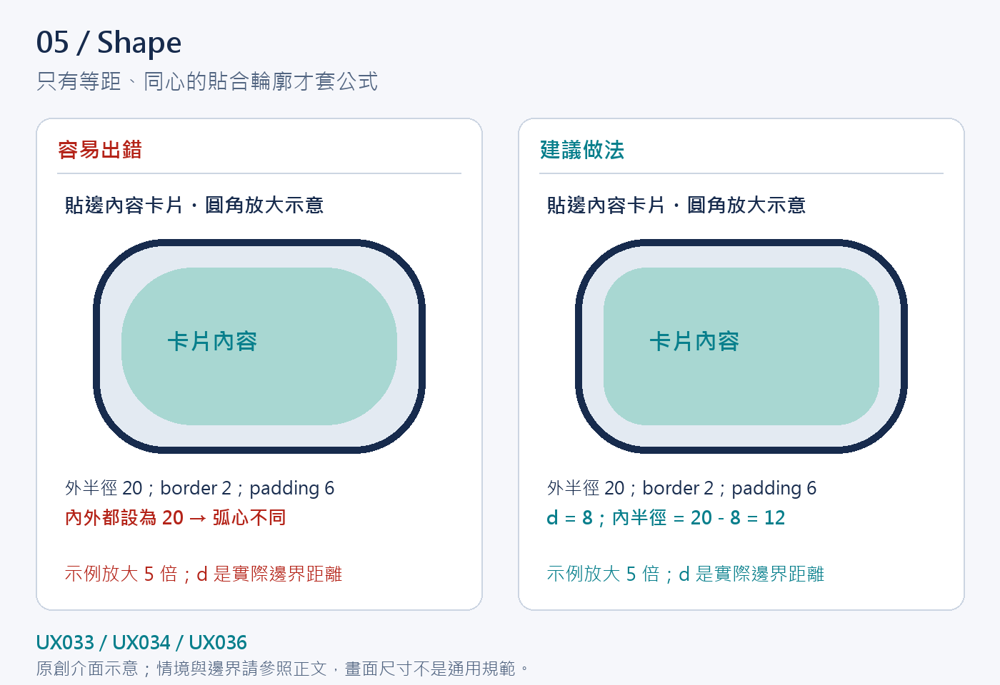

圖說：當內外輪廓需要等距同心時，就應該以實際邊界距離 d 推算內半徑。 參照 [[#UX033]]、[[#UX034]]、[[#UX036]]。

### UX033

**當內外曲線要形成等距同心圓角時，就應該用兩條實際邊界間距推算半徑。**

例：無 border、等 padding 4、內半徑 12，外半徑取 16；避免：內外都 16。邊界：只有等距圓弧貼合時適用，不是所有巢狀 component 的義務。

【綜合建議】依據：[[#V9|V9]]。

### UX034

**當外層有 border 時，就應該把 border 厚度納入邊界距離。**

例：border 2、padding 4、子元素貼 content edge、外半徑 18，子元素半徑可取 12；避免：只減 padding 得 14。邊界：子元素有 margin 或位移要再算實際距離。

【綜合建議】依據：[[#V9|V9]]。

### UX035

**當水平與垂直 inset 不同時，就應該分軸判斷圓角。**

例：分開檢查 x/y 半徑；避免：用單一 padding 值宣稱等距。邊界：要維持圓形外觀時可放棄嚴格貼合，改光學調整。

【綜合建議】依據：[[#V9|V9]]。

### UX036

**當小按鈕只是放在大卡片內時，就應該優先遵循按鈕自己的 shape token。**

例：卡片角 24、中央按鈕角 8 可並存；避免：一律套外角減 padding 導致按鈕變形。邊界：按鈕恰好貼著容器邊緣形成雙層輪廓時另算。

【綜合建議】依據：[[#V9|V9]]。

### UX037

**當計算出的內半徑小於零時，就應該以零作幾何下限並重新檢查布局。**

例：內角可為直角；避免：寫負 border-radius。邊界：零半徑不代表設計必然協調，仍需看內容安全區。

【綜合建議】依據：[[#V9|V9]]。

### UX038

**當圖像貼滿圓角卡片時，就應該確認圖像裁切與卡片輪廓一致。**

例：裁切容器管理邊角；避免：圖片直角露出。邊界：會超出的陰影、選單與 focus ring 不可一起誤裁。

【綜合建議】依據：[[#V9|V9]]。

### UX039

**當膠囊、圓角矩形、直角在同角色混用時，就應該先定義 shape 的角色。**

例：狀態 chip 與主要按鈕各有一致形狀；避免：每頁靠喜好換角。邊界：品牌活動頁可有獨立且完整的風格。

【綜合建議】依據：[[#V2|V2]]、[[#V3|V3]]。

### UX040

**當指定的角很大而實際效果與預期不同時，就應該檢查容器尺寸是否觸發半徑縮放。**

例：測短文字與長文字按鈕；避免：只比 CSS 數字認定兩個輪廓相同。邊界：大半徑刻意用於 pill 可以接受縮放結果。

【綜合建議】依據：[[#V9|V9]]。

### UX041

**當文字或圖示靠近大圓角的角落時，就應該另外留出內容安全距離。**

例：票券編號向內縮，完整保留在圓角輪廓內；避免：只算半徑正確，卻讓第一個字被角落裁掉。邊界：內容 inset 與輪廓半徑是不同決策，不能只靠一個公式保證安全。

【綜合建議】原創情境判斷，須以實際任務驗證。

## 06 Responsive Layout

空間改變後，如何保住同一個任務？

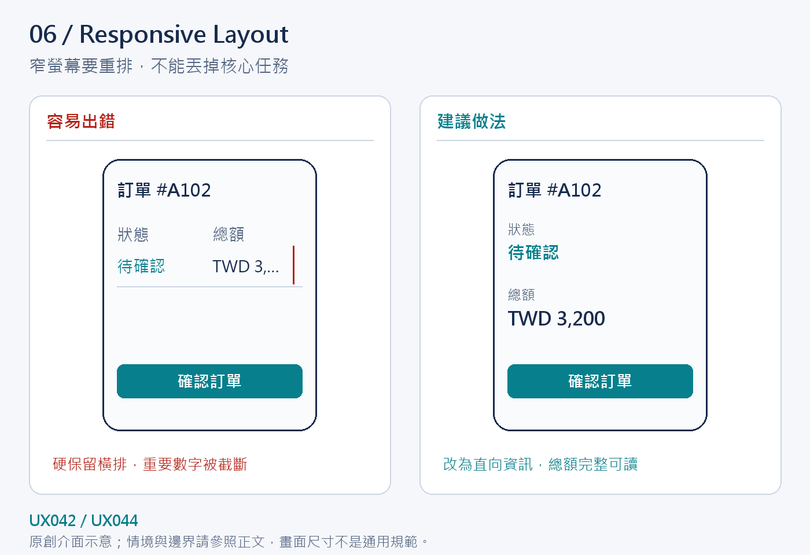

圖說：當容器變窄時，就應該重排核心資料與操作，而不是硬塞桌面版。 參照 [[#UX042]]、[[#UX044]]。

### UX042

**當螢幕變窄但任務不變時，就應該保留核心資料與操作，重排次要資訊。**

例：訂單總額與狀態仍可見；避免：手機版刪掉付款結果。邊界：次要分析可連到獨立頁。

【綜合建議】依據：[[#V8|V8]]。

### UX043

**當側欄擠壓工作區時，就應該切換適合可用空間的導航。**

例：寬版 rail、窄版明確入口；避免：在小手機保留三欄。邊界：具平台慣例時優先相容既有 mental model。

【綜合建議】依據：[[#V8|V8]]。

### UX044

**當斷點之間內容已經溢出時，就應該按內容失效點調整布局。**

例：按鈕擠壓前先換行；避免：只因裝置名稱尚未到 tablet 就拒絕調整。邊界：系統既有 breakpoints 可作起點。

【綜合建議】依據：[[#V8|V8]]。

### UX045

**當底部有固定操作區時，就應該留出內容與鍵盤可用空間。**

例：最後一列可滾到操作區上方；避免：按鈕永久壓住最後欄位。邊界：系統鍵盤變化需實機檢查。

【綜合建議】依據：[[#V8|V8]]。

### UX046

**當資料本質需要橫向比較時，就應該保留表格結構並提供可發現的橫向瀏覽。**

例：比較方案欄位；避免：拆成長卡片後無法逐列對照。邊界：只讀單筆摘要時卡片更合適。

【綜合建議】依據：[[#V4|V4]]、[[#V8|V8]]。

### UX047

**當使用者旋轉或改變視窗寬度時，就應該保留工作狀態。**

例：編輯內容與篩選仍在；避免：重建畫面把輸入清空。邊界：流程本來必須重新載入時先保存草稿。

【綜合建議】依據：[[#V8|V8]]。

### UX048

**當手機鍵盤展開時，就應該仍看得到正在編輯的欄位與錯誤。**

例：表單可捲到當前欄；避免：固定底部 CTA 蓋住輸入。 邊界：以實機測試各鍵盤類型。

【綜合建議】依據：[[#R12|R12]]。

## 07 Navigation

人在哪裡、能去哪裡、如何回來？

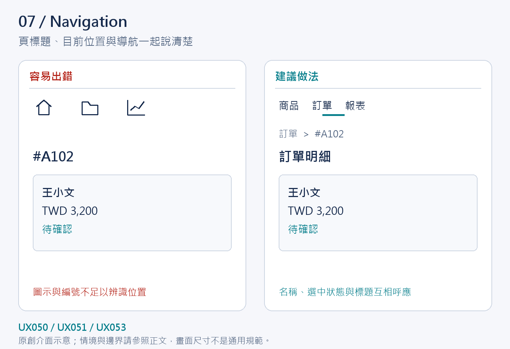

圖說：當使用者需要知道所在位置時，就應該保留頁標題與清楚的導航標示。 參照 [[#UX050]]、[[#UX051]]、[[#UX053]]。

### UX049

**當使用者在不同頂層任務間移動時，就應該提供穩定的主導航。**

例：訂單、商品、報表各自入口；避免：各頁隨意換順序。邊界：權限差異可隱藏不可用項，但不要重排熟悉位置。

【綜合建議】依據：[[#V8|V8]]。

### UX050

**當需要讓人知道目前位置時，就應該同時保留頁標題與導航選中狀態。**

例：訂單頁標題清楚；避免：只留一個變色 icon。邊界：全螢幕媒體可有暫時隱藏但可喚回的導航。

【綜合建議】依據：[[#V3|V3]]、[[#V8|V8]]。

### UX051

**當網站有多層分類時，就應該考慮 breadcrumbs 幫助返回上層。**

例：商品 > 電腦 > 筆電；避免：讓用戶只能連按瀏覽器返回。邊界：扁平結構不必為了完整而硬加。

【綜合建議】依據：[[#V5|V5]]。

### UX052

**當畫面顯示結帳進度時，就應該使用步驟語義。**

例：地址、付款、確認；避免：用 breadcrumbs 偽裝可任意前往所有步驟。邊界：允許回改的已完成步驟應明確可操作。

【綜合建議】依據：[[#V5|V5]]。

### UX053

**當圖示名稱無法被新人猜中時，就應該提供可見標籤。**

例：「稽核紀錄」配 icon；避免：只用一個不常見圖形。邊界：熟悉工具的可收合側欄仍保留名稱取得方式。

【綜合建議】依據：[[#V8|V8]]。

### UX054

**當導航項很多時，就應該先按使用者任務分組。**

例：帳務下有發票與收款；避免：把資料庫資料表名稱全部平鋪。邊界：專家工具可提供 command search 加速。

【綜合建議】依據：[[#V7|V7]]、[[#V8|V8]]。

### UX055

**當行動版把側欄收進 drawer 時，就應該保留目前位置與關閉入口。**

例：當前頁高亮、可返回內容；避免：開了選單找不到退出。 邊界：是否 modal 決定 focus 管理，不只看外觀。

【綜合建議】依據：[[#S12|S12]]。

## 08 Tabs and Disclosure

哪些內容可藏起來，哪些必須同時看到？

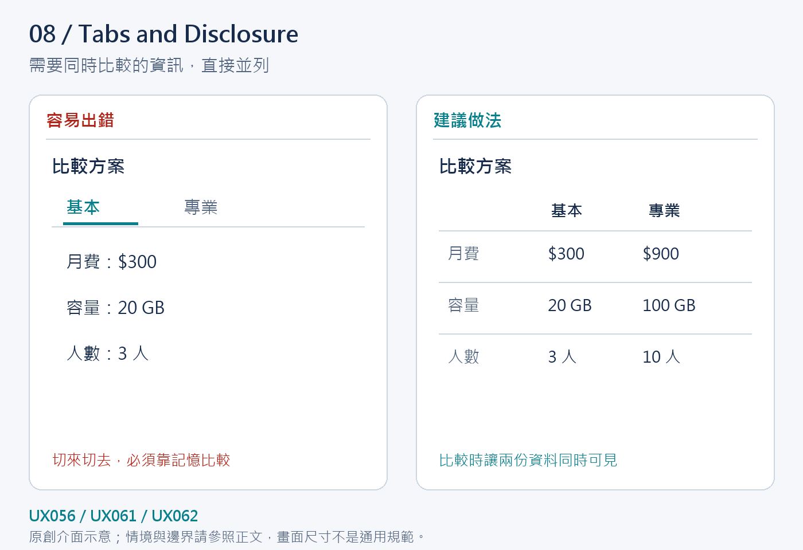

圖說：當任務是比較兩組資訊時，就應該讓它們同時可見。 參照 [[#UX056]]、[[#UX061]]、[[#UX062]]。

### UX056

**當同一物件有幾組互不必同時觀看的資訊時，就應該考慮 tabs。**

例：客戶的基本資料與活動紀錄；避免：把必須一起比較的兩份價格分開。邊界：少量內容直接顯示可能更快。

【綜合建議】依據：[[#V4|V4]]。

### UX057

**當讀者必須依序理解內容時，就應該保留連續閱讀。**

例：申請教學逐段呈現；避免：步驟拆進不明顯 tabs。邊界：每步是獨立操作的 wizard 可用進度控制。

【綜合建議】依據：[[#V4|V4]]。

### UX058

**當 tab 名稱只能叫「其他」時，就應該重整分類。**

例：「帳單紀錄」；避免：「更多資訊 2」。邊界：真正低頻且異質的次要項可收在明確更多選單。

【綜合建議】依據：[[#V4|V4]]。

### UX059

**當 tabs 數量在窄螢幕擠不下時，就應該使用有可發現性的替代排列。**

例：可捲動並提示尚有項目，或改目錄；避免：無提示地裁掉最後一半。邊界：不要只因窄屏把順序打亂。

【綜合建議】依據：[[#V4|V4]]、[[#V8|V8]]。

### UX060

**當切換 tab 會丟失輸入時，就應該先保留編輯狀態或阻止靜默遺失。**

例：切回仍有草稿；避免：切換後清空表單。邊界：必須捨棄時用明確離開確認。

【綜合建議】依據：[[#V4|V4]]。

### UX061

**當資訊對所有人完成任務都必要時，就應該直接呈現。**

例：費用在付款前可見；避免：藏在預設收起的「更多」。邊界：重複的進階說明可折疊。

【綜合建議】依據：[[#V4|V4]]。

### UX062

**當不同區塊需同時展開比較時，就應該允許多區展開或改為連續內容。**

例：保固與退貨可一起讀；避免：開一個必關另一個。邊界：空間極受限且比較不是任務時單開可行。

【綜合建議】依據：[[#V4|V4]]。

### UX063

**當某個子區塊需要被分享或重訪時，就應該讓網址能表示所在狀態。**

例：連結開到活動紀錄；避免：分享後總回預設 tab。邊界：敏感或短暫狀態不直接放入 URL。

【綜合建議】依據：[[#V4|V4]]、[[#V7|V7]]。

## 09 Search

如何讓搜尋範圍、結果與查詢字詞一致？

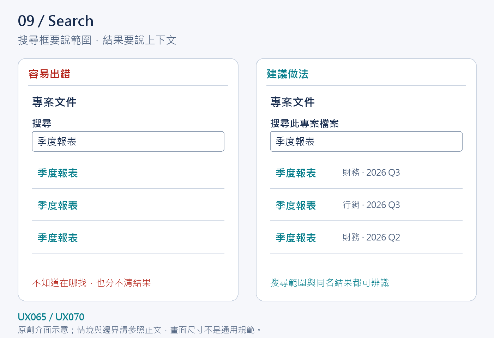

圖說：當搜尋範圍或同名結果可能混淆時，就應該把範圍與上下文放在畫面上。 參照 [[#UX065]]、[[#UX070]]。

### UX064

**當使用者知道名稱或編號時，就應該讓搜尋可直接定位。**

例：輸入訂單號取得紀錄；避免：必須逐層分類猜路徑。邊界：小型且一眼可見的清單可不加搜尋。

【綜合建議】依據：[[#V7|V7]]。

### UX065

**當頁面同時有全站與區域搜尋時，就應該寫清楚搜尋範圍。**

例：「搜尋此專案檔案」；避免：兩格都只寫「搜尋」。邊界：scope 可切換時顯示當前值。

【綜合建議】依據：[[#V7|V7]]。

### UX066

**當即時搜尋成本高或回應慢時，就應該考慮明確送出。**

例：輸入條件後按搜尋；避免：每打一字就重載重型報表。邊界：可快取的小資料集可即時。

【綜合建議】依據：[[#V7|V7]]。

### UX067

**當搜尋請求可能亂序回來時，就應該讓結果只對應目前查詢。**

例：保留最新查詢結果；避免：輸入 ABC 卻顯示 AB 的舊結果。邊界：顯示快取需註明更新中。

【綜合建議】依據：[[#V7|V7]]。

### UX068

**當搜尋只涵蓋目前頁資料時，就應該明示範圍或擴大為完整資料集。**

例：「搜尋這一頁」；避免：找不到就宣稱訂單不存在。邊界：離線模式可說明只查已下載內容。

【綜合建議】依據：[[#V7|V7]]。

### UX069

**當某筆結果因權限無法開啟時，就應該在揭露資訊前確認可顯示範圍。**

例：搜尋只返回有權查看資料；避免：列出機密標題後才拒絕進入。邊界：明確允許發現但須申請存取的產品需呈現授權流程。

【綜合建議】依據：[[#V7|V7]]。

### UX070

**當搜尋結果同時包含不同物件種類時，就應該顯示種類與能區分同名項目的上下文。**

例：「季度報表 · 財務專案 · 2026 Q3」；避免：三個結果都只叫「季度報表」。邊界：只顯示使用者有權知道的專案名稱。

【綜合建議】依據：[[#V7|V7]]。

### UX071

**當提供搜尋建議時，就應該讓選中建議與立即執行搜尋的行為清楚可預期。**

例：箭頭選建議、Enter 確認目前建議；避免：游標仍在輸入時首項被悄悄選取而開錯紀錄。

【綜合建議】依據：[[#S07|S07]]。

### UX072

**當使用者輸入中文還在選字時，就應該等組字確認再處理送出。**

例：Enter 先確認輸入法候選字，完成組字後才可送搜尋；避免：選字 Enter 直接送出半個名字。

【綜合建議】原創情境判斷，須以實際任務驗證。

## 10 Filters

篩選何時生效，會影響哪些資料？

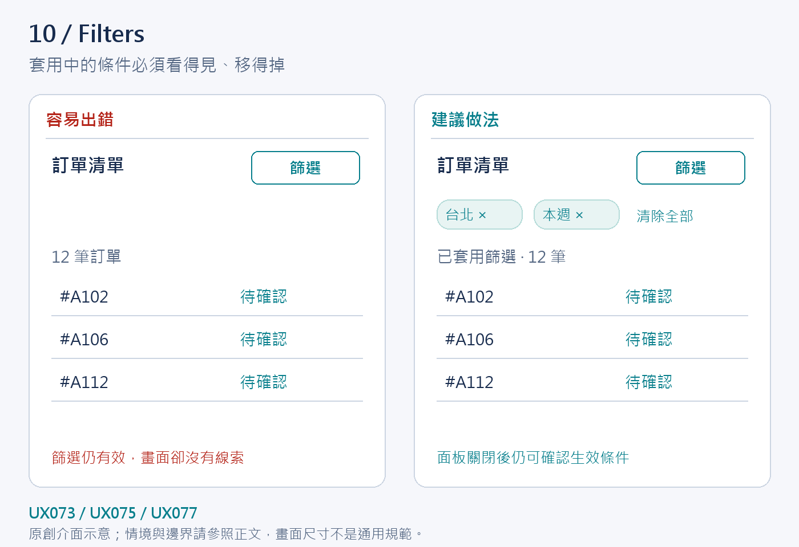

圖說：當篩選面板關閉後，就應該仍讓使用者看見並移除生效條件。 參照 [[#UX073]]、[[#UX075]]、[[#UX077]]。

### UX073

**當使用者需要組合多個條件時，就應該讓條件可被檢視及單獨移除。**

例：已選「台北」「本週」各有移除；避免：關閉抽屜就看不到套了什麼。邊界：機密條件不宜在共享畫面暴露時需另訂顯示政策。

【綜合建議】依據：[[#V6|V6]]。

### UX074

**當改一個條件就要等待很久時，就應該提供「套用篩選」。**

例：先選日期、部門再查一次；避免：每點一下都鎖住畫面。邊界：即時且便宜的單一篩選不必增加一步。

【綜合建議】依據：[[#V6|V6]]。

### UX075

**當條件尚未套用時，就應該區分草稿選擇與生效結果。**

例：顯示待套用並保留舊結果標記；避免：結果數字看似已更新。邊界：全部即時更新的流程不需此狀態。

【綜合建議】依據：[[#V6|V6]]。

### UX076

**當有多選條件時，就應該說清楚同類與跨類如何組合。**

例：狀態任一符合、部門必須符合；避免：用戶無法判斷 AND/OR。邊界：一般用戶可用自然語句，不必暴露查詢語法。

【綜合建議】依據：[[#V6|V6]]。

### UX077

**當清除與重設會產生不同結果時，就應該使用不同文案。**

例：「清除全部」與「恢復預設」；避免：按清除卻默默套回本月。邊界：產品只提供一種行為時仍需說清結果。

【綜合建議】依據：[[#V6|V6]]。

### UX078

**當排序與篩選同時存在時，就應該讓兩者角色清楚。**

例：篩選決定有哪些、排序決定先後；避免：把「價格低到高」放進產品類別。邊界：推薦排序若含個人化應另行揭露。

【綜合建議】依據：[[#V6|V6]]、[[#V7|V7]]。

### UX079

**當用戶經常重複相同條件時，就應該考慮保存檢視。**

例：「我的逾期工單」可重用；避免：每次重設五個條件。邊界：跨帳號或租戶不要共享私密條件。

【綜合建議】依據：[[#V6|V6]]、[[#V7|V7]]。

### UX080

**當篩選改變結果集時，就應該重新檢查頁碼與選取範圍。**

例：回到有效頁並說明選取仍涵蓋哪些資料；避免：留在不存在的第九頁，批次動作卻作用於隱藏舊項。邊界：保留跨頁選取時要顯示完整範圍。

【綜合建議】依據：[[#V6|V6]]。

### UX081

**當篩選值已不再有效時，就應該明示失效條件並讓人移除或替換。**

例：「部門已停用」仍顯示在條件列；避免：偷偷忽略它卻保留原結果名稱。邊界：不能重新揭露已撤銷權限的值。

【綜合建議】依據：[[#V6|V6]]。

# Part II — Controls and Operations

## 11 Actions

按下後究竟會發生什麼？

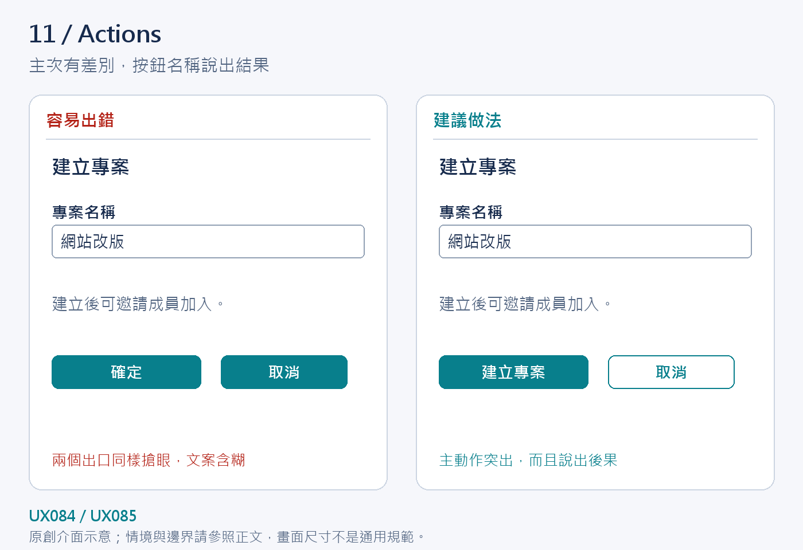

圖說：當同一任務有主要與次要出口時，就應該突出主要動作並寫出結果。 參照 [[#UX084]]、[[#UX085]]。

### UX082

**當操作要改變資料或狀態時，就應該使用 button 語意。**

例：以「封存專案」按鈕執行封存；避免：用沒有 href 的文字假裝連結。若只是前往專案頁，使用 link。

【綜合建議】依據：[[#S02|S02]]。

### UX083

**當操作會導向另一個可定位頁面時，就應該使用真正的 link。**

例：訂單編號可開新分頁；避免：整列只有 click handler，無法複製網址。頁內開 modal 則屬動作。

【綜合建議】依據：[[#S02|S02]]。

### UX084

**當同一任務有主要與次要出口時，就應該讓主要操作更突出。**

例：「建立專案」為實心，「取消」為低強調；避免：兩者都用醒目品牌色。多個獨立區塊可各有自己的主操作。

【綜合建議】依據：[[#S01|S01]]。

### UX085

**當按下後會產生具體結果時，就應該把結果寫進按鈕。**

例：「儲存地址」；避免：「確定」卻實際送出訂單。純確認已讀訊息才可用「知道了」。

【綜合建議】依據：[[#S01|S01]]、[[#S13|S13]]。

### UX086

**當提交仍欠缺資訊時，就應該讓使用者知道缺少什麼。**

例：可提交並定位錯誤，或在 disabled 操作旁顯示前提；避免：灰色按鈕無說明。不要只把原因藏在 disabled 按鈕 hover。

【綜合建議】依據：[[#S01|S01]]、[[#S09|S09]]。

### UX087

**當送出可能被連按時，就應該立即顯示處理狀態並防止同一請求重複執行。**

例：「送出中」加 server 去重；避免：只延遲關按鈕而產生兩筆訂單。取消操作是否保留取決於能否真正取消。

【綜合建議】依據：[[#S01|S01]]、[[#S16|S16]]。

### UX088

**當 icon 的意思可能被目標使用者誤解時，就應該加上可見文字標籤。**

例：「下載報表」文字搭配箭頭；避免：只加不可見 accessible name，卻期待看畫面的新人能猜懂三個箭頭。邊界：已熟悉的密集工具列可只顯示 icon，但仍須有 accessible name 與可取得的說明。

【綜合建議】依據：[[#S02|S02]]。

### UX089

**當同一按鈕切換狀態時，就應該讓名稱與 pressed 語意保持一致。**

例：固定「釘選」搭配 pressed 狀態；避免：「取消釘選，已按下」混雜兩種描述。也可改用動作名稱切換，但不要同時矛盾使用。

【綜合建議】依據：[[#S02|S02]]。

### UX090

**當目前模式會改變按鈕後果時，就應該讓後果就地可見。**

例：批次工具列寫「封存 12 筆」；避免：離開勾選區才看到泛稱「執行」。大量操作可再有摘要。

【綜合建議】依據：[[#S01|S01]]、[[#S13|S13]]。

## 12 Choice Controls

單選、多選與立即開關該用什麼？

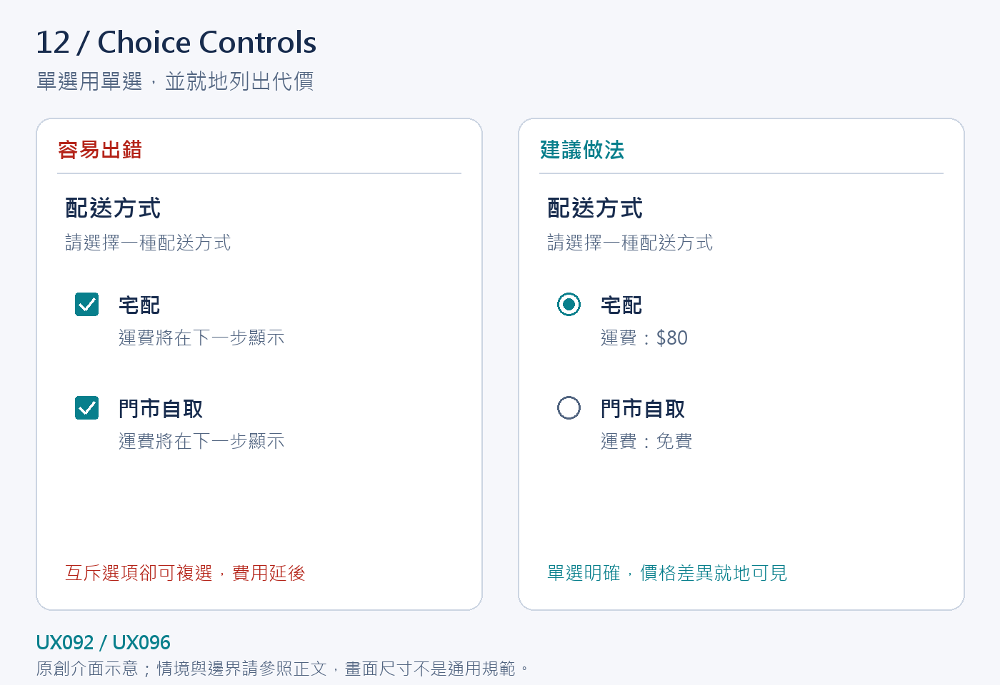

圖說：當答案只能擇一且費用不同時，就應該用單選元件並讓差異直接可見。 參照 [[#UX092]]、[[#UX096]]。

### UX091

**當答案可同時包含多項時，就應該使用 checkbox。**

例：通知管道可同選 email 與簡訊；避免：用 radio 迫使只能選一個。若項目彼此互斥，改單選。

【綜合建議】依據：[[#S04|S04]]。

### UX092

**當同組答案只能選一項時，就應該使用 radio 或單選 select。**

例：配送方式三選一；避免：三個 checkbox 到提交才說只能勾一項。需要直接比較差異時優先展開。

【綜合建議】依據：[[#S05|S05]]。

### UX093

**當設定只有開關兩態且立即套用時，就應該考慮 switch。**

例：開啟深色模式立即生效；避免：開關切了還要到頁尾儲存卻未提示。整份設定統一提交時改 checkbox 或清楚標示暫存。

【綜合建議】依據：[[#S06|S06]]。

### UX094

**當選項數量多且使用者知道名稱時，就應該提供可搜尋選取。**

例：輸入員工姓名縮小候選；避免：要求捲動五百人名單。短且易比較集合不必增加搜尋。

【綜合建議】依據：[[#S07|S07]]。

### UX095

**當可搜尋欄位只接受既有項目時，就應該清楚區分輸入文字與已選值。**

例：選中部門後顯示確定的部門名稱；避免：打了不存在名稱仍像已完成。允許新建時明示「建立新部門」。

【綜合建議】依據：[[#S07|S07]]。

### UX096

**當選項有成本或後果差異時，就應該把差異放在選項旁。**

例：配送選項列到貨日與運費；避免：選完才揭露加價。較長解釋可提供展開資訊。

【綜合建議】依據：[[#S04|S04]]、[[#S05|S05]]。

### UX097

**當複選含「以上皆非」時，就應該讓它與其他選項互斥且結果可預期。**

例：選「皆非」清掉其他值並顯示狀態；避免：「皆非」與三個項目同時勾選。不可靜默帶入與畫面不同的資料。

【綜合建議】依據：[[#S04|S04]]。

### UX098

**當某選擇會顯示額外欄位時，就應該把欄位放在該選擇附近。**

例：「其他」後出現說明欄；避免：頁尾突然多一段看不見的問題。改選後隱藏欄位是否保留資料要明確。

【綜合建議】依據：[[#S04|S04]]、[[#S05|S05]]。

### UX099

**當選項需要使用者主動同意時，就應該避免偷偷預選。**

例：使用者自行選擇是否收促銷；避免：把購買必要動作和行銷同意混在一起。本條是信任與控制權建議，非本研究法律結論。

【綜合建議】依據：[[#S04|S04]]、[[#S05|S05]]。

### UX100

**當下拉選項需要比較多個屬性時，就應該改用能看見差異的選項卡或 radio 列表。**

例：方案名稱旁列容量、月費與限制；避免：把所有差異壓成截斷的一行 select。邊界：屬性很多時另提供比較表。

【綜合建議】依據：[[#S05|S05]]。

## 13 Fields

如何讓使用者少猜格式、少重填資料？

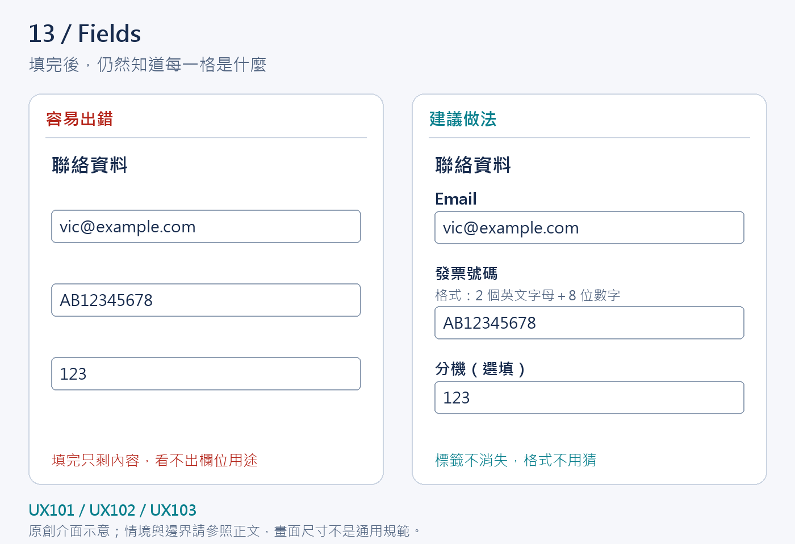

圖說：當使用者輸入資料後，就應該仍看見欄位名稱、格式提示與選填狀態。 參照 [[#UX101]]、[[#UX102]]、[[#UX103]]。

### UX101

**當使用者開始輸入後仍需確認欄位用途時，就應該保留可見 label。**

例：email 上方固定標籤；避免：placeholder 打字後消失只剩字串。浮動 label 仍需足夠可讀與測試。

【綜合建議】依據：[[#S03|S03]]。

### UX102

**當格式會影響成功率時，就應該在輸入前提供 hint。**

例：「發票號碼，例如 AB12345678」；避免：輸入失敗才說格式錯。hint 應與欄位程式化關聯。

【綜合建議】依據：[[#S03|S03]]、[[#S08|S08]]。

### UX103

**當某些欄位可以不填時，就應該用一致方式標出選填。**

例：「分機（選填）」；避免：只靠星號顏色猜必填。若大多選填，也可明示少數必填，整頁規則需一致。

【綜合建議】依據：[[#S03|S03]]、[[#S08|S08]]。

### UX104

**當問題可以用系統已有資料回答時，就應該先提供帶入或確認。**

例：顯示已驗證的聯絡地址供修改；避免：每一頁重新輸入同資料。資料可能過期或敏感時讓使用者確認。

【綜合建議】依據：[[#S11|S11]]、[[#S18|S18]]。

### UX105

**當內容通常是一段描述時，就應該提供 textarea。**

例：退貨原因可換行；避免：長文塞進窄單行欄位。若後端只接受短代碼則仍用單行。

【綜合建議】依據：[[#S03|S03]]。

### UX106

**當輸入值是代碼而非算術數量時，就應該保留前導零與格式。**

例：郵遞區號「00123」不變成 123；避免：一律用 number 讓瀏覽器處理成數值。可用文字欄位搭配合適 inputmode。

【綜合建議】依據：[[#S03|S03]]、[[#S10|S10]]。

### UX107

**當有安全且無歧義的格式差異時，就應該容忍差異。**

例：電話允許合理空白；避免：每個空格都報錯。不要對密碼或有意義識別碼任意 trim、改大小寫。

【綜合建議】依據：[[#S08|S08]]、[[#S20|S20]]。

### UX108

**當欄位有字數限制時，就應該在接近限制時提供可理解的計數。**

例：「還可輸入 24 字」；避免：提交時才丟棄超長段落。需先定義字元、字數或 byte 計算方式，畫面與 server 一致。

【綜合建議】依據：[[#S08|S08]]。

### UX109

**當多個欄位共同回答一個問題時，就應該提供群組標題。**

例：日期欄位共享「開始日期」並各有年/月/日標籤；避免：只有三格無上下文數字。

【綜合建議】依據：[[#S04|S04]]、[[#S05|S05]]、[[#S10|S10]]。

### UX110

**當填寫地址會遇到不同國家格式時，就應該依選定國家顯示相關欄位並允許手動輸入。**

例：不強迫每個地址都有州與郵遞區號；避免：自動查址找不到就不能繼續。邊界：配送範圍受限時先說明服務國家。

【綜合建議】原創情境判斷，須以實際任務驗證。

### UX111

**當金額欄位的幣別會改變數值意義時，就應該把幣別放在欄位旁且保留明確選擇。**

例：「金額（TWD）」並在換幣別時確認是否換算；避免：切成 USD 後原數字悄悄變成另一筆金額。

【綜合建議】原創情境判斷，須以實際任務驗證。

## 14 Validation

何時指出錯誤，如何讓人修好？

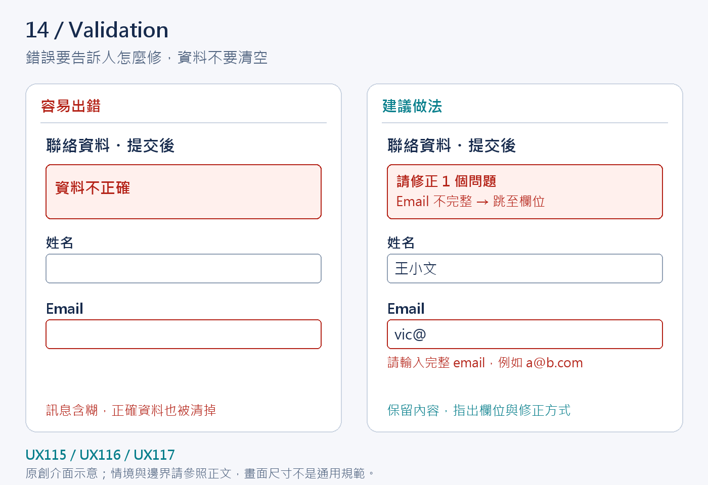

圖說：當提交驗證失敗時，就應該保留資料並把修正方式連到對應欄位。 參照 [[#UX115]]、[[#UX116]]、[[#UX117]]。

### UX112

**當使用者還未完成輸入時，就應該避免過早宣告格式錯誤。**

例：email 打到 `vic@` 時先不責備；避免：第一個字就全紅。真正有益的即時長度提示可例外。

【綜合建議】依據：[[#S08|S08]]。

### UX113

**當設計一般低頻服務表單時，就應該先以提交驗證作基線，再驗證是否需要 blur。**

例：填完整頁後一次得到可修復錯誤；避免：一律套用失焦紅字。高頻 enterprise modal 可能採 blur，但需測試收益。

【綜合建議】依據：[[#S08|S08]]、[[#S13|S13]]。

### UX114

**當錯誤已被指出而使用者正在修正時，就應該及時移除過期錯誤。**

例：合法日期輸入完成後不再顯示月份錯誤；避免：紅字一直留到下一次提交。檢查成本高時可顯示重新驗證中。

【綜合建議】依據：[[#S08|S08]]、[[#S13|S13]]。

### UX115

**當提交有多個錯誤時，就應該提供可跳到欄位的摘要。**

例：摘要「請填聯絡 email」連到該欄；避免：只在頁頂寫「資料不正確」。GOV.UK 對單一錯誤亦要求摘要，其他產品依頁面長度與測試決定。

【綜合建議】依據：[[#S09|S09]]。

### UX116

**當欄位驗證失敗時，就應該說明怎麼改。**

例：「結束日期需晚於開始日期」；避免：「Invalid input」。無法安全提供細節的登入錯誤是例外。

【綜合建議】依據：[[#S08|S08]]、[[#S19|S19]]。

### UX117

**當普通表單提交失敗時，就應該保留已輸入資料。**

例：只修一個錯字就能重送；避免：整張申請表清空。密碼、付款秘密等敏感欄位另依安全設計處理。

【綜合建議】依據：[[#S08|S08]]、[[#S19|S19]]。

### UX118

**當錯誤發生在 server 而不是使用者輸入時，就應該給服務失敗訊息。**

例：「暫時無法儲存，內容已保留，請重試」；避免：將全部欄位標紅。

【綜合建議】依據：[[#S08|S08]]、[[#S13|S13]]。

### UX119

**當使用者缺乏權限時，就應該說明權限狀態與可行出口。**

例：「需專案管理員授權，聯絡管理員」；避免：把正確輸入標成格式錯誤。敏感資源存在與否仍要避免洩漏。

【綜合建議】依據：[[#S08|S08]]、[[#S17|S17]]。

### UX120

**當資料必須經遠端檢查時，就應該區分檢查中、可用與檢查失敗。**

例：帳號名稱顯示「檢查中」而非預先綠勾；避免：網路失敗就說名稱已使用。送出時仍需權威端重新驗證。

【綜合建議】依據：[[#S08|S08]]、[[#S16|S16]]。

### UX121

**當使用者符合格式卻不符合服務資格時，就應該解釋資格結果與替代途徑。**

例：「此地區尚未提供配送，可改用門市自取」；避免：將真實地址標成『地址格式錯誤』。

【綜合建議】依據：[[#S08|S08]]。

## 15 Dates and Time

選日期、時段與跨時區時如何避免歧義？

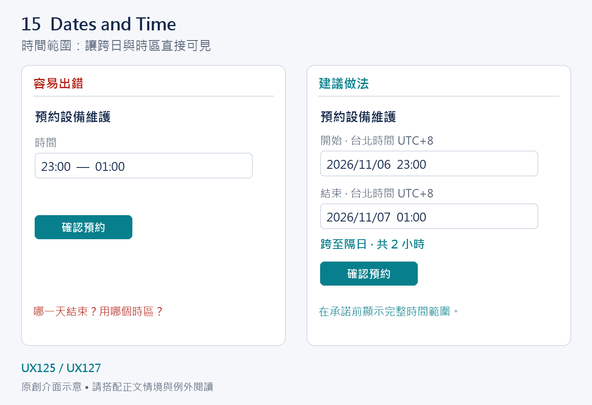

圖說：當時間跨日或跨時區時，就應該在確認點顯示日期、時區與完整範圍。 對照：[[#UX125]]、[[#UX127]]。

### UX122

**當日期是使用者已知的歷史值時，就應該允許直接輸入。**

例：出生日期可直接填年月日；避免：只能連按月曆回到三十年前。分欄順序依語系清楚標明。

【綜合建議】依據：[[#S10|S10]]。

### UX123

**當日期選擇取決於可用時段時，就應該顯示日曆或可預約清單。**

例：訂房可看可用晚數；避免：先輸入後才逐次告知不可訂。仍提供鍵盤操作與明確日期文字。

【綜合建議】依據：[[#S10|S10]]、[[#S12|S12]]。

### UX124

**當系統接受日期範圍時，就應該顯示起訖與範圍結果。**

例：「10/30–11/02，共 3 晚」；避免：兩個相同未命名的 date picker。業務上日數是否含結束日需明確。

【綜合建議】依據：[[#S10|S10]]。

### UX125

**當時間跨時區時，就應該在決策點顯示時區。**

例：會議「09:00 台北時間」；避免：只寫 09:00 讓旅客猜測。使用者旅行時需分清裝置時區與活動時區。

【綜合建議】依據：[[#S10|S10]]。

### UX126

**當選的是純日曆日期而非時間點時，就應該維持使用者選的日期。**

例：生日 10 月 31 日在不同時區仍是同一天；避免：轉 UTC 再顯示後生日變成前一天。

【綜合建議】原創情境判斷，須以實際任務驗證。

### UX127

**當同一事件有開始與結束時間時，就應該讓結束跨日的事實可見。**

例：「週五 23:00 → 週六 01:00，共 2 小時」；避免：只列 23:00–01:00 讓人誤判順序。

【綜合建議】原創情境判斷，須以實際任務驗證。

### UX128

**當預約時段會在選取後被別人訂走時，就應該在確認點重新檢查並保留其他輸入。**

例：「此時段剛被預訂，請改選 15:30 或 16:00」；避免：清空姓名與聯絡資料要求重填。

【綜合建議】原創情境判斷，須以實際任務驗證。

### UX129

**當跨夏令時間的時間可能不存在或重複時，就應該讓時區與實際時間點可辨識。**

例：重複的當地 01:30 顯示對應 UTC offset 供確認；避免：任選其中一個卻不告知。邊界：只在相關地區與日期呈現額外資訊。

【綜合建議】原創情境判斷，須以實際任務驗證。

### UX130

**當相對時間可能影響是否逾期的判斷時，就應該提供完整截止時間。**

例：「明天到期 · 11 月 1 日 17:00 台北時間」；避免：只有『剩 1 天』卻不知道幾點截止。

【綜合建議】原創情境判斷，須以實際任務驗證。

### UX131

**當週期任務以當地作息為基準時，就應該說明週期跟隨哪個時區。**

例：「每週一 09:00，Asia/Taipei」；避免：出差換裝置時區後通知時間無預警改變。

【綜合建議】原創情境判斷，須以實際任務驗證。

## 16 Multi-step Work

長流程如何保存進度並確認真正完成？

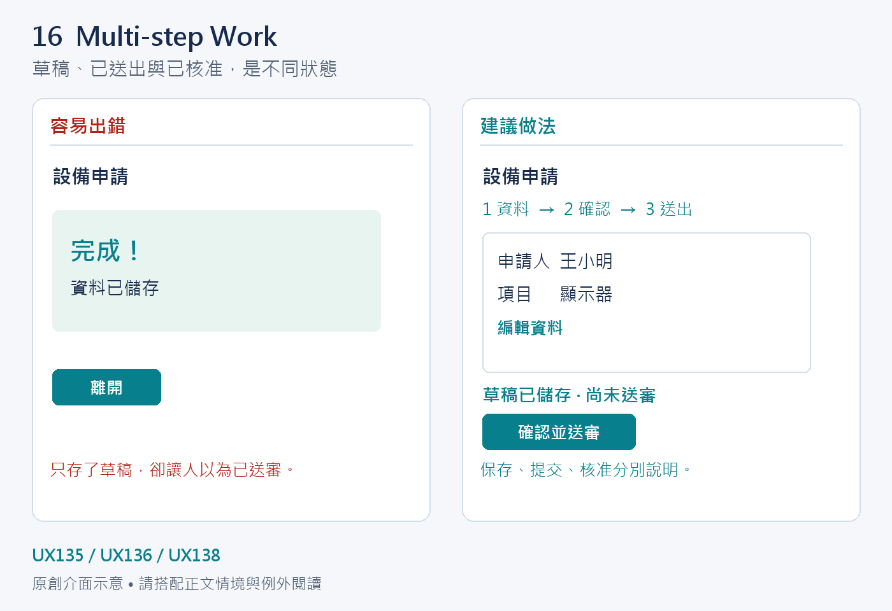

圖說：當流程有多個完成階段時，就應該明示目前狀態及下一個動作。 對照：[[#UX135]]、[[#UX136]]、[[#UX138]]。

### UX132

**當流程長到一次呈現會造成負擔時，就應該依有意義任務拆步驟。**

例：聯絡資料→配送→確認；避免：每一欄都一頁而無實際好處。短表單不用為了 stepper 強拆。

【綜合建議】依據：[[#S11|S11]]、[[#S13|S13]]。

### UX133

**當流程可往返修改時，就應該保留前一步資料。**

例：從確認頁返回地址仍保留其他答案；避免：回上一頁整段重填。上游選項改變下游答案時，說明需重確認的內容。

【綜合建議】依據：[[#S11|S11]]。

### UX134

**當步驟數會依答案改變時，就應該避免承諾不可靠的固定百分比。**

例：顯示目前階段名稱；避免：顯示 90% 後突然多十頁。總數穩定時可用完整步驟進度。

【綜合建議】依據：[[#S11|S11]]、[[#S16|S16]]。

### UX135

**當最後送出會造成重要後果時，就應該提供可編輯的確認摘要。**

例：送申請前看到申請人、項目與日期；避免：直接從最後欄位跳成功。小型可撤銷操作通常不需此頁。

【綜合建議】依據：[[#S11|S11]]。

### UX136

**當流程允許稍後繼續時，就應該明確區分草稿與正式送出。**

例：「已儲存草稿，尚未送審」；避免：單一綠勾讓人以為流程完成。可恢復期限與跨裝置能力需如實說明。

【綜合建議】依據：[[#S01|S01]]、[[#S21|S21]]。

### UX137

**當上一步選項變更會讓下游答案失效時，就應該指出哪些內容需重新確認。**

例：由宅配改自取後提示配送地址不再使用；避免：仍沿用宅配運費卻不讓人察覺。

【綜合建議】依據：[[#S11|S11]]。

### UX138

**當服務處理尚未結束但使用者已完成輸入時，就應該拆開『已提交』與『已核准』。**

例：「申請已收到，審核中」；避免：看到 API 接收成功就說『申請通過』。

【綜合建議】依據：[[#S21|S21]]。

### UX139

**當工作需要由另一人接續時，就應該說明目前負責人與等待條件。**

例：「已送主管王小姐簽核，你可以查看進度」；避免：流程停在最後一格卻沒有下一步。

【綜合建議】原創情境判斷，須以實際任務驗證。

### UX140

**當流程恢復後資料可能已過期時，就應該重檢會影響決策的項目。**

例：恢復購物草稿時標出價格或庫存變更；避免：沿用一週前價格到付款失敗才通知。

【綜合建議】原創情境判斷，須以實際任務驗證。

## 17 Identity and Onboarding

登入、授權與首次使用如何接回原任務？

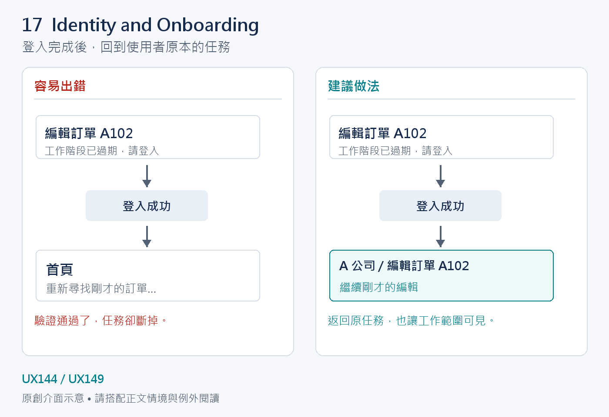

圖說：當登入中斷任務時，就應該保留目的地，並清楚展示當前工作空間。 對照：[[#UX144]]、[[#UX149]]。

### UX141

**當使用者輸入密碼時，就應該支援貼上與 password manager。**

例：可自動填入與顯示密碼；避免：阻擋貼上迫使手打。隱藏預設與顯示切換都要有清楚名稱。

【綜合建議】依據：[[#S19|S19]]、[[#S20|S20]]。

### UX142

**當登入失敗時，就應該提供能恢復而不洩漏帳號存在性的訊息。**

例：「帳號或密碼不正確」加重設入口；避免：「此 email 存在，但密碼錯」。

【綜合建議】依據：[[#S19|S19]]、[[#S20|S20]]。

### UX143

**當驗證碼由外部管道取得時，就應該支援整串貼上。**

例：貼六碼即可填入；避免：六個框要求逐格切換。到期、重寄等待與驗證失敗需有明確狀態。

【綜合建議】依據：[[#S03|S03]]、[[#S08|S08]]。

### UX144

**當登入中斷原本任務時，就應該在登入後返回原任務。**

例：登入後仍回到原本待編輯專案；避免：總是送到首頁而丟失目的。無權限或資源已失效時說明原因。

【綜合建議】依據：[[#S08|S08]]、[[#S17|S17]]。

### UX145

**當需要權限才能完成某功能時，就應該在有上下文的時機解釋用途。**

例：使用掃描時說明需要相機；避免：首次進站連續索取多種權限。拒絕後保留可行替代流程。

【綜合建議】依據：[[#S17|S17]]。

### UX146

**當初次使用需要學會核心操作時，就應該引導完成一個真實任務。**

例：建立第一筆項目時介紹必要欄位；避免：先強迫看十張功能介紹。需要安全訓練的工具可保留必要教學。

【綜合建議】依據：[[#S17|S17]]。

### UX147

**當教學不是使用前提時，就應該允許跳過並稍後重開。**

例：「稍後再看」及說明中心入口；避免：每次登入都自動播放導覽。必須完成的法定或安全內容不以可跳過建議覆蓋。

【綜合建議】依據：[[#S17|S17]]。

### UX148

**當展示範例資料時，就應該讓它與真實資料可辨識。**

例：樣本專案標「示範」並可清除；避免：假訂單混進正式 dashboard。若示範含可執行操作，明示是否有真實副作用。

【綜合建議】依據：[[#S17|S17]]。

### UX149

**當使用者換帳號或 workspace 時，就應該清楚展示當前身分與範圍。**

例：邀請視窗寫「加入 A 公司」；避免：操作完成後才知道改到 B 公司。高後果動作在確認點重申範圍。

【綜合建議】依據：[[#S11|S11]]、[[#S13|S13]]。

### UX150

**當登入或重設連結已過期時，就應該提供重新取得連結的明確出口。**

例：「此連結已失效，重新寄送」；避免：只顯示『Token invalid』讓人卡住。邊界：回應仍避免透露未授權帳號資訊。

【綜合建議】依據：[[#S20|S20]]。

## 18 Overlays

何時用浮層，如何維持操作上下文？

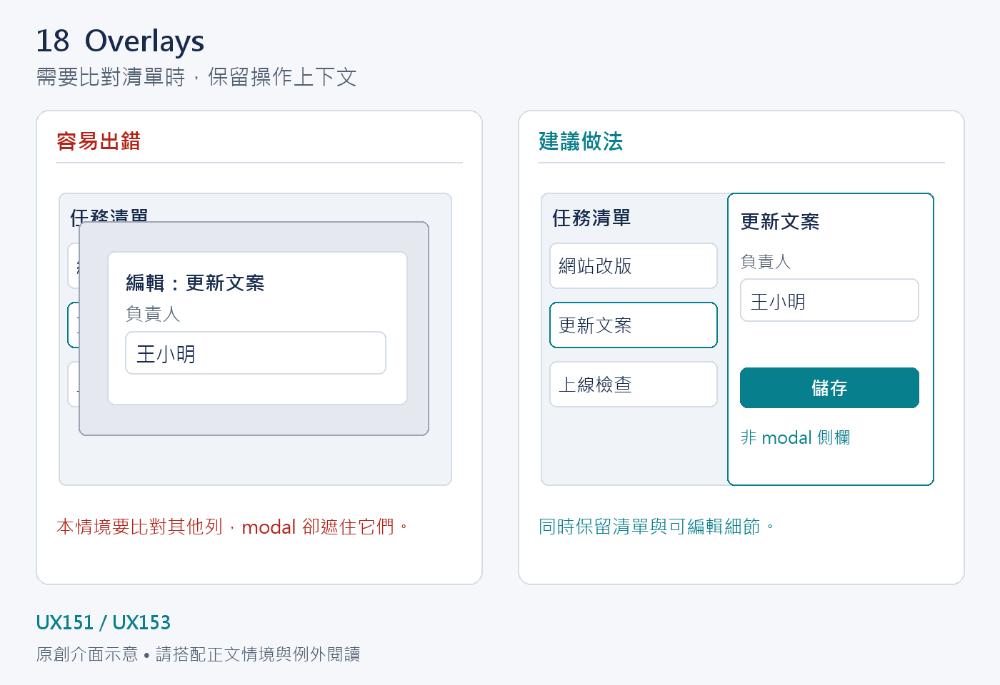

圖說：當使用者需要邊看清單邊改細節時，就應該考慮非modal側欄並保留上下文。 對照：[[#UX151]]、[[#UX153]]。

### UX151

**當任務必須暫停背景才能完成時，就應該使用真正的 modal。**

例：確認不可逆刪除時背景不可操作；避免：視覺蓋黑但鍵盤仍進入背後控制。若需要比較背景資料，改非 modal panel。

【綜合建議】依據：[[#S12|S12]]。

### UX152

**當工作會頻繁進行或包含很多步驟時，就應該優先放在頁面。**

例：大型訂單編輯有自己的頁；避免：在小 modal 捲動十個區塊。短暫補充小欄位仍可用 modal。

【綜合建議】依據：[[#S13|S13]]。

### UX153

**當使用者需要邊看列表邊改細節時，就應該考慮非 modal drawer。**

例：側欄顯示選中任務並保留列表上下文；避免：每次都打斷列表操作。窄螢幕可轉完整頁或 modal，並同步調整 focus 行為。

【綜合建議】依據：[[#S12|S12]]、[[#S13|S13]]。

### UX154

**當浮層包含可點連結或表單時，就應該使用支援互動的 popover/dialog。**

例：通知偏好浮層可正常 Tab 進去；避免：把互動按鈕塞進 tooltip。

【綜合建議】依據：[[#S14|S14]]。

### UX155

**當提供補充 tooltip 時，就應該讓鍵盤使用者也能觸發與關閉。**

例：focus 出現、Escape 收起；避免：只有滑鼠 hover 才看得到。完成任務必需的資訊仍應直接顯示。

【綜合建議】依據：[[#S14|S14]]。

### UX156

**當 modal 打開時，就應該把 focus 移到最適合開始理解內容的位置。**

例：長確認內容先聚焦標題；避免：總聚焦最底部按鈕跳過全文。簡短表單可從首欄開始。

【綜合建議】依據：[[#S12|S12]]。

### UX157

**當 modal 關閉時，就應該把 focus 還給合理工作位置。**

例：取消後回到「新增」按鈕；避免：focus 掉到頁面頂端。觸發項目已刪除時移到下一項或列表標題。

【綜合建議】依據：[[#S12|S12]]。

### UX158

**當即將執行難以撤銷的行動時，就應該避免讓初始 focus 鼓勵誤觸破壞性操作。**

例：先聚焦取消或摘要；避免：Enter 習慣性連按直接刪除。仍需依平台語意與操作頻率測試。

【綜合建議】依據：[[#S12|S12]]。

### UX159

**當關閉浮層會丟失未儲存內容時，就應該讓使用者選擇保留或放棄。**

例：「繼續編輯／放棄變更」；避免：點背景就清空表單。已自動存草稿時可直接關閉並說明保存狀態。

【綜合建議】依據：[[#S13|S13]]。

### UX160

**當操作會開啟第二層複雜浮層時，就應該改用單一可返回的工作區。**

例：在同一 drawer 內切到選擇成員並提供返回；避免：modal 疊 modal 再疊選單而不知道 Escape 關哪層。

【綜合建議】依據：[[#S12|S12]]、[[#S13|S13]]。

## 19 Feedback and Waiting

如何區分成功、處理中與真正失敗？

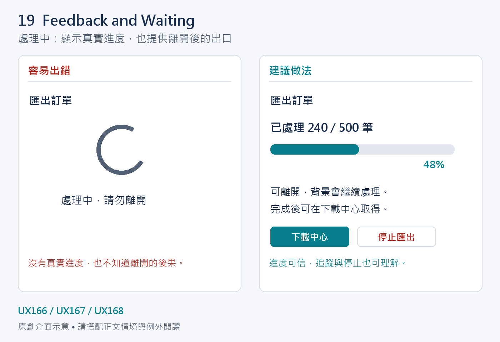

圖說：當能量測進度且工作較久時，就應該顯示真實進度與後續追蹤入口。 對照：[[#UX166]]、[[#UX167]]、[[#UX168]]。

### UX161

**當操作成功且不需後續決定時，就應該提供低干擾 feedback。**

例：收藏狀態更新並簡短提示；避免：每次收藏都要求按「確定」。結果本身已明確時不必額外 toast。

【綜合建議】依據：[[#S15|S15]]。

### UX162

**當訊息需要使用者採取行動時，就應該讓它持續可找到。**

例：上傳失敗留在檔案列並提供重試；避免：錯誤 toast 消失後無處查。非關鍵短狀態可短暫顯示。

【綜合建議】依據：[[#S15|S15]]。

### UX163

**當問題影響整個頁面或服務時，就應該用對應範圍的通知。**

例：離線 banner 出現在工作區上方；避免：每個欄位都顯示同一網路錯誤。單一欄位錯誤應就地呈現。

【綜合建議】依據：[[#S15|S15]]、[[#S08|S08]]。

### UX164

**當載入只影響局部內容時，就應該只替該區塊呈現等待狀態。**

例：報表更新時導航仍可用；避免：整個 app 每次都全屏 spinner。操作要求原子完成時可限制相關區域。

【綜合建議】依據：[[#S16|S16]]。

### UX165

**當初次載入的內容結構已知時，就應該考慮對應結構的 skeleton。**

例：列表骨架符合真實列高；避免：假骨架先放滿全頁又整頁跳動。未知結果或純計算則可用狀態文字。

【綜合建議】依據：[[#S16|S16]]。

### UX166

**當能量測完成進度時，就應該顯示真實進度。**

例：「已處理 240 / 500 筆」；避免：假百分比停在 99%。總量未知時明示處理中，不假裝精準。

【綜合建議】依據：[[#S16|S16]]。

### UX167

**當工作可能持續較久時，就應該提供離開後仍能追蹤的方式。**

例：匯出成背景任務，完成後到下載中心領取；避免：要求一直盯著 spinner。需使用者等待的流程應如實解釋。

【綜合建議】依據：[[#S16|S16]]、[[#S21|S21]]。

### UX168

**當任務可以取消時，就應該讓取消的後果可理解。**

例：「停止上傳」並說明已傳檔案仍保留；避免：按取消只關視窗，後台繼續執行卻沒提示。不可取消時不要提供假取消。

【綜合建議】依據：[[#S16|S16]]。

### UX169

**當資料只是背景刷新時，就應該保留可用內容並標明刷新。**

例：舊資料仍顯示並標「更新中」；避免：每隔十秒整表清空成 skeleton。舊值不安全時改顯示不可用而不是假即時。

【綜合建議】依據：[[#S16|S16]]。

### UX170

**當採用 optimistic update 時，就應該事先設計失敗時的回復與告知。**

例：收藏先變成已選，失敗後恢復並顯示重試；避免：失敗後仍永久顯示已完成。邊界：付款、權限變更等高後果動作不假裝已獲權威端確認。

【綜合建議】原創情境判斷，須以實際任務驗證。

## 20 Empty and Destructive States

沒資料與要刪資料時，下一步是什麼？

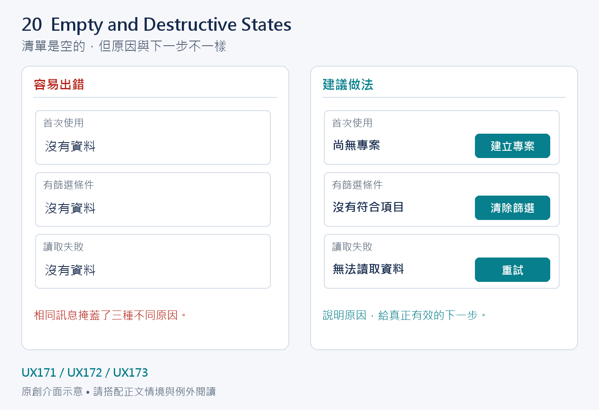

圖說：當清單沒有內容時，就應該依原因提供相符的下一步。 對照：[[#UX171]]、[[#UX172]]、[[#UX173]]。

### UX171

**當是首次沒有資料時，就應該告訴使用者第一步。**

例：「尚無專案，建立第一個專案」；避免：空白區只放插畫。功能受權限限制時不要提供做不到的 CTA。

【綜合建議】依據：[[#S17|S17]]。

### UX172

**當是搜尋或篩選後沒有結果時，就應該提供調整條件的方法。**

例：「沒有符合項目，清除篩選」；避免：提示建立新資料，彷彿資料庫是空的。

【綜合建議】依據：[[#S17|S17]]。

### UX173

**當資料未取得是因錯誤時，就應該顯示失敗而不是空資料。**

例：「無法讀取訂單，重試」；避免：「目前沒有訂單」掩蓋 API 問題。

【綜合建議】依據：[[#S17|S17]]。

### UX174

**當正常完成工作後清單為空時，就應該肯定已完成狀態。**

例：「今天的待辦都完成了」；避免：以紅色錯誤標示清單空白。不必加入過度慶祝妨礙工作。

【綜合建議】依據：[[#S17|S17]]。

### UX175

**當操作可可靠撤銷且後果輕微時，就應該考慮直接操作加 Undo。**

例：移除一個篩選條件立刻生效；避免：每次都問「確定嗎」。Undo 必須真的可還原，不能掩蓋不可逆外部副作用。

【綜合建議】依據：[[#S13|S13]]、[[#S15|S15]]。

### UX176

**當刪除會造成重大或不可逆損失時，就應該在執行前說明對象與後果。**

例：「永久刪除專案 Alpha，含 26 個任務」；避免：「是否繼續」。重要數字須由當前資料計算。

【綜合建議】依據：[[#S13|S13]]。

### UX177

**當需要額外確認高風險對象時，就應該讓確認有助於辨識對象。**

例：要求輸入專案名稱以避免刪錯；避免：所有小刪除都要求輸入 DELETE。額外摩擦應與後果匹配。

【綜合建議】依據：[[#S13|S13]]。

### UX178

**當交易已經完成時，就應該給可保存、可追蹤的確認結果。**

例：申請編號、送出時間與下一步；避免：瞬間 toast 後回首頁。等待審核不應寫成「已核准」。

【綜合建議】依據：[[#S21|S21]]。

### UX179

**當『移除關聯』與『永久刪除』的後果不同時，就應該用不同動詞並說明保留什麼。**

例：「從專案移除成員」不刪帳號；避免：兩個動作都叫『刪除』。

【綜合建議】原創情境判斷，須以實際任務驗證。

# Part III — Complex Workflows

## 21 Files and Persistence

檔案、草稿與同步失敗時如何保住工作？

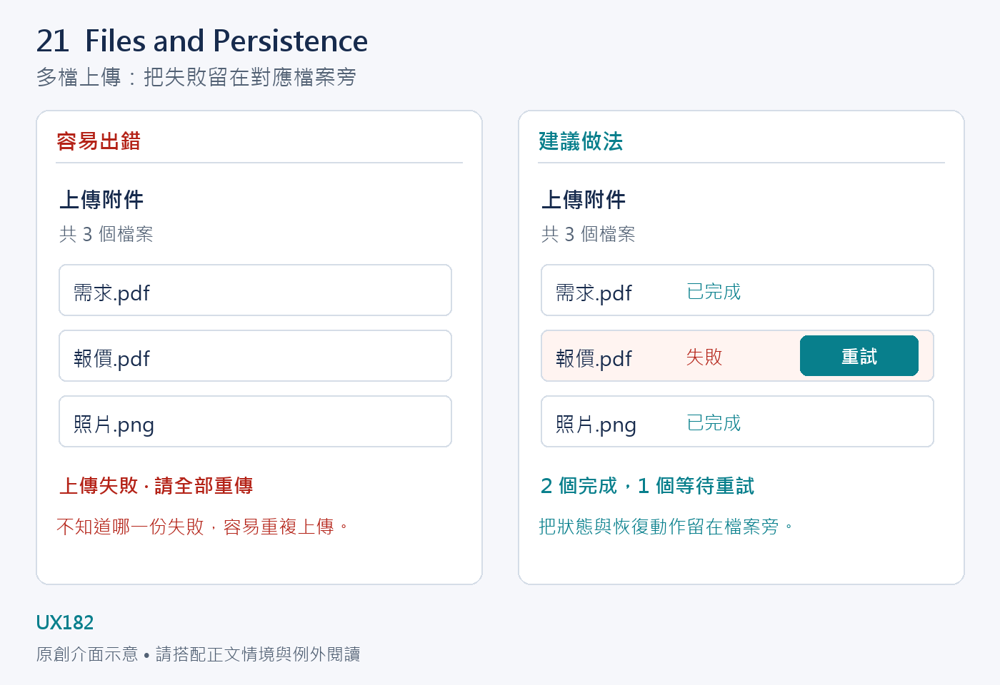

圖說：當多個檔案只有部分失敗時，就應該逐檔顯示狀態並只重試失敗項目。 對照：[[#UX182]]。

### UX180

**當要求上傳檔案時，就應該在選檔前說明限制。**

例：標可用格式與容量，再提供選檔；避免：上傳到最後才說不接受。限制以實際後端能力為準。

【綜合建議】依據：[[#S18|S18]]。

### UX181

**當提供拖放上傳時，就應該同時保留選檔入口。**

例：拖放區含「選擇檔案」；避免：只能把檔案拖進畫面。行動裝置與鍵盤使用者不能依賴拖曳。

【綜合建議】依據：[[#S18|S18]]。

### UX182

**當一次上傳多個檔案時，就應該逐檔顯示狀態。**

例：每列呈現完成、失敗及重試；避免：總訊息「上傳失敗」卻不知道哪一份。可只重試失敗項目以免重複。

【綜合建議】依據：[[#S18|S18]]、[[#S15|S15]]。

### UX183

**當同一路程已上傳過同一文件時，就應該提供重用。**

例：選擇「剛才的證明文件」；避免：反覆要求重新找檔。共用裝置與敏感文件需限制預覽或下載。

【綜合建議】依據：[[#S18|S18]]。

### UX184

**當採用 autosave 時，就應該展示真實儲存狀態。**

例：「儲存中／已儲存／尚未同步」；避免：本地輸入就一律顯示「已儲存」。若僅儲存在本機，明示本機草稿。

【綜合建議】依據：[[#S15|S15]]、[[#S16|S16]]。

### UX185

**當 autosave 失敗時，就應該保留內容並提供恢復方式。**

例：顯示重試與複製內容；避免：只顯示短暫 toast 然後關頁丟資料。敏感資料不能任意寫入長期本機儲存。

【綜合建議】依據：[[#S08|S08]]、[[#S15|S15]]。

### UX186

**當使用者離線時，就應該區分可做與暫時不可做的事。**

例：可編輯草稿，送出顯示「連線後才能送出」；避免：所有操作都看似正常成功。離線佇列需說明真正送出時機。

【綜合建議】依據：[[#S16|S16]]、[[#S17|S17]]。

### UX187

**當多端變更可能互相覆蓋時，就應該讓衝突可辨識與處理。**

例：顯示本地與伺服器版本供比較；避免：默默採最後寫入而丟掉長文。低價值設定可以採較簡單策略，但應符合預期。

【綜合建議】依據：[[#S08|S08]]、[[#S15|S15]]。

### UX188

**當重新連線可能觸發外部副作用時，就應該讓執行狀態與重送行為可追蹤。**

例：待送訊息列出「待送／已送／失敗」；避免：使用者以為已取消的訂單在恢復連線後送出。重要交易重送前需確認狀態及避免重複。

【綜合建議】依據：[[#S01|S01]]、[[#S21|S21]]。

### UX189

**當檔案已傳完但還要掃描或轉檔時，就應該分開顯示傳輸完成與可使用。**

例：「上傳完成，正在轉檔」；避免：進度 100% 就說可下載，點開卻失敗。

【綜合建議】原創情境判斷，須以實際任務驗證。

### UX190

**當下載會產生大型檔案時，就應該讓人先知道內容範圍與檔案格式。**

例：「匯出目前篩選的 8,430 筆為 CSV」；避免：只寫『匯出』而混入所有資料。

【綜合建議】原創情境判斷，須以實際任務驗證。

### UX191

**當同名檔案上傳可能覆蓋既有檔案時，就應該讓覆蓋、保留兩份與取消可區分。**

例：「取代版本／另存副本」並顯示既有檔案時間；避免：以同名為由靜默覆蓋。

【綜合建議】原創情境判斷，須以實際任務驗證。

## 22 Tables and Bulk Actions

如何比較資料並安全地批次處理？

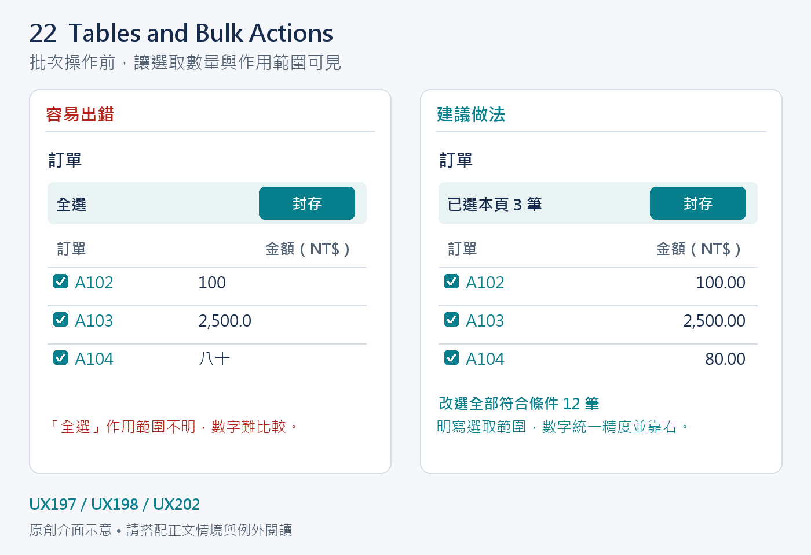

圖說：當資料表提供批次操作時，就應該明示數量與範圍，並讓可比較數字格式一致。 對照：[[#UX197]]、[[#UX198]]、[[#UX202]]。

### UX192

**當使用者需要逐欄比較相同屬性時，就應該優先用 table。**

例：訂單、金額、狀態各一欄；避免：每張訂單卡片資訊順序不同。 邊界：圖像探索為主時可用卡片。

【綜合建議】依據：[[#R1|R1]]、[[#R2|R2]]。

### UX193

**當只是讀資料並偶爾開詳情時，就應該先用原生 table 加真實 link/button。**

例：訂單編號是 link；避免：每個 td 都加 tabindex。 邊界：spreadsheet 式編輯另選完整 grid。

【綜合建議】依據：[[#R1|R1]]、[[#R2|R2]]。

### UX194

**當必須做 cell 編輯與方向鍵巡覽時，就應該採完整 grid 模型。**

例：方向鍵換格、明確進出編輯；避免：只加 role=grid 卻沒有鍵盤行為。 邊界：grid 成本高，不為樣式使用。

【綜合建議】依據：[[#R3|R3]]。

### UX195

**當整列可點擊開詳情時，就應該仍提供可用鍵盤操作的明確入口。**

例：名稱 link，點空白處也可開啟；避免：tr 只有 onclick。 邊界：列內 checkbox/menu 不得誤觸導航。

【綜合建議】依據：[[#R1|R1]]、[[#R2|R2]]。

### UX196

**當欄位可排序時，就應該顯示目前排序方向並讓控制項可操作。**

例：「金額，降冪」；避免：表頭只有滑鼠 hover 才出現箭頭。 邊界：多欄排序需另顯示優先序。

【綜合建議】依據：[[#R1|R1]]、[[#R2|R2]]。

### UX197

**當使用者選多列時，就應該切換成清楚的批次操作上下文。**

例：「已選 6 筆，封存」；避免：同時保留易混淆的單列刪除。 邊界：禁止操作應解釋限制。

【綜合建議】依據：[[#R1|R1]]、[[#R2|R2]]。

### UX198

**當有跨頁全選時，就應該明寫選取範圍。**

例：「本頁 20 筆」與「全部符合條件 843 筆」分開；避免：「全選」不知道選了多少。 邊界：資料變動時需重新確認範圍。

【綜合建議】依據：[[#R1|R1]]、[[#R2|R2]]。

### UX199

**當批次操作部分失敗時，就應該分列成功、失敗與可重試項。**

例：「8 筆成功，2 筆權限不足」；避免：只顯示失敗並讓人重做全部。 邊界：重試需避免重複副作用。

【綜合建議】依據：[[#R1|R1]]、[[#R2|R2]]。

### UX200

**當欄位太多時，就應該先保留任務必需欄位並提供次要資訊入口。**

例：狀態與金額常駐、備註展開；避免：為塞全部把字縮成 10px。 邊界：對照分析可保留橫向捲動。

【綜合建議】依據：[[#R1|R1]]、[[#R2|R2]]。

### UX201

**當某列可展開時，就應該用獨立展開控制並說明狀態。**

例：展開明細按鈕；避免：點任何格都忽然展開。 邊界：展開內容太長時改詳情頁。

【綜合建議】依據：[[#R1|R1]]、[[#R2|R2]]。

### UX202

**當金額或數量要跨列比較時，就應該對齊數字、統一精度並顯示單位。**

例：「NT$」欄名與一致小數位；避免：100、100.0、1百混在同欄。 邊界：ID 不是數量，不作數值格式化。

【綜合建議】原創情境判斷，須以實際任務驗證。

### UX203

**當資料是缺值時，就應該區分缺值、零與不適用。**

例：「未提供」「0」「不適用」；避免：全部填 0。 邊界：短橫線要有圖例。

【綜合建議】原創情境判斷，須以實際任務驗證。

### UX204

**當批次操作對選取項目有不同資格時，就應該在執行前顯示可處理與不能處理的數量。**

例：「可封存 18 筆；2 筆正在審核」；避免：直到全部送出後才只說『不允許』。邊界：執行時仍重新檢查最新狀態。

【綜合建議】原創情境判斷，須以實際任務驗證。

### UX205

**當使用者需要暫時檢查單列資訊時，就應該讓詳情展開不改變已選取的列。**

例：勾選 3 筆後展開備註仍保持選取；避免：點展開箭頭同時清空選取或觸發導航。

【綜合建議】原創情境判斷，須以實際任務驗證。

## 23 Pagination and Live Data

如何定位、返回與處理持續變動的資料？

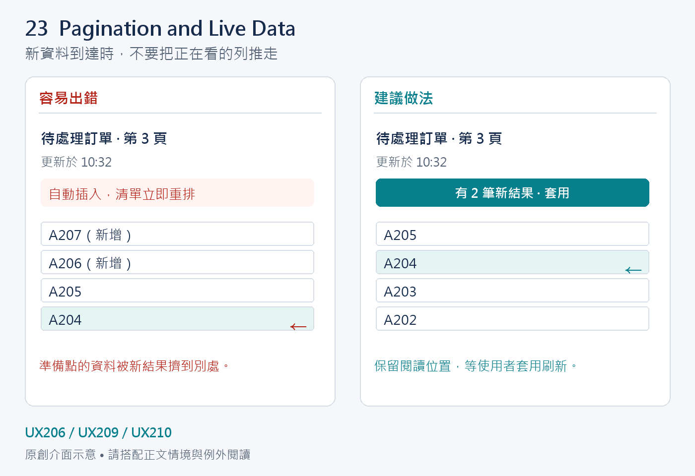

圖說：當刷新可能打斷選取或閱讀時，就應該保留位置，讓使用者決定何時套用新資料。 對照：[[#UX206]]、[[#UX209]]、[[#UX210]]。

### UX206

**當使用者要返回剛才的位置時，就應該保留 filter、sort、page 與 scroll。**

例：開詳情後返回同一列；避免：每次回到第 1 頁。 邊界：新工作階段可依需求重置。

【綜合建議】原創情境判斷，須以實際任務驗證。

### UX207

**當工作需要可定位與可分享時，就應該優先分頁並保存查詢狀態。**

例：同事打開同一查詢條件；避免：只能一路無限下滑找第 300 筆。 邊界：探索 feed 可使用 infinite scroll。

【綜合建議】原創情境判斷，須以實際任務驗證。

### UX208

**當要用 infinite scroll 時，就應該設計返回位置與可抵達的頁尾。**

例：載入更多與返回位置；避免：頁尾永遠被新資料推走。 邊界：不必為少量固定資料使用。

【綜合建議】原創情境判斷，須以實際任務驗證。

### UX209

**當資料持續更新時，就應該顯示更新時間與刷新狀態。**

例：「10:32 更新，刷新中」；避免：過期資料看起來像即時。 邊界：高頻 feed 可聚合時間提示。

【綜合建議】原創情境判斷，須以實際任務驗證。

### UX210

**當更新可能打斷選取或閱讀時，就應該暫存新資料並讓使用者套用。**

例：「有 12 筆新結果」；避免：滑鼠快點到某列時突然重排。 邊界：緊急監控可明確定義自動刷新。

【綜合建議】原創情境判斷，須以實際任務驗證。

### UX211

**當刪除目前頁最後一筆資料時，就應該回到仍有資料的有效頁。**

例：第 4 頁清空後回第 3 頁並更新總數；避免：留在不存在的第 4 頁顯示錯誤。

【綜合建議】原創情境判斷，須以實際任務驗證。

### UX212

**當頁面大小改變時，就應該盡量保留正在看的資料區段。**

例：從每頁 20 改 50 筆後仍能找到原本第 65 筆；避免：突然回第一筆且沒有理由。邊界：查詢變更另按新的資料集處理。

【綜合建議】原創情境判斷，須以實際任務驗證。

### UX213

**當總筆數未知或計算昂貴時，就應該顯示已載入數量與是否還有下一批。**

例：「已載入 100 筆，載入更多」；避免：編造『共 999 筆』或讓頁碼跳到無效位置。

【綜合建議】原創情境判斷，須以實際任務驗證。

### UX214

**當排序值相同的資料很多時，就應該讓翻頁後的順序仍穩定。**

例：相同建立時間再依唯一編號固定次序；避免：上一頁最後一筆在下一頁又出現。邊界：即時資料變動需說明使用快照還是最新資料。

【綜合建議】原創情境判斷，須以實際任務驗證。

## 24 Dashboards and Charts

圖表是否能支持下一個判斷？

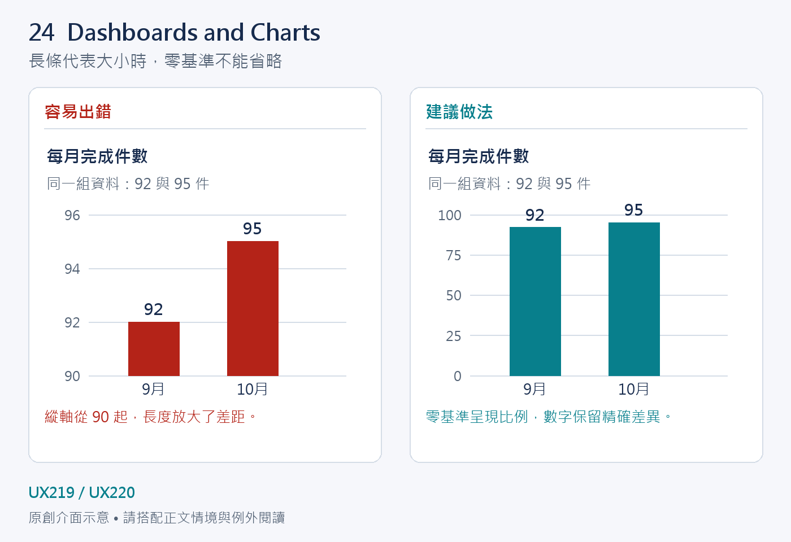

圖說：當長條長度代表數量時，就應該從零起算並讓精確數值可讀。 對照：[[#UX219]]、[[#UX220]]。

### UX215

**當 dashboard 服務特定角色時，就應該先顯示他能採取行動的指標。**

例：客服看待處理與逾時；避免：所有人都看營收大字。 邊界：管理摘要與作業介面可分開。

【綜合建議】原創情境判斷，須以實際任務驗證。

### UX216

**當指標顯示成長率時，就應該標明比較基期與時間範圍。**

例：「本週比上週 +8%」；避免：只有綠色 +8%。 邊界：缺同期資料不得假算。

【綜合建議】原創情境判斷，須以實際任務驗證。

### UX217

**當圖表需要比較類別大小時，就應該優先採容易比較長度的位置編碼。**

例：橫向 bar 顯示各店銷量；避免：十幾塊 3D pie。 邊界：真正部分整體且類別少可用 pie。

【綜合建議】原創情境判斷，須以實際任務驗證。

### UX218

**當要呈現時間趨勢時，就應該用連續時間軸並明示缺口。**

例：沒回報的日期留 gap；避免：把無資料當成零。 邊界：插值必須標明。

【綜合建議】依據：[[#R4|R4]]。

### UX219

**當 bar 長度代表數值大小時，就應該從零起算。**

例：92 與 95 差距不誇大；避免：y 軸從 90 起看似成長數倍。 邊界：line chart 可非零，但標清刻度。

【綜合建議】依據：[[#R4|R4]]。

### UX220

**當圖表必須讀精確數字時，就應該同時提供可讀的資料表或數值摘要。**

例：圖下有資料表切換；避免：只能 hover 小點讀值。 邊界：摘要可依任務聚合，不一定列全部原始點。

【綜合建議】原創情境判斷，須以實際任務驗證。

### UX221

**當系列太多難以辨識時，就應該允許篩選或拆成 small multiples。**

例：分店分圖同尺度；避免：二十條相近色折線。 邊界：不同尺度要醒目標示。

【綜合建議】原創情境判斷，須以實際任務驗證。

### UX222

**當某圖表能進一步查原因時，就應該保留 drill-down 的上下文。**

例：點週異常後看該週明細；避免：跳到沒 filter 的總表。 邊界：drill-down 入口應可鍵盤操作。

【綜合建議】原創情境判斷，須以實際任務驗證。

### UX223

**當圖表靠色彩分系列時，就應該加直接標籤或可辨線型。**

例：實線／虛線配系列名稱；避免：只說「看紅線」。 邊界：太多線型時改篩選或分圖。

【綜合建議】依據：[[#R17|R17]]。

### UX224

**當多個 dashboard 區塊使用不同資料時間時，就應該就地標出各自更新範圍。**

例：銷售截至今日、庫存截至昨日各有標記；避免：頁首一個『即時』蓋過所有延遲指標。

【綜合建議】原創情境判斷，須以實際任務驗證。

### UX225

**當圖表拿不同規模群體做比較時，就應該提供能回答問題的基準。**

例：比較退貨率同時顯示各店訂單數；避免：把大店退貨件數高直接寫成品質差。邊界：率與量回答不同問題，不互相替代。

【綜合建議】原創情境判斷，須以實際任務驗證。

### UX226

**當百分比的分母會隨篩選改變時，就應該明示目前基準。**

例：「所選部門內占比 35%」；避免：篩選後仍讓人以為是全公司占比。

【綜合建議】原創情境判斷，須以實際任務驗證。

# Part IV — Access and Quality

## 25 Touch and Motion

手指、手勢與動畫如何不阻礙操作？

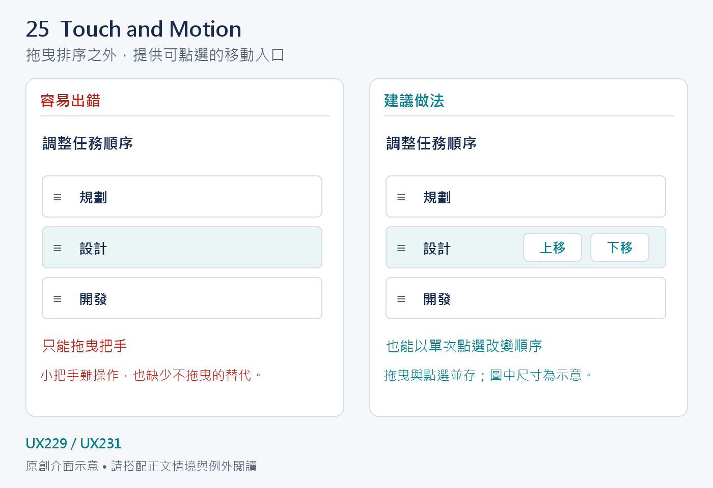

圖說：當提供拖曳排序時，就應該另有單pointer點選替代，不能只依靠拖曳。 對照：[[#UX229]]、[[#UX231]]。

### UX227

**當 Web 以 WCAG 2.2 AA 為目標時，就應該依 24×24 CSS px 與完整例外檢查 target。**

例：檢查實際可點範圍；避免：只量 icon 圖片尺寸。 邊界：不代表 24px 就是最佳觸控尺寸。

【標準落地】依據：[[#R5|R5]]。

### UX228

**當主要操作會用手指進行時，就應該採較寬裕 target 並按平台單位設計。**

例：Android 以至少 48×48 dp 的可觸控區域為平台建議；避免：跨平台寫「全部 44 實體像素」。 邊界：Web 可自訂較高目標，不假稱 AA 強制。

【平台慣例】依據：[[#R7|R7]]。

### UX229

**當 icon 視覺上需小巧時，就應該擴大 hit region 而非只放大圖案。**

例：小叉號置於大按鈕；避免：兩個隱形 hit region 重疊。 邊界：擴大後需檢查相鄰操作。

【綜合建議】依據：[[#R5|R5]]。

### UX230

**當 target 小於門檻而採 spacing 例外時，就應該檢查幾何條件。**

例：依中心圓檢查相鄰 target；避免：一律加 4px 就說合規。 邊界：以每個小 target 的 bounding box 中心畫直徑 24 CSS px 的圓，檢查其他 target 與小 target 的同類圓；AAA 44px 沒有同樣的 spacing 例外。

【標準落地】依據：[[#R5|R5]]、[[#R6|R6]]。

### UX231

**當有拖曳排序時，就應該另外提供點選式移動。**

例：「移到上一位／指定位置」；避免：只給鍵盤快捷鍵而無 pointer 替代。 邊界：拖曳本質必要者另評估例外。

【標準落地】依據：[[#R13|R13]]。

### UX232

**當非必要的多點或依賴路徑手勢被用來操作時，就應該提供單 pointer、不依賴路徑的替代。**

例：地圖除了雙指 pinch 還有可點的加減縮放；避免：只能雙指縮放而無替代。邊界：此為 SC 2.5.1 A 的適用範圍；手勢本質必要時另評估例外，OS 自身手勢與頁面自訂手勢分開判斷。

【標準落地】依據：[[#R14|R14]]。

### UX233

**當手機橫放時，就應該保持服務可用。**

例：內容重排；避免：蓋上「請轉直」阻擋頁。 邊界：方向對功能本質必要才例外。

【標準落地】依據：[[#R15|R15]]。

### UX234

**當互動引發的非必要 motion animation 可能造成不適時，就應該提供關閉或減少動態的方式。**

例：尊重 reduced motion，滑移改為直接切換或不造成同類不適的回饋；避免：設定減少動態後仍強制 parallax。邊界：SC 2.3.3 是 AAA，要求可停用互動引發且非必要的 motion animation；不能擴張成所有動畫都是 AA 禁止。

【標準落地】依據：[[#R16|R16]]。

### UX235

**當功能含 swipe-to-delete 時，就應該提供可發現的操作入口與復原。**

例：更多選單也有刪除；避免：只有隱藏手勢。 邊界：不可復原時先確認後果。

【綜合建議】原創情境判斷，須以實際任務驗證。

### UX236

**當手機操作可能從捲動手勢開始時，就應該避免手指一碰就執行不可逆動作。**

例：按下後可移離目標取消，確認釋放才提交；避免：手指在刪除鍵上準備滑動就立即刪除。邊界：特殊按壓任務需另訂可取消機制。

【綜合建議】原創情境判斷，須以實際任務驗證。

## 26 Accessible Interaction

不靠滑鼠、顏色或固定尺寸能否完成任務？

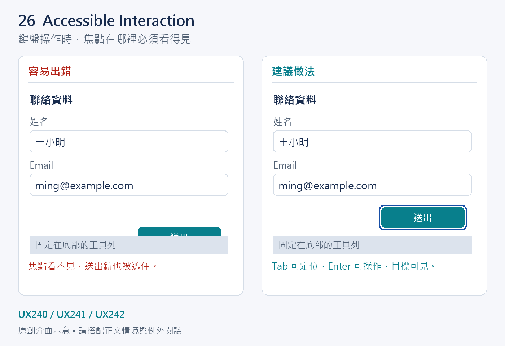

圖說：當使用者以鍵盤操作時，就應該保留可見焦點，並避免固定工具列遮住目標。 對照：[[#UX240]]、[[#UX241]]、[[#UX242]]。

### UX237

**當正文使用淺灰色時，就應該量測文字與實際底色對比。**

例：一般字達 4.5:1；避免：只憑螢幕看起來清楚。 邊界：inactive/裝飾例外不應拿來包裝重要資訊。

【標準落地】依據：[[#R8|R8]]。

### UX238

**當用大字 3:1 門檻時，就應該核對字級與字重。**

例：24 CSS px regular 作等效參考；避免：16px bold 就當大字。 邊界：字體等效與非拉丁字需保守判斷。

【標準落地】依據：[[#R8|R8]]。

### UX239

**當邊框是辨識輸入框的唯一線索時，就應該確保必要線索對比足夠。**

例：必要邊框對相鄰底色達 3:1；避免：所有框只剩近白細線。 邊界：若其他可見線索已充分辨識，不必每條裝飾線都量。

【標準落地】依據：[[#R9|R9]]。

### UX240

**當使用者只用鍵盤時，就應該能完成同一核心任務。**

例：Tab 到操作、Enter 執行；避免：只有 hover 才出現入口。 邊界：自由手繪路徑屬特殊情境。

【標準落地】依據：[[#R11|R11]]。

### UX241

**當客製按鈕樣式時，就應該保留清楚且持續的 focus indicator。**

例：focus-visible 外框；避免：outline:none 無替代。 邊界：不必強迫所有滑鼠點擊都同樣呈現。

【標準落地】依據：[[#R12|R12]]。

### UX242

**當有 sticky header/footer 時，就應該讓 focus 元件可被看見。**

例：聚焦時滾到工具列之外；避免：按鈕整個藏在底部 banner 下。 邊界：AA 最低為不完全遮擋，設計上宜完全可見。

【標準落地】依據：[[#R12|R12]]。

### UX243

**當畫面重排到小寬度時，就應該仍能讀取及操作。**

例：320 CSS px 寬單欄表單；避免：整頁固定 1200px。 邊界：表格／地圖等必要二維區塊可局部橫捲。

【標準落地】依據：[[#R10|R10]]。

### UX244

**當表格需要橫捲時，就應該把橫捲限制在表格容器。**

例：頁面正文重排，表格獨立捲；避免：整頁連標題一起超寬。 邊界：仍需讓容器可鍵盤使用及可發現。

【標準落地】依據：[[#R10|R10]]。

### UX245

**當資料更新但不需要轉移注意力時，就應該提供可讀的 status announcement。**

例：結果數以 polite status 更新；避免：每次搜尋把 focus 搶到頁頂。 邊界：真正要處理的錯誤可採不同焦點策略。

【標準落地】依據：[[#R17|R17]]。

### UX246

**當訊息更新很頻繁時，就應該合併公告。**

例：一次告知「已載入 20 筆」；避免：每列新增都朗讀。 邊界：緊急警報不能因合併而漏掉。

【綜合建議】依據：[[#R17|R17]]。

### UX247

**當使用 icon-only button 時，就應該有與動作一致的 accessible name。**

例：「刪除訂單 A102」；避免：「垃圾桶」。 邊界：可見文字與名稱應一致包含關鍵詞。

【綜合建議】依據：[[#S02|S02]]。

### UX248

**當列表重複出現相同操作時，就應該讓輔助科技能分辨作用對象。**

例：「編輯 王小明」；避免：一連串無上下文的「編輯」。 邊界：避免把整列所有文字都塞入名稱。

【綜合建議】依據：[[#R2|R2]]。

### UX249

**當圖片只做裝飾時，就應該避免重複朗讀。**

例：裝飾圖從可及性樹排除；避免：每個裝飾箭頭都讀一遍。 邊界：傳達資料的圖不能當裝飾。

【綜合建議】原創情境判斷，須以實際任務驗證。

### UX250

**當畫面用 CSS 改變視覺排列時，就應該維持讀取順序與任務順序一致。**

例：步驟視覺從上到下，鍵盤與朗讀也如此；避免：視覺最後的付款先被 Tab 聚焦。

【綜合建議】原創情境判斷，須以實際任務驗證。

### UX251

**當功能需要滑鼠畫出的範圍時，就應該提供適合該任務的替代選擇方式。**

例：框選圖表區間另有起訖日期欄位；避免：鍵盤使用者只能觀看不能分析。邊界：自由手繪本質依賴路徑者另評估。

【綜合建議】依據：[[#R11|R11]]、[[#R13|R13]]。

## 27 AI Interaction

生成結果如何查證、修正與控制執行？

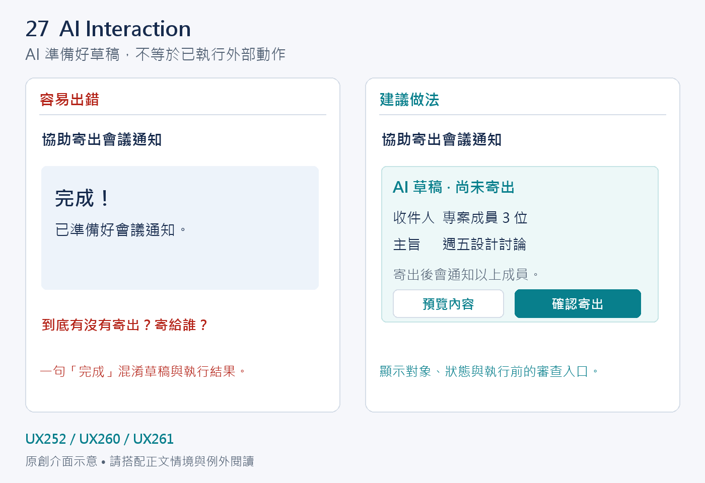

圖說：當AI準備有外部副作用的工作時，就應該分清草稿與執行狀態，並展示對象與後果。 對照：[[#UX252]]、[[#UX260]]、[[#UX261]]。

### UX252

**當內容由 AI 生成時，就應該在相關位置標示來源性質。**

例：「AI 草稿」；避免：裝成人類專家已審核。 邊界：不必每個字都貼標籤。

【綜合建議】依據：[[#R19|R19]]、[[#R20|R20]]。

### UX253

**當 AI 能做的任務有限時，就應該用具體例子說明範圍。**

例：「摘要此文件」；避免：「問任何事都能準確回答」。 邊界：能力隨方案不同需同步更新。

【綜合建議】依據：[[#R19|R19]]、[[#R20|R20]]。

### UX254

**當 AI 回答依賴來源時，就應該讓人打開對應來源核對。**

例：主張旁有支援段落入口；避免：列一堆不支援結論的連結。 邊界：沒查到來源要明說。

【綜合建議】依據：[[#R19|R19]]、[[#R20|R20]]。

### UX255

**當模型信心未經校準時，就應該用限制與證據說明不確定性。**

例：「缺少本季資料」；避免：隨意顯示「可信度 97%」。 邊界：只有經驗證的量化指標才顯示。

【綜合建議】依據：[[#R19|R19]]、[[#R20|R20]]。

### UX256

**當內容正在 streaming 時，就應該區分生成中與完成。**

例：「生成中」並提供停止；避免：游標停止就當完成但其實失敗。 邊界：停止不代表撤銷已執行外部動作。

【綜合建議】依據：[[#R19|R19]]、[[#R20|R20]]。

### UX257

**當 streaming 被中斷時，就應該保留已產生內容並提供重試。**

例：「連線中斷，保留草稿」；避免：整段消失。 邊界：不可把半段結果標成已完成。

【綜合建議】依據：[[#R19|R19]]、[[#R20|R20]]。

### UX258

**當新內容持續流入時，就應該尊重使用者正在閱讀的位置。**

例：使用者捲上去後顯示「跳到最新」；避免：每個 token 強制捲到底。 邊界：使用者停留底部可自動跟隨。

【綜合建議】依據：[[#R19|R19]]、[[#R20|R20]]。

### UX259

**當 AI 要修改文件時，就應該提供修改範圍與可審查結果。**

例：顯示差異、接受或復原；避免：無提示覆蓋原文。 邊界：小型可逆修正可依已授權範圍直接完成。

【綜合建議】依據：[[#R19|R19]]、[[#R20|R20]]。

### UX260

**當 AI 要做有外部副作用的動作時，就應該在執行前顯示對象與後果。**

例：寄出前列收件人、內容、附件；避免：「我處理好了」才揭露已寄信。 邊界：已有明確持續授權時避免重複確認。

【綜合建議】依據：[[#R19|R19]]、[[#R20|R20]]。

### UX261

**當 AI 只產生建議而未執行時，就應該用狀態文案清楚區隔。**

例：「草稿已準備，尚未送出」；避免：「完成」讓人以為已生效。 邊界：完成標籤需與產品實際狀態一致。

【綜合建議】依據：[[#R19|R19]]、[[#R20|R20]]。

### UX262

**當 AI 理解錯誤時，就應該讓人局部更正。**

例：改日期後重算；避免：要求使用者整段重講。 邊界：高風險上下文變更需重檢結果。

【綜合建議】依據：[[#R19|R19]]、[[#R20|R20]]。

### UX263

**當 AI 讀取多個資料來源時，就應該讓資料範圍可見且可調整。**

例：「本專案 3 份文件」；避免：看不出用了個人或公司資料。 邊界：不揭露使用者無權看到的資料。

【綜合建議】依據：[[#R19|R19]]、[[#R20|R20]]。

### UX264

**當 AI 回饋用於改善服務時，就應該讓回饋對象具體。**

例：標記某段「來源不符」；避免：只有整篇 thumbs-down 不知道原因。 邊界：不應強制寫長回饋才能繼續。

【綜合建議】依據：[[#R19|R19]]、[[#R20|R20]]。

### UX265

**當 AI 不能完成任務時，就應該給出可採取的下一步。**

例：「缺附件，加入後可重試」；避免：只有「出了點問題」。 邊界：不洩漏內部敏感錯誤細節。

【綜合建議】依據：[[#R19|R19]]、[[#R20|R20]]。

### UX266

**當 AI 建議常打斷工作時，就應該提供暫停或關閉控制。**

例：此頁停用建議；避免：每次關閉下一秒又彈出。 邊界：關閉功能不應難於啟用。

【綜合建議】依據：[[#R19|R19]]、[[#R20|R20]]。

### UX267

**當 AI 重跑會消耗額度或覆蓋現有結果時，就應該在重跑前讓代價與保留範圍可見。**

例：「另產生一版，保留目前版本」；避免：按重試就刪掉人工改好的段落。

【綜合建議】依據：[[#R19|R19]]、[[#R20|R20]]。

### UX268

**當 AI 的工具執行只完成一部分時，就應該逐項列出已完成與未完成的結果。**

例：「已整理 3 檔；第 4 檔無權限」；避免：整體『成功』掩蓋失敗，或整體『失敗』誘使全部重跑。

【綜合建議】依據：[[#R19|R19]]、[[#R20|R20]]。

## 28 Systems and Validation

如何讓設計可重用、可測試且不誤導？

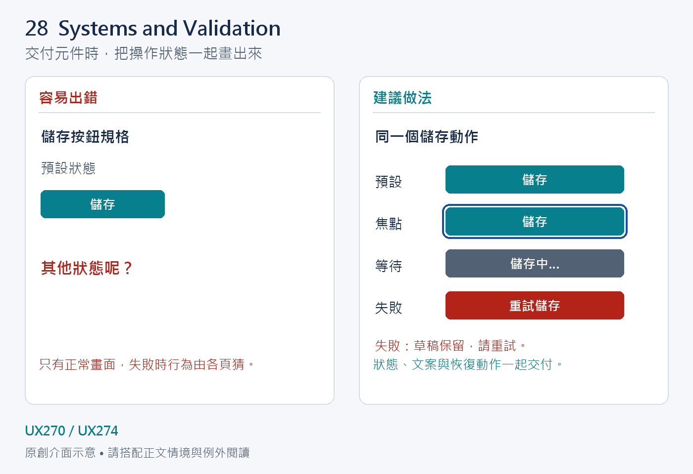

圖說：當交付component規格時，就應該定義任務需要的狀態，而非只有一張正常畫面。 對照：[[#UX270]]、[[#UX274]]。

### UX269

**當多個頁面出現同類語意顏色時，就應該使用 semantic token。**

例：text-danger／surface-selected；避免：每頁硬編不同紅色。 邊界：色票名稱可留底層，元件用角色。

【綜合建議】依據：[[#R21|R21]]。

### UX270

**當建立 component 規格時，就應該一起定義所有狀態。**

例：default、focus、loading、error、disabled；避免：只給一張正常畫面。 邊界：狀態依元件用途選擇，不必機械套全部。

【綜合建議】原創情境判斷，須以實際任務驗證。

### UX271

**當兩個 component 名稱相同時，就應該維持核心行為一致。**

例：同類 menu 都相同鍵盤模型；避免：外觀相同卻一個 Enter 開、一個 hover 開。 邊界：平台差異需明確記錄。

【綜合建議】原創情境判斷，須以實際任務驗證。

### UX272

**當新需求看似要新 component 時，就應該先檢查現有元件能否組合。**

例：既有 field 加 hint；避免：每個產品各做一套 input。 邊界：真正新語意不強塞舊元件。

【綜合建議】原創情境判斷，須以實際任務驗證。

### UX273

**當規格有例外時，就應該記錄觸發條件。**

例：「資料表可 compact」；避免：只寫「這頁比較特別」。 邊界：例外過多時回頭修正基礎模式。

【綜合建議】原創情境判斷，須以實際任務驗證。

### UX274

**當交付設計時，就應該附可測試情境而不只畫面。**

例：空資料、慢網路、權限不足、超長姓名；避免：全是假資料正常狀態。 邊界：優先覆蓋實際產品高風險路徑。

【綜合建議】原創情境判斷，須以實際任務驗證。

### UX275

**當自動 accessibility 掃描全綠時，就應該再做人工作業測試。**

例：鍵盤與 screen reader 實走；避免：把工具分數當合規證書。 邊界：人工測試也需有明確範圍。

【綜合建議】依據：[[#R22|R22]]。

### UX276

**當做 usability test 時，就應該給任務並觀察完成過程。**

例：「找上月逾期訂單」；避免：「你覺得好看嗎」。 邊界：視覺偏好可另做測試。

【綜合建議】原創情境判斷，須以實際任務驗證。

### UX277

**當優化某個 conversion 指標時，就應該同看失誤與反悔成本。**

例：完成率、退訂率、求助量一起看；避免：誤點造成的轉換也算成功。 邊界：指標應對準使用者成功。

【綜合建議】原創情境判斷，須以實際任務驗證。

### UX278

**當提供同意或拒絕選擇時，就應該讓文字與後果清楚。**

例：「接受」「拒絕」可理解；避免：「不了，我不重視隱私」。 邊界：此為設計倫理建議，不宣稱特定法規結論。

【綜合建議】原創情境判斷，須以實際任務驗證。

### UX279

**當收費在後續才發生時，就應該在承諾前說明總價與週期。**

例：「每月 NT$300，某日起扣款」；避免：把費用藏到完成後。 邊界：稅費未知則說明計算時點。

【綜合建議】原創情境判斷，須以實際任務驗證。

### UX280

**當使用者想取消服務時，就應該提供可找到且可完成的退出流程。**

例：帳務頁能取消並確認結果；避免：加入一鍵、退出必須迷宮導航。 邊界：必要身分確認應與風險相稱。

【綜合建議】原創情境判斷，須以實際任務驗證。

### UX281

**當顯示名額或倒數時，就應該反映真實狀態。**

例：真實活動截止；避免：重整就重設的假倒數。 邊界：沒有可靠資料時不要顯示精確剩餘量。

【綜合建議】原創情境判斷，須以實際任務驗證。

### UX282

**當要決定是否採用視覺新潮流時，就應該先檢查任務收益與可讀性。**

例：品牌頁適量效果；避免：後台工具為流行而犧牲密度與操作。 邊界：不把單一品牌風格稱為全產業標準。

【綜合建議】原創情境判斷，須以實際任務驗證。

### UX283

**當一個新設計模式要取代舊模式時，就應該用同一任務與同一成功定義比較。**

例：比較找到訂單所需時間與誤選率；避免：新版用容易資料、舊版用難資料後宣稱提升。

【綜合建議】原創情境判斷，須以實際任務驗證。

### UX284

**當頁面要支援列印或匯出給別人時，就應該讓篩選、單位與資料時間跟著內容保存。**

例：報表頁首列『台北門市，10月，TWD』；避免：只印數字而失去使用條件。

【綜合建議】原創情境判斷，須以實際任務驗證。

# Appendices

## Component Selection

當兩種元件看起來都能做時，先用「任務是否相同、要不要同時比較、何時生效」判斷。此表是正文入口，不新增規則數。

| 當你的情境是 | 就選擇 | 避免 | 對應規則 |
|---|---|---|---|
| 前往有 URL 的另一頁 | link | 用 button 模擬導航而失去開新分頁能力 | [[#UX083]] |
| 修改資料、開浮層或觸發操作 | button | 無 href 的假 link | [[#UX082]]、[[#UX085]] |
| 一組只能選一項，且需要看見差異 | radio | 多個 checkbox 假裝單選 | [[#UX092]]、[[#UX100]] |
| 一組可選多項 | checkbox | radio 阻止需要的多選 | [[#UX091]]、[[#UX097]] |
| 二元設定立即生效 | switch | switch 切了卻默默等頁尾送出 | [[#UX093]] |
| 項目很多、使用者知道名字 | searchable combobox | 超長且不可搜尋的下拉選單 | [[#UX094]]、[[#UX095]] |
| 同一物件的次級內容輪流看 | tabs | 把需要同時比較或依序讀的內容拆開 | [[#UX056]]、[[#UX057]] |
| 在不同頂層任務間移動 | 主導航 | 用局部 tab 代替全站位置 | [[#UX049]]、[[#UX050]] |
| 次要說明需要時才看 | disclosure / accordion | 收起所有人必讀的費用或條件 | [[#UX061]]、[[#UX062]] |
| 短暫任務必須阻斷背景 | modal | 視覺是 modal，鍵盤仍可操作背景 | [[#UX151]]、[[#UX156]] |
| 需邊看清單邊改少量詳情 | 非 modal drawer | 用焦點鎖定阻止必要的比較 | [[#UX153]] |
| 多步、長時間或需分享的編輯 | 獨立頁面 | 小 modal 裡塞整套工作流 | [[#UX152]] |
| 浮層含 link、button 或輸入 | popover / dialog | 互動內容塞 tooltip | [[#UX154]] |
| 僅補充非必要的短解釋 | tooltip | 唯一重要說明只在 hover 出現 | [[#UX155]] |
| 成功狀態短暫、無需決定 | 原位置狀態更新，必要時 toast | 每次操作都彈確認框 | [[#UX161]] |
| 錯誤需要修正 | 持續可見的 inline message | 錯誤 toast 消失後無法找回 | [[#UX162]] |
| 問題影響整頁或整個服務 | banner / 頁級通知 | 每個欄位都重複網路錯誤 | [[#UX163]] |
| 比較多筆相同屬性 | table | 每張卡片欄位順序不同 | [[#UX192]] |
| 主要靠圖片探索獨立物件 | cards / gallery | 為用 table 而縮成無法辨識的縮圖 | [[#UX004]]、[[#UX192]] |
| 每格需編輯與方向鍵巡覽 | 完整 grid 行為 | 只加 role=grid 不實作焦點模型 | [[#UX194]] |
| 要定位、分享與返回某批資料 | pagination | 無限滑到第幾百筆才找到工作 | [[#UX207]] |
| 逐批探索、希望自己控制節奏 | load more | 新資料不斷插入推走正在看的內容 | [[#UX208]]、[[#UX210]] |
| 持續探索 feed，返回與頁尾已有方案 | infinite scroll | 使用它取代精確工作清單的定位 | [[#UX208]] |
| 記得的歷史日期 | 可直接輸入的日期欄位 | 只能按月曆回到幾十年前 | [[#UX122]] |
| 日期取決於可用時段 | calendar / 時段清單 | 逐次輸入才知道不可預約 | [[#UX123]] |
| 低後果且確實可撤銷 | 直接執行＋Undo | 每次微小變更都要求確認 | [[#UX175]] |
| 不可逆且影響重大 | 具對象與後果的確認 | 泛稱「是否繼續」 | [[#UX176]]、[[#UX177]] |

## Page Recipes

這六個配方是頁面組裝順序。沿連結檢查完整狀態；不是只畫一張正常畫面就完成。

### CRUD List

當製作後台清單時，就先決定「找一筆、比較多筆、批次處理」哪個是主要任務，再放入搜尋範圍、已套用篩選、排序、選取與明確詳情入口。最低檢查組合：[[#UX064]]、[[#UX065]]、[[#UX073]]、[[#UX080]]、[[#UX192]]、[[#UX195]]、[[#UX196]]、[[#UX198]]、[[#UX199]]、[[#UX206]]。用無結果、跨頁全選、部分失敗與刪除末筆四種狀態驗收：[[#UX172]]、[[#UX204]]、[[#UX211]]。

### Editor

當製作編輯頁時，就先定義手動儲存或 autosave，再安排 label、hint、錯誤恢復與離開行為。最低組合：[[#UX101]]、[[#UX102]]、[[#UX112]]、[[#UX115]]、[[#UX117]]、[[#UX159]]、[[#UX184]]、[[#UX185]]、[[#UX187]]。測試慢網路、更新衝突與長文字，不讓離開浮層成為資料遺失點；大型編輯改完整頁：[[#UX152]]。

### Login

當製作登入頁時，就讓 password manager、貼上與重設可用，登入後接回原任務。最低組合：[[#UX141]]、[[#UX142]]、[[#UX143]]、[[#UX144]]、[[#UX149]]、[[#UX150]]。把錯誤密碼、OTP 到期、連結過期與登入後無權限分開測試，不讓「登入成功」被誤寫成「取得所有權限」：[[#UX119]]。

### Dashboard

當製作 dashboard 時，就從角色能採取的行動挑指標，為每項補上基期、時間範圍、單位與 drill-down。最低組合：[[#UX215]]、[[#UX216]]、[[#UX217]]、[[#UX218]]、[[#UX219]]、[[#UX220]]、[[#UX222]]、[[#UX224]]、[[#UX225]]、[[#UX226]]。用缺資料、過期資料、不同更新時間與鍵盤讀值驗收，不用正常示範資料掩蓋這些狀態。

### Mobile Filters

當手機篩選需要多次選擇且查詢慢時，就先在 panel 編輯，按「套用」才更新；關閉後仍顯示已套用條件。最低組合：[[#UX073]]、[[#UX074]]、[[#UX075]]、[[#UX077]]、[[#UX080]]、[[#UX172]]、[[#UX227]]、[[#UX229]]。panel 若是 modal，追加 [[#UX151]]、[[#UX156]]、[[#UX157]]；鍵盤彈出時檢查 [[#UX048]]，不要只測靜態手機截圖。

### AI Assistant

當製作 AI 助手時，就先區分「生成草稿」與「執行外部動作」，再提供來源、停止、修改與部分失敗恢復。最低組合：[[#UX252]]、[[#UX253]]、[[#UX254]]、[[#UX255]]、[[#UX256]]、[[#UX257]]、[[#UX258]]、[[#UX259]]、[[#UX260]]、[[#UX261]]、[[#UX267]]、[[#UX268]]。測試來源不足、中斷、重新生成和已執行部分動作；停止生成不等於撤銷已送出的動作。

## Standards Quick Check

此表只提供設計入口，需連同成功準則全文與例外檢查。CSS px 不是硬體像素；Android dp 也不直接等於 Web CSS px。

| 當你檢查 | 應使用的門檻或判斷 | 證據 |
|---|---|---|
| WCAG 2.2 AA pointer target | SC 2.5.8：24×24 CSS px，或完整符合 spacing / equivalent / inline / user-agent / essential 例外 | [[#R5]] |
| WCAG AAA target | SC 2.5.5：44×44 CSS px，例外與 AA 不同，沒有相同 spacing 例外 | [[#R6]] |
| Android 原生可觸控區域 | 平台建議至少 48×48 dp，量可觸控區而非只量 icon | [[#R7]] |
| 文字對比 | SC 1.4.3 AA：一般字 4.5:1、大字 3:1；大字與例外見來源登錄 | [[#R8]] |
| 必要控制項／圖像辨識線索 | SC 1.4.11 AA：對相鄰色 3:1；不包括所有裝飾線 | [[#R9]] |
| Reflow | SC 1.4.10 AA：縱向內容等效 320 CSS px 寬；必要二維區塊有例外 | [[#R10]] |
| 鍵盤 focus | 可見；SC 2.4.11 AA 不可被作者內容完全遮住，設計上仍建議完全可見 | [[#R12]] |
| 拖曳替代 | SC 2.5.7 AA 需單 pointer、不拖曳的替代；只有 keyboard 替代不足 | [[#R13]] |
| 互動引發的非必要動畫 | SC 2.3.3 是 AAA；提供可關閉機制，不把全部動畫誤稱 AA 禁止 | [[#R16]] |
| 登入認證 | SC 3.3.8 AA 不強制無協助的認知測驗；完整例外與協助方式見來源 | [[#R18]] |

## Evidence Register

每個來源只在此集中摘要；正文範例與取捨為綜合設計建議。APG 是互動模式指引，不等於 WCAG 規範全文；GOV.UK、Carbon、Fluent 與 Android 的局部慣例也不自動成為跨平台要求。以下來源正文由本次研究於 2026-10-30 查讀；未列發表日期不代表內容剛發表。

### V1

**設計系統／平台指引。** Carbon 用 typography tokens 組合字級、字重、行高；區分偏產品操作的 productive 與偏表達的 expressive 字體配置。頁面更新 2026-09-29。[Carbon Typography](https://www.carbondesignsystem.com/building-blocks/foundations/typography/overview)

### V2

**設計系統／平台指引。** Carbon spacing scale 含 2、4、8 等倍數的級距，用 token 管理 component 內外空間；這是 Carbon 系統選擇，不能推成所有產品只能使用 8px 倍數。頁面更新 2026-09-30。[Carbon Spacing](https://www.carbondesignsystem.com/building-blocks/foundations/spacing/overview)

### V3

**設計系統／平台指引。** Fluent 區分 neutral、shared、brand 色；semantic 色承載狀態並搭配其他指示，不用作無意義裝飾；深色模式會調整共享色的亮度與飽和度。頁面未列更新日。[Fluent Color](https://fluent2.microsoft.design/color)

### V4

**設計系統／平台指引。** GOV.UK tabs 適合同頁相關資訊的切換；比較跨區內容或依序閱讀時不宜使用。GOV.UK 本身不把此 component 當跨頁導航。頁面有歷史，最近所列為 2024-08。[GOV.UK Tabs](https://design-system.service.gov.uk/components/tabs/)

### V5

**設計系統／平台指引。** Breadcrumbs 用於多層網站結構；不表示線性交易的進度，也不必出現在扁平網站。GOV.UK 建議其 breadcrumbs 結束於目前頁的父層；不能把這個細節當所有系統唯一合法形式。最近所列變更 2024-07。[GOV.UK Breadcrumbs](https://design-system.service.gov.uk/components/breadcrumbs/)

### V6

**設計系統／平台指引。** Carbon filtering 區分即時套用和批次套用；多項選擇或慢查詢適合後者。收合後要顯示已套用資訊，並提供清除方式。頁面更新 2026-08-11。[Carbon Filtering](https://www.carbondesignsystem.com/building-blocks/core/patterns/filtering)

### V7

**設計系統／平台指引。** Carbon 依搜尋範圍與資料集選擇搜尋模式，區分送出後前往結果頁與輸入過程中回應；active search 需考慮伺服器負荷。頁面更新 2026-08-12。[Carbon Search](https://www.carbondesignsystem.com/building-blocks/core/patterns/search)

### V8

**設計系統／平台指引。** Android 指引的 navigation bar 容納同層 3–5 個目的地，大螢幕可轉 navigation rail；tabs 是次級同層內容導航，FAB 用於最重要的單一動作。數字僅屬該平台模式，非所有網站規定。頁面更新 2026-10-22。[Android Layouts and Navigation](https://developer.android.com/design/ui/mobile/guides/layout-and-content/layout-and-nav-patterns?hl=en)

### V9

**CSS 規格草案。** CSS 圓角的 padding edge 半徑是外邊框半徑減對應邊框厚度，content edge 再減 padding，負值為 0；相鄰圓角總和過大時瀏覽器會比例縮小。文件為 2024-03-11 Candidate Recommendation Draft，不應稱已定案的 W3C Recommendation。[W3C CSS Backgrounds §4.2](https://www.w3.org/TR/css-backgrounds-3/#corner-shaping)

### S01

**互動模式／設計系統指引。** GOV.UK Button：按鈕文字描述動作；主行動不應彼此競爭；disabled button 可能令人困惑，僅有研究支持時使用；重複提交需考慮 server 端防護。頁面含 2026-07 變更紀錄。[Button](https://design-system.service.gov.uk/components/button/)

### S02

**互動模式／設計系統指引。** APG Button：button 觸發動作，link 有不同功能；button 支援 Enter 與 Space。toggle button 以 `aria-pressed` 表達狀態時保留穩定名稱。[Button pattern](https://www.w3.org/WAI/ARIA/apg/patterns/button/)

### S03

**互動模式／設計系統指引。** GOV.UK Text input：input 需要 label，通常應可見；placeholder 不應替代 label、hint 或例子；多行答案用 textarea。[Text input](https://design-system.service.gov.uk/components/text-input/)

### S04

**互動模式／設計系統指引。** GOV.UK Checkboxes：checkbox 支援選取一個以上選項；例子使用 fieldset、legend 與提示說明可複選。[Checkboxes](https://design-system.service.gov.uk/components/checkboxes/)

### S05

**互動模式／設計系統指引。** GOV.UK Radios：radio 用於單選集合；其範例以 fieldset 與 legend 表達共同問題。[Radios](https://design-system.service.gov.uk/components/radios/)

### S06

**互動模式／設計系統指引。** Carbon Toggle：適合立即生效的二元設定；非即時生效可改 checkbox 配合提交；不應用 toggle 表示刪除。頁面更新 2026-09-30。[Toggle](https://www.carbondesignsystem.com/building-blocks/core/components/toggle/guidelines)

### S07

**互動模式／設計系統指引。** APG Combobox：可以允許自由輸入或限定合法選項，也有 editable 與 select-only 形式；自動完成的選擇模式需一致。[Combobox](https://www.w3.org/WAI/ARIA/apg/patterns/combobox/)

### S08

**互動模式／設計系統指引。** GOV.UK Validation：保留輸入、提供欄位錯誤和摘要；通常等提交才驗證，避免 blur；server 驗證仍必要；資格不符不是格式驗證錯誤。[Validation](https://design-system.service.gov.uk/patterns/validation/)

### S09

**互動模式／設計系統指引。** GOV.UK Error summary：該系統要求驗證錯誤時顯示摘要、移動 focus、連到錯誤答案；摘要與欄位文案一致。[Error summary](https://design-system.service.gov.uk/components/error-summary/)

### S10

**互動模式／設計系統指引。** GOV.UK Date input：適合記得或可查到的日期；例子讓日、月、年有各自 label 與 numeric inputmode。[Date input](https://design-system.service.gov.uk/components/date-input/)

### S11

**互動模式／設計系統指引。** GOV.UK Check answers：提交前讓使用者檢查答案，摘要提供修改入口。[Check answers](https://design-system.service.gov.uk/patterns/check-answers/)

### S12

**互動模式／設計系統指引。** APG Modal dialog：開啟時 focus 移入、Tab 留在 dialog、Escape 關閉；關閉後回到觸發點或合理後繼位置。不可逆動作可初始 focus 最不具破壞性的選項。[Modal dialog](https://www.w3.org/WAI/ARIA/apg/patterns/dialog-modal/)

### S13

**互動模式／設計系統指引。** Carbon Modal：短暫且不頻繁的阻斷任務可用 modal；複雜工作流考慮完整頁；其表單建議可在 blur 驗證。頁面更新 2026-09-30。[Modal](https://www.carbondesignsystem.com/building-blocks/core/components/modal/guidelines)

### S14

**互動模式／設計系統指引。** APG Tooltip 頁仍標示草案、未達 task force consensus；描述 tooltip 不取得 focus，可由 hover/focus 觸發、Escape 關閉。[Tooltip](https://www.w3.org/WAI/ARIA/apg/patterns/tooltip/)

### S15

**互動模式／設計系統指引。** Carbon Notification：區分 inline、toast、actionable、callout；通知應節制使用，呈現強度應與任務影響相稱。更新 2026-09-30。[Notification](https://www.carbondesignsystem.com/building-blocks/core/components/notification/guidelines)

### S16

**互動模式／設計系統指引。** Carbon Loading：loading 表示處理中；有明確內容結構的初載可使用 skeleton；局部等待可在相關區塊顯示。更新 2026-09-28。[Loading](https://www.carbondesignsystem.com/building-blocks/core/components/loading/guidelines)

### S17

**互動模式／設計系統指引。** Carbon Empty states：區分首次無資料、使用者行動後無結果與錯誤/權限問題，並給對應下一步。更新 2026-08-11。[Empty states](https://www.carbondesignsystem.com/building-blocks/core/patterns/empty-states)

### S18

**互動模式／設計系統指引。** GOV.UK File upload：同時提供選檔與拖放；同一路程可重用已上傳檔案，但需考量共用裝置上的隱私。[File upload](https://design-system.service.gov.uk/components/file-upload/)

### S19

**互動模式／設計系統指引。** GOV.UK Password input：預設隱藏密碼，可讓人主動顯示；登入錯誤不揭露帳號或密碼何者錯誤；範例支援 autocomplete。[Password input](https://design-system.service.gov.uk/components/password-input/)

### S20

**互動模式／設計系統指引。** GOV.UK Passwords：允許貼上、明確說明限制；忘記密碼以限時重設連結/代碼處理，不寄原密碼。[Passwords](https://design-system.service.gov.uk/patterns/passwords/)

### S21

**互動模式／設計系統指引。** GOV.UK Confirmation pages：完成交易後顯示完成狀態、參考編號（若有）、接下來何時會發生什麼及可保存紀錄。[Confirmation pages](https://design-system.service.gov.uk/patterns/confirmation-pages/)

### R1

**設計／互動指引。** Carbon 的 data table 提供 sorting、expandable rows、batch actions 與 toolbar；定位不是完整 spreadsheet。查證頁最後更新 2026-09-30。[Carbon Data table](https://www.carbondesignsystem.com/building-blocks/core/components/data-table/guidelines)

### R2

**設計／互動指引。** APG 建議能用原生 HTML table 時優先使用；table 本身不是互動 widget，內部 link/button 各自進入 Tab 順序。[APG Table](https://www.w3.org/WAI/ARIA/apg/patterns/table/)

### R3

**設計／互動指引。** grid 是 composite widget，通常只有一個內部元素進入頁面 Tab 順序，作者必須實作內部方向鍵移動與 focus 管理。[APG Grid](https://www.w3.org/WAI/ARIA/apg/patterns/grid/)

### R4

**設計／互動指引。** Carbon 建議 bar/area 等以大小或部分整體比較的圖表從零起算；line/scatter 為揭露變化可使用非零起點。缺資料與軸標籤都應明示。[Carbon Axes and labels](https://www.carbondesignsystem.com/building-blocks/data-visualization/axes-and-labels)

### R5

**WCAG 成功準則說明。** SC 2.5.8 AA：pointer target 至少 24×24 CSS px，或符合 spacing、equivalent、inline、user-agent、essential 例外。spacing 是以小 target 的 bounding box 中心的直徑 24 CSS px 圓檢查不與其他 target／小 target 的同類圓相交，並非「間距固定 24px」。[Target Size Minimum](https://www.w3.org/WAI/WCAG22/Understanding/target-size-minimum.html)

### R6

**WCAG 成功準則說明。** SC 2.5.5 AAA：44×44 CSS px；有 equivalent、inline、user-agent、essential 例外，並無前項相同的 spacing 例外。[Target Size Enhanced](https://www.w3.org/WAI/WCAG22/Understanding/target-size-enhanced.html)

### R7

**設計／互動指引。** Android 原生介面建議可觸控區域至少 48×48 dp；視覺圖示可以較小，但周圍點擊區必須算入設計。這是平台建議，不能直接換成 Web AA 的 CSS px。[Android Accessibility](https://developer.android.com/guide/topics/ui/accessibility/views/apps-views?hl=en)

### R8

**WCAG 成功準則說明。** SC 1.4.3 AA：一般文字至少 4.5:1，大字至少 3:1；大字門檻為 18pt regular 或 14pt bold（或等效），不是任意標題。inactive、純裝飾、logotype 等有例外。[Contrast Minimum](https://www.w3.org/WAI/WCAG22/Understanding/contrast-minimum.html)

### R9

**WCAG 成功準則說明。** SC 1.4.11 AA：辨識控制項及狀態所需的視覺資訊、理解圖像所需部分，對相鄰色至少 3:1；有 inactive／未修改 UA 外觀／essential 例外，不是每條裝飾線都要 3:1。[Non-text Contrast](https://www.w3.org/WAI/WCAG22/Understanding/non-text-contrast.html)

### R10

**WCAG 成功準則說明。** SC 1.4.10 AA：縱向內容在 320 CSS px 等效寬度、橫向內容在 256 CSS px 等效高度，不應需要雙向捲動；需二維布局才能使用／理解的局部內容有例外。[Reflow](https://www.w3.org/WAI/WCAG22/Understanding/reflow.html)

### R11

**WCAG 成功準則說明。** SC 2.1.1 A 要求鍵盤操作，底層功能依賴運動路徑的例外不等於「所有 drag 都例外」。[Keyboard](https://www.w3.org/WAI/WCAG22/Understanding/keyboard.html)

### R12

**WCAG 成功準則說明。** SC 2.4.7 AA 要求可見鍵盤 focus；SC 2.4.11 AA 要求 focus 元件不被作者內容完全遮住，完全不遮住屬更高要求。[Focus Visible](https://www.w3.org/WAI/WCAG22/Understanding/focus-visible.html)；[Focus Not Obscured](https://www.w3.org/WAI/WCAG22/Understanding/focus-not-obscured-minimum.html)

### R13

**WCAG 成功準則說明。** SC 2.5.7 AA 的 drag 功能需單 pointer 不拖曳替代，除 essential／未修改 UA 功能；只提供鍵盤替代不足以滿足此條。[Dragging Movements](https://www.w3.org/WAI/WCAG22/Understanding/dragging-movements.html)

### R14

**WCAG 成功準則說明。** SC 2.5.1 A 要求非必要的 multipoint／path-based gesture 有單 pointer、非路徑式替代。[Pointer Gestures](https://www.w3.org/WAI/WCAG22/Understanding/pointer-gestures.html)

### R15

**WCAG 成功準則說明。** SC 1.3.4 AA 不得強制單一螢幕方向，除方向對功能必要。[Orientation](https://www.w3.org/WAI/WCAG22/Understanding/orientation.html)

### R16

**WCAG 成功準則說明。** SC 2.3.3 AAA：互動引發的非必要 motion animation 可關閉；不要誤寫成全部動畫均屬 AA。[Animation from Interactions](https://www.w3.org/WAI/WCAG22/Understanding/animation-from-interactions.html)

### R17

**WCAG 成功準則說明。** SC 1.4.1 A 不以顏色作唯一視覺資訊；SC 4.1.3 AA 的 status messages 要能由輔助科技在不取得 focus 下辨識。[Use of Color](https://www.w3.org/WAI/WCAG22/Understanding/use-of-color.html)；[Status Messages](https://www.w3.org/WAI/WCAG22/Understanding/status-messages.html)

### R18

**WCAG 成功準則說明。** SC 3.3.8 AA 的認證過程不應強制認知測驗，除提供替代／協助機制／物件辨識／個人內容例外；password manager 與 copy/paste 是協助機制例。[Accessible Authentication](https://www.w3.org/WAI/WCAG22/Understanding/accessible-authentication-minimum.html)

### R19

**設計／互動指引。** Microsoft 2019 Human-AI Guidelines 強調能力與可靠度預期、讓使用者容易呼叫／忽略／更正、遇到不確定時縮限服務、提供控制與回饋。[Microsoft Human-AI Guidelines](https://www.microsoft.com/en-us/research/articles/guidelines-for-human-ai-interaction-eighteen-best-practices-for-human-centered-ai-design/)

### R20

**設計／互動指引。** Fluent Responsible AI 包括標示 AI、說明能力與資料範圍、驗證來源、避免過度依賴、保持使用者控制與蒐集回饋。[Fluent Responsible AI](https://fluent2.microsoft.design/responsible-AI)

### R21

**設計／互動指引。** Carbon color tokens 依角色與元件使用方式分組，提供不同 theme 下的值。查證頁最後更新 2026-09-25。[Carbon Color Tokens](https://www.carbondesignsystem.com/building-blocks/foundations/color/tokens)

### R22

**設計／互動指引。** WAI 建議開發早期與全程評估；沒有單一工具能獨自判定網站是否符合 accessibility 標準，需要人工評估。[WAI Evaluation](https://www.w3.org/WAI/test-evaluate/)

## Source Boundaries

### Nested Corners

原始 raw/Web Framework/uiux-notes/uiux-notes.md 是本書的起點，保留原文不修改。它的「外圓角 = 內圓角 + padding」應限縮為等距、同心且無其他邊界距離的貼合情境：先量兩條邊界的實際距離 d，再取內半徑 = max(0, 外半徑 − d)。當 child 貼 parent content edge、沒有 margin 或位移且各邊等距時，d 才可取 border + padding；沒有 border 時才簡化成原公式。卡片中央的小按鈕不必套這個公式。參照 [[#UX033]]–[[#UX040]] 與 [[#V9]]。

### Validation Timing

GOV.UK 的一般表單指引建議提交驗證並避免 blur；Carbon modal 則允許失焦時 inline validation。兩者反映不同產品情境。本書將「首次填寫避免過早打斷」「是否採 blur 依任務驗證」「修正已知錯誤時更新過期訊息」拆成三條：[[#UX112]]、[[#UX113]]、[[#UX114]]，不能截取其中一條宣稱所有產品一律如此。來源：[[#S08]]、[[#S13]]。

### Scope and Unverified Claims

Apple 相關頁面本次查讀曾遇到 JavaScript 正文不可讀，研究階段的 44pt 數字未能在後續驗收重現，因此本書不將該數字列入已驗證門檻。需要開發特定 Apple 平台時，應再確認該平台當前官方規格。

本書沒有主張已完成完整 WCAG conformance audit，也沒有使用「2026 最流行風格排行」「所有正文必須 16px」「所有間距只能用 8px」「全部介面必須某種圓角」等未查證通則。AI 章節是成熟 Human-AI 原則的情境應用，並非單一全球統一標準。設計是否改善任務成功率仍須實測，見 [[#UX275]]、[[#UX276]]、[[#UX277]]。

## 連結

- [[web-frontend-moc]] — 前端技術與設計筆記入口。
- [[react-frontend-development-roadmap]] — 把設計決策接到前端開發與驗證流程。
- [[javascript-typescript-react-foundations]] — 實作互動狀態的語言與 React 基礎。
