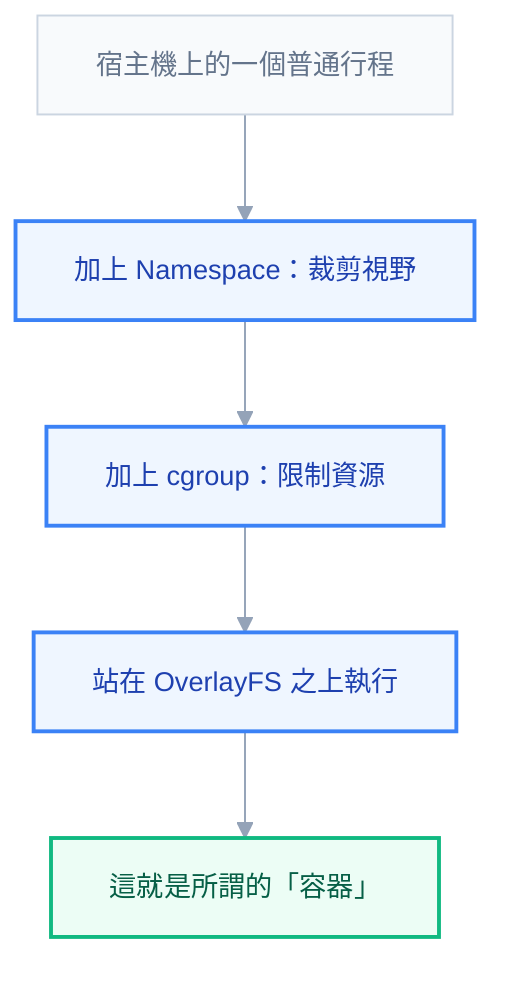
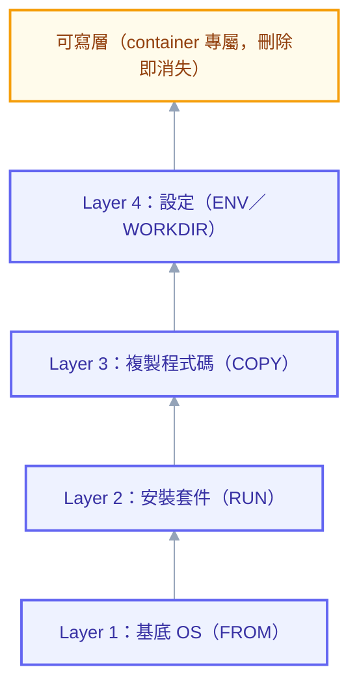

# 第零章：Docker 與容器基礎

## 在我機器上明明可以跑

幾乎每個寫過後端服務的人，都說過或聽過這句話：「在我機器上明明可以跑。」問題通常不是程式邏輯錯了，而是環境不一樣——同事的機器裝的是 Node 18，你的是 Node 20；正式環境的 Linux 版本跟你桌機的 WSL2 發行版帶的動態函式庫版本不同；某支相依套件在你電腦上被另一個專案順手裝好了，全新環境裡卻怎麼都裝不起來。這種「依賴地獄」的本質是：一份程式碼從來不是獨立存在的，它總是隱含著一整套「執行這份程式碼所需要的環境假設」，而這些假設散落在作業系統版本、系統函式庫、環境變數、設定檔路徑之中，沒有人把它們完整寫下來，直到某天在別的地方跑不動才被迫一項一項回頭排查。

Docker 要解決的正是這個問題：把「程式碼」與「執行這份程式碼所需要的一切」打包成一個單一、可攜帶、可重複建立的單位，稱為 image。這個 image 在你的筆電、同事的筆電、測試環境、正式環境裡跑起來，行為完全一致，因為它們跑的根本不是「同一份程式碼加上各自環境」，而是「同一個 image 的不同實例」。這個保證——**一次建置，到處執行**——就是容器技術最原始也最核心的價值主張，本章後面所有的機制，都是為了撐起這個保證而存在。

但這句話很容易被誤解成「容器就是輕量版的虛擬機器」。這個說法在同事面前講出來會顯得你只知其然，因為它完全沒有觸及容器真正特別的地方：容器不是靠虛擬化硬體做到隔離的，它靠的是作業系統核心本身提供的機制。下一節就把這兩種做法攤開來對比，看清楚差異到底在哪裡，也順便解釋一個所有人都好奇過的現象——為什麼容器可以在一秒內啟動，虛擬機器卻要等上一兩分鐘。

## 虛擬機器與容器：兩種隔離哲學

虛擬機器的做法，是在實體硬體上跑一層 hypervisor（例如 VMware、Hyper-V、KVM），由它模擬出一整組虛擬硬體——虛擬 CPU、虛擬記憶體、虛擬網卡、虛擬硬碟，再在這組虛擬硬體上，安裝一個完整、獨立的作業系統核心（kernel）。也就是說，如果實體機器上跑了三台虛擬機器，機器裡實際上存在著四個 kernel：宿主機自己的一個，加上三台虛擬機器各自的一個。每個 kernel 開機都要走一遍完整的硬體初始化、驅動載入、系統服務啟動流程，這也是為什麼虛擬機器開機動輒要一到兩分鐘——它不是在啟動一個程式，而是在啟動一整台電腦。

容器的做法完全不同。容器**不虛擬硬體，也不跑自己的 kernel**，所有容器共用宿主機唯一的那個 Linux kernel，容器只是宿主機上的一個普通行程（process），只是這個行程被 kernel 用一組機制包了起來，讓它「看不到」也「用不到」宿主機上其他行程與資源。既然容器啟動時不需要開機、不需要初始化硬體、不需要跑一套獨立的作業系統，它要做的事只是「請 kernel 用某些限制條件，啟動一個行程」——這件事花的時間是毫秒到秒級，這就是容器啟動速度比虛擬機器快上兩個數量級的根本原因，不是因為工程師比較會優化，而是兩者從架構設計上就不是同一種東西。

這個差異也直接反映在資源開銷上：虛擬機器每一台都要吃掉一份完整 kernel 加上系統服務的記憶體與 CPU，容器則因為共用同一個 kernel，只需要負擔應用程式本身加上少量隔離機制的開銷，因此在同一台實體機器上，能塞進去的容器數量遠遠多過能塞進去的虛擬機器數量。

```mermaid
%%{init: {'theme':'base','themeVariables':{
  'fontFamily':'ui-sans-serif, -apple-system, Segoe UI, Roboto, sans-serif',
  'fontSize':'14px',
  'primaryColor':'#eef2ff',
  'primaryTextColor':'#1e293b',
  'primaryBorderColor':'#6366f1',
  'lineColor':'#94a3b8',
  'secondaryColor':'#f1f5f9',
  'tertiaryColor':'#f8fafc',
  'noteBkgColor':'#fef9c3','noteTextColor':'#854d0e','noteBorderColor':'#eab308'
},'flowchart':{'curve':'basis','nodeSpacing':50,'rankSpacing':55,'htmlLabels':true}}}%%
graph TB
  subgraph VM["虛擬機器架構"]
    VHW["實體硬體"] --> HV["Hypervisor"]
    HV --> VK1["Guest Kernel A"]
    HV --> VK2["Guest Kernel B"]
    VK1 --> VA1["App A"]
    VK2 --> VA2["App B"]
  end
  subgraph CT["容器架構"]
    CHW["實體硬體"] --> CK["宿主機 Kernel（唯一）"]
    CK --> ENG["容器 Engine"]
    ENG --> CA1["App A（namespace 隔離）"]
    ENG --> CA2["App B（namespace 隔離）"]
  end
  class VK1,VK2 warn
  class CK success
  class CA1,CA2,VA1,VA2 primary
  classDef primary fill:#eef2ff,stroke:#6366f1,stroke-width:2px,color:#3730a3;
  classDef success fill:#ecfdf5,stroke:#10b981,stroke-width:2px,color:#065f46;
  classDef warn fill:#fffbeb,stroke:#f59e0b,stroke-width:2px,color:#92400e;
  classDef error fill:#fef2f2,stroke:#ef4444,stroke-width:2px,color:#991b1b;
  classDef decision fill:#fefce8,stroke:#eab308,stroke-width:2px,color:#854d0e;
  classDef accent fill:#eff6ff,stroke:#3b82f6,stroke-width:2px,color:#1e40af;
  classDef muted fill:#f8fafc,stroke:#cbd5e1,stroke-width:1px,color:#64748b;
```



> **同事會來問你的問題**：「容器是不是輕量版的虛擬機？」——不完全對。虛擬機器虛擬的是硬體、跑的是各自獨立的 kernel；容器共用宿主機唯一的 kernel，只是被隔離了視野與資源配額。這個差異不是程度上的（輕量 vs 重量），而是種類上的（虛擬硬體 vs 隔離行程）。

理解了容器不虛擬硬體、只隔離行程之後，自然會冒出下一個問題：kernel 到底是靠什麼機制，讓一個普通行程「看不到」系統裡其他東西、「用不了」超過配額的資源？這正是容器技術真正的地基，也是本章接下來要花最多篇幅講清楚的部分。

## 三大 Linux 基石：容器究竟是怎麼被生出來的

如果去問十個用過 Docker 的工程師「容器是什麼」，八個會回答「一種輕量虛擬機」，兩個會說「一個打包好的執行環境」，但很少有人能往下一層回答：容器沒有一個叫做「容器」的核心元件，Linux kernel 裡根本不存在一個叫做 container 的物件。容器是三種各自獨立、原本就存在於 kernel 裡的機制組合出來的效果：namespace 決定一個行程「看得到什麼」，cgroup 決定它「能用多少資源」，union filesystem 則決定它「檔案系統長什麼樣」。Docker、containerd 這些工具做的事，其實是把這三種機制組裝起來、包上一層方便操作的介面，僅此而已。搞懂這句話，就已經超越了大多數只會下 `docker run` 的人。

### Namespace：決定「看得到什麼」

Namespace 的作用，是讓同一台機器上的不同行程，各自看到一份「經過篩選」的系統視野。同一個 kernel 上，行程 A 開了一個 pid namespace，它看到的行程列表裡只有屬於自己這個 namespace 的行程；行程 B 在另一個 pid namespace 裡，看到的是完全不同的一份列表——即使兩者其實都跑在同一台機器、同一個 kernel 之上。

Linux 提供了好幾種 namespace，各自隔離系統的一個面向：

| Namespace | 隔離什麼 |
| --- | --- |
| `pid` | 行程 ID 空間，容器內看不到容器外的行程 |
| `net` | 網路介面、路由表、port，容器有自己的一份網路視野 |
| `mnt` | 掛載點，容器看到自己的一套檔案系統掛載表 |
| `uts` | hostname 與 domain name，容器可以有自己的主機名稱 |
| `ipc` | 行程間通訊（訊號量、共享記憶體），避免跨容器互相干擾 |
| `user` | UID/GID 對應，容器內的 root 可以對應到宿主機上的非特權使用者 |

這裡最能顛覆直覺的例子是 `pid` namespace：當你 `docker exec -it myapp ps aux`，看到容器內某個服務的 PID 是 1，很多人因此誤以為這個行程在系統層級真的是 PID 1、地位特殊、擁有特殊權限。事實是，PID 1 只是**這個 pid namespace 裡面**的編號，如果切回宿主機執行 `ps aux` 或用 `docker inspect` 查對應的實際 PID，會發現這個所謂的「容器裡的 PID 1」，在宿主機上其實是一個很普通的三位數、四位數 PID，跟宿主機上其他行程沒有本質差異，只是被 net、mnt、pid 等好幾個 namespace 包起來，讓它從自己的視角看出去，以為自己活在一整台獨立的機器上。

換句話說，容器內的行程完全不知道自己「在容器裡」，它只是被 kernel 動了手腳、活在一個被裁剪過的視野裡而已，這正是理解容器本質最關鍵的一句話，在本節結尾會再次強調。

### cgroup：決定「能用多少」

Namespace 解決的是「看得到什麼」，但光是看不到還不夠——如果沒有限制，一個容器裡失控的行程依然可以吃光整台機器的 CPU 或記憶體，拖垮同機器上其他容器，這在多租戶環境裡是不能接受的。負責這件事的機制叫 cgroup（control group），它讓 kernel 可以把一組行程放進同一個「控制群組」，對這個群組的資源使用設下硬性上限或做計量統計，常見的子系統包括：

- **CPU**：限制這個群組最多能吃到多少 CPU 時間片，或是相對其他群組的權重
- **memory**：設下記憶體使用上限，超過上限時 kernel 的 OOM killer 會出手，砍掉群組裡的行程
- **blkio / io**：限制對磁碟的讀寫頻寬，避免某個容器把磁碟 I/O 吃光

這裡先埋下一個伏筆：等到後面章節講到 Kubernetes 的 `resources.limits` 與 `resources.requests`，會發現那些欄位不是 Kubernetes 自己發明的抽象概念，而是**最終原封不動地翻譯成 cgroup 的設定值**，寫進容器對應的 cgroup 檔案裡。當一個 Pod 因為超過 memory limit 被 OOMKilled，開槍的不是 Kubernetes，是 kernel 的 cgroup 機制照著設定值執行了它該做的事，Kubernetes 只是負責把 YAML 裡的數字轉譯過去而已。先在這裡把這個對應關係記牢，第七章談排程與資源時會直接建立在這個基礎上，不再重新解釋一次 cgroup 是什麼。

### Union Filesystem：一層一層疊出來的檔案系統

前兩個機制解決了行程層級的隔離，第三個機制 OverlayFS（Union Filesystem 的一種主流實作）解決的是檔案系統層級的問題：多個容器如果都基於同一個 image（例如都是 `ubuntu:22.04`），要怎麼共用這份底層檔案，又能各自寫入自己的變更而互不干擾？

OverlayFS 的做法是把多個唯讀目錄「疊」在一起，對外呈現成一個統一的檔案系統視圖，疊的時候由上層蓋過下層，如果上層有同名檔案就顯示上層的，沒有就往下層找。當容器啟動時，Docker 會在這疊唯讀層的最上面，再加一層專屬於這個容器的可寫層。容器內程式所有的檔案寫入、修改、刪除，實際上都只發生在這層薄薄的可寫層裡，底下那些唯讀層——也就是 image 本身——完全不會被動到。這正是為什麼十個容器可以共用同一份幾百 MB 的 image，硬碟卻不會被吃掉十倍空間：它們共用的是同一組唯讀層，真正各自佔用空間的，只有每個容器自己那層通常只有幾 MB 的可寫層。

### 容器的本質

把這三個機制放在一起看，答案就浮現了：**容器根本不是一個獨立的「東西」，它是宿主機上一個普通的 Linux 行程，被 namespace 裁剪了視野、被 cgroup 上了資源枷鎖、再站在一疊 OverlayFS 層之上執行而已。** 沒有一個叫做「容器」的核心物件存在於 kernel 裡，`docker ps` 看到的每一行，本質上就是宿主機 `ps aux` 裡的某一個 PID，只是恰好被打包了這三種機制。下次有人問「容器到底是什麼」，這句話就是能把你和只會操作 `docker run` 的人區分開來的答案。



## Image 與 Layer：唯讀模板與那層會消失的可寫層

理解了 OverlayFS 之後，image 的結構就很好解釋：一個 image 本質上就是一疊唯讀的 layer，由 Dockerfile 裡的每一條指令逐層疊加建構出來，一旦某一層建構完成，它的內容就永久不變。可以把它想成一疊透明片，最下面一張是基底作業系統，往上一張一張疊加安裝的套件、複製進來的程式碼，最後看到的畫面是所有透明片疊在一起的結果。container 執行時，會在這疊唯讀 layer 最上方，再加一層專屬於這次執行的可寫層，這也是本章前面提過的同一個機制，只是這裡從 image 建構的角度再看一次。

`docker history <image>` 可以把這疊 layer 的建構過程列出來，每一行對應 Dockerfile 的一條指令與它增加的體積，是排查「這個 image 為什麼這麼大」的第一個工具。而 layer 能被快取與共用的關鍵，在於 Docker 用內容的 hash 來識別每一層——只要某一層的輸入（前一層加上這條指令的內容）完全沒變，Docker 建置時就會直接複用快取結果，不必重新執行。這個特性在下一節會展開成完整的建置優化策略。

這裡有一個經典陷阱必須點破：**如果在某一層裡意外把一個含有密碼或憑證的檔案寫進 image，然後在下一層用 `rm` 把它刪掉，image 的體積不會因為這個檔案而變小，因為前面那一層的內容早就已經定型、寫進 layer 裡了，`rm` 這個動作在 union filesystem 的視角裡只是在上層加了一個「這裡看不到這個檔案」的標記（whiteout），並不是真的把資料從磁碟上抹掉。** 任何人只要 `docker save` 這個 image 或直接把它的 layer tar 檔案抓出來解開，翻到那一層依然找得到被「刪除」的密碼原文。這也是為什麼安全實務裡，永遠不建議把密碼寫進任何一層再刪除，正確做法是一開始就不要讓密碼進到 image 裡，這件事會在安全實務那一節搭配 `ARG` 的陷阱一起講。



## Dockerfile 逐指令拆解

Dockerfile 是一份描述「怎麼從基底 image 一層層疊加出目標 image」的腳本，每一行都是 `INSTRUCTION 參數` 的格式，以 `#` 開頭的是註解。前面已經解釋過每條指令背後對應著一次 layer 的建構，這裡把常用指令逐一攤開，講清楚各自的用途與最容易誤用的地方。

### FROM、LABEL、WORKDIR

`FROM` 必須是 Dockerfile 的第一條有效指令，宣告這個 image 要疊在哪個基底 image 之上，例如 `FROM mcr.microsoft.com/dotnet/aspnet:8.0`。`LABEL` 用來附加中繼資料，例如維護者、版本、用途，取代了舊版常見但已被棄用的 `MAINTAINER`：

```dockerfile
LABEL maintainer="vic@example.com"
LABEL version="1.0.0"
```

`WORKDIR` 設定後續 `RUN`、`CMD`、`ENTRYPOINT`、`COPY` 的工作目錄，效果等同先 `cd` 進去再執行指令，好處是不必在每條指令裡重複寫絕對路徑，也比直接寫 `RUN cd /app && ...` 可靠——因為 `RUN` 的每一行都是在獨立的 shell session 裡執行，`cd` 的效果不會延續到下一條 `RUN`，但 `WORKDIR` 會持續套用到後續所有指令。

### RUN：每一行都是一層

`RUN` 在建置期間執行指令並把結果定型成新的一層，可以寫成 shell form（`RUN apt-get update`，實際上是丟進 `/bin/sh -c` 執行）或 exec form（`RUN ["apt-get", "update"]`，直接呼叫執行檔，不經過 shell）。最常見的誤用，是每個安裝步驟各寫一行 `RUN`：

```dockerfile
RUN apt-get update
RUN apt-get install -y curl
RUN apt-get install -y git
```

這樣寫會產生三層，而且因為 `apt-get update` 的結果被快取在第一層，之後即使套件庫早就有更新版本，只要 Dockerfile 沒改，Docker 仍然會直接複用那個過期的快取，導致安裝到舊版套件卻渾然不覺。正確做法是用 `&&` 把邏輯上屬於同一組操作的指令合併成一行，讓它們定型在同一層裡：

```dockerfile
RUN apt-get update && apt-get install -y curl git && rm -rf /var/lib/apt/lists/*
```

### COPY 與 ADD：為什麼官方建議預設用 COPY

`COPY` 和 `ADD` 都能把 build context 裡的檔案複製進 image，表面上長得幾乎一樣，但 `ADD` 多做了兩件事：如果來源是壓縮檔（`.tar`、`.tar.gz`），會自動幫忙解壓縮；如果來源是一個 URL，會幫忙下載下來。這兩個「貼心」功能，正是官方文件建議預設用 `COPY`、只有明確需要解壓縮或下載時才用 `ADD` 的原因——`ADD` 的行為取決於來源字串長什麼樣，同一行指令在不同情境下做的事不一樣，可讀性與可預測性都比 `COPY` 差；而且 `ADD` 從 URL 下載的檔案不會被快取失效機制正確追蹤，也沒有下載失敗的重試與驗證，實務上更建議用 `RUN curl` 搭配明確的錯誤處理取代。

```dockerfile
COPY ./publish/ /app/
ADD https://example.com/archive.tar.gz /app/assets/
```

### CMD 與 ENTRYPOINT：容器本質上是什麼，跟它預設帶什麼參數

很多人把 `CMD` 和 `ENTRYPOINT` 當成同一件事的兩種寫法，直到某天在 `docker run` 後面加了參數，發現容器行為完全不是預期的那樣，才發現自己一直搞錯了。差別在於：`ENTRYPOINT` 定義的是「這個容器本質上是什麼指令」，是容器啟動時一定會執行、無法被 `docker run` 後面帶的參數整個蓋掉的主程序；`CMD` 定義的是「預設帶什麼參數」，如果 `docker run` 後面有帶命令，`CMD` 會被整個蓋掉。

兩者都建議寫成 exec form（陣列語法，例如 `["dotnet", "MyApp.dll"]`），而不是 shell form（例如 `dotnet MyApp.dll`）。原因是 shell form 會先啟動一個 `/bin/sh` 子行程，再由這個子行程去執行寫的命令，於是應用程式行程並不是容器裡的 PID 1，而是那個 shell 的子行程；當 Docker 或 Kubernetes 送出停止訊號（SIGTERM）時，訊號送到的是 PID 1 也就是 `/bin/sh`，應用程式往往完全收不到這個訊號，只能等到 grace period 過完被 SIGKILL 強制砍掉，來不及做任何優雅關閉的清理工作。exec form 則是直接把應用程式當成容器的 PID 1，訊號能正確送達。

`CMD` 與 `ENTRYPOINT` 併用時最容易混淆，實務上最推薦的模式是這樣：

```dockerfile
ENTRYPOINT ["dotnet", "MyApp.dll"]
CMD ["--environment=Production"]
```

這裡 `ENTRYPOINT` 固定了主程序是 `dotnet MyApp.dll`，`CMD` 只提供預設參數；`docker run myimage --environment=Staging` 這樣執行時，`--environment=Staging` 會取代掉 `CMD` 裡的內容，變成 `dotnet MyApp.dll --environment=Staging`，而不會動到 `ENTRYPOINT` 本身。如果只寫了 `CMD` 沒寫 `ENTRYPOINT`，`docker run myimage anything` 裡的 `anything` 會整個取代掉 `CMD` 定義的命令，而不是附加在後面——這正是最多人踩坑的地方。經驗法則：如果這個 image 的用途單一、明確（例如專門跑某個服務），用 `ENTRYPOINT` 固定主程序、`CMD` 給預設參數；如果這個 image 比較像一個通用工具箱，使用者可能想跑各種不同命令（例如一個裝了各種 CLI 工具的除錯用 image），就只用 `CMD`，讓使用者可以整個覆蓋。

### ARG 與 ENV：build 期與 run 期的分野

`ARG` 宣告的變數只在 `docker build` 建置過程中存在，容器真正執行起來之後就消失了；`ENV` 宣告的變數則會被烘進 image 裡，容器執行時依然讀得到，也會被後續的 `RUN` 指令使用。

```dockerfile
ARG BUILD_VERSION=1.0.0
ENV APP_ENV=production
RUN echo "building version $BUILD_VERSION for $APP_ENV"
```

這裡有一個實務上很容易犯的安全錯誤：**用 `ARG` 傳遞密碼或 token，以為建置完成後這個值就會消失，殊不知 `docker history` 或 `docker inspect` 依然能把每一層建置時用到的 `ARG` 值攤出來，因為它終究被寫進了那一層的 metadata 或指令記錄裡。** 只要有人能存取這個 image，就能把當初傳進去的密碼還原出來。正確做法是用 build secret（`docker build --secret`）或是在 runtime 才透過環境變數、Secret 掛載的方式注入敏感資訊，永遠不要透過 `ARG` 傳遞任何密碼、API key、私有憑證。

### EXPOSE、VOLUME、USER、HEALTHCHECK

`EXPOSE` 只是文件性質的宣告，告訴使用這個 image 的人「這個服務打算監聽哪個 port」，它本身**不會**真的開放任何連線，實際要不要對外開放，取決於 `docker run -p` 或 Compose 裡的 `ports` 設定；很多人誤以為寫了 `EXPOSE` 就等於外部連得到，這是最常見誤解之一。

```dockerfile
EXPOSE 8080
```

`VOLUME` 宣告一個掛載點，告訴 Docker 這個路徑打算被外部的 volume 接管，常用在資料庫這類需要持久化資料的路徑：

```dockerfile
VOLUME ["/var/lib/postgresql/data"]
```

`USER` 指定容器執行時的使用者身份，如果沒有寫，容器預設以 root 執行，這是一個安全隱患，安全實務那一節會再展開為什麼：

```dockerfile
RUN groupadd -r appgroup && useradd -r -g appgroup appuser
USER appuser
```

`HEALTHCHECK` 讓 Docker 能定期探測容器是否真的健康，而不是只看行程有沒有活著——一個服務可能行程還在跑，但已經卡死或無法回應請求，這時候 `docker ps` 顯示的狀態會從 `healthy` 變成 `unhealthy`，方便自動化流程判斷是否該重啟：

```dockerfile
HEALTHCHECK --interval=30s --timeout=3s --retries=3 \
  CMD curl -f http://localhost:8080/health || exit 1
```

這個機制跟後面 Kubernetes 的 liveness/readiness probe 是同一種思路的不同實作層級，先在這裡打好底，第四章講 Pod 探針時會直接沿用這套心智模型。

## Layer Cache 與建置優化：指令順序決定一切

前面提過 Docker 靠內容 hash 判斷某一層能不能複用快取，這個機制帶來一個直接的推論：**Dockerfile 裡指令的順序，決定了改一行程式碼要付出多大的重建代價。** Docker 建置時是由上而下逐層檢查，只要某一層的輸入沒變就沿用快取，但只要有一層的快取失效（cache miss），它之後的每一層都必須重新建置，即使那些層的指令內容完全沒變。

看一個常見的壞範例，這是很多人一開始寫 Node.js 或 .NET 專案 Dockerfile 時的直覺寫法：

```dockerfile
# 壞範例：程式碼一改，套件全部重裝
FROM node:20-alpine
WORKDIR /app
COPY . .
RUN npm install
CMD ["node", "server.js"]
```

問題出在 `COPY . .` 這一行把整個專案目錄（包括原始碼）都複製進去，只要專案裡任何一個檔案改了一個字，這一層的 hash 就會改變，快取失效，接下來的 `RUN npm install` 也會跟著被視為快取失效而重新執行——即使 `package.json` 裡列的相依套件根本沒有變動，每次改一行程式碼都要整個重新下載安裝所有 npm 套件，建置時間被拖得又長又沒必要。

正確做法是把「變動頻率低」的東西放在前面，「變動頻率高」的東西放在後面，讓相依套件的安裝步驟能穩定命中快取：

```dockerfile
# 好範例：只有相依定義檔改變才重裝套件
FROM node:20-alpine
WORKDIR /app
COPY package.json package-lock.json ./
RUN npm install
COPY . .
CMD ["node", "server.js"]
```

這裡先只複製 `package.json` 與 `package-lock.json`，執行 `npm install`；只要這兩個檔案沒變，即使原始碼改了一百次，`RUN npm install` 這一層永遠命中快取，真正需要重新執行的只有後面 `COPY . .` 這一步，建置速度差距在大型專案上動輒是十倍以上。

另一個常被忽略的優化是 `.dockerignore`，它的作用跟 `.gitignore` 類似，排除掉不該被送進 build context 的檔案：

```text
node_modules
.git
*.log
bin/
obj/
```

沒寫 `.dockerignore` 時，`docker build` 一開始就要把整個目錄（包括龐大的 `node_modules` 或 `.git` 歷史）打包送給 Docker daemon，不但拖慢建置，還可能把不該進 image 的檔案意外複製進某一層。

## 多階段建置：把建置工具留在門外

即使指令順序優化到位，一個更根本的問題依然存在：編譯或建置一個 .NET 或 Node 專案，往往需要整套 SDK、編譯器、建置工具，這些東西加起來動輒幾百 MB 到一兩 GB，但應用程式真正執行時，完全不需要這些建置工具，只需要編譯或發佈完成後的產物。如果整個 Dockerfile 只用一個 stage，最終 image 裡會把 SDK、編譯器這些多餘的東西全部一起帶進生產環境，既浪費空間，也擴大了攻擊面。

多階段建置（multi-stage build）解決的正是這個問題：在同一份 Dockerfile 裡定義多個 `FROM`，前面的 stage 負責用完整 SDK 編譯、發佈，最後一個 stage 換成乾淨的 runtime 基底，只用 `COPY --from=<stage>` 把前面 stage 產出的成品複製過來，中間用到的 SDK、原始碼、暫存檔案完全不會進到最終 image。以 .NET 為例：

```dockerfile
FROM mcr.microsoft.com/dotnet/sdk:8.0 AS build
WORKDIR /src
COPY *.csproj ./
RUN dotnet restore
COPY . .
RUN dotnet publish -c Release -o /app/publish

FROM mcr.microsoft.com/dotnet/aspnet:8.0 AS final
WORKDIR /app
COPY --from=build /app/publish .
USER app
ENTRYPOINT ["dotnet", "MyApp.dll"]
```

第一個 stage 命名為 `build`，用的是體積龐大但功能完整的 `sdk` image；第二個 stage 用的是輕量的 `aspnet` runtime image，只透過 `COPY --from=build` 把發佈產物搬過來。最終產出的 image 只含 runtime 加上編譯好的程式，體積可能從第一階段的一兩 GB，降到最終只有幾十到一百多 MB，差距通常是十倍以上。Node.js 專案的思路完全一樣，前一階段跑 `npm install && npm run build`，後一階段只複製 `dist/` 產物加上一份精簡過的 `node_modules`（或直接用靜態伺服器 image 承接前端產物）。


## 基底映像檔的選擇：alpine、slim、distroless

多階段建置解決了「建置工具不該留在最終 image 裡」的問題，但最終 stage 選什麼基底 image，本身也有一連串取捨。

`alpine` 系列體積極小（通常只有幾 MB），因為它用的是 musl libc 而不是主流 Linux 發行版慣用的 glibc。這個差異表面上看不出來，卻是一個實務上真的會咬人的陷阱：某些預編譯的二進位檔案（尤其是一些需要特定 glibc 符號的 .NET native 相依套件、或部分 Node.js 原生模組）在 musl 環境下會直接跑不起來，或是行為出現微妙差異，追查起來往往要花上不少時間才會發現「原來是 libc 不一樣」。選 `alpine` 之前，最好先確認執行環境跟相依套件都明確支援 musl。

`slim` 系列（例如 `python:3.12-slim`、`node:20-slim`）走的是另一條路：保留 glibc、拿掉開發工具與非必要的系統套件，體積介於完整版與 alpine 之間，相容性風險比 alpine 低，是多數場景下務實的折衷選擇。

`distroless` 則是把精簡做到極致：這種 image 裡除了執行應用程式所需要的最小 runtime 之外，**連 shell 都沒有**。沒辦法 `docker exec -it` 進去下 `ls`、`cat`，因為容器裡根本沒有 `/bin/sh` 這個執行檔可以呼叫。這樣的取捨在安全上非常划算——攻擊者就算拿到執行權限，也沒有任何 shell 或系統工具可以利用來做橫向擴散——但代價是熟悉的除錯手段整個失效。這個問題會在第十三章重新被提起：當在 Kubernetes 上用 distroless image 卻連不進容器除錯，正確答案不是妥協換回帶 shell 的基底，而是改用 `kubectl debug` 建立一個 ephemeral container，掛到同一個 Pod 的 namespace 裡，用另一個帶工具的暫時容器去偵測目標容器的檔案系統與網路狀態。

## Container 生命週期與日常操作

一個 container 從建立到消失，會經過 `create`（建立但不啟動）、`run`（等於 `create` 加 `start`）、`start`、`stop`、`kill`、`rm` 這幾個狀態轉換。`stop` 與 `kill` 常被搞混：`docker stop` 會先送出 `SIGTERM` 給容器裡的 PID 1，給它一段 grace period（預設 10 秒）讓行程有機會做清理——關閉資料庫連線、把還在處理的請求跑完、寫完 log 再退出——如果這段時間內行程沒有自己結束，Docker 才會補一個 `SIGKILL` 強制終止；`docker kill` 則是直接送 `SIGKILL`（或指定的訊號），完全不給緩衝時間。

```bash
docker stop myapp        # SIGTERM，等 grace period，逾時才 SIGKILL
docker kill myapp        # 直接 SIGKILL，立即終止
docker stop -t 30 myapp  # 自訂 grace period 為 30 秒
```

這套「先禮後兵」的機制，跟 Kubernetes 裡 `terminationGracePeriodSeconds` 的行為是同一套邏輯的延伸——Pod 被刪除時，kubelet 一樣是先對容器送 `SIGTERM`，等過完設定的秒數還沒退出，才強制送 `SIGKILL`。這也是為什麼前面談 `CMD`/`ENTRYPOINT` 時特別強調要用 exec form：如果應用程式行程不是 PID 1，`SIGTERM` 很可能根本傳不到它手上，優雅關閉的機制就整個失靈，等到 Kubernetes 章節處理滾動更新與 Pod 終止時，這個地基會被反覆用到。

日常操作裡另一組容易混淆的是 `exec` 與 `attach`：`docker exec -it myapp bash` 是在容器裡另外開一個新的行程，退出時（`exit`）不影響容器內原本的主程序，是日常除錯的首選；`docker attach myapp` 則是直接接上容器主程序的標準輸入輸出，如果不小心在這裡執行了會結束主程序的指令，容器就直接停了，而且多個視窗同時 `attach` 會同步顯示同一份輸出，一個視窗卡住輸入，其他視窗也一起被卡住，實務上很少用。

```bash
docker exec -it myapp bash       # 日常除錯首選
docker logs -f myapp             # 即時追蹤 log
docker inspect myapp             # 查看網路、Volume、環境變數等完整設定
docker run -d --restart=unless-stopped myapp   # 設定重啟策略
```

`--restart` 的重啟策略決定容器異常結束後 Docker 要不要自動拉它起來，常見選項有 `no`（預設）、`on-failure`、`always`、`unless-stopped`，這個機制在單機情境下提供了基本的自我修復能力，但到了 Kubernetes 世界，這個角色交給了更完整的 controller 與 reconciliation loop，第二章已經深入講過這套機制的原理。

## 網路模型：容器如何找到彼此、如何被外界找到

Docker 預設會建立幾種網路模式，決定容器如何跟外界、跟其他容器溝通。`bridge` 是預設模式，Docker 會建一張虛擬網橋，每個容器接上這張網橋，取得一個內部 IP，容器之間可以透過這張橋互通，但外部預設連不進來；`host` 模式讓容器直接共用宿主機的網路 namespace，不做任何隔離，容器監聽的 port 就是宿主機上的 port，效能最好但完全犧牲了網路層的隔離；`none` 模式則完全不配置網路，容器裡只有 loopback，適合完全不需要對外連線的批次工作。

自訂的 bridge network（用 `docker network create` 建立）比預設 bridge 多了一個重要能力：**同一個自訂網路裡的容器，可以直接用容器名稱互相解析**，Docker 內建的 DNS 會把容器名稱解析成對應的內部 IP，這也是為什麼 Compose 產生的網路裡，服務之間可以直接用 service 名稱互連，不需要硬編任何 IP。

`-p 8080:80` 這個常見寫法的本質，是在宿主機與容器的網路 namespace 之間，設定一條 NAT 規則：外部連到宿主機的 8080 port，會被轉送到這個容器內部的 80 port。理解它是 NAT 轉發而不是「直接把容器的 port 打開」，能解釋很多疑難雜症——例如容器內程式如果只監聽 `127.0.0.1` 而不是 `0.0.0.0`，即使 port mapping 設對了，外部依然連不進去，因為 NAT 轉送過來的封包，目的地是容器的網路介面而不是 loopback。

> **踩坑實錄**：在 Windows 11 + WSL2 + Docker Desktop 的組合下，容器內部的 DNS 解析偶爾會莫名其妙失敗，尤其是接了公司 VPN、或是 WSL2 的網路介面被重新配置過之後，容器完全連不出去、`docker pull` 卡住或 timeout。這類問題常見成因是 Docker Desktop 內建的 IPv6 支援與宿主機實際網路環境衝突，比較可靠的排查順序是：先確認 Docker Desktop 設定裡是否開了實驗性 IPv6、嘗試在 `daemon.json` 明確指定 `dns`（例如 `8.8.8.8`），最後重開 Docker Desktop 讓它重建 WSL2 裡的網路 namespace。這類問題很少是應用程式本身的錯，遇到「容器內連不出去」先懷疑 Docker Desktop 的網路層，能省下大量瞎猜的時間。

容器網路模型雖然解決了單機情境下的多容器互連，但當服務跨越多台機器、容器會被隨時重新排程到不同節點時，光靠這套機制就完全不夠用了——這正是第五章要處理的 Pod 網路模型與 Service 抽象要解決的問題，屆時會看到很多概念（DNS 解析服務名稱、虛擬 IP、NAT）其實都是這裡學到的東西的延伸與再抽象。

## 資料持久化：Volume、Bind Mount 與 tmpfs

前面講過，容器可寫層的內容會隨容器一起被刪除，這對無狀態服務不是問題，但對資料庫、上傳檔案這類需要長期保存的資料就是災難——**容器內寫的資料預設會消失，不是因為 bug，而是因為可寫層原本就被設計成跟著容器生命週期走**。要讓資料活得比容器久，必須明確掛載外部儲存，Docker 提供三種方式：

**Named volume** 由 Docker 自己管理儲存位置與生命週期，是官方建議的預設選擇，因為它的生命週期獨立於任何一個容器，即使建立它的容器被刪除，volume 依然保留，也方便用 `docker volume` 系列指令管理、備份、遷移：

```bash
docker run -d -v mydata:/app/data myimage
docker volume ls
docker volume inspect mydata
```

**Bind mount** 直接把宿主機上一個明確的目錄或檔案掛進容器，開發時很常用（例如把本機原始碼掛進容器做即時熱更新），缺點是路徑跟宿主機的檔案系統結構綁死，換一台機器路徑不對就會出錯，可攜性比 named volume 差：

```bash
docker run -d -v /host/path:/container/path myimage
docker run -d -v /host/path:/container/path:ro myimage
```

**tmpfs** 掛載的內容完全存在記憶體裡，容器停止那一刻資料就消失，連磁碟都不會寫入，適合存放明確不希望落地、也不希望被其他行程窺視的暫時性敏感資料（例如某些 session 暫存）：

```bash
docker run -d --tmpfs /app/cache myimage
```

三者的選擇原則很直接：資料要跟著服務長期活著、由 Docker 自己管理，用 named volume；要跟宿主機某個特定路徑綁在一起（開發環境掛原始碼、掛設定檔），用 bind mount；資料本來就只該活在這次執行期間、不該落地，用 tmpfs。

## Docker Compose：單機多容器編排

單一 image 對應單一容器的思路，遇到「一個服務要跑後端、資料庫、反向代理」這種真實場景就不夠用了——需要同時管理好幾個容器，還要處理它們之間的網路、啟動順序、共用的 volume。Docker Compose 用一份 `docker-compose.yaml` 把這些全部宣告出來，一條 `docker compose up` 就能把整組服務啟動，核心區塊是 `services`、`networks`、`volumes`。

```yaml
services:
  backend:
    build:
      context: ./Backend
      dockerfile: Dockerfile
    container_name: myapp-backend
    environment:
      ASPNETCORE_ENVIRONMENT: Production
    ports:
      - "8080:8080"
    depends_on:
      db:
        condition: service_healthy
    networks:
      - app-net
  db:
    image: postgres:16
    environment:
      POSTGRES_PASSWORD: secret
    healthcheck:
      test: ["CMD-SHELL", "pg_isready -U postgres"]
      interval: 5s
      timeout: 3s
      retries: 5
    volumes:
      - db-data:/var/lib/postgresql/data
    networks:
      - app-net
networks:
  app-net:
    driver: bridge
volumes:
  db-data:
```

`services` 底下的每個 key（`backend`、`db`）同時是三件事：Compose 內部的識別名稱、同一個 network 裡的 DNS hostname、以及 `depends_on` 引用時用的名字，這也是為什麼 nginx 設定檔裡能直接寫 `proxy_pass http://backend:8080;`，不必管實際 IP、也不怕容器重啟後 IP 換掉。

**`depends_on` 是一個經典的誤解來源**：它只保證 Docker 依照宣告順序先啟動 `db` 這個容器，完全不保證 `db` 裡的 PostgreSQL 已經初始化完成、能接受連線。如果 `backend` 在啟動瞬間就急著連資料庫，很可能連到一個容器已經在跑、但服務其實還沒 ready 的資料庫，直接連線失敗。上面範例裡用 `condition: service_healthy` 搭配 `db` 自己的 `healthcheck`，讓 Compose 真正等到健康檢查通過才啟動 `backend`，這才是解決「啟動順序」與「服務就緒」落差的正確做法，單純調整 `depends_on` 的順序解決不了這個問題。

其他常用能力還包括：`.env` 檔案搭配 `${VAR}` 語法做變數替換，讓同一份 Compose 檔在不同環境注入不同設定；`profiles` 可以把某些服務標記成只在特定情境才啟動（例如只在 debug 模式才啟動一個管理介面）；多個 `-f` 疊加使用（`docker compose -f base.yaml -f override.yaml up`）讓開發、正式環境共用一份基礎設定、各自疊加差異部分。

Compose 跟 Kubernetes 的定位差異值得在這裡先講清楚：Compose 管的是**單一台機器**上的多個容器，它不處理跨機器排程、不處理節點掛掉之後容器該搬去哪，也沒有內建的滾動更新與自我修復機制；Kubernetes 管的是**一整個叢集**，把「這個服務該跑在哪台機器」「機器掛了怎麼辦」「怎麼在不中斷服務的前提下更新版本」這些問題一併解決。把 Compose 想成「一台機器上的迷你編排」，Kubernetes 想成「一群機器上的完整編排」，後面章節要學的每個 Kubernetes 概念，幾乎都能在 Compose 裡找到一個簡化版的對應。

## Registry 與交付：Tag、Digest、Harbor 實務

Image 建置完成後，要讓其他機器用得到，必須先推到 registry。Tag 是人類好記的別名（例如 `myapp:1.2.3`），但它是可變的——同一個 tag 可以在不同時間點被 push 指向完全不同的內容，這正是 **`latest` 這個 tag 特別危險的原因**：它預設就是「目前最新推上去的版本」，如果團隊裡有人不小心用舊版程式碼建了一次 image 又推上去覆蓋 `latest`，所有依賴 `latest` 的環境會在下次 pull 時無聲無息地換成錯誤版本，而且完全沒有紀錄可查。Image digest（例如 `myapp@sha256:abc123...`）才是真正不可變的識別方式，它是這個 image 內容的 hash，只要內容有任何一個 byte 不同，digest 就一定不同，正式環境的部署設定建議釘住 digest 而不是浮動 tag，尤其在需要精確追溯「現在跑的到底是哪次建置」的場合。

```bash
docker login myregistry.example.com
docker tag myapp:1.2.3 myregistry.example.com/project/myapp:1.2.3
docker push myregistry.example.com/project/myapp:1.2.3
docker pull myregistry.example.com/project/myapp@sha256:abc123
```

企業常見的做法是自架 Harbor 這類私有 registry，取代直接依賴 Docker Hub，好處包括內建的專案權限管理、image 漏洞掃描、以及對內網流量的控管。使用 Harbor 時有兩個實務上真的會踩到的坑：

**Robot account 名稱含 `$` 符號被 shell 展開**：Harbor 建立的 robot account 名稱格式通常類似 `robot$project+name`，如果直接把這串字放進 shell 指令列（例如 `docker login -u robot$project+name`），`$project` 會被 shell 當成變數展開，如果環境裡剛好沒有這個變數，展開結果就是空字串，導致登入的使用者名稱整個變調，出現莫名其妙的認證失敗。解法是把帳號用單引號包起來（`'robot$project+name'`），阻止 shell 做變數展開，或是把帳密整段寫進設定檔、CI 的 secret 變數裡，避免直接手動在互動式 shell 打這串字。

**Ingress 的請求大小限制擋住大型 layer 的 push**：如果 Harbor 部署在 Kubernetes 上、前面接 ingress-nginx，預設的 `client_max_body_size` 通常只有 100MB 左右，一旦某個 image 的單一 layer（常見於一次裝了太多套件、或沒切乾淨的 build 產物）超過這個限制，`docker push` 會在推送到某一層時收到 413 或連線中斷的錯誤，而且錯誤訊息往往跟「檔案太大」完全扯不上關係，很容易被誤判成網路不穩或 Harbor 掛了。真正的修法是調整 ingress 的 `nginx.ingress.kubernetes.io/proxy-body-size` annotation（連同 Harbor 自己 core 服務的相關設定）調大這個限制，而不是想辦法把 image 瘦身到剛好塞得進預設值——瘦身當然也該做，但那是治標多於治本。

## 安全實務

前面幾節已經零星提過幾個安全陷阱，這裡把它們收斂成一套清單。**不要用 root 執行容器**：預設沒寫 `USER` 的容器以 root 身份執行，一旦應用程式本身有漏洞被拿到執行權限，攻擊者在容器內等同拿到 root，如果又剛好搭配 namespace 或 kernel 層的漏洞，就有機會進一步逃逸到宿主機層級；養成習慣在 Dockerfile 裡建立專屬使用者並 `USER` 切過去，把權限縮到最小。**不要把 secret 寫進 image 或 `ARG`**：前面已經解釋過，`ARG` 值與任何寫進某一層又被後面刪除的檔案，都能從 image history 或 layer 裡還原，敏感資訊只能透過 runtime 注入（環境變數、掛載的 Secret 檔案）或 build secret 機制傳遞。**Image scanning**：用 Trivy 這類工具在 CI 流程裡掃描 image，找出基底系統與相依套件裡已知的 CVE，在 push 到 registry 之前攔下有高風險漏洞的版本。**最小基底原則**：能用 distroless 就不留 shell，能用 slim 就不留整套建置工具，每多留一個工具或套件，就是多留一個潛在的攻擊介面。**`--read-only` 與 capability drop**：`docker run --read-only` 讓容器的根檔案系統整個變成唯讀，逼著應用程式明確宣告哪些路徑真的需要寫入（用 `--tmpfs` 或 volume 額外掛出來），`--cap-drop=ALL` 再視需要用 `--cap-add` 加回真正需要的 Linux capability，而不是預設繼承一整組容器 runtime 給的能力。這一整套原則會在第八章 Pod Security 重新出現，屆時是用 `securityContext` 這個欄位在 Kubernetes 層級宣告同樣的限制，本質上是把這裡講的 Docker 層級實務，翻譯成 Kubernetes 的宣告式語法而已。

## Docker 與 Kubernetes 的關係

走到這裡，容器、image、Dockerfile、network、volume、Compose 這些單機層級的機制都建立起來了，本章最後一節要銜接到全書真正的主題：Kubernetes 跟 Docker 之間，到底是什麼關係。

Kubernetes 早期版本裡，kubelet 的程式碼直接寫死了呼叫 Docker Engine 的邏輯，這帶來兩個長期問題：Docker 自己的發布節奏會綁架 Kubernetes 的發布節奏，而任何想加進來的新 runtime（containerd、CRI-O）都得有人去 kubelet 核心裡加專屬整合代碼。社群後來定義了一套標準化的 gRPC 介面 Container Runtime Interface（CRI），讓 kubelet 只認得這一套標準動作，底層要接誰都可以，只要實作這套介面。問題是 Docker Engine 本身沒有實作 CRI，於是社群寫了一層叫 dockershim 的橋接程式，塞在 kubelet 與 Docker Engine 之間做翻譯，這層橋接維護成本高，最終在 Kubernetes 1.20 宣布棄用、1.24 正式移除。

這件事在當時引發不小的恐慌，很多人誤以為「Kubernetes 不能跑 Docker 建出來的 image 了」。**這是一個必須澄清的常見誤解：被移除的只是 kubelet 裡那層專門去跟 Docker Engine 對話的橋接程式，不是不能用 Docker build 出來的 image。** `docker build` 產出的 image 遵循的是 OCI（Open Container Initiative）訂出的產業標準格式，只要遵守這個標準，不管是 containerd 還是 CRI-O 都吃得下、跑得動，完全不需要 Docker Engine 本身介入。更巧的是，containerd 這個目前最主流的 CRI 實作，其實原本就是從 Docker Engine 內部拆分出來、專門負責拉 image、管理容器生命週期的核心引擎，就連 Docker Desktop 今天底層用的也是它。所以移除 dockershim 更準確的說法是「拿掉一層不必要的翻譯層」，而不是「拿掉 Docker 這項技術」。

這也解釋了為什麼在 Windows 上用 Docker Desktop 建的 image，可以直接推到 Harbor，再被 minikube 或正式叢集裡的 containerd 原封不動地拉下來執行——因為從頭到尾，大家交換的都是同一套 OCI 標準格式的東西，Docker 只是眾多能建置與執行這個標準格式的工具之一。至於 kubelet 究竟怎麼透過 CRI 呼叫 containerd、image 怎麼被拉下來、容器怎麼真正被建立起來，這條完整的路徑在下一章會重新被提起並展開細節。

## 連結

- [[k8s-mastery]]
- [[02-cluster-internals]]
- [[07-scheduling-and-resources]]
- [[13-troubleshooting]]
- [[docker]]
- [[kubernetes]]
