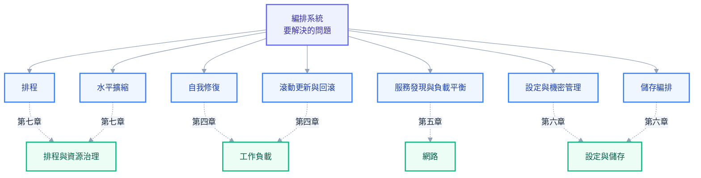

# 第一章：為什麼需要 Kubernetes——從部署地獄到編排時代

## 半夜三點的告警

假設你是值班的管理員，半夜三點手機響起，告警訊息寫著某台機器的硬碟壞了，上面跑著八個容器，其中包含一個對外服務的 API 與兩個背景排程任務。在沒有編排系統的年代，接下來要做的事情是一長串：你得先爬起來開電腦，登入監控系統確認哪些服務受到影響，再逐一登入其他機器查看誰還有餘力，手動把這八個容器搬過去、重新啟動、確認它們都正常回應，最後還要把負載平衡器的設定改過來，讓流量不再往那台故障的機器送。整個過程少說半小時，如果剛好遇上你手忙腳亂打錯一個 IP，時間還會更長，而在這段時間裡，使用者感受到的就是服務忽快忽慢，甚至直接連不上。

Kubernetes 存在的意義，就是讓這一整串動作在你還睡著的時候自動發生完畢。機器回報失聯，控制平面在幾十秒內就知道上面的容器需要被重新安置；它會挑一台還有餘力的機器，把容器排上去、拉起 image、等健康檢查通過，再更新內部的路由紀錄。等你隔天早上醒來看告警記錄，看到的是「凌晨三點零七分某節點失聯，凌晨三點零九分服務已在其他節點恢復」，而不是自己親手處理留下的一身冷汗。

這一章要做的事情，是把「為什麼需要這套系統」講清楚，同時也把它的反面講清楚——不是每個團隊、每個場景都該無條件擁抱 Kubernetes。你已經在第零章學會了怎麼用 Docker 把一個服務包裝成可攜帶的容器，這一章要往前跨一步，回答一個更根本的問題：容器都會用了，為什麼還需要一整套複雜的編排系統？下一章會把 `kubectl apply` 這行指令拆開來看它背後真正發生了什麼事，但在那之前，你得先弄懂為什麼會有人願意付出學習這整套系統的代價，也得弄懂什麼時候這筆代價其實不值得付。日後同事或主管問起「為什麼要導入 K8s」「能不能不要用」，答不出取捨的人只是照著範本操作的作業員，答得出來的人才真正參與了技術決策。

## 部署方式的演進史：從一台主機到編排時代

要理解編排系統為什麼會出現，最快的方式是把整條部署方式的演進史攤開來看一遍，因為每一代都是為了解決上一代留下的問題而生，同時也留下了新的問題給下一代去解決。

實體機時代的做法很直覺：系統需要幾個服務，就採購幾台實體機器，把應用程式直接裝上去運行。這種做法的問題不是技術上的，而是資源分配上的浪費——某些服務可能只需要一小部分運算資源就跑得動，卻整台機器被它獨佔，其餘的運算能力就這樣閒置在那裡；而當流量成長需要更多運算資源時，解法是採購新機器，這往往牽涉到請購、等待到貨、安裝上架，動輒是以週甚至以月計算的時間差，跟不上業務成長的速度。

虛擬機時代解決了資源分配的問題：透過 hypervisor，一台實體機器可以切割成好幾台虛擬機器，每台各自跑不同的服務，資源可以按照實際需求切分，不再是整台機器綁死給一個服務。第零章已經解釋過虛擬機與容器在 kernel 層的本質差異，這裡從部署史的角度重新提一次：虛擬機解決了資源浪費，卻沒有解決另一個問題——每一台虛擬機依然背著一整套獨立的作業系統，開機要跑完整套硬體初始化流程，記憶體與 CPU 有相當比例被系統本身而非應用程式吃掉，而且虛擬機終究還是一台需要被人手動建立、手動維護的機器。

容器時代把包裝的單位再往下切一層：容器共用宿主機唯一的 kernel，只靠 namespace 與 cgroup 做隔離，啟動時間從虛擬機的一兩分鐘降到毫秒到秒級，同一台機器上能塞進去的容器數量也遠遠超過能塞進去的虛擬機數量。這一層解決的是「打包與啟動」的問題——一份 image 到哪裡都能用同樣的方式跑起來，而且跑得極快。但容器時代留下一個新問題：當容器數量從個位數變成兩位數、三位數，分散在不只一台機器上時，誰去決定哪個容器該跑在哪台機器上？誰去確認容器還活著？誰在流量暴增的時候去多開幾個容器、流量退潮的時候把多餘的關掉？這些問題，Docker 本身完全沒有回答，因為 Docker 設計的原始定位就是管理單一機器上的容器，不是管理一整群機器。

編排時代因此而生——不是因為容器不好用，而是容器用得太好、太多，多到人力已經無法用手動方式管理。下圖把這四個時代的演進與各自留下的問題畫成一條時間軸：

這正是 Google 內部多年來管理數十萬台機器所累積的經驗，後來以內部 Borg 系統的設計為藍本，開源成為 Kubernetes——這個希臘文原意是「舵手」的名字，意味著引導一個個貨櫃容器到它們該去的地方，恰如其分地點出了這套系統的核心任務：不是取代容器，而是指揮成千上萬個容器。

## 有了 Docker，為什麼還不夠——編排要解決的七個問題

如果你的系統永遠只有一台機器、一個容器，`docker run --restart=always` 加上手動盯著它，其實就夠用了。但真實世界的系統很少停留在這個規模：一旦服務數量成長到十幾個、跑在不只一台機器上，Docker 沒有回答的問題就會一個一個浮現出來。以下七個問題，是編排系統存在的具體理由，也是本書第四、五、六、七章要展開細講的內容，這裡先把每一個問題的「沒有它會怎樣」講清楚。

### 排程：十台機器、五十個容器，誰該跑在哪

假設你手上有十台機器，要部署五十個容器，每個容器需要的 CPU 與記憶體都不太一樣，有些機器已經跑了別的服務、餘力有限，有些機器剛好是空的。手動排程的做法是打開一張試算表，逐一記錄每台機器目前的資源用量，再逐一決定第幾個容器該放到哪台機器，整個過程一旦有一台機器資源估算錯誤，就要重新調整後面所有的分配。這件事在五十個容器的規模下已經讓人頭痛，一旦成長到五百個、五千個，人工排程就不再是「麻煩」而是「不可能」。Kubernetes 的 scheduler 把這個決策自動化：它持續觀察每台機器剩餘的資源，任何新容器出現時自動幫它配對到最適合的機器上，這套決策機制的細節會在第七章完整攤開。

### 自我修復：容器掛了、機器掛了，誰半夜起來處理

本章開頭那個半夜三點的告警場景，正是這一項要解決的問題。容器裡的程式可能因為記憶體洩漏而當機，機器可能因為硬體故障而整台失聯，甚至只是有人手滑執行了一個不該執行的刪除指令——不管起因是什麼，沒有自我修復機制的系統，都需要一個活人盯著監控畫面、發現異常之後手動處理。Kubernetes 透過健康檢查與控制迴圈，讓系統持續比對「期望狀態」與「實際狀態」，一旦兩者不符就自動採取行動：容器掛了就地重啟，機器整台失聯就把上面的容器重新排到別的機器。這套機制的完整運作原理會在第二章與第四章分別從控制平面與工作負載兩個角度展開。

### 水平擴縮：流量尖峰要加、離峰要縮，人工來不及

想像你的服務平常穩定跑三個副本，某天遇上行銷活動或新聞曝光，流量在幾分鐘內暴增十倍。人工擴容的流程是先發現流量異常、評估需要幾個副本、手動啟動新的容器、確認它們都健康、再手動把負載平衡器的設定更新過來讓流量分攤過去——這一連串動作做完，流量尖峰往往已經過去一半，使用者早就在尖峰期間感受過卡頓甚至逾時。反過來，離峰時段忘記把多餘的副本縮回去，就是白白浪費運算資源與成本。Kubernetes 的 HorizontalPodAutoscaler 能依據 CPU、記憶體甚至自訂指標，即時且自動地增減副本數量，尖峰時分秒必爭的擴容，離峰時毫不留情的縮減，這套機制的參數與行為會在第七章細講。

### 服務發現與負載平衡：容器的 IP 會變，誰維護對照表

容器天生是短命的，重啟一次很可能就換了一個新的內部 IP。如果你的服務之間用寫死的 IP 互相呼叫，容器一旦重啟或被重新排到別的機器，呼叫方馬上就連不上，而且沒有人會主動通知你這件事——往往是等到有人發現某個功能壞掉，才回頭發現是 IP 早就變了、設定卻沒有跟著更新。維護一份「誰的 IP 現在是多少」的對照表，在容器數量少的時候還能靠人工勉強跟上，容器一多、重啟一頻繁，這份表格永遠是舊的。Kubernetes 的 Service 提供一個穩定不變的虛擬 IP 與 DNS 名稱，容器背後真正的 IP 怎麼變都不影響呼叫方，這套機制連同它如何把流量正確導到健康的容器上，會在第五章完整拆解。

### 滾動更新與回滾：怎麼在不中斷服務的前提下換版本

要把一個正在服務中的應用換成新版本，最粗暴的做法是先把所有舊容器停掉，再把新容器全部啟動——但這代表在新容器啟動完成之前，服務完全不可用，如果你的服務有正在使用的使用者，這就是一次貨真價實的當機。稍微講究一點的團隊會挑半夜流量最低的時段手動執行更新，賭的是使用者不會在那個時間點感受到中斷，但這既犧牲了工程師的睡眠時間，也只是把風險降低而非消除——真正上線後如果新版本有問題，還得手動一個一個把容器換回舊版本，過程中服務同樣不可用。Kubernetes 的滾動更新機制會逐步、有控制地把舊容器換成新容器，隨時保持有足夠數量的容器在正常服務，一旦發現新版本有問題，一行指令就能觸發回滾，整個過程都不需要挑半夜、也不需要人工一台一台去換，細節會在第四章展開。

### 設定與機密管理：同一份 image 要跑在不同環境

一份應用程式通常要跑在開發、測試、正式環境，資料庫位址、外部服務端點、日誌等級都不一樣。如果把這些設定寫死在程式碼裡再包進 image，換一個環境就要重新建置一次 image，而且如同第零章談過的，`ARG` 或某層裡刪除的檔案都可能把敏感資訊悄悄留在 image 的歷史紀錄裡，一旦被有心人取得這個 image，密碼就等於公開。Kubernetes 提供 ConfigMap 存放明碼設定、Secret 存放敏感資訊，讓同一份 image 透過外部注入的方式適應不同環境，換環境不需要重新建置，密碼輪替也不需要重新推送 image，這套機制在第六章會完整說明。

### 儲存編排：有狀態服務的資料要跟著容器走

容器的可寫層會隨著容器一起消失，這對無狀態服務不是問題，但資料庫這類需要長期保存資料的服務，一旦容器被重新排到另一台機器，原本寫在舊機器磁碟上的資料並不會自動跟過去，除非有人手動把資料搬過去，否則服務起來了、資料卻是空的。Kubernetes 透過 PersistentVolume 與 PersistentVolumeClaim 這一組抽象，把儲存從特定機器的磁碟解耦出來，容器不管被排到哪台機器，都能透過同一個宣告掛載到同一份資料，這套機制在第六章會詳細拆解。

## K8s 的設計哲學：為什麼是這一套贏了編排大戰

Kubernetes 不是市場上第一個編排系統，Docker 自己就推出過 Swarm，Apache Mesos 也早於 Kubernetes 站穩腳步過，但最後被整個產業採納為標準的是 Kubernetes。這不是行銷的勝利，而是幾個設計哲學上的選擇，讓它比對手更適應真實世界的複雜度。

### 宣告式而非命令式

`docker run` 這類指令是命令式的：你一步一步告訴系統該做什麼動作，系統照做，如果中途出錯，責任在你身上去處理善後。Kubernetes 的 YAML 走的是完全不同的路線——你在裡面描述的是「我要什麼」，例如「這個服務要有三個副本，用這個 image」，而不是「怎麼做到」。系統收到這份描述之後，會自己想辦法把現實收斂成你描述的樣子，不管中途發生什麼意外，它都會持續朝著這個目標努力，而不需要你一步一步盯著執行。這個差異在規模小的時候感覺不出來，但規模一旦變大，命令式操作的錯誤會隨著操作次數線性累積，宣告式的系統卻始終朝著同一個目標收斂。

### 控制迴圈與最終一致性

宣告式描述要真正發揮作用，背後需要一套機制持續比對「你描述的期望狀態」與「叢集當下的實際狀態」，一旦兩者不一致就自動採取行動去消弭差距，這套機制叫做控制迴圈（control loop）。它不保證這一秒就達到期望狀態，而是保證只要持續運作，狀態終將收斂——這就是所謂的最終一致性。第二章會把這套機制從 API Server 到各個 controller 之間如何協作，一步一步拆開來看。

### 一切皆資源：統一的 API 物件

Pod、Deployment、Service、ConfigMap，這些看起來完全不同的東西，在 Kubernetes 裡全部遵守同一套規則：都是一個 API 物件，都能用同一套 `get`、`apply`、`delete` 語法操作，都能被同一套 RBAC 規則授權、被同一套工具監控。這種統一性帶來的好處，是任何人只要學會操作一種資源，幾乎就學會了操作所有資源的方式，而工具生態系（kubectl、Dashboard、GitOps 工具）也能用同一套邏輯適用到所有資源類型，不需要為每種資源各寫一套特殊處理。

### 可擴充而非全能：介面而非全包

Kubernetes 刻意不去把容器怎麼執行、網路怎麼連通、儲存怎麼掛載這些事情自己實作到底，而是定義一組標準介面——CRI（容器執行）、CNI（網路）、CSI（儲存）——讓任何廠商都能實作這些介面接進來，同時透過 CRD（自訂資源）讓任何人都能定義自己的資源類型，再用 controller 賦予它行為。這代表 Kubernetes 本身可以維持核心精簡，把大量創新交給整個生態系去做，而不必等 Google 或社群核心團隊一項一項加進去。這套擴充機制的完整樣貌會在第九章展開。

這四個設計選擇合在一起，解釋了為什麼是 Kubernetes 贏了這場編排大戰：宣告式加控制迴圈讓系統天生具備自我修復的能力，一切皆資源讓工具生態系能夠統一操作，可擴充的介面設計讓廠商與社群願意投入，而不用擔心被綁死在某一家公司的實作裡。相較之下，Docker Swarm 雖然操作簡單，但擴充性有限，能接進來的生態系規模遠遠不及；社群的資源、Operator、Helm chart 幾乎全部往 Kubernetes 靠攏之後，Swarm 的生態系逐漸萎縮，這也是為什麼今天很少有新專案會選擇從 Swarm 起步。

## 誠實面對成本：K8s 不是免費的午餐

前面幾節把 Kubernetes 的好處講得很清楚，但一個能參與技術決策的管理員，必須同樣清楚它的代價，而不是只會背誦優點。

學習曲線是第一項成本。Pod、Deployment、Service、ConfigMap、RBAC、Ingress、Operator，光是名詞就有一長串，每個名詞背後又都有自己的欄位與行為細節，一個新人要熟悉到能獨立排查問題，往往需要數個月的時間浸泡在真實環境裡。維運負擔是第二項——etcd 需要定期備份、憑證需要定期輪替、版本需要規律升級，這些工作在第十二章會完整列出，任何一項沒做好，都可能在真正需要它的那一刻讓你叫天不應。資源開銷是第三項，即使是本書使用的 minikube 這種單節點環境，控制平面本身也要佔用一部分 CPU 與記憶體才能運作，正式環境的多節點控制平面加上各種周邊元件，這筆開銷比很多人想像的要高。除錯複雜度是第四項——一個請求要穿過 Ingress、Service、kube-proxy、容器網路，任何一層出錯，症狀往往都長得像「服務掛了」四個字，第十三章會建立一套分層排查的方法論，但這套方法論之所以需要存在，本身就說明了複雜度確實存在。

> **常見誤解**：以為導入 Kubernetes 就等於自動獲得高可用。事實是，Kubernetes 提供的是「讓高可用變得可行」的機制，真正的高可用還需要多節點的控制平面、跨機房的節點分布、正確設定的副本數與反親和性規則，這些都需要額外投入才能兌現，不是裝上 Kubernetes 就自動擁有的。

把成本攤開之後，下面這張表是給出明確判準的地方，用來回答「這個場景到底該不該用 Kubernetes」：

| 情境 | 該不該用 K8s | 理由 |
| --- | --- | --- |
| 單一應用、流量長期穩定 | 不建議 | 沒有多服務協調、沒有彈性擴縮的需求，Docker Compose 或單機部署就夠用，K8s 的維運成本純屬多餘 |
| 團隊沒有專職維運人力 | 不建議 | etcd 備份、憑證輪替、版本升級這些工作沒人做，遲早在最壞的時機點爆出災難 |
| 用雲端 PaaS 就能滿足需求 | 不建議 | Cloud Run、Azure Container Apps 這類服務把排程、擴縮、負載平衡都包好了，自己架 K8s 是重複造輪子 |
| 多服務、多環境、流量波動大 | 建議 | 這正是編排系統設計來解決的場景，人工管理的成本會遠高於學習 K8s 的成本 |
| 需要跨雲、避免被單一供應商綁死 | 建議 | K8s 是少數能在各大雲端與地端維持一致操作介面的選擇 |

> **主管問你為什麼要導入 K8s 時，你可以這樣答**：不是因為它是業界標準或聽起來很潮，而是因為我們的服務數量、環境數量、流量波動已經超過人工管理能負荷的規模，繼續用人工方式意味著每一次部署、每一次故障都要投入更多人力與更高的出錯風險；但同時要老實說出代價——我們需要投入時間學習、需要規劃誰負責維運、control plane 本身也要吃資源，這是一筆划算的交易，而不是沒有成本的升級。

## 選型地圖：K8s 之外還有誰

決定要不要用 Kubernetes 之前，值得先知道市場上還有哪些替代方案，因為很多時候真正合適的答案根本不是 Kubernetes。

Docker Compose 管理的是單一台機器上的多個容器，第零章已經完整講過，它沒有跨機器排程、沒有自我修復、沒有滾動更新，適合本機開發或單機部署的小型系統。Docker Swarm 是 Docker 官方自己的編排方案，操作比 Kubernetes 簡單很多，但如同前一節提過的，它的生態系這幾年持續萎縮，社群資源與現成工具越來越難找，新專案選它的機會成本正在逐年升高。HashiCorp Nomad 走的是另一條路線——它比 Kubernetes 輕量，而且不限定只能跑容器，也能直接排程一般的執行檔或虛擬機工作負載，適合工作負載類型混雜、不想被容器綁死的團隊。雲端 PaaS 例如 Google Cloud Run、微軟的 Azure Container Apps、AWS App Runner，把排程、擴縮、負載平衡這些 Kubernetes 要解決的問題整個包好給你用，你只要負責把 image 推上去，代價是失去對底層的控制權，也通常與特定雲端綁定。Serverless（例如 AWS Lambda、Azure Functions）則是把顆粒度切得更細，一個函式對應一次執行，流量歸零時成本也歸零，但要付出冷啟動延遲與執行時間限制的代價。

| 方案 | 適合情境 | 主要限制 |
| --- | --- | --- |
| Docker Compose | 單機開發、小型單體服務 | 不能跨機器、無自我修復 |
| Docker Swarm | 想要簡單編排、團隊小 | 生態系持續萎縮、工具選擇少 |
| HashiCorp Nomad | 混合容器與非容器工作負載 | 生態系與社群規模小於 K8s |
| Cloud Run／Azure Container Apps | 無狀態服務、想省維運心力 | 失去底層控制權、雲端綁定 |
| Serverless（Lambda／Functions） | 事件驅動、流量極不穩定 | 冷啟動延遲、執行時間受限 |
| Kubernetes | 多服務、多環境、需要跨雲一致性 | 學習曲線與維運成本最高 |

使用者實際在 Azure 上用過 Container Apps 的經驗值得在這裡點出來對照：Container Apps 背後其實就是託管的 Kubernetes 加上 KEDA 做事件驅動擴縮，只是把控制平面的維運責任整個交給了 Azure，你付出的是比自架 Kubernetes 更高的單位運算成本，換來的是不用管 etcd、不用管版本升級。這正是「自己扛維運換取更大控制權」與「多付一點錢換取不用維運」這兩條路線的具體體現，選哪一條沒有標準答案，取決於團隊規模與內部有沒有意願養一批專職維運的人。

## K8s 生態系地圖：核心之外還需要什麼

裝好 Kubernetes 本身，離一個能用於正式環境的平台還有一段距離，因為 Kubernetes 核心刻意只定義了介面，很多真正要用的能力，都要靠周邊生態系補上。網路層面需要一個 CNI 外掛才能讓 Pod 之間真正連通（第五章）；對外服務需要一個 Ingress Controller 把 HTTP 流量正確導入叢集（第五章）；持久化資料需要一個 CSI 驅動接上實際的儲存系統（第六章）；掌握叢集健康需要 Prometheus、Grafana 這類監控工具（第十四章）；追查問題需要 ELK 這類集中式日誌系統（第十五章）；把 YAML 打包成可版本化單位需要 Helm（第十章）；把 Git 裡的意圖自動同步到叢集需要 ArgoCD 這類 GitOps 工具（第十一章）；管理誰能做什麼需要 RBAC 與 Secret 管理工具（第八章）。CNCF（Cloud Native Computing Foundation）維護的 landscape 圖，畫的就是這整個生態系——Kubernetes 只是其中的核心一塊拼圖，而不是全部。

把這張地圖對照到使用者實際的環境會更具體：minikube 提供本機的 Kubernetes 核心，Harbor 扮演 image registry 的角色，ArgoCD 負責把 Git 裡的部署意圖同步下來，Cloudflare Tunnel 則是不必開防火牆通口也能把服務安全地對外曝露的一種 Ingress 替代方案，GitHub Actions 負責在程式碼推上 tag 之後觸發建置與部署流程。這一整條鏈路裡，Kubernetes 本身只負責其中「怎麼排程、怎麼跑起來」的那一段，其餘的建置、交付、對外曝露、可觀測性，全部是生態系裡不同的專案各自負責，本書後面的每一章，其實就是把這張地圖上的每一塊拼圖，一塊一塊講清楚。

## 本機練習環境：從 minikube 到正式環境的距離

要動手驗證本書後面每一章的內容，你需要一個能實際操作的 Kubernetes 環境，而不必真的去申請一整個雲端叢集。市面上常見的本機方案各有取捨：

| 工具 | 特性 | 適合情境 |
| --- | --- | --- |
| minikube | 單節點、功能完整、支援多種 driver 與 addon | 學習與功能驗證，本書採用 |
| kind | 用 Docker 容器模擬節點，啟動極快 | CI 環境快速起停、多節點模擬 |
| k3s | 精簡發行版，體積小、資源需求低 | 邊緣裝置、資源受限的環境 |
| Docker Desktop 內建 K8s | 安裝最簡單、與 Docker Desktop 整合 | 輕量嘗試，功能與可調校程度較有限 |

本書選擇 minikube，是因為它的功能最接近真實叢集，addon 機制也讓你能逐步打開 ingress、metrics-server 這類進階功能，跟著書裡的章節同步練習。在 Windows 11 加上 WSL2 的組合下，有幾件事值得先知道：`minikube start` 預設分配的記憶體與 CPU 可能不夠跑起本書後面章節會用到的多個服務，建議明確用 `--memory` 與 `--cpus` 參數給足資源；`ClusterIP` 與 `NodePort` 都只在叢集內部或本機可以連得到，如果要模擬正式環境裡 `LoadBalancer` 類型的 Service，需要另外執行 `minikube tunnel`，讓 minikube 把對應的虛擬 IP 接到本機的網路上；ingress、metrics-server、dashboard 這些功能預設是關閉的，需要用 `minikube addons enable` 逐一打開。

> **常見誤解**：以為在 minikube 上一切運作正常，正式環境就會一樣穩。minikube 終究是單節點——控制平面與工作節點是同一台機器，沒有真正的高可用可言，一旦這台機器本身出問題，整個叢集就一起消失，這在多節點的正式環境裡是不會發生的情境。minikube 適合拿來驗證 YAML 寫得對不對、機制運作得符不符合預期，但沒辦法讓你體驗到節點故障轉移、跨機房容錯這些正式環境才會遇到的課題，這部分的落差會在第十二章詳細補上。

## 本書地圖：讀完這一路要走過什麼

這本書的組織邏輯，跟著一個管理員真實會遇到的問題順序走：先搞懂容器本身（第零章），再搞懂容器怎麼被編排起來運作（第一到三章打地基，第四到七章是每天都會用到的資源與治理），接著是怎麼把這些資源治理得有紀律（第八、九章的安全與擴充），怎麼把它們打包成可交付、可追蹤的單位（第十、十一章的 Helm 與 ArgoCD），怎麼讓整套系統長期活下去（第十二、十三章的維運與疑難排解），最後是怎麼在系統出問題之前就先看見徵兆（第十四、十五章的監控與日誌）。

```mermaid
%%{init: {'theme':'base','themeVariables':{
  'fontFamily':'ui-sans-serif, -apple-system, Segoe UI, Roboto, sans-serif',
  'fontSize':'13px',
  'primaryColor':'#eef2ff',
  'primaryTextColor':'#1e293b',
  'primaryBorderColor':'#6366f1',
  'lineColor':'#94a3b8',
  'secondaryColor':'#f1f5f9',
  'tertiaryColor':'#f8fafc',
  'noteBkgColor':'#fef9c3','noteTextColor':'#854d0e','noteBorderColor':'#eab308'
},'flowchart':{'curve':'basis','nodeSpacing':40,'rankSpacing':45,'htmlLabels':true}}}%%
graph TD
  subgraph S0["容器篇"]
    CH0["第0章<br/>Docker基礎"]
  end
  subgraph S1["基礎篇"]
    CH1["第1章<br/>為什麼需要K8s"]
    CH2["第2章<br/>叢集內部運作"]
    CH3["第3章<br/>API與YAML"]
  end
  subgraph S2["資源篇"]
    CH4["第4章<br/>工作負載"]
    CH5["第5章<br/>網路"]
    CH6["第6章<br/>設定與儲存"]
  end
  subgraph S3["治理篇"]
    CH7["第7章<br/>排程與資源"]
    CH8["第8章<br/>安全與RBAC"]
    CH9["第9章<br/>擴充機制"]
  end
  subgraph S4["交付篇"]
    CH10["第10章<br/>Helm"]
    CH11["第11章<br/>ArgoCD"]
  end
  subgraph S5["維運篇"]
    CH12["第12章<br/>叢集維運"]
    CH13["第13章<br/>疑難排解"]
  end
  subgraph S6["可觀測性篇"]
    CH14["第14章<br/>Prometheus/Grafana"]
    CH15["第15章<br/>ELK"]
  end
  S0 --> S1 --> S2 --> S3 --> S4 --> S5 --> S6
  class CH0 muted
  class CH1,CH2,CH3 accent
  class CH4,CH5,CH6 primary
  class CH7,CH8,CH9 warn
  class CH10,CH11 success
  class CH12,CH13 decision
  class CH14,CH15 error
  classDef primary fill:#eef2ff,stroke:#6366f1,stroke-width:2px,color:#3730a3;
  classDef success fill:#ecfdf5,stroke:#10b981,stroke-width:2px,color:#065f46;
  classDef warn fill:#fffbeb,stroke:#f59e0b,stroke-width:2px,color:#92400e;
  classDef error fill:#fef2f2,stroke:#ef4444,stroke-width:2px,color:#991b1b;
  classDef decision fill:#fefce8,stroke:#eab308,stroke-width:2px,color:#854d0e;
  classDef accent fill:#eff6ff,stroke:#3b82f6,stroke-width:2px,color:#1e40af;
  classDef muted fill:#f8fafc,stroke:#cbd5e1,stroke-width:1px,color:#64748b;
```

建議的閱讀順序就是章節本身的順序，因為後面章節大量依賴前面建立的心智模型——第四章的 probe 建立在第零章 `HEALTHCHECK` 的概念上，第八章的 Admission 需要先理解第二章的控制迴圈，第十一章的 ArgoCD 本身就是第九章擴充機制最典型的產物。跳著讀當然可以應急查資料，但如果目標是「問不倒」，順著章節脈絡走一遍，會比東拼西湊地查文件扎實得多。

下一章，我們就要把本章一直提到、卻還沒真正拆開的那行指令攤開來看：當你打下 `kubectl apply -f xxx.yaml`，這行指令送出去之後，究竟經過了哪些關卡，才讓一個容器真正在某台機器上跑起來。

## 連結

- [[k8s-mastery]]
- [[00-docker-foundations]]
- [[02-cluster-internals]]
- [[09-extending-kubernetes]]
- [[12-cluster-operations]]
- [[minikube]]
- [[kubernetes]]
