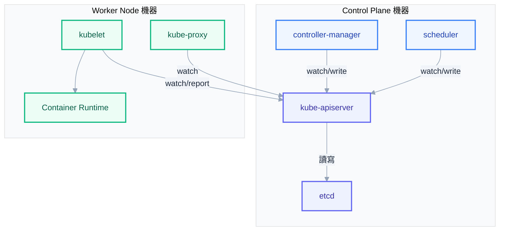
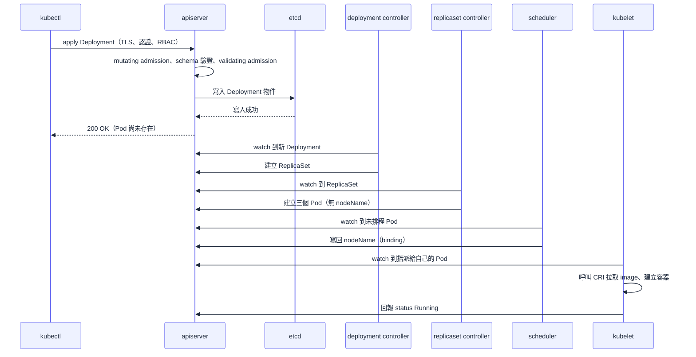
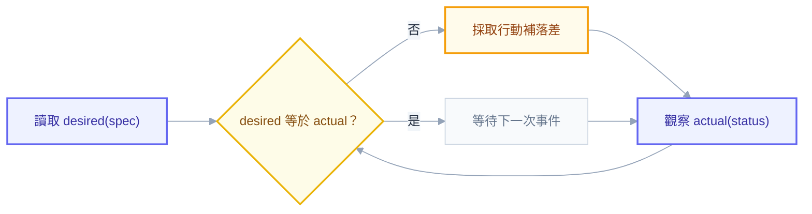

# 第二章：叢集如何運作

## 打開黑箱：`kubectl apply` 之後，到底發生了什麼事

很多學習 K8s 的人可以背出 Pod、Deployment、Service 的定義，日常也熟練地用 `kubectl apply -f xxx.yaml` 部署系統，但一旦被追問「你剛剛打的這行指令，之後究竟發生了什麼事」，卻往往語塞，只能含糊帶過一句「就交給 K8s 去處理」。這種答案在面試現場是危險訊號，在事故現場更危險——你正在操作一個自己並不理解的系統，一旦出錯（Pod 卡在 Pending 不知道為什麼、apply 之後改動沒生效），你沒有能力去推理、去 debug，只能靠碰運氣式的重開、重新 apply。

這一章的目標，就是把這個黑箱拆開，一路跟著這行指令走一遍：從你的終端機開始，經過 TLS 連線、apiserver 的層層關卡、寫進 etcd，再到 controller、scheduler、kubelet 陸續接手，最後容器真正被跑起來。走完這趟旅程，你會發現 Kubernetes 的系統設計背後其實有一套一致的哲學——宣告式（declarative）、最終一致（eventually consistent）、pull-based。這套哲學一旦內化，後面章節的 YAML、RBAC、networking、troubleshooting，全部都只是這個心智模型的延伸應用而已。

## 兩種視角：實體機器與虛擬資料中心

新手在讀 K8s 文件時最容易卡住的地方，是 Cluster、Node、Control Plane 這幾個詞同時存在於兩個完全不同的層次上，而文件經常不會告訴你現在講的是哪一層。

在**實體架構**這一層，Cluster 就是一群真實存在的機器，可能是機房裡的裸機，也可能是雲端上一台台 VM，這群機器彼此透過網路相連。這些機器裡，少部分被賦予「管理者」的角色，稱為 Control Plane node，負責做決策、記帳、排程；其餘機器被稱為 Worker Node，負責老實地把 Control Plane 決定要跑的東西真的跑起來。這一層你可以用 `kubectl get nodes`、SSH 上機器、看 process list、看 CPU 與記憶體使用率——它是水泥、電力、風扇轉速的世界。

但在**抽象概念**這一層，Cluster 被想像成一整座虛擬資料中心：有虛擬的機房（Namespace）、有虛擬主機（Pod）、有虛擬路由器（Service、Ingress）、有虛擬的設定檔庫房（ConfigMap、Secret）。當你 `kubectl apply` 一個 Pod，概念上你是在這座虛擬資料中心裡「開了一台新主機」；這件事被記錄在 Control Plane 的大腦裡（也就是 etcd），而真正執行這台「虛擬主機」的計算資源，來自某一台實體 Worker Node。

這雙軌之所以重要，是因為你之後遇到的每一個問題，都需要判斷「這是實體層出問題（機器沒資源、網路斷了、磁碟滿了），還是抽象層出問題（YAML 寫錯、selector 對不上、RBAC 沒授權）」。資深工程師腦中永遠同時開著這兩張圖，隨時切換視角去定位問題。



## Control Plane 四元件：叢集的決策大腦

剛才我們把 Control Plane 畫成一個方塊，但這個方塊裡其實住著四個各司其職的常駐 process，各自負責決策鏈裡不同的一段。理解它們，最有效的方式不是背誦「這是什麼」，而是問自己：「它在做什麼決策？它憑什麼資訊做這個決策？」

### kube-apiserver——唯一的守門人

很多人誤以為 apiserver 是「發號施令的大腦」，但它其實更接近前台加保安加檔案室櫃檯的組合，本身幾乎不做任何業務決策。整個叢集裡，沒有任何元件會繞過 apiserver 直接讀寫 etcd 或直接命令 kubelet——包括 kubectl、scheduler、controller-manager、kubelet 自己，全部都只跟 apiserver 這一個窗口打交道。

apiserver 真正做的事情，是在每一次請求進來時跑一連串檢查關卡：這個人是誰（authentication）、他被允許做這件事嗎（authorization／RBAC）、要不要在寫入前先動態改一下這個物件的內容（mutating admission）、這個物件的欄位格式對不對（schema 驗證）、最後再做一次業務邏輯上的准入檢查（validating admission），全部通過後才真的把物件寫進 etcd。這條關卡鏈我們會在稍後的 apply 旅程完整走一遍。

也因為所有讀寫都要經過 apiserver 這一個窄門，它自然而然變成叢集裡唯一的「事實視窗」：任何元件想知道現在叢集長什麼樣，都是問 apiserver，而不是自己去猜、或去問其他 Node。

> **常見誤解**：「apiserver 是大腦，它會下命令給 kubelet 做事。」——不對，apiserver 從不主動連線去敲 kubelet 的門要求它做什麼；反過來，是 kubelet 主動連上 apiserver 去問「有沒有指派給我的新工作」。這個方向一旦弄反，後面整條 pull-based 的邏輯就會全部理解錯，我們在旅程那一節會具體展開。

### etcd——記住一切的地方

apiserver 自己完全不儲存狀態，它是無狀態（stateless）的——你可以隨時多開幾個 apiserver replica 分攤流量。真正儲存「叢集現在長什麼樣」的地方，是掛在 apiserver 背後的 etcd，一個分散式 key-value 儲存。你部署的每個 Pod、Deployment、Service、Secret，最終都是 etcd 裡的一筆或多筆資料。因為 etcd 的角色如此關鍵，我們留一整節在本章後段，深入討論它的 raft 共識機制與為何節點數要是奇數。

### kube-controller-manager——一群校對員的集合

名字裡雖然是單數，但 kube-controller-manager 實際上是一個 process 裡跑著數十個獨立 controller 的集合體：deployment controller、replicaset controller、node controller、job controller……每一個 controller 都只盯著自己負責的那一種資源，做的事情永遠是同一套路：**看 desired state（spec）長什麼樣、看 actual state（status）長什麼樣，兩者有落差就採取行動去補平落差**。

舉例來說，deployment controller 看到你的 Deployment 的 `spec.replicas` 寫 3，但目前對應 ReplicaSet 的 `spec.replicas` 是 1，它就會去把 ReplicaSet 的 spec 改成 3；replicaset controller 再接手，看到現在只有一個 Pod 物件卻要求三個，於是建立兩個新的 Pod 物件。這裡每個 controller 決策所依據的資訊永遠只有一份：apiserver 回報的目前物件狀態，除此之外它們互相不認識、不直接溝通，靠著各自 watch 同一份資料自行反應，行為卻像接力賽一樣一棒接一棒完成整個部署。

### kube-scheduler——幫 Pod 找歸宿的媒人

當某個 Pod 物件被建立出來、但它的 `spec.nodeName` 欄位是空的，這個 Pod 就進入了 scheduler 的視野。scheduler 做的唯一一件事，是替這個「還沒決定要住在哪台機器」的 Pod 挑一個最適合的 Node，決策依據包括：這個 Pod 宣告要多少 CPU 與記憶體（requests）、Node 目前還剩多少可分配資源、有沒有設定 node affinity 或 anti-affinity、Node 上有沒有讓 Pod 無法忍受的 taint，以及各種內建的打分策略（例如盡量把 Pod 分散到不同 Node、盡量湊滿一台機器的資源等）。選好之後，scheduler 做的事情很輕量——只是把選中的 Node 名字寫回這個 Pod 物件的欄位裡，這個動作叫 binding，它自己完全不負責「真的把容器跑起來」這件事。

至此四個元件的分工已經很清楚：apiserver 把關所有讀寫，etcd 記住現狀，controller-manager 負責發現落差、生出下一層物件，scheduler 負責幫 Pod 挑房子。但這四者加起來，還沒有任何一行程式碼真的去下載 image、開容器——那是下一節 Node 上三個元件的工作。

## Node 三元件：真正把工作做出來的地方

Control Plane 決定了 Pod 該去哪，但誰真正把它跑起來？這正是 Node 上這三個常駐 process 的職責，而它們的共通點是：全部都只服務「自己這台機器」，沒有一個知道其他 Node 發生什麼事。

### kubelet——每台 Node 上的現場執行者

kubelet 是跑在每個 Node 上的 agent，它做的事情可以濃縮成一句話：不斷去問 apiserver「有哪些 Pod 的 nodeName 寫著我」，然後把這份清單和自己機器上實際跑著的容器做比對，實際狀態跟不上宣告狀態的地方就動手調整——該建的容器建起來、該砍的容器砍掉，探針（liveness、readiness probe）沒過的容器該重啟就重啟。它同時也負責反向回報：這個 Pod 現在是 Running 還是 CrashLoopBackOff，並把這份 status 寫回 apiserver。

值得注意的是，kubelet 自己並不知道怎麼真的建立一個容器——這件苦力活它外包給了 Container Runtime，自己只透過標準介面下指令。

### kube-proxy——維持虛擬 IP 能被找到的網路管家

前面提過，Pod 被創建時會分到一個內網動態 IP，這個 IP 隨 Pod 重建就會變，難以依賴。Service 的存在解決了這個問題，給一組 Pod 一個穩定的虛擬 IP。但這個虛擬 IP 本身並不是任何一張真實網卡在監聽的地址，它是靠每台 Node 上的 kube-proxy 預先寫好一套流量轉發規則（傳統模式下是 iptables 規則，較新的部署則常用 IPVS）才生效的：當封包的目的地是某個 Service 的 ClusterIP 時，Node 的網路層（kernel netfilter）依照 kube-proxy 寫好的規則，把它導向後面某一個真實的 Pod IP。所以嚴格來說，kube-proxy 自己並不轉送任何一個封包——它只是規則的撰寫者，真正做流量轉發的是 Linux kernel。這也是為什麼 kube-proxy 掛掉不會讓既有連線馬上斷，但新的 Service endpoint 變化就不會再更新到轉發規則裡。

### Container Runtime 與 CRI：一段標準化的歷史

kubelet 最終要「跑起一個容器」，這件事本身有很多種做法——用 Docker Engine、用 containerd、用 CRI-O，都可以達到同樣的目的，但介面各自不同。Kubernetes 在早期版本裡，kubelet 的程式碼裡直接寫死了呼叫 Docker Engine 的邏輯，這帶來兩個問題：第一，Docker 本身的 release 節奏、行為變化，會直接綁架 Kubernetes 自己的發布節奏；第二，任何想加進來的新 runtime（rkt、containerd、CRI-O），都得有人去 kubelet 的核心程式碼裡加專屬的整合邏輯，日子久了難以維護。

社群的解法，是定義一套叫做 Container Runtime Interface（CRI）的標準 grpc 介面，讓 kubelet 只認得這一套標準動作（建立容器、啟動、停止、抓取 image 狀態……），底下不管接的是誰，只要實作這套介面就能相容。問題是 Docker Engine 在 CRI 出現之前就已經存在，它本身並沒有實作 CRI，於是社群寫了一層叫做 dockershim 的橋接程式，塞在 kubelet 和 Docker Engine 之間，把 CRI 呼叫翻譯成 Docker Engine 聽得懂的指令。這層橋接維護起來很麻煩，相當於一個沒人真正想長期擁有的黏著層，所以 Kubernetes 在 1.20 版宣布棄用 dockershim，並在 1.24 版正式移除。

這件事在當時造成不小的恐慌，很多人誤以為「Kubernetes 不能跑 Docker 容器了」。這其實是一個常見誤解：被移除的只是 kubelet 裡那層專門去跟 Docker Engine 對話的橋接程式，你用 `docker build` 做出來的 image 完全沒有受影響，因為 OCI image 格式是產業標準，containerd、CRI-O 一樣吃得下。更巧的是，containerd 這個現在最主流的 CRI 實作，其實原本就是 Docker Engine 內部拆分出來、專門負責拉 image、管容器生命週期的核心引擎，Docker Desktop 今天底層用的也是它。所以拿掉 dockershim 更像是拿掉一層不必要的中間人，而不是拿掉 Docker 本身的技術。

## 全書高潮：一趟 `kubectl apply -f deploy.yaml` 的完整旅程

前面把每個元件拆開介紹過一輪，現在是時候把它們串起來，走一遍完整的旅程了。假設你在終端機打下 `kubectl apply -f deploy.yaml`，這個 yaml 定義了一個三個 replica 的 Deployment，接下來究竟發生了什麼事？

先講清楚起點：kubectl 本身不是叢集的一部分，它只是一個讀你本機 `~/.kube/config`（kubeconfig）的 HTTP client，這份設定檔告訴它要連到哪個叢集的 apiserver、用什麼身份憑證（可能是 client 憑證、token，或是雲端 IAM 整合）。

連線建立之後，緊接著是一連串把關流程，我們逐站說明：

1. **TLS 連線**：kubectl 先跟 apiserver 建立 TLS 連線，確保通道加密，也確保你連的真的是你以為的那個 apiserver，而不是中間人。
2. **Authentication（認證）**：apiserver 檢查你帶來的憑證，確認「你是誰」——可能是憑 X.509 憑證裡的 CN、可能是 bearer token、也可能是 OIDC 對接出來的身分。這一步只回答身分問題，不回答「你能不能做這件事」。
3. **Authorization（授權／RBAC）**：確認身分後，apiserver 接著查你（或你所屬的 group、ServiceAccount）有沒有被 RBAC 規則允許在這個 namespace 對 Deployment 這種資源做 create、update 動作。沒有對應的 Role 與 RoleBinding，這裡就直接被拒絕，連寫都寫不進去。
4. **Mutating Admission**：通過授權後，物件會先經過一輪 mutating admission webhook，這一階段可以動態改寫你送進來的物件內容，例如自動幫沒寫 resource limit 的 Pod 補上預設值、自動注入 sidecar 容器（常見於 service mesh）。
5. **Schema 驗證**：接著 apiserver 驗證這個物件的格式是不是合法的 Deployment——欄位型別對不對、必填欄位在不在，格式不對在這裡就會直接被拒絕並回傳錯誤訊息。
6. **Validating Admission**：格式合法後，再跑一輪 validating admission webhook，做業務邏輯層面的檢查（例如禁止使用 latest tag、要求一定要有特定 label），這一階段只能接受或拒絕，不能再修改內容。
7. **寫入 etcd**：所有關卡通過後，apiserver 把這個 Deployment 物件寫進 etcd。**這裡有一個非常關鍵、卻常被忽略的事實：寫入 etcd 成功的當下，apiserver 就會回傳 200 OK 給 kubectl 了。** 你的終端機這時候顯示部署成功，但此刻叢集裡連一個 Pod 都還沒有被建立，容器 image 甚至還沒開始下載。apply 的「成功」，指的是「你的意圖已經被完整、合法地記錄下來」，不是「你要的東西已經跑起來了」。

寫進 etcd 之後，剩下的一切都是**非同步**發生的，而且全部由 watch 驅動：

8. deployment controller 原本就在 watch 所有 Deployment 物件的變化，這時候發現多了一個（或 spec 變了）Deployment，於是依照 replica 數量去建立或更新對應的 ReplicaSet 物件——這一步一樣要寫回 apiserver，一樣要走一遍 admission 鏈。
9. replicaset controller watch 到這個 ReplicaSet 要求三個 replica、但目前對應的 Pod 數量是零，於是建立三個 Pod 物件。注意這幾個 Pod 物件被建立的當下，它們的 `spec.nodeName` 欄位是空的——還沒有人決定它們要住在哪台機器。
10. kube-scheduler 持續 watch 著所有 nodeName 為空的 Pod，發現了這三個新面孔，依照 resource requests、affinity、taint 與 toleration 等條件逐一挑選最適合的 Node，然後把結果寫回每個 Pod 物件的 nodeName 欄位，這個動作叫 binding。
11. 每台 Node 上的 kubelet 都在 watch「指派給我的 Pod 有哪些」，被選中的那幾台 Node 上的 kubelet，這時候才第一次看到這幾個新 Pod，於是呼叫底下的 Container Runtime（透過 CRI）去拉取 image、建立容器、掛載 volume、設定網路。
12. 容器真正跑起來後，kubelet 持續執行 liveness、readiness probe，並把最新狀態（Running、Ready、重啟次數……）寫回這個 Pod 物件的 status 欄位，讓所有人在下次 `kubectl get pods` 時都能看到最新現況。

整趟旅程走完，你會發現一個核心事實：**apiserver 從頭到尾沒有主動敲過任何一台 Node 的門，也沒有對任何 controller 或 kubelet 下達過任何一次主動指令。** 每一個環節的推進，都是某個元件自己去 watch 了一份它關心的資料、發現有變化、才自己動手處理。這就是所謂的 pull-based 架構：不是控制中心去 push 工作給執行者，而是執行者自己主動來拉工作。這個特性帶來一個很實際的好處——當某個 Node 暫時斷線又重新連上，它的 kubelet 只要重新 watch 一次，就能自己追上這段時間錯過的所有變化，不需要任何人特地重新派工給它。



> **面試時怎麼答**：如果被問「apply 之後發生什麼事」，能展現深度的答案不是背流程站名，而是先點出兩個關鍵事實——「API 回 200 代表寫進 etcd 成功，不代表 Pod 已經在跑」以及「後面所有動作都是各元件 watch 出來的，不是誰在下命令」，再視情況展開細節。這兩句話比背完整十二站更能說服面試官你真的理解這個系統。

## 宣告式模型與 Reconciliation Loop：為什麼系統會自己修復自己

走完 apply 旅程後，你應該已經隱約感覺到一件事：Kubernetes 裡幾乎沒有一個地方在「執行一連串步驟」，取而代之的，每個 controller 都在做同一件很單純的事——**看想要的樣子、看現在的樣子、把落差補上**。這跟我們過去熟悉的命令式（imperative）腳本思維完全不同。

命令式的做法，想像你用一支腳本管理伺服器，通常長這樣：先連上去、停掉舊容器、拉新 image、跑新容器——每一步都是明確的命令，腳本知道「現在該做什麼動作」。這種做法的脆弱之處在於，它假設每一步都會成功，一旦中途某台機器斷線、某個指令失敗，整個流程就卡住，而且腳本本身不知道「現在系統實際上是什麼狀態」，只能靠人去排查。

宣告式的做法反過來：你只描述「我要的最終樣子」（三個 replica、用某個 image 版本），剩下「怎麼從現在的樣子走到那個樣子」完全交給系統自己想辦法。每個 controller 的核心邏輯，可以用一段偽代碼概括：

```
for {
  desired := 讀取這個物件的 spec
  actual  := 觀察目前實際的狀態
  diff    := compare(desired, actual)
  if diff != 空 {
    採取行動去縮小這個落差
  }
  等待下一次事件，或睡一小段時間後重新檢查
}
```

這個永不停止的迴圈就是 reconciliation loop。它為什麼重要？因為它讓整個系統擁有**自我修復**的能力：假設有人手動把某個 Pod 砍了，replicaset controller 下一次比對 desired（3）跟 actual（2）時就會發現落差，自動再建一個新 Pod 補上，完全不需要人介入。同樣的道理，即便某次補 Pod 的動作失敗了，例如當下資源不足，也不要緊——迴圈會在下一輪再試一次，系統不會因為一次失敗就永久卡住。

但這也代表了一件事：Kubernetes 從設計上就不是即時（real-time）系統，而是**最終一致**（eventually consistent）。從你 apply 的那一刻，到所有 Pod 真正 Running，中間必然存在一段「desired 已經改了、actual 還沒跟上」的過渡期，長短取決於 image 大小、排程壓力、Node 資源等因素。理解這一點很重要——不要看到 `kubectl get pods` 一瞬間還沒變成三個就以為系統壞了，reconciliation 本來就需要時間，這是設計上的特性，不是 bug。



## Watch，而不是輪詢：informer 機制與 resourceVersion

前面反覆提到「controller 在 watch 資料」，這裡值得把 watch 本身講清楚，因為很多人直覺以為 controller 是每隔幾秒鐘就去問一次 apiserver「現在有什麼資源」，這其實是輪詢（polling）的思維，而 Kubernetes 刻意避開了它。

如果幾十個 controller，加上每台 Node 上的 kubelet，全部都用輪詢的方式每秒問一次 apiserver「有什麼變化」，光是叢集稍微大一點，apiserver 就會被這些重複、大部分時候答案都是「沒有變化」的請求淹沒。Kubernetes 選擇的做法，是讓 apiserver 提供一種長連線的 watch API：client 發起一次 watch 請求後，這條連線會持續開著，只要 etcd 裡有符合條件的物件被建立、修改、刪除，apiserver 就會主動把這筆變化推送過來，而不是等 client 下次來問。

每個物件在 etcd 裡都帶著一個 `resourceVersion`，它像是這筆資料的版本戳記，每次被修改就會遞增。watch 連線建立時，client 會帶上「我上次看到的 resourceVersion 是多少」，apiserver 就只需要推送這之後發生的變化，而不是每次都全量重傳整個資料集。這個機制配合 client-go 提供的 informer（一個把 watch 事件包裝好、附帶本地 cache 的 library），讓每個 controller 在本地端就有一份「我關心的資源目前長什麼樣」的即時鏡像，讀取時完全不用再打一次網路請求，大幅降低了 apiserver 的負擔。

即便如此，watch 連線仍然可能因為網路問題斷線，或者 client 端 cache 跟真實狀態產生了難以察覺的落差，例如某次事件在傳輸過程中遺失，所以 informer 機制還會搭配一個叫做 resync 的動作，定期（常見預設是每隔數小時）強制把本地 cache 跟真實狀態整個重新比對一次，確保即使漏接了什麼事件，系統最終還是能收斂回正確狀態——這也是「最終一致」這個特性在實作細節上的具體展現。

## etcd：叢集唯一的真實來源

前面已經多次提到 etcd，這裡我們把它單獨拉出來深入討論，因為理解它的角色重不重要，直接決定了你面對「etcd 出事」時是驚慌失措還是有條理地處理。

叢集裡的每一個元件——apiserver、controller、scheduler、kubelet——嚴格來說都是**無狀態**的：把它們全部關掉重開，只要 etcd 裡的資料還在，重開後的元件會重新 watch 一輪，很快就能恢復到關機前一樣的認知。真正握有「這個叢集現在長什麼樣」這個唯一答案的，只有 etcd。這也是為什麼業界會說 etcd 是叢集的 single source of truth——不是因為它技術上多特別，而是因為架構上所有人都只信它這一份資料，沒有第二個地方存著平行的、可能互相矛盾的狀態。

正因為如此，**etcd 如果掛了，叢集不是效能變差，而是等同於暫時失憶**：apiserver 會因為連不上後端儲存而拒絕大部分讀寫請求，controller 和 scheduler 因此看不到最新狀態、也做不了任何決策，即使此刻所有 Node 上的容器都還在正常運作（kubelet 不需要 etcd 才能維持現有容器運行），但叢集已經沒有能力對任何新變化做出反應——新的 Pod 不會被排程、故障的 Pod 不會被自動重建，直到 etcd 恢復為止。這就是為什麼 etcd 的備份與高可用性，在正式環境裡被視為最高優先級的維運項目之一。

為了不讓 etcd 自己變成單點故障，正式環境通常會部署多個 etcd 節點組成一個叢集，透過 raft 共識演算法讓這些節點對「現在資料長什麼樣」達成一致：資料寫入時，需要過半數（quorum）節點都確認寫入成功，這筆寫入才算真正生效。這也解釋了為什麼 etcd 節點數量的建議值永遠是奇數（常見是 3 或 5）——假設 5 個節點裡有 2 個因為網路問題失聯，剩下 3 個仍然構成「5 的過半」，叢集還能正常運作並繼續接受寫入；但如果一開始就配置 4 個節點，同樣是 2 個失聯，剩下 2 個並不構成「4 的過半」（需要至少 3 個），反而更容易陷入無法達成共識的窘境。多一個節點看似只是多一份保險，實際上是在故障容忍度上帶來質的差異，而偶數節點只是白白增加了網路分割時的協調成本，卻沒有換來對應的容錯能力提升。

## status 與 spec 的分工：誰在寫，誰不該碰

走到這裡，我們已經看過很多次 spec 跟 status 的互動，值得專門整理一次這兩者的分工邊界，因為這是實務上很多人會犯錯的地方。

`spec` 欄位裝的是**期望狀態（desired state）**，它的作者永遠是「人」或者「更上層的 controller」——你手寫 YAML 裡的 `replicas: 3` 是 spec，deployment controller 幫你生出來的 ReplicaSet 裡的 `replicas` 也是 spec，只是這次的作者換成了 deployment controller 而不是你。`status` 欄位裝的則是**觀察到的實際狀態（observed state）**，它的作者永遠是「負責這種資源的 controller 或 kubelet」，例如 Pod 的 `status.phase`（Running、Pending、Failed）是由 kubelet 回報寫入的，Deployment 的 `status.availableReplicas` 是由 deployment controller 統計後寫入的。

這個分工帶出一條實務上的鐵則：**使用者不應該手動修改任何資源的 status 欄位**。原因很直接——status 本質上是「某個 controller 對現實世界的觀察報告」，如果你手動把它改成你希望的樣子，並不會讓現實世界真的變成那樣，下一輪 reconciliation loop 跑起來時，controller 會重新觀察真實世界、重新寫入它觀察到的 status，把你手動改的值直接覆蓋掉。換句話說，手改 status 不但沒有效果，還會讓你誤以為自己改成功了，是一種會讓人白費力氣、甚至誤判系統狀態的操作。真正想要改變系統行為，永遠是透過修改 spec——把你的意圖寫進去，然後信任 reconciliation loop 會把 actual 追上去。

## 本章回顧

這一章我們從實體機器與虛擬資料中心這雙軌視角出發，拆解了 Control Plane 的四個決策元件與 Node 上的三個執行元件，再透過一趟完整的 apply 旅程，把「寫入 etcd 即回 200」與「往後全靠 watch 驅動、pull-based」這兩個最容易被誤解的關鍵事實講清楚。宣告式模型與 reconciliation loop 解釋了系統為什麼能自我修復、為什麼只能是最終一致；watch 與 informer 機制說明了這套自我修復為什麼不會壓垮 apiserver；etcd 一節說明了為什麼它的健康程度等同於整個叢集的健康程度；最後 status 與 spec 的分工，則是這整套心智模型在日常操作上最直接的具體提醒。

下一章我們會把視角從「系統怎麼跑」切回「你怎麼跟系統對話」——也就是 YAML 與 API 物件本身的結構規則，這也是你每天寫 deploy.yaml 時實際會打交道的部分。

## 連結

- [[k8s-mastery]]
- [[03-api-and-yaml]]
- [[13-troubleshooting]]
- [[kubernetes]]
- [[kubectl]]
