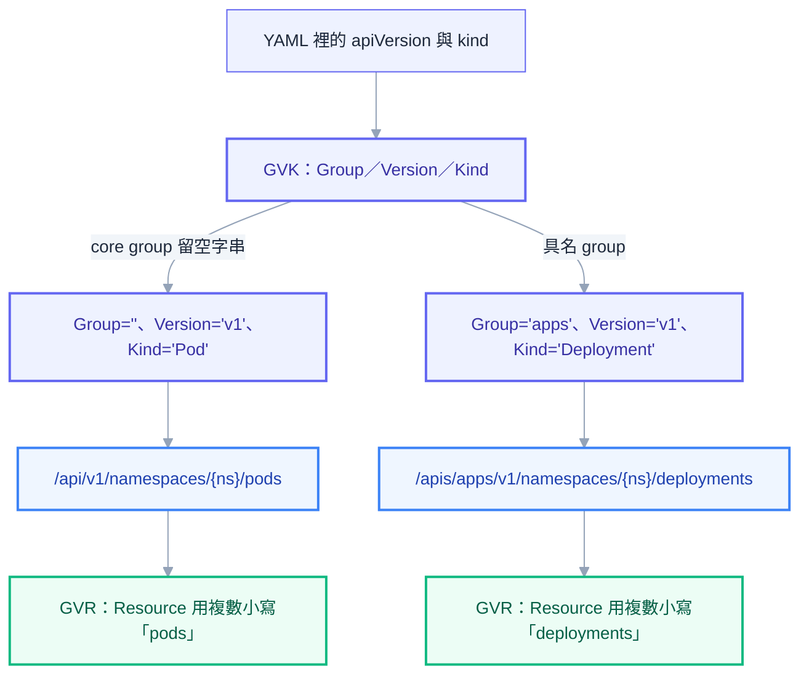
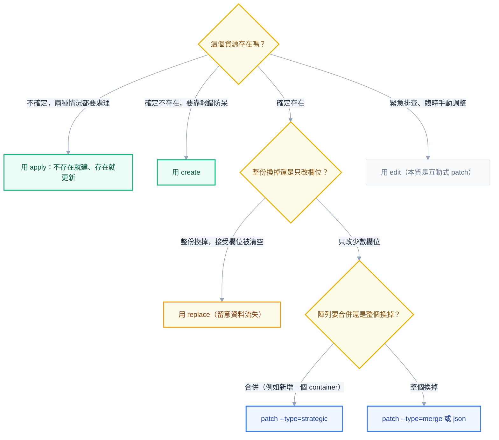

# 第三章：API 模型與 YAML 骨架——你送出去的到底是什麼

## 從設定檔到資料庫紀錄——K8s API 的本質

上一章把 `kubectl apply` 之後發生的事拆到了最細的顆粒度：TLS、認證、授權、admission、寫進 etcd、再由一群 controller 各自 watch 出來接力完成部署。這一章要往回退一步，回頭檢視你手上真正握著、每天在改的那份東西——YAML 檔案——到底是什麼。

多數人對 YAML 的直覺理解是「設定檔」，跟 `nginx.conf` 或 `application.properties`是同一類東西：改個值、存檔、套用，系統長得不一樣了。這個直覺不能說錯，但它會讓你在被追問細節時卡住，因為它漏掉了一個關鍵事實——Kubernetes 從頭到尾就是一個**RESTful 的資源資料庫**，外加一群持續 watch 這個資料庫的 controller。你的 YAML 不是「設定」，它是你想寫進這個資料庫的一筆紀錄；`kubectl apply` 做的事情，本質上跟你在後端服務裡呼叫一個 `POST /users` 或 `PUT /users/123` 沒有任何不同。

這件事親眼驗證起來並不難。加上 `-v=8` 這個詳細記錄層級，就能看到 `kubectl` 實際上打了什麼請求：

```bash
kubectl get pods -v=8
```

輸出裡會有這樣一行：

```text
GET https://192.168.49.2:8443/api/v1/namespaces/default/pods?limit=500
```

這行赤裸裸地告訴你：`kubectl get pods` 從頭到尾就是一個對著某個 URL 打的 HTTP GET，回應是一包 JSON，`kubectl` 只是把這包 JSON 用比較好讀的表格印出來而已。同樣地，`kubectl apply -f deploy.yaml` 也只是把你的 YAML 轉成 JSON，對著某個資源路徑打 `PATCH`（或 `POST`），僅此而已。`kubectl` 全程沒有任何特殊魔法權限，它能做的事，任何一支懂得帶對憑證、打對路徑的 `curl` 腳本都做得到——事實上，你甚至可以用 `kubectl proxy` 在本機開一個轉發埠，直接用 `curl` 打 Kubernetes 的原生 REST API 試試看。

一旦接受「YAML 是資料庫紀錄，不是設定檔」這個心智模型，很多原本讓人困惑的行為會突然說得通：為什麼 `apply` 之後物件裡多出一堆你沒寫的欄位（因為資料庫紀錄本來就有系統維護的欄位）、為什麼刪掉一個資源要走一套嚴謹的流程而不是直接消失（因為刪除一筆資料庫紀錄本來就該有交易保證）、為什麼多個工具同時修改同一份 YAML 會打架（因為多個 client 同時寫同一筆資料庫紀錄本來就需要併發控制）。這幾件事，正是這一章要逐一講清楚的內容。

## GVK 與 GVR：如何唯一定位一種資源

要跟一個 RESTful API 打交道，第一件事是搞清楚它的資源路徑怎麼組出來的。Kubernetes 用來唯一定位「這是哪一種資源類型」的三元組，叫做 **GVK**：Group（群組）、Version（版本）、Kind（種類）。你在 YAML 開頭寫的 `apiVersion` 跟 `kind`，合起來就是完整的 GVK。

`apps/v1` 這個 `apiVersion` 拆開來看，斜線前半段 `apps` 是 Group，斜線後半段 `v1` 是 Version；再配上 `kind: Deployment`，這三者合起來就唯一定位了「apps 群組、v1 版本的 Deployment」這一種資源類型。但如果你寫的是 `apiVersion: v1`、`kind: Pod`，你會發現這裡沒有斜線、沒有群組名稱——這不是疏漏，而是 Kubernetes 一個刻意保留下來的歷史痕跡。

Kubernetes 最早期的版本裡，還沒有「群組」這個概念，所有內建資源（Pod、Service、ConfigMap、Namespace、PersistentVolume……）統一掛在一個沒有名字的群組下，版本直接就是 `v1`。後來系統擴充出越來越多功能，才把新資源分門別類放進具名的群組裡（`apps`、`batch`、`networking.k8s.io`……），但最早那一批資源已經有大量使用者依賴著它們沒有群組名稱的路徑，為了向後相容，社群選擇讓這個沒有名字的群組（業界稱它為 **core group** 或 **legacy group**）繼續留著空字串當作自己的 Group 名稱。這個歷史決定直接反映在 URL 路徑上：core group 的資源路徑是 `/api/v1/...`，具名群組的資源路徑則是 `/apis/<group>/<version>/...`，兩條路徑的第一段 `/api` 跟 `/apis` 差了一個 `s`，正是 core group 沒有名字這件事在 URL 上留下的指紋。



跟 GVK 並列出現、卻常被混為一談的另一個縮寫是 **GVR**：Group、Version、Resource。差別在最後一個字母——GVK 的 `Kind` 是你寫在 YAML 裡的名字，單數、字首大寫，是給人類讀、給程式語言（Go 的 struct 名稱）用的；GVR 的 `Resource` 則是這個資源類型在 URL 路徑與 `kubectl` 指令裡實際使用的名字，複數、全小寫，是給 REST API 端點用的。`kind: Deployment` 對應的 resource 是 `deployments`，`kind: Pod` 對應的 resource 是 `pods`，`kind: NetworkPolicy` 對應的是 `networkpolicies`（注意這個不規則複數，並非單純加 `s`）。這也是為什麼 `kubectl get deployment`、`kubectl get deployments`、`kubectl get deploy` 都能用——`kubectl` 內部會把你打的字（不論單複數，或是縮寫）都解析回同一個 GVR，再去打對應的 URL。

**同事會來問你的問題**：「這個 CRD 的 kind 明明叫 `VirtualService`，為什麼 `kubectl get virtualservice` 打不出來，要打 `kubectl get virtualservices` 或 `vs`？」——因為 `kubectl get` 認的是 resource（複數）或者 CRD 自己註冊的縮寫（`shortNames`），不是 kind 本身；大部分英文單字複數加 `s` 就能猜對，但不確定的時候查 `kubectl api-resources` 永遠比用猜的準。

查詢一個叢集現在到底認得哪些 GVK、對應的 GVR 又長什麼樣，靠的是兩個查詢指令：

```bash
kubectl api-versions
kubectl api-resources
```

`kubectl api-versions` 印出的是這個叢集目前啟用的所有 Group/Version 組合，例如 `v1`、`apps/v1`、`batch/v1`；`kubectl api-resources` 則印出更完整的一張表，每一行是一種資源類型：

```text
NAME          SHORTNAMES   APIVERSION   NAMESPACED   KIND
pods          po           v1           true         Pod
deployments   deploy       apps/v1      true         Deployment
nodes                      v1           false        Node
```

`NAME` 欄就是 GVR 裡的 Resource、`SHORTNAMES` 是可以少打幾個字的縮寫、`APIVERSION` 標出這個資源掛在哪個 Group/Version 下、`NAMESPACED` 告訴你這種資源是不是隸屬於某個 namespace（`false` 代表 cluster-scoped，後面 metadata 那一節會再展開）、`KIND` 才是 YAML 裡實際要寫的名字。加上 `-o wide` 還會多出一欄 `VERBS`，列出這種資源支援哪些操作（`create`、`get`、`list`、`watch`、`update`、`patch`、`delete`……），這在你判斷「這個資源到底能不能被 watch、能不能被 patch」時很有用。想只看 cluster-scoped 的資源，可以加 `--namespaced=false` 過濾。

這兩個查詢指令解決的是「這個叢集認得什麼」的問題，但還有一個更細緻、也更常被低估的問題：「這個 kind 底下每個欄位到底是什麼型別、能不能省略、系統怎麼描述它的用途」。多數人的做法是開瀏覽器查官方文件，但 Kubernetes 其實把整份 API 文件內建在叢集裡了，靠的是 `kubectl explain`：

```bash
kubectl explain deployment.spec.strategy
```

輸出會直接告訴你這個欄位的型別是 `RollingUpdateDeployment`、預設行為、以及底下還有哪些子欄位，完全不需要離開終端機、不需要網路連線（只要 `kubectl` 能連到叢集，或是本機有快取的 schema）。想繼續往下鑽，一路串接欄位路徑即可：

```bash
kubectl explain deployment.spec.strategy.rollingUpdate.maxSurge
kubectl explain pod.spec.containers.livenessProbe --recursive
```

加上 `--recursive` 會把整棵子欄位樹一次攤開印出來，非常適合你完全不確定某個區塊底下有什麼選項的時候，先掃一遍再決定要細看哪個欄位。如果同一個 kind 在叢集裡同時存在多個版本（例如某些資源歷史上同時有 beta 與 GA 版本並存的過渡期），還可以用 `--api-version` 指定要看哪一版的說明：

```bash
kubectl explain --api-version=batch/v1 cronjob.spec
```

把 `kubectl explain` 內化成寫 YAML 前的反射動作，而不是先開瀏覽器搜尋，是資深工程師與新手最容易被一眼看穿的分野之一——前者的第一個動作永遠是終端機，後者才是 Google。

## API 版本的演進與棄用：管理員必知的成熟度規則

理解了 GVK 之後，緊接著的問題是：`v1`、`v1beta1`、`v1alpha1` 這些版本字尾到底代表什麼？它們不是隨意命名，而是 Kubernetes 一套明確的**成熟度分級**，每一級都對應著不同的穩定性承諾，而管理叢集升級時，這套承諾直接決定了你什麼時候必須動手改 YAML，什麼時候可以安心放著不管。

`alpha`（例如 `v1alpha1`）是最早期的階段，預設不會啟用，即使啟用了也隨時可能被拿掉、欄位語意隨時可能改變、甚至整個功能可能直接被砍掉重練，官方完全不對它做任何相容性保證，正式環境不該依賴任何 alpha 資源。`beta`（例如 `v1beta1`）代表這個功能已經過一定程度的驗證、預設會啟用，多數功能也確實堪用，但欄位細節仍有可能在後續版本微調，只是變動幅度通常比 alpha 溫和許多；值得一提的是，社群在近幾年修改了政策，新的 beta API 預設不再自動開啟，反而要求管理員自己決定是否啟用，用意是壓低叢集暴露在「尚未定案的 API」上的風險。最後是 `stable`（也就是不帶字尾的版本，例如 `v1`），代表這個 API 已經 GA（General Availability），欄位語意跟行為被視為長期契約，社群不會隨便說改就改。

「長期契約」不代表「永遠不變」——Kubernetes 有一套明確的**棄用政策（deprecation policy）**：一個 GA 版本一旦被宣布棄用，至少還要繼續維持可用**12 個月或 3 個小版本**（以較長者為準）才會真正被移除；beta 版本的緩衝期則是至少 **9 個月或 3 個小版本**。這代表官方絕對不會無預警地讓你的 YAML 突然失效，中間永遠有一段明確公告的過渡期，但過渡期不是無限期——很多事故的根源正是團隊在過渡期裡什麼都沒做，直到真正被移除那個版本才發現一堆 YAML 打不進去。

```mermaid
%%{init: {'theme':'base','themeVariables':{
  'fontFamily':'ui-sans-serif, -apple-system, Segoe UI, Roboto, sans-serif',
  'fontSize':'14px',
  'primaryColor':'#eef2ff',
  'primaryTextColor':'#1e293b',
  'primaryBorderColor':'#6366f1',
  'lineColor':'#94a3b8',
  'secondaryColor':'#f1f5f9',
  'tertiaryColor':'#f8fafc',
  'noteBkgColor':'#fef9c3','noteTextColor':'#854d0e','noteBorderColor':'#eab308'
},'flowchart':{'curve':'basis','nodeSpacing':50,'rankSpacing':55,'htmlLabels':true}}}%%
graph LR
  ALPHA["alpha（v1alpha1）<br/>預設關閉、無升級保證"] --> BETA["beta（v1beta1）<br/>預設可能開啟、語意可能微調"]
  BETA --> GA["stable（v1）<br/>GA、長期相容契約"]
  GA -->|"官方公告棄用"| DEP["deprecated<br/>GA 至少維持 12 個月或 3 個版本"]
  DEP --> REMOVED["removed<br/>舊 apiVersion 完全失效"]
  class ALPHA warn
  class BETA accent
  class GA success
  class DEP decision
  class REMOVED error
  classDef primary fill:#eef2ff,stroke:#6366f1,stroke-width:2px,color:#3730a3;
  classDef success fill:#ecfdf5,stroke:#10b981,stroke-width:2px,color:#065f46;
  classDef warn fill:#fffbeb,stroke:#f59e0b,stroke-width:2px,color:#92400e;
  classDef error fill:#fef2f2,stroke:#ef4444,stroke-width:2px,color:#991b1b;
  classDef decision fill:#fefce8,stroke:#eab308,stroke-width:2px,color:#854d0e;
  classDef accent fill:#eff6ff,stroke:#3b82f6,stroke-width:2px,color:#1e40af;
  classDef muted fill:#f8fafc,stroke:#cbd5e1,stroke-width:1px,color:#64748b;
```



正因為過渡期有限，正式的升級流程裡有一個經常被忽略、卻絕對不能省的步驟：**升級前先掃描整個叢集與所有 YAML，找出即將失效或已經失效的 apiVersion**。手動一份一份檢查不切實際，業界常用的工具是 `kubent`（kube-no-trouble）與 `pluto`，前者直接連到叢集掃描目前正在使用的資源，後者則可以對著一整個 YAML 目錄或 Helm chart 掃描：

```bash
kubent
pluto detect-files -d ./manifests
```

這兩個工具都會列出「這個資源用了哪個 apiVersion、哪個 K8s 版本會讓它失效、該換成什麼」，這正是第十二章講版本升級流程時會依賴的前置檢查，這裡先埋下伏筆。

除了長期的棄用問題，管理員日常還會撞到一種更即時的症狀——`apiVersion` **對不上導致 apply 直接失敗**，這是本書作者本人在管理環境裡實際踩過的坑。錯誤訊息通常長這樣：

```text
error: resource mapping not found for name: "..." namespace: "..."
no matches for kind "<Kind>" in version "<apiVersion>"
ensure CRDs are installed first
```

即使已經確認對應的 CRD 早就裝好了，這個錯誤還是可能出現，常見原因有三種：套件升版之後，它自己的 CRD 把 `apiVersion` 從 `v1beta1` 升成了 `v1`，但你手上的 YAML 還停在舊版本；或者你抄的範例、官方文件本身就已經過期；再不然就是 `kubectl` 本地端的 **API discovery cache** 還沒跟上叢集最新的狀態。

診斷的第一步永遠是回頭問叢集自己認得的版本是什麼，而不是憑印象猜：

```bash
kubectl api-resources | grep <keyword>
```

輸出裡的 `APIVERSION` 欄位就是這個叢集現在真正支援的版本，把 YAML 裡的 `apiVersion` 改成這個值即可解決大多數情況。如果改完了問題依然存在，很可能是 `kubectl` 本地端快取的資源清單過期了——`kubectl` 為了不用每次都重新問一次叢集有哪些資源，會把 discovery 的結果快取在本機，這份快取有時候會跟叢集實際狀態脫節（尤其是剛裝完 CRD、admission webhook 還在生效的空窗期），這時候手動清掉快取重新抓一次就能解決：

```powershell
Remove-Item -Recurse -Force "$env:USERPROFILE\.kube\cache"
```

```bash
rm -rf ~/.kube/cache
```

> **常見誤解**：「CRD 都裝好了，為什麼還說 no matches for kind？」——CRD 安裝完成的那一刻，不代表 API Server 立刻就能對外提供這個資源的完整 discovery 資訊，中間有一段短暫的窗口期，加上 `kubectl` 本地快取可能還沒更新，兩個因素疊加在一起，就是這個錯誤最常見的成因。遇到這個錯誤時，先查 `kubectl api-resources` 有沒有真的列出這個 kind，再決定要不要清快取，不要急著懷疑 CRD 本身壞掉了。

## 通用骨架五段：apiVersion、kind、metadata、spec、status

弄清楚 GVK 怎麼定位資源類型之後，我們可以正式回到 YAML 檔案本身。不論你寫的是 Pod、Deployment 還是任何 CRD 定義出來的自訂資源，骨架永遠是同樣的五段式結構：

```yaml
apiVersion: apps/v1
kind: Deployment
metadata:
  name: my-app
spec:
  replicas: 3
status:
  availableReplicas: 3
```

`apiVersion` 與 `kind` 合起來就是上一節談的 GVK，告訴 API Server 要把這份資料存進資料庫的哪一張「表」；`metadata` 是這筆紀錄的身分證與備註欄，下一節會整節深入；`spec` 與 `status` 這一組搭檔，你在第二章已經打過照面——`spec` 裝的是**期望狀態**，作者永遠是人或者更上層的 controller，你手寫的 `replicas: 3` 就落在這裡；`status` 裝的是**觀察到的實際狀態**，作者永遠是負責這種資源的 controller 或 kubelet，例如 `status.availableReplicas` 是 deployment controller 統計出來寫回去的。

這裡要把第二章那條鐵則再重申一次，因為它在寫 YAML 的當下最容易被忽略：**你永遠不該手寫 status 欄位**。就算你在 `kubectl apply` 的 YAML 裡塞進一段 `status`，API Server 也不會真的把它當作現實世界的狀態採信——下一輪 reconciliation loop 跑起來，controller 觀察到的真實狀態依然會把你手寫的值直接覆蓋掉。手改 status 唯一的效果，是讓你誤以為自己改動生效了，實際上什麼都沒發生。這也是為什麼絕大多數教學範例裡的 YAML 從來不會出現 `status` 這一段——它本來就不是你該碰的欄位。

## metadata 深入：一個物件的身分證與備註欄

`metadata` 是整個骨架裡欄位最多、也是本章價值密度最高的一段，因為它同時混雜了「你該填的」「系統會自動填的」「兩種標籤系統但用途完全不同」三種性質完全不同的東西，很多人天天在寫卻從沒認真拆過。

### name 與 generateName：DNS-1123 命名規則

`metadata.name` 是這筆紀錄在同一個 namespace、同一種 kind 底下的唯一識別碼，`kubectl get`、`kubectl delete` 靠它指定要操作誰。命名規則不是隨便選的，而是遵循 **DNS-1123** 這套源自網域名稱系統的格式限制：只能用小寫英文字母、數字、與連字號 `-`，開頭與結尾都必須是英數字，不能出現大寫字母，也不能出現底線 `_`。多數資源的名稱長度上限是 253 個字元，但部分資源（例如 Service，因為它的名字會直接被拿去組成叢集內部 DNS 名稱）要求更嚴格的 DNS label 格式，長度上限只有 63 個字元。

這條規則是很多人第一次寫 YAML 就會踩到的坑——習慣了程式語言裡用駝峰式命名或底線分隔的人，很自然地會寫出 `name: myApp` 或 `name: my_app`，兩者都會被 API Server 直接拒絕，錯誤訊息會明確指出不符合 RFC 1123 subdomain 格式。養成統一用 kebab-case（`my-app`）命名資源的習慣，是最省事的解法。

如果你不在乎精確的名稱、只需要系統幫你保證唯一性（常見於由 Job、某些 controller 動態建立的物件），可以改用 `generateName` 代替 `name`：

```yaml
metadata:
  generateName: my-job-
```

API Server 會在你給的字首後面自動附加一段隨機字元組成完整名稱，例如 `my-job-a1b2c`，這也解釋了為什麼你觀察某些由 controller 生出來的 Pod，名字後面總跟著一串看起來隨機的字尾。

### namespace 與 cluster-scoped 資源

`metadata.namespace` 決定這筆紀錄隸屬於叢集裡的哪一個邏輯分區，省略的話預設落在 `default`。並不是所有資源都有 namespace 這個概念——上一節 `kubectl api-resources` 輸出裡的 `NAMESPACED` 欄位標示著 `false` 的那些資源，稱為 **cluster-scoped**，代表它們是整個叢集共用的單一份資源，不隸屬於任何 namespace，常見的例子有 `Node`、`PersistentVolume`、`Namespace` 自己、`ClusterRole`、`ClusterRoleBinding`、`StorageClass`、以及所有 CRD 的定義本身。想快速列出叢集裡有哪些 cluster-scoped 資源，直接查：

```bash
kubectl api-resources --namespaced=false
```

判斷一個資源是不是 cluster-scoped 很實際的意義在於權限設計——RBAC 裡的 `Role` 只能授權 namespace 內的資源，想授權 cluster-scoped 資源，一定得用 `ClusterRole`，這件事會在第八章授權那一章更完整地展開。

### labels 與 annotations：長得很像，設計意圖從一開始就不同

`labels` 和 `annotations` 是 metadata 底下最容易被混為一談的兩組欄位，因為它們表面上長得一模一樣——都是掛在物件上的 key-value 對，語法完全相同。但這兩者的設計意圖從 Kubernetes 誕生的第一天就是分開的，而且分得很徹底。

`labels` 是**給 Kubernetes 自己用的索引**。Service 靠 label selector 找到該把流量導去哪些 Pod、Deployment 靠 label selector 認出自己該管理哪些 Pod、你在 `kubectl get pods -l app=web` 這種指令裡篩選資源用的也是它。正因為 labels 要被系統拿來做查詢與配對，它天生就有一套嚴格的格式限制：key 最多由一個可選的前綴（DNS subdomain 格式，最長 253 字元，例如 `app.kubernetes.io/`）加上一個名稱段（最長 63 字元，只能是英數字加上 `-`、`_`、`.`）組成，value 同樣限制在 63 字元以內。這些限制不是任意訂的，而是因為 API Server 內部會替 labels 建立索引以加速查詢，索引結構對 key/value 的長度天生就有實務上的上限考量。

`annotations` 則是**給人與工具看的備註欄**。cert-manager 拿它記錄要用哪個 issuer 簽憑證、Ingress controller 拿它記錄要用哪個 class 處理路由、ArgoCD 拿它記錄同步狀態的中繼資訊——但不管哪一種用途，Kubernetes 自己完全不會拿 annotations 的內容做任何調度或篩選決策，也不支援用 selector 去查詢 annotations。因為不需要被索引查詢，annotations 對單一 key 或 value 的長度沒有像 labels 那麼嚴格的限制，可以塞進一整段 JSON、一份完整的憑證鏈、甚至一份上一次 apply 的完整設定快照（下一節會看到這件事）。

但「沒有單一長度限制」不代表「沒有總量限制」。這正是本書作者親身踩過的坑：**一個物件所有 annotations 加起來的總大小，上限是 256 KiB（也就是 262144 bytes，不少文件與錯誤訊息會直接寫成 262KB，其實是同一個位元組數字換了個講法）**。這個限制不是 etcd 的儲存上限，而是 API Server 明文寫死的驗證規則，一旦你的物件（尤其是塞了 `last-applied-configuration` 的大型 CRD，例如複雜的 Istio VirtualService）annotations 總量超過這條線，`kubectl apply` 會直接被拒絕，錯誤訊息通常會提到 annotations 太大。碰到這種情況，解法正是後面兩節要談的 server-side apply——它從根本上不需要這個又大又肥的 annotation。

| | labels | annotations |
| --- | --- | --- |
| 用途 | 資源互相選取、分組 | 存放給人與工具讀的附加資訊 |
| 可被 selector 查詢 | 可以 | 不行 |
| 單一欄位長度限制 | key 253＋63 字元、value 63 字元 | 無單一限制 |
| 總量限制 | 無特別總量限制 | 全部加總不能超過 256 KiB |
| 典型使用者 | K8s 自己（Service、Deployment 的 selector） | 第三方工具（cert-manager、Ingress controller、ArgoCD） |

### 推薦的標準 labels：為什麼團隊該統一

除了自己土法煉鋼定義 `app: my-app` 這類標籤，Kubernetes 官方也提出了一組建議所有團隊統一採用的**標準 labels**，前綴統一用 `app.kubernetes.io/`：

| Label | 意義 |
| --- | --- |
| `app.kubernetes.io/name` | 應用程式的名稱 |
| `app.kubernetes.io/instance` | 這個應用程式的具體部署實例（同一個 app 部署多份時區分用） |
| `app.kubernetes.io/version` | 目前部署的版本號 |
| `app.kubernetes.io/component` | 這個資源在整個架構裡扮演的角色（前端、後端、快取……） |
| `app.kubernetes.io/part-of` | 這個資源隸屬於哪一個更大的應用系統 |
| `app.kubernetes.io/managed-by` | 這個資源是被哪個工具管理的（Helm、ArgoCD……） |

統一使用這套標準命名的價值，在單一團隊、單一服務的環境裡不明顯，但只要團隊人數增加、服務數量變多，價值會急速放大——Grafana 儀表板可以用同一套 label 查詢跨服務的資源用量、成本歸戶工具可以靠 `part-of` 把費用分攤到正確的專案、任何新加入的工程師靠 `kubectl get pods -l app.kubernetes.io/part-of=checkout` 就能一眼看懂整套系統的邊界在哪，而不必依賴每個團隊各自發明、彼此不相容的命名習慣。

### 系統維護的欄位：不是你寫的，但你要看得懂

`metadata` 底下還有一批欄位，從頭到尾都不是你手寫進去的，而是 API Server 在物件建立與每次更新時自動維護，但看懂它們對排查問題非常關鍵。

`uid` 是這個物件從建立那一刻起就固定下來、全叢集唯一的識別碼，即使你刪掉一個資源再用同樣的 `name` 重建一個，新物件的 `uid` 也絕對不會跟舊的重複——這也是為什麼第九章要談的 `ownerReferences` 選擇用 `uid` 而不是 `name` 來記錄擁有關係，因為 `name` 可能撞名重用，`uid` 不會。

`resourceVersion` 你在第二章的 watch 機制那一節已經見過，它是這筆資料在 etcd 裡的版本戳記，每次被修改就遞增，`informer` 靠它決定要接收哪些之後發生的變化。它還有第二個實務用途——**樂觀鎖**：當你想更新一個物件，把帶著舊 `resourceVersion` 的請求送出去，如果這段時間有別人已經搶先改過這個物件（`resourceVersion` 已經不一樣了），API Server 會直接拒絕你這次更新，逼你重新讀一次最新版本再決定怎麼合併，避免兩個人的修改互相覆蓋卻毫無察覺。

`generation` 與 `status.observedGeneration` 是另一組常被忽略、卻是排查「我明明改了 spec，為什麼 controller 好像沒反應」的關鍵線索。`generation` 只有在 `spec` 真的被修改時才會遞增（單純改 `status` 或 `metadata.labels` 不會動到它）；`observedGeneration` 則是負責這個資源的 controller，在處理完某一次 `spec` 變更之後，回寫進 `status` 的一個數字，代表「我已經看過並處理過到這一版為止的 spec 了」。當 `generation` 大於 `observedGeneration`，意味著 controller 還沒跟上你最新的修改——這通常代表 controller 卡住了，或是還在處理中，是一個比肉眼比對 YAML 內容快得多的排查切入點。

`creationTimestamp` 記錄物件何時建立；`deletionTimestamp` 則只有在刪除請求已經被接受、但這個物件還帶著 `finalizers` 尚未清空時才會出現——這正是第九章會深入的、`kubectl get ns` 卡在 `Terminating` 那個現象背後的欄位。至於 `ownerReferences`（記錄這個物件是被誰建立、擁有的）與 `finalizers`（阻擋物件被真正刪除，直到清理工作完成）這兩個欄位本身，第九章會用整整兩節分別拆解垃圾回收與 Terminating 卡住的完整機制，這裡先知道它們住在 metadata 底下、屬於系統維護的範疇即可。

## Label Selector：用標籤把資源找出來

有了 labels，下一個問題自然是：怎麼用它們去篩選、配對資源？Kubernetes 的 selector 語法分成兩個世代——**equality-based**（等值比較）是最早期、也最簡單的形式，只支援 `=`、`==`、`!=` 三種運算子，例如 `app=web` 或 `env!=production`；**set-based**（集合比較）是後來補上的擴充版本，支援 `in`、`notin`、以及檢查某個 key 存不存在的 `exists`（直接寫 key 名稱）與 `!key`（不存在）：

```bash
kubectl get pods -l app=web
kubectl get pods -l 'environment in (production,qa)'
kubectl get pods -l 'tier notin (frontend)'
kubectl get pods -l app.kubernetes.io/managed-by
```

這套語法在指令列上是字串形式，但寫進 YAML 的 `spec.selector` 時，會拆成兩個獨立欄位：`matchLabels` 對應 equality-based（而且欄位之間永遠是「且」的關係，全部條件都要滿足），`matchExpressions` 則對應 set-based，每一條表達式包含 `key`、`operator`（`In`、`NotIn`、`Exists`、`DoesNotExist`）、以及對應的 `values` 陣列：

```yaml
spec:
  selector:
    matchLabels:
      app: web
    matchExpressions:
      - key: tier
        operator: In
        values:
          - frontend
          - backend
```

`matchLabels` 與 `matchExpressions` 可以同時出現在同一個 selector 裡，兩邊條件同樣是「且」的關係，全部都要滿足才算選中。

這裡有一條實務上很容易踩到、而且踩到之後很難善後的限制：**Deployment 的 `spec.selector` 一旦建立就不可變更**。這個限制是刻意設計的——因為 selector 決定了這個 Deployment 認得哪些 Pod 是自己的，如果允許事後任意修改 selector，可能會出現一個 Deployment 突然「認領」了一批原本不屬於自己、卻剛好貼著相符標籤的 Pod，或反過來突然「失聯」原本自己管理的 Pod，這種行為的破壞力太大，所以 API Server 直接在驗證階段擋下任何想修改既有 Deployment `selector` 的請求，回傳的錯誤訊息會明確指出這個欄位是 immutable。真的撞到需要換 selector 的情境（例如重構標籤命名規則），唯一乾淨的解法是建立一個新的 Deployment（帶新的 selector 與新的 name），讓新舊兩個 Deployment 並存一段時間完成遷移，再刪除舊的——如果需要保留現有 Pod 不被連帶砍掉，可以在刪除舊 Deployment 時搭配 `--cascade=orphan`，讓 Pod 變成暫時無人管理的孤兒，再讓新 Deployment 的 selector 把它們接手回去。

## kubectl 的寫入動詞：create、apply、replace、patch、edit

前面幾節談的都是「這份資源長什麼樣」，現在轉到「怎麼把它送進叢集」。`kubectl` 提供了好幾種寫入動詞，表面上都能達到「讓叢集裡出現我要的東西」這個目的，但背後的語意差異很大，而且是資深與新手最容易被問倒的分水嶺之一。

`create` 是最直觀的命令式操作——建立一個全新資源，如果同名資源已經存在就直接報錯。它適合那些你非常確定「這是第一次建立，不該有同名的東西存在」的場景，報錯本身反而是一種防呆：如果同名資源真的已經存在，那多半代表你搞錯了環境或搞錯了流程，`create` 會第一時間提醒你，而不是默默地把東西蓋掉。

`apply` 是宣告式操作，也是 GitOps、CI/CD pipeline 裡最常用的動詞——資源不存在就建立，存在就更新，而且天生 idempotent（同一份 YAML 反覆套用，結果永遠一致，不會因為重複執行而累積出副作用）。它的複雜之處在於「更新」這一步究竟怎麼判斷該改哪些欄位、不該動哪些欄位，這正是下一節要整節拆解的兩代 apply 機制。

`replace` 語意上等同於把整個物件用你手上這份 YAML 完整覆蓋掉，概念上很接近先刪除再重建，差別是它在同一個 API 呼叫裡完成、且需要帶上目前的 `resourceVersion` 才能成功（避免覆蓋掉別人剛做的修改）。它最大的風險是**資料流失**——如果叢集裡現有的物件有一些欄位是你這次 YAML 裡沒寫的（可能是系統自動補上的預設值，或是別的工具寫進去的欄位），`replace` 會直接把這些欄位一併清空，而不是保留下來。這跟 `apply` 形成鮮明對比——`apply` 只會處理你這次明確描述、且過去你自己曾經寫過的欄位，不該碰的東西不會動；`replace` 則是全有全無，沒寫等於刪除。

`patch` 用來只改物件的一小部分欄位，不需要重新送出整份 YAML，而且它底下其實藏著三種語法完全不同的 patch 類型，這是高頻的困惑來源，尤其是「陣列到底會被合併還是整個蓋掉」這個問題：

- **strategic merge patch**：Kubernetes 自己發明、只有內建資源類型完整支援的格式，它認得每種資源裡陣列該用哪個欄位當作合併鍵（例如 `containers` 陣列用 `name` 當鍵），所以你只要指定「把名叫 `sidecar` 的這個 container 的 image 改掉」，patch 會正確地找到陣列裡對應的那一項去修改，其他 container 完全不受影響。這是 `kubectl patch` 沒指定 `--type` 時，對內建資源使用的預設行為。
- **JSON merge patch**（RFC 7386）：語法簡單，但對陣列的處理方式很粗暴——陣列欄位只要出現在 patch 裡，就會被你給的內容整個覆蓋掉，不會嘗試合併裡面的元素。
- **JSON patch**（RFC 6902）：最精確也最囉唆的形式，用一連串明確指定路徑的操作（`add`、`remove`、`replace`、`test`）描述要怎麼改，例如 `{"op":"replace","path":"/spec/replicas","value":5}`，因為每個操作都指名道姓地指到陣列的哪個 index，反而能做到「只改陣列裡第二個元素」這種精細控制，但寫起來明顯比另外兩種囉唆。

```bash
kubectl patch deployment my-app --type=strategic -p '{"spec":{"replicas":5}}'
kubectl patch deployment my-app --type=merge -p '{"spec":{"replicas":5}}'
kubectl patch deployment my-app --type=json -p '[{"op":"replace","path":"/spec/replicas","value":5}]'
```

`edit` 是互動式操作，執行後會把資源目前的內容用你預設的編輯器打開，存檔離開的瞬間，`kubectl` 會把你的修改整理成一次 patch 送出去。可以把它理解成「即時、單次的 apply 體驗」，但要提醒一個容易被忽略的細節：`edit` 不會維護下一節要談的 `last-applied-configuration` annotation，所以如果一份資源原本是靠 `kubectl apply` 用 GitOps 流程管理的，中間有人手動 `kubectl edit` 插了一手，下一次 GitOps 重新 apply 時，這次手動修改可能會被三方合併的邏輯認定為「使用者自己動過的欄位」而被保留，也可能被直接蓋掉，行為取決於你這次動的欄位有沒有同時出現在 Git 裡管理的 YAML 裡——這正是 ArgoCD 環境下，手動 `kubectl edit` 之後常常搞不清楚「為什麼改動一下就消失了」的根源，晚一點在 apply 機制那一節會講得更透徹。

哪個情境該用哪個動詞，可以直接對照這張決策表：

| 情境 | 建議指令 |
| --- | --- |
| GitOps、CI/CD pipeline 常態同步 | `apply`（大型 CRD 建議加 `--server-side`） |
| 明確要求「不存在才建，存在就報錯」防止誤蓋 | `create` |
| 想整份退回 YAML 描述的樣子，接受沒寫的欄位被清空 | `replace`（留意資料流失風險） |
| 只想改一兩個欄位（replica 數、image tag） | `patch`（預設 strategic merge，或用 `kubectl set image`） |
| 陣列必須整個換掉，而不是合併裡面的元素 | `patch --type=merge` 或明確寫 JSON patch 操作 |
| 緊急排查、臨時手動調整 | `edit`（注意別跟 GitOps 管理的資源打架） |



## Apply 的兩代機制：從 last-applied-configuration 到 field manager

`apply` 這個動詞看似簡單——「不存在就建、存在就更新」——但「更新」這兩個字底下藏著整套 Kubernetes API 設計裡數一數二精巧、也數一數二容易被誤解的機制。這一節要把它徹底拆開。

### client-side apply 與那個又肥又必要的 annotation

`apply` 從最初設計開始就必須解決一個棘手的問題：當你第二次對同一份資源執行 `apply`，而這次的 YAML 拿掉了某個欄位，`kubectl` 該怎麼判斷「這個欄位是你刻意要刪掉，所以我該把它從叢集裡移除」，還是「這個欄位本來就不是你管的，是別的工具寫進去的，我不該去動它」？單靠比較「這次的 YAML」跟「叢集現在的實際狀態」這兩份資料，永遠無法回答這個問題，因為這兩份資料都無法告訴你「上一次你到底 apply 了什麼」。

**client-side apply**（在 `--server-side` 這個選項出現之前，長年以來的預設行為）解決這個問題的辦法，是引入第三份資料：`kubectl` 會把你每一次 apply 的完整內容，原封不動塞進物件自己的一個 annotation 裡——`kubectl.kubernetes.io/last-applied-configuration`。往後每次 apply，`kubectl` 都在本機做一次**三方合併**：比對「上一次你 apply 的內容」（annotation 裡存的）、「這一次你要 apply 的內容」（你手上的新 YAML）、以及「叢集現在的實際狀態」，三者一起算出：哪些欄位是你這次新增或修改的、哪些欄位是你這次刻意拿掉所以該被刪除、哪些欄位不在你管轄範圍內所以不該去動。算完之後，`kubectl` 才把合併結果整理成一次 PATCH 送給 API Server，同時也把這次的完整內容重新寫回 annotation，留給下一次三方合併用。

這個設計聰明歸聰明，卻直接造成了上一節提過的那個坑：這個 annotation 存的是你整份物件的完整快照，YAML 越大、欄位越多，這個 annotation 就跟著越肥，而所有 annotations 總量卡在 256 KiB 這條線上——這正是為什麼用 `kubectl apply` 部署複雜的大型 CRD（常見於 Istio、某些 Operator 的自訂資源）時，偶爾會直接收到 annotations 太大的錯誤。除了體積問題，client-side apply 還有一個結構性的弱點：整套三方合併的邏輯完全跑在 `kubectl` 本機，叢集裡的其他 controller、其他工具完全不知情、也無法參與這個判斷過程，一旦有多個不同的角色（你自己手動 apply、CI/CD pipeline 的 apply、某個 controller 直接寫入）同時碰同一份資源，大家各自維護著自己版本的認知，任何一方的下一次 apply 都可能把別人剛寫入的東西當作「不在我這次配置裡」而誤刪。

### server-side apply 與 field manager：把仲裁權交還給 API Server

**server-side apply**（簡稱 SSA，自 1.22 版 GA）的解法，是把整套合併邏輯搬到 API Server 這一端來做，不再需要 `kubectl` 本機去猜三方合併該怎麼算，也因此完全不再需要那個又肥又容易超過限制的 `last-applied-configuration` annotation。它引入的核心概念叫 **field manager**：每一次有人或某個 controller 對物件的欄位做出修改，這次修改會連同「是誰做的」（field manager 的身分，例如 `kubectl-client-side-apply`、`argocd-controller`、`hpa-controller`）一起被記錄在物件的 `metadata.managedFields` 裡，精確到每一個欄位分別是被誰、在哪個 API 版本下最後設定的。

啟用 server-side apply 只需要加上一個旗標：

```bash
kubectl apply --server-side -f deploy.yaml
```

當多個 field manager 同時想要擁有同一個欄位、卻給出不同的值時，API Server 不會像 client-side apply 那樣悄悄地讓後來者覆蓋前者，而是直接回傳 **409 Conflict**，把決定權交還給操作者——如果你確定自己這次的修改就是要拿下這個欄位的所有權，得明確加上 `--force-conflicts` 才會生效：

```bash
kubectl apply --server-side --force-conflicts -f deploy.yaml
```

這個設計在本書讀者實際管理的環境裡，對應到一個非常具體的場景：ArgoCD 用宣告式的方式管理著一份 Deployment，而叢集裡同時掛著一個 HPA（Horizontal Pod Autoscaler）持續依照 CPU 使用率調整這個 Deployment 的 `spec.replicas`。如果 ArgoCD 沒有特別設定，它每次同步都會嘗試把 `replicas` 拉回 Git 裡宣告的那個固定值，跟 HPA 剛調整過的值打架——這不是 field manager 衝突機制的錯，而是兩個「合法」的擁有者對同一個欄位有著本質上互斥的期待。實務上的解法，是在 ArgoCD 的 `Application` 資源裡用 `spec.ignoreDifferences` 把 `spec.replicas` 排除在 ArgoCD 的比對範圍外，把這個欄位的所有權明確讓給 HPA；而當 ArgoCD 本身的同步選項開啟 `ServerSideApply=true` 時（第十一章會展開這個選項的完整細節），它與其他 field manager（手動 `kubectl edit`、其他 controller）之間的欄位衝突，才會依照上面說的 409 機制被明確攔下來，而不是悄悄地互相覆蓋、卻沒有人發現。

```mermaid
%%{init: {'theme':'base','themeVariables':{
  'fontFamily':'ui-sans-serif, -apple-system, Segoe UI, Roboto, sans-serif',
  'fontSize':'14px',
  'primaryColor':'#eef2ff',
  'primaryTextColor':'#1e293b',
  'primaryBorderColor':'#6366f1',
  'lineColor':'#94a3b8',
  'secondaryColor':'#f1f5f9',
  'tertiaryColor':'#f8fafc',
  'noteBkgColor':'#fef9c3','noteTextColor':'#854d0e','noteBorderColor':'#eab308'
},'flowchart':{'curve':'basis','nodeSpacing':50,'rankSpacing':55,'htmlLabels':true}}}%%
graph TB
  subgraph CSA["client-side apply（舊）"]
    A1["這次的新 YAML"] --> M1["kubectl 本機三方合併"]
    A2["last-applied-configuration annotation"] --> M1
    A3["etcd 目前的物件"] --> M1
    M1 --> P1["整理成一次 PATCH 送出"]
  end
  subgraph SSA["server-side apply（新）"]
    B1["新 YAML ＋ field manager 身分"] --> P2["送出 apply 請求"]
    P2 --> M2["API Server 依 managedFields 逐欄位比對"]
    M2 -->|"無人擁有或本人擁有"| W2["寫入並更新 managedFields"]
    M2 -->|"欄位被別人擁有且值不同"| C2["回傳 409 Conflict，需 --force-conflicts"]
  end
  class A1,A2,A3,B1 primary
  class M1,P1,P2,M2 accent
  class W2 success
  class C2 error
  classDef primary fill:#eef2ff,stroke:#6366f1,stroke-width:2px,color:#3730a3;
  classDef success fill:#ecfdf5,stroke:#10b981,stroke-width:2px,color:#065f46;
  classDef warn fill:#fffbeb,stroke:#f59e0b,stroke-width:2px,color:#92400e;
  classDef error fill:#fef2f2,stroke:#ef4444,stroke-width:2px,color:#991b1b;
  classDef decision fill:#fefce8,stroke:#eab308,stroke-width:2px,color:#854d0e;
  classDef accent fill:#eff6ff,stroke:#3b82f6,stroke-width:2px,color:#1e40af;
  classDef muted fill:#f8fafc,stroke:#cbd5e1,stroke-width:1px,color:#64748b;
```



也因為這幾個理由——annotations 不再有爆量風險、多個角色共同管理同一份資源時衝突會被明確攔下而不是靜默覆蓋、每個欄位的擁有者都有清楚的稽核紀錄可查——server-side apply 已經是 Kubernetes 社群公認的未來方向，ArgoCD、Helm 等主流工具鏈近幾年都陸續把 server-side apply 列為建議或預設選項。理解這套機制，對於每天要在 ArgoCD、HPA、手動 `kubectl` 交錯的環境裡工作的管理員來說，不是加分項，而是排查「為什麼我改的東西一直被蓋回去」這類問題時的必修課。

## 實用工具與工作流：dry-run、diff、輸出格式與 defaulting

除了寫入動詞本身，`kubectl` 還提供了一組讓你在真正動手之前先看清楚會發生什麼事的工具，善用它們是資深工程師跟新手最直觀的差異之一——前者在按下 `apply` 之前，已經在心裡（或在終端機裡）確認過會發生什麼事。

`--dry-run` 有兩種模式，差異在於請求究竟有沒有真的打到 API Server：`--dry-run=client` 完全在本機端完成，不會把請求送到叢集，連 admission 那一整條關卡（mutating webhook、schema 驗證、validating webhook）都不會跑到，所以你看到的輸出可能缺少那些原本該由 admission 動態補上的欄位；`--dry-run=server` 則會把請求送進 API Server、完整跑過一次 admission 鏈，只在真正要寫進 etcd 那一刻煞車，因此輸出會精準反映「如果你真的送出這個請求，最後存進去的物件長什麼樣」，包含所有 defaulting 與 mutating webhook 造成的變化。

```bash
kubectl apply --dry-run=client -f deploy.yaml -o yaml
kubectl apply --dry-run=server -f deploy.yaml -o yaml
```

`kubectl diff` 則是把 `--dry-run=server` 的能力包裝成一個更直覺的介面——它會把叢集現有物件跟你即將 apply 的內容做一次完整比對，直接印出 unified diff 格式的差異，不會真的執行任何寫入，很適合放進 CI/CD pipeline 裡當作 apply 前的審查關卡：

```bash
kubectl diff -f deploy.yaml
```

輸出格式的控制上，`-o yaml`、`-o json` 印出完整物件，`-o jsonpath` 讓你用 JSONPath 表達式精準抽取某個欄位（例如 `kubectl get pods -o jsonpath='{.items[*].metadata.name}'` 只印出所有 Pod 名稱），`-o custom-columns` 則讓你自訂表格欄位（例如 `kubectl get pods -o custom-columns=NAME:.metadata.name,STATUS:.status.phase`），這幾種輸出格式在寫腳本、串接其他工具時比人類閱讀用的預設表格格式好用得多。

一個經常讓新手感到困惑的現象是：`kubectl get pod my-pod -o yaml` 印出來的內容，總是比你當初寫的那份 YAML 多出一大堆欄位——`resourceVersion`、`uid`、`status`、甚至 `spec.containers[].imagePullPolicy`、`spec.dnsPolicy`、`spec.securityContext: {}` 這類你從未提過的東西。這不是 K8s 幫你「加了什麼」出乎預期的魔法，而是**defaulting** 在起作用——這正是第九章要深入的 admission chain 裡，mutating 階段連同 API Server 內建的預設值邏輯，一起把你省略的欄位補上合理的預設值，讓最終存進 etcd 的物件永遠是一份欄位齊全、語意明確的完整紀錄，而不是你原始輸入的那份殘缺片段。理解這一點，你才不會誤以為「我沒寫的東西，叢集裡就不存在」。

## 多份資源與組織方式：多文件、目錄、Kustomize

實務上很少有人只用單一資源就能描述一個服務——一個服務通常至少需要 Deployment 加 Service，可能還有 ConfigMap、Ingress。YAML 允許在同一個檔案裡，用 `---` 分隔多份文件：

```yaml
apiVersion: apps/v1
kind: Deployment
metadata:
  name: my-app
spec:
  replicas: 3

---

apiVersion: v1
kind: Service
metadata:
  name: my-app-svc
spec:
  selector:
    app: my-app
```

`kubectl apply -f` 除了指向單一檔案，也能直接指向一整個目錄，一次套用裡面所有 YAML：

```bash
kubectl apply -f ./manifests/
kubectl apply -f ./manifests/ -R
```

當服務數量、環境數量繼續往上疊加（同一套 Deployment 要分別部署到 dev、staging、production，只有少數幾個欄位不同，例如 replica 數與 image tag），單純疊 YAML 檔案會迅速變得難以維護。這正是 `kubectl` 內建支援的 **Kustomize**（`-k` 選項）存在的理由：

```bash
kubectl apply -k overlays/prod
```

Kustomize 的核心概念是 **base/overlay**：`base` 目錄放一份不含環境差異的通用資源定義，每個環境各自一個 `overlay` 目錄，裡面只描述「這個環境跟 base 比起來，哪些欄位不一樣」，透過 patch（可以是 strategic merge patch，也可以是明確的 JSON 6902 patch）疊加在 base 之上，而不是每個環境各自維護一份完整、卻大量重複的 YAML。它跟第十章要深入的 **Helm** 定位不同——Kustomize 全程操作的都是合法的 YAML 片段，靠 patch 疊加做差異化，沒有樣板語言；Helm 走的是樣板引擎路線，`values.yaml` 搭配 Go template 語法，先產生出字串再解析成 YAML，彈性更高但也多了一層樣板語法要學。兩者不是互斥的競爭關係，不少團隊會讓 Helm 負責產生 chart 的基礎輸出，再用 Kustomize 疊加最後一層環境差異，但這已經是打包與交付篇的範疇，這裡先點出兩者定位的差異即可。

## YAML 語言本身的陷阱

以上談的都是 Kubernetes 特有的語意，但 YAML 作為一門通用的資料序列化語言，自己也帶著幾個經典陷阱，而且都是實務上高頻出現、卻常常被誤認成「K8s 出了什麼怪問題」的狀況，實際上完全是 YAML 語法層級的坑。

**縮排只能用空格，絕對不能用 tab。** 這是 YAML 規格明文禁止的行為——只要檔案裡混進一個 tab 字元當作縮排，解析器多半會直接報一個語意含糊的錯誤（常見的是「found character that cannot start any token」這類訊息），至少這種情況會直接爆炸讓你知道哪裡出錯；比較麻煩的反而是空格數量不一致但仍然是合法 YAML 的情況——例如你以為某個欄位縮排在 `containers` 底下，結果因為少打一個空格，實際上被解析成跟 `containers` 同一層，YAML 本身完全不會報錯，但語意已經全錯，這種情況只能靠 `kubectl diff` 或 `--dry-run=server` 才能提前抓出來。

**Norway problem**——這個名字來自 YAML 1.1 規格裡，`yes`、`no`、`on`、`off`、`true`、`false`，以及大小寫變化（`Yes`、`NO`、`On`……）全部都會被解析成布林值，而「NO」剛好也是挪威（Norway）的國碼，如果你寫了一份包含國碼欄位的 YAML，`country: NO` 會被悄悄解析成布林值 `false`，而不是字串 `"NO"`。多數 YAML 解析器（包括 K8s 用的）仍然沿用這套規則，解法很直接——任何看起來像是保留字、卻其實想當作字串的內容，一律手動加上引號：`country: "NO"`。

**版本號被當成數字解析，而且會弄丟精度。** `version: 1.10` 如果不加引號，會被解析成浮點數 `1.1`——注意結尾的 `0` 直接消失了，這在 image tag、Helm chart 版本號這類「看起來像小數，但其實是字串」的欄位上是相當隱蔽的陷阱，務必寫成 `version: "1.10"`。同樣地，任何帶前導零的數字（例如 `port: 010`）也可能被某些解析器誤判成八進位，一律建議只要不是拿來做數學運算的數字欄位，寧可加引號保守處理。

**何時該加引號**，除了上面兩種情況，還有幾個常見時機：字串開頭是特殊符號（`:`、`{`、`[`、`*`、`&`、`!`、`%`、`#`、反引號、`"`、`'`、`|`、`>`、`@`）、字串本身是空字串、以及你明確希望某個看起來像布林或數字的值被當成字串處理的所有情況（例如 `enabled: "true"` 如果你真的要的是字串 `"true"` 而非布林 `true`）。

**多行字串：`|` 與 `>` 的差別。** 需要在 ConfigMap 裡塞進一整份設定檔（`nginx.conf`、`application.properties`）這類需要保留原始換行的內容時，用 `|`（literal block），每一行原封不動保留，包含換行本身：

```yaml
data:
  nginx.conf: |
    server {
      listen 80;
      location / {
        proxy_pass http://backend;
      }
    }
```

如果只是想把一段長文字拆成多行方便閱讀，但實際語意上它是「一整句連續的話」，想要多個換行被自動折疊成空格，才該用 `>`（folded block）——兩者一個保留結構，一個折疊成單行，混用會讓 ConfigMap 掛載出去的檔案格式全部跑掉。

**錨點與別名：`&` 與 `*`。** YAML 允許用 `&name` 幫一段內容定義錨點，之後用 `*name` 在別處直接重複引用同一段內容，避免同一組 `env` 或 `resources` 設定在多個 container 之間重複貼上：

```yaml
resources: &default-resources
  requests:
    memory: "64Mi"
    cpu: "250m"

containers:
  - name: app
    resources: *default-resources
  - name: sidecar
    resources: *default-resources
```

這個技巧在手寫的 base YAML（尤其是 Kustomize 的 base 檔案）裡偶爾能看到，但要留意部分工具鏈或嚴格模式的 YAML linter 對合併鍵（`<<: *anchor`）的支援程度不一，大規模採用前最好先確認你的 CI pipeline 吃得下。

## 本章回顧

這一章把「YAML 是設定檔」這個直覺，替換成更貼近事實的「YAML 是你想寫進 K8s 這個 RESTful 資源資料庫的一筆紀錄」，並沿著這條主軸把整個 API 模型拆開來看：GVK/GVR 決定了資源怎麼被唯一定位、`kubectl explain` 是查閱欄位語意最快的路徑、API 版本的成熟度分級與棄用政策決定了你什麼時候該動手改 YAML；通用骨架五段裡，metadata 是資訊密度最高的一段，DNS-1123 命名限制、labels 與 annotations 的設計意圖分野、256 KiB 的 annotations 總量上限、以及一整組系統維護的欄位，都是日常操作裡最容易被忽略卻最常出事的地方；寫入動詞的差異與兩代 apply 機制，則是理解「為什麼我改的東西一直被蓋掉」這類日常困惑的根本答案。

下一章會把視角從「你怎麼描述一筆資源」切到「這份資源背後代表的工作負載，運作起來到底是什麼樣子」——Deployment 滾動更新的細節、三種 Probe 的差異、Pod 的生命週期，都是你每天在寫的 YAML 真正要驅動的東西。

## 連結

- [[k8s-mastery]]
- [[02-cluster-internals]]
- [[04-workloads]]
- [[09-extending-kubernetes]]
- [[11-argocd]]
- [[13-troubleshooting]]
- [[kubectl]]
- [[kubernetes]]
