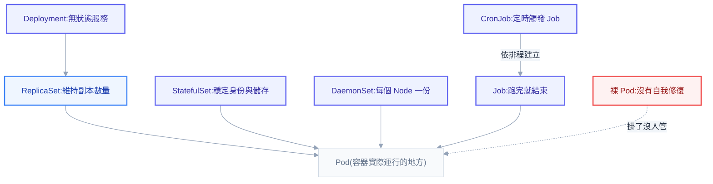
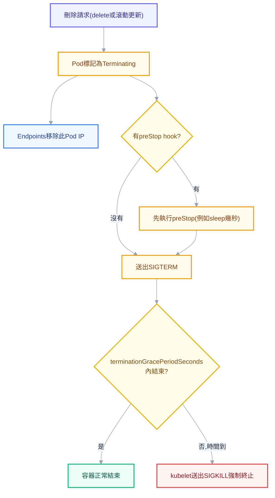
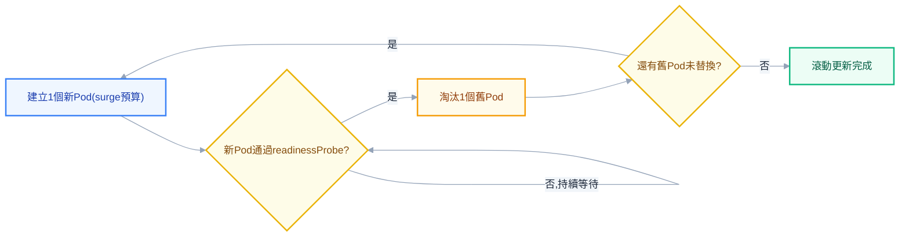
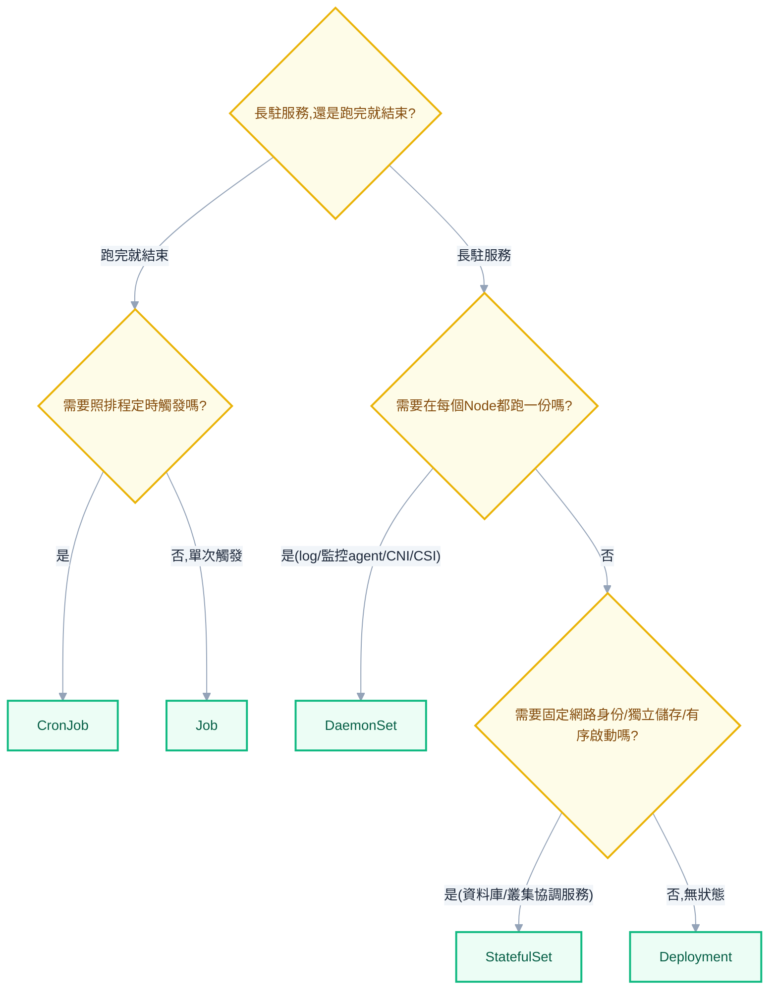

# 第四章：工作負載——讓 Pod 學會自我修復

前面幾章把地基打好了：你知道 `kubectl apply` 之後請求會經過哪些關卡、Control Plane 怎麼分工、reconciliation loop 怎麼讓實際狀態追上期望狀態。這一章要把鏡頭拉回到你每天實際在寫的東西——那些每天都要改、每天都要 review、被同事問到細節就容易語塞的 workload YAML。這是整套教材裡使用頻率最高的一章，因為不管你今天要部署的是一個 API、一個資料庫，還是一個排程任務，第一步永遠是決定「這個東西該用哪種 workload 來包」。

多數人學 K8s 的路徑是複製一份 Deployment 範本，改幾個欄位就上線，能動就算過關。這種學法撐得到「把服務部署起來」，撐不到「同事丟一句為什麼」。這一章要把每種 workload 的設計意圖講到底：它為了解決什麼問題而存在、它跟隔壁那個看起來很像的 workload差在哪裡、以及它在背後悄悄做了哪些你從沒注意過的事。讀完這章，你不會只是「會寫 Deployment」，而是能夠一眼看穿一份 YAML 選錯了 workload、講得出滾動更新每一步在做什麼、也答得出「資料庫為什麼不能塞進 Deployment」這種聽起來簡單、卻能刷掉一半人的問題。

## 為什麼不直接寫 Pod：工作負載家族地圖

上一章提過，Pod 是 K8s 排程與部署的最小單位——一個 Pod 對應一份 YAML，裡面包一個或多個 container。但「最小單位」這個描述背後藏著一個致命的缺陷：**Pod 本身沒有任何自我修復能力**。如果你直接 `kubectl apply` 一份裸 Pod 的 YAML，這個 Pod 跑起來之後，K8s 不會去管它的死活。容器裡的程式當機、Node 硬體故障、甚至只是有人手滑打了一個 `kubectl delete pod`，這個 Pod 就真的沒了，不會有任何機制把它生回來。你精心設計的服務，就因為一次偶發的當機而從叢集裡消失，直到有人發現服務掛了才手動重新建立。

這正是第二章講過的 reconciliation loop 要解決的問題，只是這裡要把它套用到「讓 Pod 活下去」這件事上。K8s 的做法不是讓 Pod 自己學會重生，而是在 Pod 之上再包一層**controller**——一個持續盯著「我要幾個長這樣的 Pod」與「現在實際有幾個」之間差距、並且不斷把現實拉回期望值的監控迴圈。Pod 掛了，controller 立刻發現數量不對，馬上建一個新的補上；Node 壞了，controller 察覺這個 Node 上的 Pod 消失了，就到別的 Node 上重建。裸 Pod 沒有這層保護傘，實務上幾乎不會直接使用，只有偵錯或一次性的手動測試才會單獨寫一個 Pod YAML。

而 K8s 提供的 controller 不是只有一種，因為「讓 Pod 活下去」這件事，對不同性質的應用來說要求完全不同。一個無狀態的 API server 只在乎「隨時有 N 份副本在跑，掛了補上就好，補在哪台機器、叫什麼名字都無所謂」；一個資料庫叢集卻在乎「每個副本都要有自己固定的身份與自己的儲存，補起來的新 Pod 絕對不能跟別人共用資料」；一個監控 agent 在乎「每台機器都要有一份，不多不少」；一個批次任務只在乎「跑完就好，不需要一直活著」。這些截然不同的訴求，催生出 K8s 工作負載家族裡的幾個主要角色——而理解這個家族地圖，就是這一整章的骨架。



接下來的章節會依序把 Pod 本身的內部構造講清楚、再一路往上拆解 ReplicaSet、Deployment、StatefulSet、DaemonSet、Job、CronJob 這幾個角色，最後給一張選型決策表收尾。

## Pod 剖析：一組容器共享的最小世界

多數教學會告訴你「一個 Pod 通常跑一個 container」，這句話沒錯，但也容易讓人誤以為 Pod 只是「container 的另一個名字」。事實上 Pod 從設計之初就是為了「一組容器」而生，而不是單一容器——差別在於，Pod 裡的所有容器共享同一個 network namespace 與可選的 volume，這件事帶來的效果，遠比表面上看起來重要。

共享 network namespace 意味著同一個 Pod 裡的容器，彼此之間用 `localhost` 就能互通，並且共用同一個 Pod IP。如果你在一個 Pod 裡跑了兩個容器，一個監聽 8080、一個監聽 9090，另一個容器可以直接打 `localhost:8080`，完全不需要知道對方的容器名稱或另外建立 Service。這也是為什麼同一個 Pod 內的容器**不能**使用同樣的 port——它們共享同一份網路身份，端口衝突在容器層級就跟同一台機器上兩個程式搶同個 port 一樣會出錯。

那麼 K8s 是怎麼做到「這兩個獨立的容器，卻共用同一個網路身份」的？答案是一個大多數人從來沒聽過、但在背後每個 Pod 都少不了的角色——**pause container（也叫 infra container）**。當 kubelet 要建立一個 Pod，它會先透過 container runtime 起一個極簡單的容器，這個容器裡只跑一支幾乎什麼都不做的程式，唯一的工作就是把 network namespace（以及某些設定下的 IPC、UTS namespace）撐開並保持存在。Pod 裡真正的業務容器與你加的 sidecar，起來的時候都會以「加入這個 pause container 的 network namespace」的方式啟動，這就是它們共享 IP、能用 `localhost` 溝通的底層機制。

pause container 平常完全不會出現在你眼前——`kubectl get pods`、`kubectl describe pod` 都不會列出它，因為它是 K8s 自己管理的隱藏角色。你只有直接登入 Node、用 `crictl ps -a` 或 `docker ps` 才看得到它的存在，通常映像檔叫 `registry.k8s.io/pause`。它的存在也解釋了另一個容易被忽略的細節：Pod 的 IP 之所以能在業務容器重啟時保持不變，是因為網路身份錨定在 pause container 身上，而不是錨定在你的應用容器——應用容器掛了重啟只是換了一個容器實例，pause container（也就是這個 Pod 的網路身份）沒有跟著重建，IP 自然不變。

## 多容器設計模式：sidecar、ambassador、adapter

理解了「同一個 Pod 內的容器共享網路與 volume」這件事之後，一個自然的問題是：什麼情況下真的需要在一個 Pod 裡塞不只一個容器？業界對此發展出三種經典的多容器設計模式，各自解決不同性質的問題，而不是隨便把不相干的程式塞進同一個 Pod。

**Sidecar（邊車）模式**的核心精神是「在不改動主容器程式碼的前提下，替它擴充能力」。最經典的例子是 Istio 的 `istio-proxy`——它以 Envoy 為基礎，攔截這個 Pod 所有的進出流量，處理 mTLS 加密、流量遙測、重試與熔斷這些橫切關注點，而你的應用程式完全不需要知道它的存在，也不用改一行程式碼就享受到這些能力。另一個常見例子是日誌代理：應用容器只管把 log 寫到共享的 `emptyDir` volume 裡，旁邊的 Filebeat sidecar 負責讀取這個檔案並轉送到 Elasticsearch（這部分第 15 章會展開）。sidecar 之所以叫「邊車」，就是因為它像摩托車邊上掛的那個附加座——跟主車一起移動、一起生滅，卻不干涉主車怎麼開。

**Ambassador（大使）模式**解決的是「主容器想用簡單的方式存取一個其實很複雜的外部資源」。最常被拿來當範例的是 Cloud SQL Auth Proxy：應用容器只需要連線到 `localhost:5432`，感覺就像在連一個近在咫尺的 Postgres，但實際上，旁邊的 ambassador 容器才是真正在處理 IAM 認證、TLS 交握、找到雲端資料庫真正位置這些髒活的角色。應用程式因此完全不需要知道自己其實是在跨網路連一個雲端受管資料庫，這正是 ambassador 這個名字的由來——它是代表應用程式出面交涉的「大使」。

**Adapter（轉接器）模式**解決的是「主容器輸出的格式，跟外部系統期待的格式對不上」。舉例來說，如果你的應用程式吐出的是一套自訂格式的 metrics，而叢集裡的 Prometheus 只認得標準的 exposition format，你可以放一個 adapter sidecar，把應用的原生輸出轉換成 Prometheus 看得懂的格式再曝露出來，讓 Prometheus 可以用同一套邏輯無差別地抓取各種異質應用的指標，而不必替每個應用各寫一套抓取邏輯。

這三種模式的共通點是：它們都善用「同一個 Pod 內的容器共享網路與儲存」這個特性，把橫切關注點從主容器身上剝離出去，讓主容器只專心做它該做的事。

## Init Container 與原生 Sidecar

除了跟主容器一起活到底的 sidecar，Pod 還有一種只在最開始跑、跑完就退場的角色，叫 **Init Container**。它們的執行順序是嚴格循序的：Pod 裡定義的所有 init container 會照著列出的順序一個接一個執行，前一個必須成功結束（exit code 0），下一個才會開始，全部 init container 都成功結束之後，主容器（包括所有一般 container）才會一起啟動。如果某個 init container 失敗了，K8s 會依照這個 Pod 的 `restartPolicy` 決定下一步：`Always` 或 `OnFailure` 會不斷重試這個失敗的 init container，直到它成功為止；`Never` 則會讓整個 Pod 直接判定為失敗，不會有主容器被啟動的機會。

Init container 最常見的三種用途，都圍繞著「主容器啟動前必須先確保某件事成立」這個核心訴求。第一種是**等待相依服務就緒**——例如應用程式依賴一個 Postgres 資料庫，如果資料庫還沒準備好接受連線就讓主容器啟動，主容器很可能因為連線失敗而立刻 crash，接著進入 `CrashLoopBackOff`。用一個 init container 反覆嘗試連線資料庫，成功了才放行主容器，可以避免這種一開機就狂噴錯誤 log 的窘境。第二種是**預先下載資料**，例如把一個較大的模型檔案或靜態資源先下載到共享的 `emptyDir` volume，主容器啟動時檔案已經備妥，不需要在自己的啟動流程裡處理下載邏輯。第三種是**權限修正**，很常見於掛載 PVC 的場景——PVC 掛上來的目錄預設擁有者可能是 root，而主容器又設定成用非 root 使用者執行，這時候用一個有權限的 init container 先跑一次 `chown`/`chmod` 把目錄權限改好，主容器才能正常寫入。

```yaml
apiVersion: v1
kind: Pod
metadata:
  name: app-with-init
spec:
  initContainers:
    - name: wait-for-db
      image: busybox:1.36
      command: ["sh", "-c", "until nc -z postgres-svc 5432; do echo waiting for db; sleep 2; done"]
    - name: fix-permission
      image: busybox:1.36
      command: ["sh", "-c", "chown -R 1000:1000 /data"]
      volumeMounts:
        - name: app-data
          mountPath: /data
  containers:
    - name: app
      image: my-app:2.3
      volumeMounts:
        - name: app-data
          mountPath: /data
  volumes:
    - name: app-data
      persistentVolumeClaim:
        claimName: app-data-pvc
```

傳統 sidecar 模式有一個長期存在、卻很少被人講清楚的痛點：**它跟 Job 合不來**。假設你在一個 Job 的 Pod 裡放了一個 istio-proxy sidecar，主容器把批次任務做完、正常結束了，但 sidecar 是一個普通的長駐容器，沒有人告訴它「主角已經下班了」，它會繼續傻傻地跑下去。而 Job 判定完成的條件是「Pod 裡所有容器都結束」，只要 sidecar 還活著，這個 Pod 就永遠卡在 `Running`，Job 永遠不會被標記為 `Completed`，逼得維運人員得手動呼叫 sidecar 的關閉 API 來清場，非常擾人。

K8s 1.28 引入的**原生 sidecar（native sidecar）**正是為了解決這個老問題。做法是把 sidecar 定義成一個 init container，但額外加上 `restartPolicy: Always`。這樣的 init container 有著獨特的行為：它會跟其他 init container 一樣先啟動，但啟動之後**不會等它結束才繼續**，而是在它進入 running 狀態後就放行後面的 init container 與主容器；當 Pod 要結束時，K8s 會保證這種原生 sidecar 是**最後才被關閉**的容器——先讓主容器們結束，原生 sidecar 才收到終止訊號。這個順序完美解決了兩個老問題：啟動時可以確保 sidecar（例如 istio-proxy）已經就緒才讓主容器起步；結束時 Job 的主容器做完工作就能讓 Job 判定完成，不會被還在運行的 sidecar 卡住，因為它是最後才關、而不是永遠不關。

```yaml
apiVersion: v1
kind: Pod
metadata:
  name: job-with-native-sidecar
spec:
  initContainers:
    - name: log-shipper
      image: filebeat:8.13
      restartPolicy: Always
      volumeMounts:
        - name: shared-logs
          mountPath: /var/log/app
  containers:
    - name: batch-job
      image: my-batch:1.0
      volumeMounts:
        - name: shared-logs
          mountPath: /var/log/app
  volumes:
    - name: shared-logs
      emptyDir: {}
  restartPolicy: Never
```

> **常見誤解：**「Init Container 跟 sidecar 是同一種東西，只是叫法不同」——不對。傳統 init container 一定要跑完才會放行下一個角色，而且結束後就徹底退場；原生 sidecar 雖然也宣告在 `initContainers` 欄位裡，行為卻完全不同——它啟動後不阻擋後續容器，而且會活到主容器都結束才輪到它關閉，本質上是一個「有嚴格啟動與關閉順序保證的長駐容器」，不是傳統意義上的 init container。

## 三種 Probe：健康檢查的三張考卷

`livenessProbe` 和 `readinessProbe` 長得幾乎一模一樣，設定方式、探測方式全部共用同一套語法，失敗後的下場卻天差地別：前者會把容器判定為不健康直接殺掉重啟，後者只是安靜地把這個 Pod 從 Service 的 Endpoints 名單上摘掉，讓它繼續活著、只是暫時不接流量。搞混這兩個的後果分成兩種極端——輕則滾動更新時新 Pod 還沒真正準備好就開始收請求，掉了一批請求；重則某個依賴（例如資料庫）短暫抖動，就讓一整批本來健康的 Pod 集體陷入無限重啟。

除了這兩個大家比較熟的探針，K8s 還提供第三種——**startupProbe**，專門為「啟動很慢」的應用而生。它的存在解決了一個尷尬的兩難：一個啟動要花 40 秒才能就緒的應用，如果直接套用 `livenessProbe` 的 `initialDelaySeconds`，你得把這個延遲設得非常保守才不會誤殺正在慢慢啟動的容器，但這個保守值一旦設定下去，日後這個應用如果真的在運行途中卡死，也要等上同樣長的時間才會被 `livenessProbe` 發現並重啟，反應變得非常遲鈍。`startupProbe` 的解法是：在它成功回報之前，`livenessProbe` 與 `readinessProbe` 完全不會被執行，把整個啟動期的耐心都讓給 `startupProbe` 自己的 `failureThreshold` 去承擔；一旦 `startupProbe` 判定成功，主導權才交棒給 `livenessProbe`/`readinessProbe`，這時它們可以放心用比較敏感、反應快的參數，因為啟動期的干擾已經被隔離掉了。

| Probe | 失敗後的行為 |
| --- | --- |
| `livenessProbe` | 判定容器不健康，重啟這個 container |
| `readinessProbe` | 從 Service 的 Endpoints（或 EndpointSlice）移除，不重啟，安靜等待恢復 |
| `startupProbe` | 尚未成功前，`livenessProbe`/`readinessProbe` 都不會被執行；成功後才交棒 |

三種探針都支援同樣的三種探測方式，差別只在於「怎麼判斷這次探測算成功」。

| 探測方式 | 判定成功的條件 |
| --- | --- |
| `httpGet` | 對指定的 path 與 port 發 HTTP 請求，回傳碼落在 2xx 或 3xx 視為成功 |
| `tcpSocket` | 能否成功建立一次 TCP 連線 |
| `exec` | 在容器內執行指定指令，exit code 為 0 視為成功 |

而不管用哪種探測方式，判定「成功」與「失敗」的節奏，都是靠下面這五個參數共同決定的：

| 參數 | 意義 |
| --- | --- |
| `initialDelaySeconds` | 容器啟動後，等多久才開始第一次探測 |
| `periodSeconds` | 之後每隔多久探測一次 |
| `timeoutSeconds` | 單次探測等待回應的逾時秒數，超過視為這一次失敗 |
| `failureThreshold` | 連續失敗幾次，才正式判定為失敗並觸發對應行為 |
| `successThreshold` | 連續成功幾次，才判定恢復（`livenessProbe` 只能設 1） |

```yaml
apiVersion: v1
kind: Pod
metadata:
  name: probe-demo
spec:
  containers:
    - name: app
      image: my-app:2.3
      ports:
        - containerPort: 8080
      startupProbe:
        httpGet:
          path: /healthz
          port: 8080
        periodSeconds: 5
        failureThreshold: 24 # 5秒 x 24次 = 給足120秒讓應用慢慢啟動
      livenessProbe:
        httpGet:
          path: /healthz
          port: 8080
        periodSeconds: 10
        failureThreshold: 3 # startupProbe過關後才會開始跑,可以設敏感一點
      readinessProbe:
        httpGet:
          path: /ready
          port: 8080
        periodSeconds: 5
        failureThreshold: 2 # 失敗只是摘掉流量,可以比liveness更敏感
```

理解了機制之後，接下來才是真正決定你半夜會不會被叫醒的部分——三個在實務上一犯再犯的災難模式。第一個是**liveness 設得太敏感**：如果 `periodSeconds` 設太短、`failureThreshold` 又設成 1，一次因為 GC 暫停、瞬間流量尖峰造成的探測逾時，就足以觸發重啟。而重啟本身會讓應用重新經歷一次冷啟動（重建連線池、重新暖機快取），這段期間更容易再次探測失敗，形成「重啟導致更容易被重啟」的惡性循環，一個原本完全健康的服務就這樣被自己的健康檢查活活玩死。第二個是**liveness 檢查了下游相依**：如果你的 `/healthz` 端點裡面偷偷去 ping 了資料庫或第三方 API，一旦資料庫短暫斷線，所有連著這個資料庫的 Pod 會**同時**判定 liveness 失敗、同時被重啟，故障因此從「一個資料庫掛了」擴散成「一整層服務集體重啟」，雪上加霜。這正是為什麼業界的共識是：`livenessProbe` 應該只檢查「這個程式自己的行程還活著、事件迴圈還轉得動」，深層的下游依賴檢查應該放進 `readinessProbe`，因為 readiness 失敗只是安靜地摘除流量，不會製造出重啟風暴。第三個是**忘記設定 readinessProbe**：K8s 預設沒有 `readinessProbe` 時，只要容器狀態是 `Running` 就視為 Ready，馬上被排進 Service 的流量名單。如果應用程式啟動後還需要暖機、還在建立資料庫連線池，這段空窗期打進來的請求就會直接失敗——這是滾動更新後「明明 Pod 都 Running 了卻有一小段時間狂噴 502」的最常見成因。

> **同事會來問你：**「服務一直重啟，但看起來完全沒有錯誤 log，是不是程式有 bug？」——先看 `kubectl describe pod` 的 Events，如果看到大量 `Liveness probe failed` 字樣，問題根本不在你的程式邏輯，而在 `livenessProbe` 的參數或檢查內容本身。回頭確認它有沒有偷查了下游依賴、`failureThreshold` 是不是設得太緊繃。

## Pod 生命週期與優雅關閉

一個 Pod 從誕生到消失，會經歷幾個明確的 phase：`Pending` 代表已經被建立、但還在等排程或等映像檔拉取完成；`Running` 代表已經綁定到一個 Node 上且至少有一個容器在跑；`Succeeded` 代表所有容器都已經正常結束（exit code 0）且不會再重啟，常見於 Job 的 Pod；`Failed` 代表至少有一個容器以非零 exit code 結束且不會再重啟；`Unknown` 則代表 K8s 因為某種原因（通常是跟這個 Node 的通訊中斷）已經拿不到這個 Pod 目前真實的狀態。

這幾個 phase 要搭配 `restartPolicy` 一起理解，因為它決定了容器結束後接下來會怎樣。`Always`（預設值）代表不管容器怎麼結束都要重啟，適合 Deployment、StatefulSet、DaemonSet 這類「理論上要永遠活著」的長駐服務。`OnFailure` 代表只有非正常結束（exit code 非 0）才重啟，正常結束就讓它保持 `Succeeded`，這是 Job 的典型選擇——你不會希望一個已經成功跑完的批次任務被重啟重跑一次。`Never` 則是完全不重啟，不管結束得正不正常都維持結束狀態，交由上層的 controller（例如 Job 的 `backoffLimit` 機制）決定要不要建立一個全新的 Pod 重試。這裡有一個容易忽略的限制：Deployment、StatefulSet、DaemonSet 這幾種「長駐型」workload，`restartPolicy` 只能是 `Always`，寫別的值會直接被拒絕，因為長駐服務的定義就是「掛了就要重啟」，跟 `OnFailure`/`Never` 的語意互相矛盾。

真正決定一次部署品質、也是多數人答不出來的細節，藏在 Pod 被刪除的那一刻。當你下 `kubectl delete pod`，或是滾動更新觸發舊 Pod 該退場，完整的終止流程是這樣走的：K8s 先把這個 Pod 標記為 `Terminating`，緊接著幾乎同時發生兩件事——第一，這個 Pod 的 IP 會從它所屬 Service 的 Endpoints（或新版的 EndpointSlice）名單中移除，這一步呼應第 13 章講過的「Endpoints 空掉是網路排查最高頻根因」，這裡則是它「被清空」的源頭；第二，如果這個容器定義了 `preStop` hook，kubelet 會先執行它，等它執行完畢（或逾時）之後，才真正送出 `SIGTERM` 訊號給容器裡的主行程。從刪除請求送出的那一刻起，整個關閉流程有一個總預算，叫 `terminationGracePeriodSeconds`（預設 30 秒），這包含了 `preStop` 執行的時間加上程式收到 `SIGTERM` 之後自行善後的時間。一旦這段時間用完，容器卻還沒自己結束，kubelet 不會再等，直接送出 `SIGKILL` 強制終止——不管程式當下處理到哪個步驟，都會被硬生生打斷。



這裡藏著一個幾乎所有人都親身遇過、卻很少人真正搞懂原因的現象：**明明用了滾動更新，發布的當下還是掉了幾個請求**。問題出在「Endpoints 從清單移除」和「叢集裡每一台 Node 上 kube-proxy 真正把轉發規則（iptables 或 IPVS）更新完畢」這兩件事，並不是同一個時間點發生的——前者幾乎是即時的 API 物件更新，後者卻需要每個 Node 上的 kube-proxy watch 到這個變化、重新寫入規則，這中間存在一段短暫但真實存在的延遲，尤其在節點數量多的叢集裡更明顯。如果 Pod 一收到 `SIGTERM` 就立刻停止接受連線、甚至直接結束行程，而某些 Node 上的轉發規則還沒更新完，新進來的請求就可能被導到一個其實已經在關閉中的 Pod 上，白白失敗。

解法就是善用 `preStop` hook，刻意在真正送出 `SIGTERM` 之前先加上一段緩衝時間，讓 Endpoints 移除的消息有時間傳播到叢集裡所有 kube-proxy，確保新流量不會再被導過來，之後才讓程式真正開始關閉。最簡單常見的寫法就是一個 `sleep`：

```yaml
apiVersion: v1
kind: Pod
metadata:
  name: graceful-shutdown-demo
spec:
  terminationGracePeriodSeconds: 45 # 需要大於preStop的sleep時間,留給程式自己收尾的空間
  containers:
    - name: app
      image: my-app:2.3
      lifecycle:
        preStop:
          exec:
            command: ["sh", "-c", "sleep 5"] # 先等5秒,讓Endpoints變更傳播到所有kube-proxy
      readinessProbe:
        httpGet:
          path: /ready
          port: 8080
        periodSeconds: 3
```

> **同事會來問你：**「我明明設了 `maxUnavailable: 0`，發版還是有零星的 502，是設定沒生效嗎？」——設定本身沒問題，這是 Endpoints 更新與 kube-proxy 規則同步之間天生的非同步延遲造成的，跟 `maxUnavailable` 管的「Pod 可用數量」是兩件事。解法是幫容器加上幾秒鐘的 `preStop` sleep，把「流量真正停止導入」和「程式開始關閉」這兩件事在時間上錯開。

## ReplicaSet：被架空的中間管理層

拆解完 Pod 本身，接下來往上一層，是最早被設計出來、專門負責「維持指定數量的 Pod 副本」的 controller——**ReplicaSet**。它的邏輯很純粹：持續數叢集裡符合 `selector` 的 Pod 有幾個，跟 `replicas` 宣告的數字不一致就補或砍，直到兩者相等為止。這裡有一個所有工作負載都共通、卻很基礎的鐵律：`spec.selector` 與 `template.metadata.labels` 必須完全一致，因為 ReplicaSet 就是靠 selector 去認回自己建立的 Pod——選不到，ReplicaSet 會以為自己一個 Pod 都沒有，進而不斷嘗試建立新的，導致 Pod 數量遠超過你的預期。

ReplicaSet 還有一個容易被忽略的行為叫**孤兒 Pod 認養**：如果叢集裡剛好有一個 Pod，它的 label 符合某個 ReplicaSet 的 selector，但這個 Pod 本身沒有被任何 controller 擁有（沒有對應的 `ownerReference`），這個 ReplicaSet 會直接把它認養過來，視為自己管理的副本之一，即使這個 Pod 根本不是它親手建立的。這個機制解釋了一些乍看之下很詭異的現象——例如你手動建立了一個 label 剛好撞上某個 Deployment selector 的裸 Pod，隔天發現它被 K8s 默默接管、甚至跟著一起被滾動更新掃到。

儘管 ReplicaSet 是讓 Pod 具備自我修復能力的功臣，實務上你幾乎不會直接手寫 ReplicaSet 的 YAML，原因很簡單：**它只管「數量夠不夠」，完全不管「怎麼把舊版本換成新版本」**。ReplicaSet 沒有任何更新策略的欄位，如果你想把裡面的 image 換成新版本，你能做的只有整批砍掉重建（造成停機）或者手動再開一個新 ReplicaSet 自己控制切換節奏——這些工作，正是下一節要介紹的 Deployment 已經幫你包好的能力。

## Deployment：最常寫的工作負載

如果說 ReplicaSet 解決的是「Pod 掛了要補」，Deployment 解決的就是「我要換版本，而且換的過程中服務不能中斷」。這也是為什麼 Deployment 幾乎是每個團隊寫得最多的 workload——絕大多數服務都是無狀態的，都需要能夠安全地滾動升級並在出包時一鍵回滾。

Deployment 的 YAML 結構其實是在 Pod 的定義外面多包一層：`replicas` 宣告要維持幾份副本、`selector` 決定它認領哪些 Pod、`template` 裡包著完整的 Pod 定義（跟你單獨寫 Pod 的 `spec` 完全一樣）、`strategy` 則決定新舊版本切換的節奏。真正決定「發版過程長什麼樣子」的，就是 `strategy` 底下 `rollingUpdate` 的兩個欄位——`maxSurge` 與 `maxUnavailable`。

`maxSurge` 決定更新過程中，最多可以比宣告的 `replicas` 多出幾個 Pod；`maxUnavailable` 決定更新過程中，最多可以有幾個 Pod 處於不可用狀態。這兩個數字合起來，框住了整個滾動更新過程中「Pod 總數的上限」與「可用數量的下限」。光看定義還是很抽象，用具體數字推演一次就會非常清楚。假設 `replicas: 4`、`maxSurge: 1`、`maxUnavailable: 0`——這組設定的意思是「更新過程中最多可以有 5 個 Pod 同時存在，但任何時刻都必須維持 4 個可用」，實際的更新節奏會是這樣：

| 階段 | 舊 Pod（v1，Ready） | 新 Pod（v2，建立中） | 新 Pod（v2，Ready） | Pod 總數 | Available 數 |
| --- | --- | --- | --- | --- | --- |
| 初始狀態 | 4 | 0 | 0 | 4 | 4 |
| ① 建立 1 個新 Pod（surge） | 4 | 1 | 0 | 5 | 4 |
| ② 新 Pod 轉 Ready，淘汰 1 個舊 Pod | 3 | 0 | 1 | 4 | 4 |
| ③ 再建立 1 個新 Pod（surge） | 3 | 1 | 1 | 5 | 4 |
| ④ 新 Pod 轉 Ready，淘汰 1 個舊 Pod | 2 | 0 | 2 | 4 | 4 |
| ⑤ 再建立 1 個新 Pod（surge） | 2 | 1 | 2 | 5 | 4 |
| ⑥ 新 Pod 轉 Ready，淘汰 1 個舊 Pod | 1 | 0 | 3 | 4 | 4 |
| ⑦ 再建立 1 個新 Pod（surge） | 1 | 1 | 3 | 5 | 4 |
| ⑧ 新 Pod 轉 Ready，淘汰最後 1 個舊 Pod | 0 | 0 | 4 | 4 | 4 |

從這張表可以看出一個重點：`maxUnavailable: 0` 這個設定，強迫 Deployment 必須等新 Pod 真正通過 `readinessProbe` 變成 Ready 之後，才敢淘汰對應的舊 Pod，而 `maxSurge: 1` 則限制它一次只能多冒出 1 個 Pod 來做這件事。所以即使 `maxSurge` 允許總數衝到 5，實際的節奏依然是「生 1 個、等它 Ready、砍 1 個舊的」，重複 4 次，Available 數字從頭到尾穩穩維持在 4——這正是零停機發版最推薦的組合。相對地，如果你把 `maxUnavailable` 調高（例如官方預設的 25%），Deployment 會更激進地同時淘汰多個舊 Pod，總 Pod 數波動較小、但短時間內可用副本數會下降，適合對「服務略微降級但求發版速度快」能接受的場景。



除了 `RollingUpdate`，`strategy.type` 還有另一個選項叫 `Recreate`——它的行為簡單粗暴：先把所有舊 Pod 砍光，確認一個不剩之後才開始建立新版本的 Pod。這代表更新過程中必然有一段時間服務完全不可用，聽起來像是退步，但某些場景下它才是正解——當你的應用**不能容忍新舊版本同時存在**時，例如兩個版本會對同一份資料做不相容的 schema 操作、或是這個服務靠佔用某個獨佔資源（授權伺服器同時只能有一個實例、獨佔某個檔案鎖）運作，`RollingUpdate` 讓新舊版本並存的特性反而是風險，這種情況就該老實選 `Recreate`，用短暫停機換取「絕對不會有兩個版本同時活著」的保證。

```yaml
apiVersion: apps/v1
kind: Deployment
metadata:
  name: my-app
  namespace: default
spec:
  replicas: 4
  revisionHistoryLimit: 5 # 保留最近5個舊版ReplicaSet,供rollback使用
  progressDeadlineSeconds: 300 # 5分鐘內沒有進展就標記為ProgressDeadlineExceeded
  minReadySeconds: 10 # 新Pod要維持Ready狀態10秒才算真正Available,防止抖動被誤判成功
  selector:
    matchLabels:
      app: my-app
  strategy:
    type: RollingUpdate
    rollingUpdate:
      maxSurge: 1
      maxUnavailable: 0
  template:
    metadata:
      labels:
        app: my-app
      annotations:
        checksum/config: "d41d8cd98f00b204e9800998ecf8427e" # ConfigMap內容的hash,內容變了這裡就要跟著變
    spec:
      containers:
        - name: app
          image: my-app:2.3
          envFrom:
            - configMapRef:
                name: my-app-config
          readinessProbe:
            httpGet:
              path: /ready
              port: 8080
            periodSeconds: 3
          livenessProbe:
            httpGet:
              path: /healthz
              port: 8080
            periodSeconds: 10
          lifecycle:
            preStop:
              exec:
                command: ["sh", "-c", "sleep 5"]
      terminationGracePeriodSeconds: 30
```

真正決定 Deployment「能不能回滾」的關鍵，是它跟 ReplicaSet 之間一個很多人沒認真想過的三層關係：**Deployment 從來不會自己直接管 Pod，它永遠透過 ReplicaSet 間接管理**。每次你改動 `template`（換 image、改 env、動任何會影響 Pod 內容的欄位），Deployment 都會建立一個全新的 ReplicaSet（帶著新的 hash 後綴），把它慢慢擴大，同時把舊 ReplicaSet 慢慢縮小到 0——但舊的 ReplicaSet 並不會被刪除，只是副本數變成 0、安靜地待在旁邊，數量由 `revisionHistoryLimit` 決定最多留幾份。這正是 `kubectl rollout undo` 為什麼能瞬間回滾的原因：它不需要重新建立任何東西，只需要把舊 ReplicaSet 的副本數重新調回去、同時把目前這個 ReplicaSet 調成 0，整個「回到上一版」的操作本質上就是兩個數字的互換。反過來說，如果你只是調整 `replicas`（純粹擴縮容，沒動 `template`），並不會產生新的 ReplicaSet，只會讓現有的那一個 ReplicaSet 直接調整數量。

`progressDeadlineSeconds` 是另一個容易被忽略的安全網——如果一次滾動更新在這個時間內沒有任何進展（例如新 Pod 一直卡在 `CrashLoopBackOff`，永遠通不過 readiness），Deployment 的 status 會被標記上 `ProgressDeadlineExceeded` 這個 condition，方便監控系統或 CI/CD pipeline 據此判斷這次發版是不是卡住了，需要人工介入——但要注意它**不會自動幫你回滾**，只是插一面警示旗。`minReadySeconds` 則是替「新 Pod 算不算真正 Available」加上一個緩衝期，避免一個 Pod 剛通過 readiness 就立刻被拿去頂替舊 Pod 的名額，結果幾秒後又抖動失敗，造成整個更新過程原地打轉。

實務上還會頻繁用到幾個 `kubectl rollout` 指令：`kubectl rollout status deployment/my-app` 即時盯著這次更新的進度；`kubectl rollout history deployment/my-app` 列出保留的版本歷史；`kubectl rollout undo deployment/my-app --to-revision=3` 回滾到指定版本；`kubectl rollout pause`/`resume` 則讓你可以在滾動更新途中暫停——這在你想先觀察一小批新 Pod 的表現、確認沒問題才讓它繼續往下推進時特別有用，本質上是一種手動的金絲雀（canary）節奏控制。

最後一個坑，幾乎每個用 ConfigMap 管設定的人都踩過一次：**只改 ConfigMap 的內容，不會觸發 Deployment 的滾動更新**。原因跟上面講的三層關係直接相關——Deployment 判斷「要不要滾動更新」的依據是 `template` 有沒有變化，而 `template` 裡通常只寫了 ConfigMap 的**名稱**（`configMapRef.name: my-app-config`），這個名稱沒有變，`template` 的 hash 自然也不會變，Deployment 完全不知道底層的內容其實已經不一樣了。如果你是用 `volumeMount` 掛載 ConfigMap，kubelet 確實會在背景定期同步（通常一分鐘內），檔案內容最終會更新，但如果應用程式只在啟動時讀一次檔案、不會動態重新載入，這個更新等於白費；如果你是用 `envFrom`/`env` 注入成環境變數，那更是連「最終更新」都不會發生——環境變數只在容器建立那一刻寫死，之後 ConfigMap 內容怎麼變都不會反映到已經在跑的容器裡。

解法就是上面 YAML 範例裡出現過的 **checksum annotation** 技巧：把 ConfigMap 內容的 hash 值寫進 `template.metadata.annotations`（Helm 裡常見寫法是 `checksum/config: {{ include (print $.Template.BasePath "/configmap.yaml") . | sha256sum }}`），這樣一來，只要 ConfigMap 內容改變、hash 值跟著改變，`annotations` 也跟著變，而 annotations 本身就是 `template` 的一部分，`template` 的變化自然會被 Deployment 認定為「需要一次真正的滾動更新」，強迫所有 Pod 重建、確保它們拿到最新設定。這個技巧會在第 10 章講 Helm 時再更完整地展開。

> **同事會來問你：**「我明明已經把 ConfigMap 改好了，怎麼服務行為完全沒變？」——先問清楚 ConfigMap 是掛成 volume 還是注入成環境變數，再問 Deployment 有沒有搭配 checksum annotation 這類機制。多數情況下答案就是：Deployment 根本不知道 ConfigMap 變了，沒有觸發任何 Pod 重建。

## StatefulSet：三個 Deployment 給不了的保證

Deployment 把「無狀態服務怎麼優雅換版本」這件事處理得很好，但它天生假設「所有副本都是可以互相替換的，誰是誰不重要」。這個假設對資料庫、訊息佇列這類**有狀態叢集應用**完全不成立——Postgres 的每個複本要知道自己是 primary 還是某個特定的 replica、Kafka 的每個 broker 要保有自己的 log segment、ZooKeeper/etcd 的每個節點要在共識協定裡有一個穩定的身份。這些需求，正是 **StatefulSet** 存在的理由，它提供三個 Deployment 完全給不了的保證。

第一個保證是**穩定的網路身份**。Deployment 建立出來的 Pod 名字帶著隨機字串（`my-app-5454f687cd-bxjfz`），每次重建都會換一個新名字。StatefulSet 建立的 Pod 名字則是可預測、固定的序號格式——`web-0`、`web-1`、`web-2`，這個 Pod 不管重建幾次，只要它是「第 0 號副本」，名字永遠是 `web-0`，不會變成別的字串。第二個保證是**穩定的儲存**：每個副本都綁定屬於自己、獨立的 PVC，`web-0` 的資料永遠掛在它自己的 PVC 上，就算這個 Pod 被刪掉重建，重建出來的新 `web-0` 依然會掛回同一個 PVC、讀到同一份資料，而不是拿到一個乾淨空白的儲存空間。第三個保證是**有序的部署與擴縮**：擴容時，K8s 保證先建好 `web-0` 並確認它 Running 且 Ready 之後，才會開始建立 `web-1`，依此類推；縮容時則反過來，先砍掉編號最大的那一個（例如從 3 個副本縮到 2 個，一定是先砍 `web-2`），絕不會兩端同時動手或跳號操作。

要讓 K8s 幫每個副本產生像 `web-0.web.default.svc.cluster.local` 這樣穩定的 DNS 名稱，StatefulSet 必須搭配一個特殊的 Service——**headless Service**（把 `clusterIP` 設為 `None`）。一般的 Service 會給你一個統一的虛擬 IP，幫你把流量負載平衡到隨便一個後端 Pod，這對「我要精準連到 `web-1` 這一台，不是隨便哪一台」的需求完全幫不上忙。headless Service 拿掉了這層負載平衡，DNS 查詢這個 Service 名稱時，回傳的不是一個虛擬 IP，而是所有符合 selector 的 Pod IP 列表，並且額外替每個 Pod 產生一條專屬的 DNS 紀錄，格式就是 `<pod名稱>.<service名稱>.<namespace>.svc.cluster.local`。StatefulSet 的 `spec.serviceName` 欄位，指定的正是這個 headless Service 的名字，兩者必須搭配著用，叢集內的其他成員才能透過穩定的 DNS 找到彼此，而不必知道對方目前的 Pod IP。

```yaml
apiVersion: v1
kind: Service
metadata:
  name: postgres-headless
  namespace: default
spec:
  clusterIP: None # headless Service,不做負載平衡,只回傳每個Pod自己的DNS紀錄
  selector:
    app: postgres
  ports:
    - port: 5432
      targetPort: 5432
---
apiVersion: apps/v1
kind: StatefulSet
metadata:
  name: postgres
  namespace: default
spec:
  serviceName: postgres-headless # 必須對應到上面的headless Service名稱
  replicas: 3
  podManagementPolicy: OrderedReady # 預設值,依序0->1->2建立,反序刪除
  selector:
    matchLabels:
      app: postgres
  template:
    metadata:
      labels:
        app: postgres
    spec:
      containers:
        - name: postgres
          image: postgres:16
          ports:
            - containerPort: 5432
          volumeMounts:
            - name: data
              mountPath: /var/lib/postgresql/data
  volumeClaimTemplates:
    - metadata:
        name: data
      spec:
        accessModes: ["ReadWriteOnce"]
        resources:
          requests:
            storage: 20Gi
```

`volumeClaimTemplates` 是 StatefulSet 跟 Deployment 在儲存概念上最本質的差異。Deployment 如果要掛 PVC，通常所有副本共用同一份定義好的 PVC 名稱，代表它們理論上會搶著掛同一塊儲存空間——這對多數叢集資料庫來說是不能接受的，因為每個副本都需要自己獨立的資料目錄，即使彼此之間會互相同步。`volumeClaimTemplates` 讓 K8s 依照副本序號，自動幫每個 Pod 各自建立一個獨立命名的 PVC（`data-postgres-0`、`data-postgres-1`、`data-postgres-2`），這個 PVC 從此跟著這個序號綁定一輩子，而不是任由所有副本共用一份。

如果你的叢集應用不需要嚴格的建立順序（例如它自己內部靠共識協定處理成員加入的先後），可以把 `podManagementPolicy` 從預設的 `OrderedReady` 改成 `Parallel`——這會讓所有副本同時建立、同時刪除，不再一個一個等，擴縮容速度明顯加快，代價是放棄了「有序」這個保證，只適合本來就不依賴啟動順序的應用。

最後一個對管理員來說極其重要、卻常被誤以為是 bug 的行為：**縮減 StatefulSet 的副本數，並不會連帶刪除被縮掉的那些 PVC**。假設你把 `replicas` 從 3 調到 1，`postgres-2`、`postgres-1` 這兩個 Pod 會被砍掉，但它們對應的 `data-postgres-2`、`data-postgres-1` 這兩個 PVC 會繼續乖乖躺在那裡，狀態依然是 `Bound`，只是沒有 Pod 在使用。這是**刻意的設計，不是缺陷**——如果縮容連 PVC 都一起刪，任何一次誤縮容（例如打指令手滑多按了一個 0）都可能造成資料永久遺失，而 K8s 選擇了更保守的路線：先讓資料留著，之後如果你把 `replicas` 調回去，新建的 `postgres-1` 會重新掛回原本那個裝著舊資料的 PVC，而不是拿到一個空的儲存空間。如果你真的確定不再需要這份資料，必須手動把留下來的 PVC 刪掉，K8s 不會替你自動決定「這份資料可以丟了」。

StatefulSet 的典型使用場景，正是這一路推演下來所指向的那些系統——資料庫（Postgres、MySQL）、訊息與協調服務（Kafka、ZooKeeper、etcd）。你在 minikube 上用 Bitnami Helm Chart 部署過的 Postgres，底層用的正是 StatefulSet 加上 `volumeClaimTemplates`，這正是為什麼它的 PVC 名稱總是帶著固定的序號後綴，而且不管你怎麼重啟 Pod，資料始終還在。

## DaemonSet：每個 Node 都要有一份

前面幾種 workload 都在乎「副本數量對不對」，DaemonSet 在乎的是完全不同的問題——**每一台 Node 上，都要剛好有一份**。它不看 `replicas` 這個數字（DaemonSet 的 YAML 裡根本沒有這個欄位），而是持續確保「叢集裡符合條件的每個 Node 上都跑著一個對應的 Pod」。新的 Node 加入叢集時，DaemonSet 會自動在上面補一份；Node 被移出叢集時，它身上的那份也會跟著消失，完全不需要你手動調整任何數字。

這個「每個 Node 一份」的特性，正好對應到那些天生就該以 Node 為單位運作的基礎設施元件。日誌代理（例如第 15 章會講的 Filebeat）需要讀取每台 Node 上所有容器的 log，自然是每個 Node 各跑一份；監控 agent（第 14 章的 node-exporter）需要蒐集每台 Node 自己的硬體與作業系統指標，同樣是每個 Node 各一份；CNI 網路 plugin 與各種儲存 CSI plugin，也都是以 Node 為單位安裝、初始化的基礎設施，天生就該用 DaemonSet 來管理，而不是用 Deployment 隨便排幾個副本、放到隨便幾台機器上就當作交差。

要注意的是，DaemonSet 一樣受第 7 章講過的 taint 機制約束——如果你的叢集的 control-plane Node 被打上了 `node-role.kubernetes.io/control-plane:NoSchedule` 這類系統 taint，一般 DaemonSet 的 Pod 預設是排不上去的。但像 node-exporter、log agent 這類監控與日誌元件，通常需要涵蓋**所有**Node，包括 control-plane 在內才有意義——這時候就必須在 DaemonSet 的 Pod template 裡明確加上對應的 `tolerations`，讓它有能力無視這個 taint、順利排到 control-plane 上。

```yaml
apiVersion: apps/v1
kind: DaemonSet
metadata:
  name: node-exporter
  namespace: monitoring
spec:
  selector:
    matchLabels:
      app: node-exporter
  updateStrategy:
    type: RollingUpdate
    rollingUpdate:
      maxUnavailable: 1 # 每次最多同時更新1個Node上的Pod
  template:
    metadata:
      labels:
        app: node-exporter
    spec:
      tolerations:
        - key: node-role.kubernetes.io/control-plane
          operator: Exists
          effect: NoSchedule # 讓node-exporter也能排到control-plane節點上
      containers:
        - name: node-exporter
          image: prom/node-exporter:v1.8.0
          ports:
            - containerPort: 9100
```

DaemonSet 的更新策略跟 Deployment 一樣有兩種選擇。`RollingUpdate`（預設）會照著 `maxUnavailable` 的節奏，一台一台 Node 依序替換上面的 Pod，是最常見的做法。`OnDelete` 則完全交由人工掌控——即使你改了 DaemonSet 的 `template`，既有的 Pod 也不會自動更新，只有等到有人手動把某個 Node 上的舊 Pod 刪掉，新版本的 Pod 才會被建立上去。這種「不動它就不會自己變」的特性，適合那些極度敏感、你希望完全掌控每一台 Node 何時更新（例如逐台觀察沒問題才推下一台）的基礎設施元件。

## Job：跑完就該結束的任務

前面所有的 workload 骨子裡都假設「這個東西要一直活著」，但很多任務天生就是一次性的——跑一次資料庫遷移、跑一次批次報表、處理一批佇列裡的訊息。硬要把這種任務塞進 Deployment，你會得到一個詭異的局面：任務執行完畢、容器正常退出，Deployment 卻覺得「副本數量不對」，不斷把它重新拉起來重跑一次，陷入無窮迴圈。**Job** 存在的意義，就是提供一種「以任務完成為終點」而不是「以副本數量為終點」的工作負載。

Job 最重要的兩個欄位是 `completions` 與 `parallelism`，兩者的組合決定了任務執行的四種典型模式。最單純的模式是兩者都不設（預設都是 1），代表只需要一個 Pod 成功跑完一次，任務就算完成，適合單純的一次性腳本。第二種模式是 `completions` 設為 N、`parallelism` 維持 1，代表這 N 次執行必須一個接一個依序完成，前一個成功了下一個才會開始，適合彼此之間不能同時進行的連續步驟（例如一系列必須按順序套用的資料庫遷移腳本）。第三種模式是 `completions` 與 `parallelism` 都設為大於 1 的數字（例如 `completions: 10`、`parallelism: 3`），代表最多同時跑 3 個 Pod，直到總共成功完成 10 次為止，適合工作量固定、彼此獨立、可以平行處理的批次任務。第四種是**工作佇列模式**——不設 `completions`，只設 `parallelism`，多個 Pod 各自從一個外部佇列（例如 Redis、RabbitMQ）裡搶著拉任務來處理，誰都不知道總共有幾筆，直到佇列被清空、所有 Pod 都自然結束，Job 才算完成，適合任務總數量在一開始並不確定的場景。

```yaml
apiVersion: batch/v1
kind: Job
metadata:
  name: data-sharding-job
spec:
  completions: 5
  parallelism: 5
  completionMode: Indexed # 每個Pod拿到自己專屬的索引
  backoffLimit: 3 # 累積失敗超過3次就整個Job判定失敗
  activeDeadlineSeconds: 600 # 整個Job從開始到現在超過600秒,不管做到哪都強制終止
  ttlSecondsAfterFinished: 3600 # 結束後1小時,K8s自動清掉這個Job物件,不留垃圾
  template:
    spec:
      containers:
        - name: shard-worker
          image: my-batch-processor:1.2
          command: ["sh", "-c", "process-shard.sh $JOB_COMPLETION_INDEX"]
      restartPolicy: OnFailure
```

`backoffLimit` 決定這個 Job 整體能容忍幾次失敗——每次有 Pod 以失敗告終，計數就加一，一旦超過這個門檻，整個 Job 直接被判定為失敗，不會再繼續嘗試。`activeDeadlineSeconds` 則是一個跟 `backoffLimit` 完全獨立的安全網，它管的是「時間」而不是「次數」——即使 Job 還沒用完重試次數，只要從開始執行算起、超過這個秒數，K8s 會強制把還在跑的 Pod 全部砍掉，把整個 Job 標記為失敗，專門用來防止一個邏輯上卡死、跑到天荒地老都不會自己結束的任務占用資源。`ttlSecondsAfterFinished` 解決的是另一種困擾——Job（尤其是被 CronJob 大量產生的那些）如果永遠不清理，namespace 裡會漸漸堆滿早已完成、卻沒人手動清掉的舊 Job 物件，設定這個欄位後，K8s 會在 Job 結束（不管成功或失敗）滿指定秒數之後自動把它連同底下的 Pod 一起回收。

上面範例用到的 `completionMode: Indexed` 是專門為「資料分片處理」設計的功能——啟用後，Job 產生的每個 Pod 都會拿到一個環境變數 `JOB_COMPLETION_INDEX`（從 0 開始），讓每個 Pod 知道「我是負責第幾份資料」，不需要額外的協調機制或共享佇列，就能讓一份大檔案或一批資料被平行拆開處理，例如把一份 100 萬筆的資料切成 5 份，索引 0 的 Pod 處理第 1 到 20 萬筆，索引 1 處理下一段，依此類推。

更精細的失敗控制則來自 `podFailurePolicy`——它讓你可以針對容器結束時的**特定 exit code** 客製化行為，而不是所有失敗都一視同仁地計入 `backoffLimit`。舉例來說，你可以宣告「exit code 42 代表這是一種可預期、不需要重試的業務性失敗，直接判定整個 Job 失敗，不用浪費時間重跑」，或反過來宣告「某些 exit code 純粹代表被系統中斷（例如 Node 被驅逐），這種失敗根本不該計入重試次數」，讓重試邏輯更貼近任務本身的語意，而不是一律套用同一套模糊的重試次數上限。

## CronJob：定時觸發的 Job

Job 解決了「跑一次性任務」的問題，但很多任務不是跑一次就好，而是要「每天凌晨跑一次備份」「每小時跑一次報表」這種周期性排程。**CronJob** 做的事情很直白——它本身不執行任何工作，只負責照著設定的時間表，準時建立一個新的 Job，實際的執行邏輯完全交給底下的 Job（以及 Job 底下的 Pod）去做。

`schedule` 欄位用的是標準 cron 語法，五個欄位由左到右分別代表分、時、日、月、星期：

```text
* * * * *
│ │ │ │ └── 星期(0-7,0和7都代表週日)
│ │ │ └──── 月份(1-12)
│ │ └────── 日(1-31)
│ └──────── 時(0-23)
└────────── 分(0-59)
```

一個長期存在、直到 K8s 1.27 才真正解決的大坑是**時區**。在那之前，不管你的叢集實體機器設定的時區是什麼，`schedule` 一律以 UTC 為準去解讀——一個台灣團隊寫 `schedule: "0 2 * * *"`，直覺以為是台灣時間凌晨兩點，實際上跑的卻是 UTC 兩點，也就是台灣時間的早上十點，對「凌晨離峰時段做批次處理」這種需求來說完全是反效果。K8s 1.27 之後穩定支援的 `timeZone` 欄位，讓你可以明確指定這個排程要用哪個時區解讀（例如 `Asia/Taipei`），徹底終結了這種「排程時間跟預期對不上」的困惑，但如果你維護的是舊叢集或沒有明確設定這個欄位，務必記得回頭確認——沒寫就是預設用 UTC。

`concurrencyPolicy` 決定「如果上一次排程建立的 Job 還沒跑完，下一次排程時間又到了，該怎麼辦」，共有三種選擇：

| concurrencyPolicy | 行為 |
| --- | --- |
| `Allow`（預設） | 不管上一個 Job 有沒有跑完，時間到了照樣建立新的 Job，允許多個 Job 同時存在 |
| `Forbid` | 上一個 Job 還沒結束，這一次排程直接跳過，不建立新的 |
| `Replace` | 取消目前還在跑的 Job，改成立刻建立這一次的新 Job |

```yaml
apiVersion: batch/v1
kind: CronJob
metadata:
  name: nightly-backup
  namespace: default
spec:
  schedule: "0 2 * * *"
  timeZone: Asia/Taipei # K8s 1.27+,明確指定用台灣時區解讀,不再誤用UTC
  concurrencyPolicy: Forbid # 上一次備份還沒做完,絕不同時再跑一次
  startingDeadlineSeconds: 200 # 錯過排定時間超過200秒,這次就放棄不補跑
  successfulJobsHistoryLimit: 3
  failedJobsHistoryLimit: 1
  jobTemplate:
    spec:
      backoffLimit: 2
      template:
        spec:
          containers:
            - name: backup
              image: my-backup-tool:1.0
              command: ["sh", "-c", "pg_dump -h postgres-headless -U app_user app_db > /backup/nightly.sql"]
          restartPolicy: OnFailure
```

`startingDeadlineSeconds` 是最容易被低估、卻藏著一個真實陷阱的欄位。它的字面意思是「這次排定的執行時間，如果因為某種原因（叢集短暫故障、CronJob controller 本身掛了）被延誤，延誤超過這個秒數就放棄這次、不再補跑」。陷阱在於：如果叢集發生了一段較長時間的中斷（例如 Control Plane 掛了幾個小時），CronJob 錯過的排程次數一旦累積超過 100 次（這是目前實作內建的硬性上限），**CronJob controller 會直接判定自己再也搞不清楚該補跑哪些、放棄繼續往下排程，並在 log 裡留下錯誤訊息**，不會像很多人想像的那樣「恢復正常後自動一次補跑所有錯過的排程」。這代表你不能天真地以為「反正之後系統會自己追上進度」，一次夠長的叢集中斷之後，務必主動檢查這類週期性 CronJob 是不是還在正常運作，而不是假設它自己會恢復。

`successfulJobsHistoryLimit` 與 `failedJobsHistoryLimit` 則單純是保留歷史紀錄的數量上限——分別控制「最近幾次成功」與「最近幾次失敗」的 Job 物件要保留下來供你事後查看 log、除錯，超過這個數量，更舊的 Job（以及底下的 Pod）會被自動清掉，避免 namespace 被逐日累積的排程紀錄塞滿。

## 選型決策：一張表決定用哪種 workload

拆解完每一種 workload 的設計意圖，最後回到最實際的問題：今天接到一個新需求，到底該用哪一種？答案其實藏在幾個簡單的問句裡——這個東西需要一直活著，還是跑完就該結束？如果要一直活著，它需要在每一台 Node 上都跑一份嗎？如果不需要，它需要固定的網路身份、自己專屬的儲存、還是嚴格的啟動順序嗎？



| 需求 | 該用的 workload |
| --- | --- |
| 無狀態服務（API server、前端） | Deployment |
| 有狀態叢集應用（資料庫、Kafka、ZooKeeper） | StatefulSet |
| 每個 Node 都要常駐一份（log agent、監控 agent、CNI/CSI plugin） | DaemonSet |
| 一次性任務（遷移腳本、批次報表） | Job |
| 定期重複的任務（每日備份、每小時清理） | CronJob |

這張表看起來簡單，但真正的殺傷力藏在「誤用」上。最經典的誤用，就是把資料庫直接塞進 Deployment。表面上看起來能動——Pod 一樣會被排程、一樣有 `readinessProbe`、掛了一樣會重啟，但幾個致命的裂縫遲早會浮現。第一，Deployment 建立出來的 Pod 名字每次重建都會換一組隨機字串，任何依賴「固定名字互相認識彼此」的資料庫叢集協定，在 Deployment 底下完全無法運作。第二，如果你圖方便讓所有副本共用同一個 PVC（而不是像 StatefulSet 那樣每個副本各自獨立），一旦 `replicas` 大於 1，多個 Pod 同時掛載同一塊用 `ReadWriteOnce` 宣告的儲存空間，輕則後面建立的 Pod 直接卡在掛載失敗，重則更嚴重的是滾動更新過程中新舊兩個版本的 Pod 短暫同時存在、同時搶著寫入同一份資料檔案，對大多數資料庫來說這是會直接搞壞資料檔案的災難性場景。第三，就算你老實把 `replicas` 設成 1 想避開上述問題，Deployment 的滾動更新策略天生就會在替換過程中讓新舊 Pod 短暫並存——這正是 StatefulSet 存在的意義被反過來證明：你想要的「資料庫穩定運作」，恰恰需要 Deployment 完全不打算提供的那三個保證。

> **同事會來問你：**「反正資料庫只跑 1 個副本，直接用 Deployment 不行嗎，幹嘛搞得這麼複雜？」——問題不在副本數量，而在「重建時的身份與儲存是否穩定」以及「滾動更新過程中是否可能有新舊版本並存的空窗期」這兩件事，Deployment 兩者都沒有保證，而這正是資料庫最不能將就的部分。

回顧整章，工作負載的世界其實是一條從「最小單位」到「各種韌性保證」逐層疊加的鏈路：Pod 提供容器執行的地方，卻沒有自我修復能力；ReplicaSet 補上了數量上的韌性，卻不管版本怎麼換；Deployment 在此之上加了滾動更新與回滾能力，成為無狀態服務的預設選擇；StatefulSet 再往上疊加身份與儲存的穩定性，把韌性延伸到有狀態叢集；DaemonSet 把「數量夠不夠」的定義換成了「每個 Node 都要有」；Job 與 CronJob 則徹底跳脫「長駐」的假設，把韌性用在「確保任務真的做完」而不是「確保服務一直活著」上。下一章會把視角轉向 Service 與網路——這些 Pod 建起來之後，要怎麼被穩定地找到、怎麼被流量正確導入，而 Endpoints 空掉的排查邏輯，正是這一章 `readinessProbe` 與優雅關閉機制留下的伏筆。

## 連結

- [[k8s-mastery]]
- [[05-networking]]
- [[06-config-and-storage]]
- [[07-scheduling-and-resources]]
- [[13-troubleshooting]]
- [[kubernetes]]
