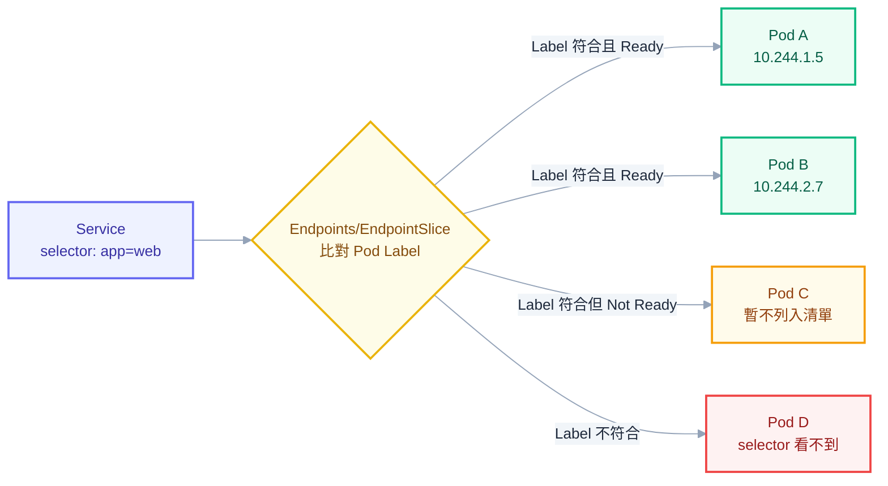
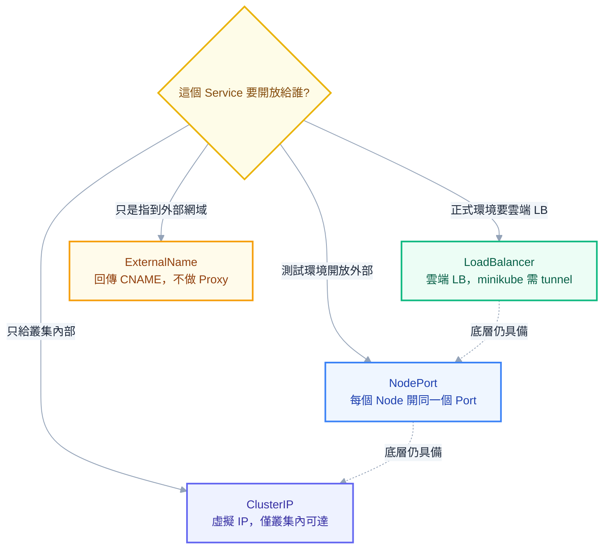
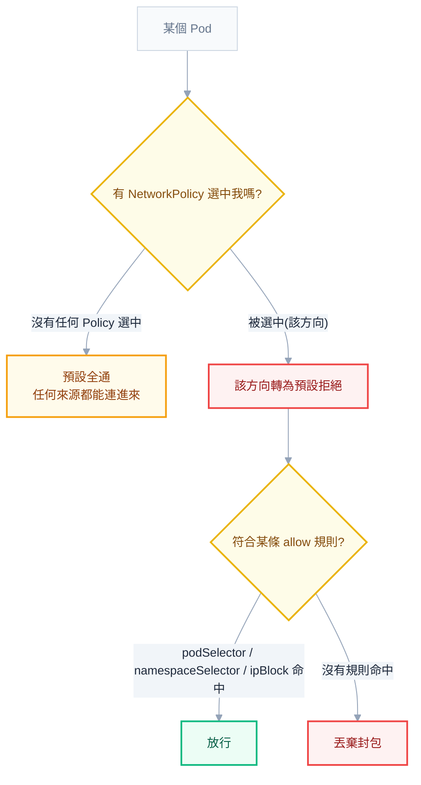

# 第五章：網路——封包如何從外部走到容器裡

## 為什麼網路是最容易把人問倒的一章

「明明 Service 連得到，Ingress 怎麼連不到」「Pod 之間 ping 得到，為什麼打不到 Service 的 port」，這兩句話幾乎是每個團隊裡最常被問、也最常答不出所以然的問題。第二章拆過 Control Plane 與 Node 之間那條 pull-based 的旅程，第七章拆過 Scheduler 怎麼決定 Pod 該去哪台機器，這些都只回答了「Pod 有沒有被排起來、跑不跑得動」；即使這些全部正常，只要網路這一層有任何一個環節接不上，使用者感受到的症狀永遠是同一句話——「服務掛了」。網路之所以特別難纏，是因為它牽涉的元件最多、每一段看起來都很正常，卻只要有一環出錯就會讓整條路徑斷掉，而且斷在哪一段，症狀往往長得一模一樣。

本章要做的事情，是把一個請求從離開使用者的瀏覽器，到真正抵達容器裡監聽的那個 port 之間，會經過的每一站都攤開來講清楚。第九章談過 CNI 是 K8s 對外開放的三大介面之一，本章要具體拆開這個介面在做什麼；第十三章那張網路排查流程圖，其實就是站在本章建立的心智模型之上畫出來的決策樹。讀完這一章，應該能夠回答：為什麼 `kubectl get svc` 看到的 ClusterIP，`ping` 不通卻能 `curl` 得到回應；為什麼有些外部網域的 DNS 查詢會莫名其妙變慢；為什麼 Ingress 規則寫得完全正確，回應卻是 502 而不是想要的內容；以及為什麼一份寫好的 NetworkPolicy YAML，套用之後看起來什麼事都沒發生。

## 四條鐵律：K8s 網路模型的起點

在深入任何一個元件之前，必須先建立一個前提：K8s 對「網路該長什麼樣子」立下了四條規矩，這四條規矩不是某個元件的行為，而是整個平台對所有 CNI 實作的硬性要求，後面談到的 Service、DNS、Ingress，全部都是蓋在這四條規矩之上的建築。

第一，每個 Pod 都拿到屬於自己的一個 IP，這個 IP 在整個叢集裡是唯一的。第二，Pod 之間可以直接用這個 IP 互相通訊，完全不需要經過任何形式的位址轉換，也就是不需要 NAT。第三，一個 Pod 看到的自己的 IP，跟叢集裡任何其他人看到它的 IP 是同一個，沒有「內部看到一個位址、外部看到另一個位址」這種落差。第四，Node 上跑的系統層級程式（例如 kubelet 本身、或跑在該 Node 上的監控 agent）可以直接連到這個 Node 上所有 Pod，不需要繞路。

這四條規矩合起來想解決的問題只有一個：讓容器化之後的網路世界，看起來盡量像一個由許多傳統實體機器組成的網路。傳統世界裡，一台機器有一個 IP，機器與機器之間直接互通，程式碼從來不需要為了「我現在是不是被裝在容器裡」這件事做任何調整。如果 K8s 選擇了另一條路——例如讓每個 Pod 只能看到私有位址，對外都要經過一層 NAT——那麼幾乎每一個應用程式的網路呼叫、每一個服務發現機制、每一份既有的維運腳本，都得為了容器化重新設計一次。四條鐵律換來的，就是「應用程式不需要知道自己活在 K8s 裡」這件事，這也是為什麼 Docker 預設的 bridge network 模式在單機上還要靠 `-p` 做 port mapping、靠 NAT 才能對外，而 K8s 的 Pod 網路模型刻意不走這條路。

> **常見誤解**：不少人以為 K8s 的網路是靠 K8s 自己實作出來的一套協定。實際上 K8s 本身完全不實作網路，它只負責定義上面這四條規矩當作驗收標準，真正把規矩落地的工作，全部交給下一節要談的 CNI plugin。

## CNI：K8s 自己不做網路，只定義介面

延續第九章談過的三大可插拔介面，CNI（Container Network Interface）正是負責兌現前面四條鐵律的那一層。K8s 只知道「Pod 建立的時候需要一個 IP、需要能跟其他 Pod 互通」，實際怎麼分配這個 IP、怎麼把封包從一個 Pod 送到另一個 Pod，全部委託給 kubelet 呼叫的 CNI plugin 去完成。這個設計讓 K8s 核心程式碼完全不需要因為底層網路方案的演進而修改，真正的技術取捨，被壓在 CNI plugin 這一層。

CNI plugin 的實作大致分成兩種思路，兩者的差別直接決定了效能與維運複雜度。第一種是 **overlay 網路**，最典型的代表是 Flannel 預設使用的 VXLAN backend。它的做法是在既有的實體網路之上，額外包一層虛擬的網路：一個 Pod 送出的封包，會先被目的地 Pod 所在 Node 上的 agent 封裝進一個 VXLAN 標頭裡，變成一般的 UDP 封包在實體網路上傳輸，抵達目的地 Node 之後再被拆開，還原成原本的封包送進正確的 Pod。這種做法的好處是完全不需要底層網路知道任何關於 Pod IP 的資訊，只要 Node 之間能夠互通，Overlay 就能運作，適合網路環境比較受限、或不想去動底層路由設定的場景；代價是每個封包都要多一次封裝與解封裝，會增加 CPU 負擔，也會因為多包了一層標頭而壓縮實際可用的 MTU，對高吞吐量場景是看得見的效能損耗。

第二種是**路由模式**，最典型的代表是 Calico 預設使用的 BGP 模式。它的做法是讓每個 Node 把自己負責的 Pod IP 網段，透過 BGP 協定廣播給叢集裡其他 Node，讓底層網路的路由表直接知道「這個 Pod 網段要送去哪台 Node」。封包不需要額外封裝，就像一般的三層路由封包一樣被轉送，效能上比 Overlay 更接近原生網路。代價是這種模式通常需要底層網路支援跨網段路由（或退回用 IP-in-IP 這類輕量封裝當作備案），在某些雲端環境或多層網路架構下，設定 BGP peering 本身就是一項需要維運知識的工作。

| 模式 | 代表實作 | 運作方式 | 效能取捨 |
| --- | --- | --- | --- |
| Overlay（VXLAN） | Flannel | 封包額外封裝一層 VXLAN 標頭穿越底層網路 | 設定簡單、相容性好，但有封裝開銷與 MTU 損耗 |
| 路由（BGP） | Calico | Node 之間交換路由表，封包走原生三層路由 | 效能接近原生網路，但需要底層網路配合或额外設定 |

選型上，Flannel 設定簡單、資源消耗低，很適合教學環境與小型叢集使用，minikube 預設的簡化網路方案走的也是類似思路，但它有一個致命的限制留到 NetworkPolicy 那一節細講：它不支援 NetworkPolicy 的執行。Calico 是目前最常被用在正式環境的選擇之一，除了路由效能之外，NetworkPolicy 的執行力也是它的強項。近年討論度最高的則是 Cilium，它的底層完全建立在 **eBPF** 之上，這也是為什麼「Cilium 是趨勢」這句話會反覆出現在各種技術選型討論裡。傳統的 iptables 式規則，不管是 CNI 層面還是後面要談的 kube-proxy，本質上都是把規則串成一條條 chain，封包進來要依序比對這些規則，規則數量隨著 Service 或 Pod 數量線性成長，大叢集裡光是規則比對本身就會拖慢連線建立的速度。eBPF 則是讓自訂的小程式直接掛載進 Linux 核心裡的網路處理路徑（例如 XDP、tc 這些掛勾點），用雜湊表做近乎 `O(1)` 的查找，完全繞過冗長的 iptables chain；同時因為程式碼跑在核心裡，可以順手把封包的流向、延遲、丟包原因等資訊記錄下來，這正是 Cilium 搭配 Hubble 能提供比傳統 CNI 深得多的可觀測性的原因。

```bash
# minikube 預設網路方案不支援 NetworkPolicy，要換成有實作的 CNI 需要在建立叢集時指定
minikube start --cni=calico

# 查看目前叢集用的是哪個 CNI，可以從 kube-system 底下的 Pod 看出端倪
kubectl get pods -n kube-system -o wide
```

## Pod 內與 Pod 之間：封包怎麼真正走完最後一哩路

四條鐵律與 CNI 講的是整體規則，實際落地到單台機器上，封包要怎麼從一個容器送到另一個容器，還分成三種截然不同的距離。

同一個 Pod 裡的多個 container，彼此之間是靠共用同一個 network namespace 做到互通的——這正是第四章會提到的 pause container（又叫 infra container）真正的用途：Pod 建立時，K8s 會先起一個幾乎不做任何事的 pause container，它唯一的工作就是持有這個 Pod 的 network namespace，讓同一個 Pod 底下的其他 container 全部掛載進這個共享的 namespace。因此同 Pod 內的 container 之間可以直接用 `localhost` 互相呼叫，就像同一台機器上兩個各自監聽不同 port 的程式一樣，這也是 sidecar 模式（例如一個容器跑應用、另一個容器跑 log 收集或 service mesh proxy）能夠成立的網路基礎。

同一個 Node 上不同 Pod 之間的連線，走的是另一條路。每個 Pod 會拿到一組 **veth pair**（virtual ethernet pair），一端留在 Pod 的 network namespace 裡（通常顯示為 `eth0`），另一端則被接到 Node 上的一個虛擬網橋（bridge）上，這個網橋把同一台 Node 上所有 Pod 的 veth 另一端都串在一起，行為就像一台實體交換器：Pod A 送出的封包，先進到自己的 veth，經過網橋轉送到目的地 Pod B 對應的 veth，再進到 Pod B 的 network namespace。這整個過程都發生在同一台機器的核心裡，沒有離開過這台 Node。

跨 Node 的連線，才是真正需要 CNI plugin 出手的場景。封包一樣先從來源 Pod 的 veth 進到本機的網橋，但 Node 的路由表這時候會發現目的地 IP 屬於另一個 Node 的 Pod 網段，於是交給 CNI plugin 決定接下來怎麼走——用 Overlay 模式的話，封包會被封裝進 VXLAN 隧道送往目的地 Node；用路由模式的話，封包會直接依照 BGP 廣播出來的路由表被轉送過去。抵達目的地 Node 之後，同樣的流程反過來走一次：進到目的地 Node 的網橋、透過對應的 veth 送進目的地 Pod。

```bash
# 在 Node 上可以直接看到每個 Pod 對應的 veth 介面
ip link show type veth

# 從 Pod 內部看，自己的網路介面通常只會看到 eth0 和 lo
kubectl exec -it <pod-name> -- ip addr show
```

## Service：給一群不斷改變的 Pod 一個固定門牌

Pod 有了 IP、也能互通之後，馬上會撞上一個新問題：Pod 是會死的，而且死了通常不會用原本的 IP 復活。Deployment 做滾動更新、Pod 因為資源不足被驅逐、節點故障導致 Pod 被重新排程到別的 Node，每一次重建，Pod 拿到的都是一個全新的 IP。如果讓前端服務直接把後端 Pod 的 IP 寫死在設定裡，這套系統連第一次滾動更新都撐不過——舊 Pod 一消失，前端手上握著的 IP 立刻變成一個死位址。

Service 存在的唯一理由，就是給一群隨時在增減、IP 隨時在變的 Pod，一個固定不變的門牌號碼。呼叫端永遠只需要記住這個門牌（Service 的名稱與 ClusterIP），至於門牌後面實際站著哪幾個 Pod、IP 是多少，全部由 Service 這一層去追蹤與更新。這條追蹤鏈的機制是：Service 透過 `spec.selector` 描述「我要服務貼著哪些 label 的 Pod」，K8s 的 endpoint controller 持續 watch 叢集裡所有 Pod，只要有 Pod 的 label 符合某個 Service 的 selector、而且這個 Pod 通過了 readinessProbe（第四章會細談 readinessProbe 的判定邏輯），它的 IP 就會被寫進一個叫 **Endpoints**（或新版可以水平擴充、效能更好的 **EndpointSlice**）的物件裡。kube-proxy 接著 watch 這個 Endpoints/EndpointSlice，把裡面列出的 Pod IP 拿去產生實際的封包轉發規則。



如上圖所示，這條鏈上有兩個地方最容易斷掉：selector 拼字或 label 值跟 Pod 對不上，或者 Pod 本身沒有通過 readinessProbe。第十三章會把「Endpoints 是空的」列為網路連不通問題裡命中率最高的根因，原因正是這條鏈：Endpoints 空了，代表 kube-proxy 手上完全沒有任何一個可以轉發的目的地，不管呼叫端怎麼連，Service 這一層都無處可轉。

```bash
# 檢查 Service 背後實際有沒有 Pod IP
kubectl get endpoints my-service -n default

# 逐字比對 Service selector 與 Pod label，是排查空 Endpoints 的第一步
kubectl get service my-service -o jsonpath='{.spec.selector}'
kubectl get pods --show-labels
```

## 四種 Service Type，以及 port、targetPort、nodePort 的差別

Service 的 `spec.type` 決定了這個固定門牌要開放給誰看見，四種型別由內到外，剛好對應「只給叢集內部」到「開放給整個外部世界」的四道關卡。

`ClusterIP` 是預設值，也是其他三種型別的基礎：K8s 會分配一個虛擬 IP，只有叢集內部的 Pod 或其他資源能夠存取，外部世界完全看不到這個 IP。`NodePort` 在 ClusterIP 的基礎上，額外在**每一個** Node 上開出同一個 port（範圍限定在 30000 到 32767 之間，不指定的話系統會自動挑一個），外部可以用任何一個 Node 的 IP 加上這個 port 連進來，即使實際的 Pod 根本沒有跑在那台被連線的 Node 上，kube-proxy 也會負責把流量轉送到正確的地方，這個型別常見於測試環境，正式環境很少直接曝露 NodePort 給使用者。`LoadBalancer` 再往外一層，在 NodePort 的基礎上，要求雲端平台的 cloud-controller-manager 去建立一個真正的外部負載平衡器，指向所有 Node 的這個 NodePort；問題是 minikube 沒有雲端平台可以呼叫，所以宣告了 `type: LoadBalancer` 的 Service，`EXTERNAL-IP` 欄位會永遠停留在 `<pending>`，除非額外執行 `minikube tunnel`——這個指令會在本機開一個程序，模擬雲端 LB 的角色，把本機的網路請求接進叢集裡對應的 Service。第四種 `ExternalName` 走的完全是另一條路，它不做任何形式的 Proxy 或負載平衡，只是讓 CoreDNS 回一筆 CNAME 記錄，把 Service 名稱指向 `spec.externalName` 寫的外部網域，適合用在「叢集內的程式想用 Service 名稱存取一個外部資料庫」這種場景。



四種型別講完，接著要拆新手最常搞混的三個欄位：`port`、`targetPort`、`nodePort`。這三個名字長得很像，管的卻是完全不同的三段旅程。`port` 是「別人要連到這個 Service 的時候用的 port」，打的是 ClusterIP 這個虛擬位址；`targetPort` 是「流量真正要轉發到 Pod 上的哪個 port」，也就是容器實際監聽的那個 port；`nodePort` 則只在 NodePort 與 LoadBalancer 型別才有意義，是「外部用 Node IP 連進來時要打的 port」。三段可以完全不一樣：對外統一用 `port: 80`，實際容器裡的程式卻監聽在 `targetPort: 3000`，這種寫法非常常見，好處是呼叫端永遠只需要知道一個乾淨的 80 port，不用管背後的應用實際用了什麼奇怪的 port。

```yaml
apiVersion: v1
kind: Service
metadata:
  name: my-service
  namespace: default
spec:
  type: NodePort
  selector:
    app: my-app
  ports:
    - name: http
      protocol: TCP
      port: 80
      targetPort: 3000
      nodePort: 30080
```

上面這份設定的意思是：叢集內部的其他資源打 `my-service:80`；kube-proxy 會把流量 DNAT 到後端 Pod 監聽的 `3000`；外部使用者則可以用任何一個 Node 的 IP 加上 `30080` 連進來。三個數字各自負責一段，混在一起理解就會覺得很亂，拆開之後其實每一段都很單純。

如果一個 Service 底下的多個 Pod，容器實際監聽的 port 不見得完全一致（例如新舊版本並存、或不同副本用不同設定），寫死一個數字當 `targetPort` 就會出事。這時候可以改用 **named port**：先在 Pod 的 container 定義裡替 port 取一個名字，Service 的 `targetPort` 直接引用這個名字，而不是寫死數字。

```yaml
# Pod 這一側，替 port 取名字
spec:
  containers:
    - name: my-container
      ports:
        - name: http
          containerPort: 8080
---
# Service 這一側，用名字而不是數字對應
spec:
  ports:
    - port: 80
      targetPort: http
```

這樣寫的好處是，即使日後某個版本的容器把 `containerPort` 從 `8080` 改成別的數字，只要 Pod 那邊的 port 名稱依然叫 `http`，Service 完全不需要跟著改，兩邊的耦合從「數字要一致」降級成「名字要一致」，維護起來輕鬆得多。

## headless Service：不做負載平衡的特例

前面講的四種型別，全部都預設 Service 要幫忙做負載平衡——呼叫端打 Service 名稱，實際連到哪一個 Pod 是不確定的，而且刻意讓使用者不需要在意。但有一種場景剛好相反：呼叫端需要精準地連到「某一個特定的 Pod」，而不是隨便一個能用的 Pod，這正是第四章會細談的 StatefulSet 存在的理由——資料庫叢集裡的每個副本各自扮演不同角色（誰是 primary、誰是 replica），把它們背後的身份抹平成一個模糊的負載平衡池，反而會讓應用邏輯沒辦法運作。

**headless Service** 就是為了這種場景而生，寫法上只需要把 `clusterIP` 明確設成 `None`。K8s 看到這個設定，就不會再幫這個 Service 分配虛擬 IP，kube-proxy 也完全不會介入、不做任何負載平衡；DNS 查詢這個 Service 名稱時，CoreDNS 會直接把符合 selector 的每一個 Pod IP，原封不動地列成多筆 A 記錄回傳給呼叫端，要連哪一個由呼叫端自己決定。搭配 StatefulSet 使用時，每個 Pod 還會額外拿到一個以自己名字命名的 DNS 記錄，形如 `<pod-name>.<service-name>.<namespace>.svc.cluster.local`，讓叢集內任何人都可以精準指名道姓地連到某一個特定副本。

```yaml
apiVersion: v1
kind: Service
metadata:
  name: db-headless
spec:
  clusterIP: None
  selector:
    app: postgres
  ports:
    - port: 5432
      targetPort: 5432
```

## sessionAffinity 與 externalTrafficPolicy：流量怎麼分、來源 IP 保不保得住

Service 預設的負載平衡行為，是每一次連線都可能被隨機分配到不同的後端 Pod。如果應用程式把使用者的 session 狀態直接存在記憶體裡（而不是外部的 Redis 或資料庫），同一個使用者連續發出的請求被分散到不同 Pod，就會出現「這次登入了、下一次卻要求重新登入」這種詭異行為。`sessionAffinity: ClientIP` 可以緩解這個問題：Service 會記住某個來源 IP 上一次連到哪個 Pod，在設定的逾時時間內，同一個來源 IP 的後續請求都盡量導向同一個 Pod。但這個機制不是萬靈丹，如果大量使用者共用同一個出口 IP（例如企業內網、行動網路的 NAT），這些人會全部被黏在同一個 Pod 上，反而造成負載不均；Pod 重啟之後，這份黏性記錄也會直接消失。

```yaml
spec:
  sessionAffinity: ClientIP
  sessionAffinityConfig:
    clientIP:
      timeoutSeconds: 10800
```

另一個常被混淆、但影響完全不同的欄位是 `externalTrafficPolicy`，它只對 NodePort 與 LoadBalancer 型別有意義，決定的是「外部流量打進某個 Node 之後，可以轉發給哪些 Pod」。預設值 `Cluster` 允許轉發給叢集裡任何一個 Node 上的 Pod，即使目的地 Pod 跑在另一台 Node，也會多跳一次轉送過去；代價是這次額外的轉送需要做一次來源位址轉換（SNAT），後端 Pod 看到的來源 IP 會變成轉發它的那台 Node 的 IP，而不是真正發起請求的使用者 IP。設成 `Local` 則只把流量轉發給**同一台 Node 上**的 Pod，不做任何跨 Node 轉送，好處是不需要 SNAT，後端 Pod 能看到使用者真正的來源 IP；代價是如果流量剛好打到一台完全沒有該 Service 對應 Pod 的 Node，這次連線就直接被丟棄，而且如果 Pod 沒有平均分散在每台 Node 上，`Local` 模式下的負載可能會嚴重不均——這正是它「保得住來源 IP，卻可能犧牲均衡度」的取捨所在。

> **同事會來問你**：「為什麼我的後端 log 裡，使用者的來源 IP 全部變成某幾個固定的內部位址？」——先查這個 Service 的 `externalTrafficPolicy` 是不是 `Cluster`。這是預設值，代表流量經過了一次跨 Node 轉送與 SNAT，後端看到的是轉發節點的 IP 而不是真正的使用者 IP；如果需要保留真實來源 IP，答案是把它改成 `Local`，但要先確認 Pod 是不是均勻分散在各個 Node 上，否則可能換來另一個負載不均的新問題。

## kube-proxy：ClusterIP 其實是一串規則，不是一張網卡

到目前為止，一直把 ClusterIP 講得像一個真實存在的位址，但如果實際找一台裝了這個叢集的機器，用 `ip addr` 去找這個 IP，會發現它根本沒有掛在任何一張網卡上。這正是很多人第一次卡住的地方：`kubectl get svc` 明明顯示一個 ClusterIP，`ping` 這個 IP 卻永遠沒有回應，但拿同一個 IP 加上 port 去 `curl`，卻能拿到正常的回應。

答案是：ClusterIP 從頭到尾都是一個**虛擬位址**，它不存在於任何實體或虛擬網卡上，純粹是 kube-proxy 寫進核心網路子系統裡的一組轉發規則的「鍵值」。當某台機器上有封包的目的地是這個 ClusterIP、目的地 port 是 Service 定義的那個 `port`，這組規則就會把封包的目的地位址與 port 動態改寫（也就是 **DNAT**，Destination NAT）成 Endpoints 清單裡某一個實際 Pod 的 IP 與 `targetPort`，改寫完之後再正常路由出去。`ping` 用的是 ICMP echo，這組規則從來沒有替 ICMP 協定寫過任何轉發邏輯，加上這個位址本來就沒有網卡在回應 ARP，自然石沉大海；但 `curl` 用的是 TCP，完全命中這組 DNAT 規則，封包在半路就被改頭換面送去了真正的 Pod，所以連線正常。

kube-proxy 落地這組規則的做法，一路演進過三種模式。最早的 `userspace` 模式，kube-proxy 自己是一個運行在使用者空間的代理程式，每一筆連線都要在核心與使用者空間之間來回搬動資料，效能很差，現在已經完全被淘汰，不會在新叢集裡遇到。取代它的是長年作為預設值的 `iptables` 模式：kube-proxy 持續 watch Service 與 Endpoints 的變化，把規則寫成一長串 iptables chain（`KUBE-SERVICES`、`KUBE-SVC-*`、`KUBE-SEP-*` 這類命名），核心處理封包時要依序比對這條 chain，用機率式的方式在多個後端 Endpoint 之間做隨機分配。它的問題在於規則數量跟 Service 數量與每個 Service 底下的 Endpoint 數量成正比線性成長，大型叢集裡動輒上萬條規則，不只比對封包要花更多時間，光是 kube-proxy 每次同步、重寫整份規則表本身就會消耗可觀的 CPU。第三種 `IPVS` 模式則是把整個轉發邏輯換成核心內建的 IP Virtual Server，用雜湊表而不是逐條比對的 chain 來查找目的地，理論上不管 Service 數量多寡都能維持接近 `O(1)` 的查找效能，還額外支援多種負載平衡演算法（輪詢、最少連線數、目的地雜湊、來源雜湊等），是目前大規模叢集的建議選擇，但需要 Node 上已載入對應的核心模組與 `ipvsadm` 工具。

```bash
# 檢查 kube-proxy 目前用的模式
kubectl get configmap kube-proxy -n kube-system -o yaml | grep mode

# 想切換成 IPVS，需要在 kube-proxy 的 ConfigMap 裡設定
# mode: "ipvs"
# 並確保 Node 已載入 ip_vs 相關核心模組
```

> **常見誤解**：很多人以為 kube-proxy 是一個「代理伺服器」，所有流量真的會經過它轉一手。實際上 `iptables` 與 `IPVS` 模式下，kube-proxy 只負責**寫規則**，真正轉發封包的工作完全在 Linux 核心裡完成，kube-proxy 這個程式本身不經手任何一個實際的資料封包，這也是為什麼即使 kube-proxy 的 Pod 短暫掛掉，既有連線通常也不會立即受到影響——規則已經寫進核心了，核心自己會照著規則繼續轉發。

## DNS：CoreDNS 怎麼幫 Service 和 Pod 取名字

有了 Service 之後，還缺最後一塊拼圖：呼叫端要怎麼知道該連哪個名字。答案是叢集內建的 **CoreDNS**，它負責把 Service 名稱、Pod 名稱翻譯成對應的 IP。完整的 Service DNS 格式是 `<service>.<namespace>.svc.cluster.local`，如果呼叫端跟目標 Service 在同一個 namespace，可以只寫 `<service>` 這個短名稱，因為 Pod 內 `/etc/resolv.conf` 的 `search` 欄位預設會列出當前 namespace 的搜尋路徑，短名稱會自動補上這個路徑去查詢；跨 namespace 呼叫時，短名稱查不到，必須至少寫到 `<service>.<namespace>` 這一層。headless Service 底下每個 Pod 額外拿到的 DNS 記錄，格式則是 `<pod-hostname>.<service-name>.<namespace>.svc.cluster.local`，前面 headless Service 那節已經解釋過這個機制怎麼運作。

真正容易踩到坑、卻很少人知道原因的，是一個藏在 `/etc/resolv.conf` 裡的參數：`ndots:5`。K8s 預設替每個 Pod 寫入的 DNS 設定裡帶著這個選項，意思是「如果要查詢的網域裡，句點的數量少於 5 個，就先當作『可能還不是完整網域』，依序套上 search 路徑去試」。這對查詢叢集內部的短名稱（例如只有一個句點的 `my-service`）是合理的行為，但對外部網域就會變成效能陷阱：假設程式要呼叫一個只有兩個句點的外部網域 `api.github.com`，因為句點數量小於 5，resolver 會先依序嘗試 `api.github.com.<namespace>.svc.cluster.local`、`api.github.com.svc.cluster.local`、`api.github.com.cluster.local`，這三次查詢全部注定失敗，等到全部撞牆之後才會嘗試把它當成一個完整網域直接查詢，也就是說每一次呼叫外部 API，都要先白白付出三次失敗的 DNS 往返延遲。

```yaml
# 在 Pod 上明確調低 ndots，減少對外部網域的無謂搜尋
spec:
  dnsConfig:
    options:
      - name: ndots
        value: "2"
```

除了調校 `ndots`，另一個常見的緩解方式是在程式碼裡把外部網域寫成完整名稱並以句點結尾（例如 `api.github.com.`），這樣 resolver 會直接判定它已經是完整網域，跳過整段 search 路徑；如果沒辦法改動應用程式碼，後面會提到的 NodeLocal DNSCache 也能有效吸收這些重複查詢造成的延遲。

`dnsPolicy` 這個欄位則決定 Pod 到底要不要採用叢集 DNS，一共四種值。`ClusterFirst` 是預設值，Pod 優先查詢叢集內的 CoreDNS，不屬於 `cluster.local` 這個內部網域的查詢，CoreDNS 會再轉發給叢集外部設定的上游 DNS 伺服器。命名上最容易誤導人的是 `Default`——它完全不是「預設行為」的意思，而是代表 Pod 直接繼承 Node 自己的 DNS 設定（讀取 Node 的 `/etc/resolv.conf`），完全略過叢集 DNS。`None` 則是把選擇權整個交還給使用者，K8s 不會替這個 Pod 填入任何 DNS 設定，必須自己在 `dnsConfig` 裡把 `nameservers`、`searches`、`options` 全部寫清楚。最後 `ClusterFirstWithHostNet` 是專門給 `hostNetwork: true` 的 Pod 準備的——這類 Pod 因為共用了 Node 的 network namespace，如果不特別聲明，會傾向直接使用 Node 的 DNS 設定，這個選項讓它明確選擇「即使共用了 Node 網路，DNS 查詢仍然要走叢集 CoreDNS」。

排查 DNS 問題時，第一步永遠是確認 CoreDNS 的 Pod 是不是正常運作，接著檢查 CoreDNS 的 Corefile 設定（存在 `coredns` 這個 ConfigMap 裡），確認上游轉發設定是否正確；如果 CoreDNS 本身持續 CrashLoop，一個常見成因是 minikube 或某些自建叢集環境下，CoreDNS 偵測到自己形成了轉發迴圈（Corefile 裡的 `loop` 這個 plugin 專門負責偵測這種情況），通常代表 Node 的 DNS 設定本身有問題。

```bash
# 檢查 CoreDNS 是否正常運作
kubectl get pods -n kube-system -l k8s-app=kube-dns

# 從一個測試 Pod 內驗證 DNS 解析是否正常
kubectl run -it --rm dnsutils --image=registry.k8s.io/e2e-test-images/jessie-dnsutils:1.7 -- nslookup kubernetes.default

# 檢查 Pod 實際拿到的 DNS 設定
kubectl exec -it <pod-name> -- cat /etc/resolv.conf
```

如果叢集規模夠大、DNS 查詢量夠高，**NodeLocal DNSCache** 是值得部署的優化：它以 DaemonSet 的形式在每台 Node 上跑一個本機 DNS 快取代理，Pod 查詢 DNS 時改成打這個本機代理（透過一張虛擬網卡上的固定位址），而不是每次都要經過 kube-proxy 的轉發規則去打 CoreDNS 的 ClusterIP。這樣做除了減少一次 DNAT 帶來的開銷，也順便繞開了 Linux 核心 UDP conntrack 在高並發下已知會造成偶發五秒逾時的一個經典 bug，對於前面 `ndots:5` 造成的大量重複查詢，也能就地用本機快取吸收掉，不必每次都真的打到 CoreDNS。

## Ingress：規則與真正幹活的 Controller

Service 解決了「叢集內部怎麼找到一群 Pod」，但四種 Service Type 裡唯一真正打算給外部使用者長期使用的 LoadBalancer，每個 Service 都要佔用一個雲端 LB（或在 minikube 上要一份獨立的 tunnel），Service 一多，管理與計費都會變得笨重。**Ingress** 存在的目的，是在多個 Service 前面架一層 HTTP/HTTPS 層級的統一入口，依照網域名稱與路徑，把外部流量分流到正確的 Service。

第一件必須先弄清楚的事：**Ingress 這份 YAML 本身只是一份規則**，它自己完全不具備接收流量、處理連線的能力。真正把這份規則落地成一個會監聽 port、能夠反向代理的伺服器，是另一個獨立跑在叢集裡的 **Ingress Controller**，本質上就是第四章會談到的 Deployment（有時候是 DaemonSet）跑出來的一組 Pod，例如 `ingress-nginx`。沒有裝任何 Ingress Controller 的叢集裡寫了一份 Ingress YAML，K8s 會乖乖把它存進 etcd，但永遠不會有任何流量真的被處理，因為根本沒有程式在讀這份規則。

```yaml
apiVersion: networking.k8s.io/v1
kind: Ingress
metadata:
  name: my-ingress
  namespace: default
spec:
  ingressClassName: nginx
  rules:
    - host: example.viclai.idv.tw
      http:
        paths:
          - path: /
            pathType: Prefix
            backend:
              service:
                name: frontend-svc
                port:
                  number: 80
          - path: /api
            pathType: Prefix
            backend:
              service:
                name: backend-svc
                port:
                  number: 80
```

`rules` 底下的每一條規則先比對 `host`（HTTP 請求的 Host header），再比對 `path`。`pathType` 決定路徑要怎麼比對，一共三種：`Exact` 要求完全一致，`/api` 只匹配 `/api` 本身；`Prefix` 是最常用的選擇，會匹配這個路徑開頭的所有子路徑（例如 `/api` 匹配 `/api`、`/api/users`）；`ImplementationSpecific` 則把解讀權完全交給實際的 Ingress Controller，nginx 常常搭配這個 pathType 開放正規表示式路徑寫法，配合特定 annotation 使用。`ingressClassName` 這個欄位在叢集裡同時裝了多個 Ingress Controller 時特別重要——例如一個對外的 nginx 搭配另一個只給內網使用的 nginx——它明確指定這條 Ingress 規則該由哪一個 Controller 認領，避免多個 Controller 同時搶著處理同一份規則造成的混亂。

## TLS 與 cert-manager：那次 nginx CrashLoop 的真相

HTTPS 是正式環境的基本要求，Ingress 透過 `spec.tls` 區塊宣告某個 host 需要走 TLS，並指定憑證要從哪個 Secret 讀取。手動管理憑證的 Secret 很痛苦——申請、續期、輪替全部要手動做——因此幾乎所有真實環境都會搭配 **cert-manager**：在 Ingress 上加一個 `cert-manager.io/cluster-issuer` annotation，cert-manager 的 controller 就會自動去跟 Let's Encrypt 這類 CA 完成驗證流程，把拿到的憑證寫進 `tls.secretName` 指定的那個 Secret，並在到期前自動續簽。

```yaml
apiVersion: networking.k8s.io/v1
kind: Ingress
metadata:
  name: my-ingress
  annotations:
    cert-manager.io/cluster-issuer: letsencrypt-prod
spec:
  tls:
    - hosts:
        - viclai.idv.tw
      secretName: viclai-tls
  rules:
    - host: viclai.idv.tw
      http:
        paths:
          - path: /
            pathType: Prefix
            backend:
              service:
                name: frontend-svc
                port:
                  number: 80
```

這裡要老實交代一次真實踩過的坑。DEV 環境沒有申請任何 TLS 憑證，但 Helm chart 的 Deployment 卻無條件把一個 TLS volume 掛進去，nginx 容器的 ConfigMap 也硬寫死了 `ssl_certificate /etc/nginx/certs/tls.crt` 這一行——問題不在 Ingress 資源本身，而在於**任何一個 nginx 相關的元件，只要設定檔硬性假設某個 TLS 檔案一定存在，Secret 一旦缺席，這個 nginx 就會直接 CrashLoop**，不管這個 nginx 扮演的是 Ingress Controller 這一層，還是應用自己內建的 web server。第一次遇到的錯誤訊息是掛載失敗：

```text
MountVolume.SetUp failed for volume "tls-volume": secret "web-app-tls" not found
```

繞過掛載問題之後，第二層錯誤才真正現形——nginx 啟動時讀設定檔，找不到寫死路徑上的憑證檔案，直接崩潰重啟：

```text
cannot load certificate "/etc/nginx/certs/tls.crt": No such file or directory
```

正確的修法是讓 Helm template 對 TLS 相關的區塊全部加上條件判斷，而不是假設每個環境都有憑證：

```yaml
{{- if .Values.ingress.tls.enabled }}
- name: tls-volume
  secret:
    secretName: {{ .Values.ingress.tls.secretName }}
{{- end }}
```

ConfigMap 裡產生 nginx 設定的部分，也要對稱地用條件判斷切換成兩種完全不同的 server 區塊，而不是永遠假設 443 一定能拿到憑證：

```yaml
{{- if .Values.ingress.tls.enabled }}
server {
    listen 443 ssl;
    ssl_certificate /etc/nginx/certs/tls.crt;
    ssl_certificate_key /etc/nginx/certs/tls.key;
    ...
}
{{- else }}
server {
    listen 80;
    ...
}
{{- end }}
```

並且要在 `values.yaml` 明確寫出這個欄位的預設值，即使是 `false`，也不能讓 template 存取一個從未被定義過的欄位——那會直接踩到 Helm 的 nil pointer 錯誤，這是另一個獨立但相關的坑：`values.yaml` 只要沒有定義 template 會存取的每一個欄位，Helm 渲染時碰到 `nil` 就會直接中止。

> **這題怎麼答**：如果同事問「為什麼 DEV 環境的 nginx 一直重啟」，不要急著懷疑 image 壞掉。先查 `kubectl describe pod` 的 Events，看是卡在掛載階段（Secret 根本不存在）還是容器啟動後才崩潰（設定檔引用了不存在的檔案路徑）。這兩層錯誤看起來很像，但一個是 K8s 層面的掛載失敗，另一個是應用程式（nginx）自己讀檔案失敗，修法都是同一個方向——讓 TLS 相關設定變成可以被關閉的條件區塊，而不是寫死假設它永遠存在。

## 常用 nginx annotation，以及那個 100MB 的天花板

`ingress-nginx` 提供大量 annotation 讓使用者微調底層 nginx 的行為，不需要自己維護一份完整的 `nginx.conf`。最常用的幾個包括：`nginx.ingress.kubernetes.io/proxy-body-size` 控制 nginx 願意接受的請求主體大小上限，nginx 預設只有 1MB，超過這個大小的上傳（例如檔案上傳、大型 API payload）會直接被拒絕，需要視情況調大；`rewrite-target` 搭配 `ImplementationSpecific` 的路徑正規表示式使用，可以把匹配到的路徑片段重寫成後端服務期望的路徑；`ssl-redirect` 決定是不是要把所有 HTTP 請求強制轉址到 HTTPS，這個值預設是 `true`（只要這條 Ingress 有設定 TLS），但如果前面還疊了一層由其他系統（例如 CDN）負責的 TLS 終止，有時候需要手動關閉，否則容易形成轉址迴圈；`backend-protocol` 告訴 nginx 該用什麼協定跟後端 Pod 溝通，預設是 HTTP，如果 Pod 自己也終止了一層 TLS，就要設成 `HTTPS`。

```yaml
metadata:
  annotations:
    nginx.ingress.kubernetes.io/proxy-body-size: "100m"
    nginx.ingress.kubernetes.io/rewrite-target: /$2
    nginx.ingress.kubernetes.io/ssl-redirect: "true"
    nginx.ingress.kubernetes.io/backend-protocol: "HTTP"
```

這裡有一個真實案例值得完整拆開，因為它示範了「K8s 內部的天花板調高了，外面還有一層更硬的天花板」這個常被忽略的教訓。使用者的 Harbor（私有 Docker registry）走 Cloudflare Proxy 對外，`docker push` 大型 image layer 時得到：

```text
error parsing HTTP 413 response body
```

一開始很容易誤以為是 Ingress 自己的 `proxy-body-size` 太小，調大這個 annotation 卻完全沒有幫助——因為問題根本不在叢集裡的任何一層，而是 **Cloudflare 免費方案對於走 Proxy（橘色雲朵）的請求，有一條硬性的 100MB request body 上限**，這個限制在流量抵達 Ingress 之前，就已經被 Cloudflare 邊緣節點擋下了。既然限制發生在 K8s 完全管不到的一層，修法自然也不能留在 K8s 裡找：把該筆 DNS record 從 Proxied（橘色雲朵）改成 **DNS only（灰色雲朵）**，讓流量不再經過 Cloudflare 的代理層；同時架好 cert-manager 搭配 Let's Encrypt 簽發正式憑證（不能再依賴 Cloudflare 幫忙做 TLS 終止），並在路由器上把 443 port 轉發到本機。三步做完，`docker push` 直連本機，完全不受 Cloudflare 那條 100MB 上限的約束。

> **同事會來問你的問題**：「我已經把 `proxy-body-size` 調到 500m 了，為什麼上傳還是卡在 413？」——先問清楚這個網域是不是走 Cloudflare Proxy（橘色雲朵）。如果是，且上傳的東西經常超過 100MB（image layer、影片檔、備份檔常見），那麼問題出在 K8s 完全管不到的 Cloudflare edge 層，任何 Ingress annotation 都救不了，唯一的路是把該 record 切成 DNS only，或改走能承受大檔案的專用上傳管道。

## Ingress 的侷限與 Gateway API：下一代標準

Ingress 的設計刻意保持精簡，只涵蓋最基本的 host 與 path 路由。任何再進一步的需求——依照 HTTP header 做路由、把流量按比例分給新舊兩個版本做灰度發布（canary）、讓不同團隊各自管理自己的路由規則但共用同一個入口——Ingress 規格本身完全沒有定義，全部只能靠 Ingress Controller 各自發明的 annotation 去實現。這帶來一個現實問題：nginx 的 annotation 換到 Traefik 上完全不認得，annotation 之間互不相容，讓 Ingress 規則變成一份高度綁死特定實作的設定檔；而且所有路由規則跟基礎設施設定（哪個 Controller、憑證怎麼配）全部攤平在同一個物件裡，這正是第十三章那個「Ingress 孤兒資源衝突」案例背後結構性的問題根源之一——當 Ingress 被刪除又重建、多個團隊共用同一批物件時，缺乏清楚的權責邊界。

**Gateway API** 就是社群為了解決這一整組問題設計出的下一代標準，核心想法是把原本擠在一個物件裡的職責拆成三層。`GatewayClass` 對應原本的 IngressClass，定義由哪個 Controller 實作這一類入口；`Gateway` 描述實際的基礎設施——要監聽哪些 port、哪些 host、TLS 憑證怎麼設定，這一層通常由平台或基礎設施團隊管理；`HTTPRoute` 才是真正的路由規則，包括路徑、header 比對、流量按權重分割做灰度發布，而且**用標準欄位而不是 annotation** 表達，天生就能跨不同 Controller 實作移植。

```yaml
apiVersion: gateway.networking.k8s.io/v1
kind: Gateway
metadata:
  name: shared-gateway
  namespace: infra
spec:
  gatewayClassName: nginx
  listeners:
    - name: https
      protocol: HTTPS
      port: 443
      tls:
        certificateRefs:
          - name: viclai-tls
---
apiVersion: gateway.networking.k8s.io/v1
kind: HTTPRoute
metadata:
  name: frontend-route
  namespace: team-frontend
spec:
  parentRefs:
    - name: shared-gateway
      namespace: infra
  hostnames:
    - viclai.idv.tw
  rules:
    - matches:
        - path:
            type: PathPrefix
            value: /
      backendRefs:
        - name: frontend-svc
          port: 80
```

這種角色分離解決的是一個很實際的多團隊痛點：基礎設施團隊擁有並管理 `Gateway`（統一入口、憑證、監聽 port），各個應用團隊只需要在自己的 namespace 裡建立 `HTTPRoute`，透過 `parentRefs` 掛載到共用的 `Gateway` 上，不需要擁有 cluster-admin 等級的權限就能新增自己的路由規則，跨 namespace 的掛載權限則由 `ReferenceGrant` 明確授權，而不是隱含地全部開放。Ingress 從來沒有一個乾淨的方式解決「這個入口是共用的，但路由規則要分權管理」這件事，Gateway API 補上了這一塊。

## NetworkPolicy：預設全通的叢集，你敢確定嗎

前面所有內容，講的都是「怎麼讓流量連得到」，最後一節要反過來談「怎麼確定流量不該連到的地方連不到」。這裡藏著整個網路章節裡殺傷力最大的一個誤解：**一個剛裝好、沒有套用任何 NetworkPolicy 的 K8s 叢集，預設是完全開放的**——任何一個 Pod，不管貼了什麼 label、屬於哪個 namespace，都可以直接連到叢集裡任何其他 Pod 的任何 port，沒有任何隔離。這代表如果一個叢集裡同時跑著前端、後端、資料庫，而完全沒有設定 NetworkPolicy，一旦前端的 Pod 被入侵，攻擊者可以直接暢通無阻地連到資料庫的 Pod，中間沒有任何一道網路層級的關卡能夠攔住它。

NetworkPolicy 的運作邏輯是一套**白名單模式**，而且是「一旦被選中才啟用」：只要沒有任何 NetworkPolicy 的 `podSelector` 選中某個 Pod，這個 Pod 在對應方向（ingress 或 egress）上維持預設全通；一旦有**至少一個** NetworkPolicy 的 `podSelector` 選中了它，這個 Pod 在被選中的方向上，行為就整個翻轉成預設拒絕，只有明確被允許的流量才能通過，其餘全部擋下。這裡有個容易忽略的細節：ingress 與 egress 是分開判定的，一個只寫了 `ingress` 規則的 Policy，只會讓這個 Pod 的**進入**流量變成白名單模式，它的**送出**流量依然保持完全開放，除非另外有一條 Policy 也把這個 Pod 的 egress 方向選中。



規則裡描述「誰可以連進來」有三種選擇器，可以混合使用。`podSelector` 依 label 選同一個叢集裡的其他 Pod；`namespaceSelector` 依 label 選整個 namespace，允許來自符合條件的 namespace 裡的任何 Pod（K8s 1.22 之後每個 namespace 會自動帶一個 `kubernetes.io/metadata.name` 的內建 label，方便直接依名稱選取）；`ipBlock` 則是用 CIDR 描述叢集之外的位址範圍，適合用在「只允許連到某個外部資料庫的固定 IP 段」這類場景，也支援用 `except` 排除子範圍。

```yaml
# 只允許 frontend 連到 backend 的 8080 port，其餘一律拒絕
apiVersion: networking.k8s.io/v1
kind: NetworkPolicy
metadata:
  name: allow-frontend-to-backend
  namespace: default
spec:
  podSelector:
    matchLabels:
      app: backend
  policyTypes:
    - Ingress
  ingress:
    - from:
        - podSelector:
            matchLabels:
              app: frontend
      ports:
        - protocol: TCP
          port: 8080
---
# 禁止某個 Pod 對外連網，只保留對叢集內 DNS 的存取
apiVersion: networking.k8s.io/v1
kind: NetworkPolicy
metadata:
  name: deny-egress-to-internet
  namespace: default
spec:
  podSelector:
    matchLabels:
      app: sensitive-job
  policyTypes:
    - Egress
  egress:
    - to:
        - namespaceSelector: {}
      ports:
        - protocol: UDP
          port: 53
```

最後一個、也是全書排名數一數二高頻的踩坑點：**NetworkPolicy 完全依賴 CNI plugin 實作它才會生效**。NetworkPolicy 本身只是一個 K8s API 物件，`kubectl apply` 之後 K8s 一樣會乖乖把它存進 etcd，API server 不會因為底層 CNI 不支援就報錯拒絕——但如果叢集用的是 Flannel 這類不實作 NetworkPolicy 執行邏輯的 CNI，寫了規則等於什麼事都沒發生，流量依然暢通無阻，而且**沒有任何錯誤訊息會提醒你這件事**。這正是危險的地方：團隊以為已經照著安全規範把服務隔離好了，實際上叢集從頭到尾都是全通的。Calico、Cilium、Weave Net 這類 CNI 都有實作 NetworkPolicy 的執行邏輯，選型的時候如果安全隔離是硬性需求，這件事必須排進評估清單，而不是理所當然地假設寫了 YAML 就等於生效。

> **常見誤解**：以為 NetworkPolicy 跟其他 K8s 資源一樣，只要 `kubectl apply` 成功就代表規則已經在運作。事實上「被 API server 接受」跟「被實際執行」是兩回事——NetworkPolicy 純粹是宣告式的期望狀態，真正落地成防火牆規則的動作，完全是 CNI plugin 自己的責任。在 Flannel 這類不支援的 CNI 上，這份 YAML 只是一份被 K8s 誠實記錄下來、卻永遠不會被任何人執行的空文件。

## 從外部到容器：本章的完整封包路徑

把前面每一節拆開的元件重新串在一起，正好對應到使用者實際部署環境裡，一個請求從離開手機到抵達容器的完整旅程——這條路徑除了標準 K8s 網路模型的部分，前面還多疊了 Cloudflare Tunnel 這一段第三方邊界。

```mermaid
%%{init: {'theme':'base','themeVariables':{
  'fontFamily':'ui-sans-serif, -apple-system, Segoe UI, Roboto, sans-serif',
  'fontSize':'14px',
  'primaryColor':'#eef2ff',
  'primaryTextColor':'#1e293b',
  'primaryBorderColor':'#6366f1',
  'lineColor':'#94a3b8',
  'secondaryColor':'#f1f5f9',
  'tertiaryColor':'#f8fafc',
  'noteBkgColor':'#fef9c3','noteTextColor':'#854d0e','noteBorderColor':'#eab308'
},'flowchart':{'curve':'basis','nodeSpacing':50,'rankSpacing':55,'htmlLabels':true}}}%%
flowchart LR
  user["使用者/手機"]:::primary --> dns["DNS 查詢<br/>viclai.idv.tw"]:::muted
  dns --> cf["Cloudflare Edge"]:::accent
  cf -->|"Cloudflare Tunnel"| cfd["cloudflared(本機)"]:::accent
  cfd -->|"minikube tunnel"| ing["Ingress Controller Pod"]:::accent
  ing -->|"host/path 比對規則"| svcB["後端 Service(ClusterIP)"]:::accent
  svcB -->|"kube-proxy DNAT"| podC["容器監聽的 Port"]:::success

classDef primary fill:#eef2ff,stroke:#6366f1,stroke-width:2px,color:#3730a3;
classDef success fill:#ecfdf5,stroke:#10b981,stroke-width:2px,color:#065f46;
classDef accent fill:#eff6ff,stroke:#3b82f6,stroke-width:2px,color:#1e40af;
classDef muted fill:#f8fafc,stroke:#cbd5e1,stroke-width:1px,color:#64748b;
```



逐站攤開看，每一站都各自有一組可能出錯的地方，剛好對應第十三章那張排查流程圖要驗證的每一個關卡。

| 站 | 這一站在做什麼 | 常見出錯點 |
| --- | --- | --- |
| DNS 查詢 | 把網域解析成 Cloudflare 的位址 | 網域指到錯誤的 DNS record、快取到過期的舊 IP |
| Cloudflare Edge → cloudflared | 透過事先建立好的 Tunnel 把流量送回本機 | cloudflared 程序沒有在跑，Cloudflare 收到請求卻轉不進來（Error 1016） |
| cloudflared → minikube tunnel | 把本機收到的流量接進 minikube 裡的叢集 | `minikube tunnel` 沒有在跑，`127.0.0.1` 沒有任何程式接聽 |
| Ingress Controller | 依照 host/path 規則決定轉給哪個 Service | Ingress Controller Pod 沒起來、規則 host 打錯、TLS Secret 缺失讓 nginx 崩潰 |
| 後端 Service | 用 selector 找到 Endpoints，DNAT 到某個 Pod IP | Endpoints 是空的、selector 拼字對不上、targetPort 寫錯 |
| 容器 Port | 真正處理請求的程式 | 容器沒有監聽在 `0.0.0.0`，只綁 `127.0.0.1` 導致外部連不進來 |

使用者真實遇過的 Cloudflare Error 1016，正好卡在「cloudflared → minikube tunnel」這一站：cloudflared 跟 Cloudflare 之間的連線完全正常，Cloudflare 也確實把請求送到了本機，但因為 `minikube tunnel` 沒有在背景執行，本機的 `127.0.0.1:80` 根本沒有任何程式在接聽，請求走到這裡就斷了。第十三章對這個案例與另一個「Ingress 孤兒資源衝突」（舊 ArgoCD Application 被刪除、底下 Ingress 沒有一併清除，跟新建立的 Ingress 在 admission webhook 撞 host/path 衝突）都有完整的案例紀錄與診斷指令，這裡不重複貼出，本章建立的正是讓那些案例讀起來「講得通」的底層心智模型。

## 常見網路問題排查：連不到的時候先查什麼

把整章串起來，最後留一份可以直接照著走的排查順序。當「連不到 Service」發生時，最有效率的做法不是憑感覺亂猜，而是沿著封包真正會走的路徑，一段一段驗證：

1. **先查 Endpoints/EndpointSlice 有沒有 IP**——這是最高頻的根因，空的 Endpoints 代表 kube-proxy 手上完全沒有可以轉發的目的地。
2. **selector 對不對**——逐字比對 Service 的 selector 跟 Pod 的 label，連大小寫都要對，這一步能抓到絕大多數空 Endpoints 的案例。
3. **targetPort 對不對**——確認它跟容器實際監聽的 port 一致，Service 寫 `8080`、容器卻聽在 `3000` 是常見的手誤。
4. **Pod 是否監聽 `0.0.0.0` 而非 `127.0.0.1`**——只綁 loopback 的話，即使 port 完全正確，其他 Pod（甚至同 Node 上的其他 Pod）依然連不進來，因為每個 Pod 都活在自己獨立的 network namespace 裡，不是共享同一個 loopback。
5. **readinessProbe 有沒有過**——沒通過的 Pod 即使容器本身活著，也不會出現在 Endpoints 清單裡，Service 完全不會把流量導向它。

DNS 解析失敗的排查順序類似：先確認 CoreDNS 的 Pod 是否正常運作、再檢查 `coredns` ConfigMap 裡的 Corefile 設定，接著到出問題的 Pod 內確認 `/etc/resolv.conf` 的 `search` 與 `nameserver` 是否正確，別忘了前面提過的 `ndots:5` 陷阱——查詢外部網域異常緩慢時，這往往才是真正的根因，而不是 CoreDNS 本身壞掉。

Ingress 回應 5xx 錯誤時，三種狀態碼各自指向完全不同的環節。**502 Bad Gateway** 代表 Ingress Controller 成功把請求轉發給後端，但後端的回應本身是異常或不完整的，常見成因是後端 Pod 正在重啟、被 OOMKilled，或程式在處理請求途中崩潰把連線直接斷掉。**503 Service Unavailable** 代表 Ingress Controller 根本找不到任何一個健康的後端可以轉發，nginx 自己直接吐出 503，連後端的門都還沒敲——這通常對應到 Endpoints 是空的，或所有後端都被 readinessProbe 判定為 Not Ready。**504 Gateway Timeout** 代表 Ingress Controller 確實連上了後端，但後端在設定的逾時時間內沒有回應完成，常見於後端正在做長時間運算、資料庫查詢卡住，或連線池被耗盡，可以透過 `nginx.ingress.kubernetes.io/proxy-read-timeout` 這類 annotation 視情況調整逾時秒數，但治本的做法永遠是先查清楚後端為什麼變慢。

> **同事會來問你**：「同樣一個 Ingress，為什麼有時候是 502、有時候是 503？」——502 代表「連到了，但後端吐回來的東西有問題」，503 代表「根本沒有後端可以連」。先查 `kubectl get endpoints`，如果是空的就是 503 的路線，查 selector 跟 readinessProbe；如果 Endpoints 有 IP，那就往 502 的路線查，去看後端 Pod 的 log 跟有沒有被 OOMKilled 過。

## 小結

本章從四條鐵律出發，一路把 CNI、Pod 網路、Service、kube-proxy、DNS、Ingress、NetworkPolicy 串成一條完整的因果鏈：K8s 定規矩，CNI 落地規矩，Service 在動盪的 Pod IP 之上蓋出一個穩定的門牌，kube-proxy 把這個門牌翻譯成核心裡的轉發規則，CoreDNS 讓大家可以用名字而不是 IP 互相稱呼，Ingress 在多個 Service 前面架出對外的統一入口，NetworkPolicy 則負責把預設全通的世界收斂成該有的白名單。這些機制沒有一個是孤立的——Ingress Controller 依賴 Service 找到後端，Service 依賴 Endpoints 追蹤 Pod，DNS 依賴 Service 的命名規則，NetworkPolicy 的執行力則整個押注在 CNI 的實作上。下一章把視角轉向 ConfigMap、Secret 與儲存，會再次用到這裡建立的網路直覺——尤其是「宣告了不代表生效」這個貫穿本章 NetworkPolicy 一節的教訓，在儲存領域一樣會用不同的面貌出現一次。

## 連結

- [[k8s-mastery]]
- [[04-workloads]]
- [[09-extending-kubernetes]]
- [[13-troubleshooting]]
- [[02-cluster-internals]]
- [[07-scheduling-and-resources]]
- [[kubernetes]]
- [[domain-networking]]
