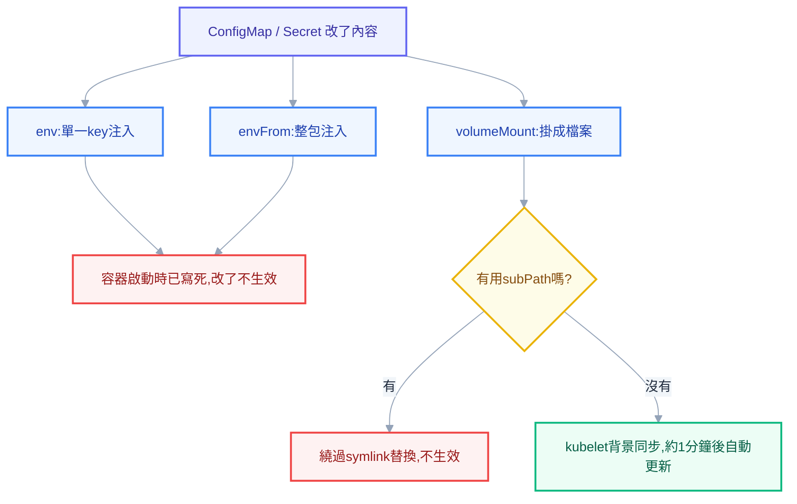
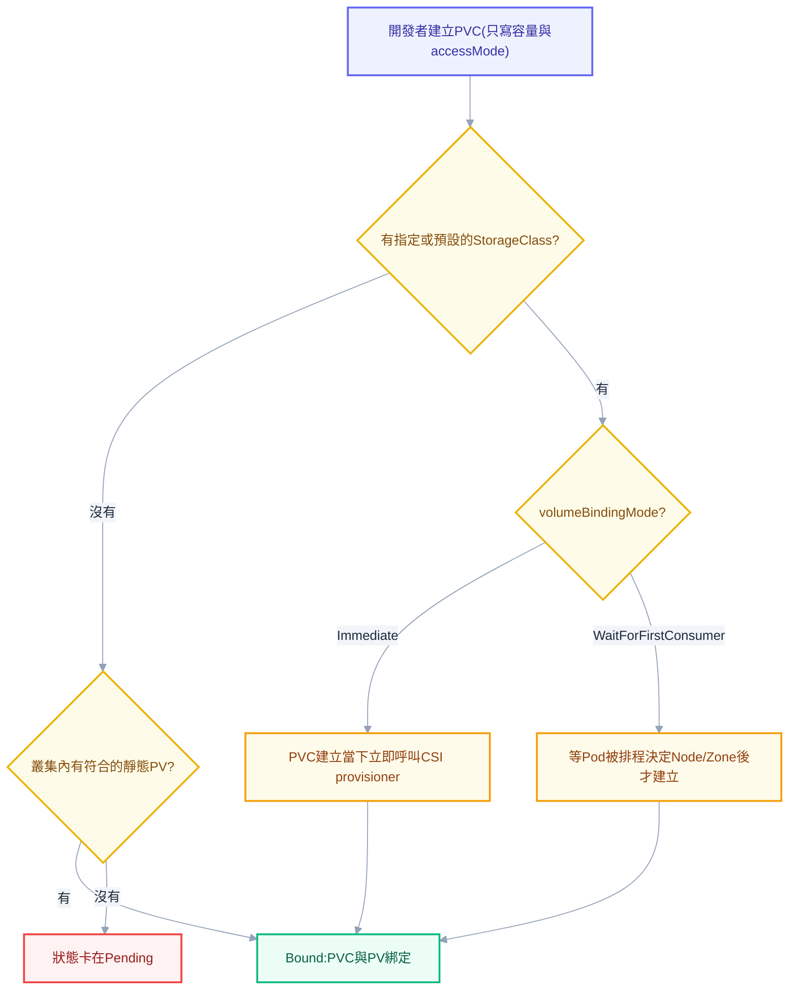
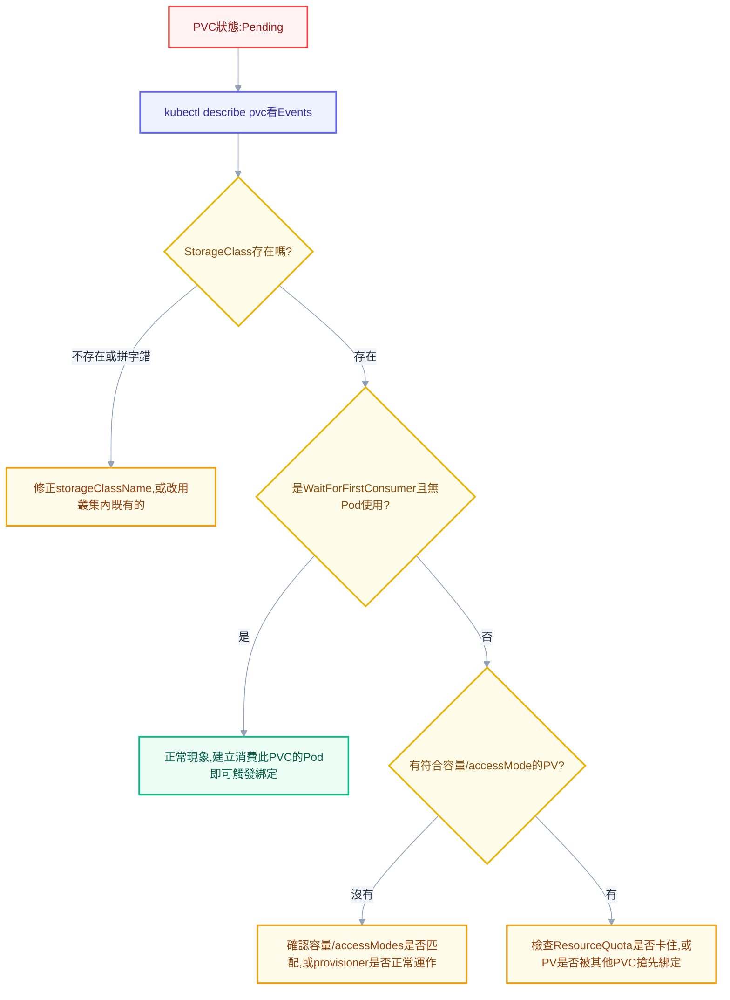

# 第六章：設定與儲存——讓容器活得乾淨，讓資料活得久

上一章處理的是「外部流量怎麼進來」，這一章要處理另外兩個每天都會撞到、卻常常被輕描淡寫帶過的問題：**設定怎麼進到容器裡**，以及**資料怎麼活過 Pod 重建**。這兩個問題聽起來簡單，實務上卻是新手跟資深工程師分水嶺最明顯的地方——「我改了 ConfigMap，為什麼服務行為完全沒變」「PVC 為什麼一直 Pending，Event 也看不出所以然」「StatefulSet 刪掉重建，資料到底還在不在」，這幾句話幾乎是每個 K8s 管理員都被同事問過、也都親自踩過的坑。這一章的目標，就是把這些問題背後的機制講到你下次遇到時，第一時間就能講出原因，而不是先慌一輪再開始亂試。

## 為什麼設定要跟映像檔分離

先回到一個最根本的問題：為什麼不能把資料庫連線字串、API 金鑰直接寫進程式碼、包進 image 裡就好？答案藏在一個很現實的場景裡——同一份程式碼，通常要跑在 dev、staging、prod 三個環境，資料庫位址不一樣、外部服務的 endpoint 不一樣、log 等級也不一樣。如果設定值烤進了 image，代表每換一個環境就要重新 build 一次 image，光是「dev 測試通過的 image 到了 prod 卻用著 dev 的資料庫」這種事故，就足以讓整個團隊對發版流程失去信任。更糟的是，一旦某個密碼外洩需要輪替，你得重新 build、重新推送、重新部署整個 image，只為了換一個字串。

這正是**十二要素應用（twelve-factor app）**方法論裡最核心的一條原則：設定必須以環境變數或外部檔案的形式注入，程式碼本身應該對「自己跑在哪個環境」一無所知。K8s 用 **ConfigMap** 與 **Secret** 這兩個原生資源實現這個原則——同一份 Deployment YAML、同一個 image，只要換一個 ConfigMap 或 Secret 的內容，就能在 dev、staging、prod 之間切換行為，完全不需要碰 image 本身。這也是為什麼這兩個資源幾乎出現在每一份實務上的 workload YAML 裡，理解它們的注入方式與更新行為，是這一章、也是整個治理篇的起點。

## ConfigMap：建立方式與三種注入

ConfigMap 本質上就是一份 K8s 幫你保管的 key-value 清單，建立方式有三種，各自適合不同的使用情境。最快的方式是 `--from-literal`，直接在指令列丟一組 key-value：

```bash
kubectl create configmap my-config --from-literal=APP_ENV=production --from-literal=LOG_LEVEL=info
```

如果你手上已經有一份設定檔（例如 `nginx.conf`），可以用 `--from-file` 把整份檔案內容當成一個 value 存進去，key 就是檔名：

```bash
kubectl create configmap nginx-config --from-file=nginx.conf
```

但實務上最常見、也最適合放進版控的方式，還是直接寫成 YAML，用 `kubectl apply` 套用：

```yaml
apiVersion: v1
kind: ConfigMap
metadata:
  name: my-config
  namespace: default
data:
  DB_HOST: postgresql.default.svc.cluster.local
  DB_PORT: "5432"
  app.properties: |
    server.port=8080
    log.level=info
```

有了 ConfigMap 之後，要注入到 Pod 裡，K8s 提供三種完全不同的方式，而這三種方式的差異，正是下一節要深入拆解的重點。

```yaml
apiVersion: apps/v1
kind: Deployment
metadata:
  name: my-app
spec:
  replicas: 2
  selector:
    matchLabels:
      app: my-app
  template:
    metadata:
      labels:
        app: my-app
    spec:
      containers:
        - name: app
          image: my-app:2.3
          env:
            - name: DB_HOST
              valueFrom:
                configMapKeyRef:
                  name: my-config
                  key: DB_HOST
          envFrom:
            - configMapRef:
                name: my-config
          volumeMounts:
            - name: config-volume
              mountPath: /etc/app-config
      volumes:
        - name: config-volume
          configMap:
            name: my-config
```

`env` 搭配 `configMapKeyRef` 只取單一個 key，適合你只需要某幾個設定值的場景；`envFrom` 搭配 `configMapRef` 則是把整包 ConfigMap 的所有 key 一次性變成環境變數，適合 key 名稱本身剛好可以直接當環境變數用、而且你需要全部設定值的情況；`volumeMount` 則是把整份 ConfigMap 掛成一個目錄，目錄底下每個 key 都變成一個檔案，適合像 `nginx.conf`、`application.properties` 這種需要以完整檔案形式讀取的設定。

## 改了 ConfigMap 為什麼沒生效：更新行為的分岔路

這是整章最容易踩、也最該講透的坑。情境是這樣的：你改了 ConfigMap 的內容，`kubectl apply` 也順利成功了，回頭去看服務，行為卻完全沒變——這不是 K8s 壞了，而是你選了哪一種注入方式，決定了這次修改到底會不會反映到正在跑的容器裡。

用 `env` 或 `envFrom` 注入的環境變數，其實只是容器啟動的那一刻，kubelet 把當時 ConfigMap 的內容讀出來、寫進這個容器行程的環境變數表裡，這個動作只發生一次。容器啟動之後，這份環境變數就是這個行程記憶體裡的一份靜態拷貝，跟 ConfigMap 這個 K8s 物件之間再也沒有任何連動關係——之後你把 ConfigMap 改成什麼樣子，這個已經在跑的容器完全不會知道，也不會重新讀取一次。這正是「環境變數注入的值在容器啟動後就固定了」這句話的實際意思：不是 K8s 忘記通知容器，而是這個機制從設計上就只做「啟動時讀一次」這件事，沒有任何後續同步的責任。

用 `volumeMount` 掛載成檔案的情況則完全不同。K8s 在背後用一種「原子替換」的機制維護這個掛載目錄：kubelet 會定期跟 API Server 同步 ConfigMap 的最新內容，一旦偵測到變化，就在背景準備好一份新的檔案，然後透過切換符號連結（symlink）的方式，把整個目錄瞬間指向新內容，而不是逐一覆寫舊檔案。這意味著只要應用程式會重新讀取這份檔案（而不是只在啟動時讀一次就快取在記憶體裡），檔案掛載的方式**會**自動反映 ConfigMap 的最新內容——但這裡有一個實務上必須知道的延遲：kubelet 的同步不是即時的，通常需要等上**約一分鐘**左右，這段延遲來自 kubelet 內部的快取更新週期，不是 bug，只是需要有耐心等它跑完一輪同步。

還有一個更陰險的陷阱：如果你用 `subPath` 只掛載目錄裡的單一檔案（而不是整個目錄），這個檔案**不會**享受到上面說的自動更新機制。原因是 `subPath` 掛載繞過了「切換符號連結」這套設計，容器看到的是直接 bind mount 進去的單一檔案，kubelet 背景的原子替換動作對它完全沒有作用，結果是：即使你選了 volume 這條理論上會自動更新的路，只要多加了一個 `subPath`，行為就退化成跟環境變數一樣的「寫死不更新」。



> **常見誤解：**「volume 掛載一定即時生效」——不對，它是最終一致（eventually consistent），中間有 kubelet 同步週期造成的延遲，而且只有應用程式真的會重新讀取檔案內容才有意義，如果程式只在啟動時讀一次就快取在記憶體，掛載方式再怎麼更新也沒用。

> **同事會來問你：**「我把 ConfigMap 改了，`kubectl apply` 也顯示成功，服務怎麼完全沒反應？」——先問清楚這個值是用 `env`/`envFrom` 注入還是 `volumeMount`。如果是前者，答案就是：環境變數在容器啟動那一刻就寫死了，唯一的解法是讓容器重啟。如果是後者，先確認有沒有用 `subPath`，再確認應用程式的邏輯到底有沒有重新讀檔，最後才檢查是不是還沒過那一分鐘的同步延遲。

## 讓改動真正生效：checksum annotation 與 rollout restart

既然環境變數注入天生就不會自動生效，總得有辦法讓 Deployment 知道「我這次改的 ConfigMap 很重要，麻煩把 Pod 重建一輪」。第四章講過，Deployment 判斷要不要觸發滾動更新的依據，是 `template` 這個欄位有沒有變化，而 `template` 裡通常只寫了 ConfigMap 的**名稱**，名稱沒變，Deployment 自然不覺得有任何事需要處理。

業界最常見的解法是 **checksum annotation** 技巧：把 ConfigMap 內容算出一個 hash 值，寫進 `template.metadata.annotations` 裡。因為 annotations 本身就屬於 `template` 的一部分，只要 ConfigMap 內容改變、hash 值跟著變，Deployment 就會偵測到 `template` 真的變了，進而觸發一次貨真價實的滾動更新，強迫所有 Pod 重建、拿到最新設定。

```yaml
apiVersion: apps/v1
kind: Deployment
metadata:
  name: my-app
spec:
  replicas: 2
  selector:
    matchLabels:
      app: my-app
  template:
    metadata:
      labels:
        app: my-app
      annotations:
        checksum/config: d41d8cd98f00b204e9800998ecf8427e
    spec:
      containers:
        - name: app
          image: my-app:2.3
          envFrom:
            - configMapRef:
                name: my-config
```

如果是用 Helm 管理（第十章會展開），這個 hash 通常直接在模板裡動態算：`checksum/config: {{ include (print $.Template.BasePath "/configmap.yaml") . | sha256sum }}`，每次 `helm upgrade` 都會重新計算，內容一變 annotation 就跟著變。如果手上沒有 Helm，或是想臨時手動觸發一次重建，最直接的做法就是：

```powershell
kubectl rollout restart deployment/my-app
```

這個指令的效果，本質上是幫 `template` 加上一個時間戳記類型的 annotation，強迫 Deployment 認定 `template` 已經變化，觸發一次滾動更新，但完全不需要真的去改任何 image 或欄位——這是排查「ConfigMap 改了沒生效」時最快的手動急救方式。

另外值得認識的是 `immutable: true` 這個欄位。把 ConfigMap 或 Secret 標記成不可變之後，K8s 會拒絕任何後續的修改請求，一旦叢集裡有大量 ConfigMap 且經常變動，kubelet 得持續 watch 它們的變化，這對 kube-apiserver 是不小的負擔；標成 immutable 之後，kubelet 就不需要再監看這個物件，省下的 watch 成本在大型叢集裡相當可觀，同時也順手防止了有人手滑改錯內容卻沒人發現的意外。代價是以後要換內容，得建立一個全新名稱的 ConfigMap（例如 `my-config-v2`），再把 Deployment 的 `template` 改成指向新名稱——但這件事本身就會讓 `template` 真的發生變化，等於順帶解決了上面講的「改了沒生效」問題。

## Secret：跟 ConfigMap 只差一個編碼

Secret 在 K8s 的資料結構上，跟 ConfigMap 幾乎是同一種東西，兩者連注入方式（`env`、`envFrom`、`volumeMount`）都完全共用同一套語法，實際的差異只有兩點：Secret 的 value 存的時候會先做 base64 編碼，以及 K8s 在處理上會對它多一份「這是敏感資料」的小心（例如 `kubectl get pods` 之類的一般輸出不會把 Secret 內容印出來）。

這裡藏著這一章最大的誤解，也是幾乎每個剛接觸 K8s 的人都會弄錯的一點：**base64 不是加密，是編碼**。加密需要金鑰，沒有金鑰就算拿到密文也還原不出明文；base64 只是一套把二進位資料轉成可列印字元的規則，任何人只要知道這是 base64（而這幾乎是公開常識），拿到字串就能立刻還原成明文，完全不需要金鑰。

```bash
kubectl get secret my-secret -o jsonpath="{.data.password}" | base64 -d
```

這行指令就是最好的證明——任何有權限執行 `kubectl get secret -o yaml` 的人，一行指令就能看到明文密碼。換句話說，Secret 這個資源真正提供的保護，不是「防止有權限的人看到內容」，而是「跟一般設定分開處理、方便套上 RBAC 限制存取範圍、避免明文散落在一般的 YAML 或 log 裡」。誰能 `get` 這個 Secret，誰就等於直接握有明文，這正是為什麼第八章會花整章篇幅講 RBAC 怎麼限制誰能碰 Secret 這個資源。

> **常見誤解：**「Secret 存起來是加密的，比 ConfigMap 安全」——如果只看 K8s 物件本身，Secret 跟 ConfigMap 一樣是明文（base64 只是編碼），真正的安全性差異來自兩個地方：etcd 有沒有開啟靜態加密（下一節會講），以及 RBAC 有沒有正確限制誰能讀取這個 Secret 物件。

> **萬一真的外洩了，處置順序是「先輪替，再清理」——而多數人的直覺是反的。**
>
> 發現密碼進了 git 或 log，第一反應通常是「趕快把它清掉」。但清理需要時間（改 git 歷史要協調所有人重新 clone、重建映像要跑一次 CI），而**在這段期間那份憑證仍然有效**；更重要的是你無法確定沒有人已經看過——repo 可能被 fork、被 CI 快取、被搜尋引擎索引。
>
> 正確的心智模型不是「清乾淨就沒事」，而是**「外洩即已失效」**：先讓那份憑證失效（輪替），事故的嚴重性就大幅下降，之後再從容清理來源、補上偵測、修正流程。完整的處置流程與各類憑證的輪替方式見 [[38-security-incident-response]]。

除了拿來裝一般的帳號密碼（`Opaque` 類型，也是預設值），Secret 還有幾種帶著特殊用途、K8s 會用不同方式處理的內建類型。`kubernetes.io/dockerconfigjson` 是 `imagePullSecrets` 專用的類型，儲存的是 image registry 的登入憑證，在使用 Harbor 這類私有 registry 時，Pod 要能成功拉取 image，就需要參照這種類型的 Secret：

```bash
kubectl create secret docker-registry harbor-cred `
  --docker-server=harbor.internal.example.com `
  --docker-username=robot-account `
  --docker-password=xxxxxxxx `
  --docker-email=devops@example.com
```

```yaml
apiVersion: v1
kind: Pod
metadata:
  name: app-from-harbor
spec:
  imagePullSecrets:
    - name: harbor-cred
  containers:
    - name: app
      image: harbor.internal.example.com/team/my-app:2.3
```

`kubernetes.io/tls` 則是第五章提過的 Ingress TLS 設定專用類型，裡面固定要有 `tls.crt` 與 `tls.key` 兩個 key：

```bash
kubectl create secret tls my-app-tls --cert=tls.crt --key=tls.key
```

這正是第五章 Ingress YAML 裡 `spec.tls[].secretName` 指向的那個物件——cert-manager 申請到憑證後，也是自動建立這種類型的 Secret 供 Ingress Controller 讀取。最後一種 `kubernetes.io/service-account-token`，則是每個 ServiceAccount 背後對應的認證憑證，第八章講 ServiceAccount 與 RBAC 時會完整展開它跟 Pod 認證鏈的關係，這裡先知道它的存在即可。

## etcd 靜態加密與 Secret 不該進 Git

上一節說 Secret 在 K8s 物件層級就是明文，那更底層一點——這些資料被 API Server 寫進 etcd（第二章講過，整個叢集狀態的唯一真相來源）之後，是不是至少在儲存層加密了？答案是：**預設沒有**。如果叢集沒有額外設定，Secret 寫進 etcd 的內容就是原封不動的明文（頂多套一層 base64），任何有辦法直接存取 etcd 資料檔案或備份檔的人，都能不透過 K8s API、繞過所有 RBAC 限制，直接拿到所有 Secret 的明文內容——這也是為什麼 etcd 備份檔案本身也必須被視為高度敏感資料嚴加保管。

要讓 Secret 在 etcd 裡真正被加密，需要在 kube-apiserver 設定一份 `EncryptionConfiguration`：

```yaml
apiVersion: apiserver.config.k8s.io/v1
kind: EncryptionConfiguration
resources:
  - resources:
      - secrets
    providers:
      - aescbc:
          keys:
            - name: key1
              secret: <base64編碼的32位元隨機金鑰>
      - identity: {}
```

`providers` 清單的順序很關鍵：K8s 會用清單裡第一個 provider 做加密，讀取時則依序嘗試每個 provider 解密。上面的範例把 `aescbc` 放在第一位，代表新寫入的 Secret 會被加密；如果不小心把 `identity`（代表不加密）放在第一位，即使清單裡也列了 `aescbc`，實際效果卻是完全不加密，因為新資料一律用清單第一位的 provider 處理。這份設定要透過 kube-apiserver 的 `--encryption-provider-config` 參數載入才會生效，而且**只對套用設定之後新寫入或更新的 Secret 有效**——已經存在的舊資料不會自動補加密，得手動跑一次 `kubectl get secrets --all-namespaces -o json | kubectl replace -f -` 強制重寫一遍，才能讓既有資料也套上加密。這件事會在第十二章維運篇再細談，這裡先建立「etcd 靜態加密不是預設行為，是要主動設定」的認知。

有了這層認知，就能理解為什麼「Secret 不該進 Git」這件事，在 GitOps 的世界裡是個天生的矛盾。第十一章會講 ArgoCD 與 GitOps 的核心信仰是「Git 是唯一真相來源，叢集裡的一切都該能從 Git 內容重建」，但 Secret 一旦進了 Git，就等於把明文密碼永久留在版控歷史裡——就算後來刪掉那一行，只要 Git history 沒有被清乾淨，任何拿到這個 repo 存取權的人都能翻出舊 commit 挖出明文，而且這幾乎是無法徹底清除的痛。這個矛盾沒有辦法靠「小心一點、不要手滑 commit」解決，只能靠改變 Secret 本身的管理方式來繞過，這正是下一節要談的外部 Secret 管理機制存在的理由。

## 外部 Secret 管理：Vault、External Secrets Operator、Sealed Secrets

解決「Secret 不該進 Git」這個矛盾，業界大致收斂出三條路，而你目前的環境（Vault + External Secrets Operator）剛好走的是其中最主流的一條，這裡值得講到可以直接操作的程度。

**HashiCorp Vault** 的角色是一個獨立於 K8s 之外、專門管理機密資料的服務，Secret 從此不再是「寫在 K8s YAML 裡的東西」，而是「存在 Vault 裡，K8s 只是拿到讀取權限的其中一個消費者」。Vault 啟動後預設處於**封存（sealed）**狀態——所有資料都在磁碟上加密，即使有人拿到磁碟檔案也無從解讀，因為解密用的 master key 本身並不會完整存在任何一個地方，而是透過 Shamir's Secret Sharing 演算法拆成好幾份分散保管的碎片。初始化與解封的實際指令長這樣：

```bash
kubectl exec -n infra vault-0 -- vault operator init -key-shares=3 -key-threshold=2
```

這行指令的意思是：把 master key 拆成 3 份碎片，其中任意 2 份湊在一起就能重建出完整金鑰。之後每次 Vault 這個 Pod 重啟（版本升級、Node 重排、單純的 crash），它都會重新回到狀態，需要有人拿出其中 2 把 key 執行兩次解封：

```bash
kubectl exec -n infra vault-0 -- vault operator unseal <key-1>
kubectl exec -n infra vault-0 -- vault operator unseal <key-2>
```

這個「每次重啟都要手動解封」的特性，在小規模環境裡是可以接受的操作成本，但也是很多團隊後續會導入雲端 KMS 做 auto-unseal 的原因——把這個手動流程自動化掉。Vault 與 K8s 之間比較安全、也是正式環境建議的整合方式，是啟用 **Kubernetes Auth Method**：Vault 不需要知道任何 K8s 的帳密，而是讓來源端（例如 ESO 的 Pod）帶著自己的 ServiceAccount token 過來，Vault 拿這個 token 反過來呼叫 K8s API 的 TokenReview 端點確認「這個 token 真的是這個 ServiceAccount、目前還沒過期」，驗證通過後，再依照預先設定的 Vault Role（綁定特定 ServiceAccount 與 namespace）發一張只有對應權限的 Vault token。這一整條認證鏈完全不需要人工介入，也不需要把任何長期有效的密碼寫死在設定裡。

Vault 另一個 ConfigMap/Secret 完全做不到的能力是**動態 secret**：不是預先存好一組固定帳密給大家共用，而是每次有人申請，Vault 就即時向資料庫要求建立一組全新、獨一無二、附帶存活時間的臨時帳號，用完或到期自動失效撤銷。相比一個寫死在 K8s Secret 裡、外洩了就得手動全面輪替的固定密碼，動態 secret 把外洩的影響範圍限制在一個很短的時間窗口內。

單靠 Vault 本身，應用程式還是得自己寫程式碼去呼叫 Vault API 才能拿到密碼，這對大部分只認得 `secretKeyRef` 的既有應用來說並不方便。**External Secrets Operator（ESO）** 補上的正是這一段轉譯——它是第九章講過的 Operator pattern 的具體實例，用三個 CRD 把外部系統的機密資料，轉譯成應用程式熟悉的原生 K8s Secret。`SecretStore`（限定單一 namespace）或 `ClusterSecretStore`（跨整個叢集共用）定義的是「怎麼連到 Vault」——位址、認證方式；`ExternalSecret` 定義的是「要同步哪些 key、多久同步一次、產生出來的 K8s Secret 該叫什麼名字」：

```yaml
apiVersion: external-secrets.io/v1beta1
kind: SecretStore
metadata:
  name: vault-backend
  namespace: default
spec:
  provider:
    vault:
      server: http://vault.infra.svc.cluster.local:8200
      path: infra
      version: v2
      auth:
        kubernetes:
          mountPath: kubernetes
          role: eso-reader
          serviceAccountRef:
            name: eso-sa
---
apiVersion: external-secrets.io/v1beta1
kind: ExternalSecret
metadata:
  name: postgresql-credentials
  namespace: default
spec:
  refreshInterval: 1h
  secretStoreRef:
    name: vault-backend
    kind: SecretStore
  target:
    name: postgresql-secret
  data:
    - secretKey: password
      remoteRef:
        key: database
        property: password
```

ESO 的 controller 依照這份定義，定期（`refreshInterval`）向 Vault 讀取指定路徑下的資料，寫成一個名叫 `postgresql-secret` 的原生 K8s Secret；應用程式那一端完全不需要修改任何一行程式碼，還是用最普通的 `secretKeyRef` 讀取 `postgresql-secret`，完全不知道背後真正的資料源頭其實是 Vault，也不需要知道。

```mermaid
%%{init: {'theme':'base','themeVariables':{
  'fontFamily':'ui-sans-serif, -apple-system, Segoe UI, Roboto, sans-serif',
  'fontSize':'14px',
  'primaryColor':'#eef2ff',
  'primaryTextColor':'#1e293b',
  'primaryBorderColor':'#6366f1',
  'lineColor':'#94a3b8',
  'secondaryColor':'#f1f5f9',
  'tertiaryColor':'#f8fafc',
  'noteBkgColor':'#fef9c3','noteTextColor':'#854d0e','noteBorderColor':'#eab308'
},'flowchart':{'curve':'basis','nodeSpacing':50,'rankSpacing':55,'htmlLabels':true}}}%%
flowchart LR
  Vault["Vault KV engine(真正的密碼源頭)"]:::primary
  SS["SecretStore(定義如何連線Vault)"]:::accent
  ES["ExternalSecret(定義同步哪些key)"]:::accent
  Ctrl["ESO Controller(reconcile loop)"]:::warn
  Sec["原生K8s Secret(自動產生/更新)"]:::success
  Pod["Pod用secretKeyRef讀取"]:::muted

  SS --> ES --> Ctrl
  Ctrl -->|"定期讀取"| Vault
  Ctrl -->|"建立/更新"| Sec
  Sec --> Pod

classDef primary fill:#eef2ff,stroke:#6366f1,stroke-width:2px,color:#3730a3;
classDef success fill:#ecfdf5,stroke:#10b981,stroke-width:2px,color:#065f46;
classDef warn fill:#fffbeb,stroke:#f59e0b,stroke-width:2px,color:#92400e;
classDef error fill:#fef2f2,stroke:#ef4444,stroke-width:2px,color:#991b1b;
classDef decision fill:#fefce8,stroke:#eab308,stroke-width:2px,color:#854d0e;
classDef accent fill:#eff6ff,stroke:#3b82f6,stroke-width:2px,color:#1e40af;
classDef muted fill:#f8fafc,stroke:#cbd5e1,stroke-width:1px,color:#64748b;
```



跟 Vault + ESO 這種「外部系統為主、K8s Secret 只是自動產生的副本」的思路完全相反的，是 **Sealed Secrets** 的做法——它解決的正好是上一節「Secret 不該進 Git」的矛盾，但用的是加密而不是外部化。做法是叢集裡跑一個 controller，持有一組非對稱金鑰，管理員用它的公鑰、搭配 `kubeseal` 這個 CLI 工具，把一份原本明文的 Secret 加密成一個 `SealedSecret` 這種自訂資源，加密後的密文只有叢集內那個 controller 手上的私鑰解得開。因為密文本身沒有私鑰就毫無意義，`SealedSecret` 可以安心地提交進 Git，套用到叢集後，controller 會自動把它解密還原成一個普通的 K8s Secret 供 Pod 使用。

三者的選型判準可以歸納成一張表：

| 情境                                                                        | 建議選擇               |
| --------------------------------------------------------------------------- | ---------------------- |
| 已經有 Vault 這類集中式機密管理系統，多個系統（不只 K8s）都要共用同一份密碼 | Vault + ESO            |
| 需要動態產生短期憑證、自動輪替，降低長期固定密碼外洩的風險                  | Vault（搭配 ESO 消費） |
| 只是想單純把 Secret 以加密形式放進 Git，不想額外維運一套外部系統            | Secrets                |
| 小團隊、沒有額外 infra 預算維護 Vault 這種有狀態服務                        | Secrets 較輕量         |

你目前的環境用 Vault + ESO，換來的是機密資料完全不落地在 Git 裡、也不需要每個應用自己實作 Vault API 呼叫邏輯，代價是多了一套需要手動解封、需要維運的有狀態服務——這個取捨在有專職維運人力的團隊裡通常划算，這也是為什麼它是目前業界最主流的組合。

## Volume 的全景：Pod 與容器怎麼共享儲存

講完設定，接下來是儲存。K8s 的 volume 機制有一個經常被忽略的兩層結構：`volumes` 宣告在 **Pod** 層級，代表「這個 Pod 手上有哪些儲存資源可以用」；`volumeMounts` 則宣告在**容器**層級，代表「這個容器要把哪一份 Pod 層級的 volume，掛到自己檔案系統的哪個路徑」。同一個 `volumes` 可以被 Pod 裡的多個容器各自掛到不同路徑，這正是前一章講過的 sidecar 模式（例如日誌代理跟主容器共享同一個 `emptyDir`）背後的機制基礎。

K8s 支援的 volume 類型有十幾種，實務上最常撞到的是這幾種。`emptyDir` 的生命週期跟 Pod 綁在一起——Pod 被排到某個 Node 時建立一個空目錄，Pod 從這個 Node 上消失（不管是正常刪除還是被驅逐）時這個目錄就跟著銷毀，適合暫存檔、容器間傳遞資料這類「用完即丟」的場景；把 `medium` 設成 `Memory`，這個 `emptyDir` 就會改用記憶體（tmpfs）而不是磁碟，讀寫速度快很多，但代價是會佔用這個 Pod 的記憶體額度，Node 重開機資料也會直接消失。

`hostPath` 把 Node 本身檔案系統的某個路徑直接掛進 Pod，這是**安全風險最高**的一種 volume 類型——它讓容器有能力直接碰觸宿主機的檔案系統，一旦容器被攻破，攻擊者等於直接拿到了 Node 層級的存取能力，這是容器逃逸類攻擊最常利用的破口之一。除此之外，`hostPath` 掛載的內容因 Node 而異，完全沒有可攜性，Pod 被排到不同 Node 上看到的內容可能天差地別。正式環境幾乎不該讓一般應用使用 `hostPath`，例外只有那些天生就需要碰觸宿主機資源的基礎設施元件（例如監控 agent 要讀 `/proc`、CNI plugin 要操作宿主機的網路設定），而且通常會用 DaemonSet 搭配嚴格的 RBAC 限制存取範圍。

`configMap` 與 `secret` 類型的 volume 前面已經講過，把物件內容掛成檔案。**`projected`** volume 則是進階版——它可以把 `configMap`、`secret`、`downwardAPI`、`serviceAccountToken` 這幾種不同來源的資料，合併掛進**同一個目錄**，省去分別掛好幾個 volume 的麻煩：

```yaml
volumes:
  - name: all-in-one
    projected:
      sources:
        - configMap:
            name: my-config
        - secret:
            name: my-secret
        - downwardAPI:
            items:
              - path: pod-name
                fieldRef:
                  fieldPath: metadata.name
```

**`downwardAPI`** 解決的是另一種需求：讓 Pod 內的程式能夠知道自己的 metadata（例如自己的 name、namespace、labels、資源 requests/limits），而不需要反過來呼叫 K8s API 查詢自己。這在應用程式需要把自己的 Pod 名稱寫進 log、或依照自己被分配到的資源限制動態調整內部執行緒數量時特別實用——不用額外賦予 RBAC 權限、不用寫任何呼叫 API Server 的程式碼，資訊直接以檔案或環境變數的形式出現在容器裡。

## 持久化儲存三件套：PV、PVC、StorageClass 為什麼要拆三層

前面談的 volume 都有一個共同的限制：跟著 Pod 的生命週期走，Pod 沒了資料也沒了。但資料庫、訊息佇列這類服務需要的是「Pod 可以重建、資料必須留著」，這正是第四章 StatefulSet 那一章埋下的伏筆——而真正負責「讓資料活得比 Pod 久」的，是 **PersistentVolume（PV）**、**PersistentVolumeClaim（PVC）**、**StorageClass** 這三個物件組成的持久化儲存體系。

初次接觸的人常有一個疑問：儲存空間這件事，為什麼不能直接在 Pod 的 YAML 裡寫清楚要用哪塊硬碟，而要拆成三個獨立的物件？答案是**關注點分離**：一個要部署應用的開發者，通常只想表達「我需要 10GB 空間、要能讀寫」這樣的需求，根本不想也不該去搞懂背後究竟是 NFS、雲端 EBS、還是地端一顆實體磁碟；而管理員或雲端 provisioner 關心的是「這塊儲存空間實際上要怎麼生出來、掛在哪個 Node、用哪種協定」。PVC 就是前者的申請單，PV 是後者提供的實際儲存資源，StorageClass 則是讓 PV 可以被**自動生成**（而不是每次都要管理員手動先建好）的模板。

早期的做法是**靜態供給**：管理員預先手動建立好一批 PV，開發者建立 PVC 時，K8s 內建的 PV controller 會在這批 PV 裡挑一個容量足夠、`accessModes` 相符、`storageClassName` 也對得上的，把兩者綁定（Bound）起來。這套做法在雲端環境裡效率太低——沒有人想每次有人申請儲存空間，就要手動去雲端主控台點一顆新硬碟出來。現在更普遍的做法是**動態供給**：PVC 直接指定一個 `storageClassName`，如果沒有現成 PV 符合條件，K8s 會呼叫這個 StorageClass 底下指定的 provisioner（通常是某個 CSI driver），即時建立一塊全新的儲存空間，並自動生成一個對應的 PV 跟這個 PVC 綁定——整個過程開發者完全無感，只感覺自己申請的 PVC 一下子就從 `Pending` 變成 `Bound`。

```yaml
apiVersion: storage.k8s.io/v1
kind: StorageClass
metadata:
  name: fast-ssd
provisioner: kubernetes.io/aws-ebs
parameters:
  type: gp3
reclaimPolicy: Delete
volumeBindingMode: WaitForFirstConsumer
allowVolumeExpansion: true
---
apiVersion: v1
kind: PersistentVolumeClaim
metadata:
  name: app-data-pvc
  namespace: default
spec:
  storageClassName: fast-ssd
  accessModes:
    - ReadWriteOnce
  resources:
    requests:
      storage: 10Gi
```



## accessModes 精確定義：RWO 不是「只能一個 Pod」

`accessModes` 是 PVC 常常寫錯、也常常被誤解的欄位，最容易搞混的就是 `ReadWriteOnce`（RWO）。幾乎每個人第一次看到都會直覺理解成「這個 volume 只能被一個 Pod 掛」，但這個理解**不精確**——RWO 精確的定義是：**這個 volume 一次只能被掛載到一個 Node 上進行讀寫**，而不是一次只能被一個 Pod 掛。如果同一個 Node 上同時跑著兩個都需要掛這個 volume 的 Pod，RWO 完全允許這兩個 Pod 同時掛載讀寫，只要它們待在同一個 Node 上就沒問題；真正會出事的情境，是這個 volume 已經被 Node A 上的某個 Pod 掛著，這時候另一個 Pod 被排程到 Node B、也想掛同一個 volume，這才會觸發衝突（下一節排錯會講到的 `Multi-Attach error` 正是這個情境的產物）。

| accessMode                 | 精確定義                                                                                                                      |
| -------------------------- | ----------------------------------------------------------------------------------------------------------------------------- |
| `ReadWriteOnce`（RWO）     | 同一時間只能有**一個 Node** 掛載讀寫，該 Node 上的多個 Pod 可以共用                                                           |
| `ReadOnlyMany`（ROX）      | 多個 Node 可以同時掛載，但只能唯讀                                                                                            |
| `ReadWriteMany`（RWX）     | 多個 Node 可以同時掛載讀寫，需要底層儲存後端原生支援（例如 NFS、CephFS），大多數雲端 block storage（EBS、Azure Disk）都不支援 |
| `ReadWriteOncePod`（RWOP） | 比 RWO 更嚴格，限制整個叢集裡**只能有單一個 Pod** 掛載，即使同一個 Node 上的另一個 Pod 也不行                                 |

> **常見誤解：**「RWO 就是只能一個 Pod 用」——精確地說是「只能一個 Node」。如果你真的需要「整個叢集絕對只能有一個 Pod 碰這個 volume」這種更嚴格的保證（例如避免誤設定造成兩個資料庫實例同時寫入同一份資料），該用的是 `ReadWriteOncePod`，而不是誤以為 RWO 已經提供了這個保證。

## reclaimPolicy 與 volumeBindingMode：資料保留策略與延遲綁定

PVC 被刪除之後，底下綁定的那塊實際儲存空間該何去何從，由 PV 的 `persistentVolumeReclaimPolicy` 決定，這是資料保護策略上很關鍵的一個開關。

| Policy    | 行為                                                                                              |
| --------- | ------------------------------------------------------------------------------------------------- |
| `Retain`  | PVC 刪除後，PV 進入 `Released` 狀態，底層資料完整保留，需要管理員手動確認、清理後才能重新變回可用 |
| `Delete`  | PVC 刪除時，底層儲存空間與 PV 物件一併刪除，動態供給的預設值                                      |
| `Recycle` | 已淘汰，原本行為是簡單清空內容後讓 PV 重新變回 `Available`，現在建議一律改用動態供給取代          |

`Delete` 圖方便但風險也最直接——一旦有人手滑刪錯 PVC，資料真的就沒了；`Retain` 則多留了一道防線，代價是需要有人記得回頭清理那些不再需要、卻一直佔著空間的舊 PV。正式環境裡承載重要資料的 StorageClass，通常會刻意把 `reclaimPolicy` 設成 `Retain`，用「多一道手動確認」換取「不會因為一次誤刪就徹底遺失資料」。

`volumeBindingMode` 則決定「PVC 什麼時候真正觸發綁定或建立」，預設值 `Immediate` 會在 PVC 一建立就立刻嘗試綁定或呼叫 provisioner，完全不考慮之後這個 PVC 會被哪個 Pod 使用、那個 Pod 又會被排程到哪個 Node。這在跨可用區（zone）的雲端環境或使用 local storage 時，會製造出一個第七章排程篇講過的拓樸錯配問題：如果 provisioner 依照 `Immediate` 模式，在 zone A 建出了一塊儲存空間，但排程器基於其他考量（資源、affinity）把真正要用它的 Pod 排到了 zone B，這個 Pod 就會永遠卡住無法啟動，因為 zone B 的 Node 根本碰不到 zone A 的那塊儲存。

`WaitForFirstConsumer` 解決的正是這個問題：它讓綁定（或動態供給）的時機延後到「真的有 Pod 要使用這個 PVC、而且排程器已經決定好這個 Pod 要放在哪個 Node」的那一刻，這樣 provisioner 才能參考排程結果，在正確的 zone、甚至正確的 Node 上建立儲存空間，從根本上避免拓樸錯配。這也是為什麼上一節 `StorageClass` 範例裡特意把它設成 `WaitForFirstConsumer` 而不是預設的 `Immediate`——只要你的環境有多 zone 或 local storage 的可能性，這幾乎該是預設選擇。

## CSI：K8s 不做儲存，只定義介面

第九章講過，K8s 對容器執行、網路、儲存這三件事的一致態度是「自己完全不實作，只定義標準介面」，儲存對應的正是 **CSI（Container Storage Interface）**。PVC 描述的永遠只是「我要多大容量、什麼存取模式」這種抽象需求，真正去雲端 API 或儲存陣列申請一塊實體空間、把它掛進 Node、再掛進 Pod 這幾個動作，全部是由對應的 CSI driver 完成的——K8s 核心程式碼從頭到尾不需要知道任何一家儲存廠商 API 的細節。

一個典型的 CSI driver 通常拆成兩個部分部署：**Controller Plugin**（通常是 Deployment 或 StatefulSet）負責跟雲端 API 或儲存陣列溝通，處理建立、刪除、attach、detach 這些不需要在特定 Node 上執行的操作；**Node Plugin**（通常是 DaemonSet，因為每個 Node 都需要一份）負責在實際跑 Pod 的那台 Node 上，把 volume 真正 mount、格式化、卸載。常見的實作包括雲端環境的 `ebs.csi.aws.com`、`disk.csi.azure.com`、`pd.csi.storage.gke.io`，地端環境常見的 `Ceph CSI`、`Longhorn`，以及需要跨 Node 共享讀寫時常用的 `NFS CSI driver`。認識 CSI 這一層的價值在於，日後遇到儲存相關的怪異行為，你會知道該去查的不是 K8s 本身的 bug，而是這個叢集裝了哪個 CSI driver、它的 controller 跟 node plugin 是不是都正常運作。

## PVC 擴容與快照

儲存空間不夠用是遲早會發生的事，K8s 支援**線上擴容**，但有一個嚴格的前提：對應的 StorageClass 必須把 `allowVolumeExpansion` 設成 `true`，這個欄位預設是關閉的。擴容的操作方式很直接——直接編輯 PVC 的 `spec.resources.requests.storage` 改成更大的數字：

```yaml
apiVersion: v1
kind: PersistentVolumeClaim
metadata:
  name: app-data-pvc
spec:
  storageClassName: fast-ssd
  accessModes:
    - ReadWriteOnce
  resources:
    requests:
      storage: 20Gi
```

送出之後，CSI controller 先在底層把實際的儲存空間擴大，接著視 CSI driver 是否支援線上檔案系統擴容而定，有些不需要重啟 Pod 就能讓 kubelet 自動觸發檔案系統層的 resize，有些則需要 Pod 重啟一次才會真正把新增的空間反映到檔案系統上；在這段期間，PVC 的狀態會顯示 `FileSystemResizePending`，代表底層空間已經擴大、只是還在等檔案系統層完成調整。這裡有一條沒有例外的規則：**只能往上擴，不能往下縮**——如果你把數字改得比原本小，這個請求會直接被拒絕。原因很直接：檔案系統的收縮在絕大多數實作上都是高風險操作，稍有不慎就可能造成資料損毀，而擴大只是單純增加可用空間，風險低得多，K8s 乾脆從設計上完全不開放縮小這條路。

比擴容更進一步的資料保護手段是 **VolumeSnapshot**。`VolumeSnapshotClass` 的角色類似 StorageClass，定義這次快照要用哪個 CSI driver 執行；`VolumeSnapshot` 則指定一個既有的 PVC 當作來源，向 CSI driver 要求對它做一次時間點快照：

```yaml
apiVersion: snapshot.storage.k8s.io/v1
kind: VolumeSnapshot
metadata:
  name: app-data-snapshot
spec:
  volumeSnapshotClassName: csi-snapclass
  source:
    persistentVolumeClaimName: app-data-pvc
```

要從這份快照還原資料，做法是建立一個全新的 PVC，把 `dataSource` 指向這個 `VolumeSnapshot`，provisioner 收到請求後，會從快照複製出一份新的儲存空間給這個新 PVC 使用，原本的 `app-data-pvc` 完全不受影響——這也是資料庫升級前、或做任何有風險的資料操作前，最推薦的保險做法。

## StatefulSet 與儲存：volumeClaimTemplates 與那次密碼對不上的踩坑

第四章介紹 StatefulSet 時提過，它跟 Deployment 在儲存概念上最本質的差異是 `volumeClaimTemplates`——K8s 依照副本序號，自動幫每個 Pod 建立各自獨立命名的 PVC（`data-postgres-0`、`data-postgres-1`……），而不是像 Deployment 那樣所有副本共用同一份 PVC。這一節要接著講的是這個機制帶來的兩個對管理員極其重要、卻常被誤以為是 bug 的行為，以及一個真實發生過的完整事故。

第一個行為：**縮容 StatefulSet 不會連帶刪除被縮掉的那些 PVC**。這是刻意的設計——如果縮容連 PVC 都一起刪，任何一次誤縮容（打指令手滑多按了一個 0）都可能造成資料永久遺失，K8s 選擇了更保守的路線，把「這份資料真的可以丟了」這個決定權留給人類，而不是自動幫你判斷。第二個行為，也是很多人沒想過的一點：**刪除整個 StatefulSet 本身，同樣不會級聯刪除任何 PVC**。這跟 Deployment→ReplicaSet→Pod 那條靠 `ownerReferences` 串起來、刪除時會自動連鎖清理的 GC 鏈不一樣——PVC 在這個意義上並不是被 StatefulSet「擁有」的子資源，它的生命週期是被刻意獨立出來管理的，`kubectl delete statefulset` 之後，你回頭 `kubectl get pvc` 依然會看到那些 PVC 好端端地躺在那裡，狀態是 `Bound`。

這兩個行為背後共同的哲學是「刪 Pod 容易，刪資料要難」，但這個保護機制在你實際的環境裡，卻造成了一次真實的踩坑——Bitnami PostgreSQL 用 Helm 重裝時，密碼怎麼設都連不上。

完整的事故經過是這樣的：你用 Bitnami 的 PostgreSQL Chart 部署過一次，指定了一組密碼；後來想要換一個新密碼，直覺的做法是 `helm uninstall` 之後再重新 `helm install`，並在 `--set auth.postgresPassword` 帶入新密碼。結果重裝完成後，用新密碼完全連不上資料庫，反而是舊密碼才連得上——乍看之下像是 Helm 的 `--set` 沒有生效，但問題其實出在 PVC 身上。

原理要從 PostgreSQL 容器的啟動腳本說起：容器的 entrypoint 會先檢查 `PGDATA` 這個資料目錄是不是空的，只有在**全新、空白**的資料目錄上，才會執行 `initdb` 這個初始化流程——而密碼，正是在 `initdb` 這個階段，才會依照傳入的環境變數（也就是 `auth.postgresPassword` 最終轉譯成的那個值）寫進資料庫內部的使用者表。如果 `PGDATA` 目錄裡已經有資料（代表這個資料庫之前已經初始化過），entrypoint 判斷不需要重新 `initdb`，會直接用現有資料庫檔案啟動——這時候不管你在 `helm install` 帶了什麼新密碼，都不會有任何效果，因為根本沒有執行到「寫入密碼」的那一段程式碼。

而 `helm uninstall` 只會清掉這次 Release 建立的 Deployment、StatefulSet、Service 這些「無狀態」的資源，PVC（正是上面剛講過的、StatefulSet 縮容或刪除都不會連帶刪除的那個 PVC）會完整地被留下來。等你重新 `helm install`，新建立的 StatefulSet 透過 `volumeClaimTemplates` 產生的 PVC 名稱如果跟舊的重名，就會直接掛回那個裝著舊資料的 PVC，`PGDATA` 目錄裡早就有上一次留下的完整資料庫檔案——於是新 Pod 啟動時判斷「已經初始化過」，跳過 `initdb`，你這次帶進去的新密碼完全被無視，資料庫裡真正生效的，永遠是第一次部署時寫進去的那組舊密碼。

解法只有一個，而且必須是刻意、確認過的操作：在 `helm uninstall` 之後，先確認真的不再需要這份資料，手動執行 `kubectl delete pvc` 把那些殘留的 PVC 清乾淨，再重新 `helm install`。這樣新的 StatefulSet 拿到的會是一個真正全新、空白的資料目錄，`initdb` 才會重新跑一次，這次 `--set auth.postgresPassword` 帶進去的新密碼才會真正被寫入資料庫。

```powershell
helm uninstall postgresql -n <namespace>
kubectl delete pvc -l app.kubernetes.io/instance=postgresql -n <namespace>
helm install postgresql bitnami/postgresql -n <namespace> `
  --set auth.postgresPassword="<new-password>" `
  --set primary.persistence.size=2Gi
```

> **同事會來問你：**「我明明改了 Helm 的密碼設定，重裝之後怎麼還是連不上，是不是 `--set` 語法寫錯了？」——先問一句「重裝前有沒有先刪 PVC」。九成的情況答案都是沒有，而根本原因不是 `--set` 失效，是 PostgreSQL 只有在資料目錄全新空白時才會執行 `initdb` 寫入密碼，PVC 留著等於資料庫根本沒有重新初始化，密碼設定自然不會生效。這正是「StatefulSet 縮容/刪除刻意不連帶刪 PVC」這個保護設計，在資料庫密碼輪替場景下反而製造出的副作用。

## 常見問題排查：從 PVC Pending 到 Multi-Attach error

儲存相關的故障，最終幾乎都會收斂到這幾個高頻現象，把它們的成因摸熟，能省下大量對著一片空白 Event 發呆的時間。

**PVC 卡在 `Pending`**：先執行 `kubectl describe pvc <name>` 看 Events 裡的訊息，常見成因有四種——沒有符合容量與 `accessModes` 的靜態 PV（純手動供給環境）；PVC 指定的 `storageClassName` 打錯字或根本不存在，可以用 `kubectl get storageclass` 確認清單；容量或 `accessModes` 跟現有的 PV 對不起來；叢集根本沒有安裝任何 CSI provisioner，動態供給無從發生。另外有一種**完全正常、不是故障**的情況：如果這個 StorageClass 是 `WaitForFirstConsumer`，PVC 在還沒有任何 Pod 引用它之前，本來就會一直停在 `Pending`，這是設計行為，只要建立會用到這個 PVC 的 Pod，排程一決定，綁定馬上就會發生。



**Pod 卡在 `ContainerCreating`**：這通常是掛載步驟失敗，第十三章講過的排查方法論在這裡完全適用——`kubectl describe pod` 的 Events 裡如果出現 `FailedMount`、`FailedAttachVolume` 這類訊息，代表問題出在 volume 這一層，而不是 image 拉取或容器啟動邏輯，該去查的是 CSI driver 的狀態、底層儲存後端是否正常回應。

**`Multi-Attach error`**：這個錯誤幾乎都跟上面講過的 RWO 精確定義有關——RWO 限制的是「同一時間只能一個 Node」，如果一個 Deployment 誤用了 RWO 的 PVC，卻又設定了大於 1 的 `replicas`，一旦這些副本被排程到不同 Node 上，第二個 Pod 想掛同一個 volume 就會直接撞上這個錯誤。另一種常見情境是 Node 發生 crash 或進入 `NotReady`，原本掛在它身上的 Pod 被重新排程到別的 Node，但舊 Node 上的 volume attachment 因為那個 Node 已經失聯，沒能被正常釋放，新 Node 上的 Pod 想要 attach 同一個 volume 時就會卡住，通常需要等 K8s 判定舊 attachment 逾時、或由管理員手動介入清除卡住的 `VolumeAttachment` 物件才能解開。

**磁碟空間用滿**：PVC 底層的實際空間被寫滿時，Pod 有時候看起來還在 `Running`，但寫入操作會開始失敗，嚴重時甚至觸發第七章講過的驅逐機制。排查時先進容器內用 `df -h` 或直接檢查掛載點的使用量，確認確實是空間問題之後，如果 StorageClass 有開 `allowVolumeExpansion`，直接照上一節的方式擴容即可，比手忙腳亂清資料快得多。

**掛載點權限問題**：PVC 掛上來的目錄，預設擁有者常常是 `root`，如果容器本身設定成以非 root 使用者執行（`runAsUser`），寫入這個目錄時就會遇到 `Permission denied`。解法是在 Pod 的 `securityContext` 裡設定 `fsGroup`，K8s 掛載這個 volume 時會自動把目錄的群組擁有權調整成這個 GID，讓指定使用者所在的群組能夠正常讀寫：

```yaml
apiVersion: v1
kind: Pod
metadata:
  name: app-with-fsgroup
spec:
  securityContext:
    fsGroup: 1000
  containers:
    - name: app
      image: my-app:2.3
      securityContext:
        runAsUser: 1000
      volumeMounts:
        - name: data
          mountPath: /data
  volumes:
    - name: data
      persistentVolumeClaim:
        claimName: app-data-pvc
```

如果這個 volume 容量很大，每次掛載都要重新遞迴 `chown` 整個目錄，會拖慢 Pod 的啟動速度，部分 CSI driver 支援把 `fsGroupChangePolicy` 設成 `OnRootMismatch`，只在根目錄擁有權真的不對時才執行一次調整，日後重複掛載就能跳過這個開銷。

## 連結

- [[k8s-mastery]]
- [[04-workloads]]
- [[08-security-and-rbac]]
- [[10-helm]]
- [[13-troubleshooting]]
- [[kubernetes]]
