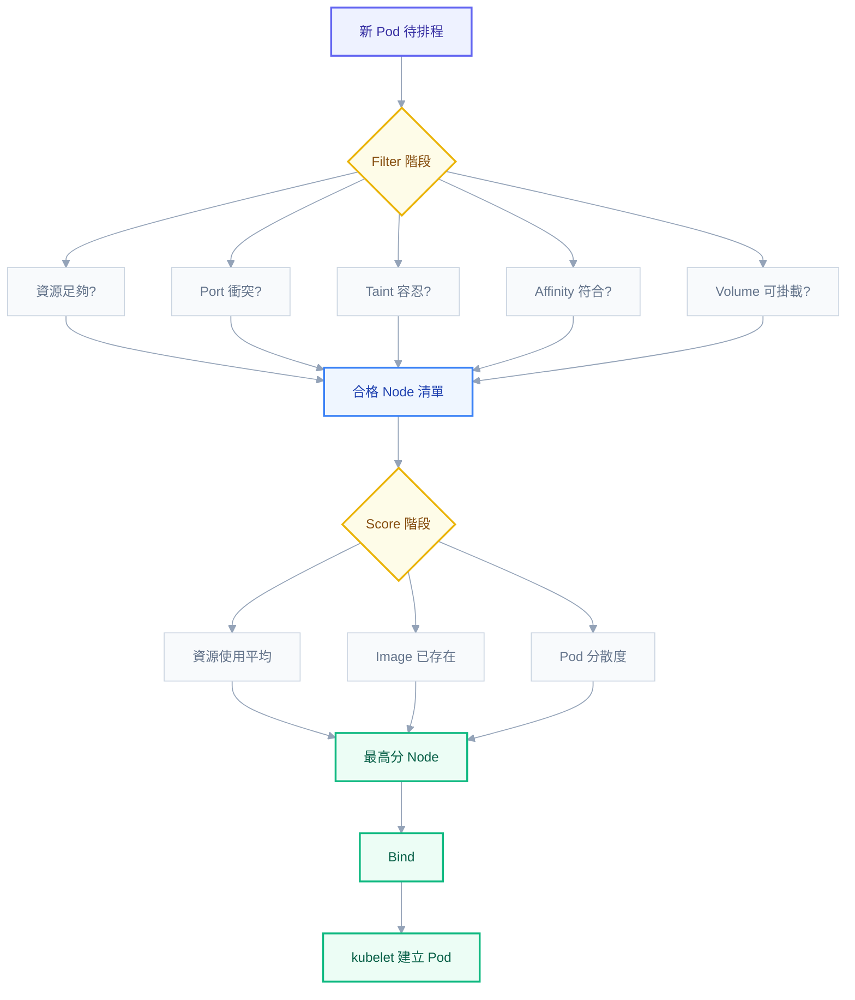
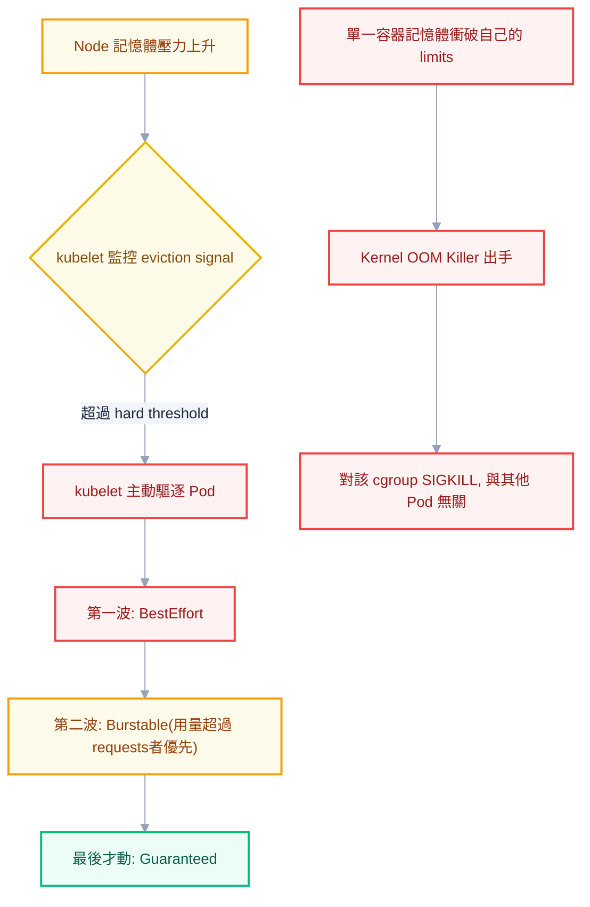

# 第 7 章：排程與資源治理

如果你讀到這裡，前面幾章已經讓你把 Pod、Deployment、Service 玩得很熟——你知道怎麼包一個容器、怎麼讓它對外曝露、怎麼用 ConfigMap 管設定。但那些都是「開發者視角」：你關心的是「我的 Pod 能不能跑起來」。這一章要換一個角色。當你的職稱不再是「寫這個服務的人」，而是「管這個叢集的人」，你要回答的問題完全不同：為什麼這個 Pod 排不進去？為什麼它半夜被殺掉，早上同事來問你「服務掉線了」？為什麼 Grafana 上 CPU 明明沒滿，API 卻慢得像蝸牛？

這些問題的答案都藏在同一個地方——K8s 怎麼決定「誰能跑」「跑多少」「誰先死」。這正是排程（scheduling）與資源治理（resource governance）要處理的事。開發者只要 Pod Running 就滿足了；管理員必須理解背後那套決策機制，才能在同事丟問題過來時，一眼看出病灶在哪一層。這一章會照著「排程決策 → 資源分配 → 節點壓力 → 進階排程控制 → 自動化治理」的順序，把整條鏈路攤開來講。

## Scheduler 如何決策：兩階段的篩選與打分

當你 `kubectl apply` 一個新 Pod，它並不會立刻出現在某台機器上。它會先進入一個叫 `kube-scheduler` 的元件手裡，被丟進一個兩階段的流程：先篩選（Filter），再打分（Score），最後才綁定（Bind）。理解這個流程，是回答「為什麼我的 Pod 一直卡在 Pending」的起點——十次有八次，答案就藏在 Filter 階段被刷掉的原因裡。

**Filter 階段（早期版本稱為 Predicates）** 的工作很直白：把叢集裡所有 Node 過一遍，只要有一項硬性條件不滿足，這個 Node 就直接出局，連打分的資格都沒有。常見的 filter 包括：這個 Node 剩餘的可分配資源（allocatable）夠不夠這個 Pod 宣告的 `requests`；Pod 想用的 `hostPort` 在這個 Node 上是否已被別人佔用；Node 身上貼的 taint，這個 Pod 有沒有對應的 toleration 能容忍；Pod 的 `nodeAffinity`/`nodeSelector` 規則這個 Node 符不符合；Pod 要掛載的 Volume（尤其是有 zone 限制的雲端硬碟）這個 Node 是否掛得上。只要闖過所有 filter 的 Node，才會進入下一階段的候選名單。

**Score 階段（早期稱為 Priorities）** 則是替候選 Node 打分，決定「這麼多合格的 Node 裡，哪一個最適合」。常見的 scoring 邏輯包括：這個 Node 排進這個 Pod 之後，資源使用率會不會比其他 Node 更均衡（避免有些 Node 被塞爆、有些卻很閒）；這個 Node 上是不是已經有這個 Pod 要用的 image，省下拉取image的時間；把這個 Pod 排上去之後，同一個 Deployment 底下的副本會不會過度集中在同一個 Node 上（分散度）。所有分數加總後，分數最高的 Node 雀屏中選，Scheduler 執行 **Bind**，把「這個 Pod 歸這個 Node 管」的決定寫回 API Server，最後由該 Node 上的 `kubelet` 真正把容器跑起來。



> **同事會來問你：**「我的 Pod 卡在 Pending，到底哪個 Node 不要它？」——第一件事永遠是 `kubectl describe pod <name>`，看 Events 區塊。Scheduler 會老實列出每個 Node 被刷掉的原因，例如 `Insufficient cpu`、`node(s) had taint that the pod didn't tolerate`、`didn't match Pod's node affinity/selector`。這段訊息比任何猜測都準。

## requests 與 limits：兩個數字，兩個完全不同的用途

這是整章、甚至整套 K8s 資源治理裡最重要、也最多人搞混的觀念。很多人以為 `requests` 和 `limits` 只是「下限」跟「上限」的溫和說法，兩者本質相同只是數值不同。這是錯的——它們服務兩個完全不同的系統，發生在完全不同的時間點。

`requests` 只在**排程當下**有意義。當 Scheduler 在做 Filter 階段的資源檢查時，它比對的是「這個 Node 上所有已排定 Pod 的 requests 總和」加上「新 Pod 的 requests」，看看會不會超過這個 Node 的 allocatable 資源。注意這句話的關鍵：Scheduler 看的是**宣告值的總和**，不是**實際用量**。一旦 Pod 排定上了 Node，`requests` 這個數字對 Scheduler 來說就完成任務、退場了——它不會再回頭檢查這個 Pod 實際吃了多少 CPU、多少記憶體。

`limits` 則活在完全不同的時間軸上：它管的是**執行期**（runtime）的行為，由 Node 上的 container runtime 透過 Linux cgroup 機制強制執行。簡單說，`limits` 是寫進 cgroup 設定檔裡的硬上限，容器想超過這個數字使用資源，cgroup 會出手管制——而管制的方式，CPU 和 Memory 完全不同（下一節會講透）。

從這兩個事實可以推導出一個所有管理員都必須刻在腦子裡的結論：**Node 可以被超賣（overcommit）**。因為 Scheduler 只看 requests 總和決定排不排得下，而 Pod 實際執行時吃的資源可能遠高於它宣告的 requests（只要沒超過 limits，cgroup 不會阻止）。想像一個 Node 有 8 顆 CPU，上面排了 20 個 Pod，每個都宣告 `requests.cpu: 200m`（總和 4 顆，帳面上還有 4 顆餘裕，Scheduler 很樂意繼續往上排），但每個 Pod 的 `limits.cpu` 都設成 `1000m`。一旦這 20 個 Pod 同時流量尖峰、都想衝到 limits 附近，這台 Node 瞬間需要 20 顆 CPU 才夠——而它只有 8 顆。這就是「明明 Dashboard 顯示資源充足，服務卻集體變慢」最常見的真正成因。

```yaml
apiVersion: v1
kind: Pod
metadata:
  name: requests-limits-demo
spec:
  containers:
    - name: app
      image: my-app:1.4
      resources:
        requests:
          cpu: 250m # 排程依據: Node 剩餘 allocatable 要 >= 250m 才排得進去
          memory: 256Mi # 排程依據: 同上，只在排程當下比較一次
        limits:
          cpu: 1000m # 執行期上限: cgroup 強制節流，超過就 throttle
          memory: 512Mi # 執行期上限: cgroup 強制上限，超過就 OOMKilled
```

> **常見誤解：**「我把 requests 設高一點，Pod 就會跑得比較快」——不會。requests 只影響「能不能排上去」，完全不影響排上去之後分到多少實際運算資源（那是 limits 加上 cgroup 排程權重的事）。requests 設太高唯一的效果，是讓 Scheduler 覺得這個 Node 更擠，可能導致 Pod 排不進去，或整體叢集 Node 使用率被人為墊高、Cluster Autoscaler 誤判要多開機器。

## CPU 與 Memory 的不對稱：一個變慢，一個直接死

承接上一節的伏筆——當 Pod 實際用量超過 `limits`，會發生什麼事？這裡藏著全 K8s 最容易被答錯的觀念：**CPU 超過 limit 和 Memory 超過 limit，後果完全不同，因為這兩種資源的本質不同。**

CPU 是一種**可壓縮資源（compressible resource）**。可壓縮的意思是，你可以讓一個 process 用比較少的 CPU 時間片，它不會因此死掉，只會執行得比較慢。所以當一個容器的 CPU 使用量觸頂 `limits.cpu`，Linux cgroup（透過 CFS——Completely Fair Scheduler 的 quota 機制）會對它做 **throttling（節流）**：在每個排程週期（預設 100ms）裡，一旦這個容器用掉了配額，cgroup 就不再分配 CPU 時間給它，讓它「停頓」到下一個週期。容器不會被殺、不會重啟、Pod 狀態依然是漂亮的 `Running`，但它裡面的程式碼執行速度活生生被打了折扣。

Memory 則完全相反，它是**不可壓縮資源（incompressible resource）**。記憶體沒有「先借用一下、之後再還」的空間——一個 process 要求分配一塊記憶體，作業系統要嘛給、要嘛拒絕，無法讓它「用慢一點」來將就。所以當容器的記憶體用量觸頂 `limits.memory`，cgroup 沒有節流這個選項可用，唯一的手段就是直接送出 `SIGKILL`——這就是大家在 `kubectl describe pod` 裡看到的 **OOMKilled**。容器瞬間死亡，`kubectl get pod` 上會看到 `RestartCount` 增加，若沒有其他問題，kubelet 會依 restart policy 把它重啟起來，但重啟期間服務是真的斷過。

這個不對稱性，直接對應到兩種你在事故現場會遇到的完全不同症狀。CPU throttling 的症狀是「服務沒有掛，但慢得離譜，而且應用程式本身沒有任何錯誤log」——因為從應用程式的視角，它只是「這次系統呼叫比較慢」，它根本不知道自己被 cgroup 卡住了。Memory 觸頂則是「服務直接斷線、Pod 重啟、有清楚的 OOMKilled 紀錄」，症狀明顯到不太會被誤判。

想確認「是不是 CPU throttling 在搞鬼」，不能只看 `kubectl top pod` 的 CPU 使用率——因為 throttling 恰恰會讓「使用率」看起來不高（畢竟它被限制住了、衝不上去），這是最容易誤判的地方。真正該看的指標是 cgroup 暴露出來的 throttle 計數，在 Prometheus/cAdvisor 體系裡對應 `container_cpu_cfs_throttled_periods_total`（被節流的週期數）與 `container_cpu_cfs_periods_total`（總週期數），兩者相除就是節流比例；也可以直接在 Node 上看 `/sys/fs/cgroup/.../cpu.stat` 裡的 `nr_throttled`。只要這個比例不是 0，就代表這個容器正在被限制，而它表現出來的症狀，十之八九就是「應用沒報錯但變慢」。

> **同事會來問你：**「我的 API 平常 100ms 內回應，尖峰時段變成 2 秒，但 log 完全乾淨、CPU 使用率圖表也沒有到頂，到底怎麼回事？」——這正是 CPU throttling 的教科書症狀。先查 `container_cpu_cfs_throttled_periods_total`，再回頭看這個 Pod 的 `limits.cpu` 設得是不是太保守。多數時候答案是把 `limits.cpu` 調高、或乾脆去掉 CPU limit（只留 requests，讓它能彈性借用 Node 閒置算力）。

## QoS Class：從 requests/limits 推導出的三種階級

`requests` 與 `limits` 的組合方式，還會決定另一件影響深遠的事——這個 Pod 屬於哪個 **QoS（Quality of Service）Class**。K8s 不需要你手動指定 QoS，它是系統依照你怎麼寫 `resources` 欄位**自動推導**出來的，分成三級，分級規則其實很單純。

**Guaranteed** 是最高等級，條件是：Pod 裡**每一個** container 都同時設定了 `requests` 與 `limits`，而且對 CPU 和 Memory 而言，`requests` 必須**等於** `limits`。這代表這個 Pod 要求的資源量是「精確」的，系統可以完全保證它拿到承諾的資源，不多不少。

**Burstable** 是中間等級，條件是：Pod 至少有一個 container 設定了 `requests` 或 `limits`，但不滿足 Guaranteed 的「處處相等」條件——最常見的情況就是 `limits` 比 `requests` 高一截，讓 Pod 平常只占用 requests 的量，尖峰時段可以「爆發（burst）」借用到 limits 的量。這是實務上最常見、也最建議的寫法，因為它兼顧了資源保證與彈性。

**BestEffort** 是最低等級，條件是：Pod 裡**完全沒有**設定任何 `requests` 或 `limits`。這種 Pod 對系統來說是「有多少算多少」，沒有任何資源保證，也是 Node 資源緊張時第一個被犧牲的對象。

```yaml
# Guaranteed: requests 與 limits 完全相等
resources:
  requests:
    cpu: 500m
    memory: 256Mi
  limits:
    cpu: 500m
    memory: 256Mi
---
# Burstable: 有設定但 requests < limits
resources:
  requests:
    cpu: 250m
    memory: 128Mi
  limits:
    cpu: 1000m
    memory: 512Mi
---
# BestEffort: 完全不設定 resources 欄位
# (連 resources: {} 都不用寫，什麼都不寫即是 BestEffort)
```

QoS Class 不是拿來好看的分類標籤，它的真正作用是**決定 Node 記憶體壓力來臨時，誰先被犧牲**。這條規則會在下一節「Eviction」詳細展開，但先建立直覺：BestEffort 最先死，Burstable 次之（而且是「超過自己 requests 的那些」優先被清），Guaranteed 幾乎是最後才會被動到的族群。這代表你的核心服務、資料庫這類「死不得」的工作負載，應該盡量寫成 Guaranteed 或至少 Burstable，而不是圖方便什麼都不寫，變成 BestEffort。



## Node 壓力驅逐（Eviction）：kubelet 主動出手，kernel 被動出手

上面那張圖其實藏了兩條完全不同的路徑，很多人會把它們混為一談，但對管理員來說分清楚它們是必修課：**kubelet 的 eviction** 和 **kernel 的 OOM Killer**，是兩個不同層級、不同觸發條件、甚至不同「殺法」的機制。

**kubelet eviction** 是一種**預防性**的機制。kubelet 會持續監控 Node 整體的資源餘裕，包括 `memory.available`（可用記憶體）、`nodefs.available`（主要檔案系統可用空間）、`nodefs.inodesFree`、`imagefs.available`、`pid.available` 等訊號，並設有 soft 和 hard 兩種門檻。Hard threshold 一旦跨過，kubelet 立刻開始驅逐 Pod，不等 Pod 優雅關閉；soft threshold 跨過則會給一段 grace period，期望壓力自然緩解。這整套機制的目的，是在 Node **真正被壓垮、kernel 被迫介入之前**，由 kubelet 先「未雨綢繆」地清空一些 Pod，把 Node 拉回安全水位。而它挑誰下手的順序，正是上一節講的 QoS 邏輯：先清 BestEffort，再清超用的 Burstable，Guaranteed 最後才會被考慮。

**kernel OOM Killer** 則是完全不同層級的機制，它不看 QoS，不看整個 Node 的資源餘裕，它的觸發範圍窄到只針對「單一 cgroup（也就是單一容器）記憶體衝破自己的 limits，或整個系統實體記憶體被榨乾」這一瞬間。這是 Linux kernel 內建、由來已久的機制，跟 K8s 完不完全沒有關係——K8s 只是把每個容器包進一個 cgroup，借用了這套既有機制當作 `limits.memory` 的執行手段。OOM Killer 出手是**瞬間、直接的 SIGKILL**，沒有寬限期，沒有排隊順序，它只認「誰在這個當下超記憶體超得最兇」。

一句話總結兩者的差異：**kubelet eviction 是「管理員未雨綢繆式的整隊驅逐」，OOM Killer 是「kernel 逼到牆角時的當機立斷」。** 前者你在 `kubectl get events` 會看到 `Evicted` 字樣加上明確原因（例如 `The node was low on resource: memory`）；後者則是容器的 `LastState` 顯示 `OOMKilled`、`exit code 137`。看到哪種訊息，就知道你在哪個層級的問題。

## Taints 與 Tolerations：貼給 Node 的「閒人勿近」標籤

有些 Node 你不希望隨便什麼 Pod 都排進去——可能它裝了昂貴的 GPU 只想留給訓練任務用，也可能它是 Master Node 只想拿來管叢集不想被業務 Pod 占用，又或者它剛被監控系統標記為疑似故障、你不希望新 Pod 繼續往上排。Taint 就是替 Node 貼上一張「閒人勿近」的標籤，而 Pod 要嘛乖乖繞道，要嘛帶著一張寫著「我不怕」的通行證——這張通行證就是 Toleration。

Taint 由三個部分組成：`key`、`value`、`effect`，其中 `effect` 決定了「不容忍的 Pod 會被怎麼對待」，共有三種：

| Effect | 行為 |
| --- | --- |
| `NoSchedule` | 新 Pod 不會被排上這個 Node，但已經在跑的 Pod 不受影響 |
| `PreferNoSchedule` | 軟性版本，Scheduler 會盡量避開，但資源緊張時仍可能排上去 |
| `NoExecute` | 不只擋新 Pod，連**已經在這個 Node 上跑的、沒有對應 toleration 的 Pod 都會被趕走** |

`NoExecute` 是三者中最激進的，也是最常被低估的一個——它不是單純的「排程規則」，而是一個「連現有 Pod 都要清場」的動作。實務上最常見到它的場景，是 Node 進入 `NotReady` 狀態時，K8s 的 node lifecycle controller 會自動替這個 Node 打上 `node.kubernetes.io/not-ready:NoExecute` 或 `node.kubernetes.io/unreachable:NoExecute` 這類系統 taint，並給一段預設的 `tolerationSeconds`（通常 300 秒）——意思是「這台機器看起來有問題，如果 300 秒內它沒有恢復，把上面的 Pod 都清走、讓它們去別的 Node 重生」。

實務上你會遇到的 taint 用法大致有三類。第一類是**專用資源保護**，例如 GPU Node 打上 `nvidia.com/gpu=present:NoSchedule`，只有明確需要 GPU、也宣告了對應 toleration 的訓練任務才排得上去，避免一般 web 服務誤占這種昂貴機器。第二類是**Master Node 的預設保護**，Kubeadm 建立的叢集會自動替 control-plane Node 打上 `node-role.kubernetes.io/control-plane:NoSchedule`，避免業務 Pod 跟叢集控制元件搶資源。第三類就是上一段講的**故障自動標記**，由系統自動貼、自動清場，你作為管理員通常不需要手動介入，但必須知道這是為什麼 Node 短暫斷線後 Pod 會被自動遷走的原因。

```yaml
# Pod 要容忍 GPU node 上的 taint 才排得上去
spec:
  tolerations:
    - key: nvidia.com/gpu
      operator: Equal
      value: present
      effect: NoSchedule
  containers:
    - name: training-job
      image: my-training:2.0
```

```bash
kubectl taint nodes gpu-node-1 nvidia.com/gpu=present:NoSchedule
```

> **同事會來問你：**「我明明有 3 個副本，為什麼 Node 一斷線，服務整個掛了？」——先查那台斷線 Node 有沒有被打上 `NoExecute` taint、`tolerationSeconds` 設多久。如果你的 Pod 沒有配合 `podAntiAffinity` 或 `topologySpreadConstraints` 把副本分散到不同 Node，3 個副本全擠在同一台機器上，taint 再怎麼設計都救不了你——這正是下一節要講的內容。

## Affinity 家族：從陽春到現代的排放邏輯演進

Taint/Toleration 解決的是「Node 拒絕誰」，而 Affinity 家族解決的是反過來的問題——「Pod 想去哪、想跟誰在一起、想離誰遠一點」。這個家族其實是一段清楚的演進史，一代解決不了的問題，催生了下一代。

最早、最陽春的做法是 `nodeSelector`，用法就是幫 Pod 寫一個 key-value，要求它只能排到帶有對應 label 的 Node 上。它的優點是簡單好懂，缺點也很明顯——它只能表達「完全符合」這一種邏輯，沒有「軟性偏好」，也無法表達「多選一」或「排除」這種複雜條件。

`nodeAffinity` 是 nodeSelector 的進化版，它引入了 `requiredDuringSchedulingIgnoredDuringExecution`（硬性條件，不符合就是不排）與 `preferredDuringSchedulingIgnoredDuringExecution`（軟性偏好，盡量滿足，滿足不了也不阻擋）兩種強度，並支援 `In`、`NotIn`、`Exists` 等更豐富的運算子。這代表你終於可以表達「一定要在 SSD 機器上」（required）同時「盡量選離用戶近的機房」（preferred）這種混合條件。

```yaml
affinity:
  nodeAffinity:
    requiredDuringSchedulingIgnoredDuringExecution:
      nodeSelectorTerms:
        - matchExpressions:
            - key: disktype
              operator: In
              values:
                - ssd
    preferredDuringSchedulingIgnoredDuringExecution:
      - weight: 80
        preference:
          matchExpressions:
            - key: topology.kubernetes.io/zone
              operator: In
              values:
                - zone-near-user
```

但 nodeAffinity 只能讓 Pod 跟 **Node 的標籤** 對話，無法表達「我想跟另一個 Pod 排在一起（或分開）」這種 Pod 對 Pod 的關係。這就是 `podAffinity`/`podAntiAffinity` 要解決的問題——例如「我這個快取服務想跟同一個應用 Pod 排在同一台 Node，降低網路延遲」（podAffinity），或最常見的「同一個 Deployment 的多個副本，請不要擠在同一台 Node、甚至同一個可用區，以免單點故障整組陣亡」（podAntiAffinity）。

```yaml
affinity:
  podAntiAffinity:
    requiredDuringSchedulingIgnoredDuringExecution:
      - labelSelector:
          matchExpressions:
            - key: app
              operator: In
              values:
                - my-app
        topologyKey: kubernetes.io/hostname
```

podAffinity/podAntiAffinity 的問題在於**它的計算成本會隨叢集規模爆炸**。每次排程，Scheduler 都必須拿這個 Pod 的規則，去比對叢集裡**所有符合 label selector 的其他 Pod** 目前分佈在哪些 Node 上，這是一種近似 O（N×M） 的運算（N 是候選 Node 數、M 是符合條件的 Pod 數）。在只有幾十個 Node 的小叢集裡感覺不出差異，但在數百上千個 Node、成千上萬個 Pod 的正式環境裡，這種「每次排程都要重新掃一遍全叢集」的作法，會讓 Scheduler 的排程延遲明顯拉長，這是官方文件也明確警告過的 known scalability concern。

因此，現代 K8s（1.19+）推薦的做法是 `topologySpreadConstraints`——它做的事情跟 podAntiAffinity 想達成的目標很像（把副本分散開），但計算方式完全不同。它不去比對 Pod 對 Pod 的關係，而是直接用「拓樸網域內的 Pod 數量分佈」的**偏斜值（skew）** 來決策，計算量遠低於 pairwise 比對，同時語意也更精準——你可以直接說「同一個 zone 裡這個 label 的 Pod 數量，跟其他 zone 相比，差距不能超過 1」。

```yaml
topologySpreadConstraints:
  - maxSkew: 1
    topologyKey: topology.kubernetes.io/zone
    whenUnsatisfiable: DoNotSchedule
    labelSelector:
      matchLabels:
        app: my-app
```

`maxSkew` 定義容許的最大不平衡量，`topologyKey` 定義「拓樸網域」怎麼劃分（zone、hostname 都可以），`whenUnsatisfiable` 則決定「如果做不到均衡分佈，要硬性拒絕（`DoNotSchedule`）還是將就排上去（`ScheduleAnyway`）」。對「把副本分散避免單點故障」這個最主流的需求來說，`topologySpreadConstraints` 已經取代 `podAntiAffinity` 成為推薦寫法。

```mermaid
%%{init: {'theme':'base','themeVariables':{
  'fontFamily':'ui-sans-serif, -apple-system, Segoe UI, Roboto, sans-serif',
  'fontSize':'14px',
  'primaryColor':'#eef2ff',
  'primaryTextColor':'#1e293b',
  'primaryBorderColor':'#6366f1',
  'lineColor':'#94a3b8',
  'secondaryColor':'#f1f5f9',
  'tertiaryColor':'#f8fafc',
  'noteBkgColor':'#fef9c3','noteTextColor':'#854d0e','noteBorderColor':'#eab308'
},'flowchart':{'curve':'basis','nodeSpacing':50,'rankSpacing':55,'htmlLabels':true}}}%%
flowchart LR
  A["nodeSelector 陽春版"]:::muted --> B["nodeAffinity 分強弱"]:::accent
  B --> C["podAffinity / podAntiAffinity 看其他Pod"]:::warn
  C -->|"大叢集O(N x M)太貴"| D["topologySpreadConstraints 現代解法"]:::success

classDef primary fill:#eef2ff,stroke:#6366f1,stroke-width:2px,color:#3730a3;
classDef success fill:#ecfdf5,stroke:#10b981,stroke-width:2px,color:#065f46;
classDef warn fill:#fffbeb,stroke:#f59e0b,stroke-width:2px,color:#92400e;
classDef error fill:#fef2f2,stroke:#ef4444,stroke-width:2px,color:#991b1b;
classDef decision fill:#fefce8,stroke:#eab308,stroke-width:2px,color:#854d0e;
classDef accent fill:#eff6ff,stroke:#3b82f6,stroke-width:2px,color:#1e40af;
classDef muted fill:#f8fafc,stroke:#cbd5e1,stroke-width:1px,color:#64748b;
```



## PriorityClass 與 Preemption：排不進去就把別人擠走

前面幾節談的都是「Pod 挑 Node」的邏輯，但如果整個叢集資源真的緊繃，一個很重要、卻常被忽略的行為會發生：**高優先級的 Pod 排不進去時，Scheduler 可以主動把低優先級的 Pod 趕下去，騰出位置。** 這個機制叫 **Preemption（搶佔）**，很多剛接手叢集管理的人完全不知道 K8s 有這一手，直到某天發現一個不相干的低優先服務莫名其妙被終止，才驚覺原來是被更高優先的 Pod 擠掉的。

要啟用這個機制，得先定義 `PriorityClass`，替它取名並給一個整數值，數值越大優先度越高。Pod 在 `spec.priorityClassName` 裡指定要用哪一個 PriorityClass。當 Scheduler 嘗試替一個高優先 Pod 找位置、卻發現所有 Node 都排不下時，它不會直接放棄回報 Pending，而是會去找「如果把某些低優先 Pod 從某個 Node 清掉，騰出的空間夠不夠讓這個高優先 Pod 排上去」，如果找得到這樣的組合，就會**驅逐**那些低優先 Pod（給予它們 graceful termination 的機會，而不是粗暴 kill），然後把高優先 Pod 排上去。

```yaml
apiVersion: scheduling.k8s.io/v1
kind: PriorityClass
metadata:
  name: high-priority-payment
value: 1000000
globalDefault: false
description: 支付服務專用, 資源緊張時可搶佔一般服務的位置
---
apiVersion: v1
kind: Pod
metadata:
  name: payment-service
spec:
  priorityClassName: high-priority-payment
  containers:
    - name: payment
      image: payment:3.1
```

這個機制對管理員的意義是：**PriorityClass 的分配權必須謹慎，不能讓每個團隊隨便自己拉高優先級**，否則叢集裡人人都是「高優先」，搶佔機制反而變成互相踐踏的亂源。實務上通常只給少數核心服務（支付、認證這類真的不能斷的）較高優先級，其餘一律用預設優先度，並搭配 `PodDisruptionBudget`（下面會講）確保被搶佔的服務至少還有最低可用副本數。

## 三種 Autoscaler 的分工：別再搞混 HPA、VPA、Cluster Autoscaler

K8s 的自動擴縮有三個名字很像、職責卻完全不同的角色，幾乎所有新手都會混淆過至少一次，搞清楚它們各自管哪一層，是回答「為什麼自動擴縮沒生效」的關鍵。

**HPA（Horizontal Pod Autoscaler）** 調整的是**Pod 的數量**。它持續監控指標（最常見是 CPU/Memory 使用率相對於 `requests` 的比例，也可以接自訂指標或外部指標），當指標超過設定門檻，就增加 replicas；低於門檻就減少。它動的是「水平」維度——多開幾個一模一樣的 Pod。

```yaml
apiVersion: autoscaling/v2
kind: HorizontalPodAutoscaler
metadata:
  name: my-app-hpa
spec:
  scaleTargetRef:
    apiVersion: apps/v1
    kind: Deployment
    name: my-app
  minReplicas: 3
  maxReplicas: 20
  metrics:
    - type: Resource
      resource:
        name: cpu
        target:
          type: Utilization
          averageUtilization: 70
```

**VPA（Vertical Pod Autoscaler）** 調整的是**單一 Pod 的 requests/limits 大小**。它觀察這個 workload 過去一段時間的實際用量，判斷目前設定的 `requests`/`limits` 是不是太保守或太浮誇，然後自動調整（依模式不同，可能是直接更新、也可能是重建 Pod 套用新值）。它動的是「垂直」維度——同一個 Pod，身形變胖或變瘦。

```yaml
apiVersion: autoscaling.k8s.io/v1
kind: VerticalPodAutoscaler
metadata:
  name: my-app-vpa
spec:
  targetRef:
    apiVersion: apps/v1
    kind: Deployment
    name: my-app
  updatePolicy:
    updateMode: Auto
```

**Cluster Autoscaler** 調整的是**Node 的數量**。它不管單一 Pod 或單一 Deployment，它站在整個叢集的高度看事情：如果有 Pod 因為所有 Node 資源都不夠而 Pending，它會去雲端 API 申請新的機器加入叢集；如果有 Node 長期閒置、上面的 Pod 挪到別的 Node 也綽綽有餘，它會把這台 Node 縮掉省錢。它動的是「底層硬體」維度。

| Autoscaler | 調整對象 | 觸發依據 |
| --- | --- | --- |
| HPA | Pod 數量（水平） | 使用率/自訂指標 vs 副本數門檻 |
| VPA | 單 Pod 的 requests/limits（垂直） | 該 workload 歷史用量分析 |
| Cluster Autoscaler | Node 數量 | 是否有 Pod 因資源不足 Pending / Node 是否閒置可縮 |

這三者分工清楚，但有一個組合會出事：**HPA 與 VPA 不能對同一個指標（通常是 CPU）同時作用在同一個 workload 上。** 原因在於兩者會形成一個互相干擾的回饋迴路——HPA 看的「CPU 使用率」這個指標，其分母正是 `requests.cpu`；而 VPA 的工作恰恰就是去改動這個 `requests.cpu`。假設 VPA 把 requests 調高了，同樣的實際用量算出來的「使用率百分比」就會下降，HPA 因此可能誤判「負載變輕了」而縮減副本數；反過來，HPA 增加副本數會分散總負載、讓每個 Pod 的實際用量下降，VPA 又可能因此把 requests 調低。兩個控制器基於同一份訊號、卻各自往不同維度動手，很容易產生震盪甚至打架。官方建議是：HPA 用 CPU/Memory 這類資源指標時，不要在同一個 workload 上同時掛 VPA 調同一個 resource；如果真的想兩者並存，讓 HPA 改用自訂業務指標（例如 QPS、queue length），避開跟 VPA 的資源型指標衝突。

## 命名空間層級治理：ResourceQuota 與 LimitRange

前面談的都是「單一 Pod 怎麼被排程、怎麼被限制」，但作為管理員，你更常需要回答團隊主管的問題是：「這個部門/這個 namespace，整體最多能用多少資源？」這就是命名空間層級治理要處理的範疇，主角是 `ResourceQuota` 和 `LimitRange` 這兩個常常一起出現、卻各管各的資源物件。

`ResourceQuota` 管的是**整個 namespace 的總量與物件數量上限**。你可以限制這個 namespace 底下所有 Pod 的 `requests.cpu`/`requests.memory`/`limits.cpu`/`limits.memory` 加總不能超過多少，也可以限制這個 namespace 最多能建立幾個 Pod、幾個 Service、幾個 PVC。這是防止單一團隊在共用叢集裡把資源吃光、拖垮其他團隊的第一道防線。

```yaml
apiVersion: v1
kind: ResourceQuota
metadata:
  name: team-a-quota
  namespace: team-a
spec:
  hard:
    requests.cpu: "20"
    requests.memory: 40Gi
    limits.cpu: "40"
    limits.memory: 80Gi
    pods: "50"
```

這裡有一個實務上非常常見、卻很少人事先被警告過的陷阱，幾乎每個管理員都踩過一次：**一旦 namespace 被設了涉及 `requests`/`limits` 的 ResourceQuota，之後任何沒有明確寫出 `requests`/`limits` 的 Pod，建立當下就會直接被 API Server 拒絕**，連 Pending 的機會都沒有，錯誤訊息通常長得像 `must specify limits.cpu, requests.cpu`。原因不難理解：ResourceQuota 的 admission control 需要知道每個新建物件會佔用多少額度才能扣帳，如果 Pod 沒宣告 requests/limits，系統根本不知道該扣多少，乾脆直接拒絕整個建立請求。這對開發團隊來說常常是一場「昨天還能部署，今天怎麼全部失敗」的驚魂記，而肇因往往只是平台團隊悄悄加上了一條 ResourceQuota。

解法正是 `LimitRange`——它的作用是替**單一 Pod / Container** 設定預設值與上下限，在 ResourceQuota 檢查扣帳之前，先把沒填的欄位自動補上。只要 namespace 裡同時放了一個定義了 `defaultRequest`/`default` 的 LimitRange，團隊成員即使偷懶沒寫 `resources` 欄位，系統也會自動幫他們套上合理預設值，而不是直接被 ResourceQuota 擋下來。

```yaml
apiVersion: v1
kind: LimitRange
metadata:
  name: team-a-defaults
  namespace: team-a
spec:
  limits:
    - type: Container
      default:
        cpu: 500m
        memory: 256Mi
      defaultRequest:
        cpu: 100m
        memory: 128Mi
      max:
        cpu: "2"
        memory: 2Gi
      min:
        cpu: 50m
        memory: 64Mi
```

`default`/`defaultRequest` 負責補值，`max`/`min` 則額外限制單一 Container 不能宣告過大或過小的資源（避免有人手滑寫了 `cpu: 100` 這種荒謬數字，一口氣把整個 namespace 的 quota 吃光）。**ResourceQuota 管總量、LimitRange 管個體並補預設值**，兩者搭配著用，才是命名空間治理的完整組合——只上 ResourceQuota 沒上 LimitRange，幾乎注定會在某次「忘記寫 resources」時炸掉團隊的部署。

## PodDisruptionBudget：保護「自願性」中斷

最後這個機制回頭呼應這一章前面提到的：副本被 taint NoExecute 趕走、被 preemption 擠掉、被 node drain 清空，這些情境有一個共通點——它們都是**有人主動觸發的操作**，理論上是可控、可協調的。`PodDisruptionBudget`（PDB）存在的目的，就是替這類「自願性中斷（voluntary disruption）」畫一條底線：不管誰要清空 Node、誰要升級叢集，都不准一次把某個服務的副本砍到低於這個底線。

自願性中斷典型的觸發場景包括：管理員手動 `kubectl drain` 一台要維護的 Node、Cluster Autoscaler 判斷某台 Node 閒置要縮容、叢集版本升級時逐台 Node 重建。這些操作背後都是呼叫 K8s 的 **Eviction API**，而 Eviction API 在執行前，會先檢查目標 Pod 是否受 PDB 保護，如果驅逐後會讓可用副本數跌破 PDB 設定的門檻，這次驅逐就會被拒絕、操作方（不管是 `kubectl drain` 還是 Cluster Autoscaler）必須等待或改變策略，不能強行執行。

```yaml
apiVersion: policy/v1
kind: PodDisruptionBudget
metadata:
  name: my-app-pdb
spec:
  minAvailable: 2
  selector:
    matchLabels:
      app: my-app
```

`minAvailable: 2` 代表不管做什麼自願性操作，這個 label 選出的 Pod 群至少要留 2 個可用副本（也可以用 `maxUnavailable` 從另一個方向表達「最多能同時拿掉幾個」）。但這裡務必說清楚 PDB 的能力邊界：**PDB 只對自願性中斷有效，對非自願性中斷（involuntary disruption）完全無能為力**——Node 硬體故障、kernel panic、機房斷電、OOM Killer 突然出手，這些都不會經過 Eviction API，PDB 攔不住，也不應該期待它攔。PDB 是「協調計畫性維護」的工具，不是「防止意外」的工具，這個邊界認知清楚，才不會在真正的故障事故發生後，誤以為「我明明設了 PDB 怎麼還是掛了」。

---

回顧這一整章，你會發現排程與資源治理其實是一條環環相扣的鏈路：Scheduler 依 `requests` 決定 Pod 排到哪個 Node，`limits` 決定它執行期能用多少，QoS Class 從兩者的關係推導出來，又反過來決定資源緊張時誰先被犧牲；Taint/Affinity 是排程規則的精修，PriorityClass 則是在規則之外開了一道「插隊」的後門；三種 Autoscaler 在不同維度自動調節這條鏈路上的各個變數；而 ResourceQuota/LimitRange/PDB 則是管理員在命名空間層級架起的護欄。同事來問你「為什麼」的時候，答案幾乎都能在這條鏈路上找到對應的一環。

## 連結

- [[k8s-mastery]]
- [[02-cluster-internals]]
- [[13-troubleshooting]]
- [[kubernetes]]
