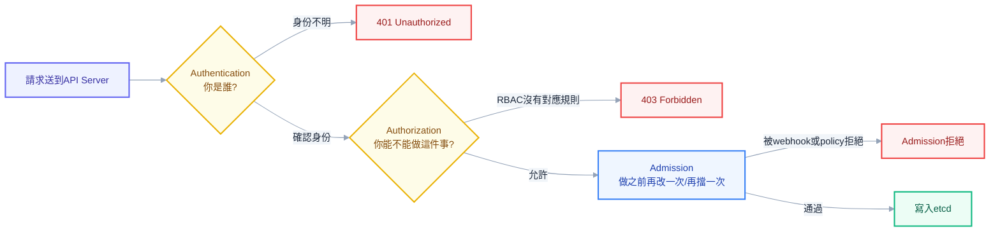
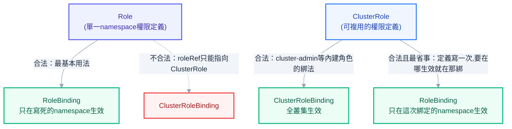
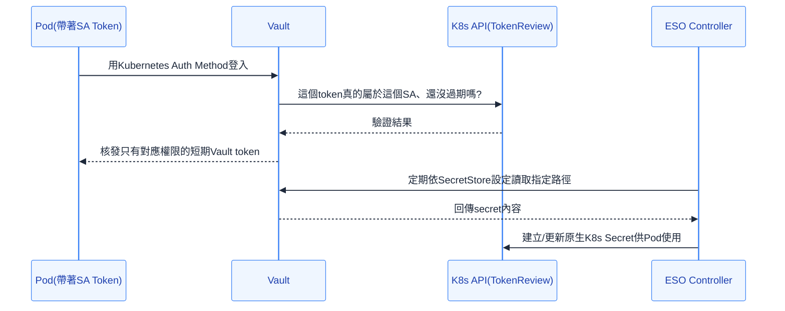
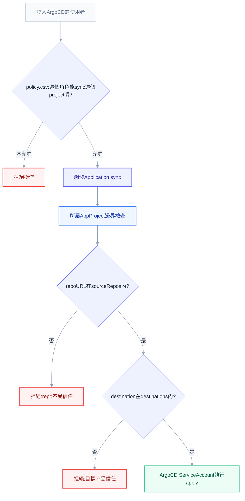

# 第八章：安全與權限——誰是誰、誰能做什麼、誰該負責

前七章處理的都是「怎麼把服務跑起來、跑得穩」，這一章要處理的是完全不同性質的問題：誰有資格對這個叢集動手，動手之後出了事，責任算在誰頭上。這個轉變對即將接手公司叢集的管理員特別關鍵，因為往後每天最頻繁出現的請求不是「Pod 又掛了」，而是「幫我開個權限」；而真正讓人夜不能寐的，也不是效能調校調得好不好，是權限給得太鬆、有一天出事被回頭追究。RBAC 的 YAML 看起來人畜無害，複製別人的範本改個名字就能動，但**每一次核准都是一次信任決策**——你把某個身份放進叢集，這個身份能碰到什麼、碰壞了會造成多大範圍的傷害，全部寫在你當初核准的那份 YAML 裡。

先把整章的骨架講清楚。每一個打到 kube-apiserver 的請求，不管是你手動下的 `kubectl apply`，還是 ArgoCD 的 controller 在背景默默同步，都必須依序通過三道完全獨立的關卡，缺一不可、順序不能顛倒。第一道是 **Authentication（你是誰）**，第二道是 **Authorization（你能不能做）**，第三道是 **Admission（做之前再改一次、再擋一次）**。第二章走過 `kubectl apply` 的完整旅程時已經點過這三站的名字，第九章也深入拆過 Admission 這一站內部 Mutating／Schema／Validating 的順序——本章要做的，是把前兩站攤開講到底，因為它們才是「誰能做什麼」這個問題真正的答案所在，而 Admission 在這裡的角色，是最後一道把關者，確保就算前兩關都放行了，寫進 etcd 的東西依然合乎規矩。

很多人下意識把 Authentication 跟 Authorization 混成同一件事，覺得「反正就是登入」。這個混淆在日常操作裡通常無傷大雅，但一旦要排查一個 403 錯誤，分不清這兩者就會抓錯方向——如果錯誤訊息裡明確寫著使用者名稱或 ServiceAccount 名稱，代表 Authentication 早就過關了，問題出在 Authorization 這一關的 RBAC 規則沒對上；如果連身份都認不出來，回傳的會是 401 而不是 403，這時候該查的是憑證或 token 本身，而不是急著去改 Role。這個判斷順序，會是你日後排查任何權限問題的第一個分岔點。



## Authentication：K8s 從來不知道「使用者」是誰

這一節要打破一個幾乎所有新手都會有的直覺：**K8s 裡不存在一個叫做「User」的物件**。你可以 `kubectl get pods`、`kubectl get deployments`，但你永遠找不到 `kubectl get users`，因為這個資源根本不存在。K8s 對「使用者」這個概念的態度極其務實——它完全不管理身份，只負責在每次請求進來時，讀一段外部系統交給它的身份宣告，然後相信這段宣告。

具體來說，如果你用的是最傳統的 x509 客戶端憑證認證，你的身份藏在憑證的兩個欄位裡：**Common Name（CN）被當成使用者名稱，Organization（O）被當成群組名稱**。也就是說，一張憑證的 Subject 寫著 `CN=vic, O=devops-team`，kube-apiserver 收到之後就會認定「這個請求的發起者叫 vic，屬於 devops-team 群組」——這個對應關係不是查資料庫查出來的，是憑證簽發時就寫死在憑證內容裡的，kube-apiserver 只是單純解析它、相信它。理解這一點之後，「使用者管理」這件事在 K8s 的世界裡，本質上變成「憑證怎麼簽發、簽給誰」的問題，而不是「在某張表裡新增一筆使用者紀錄」的問題。

除了 x509 憑證，K8s 支援的認證方式還有好幾種，實務上常見的組合是這樣：

| 認證方式 | 身份怎麼來 | 常見情境 |
| --- | --- | --- |
| x509 客戶端憑證 | 憑證的 CN／O 欄位 | kubeadm 建叢集時給管理員的初始憑證 |
| Static Token File | apiserver 啟動時載入的固定 token 清單 | 已淘汰，僅出現在很舊的環境 |
| ServiceAccount Token | K8s 自己簽發、綁定 ServiceAccount 的 JWT | Pod 內程式呼叫 API Server |
| OIDC（OpenID Connect） | 企業 SSO 發出的 ID Token | 公司用 Google／Azure AD／Okta 做團隊登入 |
| Webhook Token Authentication | 把 token 轉發給外部服務驗證 | 自建或第三方身份系統整合 |

其中 **OIDC** 是正式環境管理多人團隊時最值得投資的一條路，理由很直接：如果每個工程師都拿一張 x509 憑證，離職時你要做的是「作廢這張憑證」，但下一節會講到 K8s 的 x509 認證天生沒有作廢機制；如果走 OIDC，離職這件事只需要在企業 SSO 系統（Google Workspace、Azure AD）裡停用這個帳號，下一次這個人嘗試取得新的 ID Token 就會直接失敗，撤銷的責任交給了本來就該負責身份生命週期管理的系統，而不是叢集自己土法煉鋼維護一份使用者清單。kube-apiserver 這一端要接上 OIDC，需要在啟動參數裡指定 `--oidc-issuer-url`、`--oidc-client-id`、`--oidc-username-claim`（通常是 `email`）、`--oidc-groups-claim`（通常是 `groups`），之後 kubectl 透過 `oidc-login` 這類 exec 插件，在使用者本機瀏覽器跳出一次 SSO 登入頁，換回一份短期有效的 ID Token 塞進 kubeconfig。

## kubeconfig 解剖：cluster、user、context 三段式

理解了身份從哪裡來之後，接著要理解的是 kubectl 怎麼知道要用哪個身份、連到哪個叢集。答案就在 `~/.kube/config` 這份檔案裡，它固定由三種區塊組成：

```yaml
apiVersion: v1
kind: Config
clusters:
  - name: minikube
    cluster:
      server: https://192.168.49.2:8443
      certificate-authority: /home/vic/.minikube/ca.crt
users:
  - name: vic-admin
    user:
      client-certificate: /home/vic/.minikube/profiles/minikube/client.crt
      client-key: /home/vic/.minikube/profiles/minikube/client.key
contexts:
  - name: minikube
    context:
      cluster: minikube
      user: vic-admin
      namespace: default
current-context: minikube
```

`clusters` 區塊回答「連到哪裡」——每個叢集的 API Server 位址，以及驗證這個 API Server 身份用的 CA 憑證，這一步確保你連上的真的是你以為的那個叢集，而不是中間人偽裝的假端點。`users` 區塊回答「用什麼身份」——可能是一組客戶端憑證，可能是一個 token，也可能是像上一節提到的 OIDC exec 插件，甚至雲端環境常見的作法是呼叫一個 exec 指令去跟雲端 IAM 換一張短期憑證。`contexts` 區塊則是把「連到哪個叢集」跟「用哪個身份」組成一組固定搭配，額外還能帶一個預設 namespace，讓你不用每次都加 `-n`。`current-context` 決定 kubectl 這一刻實際生效的是哪一組。

多叢集切換完全靠操作這份設定檔完成：

```powershell
kubectl config get-contexts
kubectl config use-context prod-cluster
kubectl config set-context --current --namespace=team-a
```

同事最常誤解的一點，是以為 kubeconfig 本身有某種安全機制保護——事實是這份檔案通常只是明文（頂多憑證是 base64 編碼，跟第六章講過的 Secret 一樣不是加密），任何人只要拿到你的 `~/.kube/config`，就等於拿到了裡面那組憑證能做的一切事情，這也是為什麼正式環境的管理員 kubeconfig 不該隨手複製到別人的筆電、也不該進 Git。

## 憑證外洩無法撤回：為什麼不能把 cluster-admin 到處發

這一節要講清楚一件很多人到出事之前都不會意識到的事：**K8s 內建的 x509 客戶端憑證認證，沒有 revocation list（撤銷清單）機制**。TLS 世界裡本來就有 CRL、OCSP 這類「這張憑證雖然還沒過期，但已經作廢了」的通報機制，但 kube-apiserver 預設的憑證驗證邏輯並不會去檢查任何撤銷清單——它只檢查兩件事：這張憑證是不是由它信任的 CA 簽發的、這張憑證是不是還在有效期內。只要這兩個條件都成立，即使你心裡認定這張憑證「應該」作廢，kube-apiserver 依然會照單全收。

這件事的後果非常具體：如果有人離職、筆電遺失、憑證私鑰被 commit 進了公開 repo，你唯一能做的事只有兩種——等這張憑證自然過期（如果簽發時效期設得很長，這個等待可能長達一年以上），或者**輪替整個叢集的 CA**，讓所有基於舊 CA 簽出來的憑證全部失效，這是一個影響全叢集、需要重新分發所有合法憑證的重手術，不是能隨手執行的日常操作。這正是為什麼絕對不該把 `cluster-admin` 等級的憑證，當成方便就發給每一個要碰叢集的人——一張長期有效、範圍是整個叢集的 x509 憑證一旦外洩，你面對的不是「撤銷這一張就好」，而是「要嘛賭它不會被濫用直到過期，要嘛換掉整個 CA」。

> **常見誤解**：「反正 K8s 有 RBAC，就算憑證外洩，做壞事之前先擋一次」——這個想法搞混了兩件事。RBAC 限制的是「這個身份能做什麼」，但如果外洩的憑證本身就是簽給 `cluster-admin` 這種身份，RBAC 在這個身份面前形同虛設，因為它本來就被授權做任何事。真正的防線在更前面：一開始就不該讓任何一張長期憑證擁有 cluster-admin 等級的權限，尤其不該把它發到人手一份。

實務上的緩解策略有三個層次：第一，能走 OIDC 就走 OIDC，把撤銷責任交給企業身份系統；第二，如果非用憑證不可，透過 K8s 的 CertificateSigningRequest（CSR）API 簽發**短期**憑證（例如幾天到幾週），縮短外洩後的暴露窗口；第三，最根本的一條——**沒有人應該手上握著範圍是整個叢集的最高權限**，就算是管理員自己，日常操作也該用範圍受限的身份，只有在明確需要的操作當下才切換到高權限身份，用完就切回來。

## ServiceAccount：Pod 的身份證

前面講的都是「人」怎麼被 K8s 認出來，但叢集裡絕大多數的 API 請求，其實不是人手動打的，而是 Pod 裡跑著的程式自己去呼叫 K8s API——Prometheus 要去 watch 有哪些 Pod 可以抓 metrics、ArgoCD 的 controller 要去 diff 叢集現況、一個自訂的 operator 要去 reconcile 它管理的 CRD。這些場景裡，被認證的身份不是某個人，而是 **ServiceAccount**——Pod 專屬的身份證。

每個 namespace 一旦被建立，K8s 就會自動生出一個名叫 `default` 的 ServiceAccount，任何 Pod 在 spec 裡沒有明確指定 `serviceAccountName` 時，都會被自動掛上這個 `default` SA。這件事本身就是一個常被忽略的風險：如果這個 namespace 底下曾經有人為了圖方便，把一些額外權限綁到了 `default` SA 上，代表這個 namespace 裡**所有沒有特別指定身份的 Pod**，都會意外繼承那份權限——包括你臨時丟進去測試用的一個小工具 Pod。正式環境的實務做法是永遠不要往 `default` SA 上綁任何權限，需要什麼權限的 Pod，就顯式建立一個專屬的 ServiceAccount：

```yaml
apiVersion: v1
kind: ServiceAccount
metadata:
  name: report-generator
  namespace: reporting
---
apiVersion: v1
kind: Pod
metadata:
  name: report-job
  namespace: reporting
spec:
  serviceAccountName: report-generator
  containers:
    - name: app
      image: my-app:2.3
```

## Token 的演進：從長期 Secret 到短期 projected token

ServiceAccount 這個身份最終要落地成一個實際可用的憑證，才能讓 Pod 內的程式拿著它去跟 API Server 打交道，而這個機制在 K8s 1.24 前後有一次影響深遠的變化，也是同事最容易搞混新舊行為的地方。

**1.24 之前**，只要建立一個 ServiceAccount，K8s 就會自動連帶建立一個型別是 `kubernetes.io/service-account-token` 的 Secret，裡面裝著一組**長期有效、不會過期**的 JWT token，這個 Secret 會被自動掛載進所有使用這個 SA 的 Pod 裡。問題很直接：這組 token 一旦被建立出來，只要不手動刪除，理論上可以無限期使用，如果它不小心外洩（例如被 dump 進了一份錯誤紀錄、被複製到別的地方），攻擊者手上拿到的是一張沒有過期時間、除非管理員發現並手動刪除 Secret 否則永遠有效的通行證。

**1.24 起**，這個自動建立長期 Secret 的行為被取消了，取而代之的是 **projected volume 掛載的短期 token**——kubelet 透過 TokenRequest API 向 apiserver 現場申請一份 JWT，預設有效期只有一小時左右，並且 kubelet 會在到期前主動幫這個 token 續期，整個過程對 Pod 內的程式完全透明，讀取的路徑（`/var/run/secrets/kubernetes.io/serviceaccount/token`）跟以前一樣，只是背後的產生方式完全換了一套。這個新機制還多了一項舊機制沒有的能力：**token 可以綁定特定的 Pod（bound token）**，一旦這個 Pod 被刪除，這個 token 就會立刻失效，不像舊的長期 token 是跟 ServiceAccount 這個物件綁定，只要 SA 還在，token 就一直有效，跟哪個 Pod 用過它完全無關。

```yaml
apiVersion: v1
kind: Pod
metadata:
  name: app-with-scoped-token
spec:
  serviceAccountName: report-generator
  containers:
    - name: app
      image: my-app:2.3
      volumeMounts:
        - name: sa-token
          mountPath: /var/run/secrets/tokens
  volumes:
    - name: sa-token
      projected:
        sources:
          - serviceAccountToken:
              path: token
              expirationSeconds: 3600
              audience: vault
```

上面這段 YAML 手動宣告了一個 `serviceAccountToken` 的 projected volume（第六章介紹過 projected volume 可以合併多種來源，這是它的其中一種），`audience` 欄位限制這份 token 只能拿去給指定的對象使用（例如 `vault`，對應到後面會講的 Vault Kubernetes Auth Method），避免同一份 token 被拿去別的地方冒用。日常大多數情境不需要手動寫這段——只要 Pod 掛了某個 SA，kubelet 就會自動幫你處理好這一切，這裡展開只是為了讓你理解「短期 token」背後具體是怎麼運作的。

> **同事會來問你**：「以前 K8s 裝的教學影片都教直接 `kubectl get secret <sa-name>-token-xxxx`，現在怎麼找不到了？」——因為 1.24 起不再自動建立這個 Secret 了。如果真的有個外部系統，只認得傳統、不會過期的長期 token（不支援 kubelet 幫忙續期），還是可以手動建立一個帶著 `kubernetes.io/service-account.name` annotation 的 Secret 補回舊行為，但這應該是例外，不是預設路線，而且要清楚知道自己正在重新引入「token 永遠不過期」這個風險。

## automountServiceAccountToken 與 imagePullSecret：Harbor 私有 registry 實務

前面的討論建立在「Pod 需要呼叫 K8s API」這個前提上，但實務上大多數應用程式（一個普通的 Web API、一個前端服務）從頭到尾都不會去呼叫 K8s API，卻依然預設被掛上了一份 ServiceAccount token。這個 token 平白無故躺在容器檔案系統裡，對一個完全不需要它的應用程式來說，純粹是多出來的攻擊面——一旦這個容器被入侵，攻擊者第一件事通常就是去翻這個固定路徑，看看能不能撿到一張現成的 API 憑證。

如果 Pod 確定不需要呼叫 API Server，該做的是明確關閉自動掛載：

```yaml
apiVersion: v1
kind: Pod
metadata:
  name: frontend
spec:
  serviceAccountName: default
  automountServiceAccountToken: false
  containers:
    - name: web
      image: my-frontend:1.0
```

這個欄位也可以直接設在 ServiceAccount 物件本身上，讓底下所有用這個 SA 的 Pod 都繼承這個預設值，除非個別 Pod 自己覆寫。這是一條低成本、幾乎沒有代價、卻常被忽略的加固手段——多數應用程式根本用不到這份 token，關掉它不會犧牲任何功能，卻能實際縮小攻擊面。

另一個跟 ServiceAccount 密切相關、你的環境會天天用到的實務是 **imagePullSecret**。你的環境用 Harbor 當私有 image registry，Pod 要能成功拉取 image，需要引用一份裝著 registry 登入憑證的 Secret：

```yaml
apiVersion: v1
kind: ServiceAccount
metadata:
  name: default
  namespace: team-a
imagePullSecrets:
  - name: harbor-robot-cred
```

把 `imagePullSecrets` 綁在 ServiceAccount 上而不是每個 Pod 各自宣告一次，好處是這個 namespace 底下所有用到這個 SA 的 Pod，都會自動帶上這份拉取憑證，不需要每一份 Deployment YAML 都重複寫一次 `imagePullSecrets`。實務上建議 Harbor 的 robot account 依專案切分、只給 `pull`（甚至進一步只給特定 project 的 pull）權限，不要圖方便讓一組萬用的 robot account 帳密散布在好幾個團隊的 namespace 裡——一旦外洩，波及的範圍就是這組帳號能碰到的所有 Harbor project。

## RBAC 是什麼：四個物件的排列組合

前面鋪陳的都是「你是誰」，從這裡開始進入本章真正的核心——「你是誰」確定之後，K8s 怎麼判斷「你能不能做這件事」。答案就是 RBAC（Role-Based Access Control），而 RBAC 最容易搞混、也最值得講透的地方，就是四個物件之間的排列組合。

RBAC 的世界裡只有四種物件：`Role` 定義一組權限規則，作用範圍限定在單一 namespace；`ClusterRole` 也是定義一組權限規則，但作用範圍是整個叢集；`RoleBinding` 把某個 Role 或 ClusterRole 授予某個身份，生效範圍限定在單一 namespace；`ClusterRoleBinding` 把某個 ClusterRole 授予某個身份，生效範圍是整個叢集。多數人心裡的第一個直覺，是把這四個物件想成一個乾淨的 2x2 矩陣——Role 配 RoleBinding、ClusterRole 配 ClusterRoleBinding，各自獨立、互不相干。這個直覺只對了一半，而錯的那一半，正是實務上最常被浪費的一個技巧。

真正的合法配對只有三種，不是四種。`Role` 配 `RoleBinding` 完全合法，這是最基本、範圍最窄的用法——權限只在寫死的那個 namespace 生效。`ClusterRole` 配 `ClusterRoleBinding` 也完全合法，這是內建的 `cluster-admin`、`view` 這類角色綁定給某個人時常見的用法，權限橫跨整個叢集。但**最容易被忽略、也是實務上最省事的第三種合法組合，是 `ClusterRole` 配 `RoleBinding`**：把一份可複用的權限定義寫成 `ClusterRole`，卻不用 `ClusterRoleBinding` 讓它在全叢集生效，而是用 `RoleBinding` 把它綁在某個特定的 namespace 裡，效果是「這份權限定義只在這個 namespace 生效」。這樣做的價值在於，如果你有五個團隊各自的 namespace，都需要一份一模一樣的「唯讀開發者」權限，你不需要在五個 namespace 裡各寫一份幾乎一樣的 Role，只需要寫一份 `ClusterRole`，再到五個 namespace 各自建一份 `RoleBinding` 指向它——權限定義維護一份就好，要在哪裡生效就在那裡綁一次。

至於第四種組合——`Role` 配 `ClusterRoleBinding`——**根本不合法**，K8s 的 API 設計上直接不允許：`ClusterRoleBinding` 的 `roleRef.kind` 只能填 `ClusterRole`，沒有辦法指向一個 namespace 範圍的 `Role`。這個限制背後的邏輯很直觀：`Role` 本身的定義就綁死在某個 namespace 裡，讓它透過 `ClusterRoleBinding` 在全叢集生效，語意上根本自相矛盾。



## rules 三要素與 resourceNames：把權限寫精確

Role 與 ClusterRole 的血肉，都裝在 `rules` 這個陣列裡，每一條規則由三個要素組成：`apiGroups`（這個資源屬於哪個 API 群組）、`resources`（具體是哪種資源）、`verbs`（允許對它做哪些動作）。

```yaml
apiVersion: rbac.authorization.k8s.io/v1
kind: Role
metadata:
  name: pod-reader
  namespace: team-a
rules:
  - apiGroups: [""]
    resources: ["pods"]
    verbs: ["get", "list", "watch"]
  - apiGroups: [""]
    resources: ["pods/log"]
    verbs: ["get"]
  - apiGroups: ["apps"]
    resources: ["deployments"]
    verbs: ["get", "list"]
```

`apiGroups` 裡的空字串 `""` 代表 core API group，涵蓋 Pod、Service、Secret、ConfigMap 這些最基礎的資源；`apps` 群組涵蓋 Deployment、StatefulSet、DaemonSet；每個 CRD 也都有自己的 API group（例如 ArgoCD 的 `argoproj.io`、External Secrets 的 `external-secrets.io`）。`resources` 除了資源本體，還可以指到 **subresource**——上面範例裡的 `pods/log` 就是一個 subresource，代表「讀取這個 Pod 的 log」這個動作，跟「讀取這個 Pod 物件本身」是完全獨立的兩種權限；同理 `pods/exec` 控制的是能不能對 Pod 執行 `kubectl exec`，`deployments/scale` 控制的是能不能透過 scale subresource 調整副本數。這個切分非常重要——一個只給了 `pods` 的 `get` 權限的人，看得到 Pod 的 YAML，但不代表他能讀 log、更不代表他能 `exec` 進去，這三件事必須分開授權，而現實中很多人以為授予了 `pods` 的權限就等於全部都能做，這是實務上很值得提醒新人的一點。

`verbs` 常見的有 `get`、`list`、`watch`（唯讀三兄弟，分別對應查單一物件、查清單、訂閱變化）、`create`、`update`、`patch`、`delete`、`deletecollection`（批次刪除），另外還有幾個特殊用途的 verb 會在下一節展開。

如果想把權限收得更窄，限定在特定物件，可以加上 `resourceNames`：

```yaml
rules:
  - apiGroups: ["apps"]
    resources: ["deployments"]
    resourceNames: ["payment-service"]
    verbs: ["get", "update", "patch"]
```

這條規則的效果是「只能對名叫 `payment-service` 的這一個 Deployment 做 get／update／patch，其他 Deployment 完全碰不到」。這裡有個實務上常踩的細節：`resourceNames` 對 `list` 與 `watch` 幾乎沒有意義，也不該搭配 `create` 使用——`list`／`watch` 本質上是在列舉一批物件，此時物件的名稱還沒有被逐一比對的機會；`create` 發生的當下，這個物件根本還不存在，沒有名字可以限制。`resourceNames` 真正好用的場景，是 `get`／`update`／`patch`／`delete` 這幾個「已經知道要操作哪個具體物件」的動作。

## 純白名單、只累加不相減：RBAC 沒有 deny 規則

這是整個 RBAC 系統裡最容易被誤解、卻也最重要的一條設計原則：**RBAC 是純粹的白名單機制，只會累加權限，不存在任何形式的 deny 規則**。一個身份最終擁有的權限，是它所綁定的所有 Role／ClusterRole 規則的**聯集**——你沒辦法寫一條規則說「這個人可以做任何事，除了刪除 Secret」，因為 RBAC 完全沒有「排除」這個語意存在。

這件事在實務上經常造成誤判。同事有時候會提出這樣的請求：「這個 ServiceAccount 目前綁了 `edit`，但我想讓它不能刪除 namespace 裡的 ConfigMap」，如果你的直覺是去 `edit` 這個 ClusterRole 裡想辦法「扣掉」ConfigMap 的 delete 權限，你會發現根本沒有這樣的欄位可以寫。正確的做法永遠是反過來想：**不要在既有的寬鬆權限上做減法，而是重新設計一份更窄的權限定義**，只列出真正需要的 resources 與 verbs，讓它從一開始就沒有多餘的部分，而不是先給多再想辦法收回來。

如果多個 RoleBinding／ClusterRoleBinding 同時綁定了同一個身份，效果一樣是聯集，不會互相覆蓋、也不會互相限制。這代表稽核一個身份到底擁有多少權限時，不能只看某一份 Binding，必須把所有指向這個身份的 Binding 全部列出來，逐一加總才是真正的權限範圍——這也是下面會講到的 `kubectl auth can-i` 之所以重要的原因：與其自己在腦中手動加總好幾份規則，不如直接問系統「這個身份到底能不能做這件事」。

如果真的需要「deny」這種語意（例如「除非特別允許，否則一律拒絕存取某些高風險資源」），答案不在 RBAC 這一層，而是要交給第九章講過的 admission webhook 或 Policy as Code 工具（Kyverno、OPA Gatekeeper）在 Admission 這一關去攔——這也正好呼應了本章一開始講的三道關卡：Authorization（RBAC）天生只能做加法，Admission 才是能做「無論你有沒有權限，這個動作本身在治理規則上就不允許」這種判斷的地方。

## 權限提升防護：不能給別人你自己都沒有的權限

RBAC 系統裡藏著一條重要的自我保護機制，叫做**權限提升防護（privilege escalation prevention）**：預設情況下，一個身份**不能**建立或修改一份 Role／ClusterRole，讓它包含自己目前都沒有的權限。舉例來說，如果你的身份只被授予了對 Pod 的 `get`／`list` 權限，你嘗試建立一份新的 Role，裡面寫著對 Secret 的 `delete` 權限——即使你有權限「建立 Role 這個物件本身」，這次建立操作依然會被拒絕，因為你正在試圖生出一份連你自己都不擁有的能力，交給別人（或未來的自己）使用。

這條防護有一個明確的逃生門，叫做 `escalate` 這個 verb，作用在 `roles`／`clusterroles` 這個資源本身上：

```yaml
apiVersion: rbac.authorization.k8s.io/v1
kind: ClusterRole
metadata:
  name: role-manager-with-escalate
rules:
  - apiGroups: ["rbac.authorization.k8s.io"]
    resources: ["roles", "clusterroles"]
    verbs: ["get", "list", "create", "update", "escalate"]
```

只有明確被授予 `escalate` 的身份，才能繞過上面那條「不能給別人自己沒有的權限」的檢查，這通常只該授予極少數負責管理整個 RBAC 體系本身的高階管理身份，一般的 namespace 管理者不該擁有這個 verb。跟 `escalate` 常常一起提到的還有 `bind` 這個 verb，管的是另一件相關但不同的事：能不能把一份 Role／ClusterRole**綁定**給別人（也就是建立 RoleBinding／ClusterRoleBinding），如果這份 Role 涵蓋了你自己都沒有的權限。沒有 `bind` 權限的人，即使能看到某份 ClusterRole 存在，也沒辦法把它綁給任何身份使用。

這條機制的存在，正是為了防堵一個很直覺卻很危險的攻擊路徑：一個權限本來很小的身份，透過「建立一份權限更大的 Role，再想辦法把它綁給自己」來間接提升權限。如果沒有這條防護，RBAC 系統本身的完整性就會出現漏洞——授權系統的規則，本身也可能被濫用授權規則的方式攻破。

## 內建 ClusterRole 與 aggregated ClusterRole

K8s 內建四個現成的 ClusterRole，涵蓋絕大多數日常需求，不需要每次都自己從零寫規則：`cluster-admin` 擁有對所有資源的所有動作（包含 `*` 這個萬用 verb），是叢集裡權限最大的角色；`admin` 擁有對絕大多數 namespace 範圍資源的完整讀寫權限，但不包含會影響到 namespace 本身配額、RBAC 設定這類「管理這個 namespace 的權限本身」的動作；`edit` 類似 `admin` 但更收斂一些，能建立與修改大部分資源，但不能碰 RBAC 相關物件；`view` 則是純唯讀，能看但不能改任何東西。

這四個角色不是各自寫死的獨立規則集合，而是透過一個叫做 **aggregated ClusterRole** 的機制自動組裝出來的。`aggregationRule` 讓一個 ClusterRole 宣告「我的規則，等於所有符合這個 label selector 的其他 ClusterRole 規則的總和」：

```yaml
apiVersion: rbac.authorization.k8s.io/v1
kind: ClusterRole
metadata:
  name: my-crd-editor
  labels:
    rbac.authorization.k8s.io/aggregate-to-edit: "true"
rules:
  - apiGroups: ["external-secrets.io"]
    resources: ["externalsecrets", "secretstores"]
    verbs: ["get", "list", "watch", "create", "update", "patch", "delete"]
```

這份 ClusterRole 本身沒有掛任何 `aggregationRule`，但它貼上了 `rbac.authorization.k8s.io/aggregate-to-edit: "true"` 這個 label，而內建的 `edit` ClusterRole 本身的定義正好是「聚合所有帶這個 label 的 ClusterRole」。這代表一旦你的叢集裝了某個 CRD（例如 External Secrets Operator），只要照著它官方文件的建議，補上一份帶著正確 aggregation label 的 ClusterRole，這個 CRD 的權限就會自動被「加進」內建的 `edit`／`admin` 角色裡，不需要去修改 K8s 內建 ClusterRole 本身（事實上你也修改不了，它們是叢集啟動時自動維護、被覆寫回原樣的）。這個機制對維護自訂 CRD 權限特別重要——如果沒有正確設定 aggregation，一個團隊即使被綁了 `edit`，也完全碰不到這個新裝的 CRD，因為 `edit` 從一開始就不認識這個新資源。

## 排查權限：kubectl auth can-i 與 --as impersonation

寫好 RBAC 規則之後，下一個問題是怎麼確認它真的照你想的方式生效，而不是憑感覺覺得「這樣寫應該可以」。`kubectl auth can-i` 是這裡最直接的工具，它不會真的執行操作，只回答「如果現在真的做這件事，會不會被允許」：

```bash
kubectl auth can-i delete secrets --namespace=team-a
```

回傳 `yes` 或 `no`，直接對照你目前登入的身份。但真正有威力的用法是搭配 `--as` 做 **impersonation**，模擬別的身份去問同一個問題，而不用真的切換到那個身份的憑證：

```bash
kubectl auth can-i update deployments \
  --as=system:serviceaccount:team-a:ci-deployer \
  --namespace=team-a

kubectl auth can-i list pods \
  --as=vic@example.com \
  --as-group=devops-team \
  --namespace=team-a
```

第一行驗證的是「這個 CI 用的 ServiceAccount 到底能不能更新 Deployment」——這正是稽核一個自動化流程權限最快的方式，不需要真的觸發一次 CI pipeline 再去看它是不是失敗。第二行示範同時模擬使用者身份與群組，驗證某個人在某個群組下的實際權限組合。這個工具的價值在於，它把「RBAC 規則的聯集到底算出什麼結果」這個原本要靠人工在腦中拼湊的問題，直接丟給系統去回答，準確、即時，而且完全不需要真的執行一次有風險的操作去試探。第十三章講到 403 排查的完整流程時，用的正是同一套 `--as` 手法，只是那裡的重點是「事後除錯」，這裡的重點是「事前驗證你剛寫好的規則有沒有達到預期效果」——同一個指令，兩種不同的使用時機。

## 三個可以直接抄的 RBAC 範例

理論講完，落地成三個實務上真的會遇到的場景，各自對應不同的權限收斂程度。

**唯讀開發者**：某個團隊的工程師需要看得到自己 namespace 裡的資源狀態，方便自行排查，但不該有任何寫入能力，也不該碰到 Secret 明文：

```yaml
apiVersion: rbac.authorization.k8s.io/v1
kind: Role
metadata:
  name: dev-viewer
  namespace: team-a
rules:
  - apiGroups: [""]
    resources: ["pods", "services", "configmaps", "events"]
    verbs: ["get", "list", "watch"]
  - apiGroups: ["apps"]
    resources: ["deployments", "replicasets"]
    verbs: ["get", "list", "watch"]
  - apiGroups: [""]
    resources: ["pods/log"]
    verbs: ["get"]
---
apiVersion: rbac.authorization.k8s.io/v1
kind: RoleBinding
metadata:
  name: dev-viewer-binding
  namespace: team-a
roleRef:
  apiGroup: rbac.authorization.k8s.io
  kind: Role
  name: dev-viewer
subjects:
  - kind: Group
    name: team-a-developers
    apiGroup: rbac.authorization.k8s.io
```

注意這裡刻意**沒有**列出 `secrets` 這個 resource——一個唯讀開發者角色，通常不該連 Secret 的明文都能讀到，如果真的需要，該是一份範圍更窄、額外經過核准的獨立授權，而不是塞進日常開發權限裡一起給。`subjects` 這裡綁的是 `Group` 而不是個別使用者，搭配上一節講的 OIDC，這個群組名稱直接對應企業 SSO 系統裡的群組，新人加入團隊只需要被加進 SSO 群組，不需要另外寫一份新的 RoleBinding，離職時同理，從 SSO 群組移除就等於收回權限。

**CI 部署專用 ServiceAccount**：CI pipeline 需要能夠更新 Deployment、ConfigMap 完成部署，但不該有刪除 namespace、修改 RBAC 這類「管理這個 namespace 本身」的能力，也**絕對不該共用管理員的 kubeconfig**：

```yaml
apiVersion: v1
kind: ServiceAccount
metadata:
  name: ci-deployer
  namespace: team-a
---
apiVersion: rbac.authorization.k8s.io/v1
kind: ClusterRole
metadata:
  name: deployer
rules:
  - apiGroups: ["apps"]
    resources: ["deployments"]
    verbs: ["get", "list", "watch", "create", "update", "patch"]
  - apiGroups: [""]
    resources: ["configmaps", "services"]
    verbs: ["get", "list", "watch", "create", "update", "patch"]
---
apiVersion: rbac.authorization.k8s.io/v1
kind: RoleBinding
metadata:
  name: ci-deployer-binding
  namespace: team-a
roleRef:
  apiGroup: rbac.authorization.k8s.io
  kind: ClusterRole
  name: deployer
subjects:
  - kind: ServiceAccount
    name: ci-deployer
    namespace: team-a
```

這正是前面講過的「`ClusterRole` 配 `RoleBinding`」這個省事組合的實際應用——`deployer` 這份權限定義可以原封不動地在其他團隊的 namespace 裡各綁一次，而不用每個團隊都重寫一份幾乎一樣的 Role。

**只能重啟 Deployment 的 SRE**：值班的 SRE 常常只需要在半夜排查時執行 `kubectl rollout restart`，不該連帶擁有刪除或改寫 image 版本這種風險更高的能力。`kubectl rollout restart` 的本質，是在 Deployment 的 `template.metadata.annotations` 裡加一個時間戳，觸發滾動更新，所以真正需要的 verb 只有 `get` 與 `patch`：

```yaml
apiVersion: rbac.authorization.k8s.io/v1
kind: ClusterRole
metadata:
  name: deployment-restarter
rules:
  - apiGroups: ["apps"]
    resources: ["deployments"]
    verbs: ["get", "list", "patch"]
---
apiVersion: rbac.authorization.k8s.io/v1
kind: RoleBinding
metadata:
  name: sre-restart-only
  namespace: team-a
roleRef:
  apiGroup: rbac.authorization.k8s.io
  kind: ClusterRole
  name: deployment-restarter
subjects:
  - kind: Group
    name: sre-oncall
    apiGroup: rbac.authorization.k8s.io
```

這份權限刻意不包含 `create`、`delete`，也不包含 `deployments/scale`——值班時只需要「讓 Pod 重新啟動一輪」，不需要能新增或砍掉整個 Deployment，這正是本章一路強調的精神：權限永遠應該只夠完成明確定義的工作，而不是圖方便給一個大範圍角色再期待使用者自律。

## Pod Security Admission：PSP 之死與三等級三模式

RBAC 管的是「誰能對 K8s API 做什麼動作」，但即使一個身份被合法授權建立 Pod，這個 Pod 本身的內容依然可能是危險的——例如宣告 `privileged: true`、掛載整個宿主機檔案系統。控制「Pod 的內容本身合不合規」不是 RBAC 的工作，而是 Admission 這一關的工作，具體落地的機制叫 **Pod Security Admission（PSA）**。

K8s 曾經有一個叫做 PodSecurityPolicy（PSP）的機制負責這件事，但它在 1.21 被標記棄用、1.25 正式移除，原因是它的設計本身太複雜、跟 RBAC 的互動方式難以理解（一個 Pod 要通過哪條 PSP，取決於建立者被 RBAC 授權使用哪些 PSP，這層間接關係讓除錯異常困難），社群最終決定用一個更簡單直接的機制取代它，也就是現在的 PSA。

PSA 的心智模型簡單很多：透過 namespace 上的 label 直接宣告這個 namespace 要套用哪個等級的規則。等級分三種：`privileged` 完全不設限，等同於沒有這層保護；`baseline` 阻擋已知會導致容器逃逸或明顯提權的設定（例如 `privileged: true`、掛載宿主機的敏感路徑），但盡量減少對現有工作負載的影響；`restricted` 是最嚴格的等級，遵循目前公認的容器加固最佳實踐，強制要求 `runAsNonRoot`、禁止權限提升、要求捨棄所有 Linux capability、要求設定 seccomp profile。

更巧妙的是，這三個等級可以搭配三種**模式**同時套用在同一個 namespace 上：`enforce` 真的拒絕不合規的 Pod；`audit` 允許 Pod 建立，但把違規記錄寫進審計日誌（下面會展開）；`warn` 允許 Pod 建立，但會讓 `kubectl apply` 的使用者在終端機上看到一段警告文字。這個設計讓漸進式導入變得可行——你可以先把 `enforce` 維持在寬鬆的 `baseline`，但把 `audit` 跟 `warn` 都設成 `restricted`，這樣現有工作負載不會被立刻擋下來，但你能提前看到哪些 Pod 一旦收緊到 `restricted` 就會出事，有時間逐一修正，等確認影響範圍夠小之後，再把 `enforce` 也調高。

```yaml
apiVersion: v1
kind: Namespace
metadata:
  name: team-a
  labels:
    pod-security.kubernetes.io/enforce: baseline
    pod-security.kubernetes.io/audit: restricted
    pod-security.kubernetes.io/warn: restricted
```

> **常見誤解**：「PSP 被移除了，代表 K8s 現在對 Pod 安全設定完全不管了」——正好相反，PSA 是內建在 kube-apiserver 裡、預設就存在的 admission 機制，不需要額外安裝任何元件，只是把設定介面從「複雜的 PSP 物件加上間接的 RBAC 授權」簡化成「namespace label」。真正需要額外安裝的，反而是更進階的治理需求（例如第九章提過的 Kyverno、OPA Gatekeeper），PSA 涵蓋的是最基礎的一層防護。

## SecurityContext：容器層級最後一道牆

PSA 決定了整個 namespace 的門檻，但每個 Pod 與容器本身，還可以透過 `securityContext` 做更精細的加固，這一節談的機制，最終全部會落回第零章講過的 kernel 機制——namespace、cgroup、capability——只是這次是從「怎麼設定」的角度看，而不是「底層原理是什麼」的角度。

```yaml
apiVersion: v1
kind: Pod
metadata:
  name: hardened-app
spec:
  securityContext:
    runAsNonRoot: true
    runAsUser: 1000
    fsGroup: 1000
    seccompProfile:
      type: RuntimeDefault
  containers:
    - name: app
      image: my-app:2.3
      securityContext:
        readOnlyRootFilesystem: true
        allowPrivilegeEscalation: false
        capabilities:
          drop: ["ALL"]
      volumeMounts:
        - name: tmp
          mountPath: /tmp
        - name: cache
          mountPath: /app/cache
  volumes:
    - name: tmp
      emptyDir: {}
    - name: cache
      emptyDir: {}
```

`runAsNonRoot: true` 加上 `runAsUser` 確保容器裡的行程不是用 UID 0（也就是 root）執行——即使容器內的檔案系統本身跟宿主機隔離，一旦容器逃逸類漏洞被觸發，用 root 身份執行的行程能造成的傷害遠大於一個受限的一般使用者身份。`readOnlyRootFilesystem: true` 讓整個容器的根檔案系統變成唯讀，攻擊者就算取得了程式碼執行能力，也沒辦法在容器裡寫入惡意檔案、竄改既有執行檔——代價是應用程式如果真的需要寫入某些暫存目錄（例如 `/tmp`、快取目錄），必須額外掛一個 `emptyDir` 給那些特定路徑，第六章介紹過 `emptyDir` 的生命週期跟 Pod 綁在一起，正好適合這種「用完即丟、不需要跨重啟保留」的暫存需求。

`allowPrivilegeEscalation: false` 阻止容器內的行程透過 setuid 二進位檔或類似手法，取得比自己啟動時更高的權限，這是防止容器內「本來受限的行程，卻能瞬間拿到更大權力」這條路徑的直接開關。`capabilities.drop: ["ALL"]` 把 Linux capability 全部捨棄——第零章提過容器的本質是被 namespace 裁剪視野、被 cgroup 限制資源的普通行程，而 capability 正是控制這個行程「即使不是完整的 root，還保留了哪些原本屬於 root 的細粒度權力」的機制，全部捨棄之後，如果真的有某個功能需要用到（例如網路服務要監聽小於 1024 的特權 port，需要 `NET_BIND_SERVICE`），才在 `add` 裡個別加回來，而不是預設全部保留再想辦法收緊。

`privileged: true` 是所有 SecurityContext 選項裡最危險的一個，它幾乎完全關閉容器與宿主機之間的隔離——容器內的行程能直接碰到宿主機的裝置檔案、能做幾乎任何 root 在宿主機上能做的事，等同於把第零章講過的 namespace／cgroup 隔離機制大部分繳械。正式環境裡幾乎沒有一般應用程式需要這個設定，唯一常見的例外是某些需要直接操作宿主機網路設定的 CNI plugin 或系統層級的監控 agent，而且這些例外通常會搭配嚴格的 RBAC 與獨立的 ServiceAccount，把權限收在最小範圍。

最後 `seccompProfile.type: RuntimeDefault` 限制容器內的行程只能呼叫一組經過篩選、被認定安全的系統呼叫（syscall），把一些平常應用程式根本用不到、卻是攻擊者常利用的危險 syscall 直接擋在 kernel 層級，這同樣是第零章那套「容器最終落地成 kernel 機制」哲學的具體展現——SecurityContext 裡每一個看起來像是 K8s 自創概念的欄位，最後都對應到一個貨真價實的 Linux kernel 機制，不是 K8s 憑空發明的抽象規則。

## Secret 怎麼守：etcd 加密、Vault 信任鏈與別讓明文進 log

第六章已經深入講過 Secret 的資料結構本質、`base64` 不是加密的常見誤解、以及 Vault 加 External Secrets Operator（ESO）怎麼把外部機密資料轉譯成原生 K8s Secret，那一章的重點是「怎麼用」；這一章要從「怎麼守」的角度重新看同一套機制，關注的是信任鏈上每一環到底憑什麼被信任。

先重申一個安全上的關鍵事實：**Secret 在 etcd 裡預設不是加密的**，只有明確設定過 `EncryptionConfiguration` 之後才會真正加密（第六章有完整 YAML 範例）。從安全稽核的角度看，這件事的意義是——任何有辦法直接存取 etcd 資料檔案或備份檔的人，完全可以跳過本章前面講的一切 RBAC 授權，直接拿到所有 Secret 的明文內容。這代表 etcd 的存取控制與備份檔案的保管，重要程度跟 RBAC 本身其實是同一個等級，絕不是「反正有 RBAC 擋著就夠了」。

Vault 加 ESO 這條路的信任基礎，建立在一次關鍵的驗證動作上：Pod 帶著自己的 ServiceAccount token 去跟 Vault 表明身份時，Vault 並不是直接相信這份 token，而是拿它反過來呼叫 K8s API 的 **TokenReview** 端點，問「這個 token 現在是不是真的有效、真的屬於它宣稱的那個 ServiceAccount」。只有 TokenReview 確認無誤，Vault 才會依照預先設定好的 Vault Role（這個 Role 本身就綁定了特定的 ServiceAccount 與 namespace），核發一張只有對應權限的 Vault token。這個設計把信任的根源牢牢釘在 K8s 自己的認證機制上——Vault 不需要另外維護一套帳密系統，它信任的終究是「K8s 自己確認過這個身份是真的」這個判斷。



日常操作裡最容易出錯、卻經常被忽略的一環，是**不要讓 Secret 內容印進 log**。一個常見的踩坑情境是應用程式在啟動時把所有環境變數 dump 出來方便除錯，如果這個環境變數清單裡混著資料庫密碼，這份 log 就等於把明文密碼寫進了公司的日誌系統（第十五章講過的 ELK，或任何被多人有權限查詢的日誌平台），而日誌系統的存取範圍，往往比 Secret 本身的 RBAC 範圍寬得多——很多團隊會把 log 查詢權限開放給所有工程師方便排查問題，但很少有人會同樣鬆散地開放 Secret 的讀取權限，結果 Secret 該有的存取限制，反而被一次隨手的 debug log 完全繞過。實務上的防範，是應用程式啟動時的環境變數 dump 邏輯要明確排除任何裝著密碼、token 的 key，或者乾脆在 CI/CD 流程裡加一道掃描，檢查有沒有敏感字串意外出現在建置產物或 log 範本裡。

## 供應鏈與映像檔安全

前面幾節都在講「已經跑在叢集裡的東西怎麼被限制」，但更早一步的問題是——一開始被允許跑進來的 image，本身乾不乾淨。這一環在安全社群裡統稱**供應鏈安全（supply chain security）**，關注的是從程式碼寫下第一行、到最終 image 被 pull 進 Pod 之間，每一個可能被竄改或藏著已知漏洞的環節。

**Image scanning** 是最基本的一道防線，`Trivy` 這類工具能掃描一個 image 裡每一層 layer 安裝的套件版本，比對已知的 CVE 資料庫，找出裡面用了哪些已經公開漏洞、卻還沒更新的套件版本。實務上這件事該發生在 CI pipeline build 完 image 之後、push 到 Harbor 之前，讓有高危漏洞的 image 直接卡在 CI 這一關，不讓它有機會被部署出去。

只掃描還不夠，還需要確保**只有經過信任的 registry 才能被拉取**，否則就算 CI 流程掃得再乾淨，也擋不住有人直接手動 `kubectl apply` 一份指向 Docker Hub 上某個來路不明 image 的 Deployment。第九章介紹過的 Kyverno 這類 Policy as Code 工具，正好可以在這裡再派上用場：

```yaml
apiVersion: kyverno.io/v1
kind: ClusterPolicy
metadata:
  name: restrict-image-registries
spec:
  validationFailureAction: Enforce
  rules:
    - name: only-trusted-registry
      match:
        resources:
          kinds: [Pod]
      validate:
        message: "image 必須來自harbor.internal.example.com"
        pattern:
          spec:
            containers:
              - image: "harbor.internal.example.com/*"
```

這份規則跟第九章講過的「禁止 `latest` tag」規則是同一套機制的延伸應用，只是這次檢查的是 image 位址的前綴，而不是 tag 名稱——兩者經常一起套用，一份完整的映像檔治理策略通常同時要求「來自可信 registry」以及「不可用 latest tag」。

比 tag 更進一步的保護是 **image digest 釘選**。第零章講過 image 是一疊唯讀 layer 疊出來的，一個 tag（例如 `my-app:2.3`）本質上只是一個可變的指標，隨時可能被人重新 push、指向完全不同的內容——這正是第九章提過「禁止 latest」規則想防堵的漂移問題，但即使是明確的版本號 tag，理論上依然可以被覆蓋重推。**digest** 則是這個 image manifest 內容本身算出來的雜湊值，跟內容是一對一綁定的，只要內容有任何一絲改變，digest 就會完全不同：

```yaml
containers:
  - image: harbor.internal.example.com/team/my-app@sha256:e3b0c44298fc1c149afbf4c8996fb92427ae41e4649b934ca495991b7852b855
```

用 digest 而不是 tag 部署，等於徹底鎖死「叢集裡跑的到底是哪一份確切內容」，不會因為有人手滑對同一個 tag 重新 push 而在你不知情的狀況下換了內容，這對正式環境的關鍵服務、以及需要通過安全稽核的環境來說，是值得養成的習慣。

最後回到你自己環境正在用的 Harbor：它內建的漏洞掃描功能可以在 image push 上去的當下自動觸發，並且能設定「掃描出高危漏洞就阻擋 pull」的政策；而前面提過的 robot account，實務上應該依專案切分、只給最小必要的權限（通常只需要 `push`／`pull`，不需要能刪除 image 或修改 project 設定），而且要定期輪替密碼——這正好呼應本章最後管理員清單裡會再提到的輪替習慣。

## NetworkPolicy：安全的另一個維度

到這裡為止，本章談的安全機制全部發生在同一個維度上——「誰能對 K8s API 做什麼」。但還有另一個完全獨立的維度，第五章已經深入講過，這裡要做的是把它明確放進「安全」這張地圖裡：**RBAC 管的是 API 存取，NetworkPolicy 管的是網路流量，兩者控制的是完全不同層面的行為**。

一個很直接的思考實驗能說明為什麼兩者缺一不可：假設有個 Pod 被入侵了，而這個 Pod 掛的 ServiceAccount 權限收得極窄，`kubectl auth can-i` 對它問什麼幾乎都回答 `no`——RBAC 這一層已經把它管得死死的。但如果叢集裡沒有設任何 NetworkPolicy，K8s 預設是**所有 Pod 之間網路全通**，這個被攻陷的 Pod 依然能自由地對同一叢集裡其他 namespace 的資料庫、內部 API 發起連線，做偵察、做橫向移動，完全不需要碰到 K8s API 一次。RBAC 再嚴格，防的都是「這個身份能不能呼叫 K8s API 做什麼」，對「這個 Pod 能不能直接對另一個 Pod 發封包」完全無能為力——這是兩條正交的防線，只做好其中一條，另一條的破口依然完整存在。

第五章提過一個很容易被忽略的常見誤解也值得在這裡重申：**NetworkPolicy 被 API server 接受，不代表它真的被執行了**——它的落地完全依賴 CNI plugin 有沒有實作這個功能，minikube 預設的簡化網路方案就不支援，套用了 YAML 卻毫無效果，而且不會有任何錯誤訊息告訴你「這份規則沒有生效」。正式環境選型 CNI 時，支援 NetworkPolicy 幾乎該是硬性條件，`Calico`、`Cilium` 都是常見選擇。

## 審計與合規

前面所有機制回答的都是「當下該不該允許這個動作」，但即使每一道關卡都設計得無懈可擊，一旦真的出事，管理員必須有能力回答一個更根本的問題：**誰、在什麼時候、對什麼東西、做了什麼**。這正是 **Audit Policy** 存在的理由。

kube-apiserver 可以設定一份 `--audit-policy-file`，定義哪些請求該被記錄、記錄到什麼詳細程度，輸出到 `--audit-log-path` 指定的檔案（或轉送到外部日誌系統，例如第十五章講過的 ELK）。記錄的詳細程度分四個 level，由粗到細：

| Level | 記錄內容 |
| --- | --- |
| `None` | 完全不記錄符合這條規則的請求 |
| `Metadata` | 記錄誰、何時、對什麼資源做了什麼動作，但不含請求或回應的實際內容 |
| `Request` | 在 Metadata 之上，額外記錄請求本身的完整內容 |
| `RequestResponse` | 記錄請求與回應兩邊的完整內容，最詳細也最耗儲存空間 |

```yaml
apiVersion: audit.k8s.io/v1
kind: Policy
rules:
  - level: RequestResponse
    resources:
      - group: ""
        resources: ["secrets"]
  - level: Metadata
    resources:
      - group: "rbac.authorization.k8s.io"
        resources: ["roles", "clusterroles", "rolebindings", "clusterrolebindings"]
  - level: None
    users: ["system:kube-proxy"]
    verbs: ["watch"]
```

這份範例示範了一個實務上常見的取捨：對 `Secret` 這種高敏感資源用最詳細的 `RequestResponse`，確保任何一次存取都有完整紀錄可查；對 RBAC 相關物件（誰改了誰的權限）至少記錄 `Metadata`，確保權限變動有稽核軌跡；而對像 `kube-proxy` 這種本來就會產生大量、價值不高的 `watch` 請求，直接設成 `None` 排除掉，避免審計日誌被雜訊淹沒，真正重要的紀錄反而被稀釋掉。

光有 Audit Log 只解決了「事後查得到」，另一個同樣重要的問題是「這個叢集現在的整體設定，符不符合業界公認的安全基準」，這正是 **kube-bench** 存在的理由。它是把 **CIS Kubernetes Benchmark**（一份業界共識的叢集安全設定檢查清單）自動化執行的工具，通常以一個 Job 的形式跑在叢集裡，對 Control Plane 與 Node 的設定逐項比對，輸出每一項是 PASS、FAIL、還是 WARN，常見的檢查項目包括「kube-apiserver 有沒有開啟匿名存取」「etcd 的通訊有沒有啟用 TLS」「kubelet 的設定檔案權限是不是過於寬鬆」。定期跑一次 kube-bench，能在真正出事之前，主動抓出設定上的隱患。

最後一項容易被忽略、卻經常在正式環境釀成事故的是**憑證到期監控**。本章前面講過 x509 憑證沒有撤銷機制，但反過來，它**有**到期日，而且到期是無聲無息的——不會有人提醒你，直到某天所有基於這張憑證的認證突然全部失敗，叢集組件之間開始互相拒絕連線。kubeadm 建的叢集，control plane 元件之間互信的憑證預設效期通常只有一年，如果沒有建立監控與到期前主動輪替的習慣，很容易在憑證到期的那一刻才驚覺整個叢集失去自我修復能力。這件事在第十二章（維運篇）會有完整的憑證輪替操作步驟，第十四章講到 Prometheus／Grafana 時，也會提到怎麼用 `kube-state-metrics` 或 blackbox exporter 對憑證到期時間設告警——這裡先建立起「憑證到期是一個必須主動監控的維運項目，不是等出事才處理的意外」這個認知。

## ArgoCD 的權限模型：AppProject 邊界與 sourceNamespaces 踩坑

第十一章完整拆過 ArgoCD 的運作機制，這裡要專門從安全這個角度，重新檢視 ArgoCD 在你的實際部署裡，到底改變了叢集的信任邊界。

先講一個容易被忽略的事實：GitOps 把「誰能改動叢集」這個問題，從「誰有 kubectl 的憑證」轉移到了「誰有權限往部署 repo 推 commit」。ArgoCD 自己的 ServiceAccount，為了能夠部署任意團隊的任意資源，通常需要相當廣泛的叢集權限，某種意義上，它是整個叢集裡權力最集中的身份之一。這代表 ArgoCD 的安全模型必須從兩個完全獨立的層面同時檢視：**K8s RBAC 控制的是 ArgoCD 自己的 ServiceAccount 能對叢集做什麼**；而 **ArgoCD 自己的內部授權系統，控制的是登入 ArgoCD UI／CLI 的人類使用者，能在 ArgoCD 這個系統裡做什麼**。兩者是兩套完全獨立的權限體系，絕對不能混為一談。

第十一章已經深入講過 `AppProject` 怎麼用 `sourceRepos`、`destinations`、`clusterResourceWhitelist` 劃出邊界，這裡從安全的角度重新框一次：AppProject 對 ArgoCD 而言，扮演的角色等同於 RBAC 對 K8s API 而言的角色——它是**限制一次 sync 的爆炸半徑**的機制。如果沒有 AppProject 的邊界，一個原本只該管理 `team-a` namespace 的 Application，理論上可以在它的 `destination` 裡寫任何叢集、任何 namespace，而 ArgoCD 會照單全收去執行部署，這正是 `sourceRepos`（限制能從哪些 repo 拉內容）與 `destinations`（限制能部署到哪些叢集／namespace 組合）存在的理由。

```yaml
apiVersion: argoproj.io/v1alpha1
kind: AppProject
metadata:
  name: team-a
  namespace: argocd
spec:
  sourceRepos:
    - https://github.com/example-org/team-a-deploy.git
  destinations:
    - server: https://kubernetes.default.svc
      namespace: team-a
  clusterResourceWhitelist: []
```

`clusterResourceWhitelist` 這裡刻意設成空陣列，代表這個 project 底下的 Application 完全不能建立任何 cluster-scoped 的資源（例如 ClusterRole、Namespace 本身），只能碰觸限定範圍內的 namespace-scoped 資源——這是給一般應用團隊的典型收斂寫法，權限最集中的 `infra` 類 AppProject 才需要放寬這一項。

`sourceNamespaces` 是你自己真實踩過、值得完整記在心裡的坑。ArgoCD 預設**只信任 `argocd` 這個 namespace**底下建立的 Application 資源，這是刻意的安全設計——如果任何 namespace 都能建立 Application 並讓 ArgoCD 執行，等於任何一個在自己 namespace 裡有建立資源權限的團隊，都能間接透過 Application 的 `destination` 去操作叢集裡任何角落，namespace 隔離會形同虛設。你的環境把 `vault-app.yaml` 這類 Application 放在 `infra` namespace，結果它完全不會出現在 `kubectl get application -n argocd` 裡——ArgoCD 根本不認得這個 namespace 來的 Application。完整的修法要三步同時到位：告訴 `argocd-cmd-params-cm` 額外監控 `infra` namespace、讓 `default` AppProject 的 `sourceNamespaces` 明確允許來自 `infra` 的 Application、重啟 controller 讓設定真正生效——第十一章有完整的三行指令，這裡從安全角度提醒一件事：**`sourceNamespaces` 本質上是在放寬「誰能建立 Application 並讓 ArgoCD 信任它」這個信任邊界**，每多開放一個 namespace，就等於多信任了一批能在那個 namespace 裡建立資源的身份，放寬之前該先確認清楚那個 namespace 裡誰有寫入權限。

ArgoCD 自己內部的授權，則是靠 `argocd-rbac-cm` 這個 ConfigMap 裡的 `policy.csv` 定義：

```yaml
apiVersion: v1
kind: ConfigMap
metadata:
  name: argocd-rbac-cm
  namespace: argocd
data:
  policy.csv: |
    p, role:team-a-developer, applications, sync, team-a/*, allow
    p, role:team-a-developer, applications, get, team-a/*, allow
    g, team-a-sso-group, role:team-a-developer
  policy.default: role:readonly
```

`p` 開頭的規則定義一個角色能做什麼（這裡的 `sync`、`get` 是 ArgoCD 自己定義的動作，不是 K8s 的 verb），`g` 開頭的規則把一個角色綁定給某個群組——這個群組名稱一樣對接到 dex 轉譯過的 SSO 群組，跟本章前面 kubectl RBAC 範例裡 `Group` subject 的用法概念一致，只是這裡管的是「誰能在 ArgoCD UI 上點 Sync 按鈕」，而不是「誰能呼叫 K8s API」。`policy.default` 設成 `role:readonly` 是一個值得養成的保守預設——任何沒有被明確賦予角色的登入使用者，預設只能唯讀，而不是意外繼承了比預期更寬的權限。



## 管理員實務清單

把整章的機制收斂成幾條可以直接照做的營運準則。

**新人入職給什麼權限**：預設從最窄的範圍開始——自己團隊 namespace 的 `edit` 或自訂的唯讀角色，透過 SSO 群組綁定，而不是替每個人個別寫一份 RoleBinding。除非工作內容明確需要，否則不該有任何 `cluster-admin` 或跨 namespace 的權限，需要臨時的高權限操作，該走「申請、核准、操作完收回」的流程，而不是預先發一張長期有效的萬用憑證。

**CI/CD 該用什麼身份**：永遠是專屬的 ServiceAccount，權限收在「這個 pipeline 實際需要動的資源種類與 namespace」，絕不共用任何人類管理員的 kubeconfig。不同環境（dev/staging/prod）的部署身份也該分開，避免一個測試環境用的憑證外洩，卻連帶波及正式環境。

**如何稽核誰有 cluster-admin**：定期跑一次盤點，列出所有指向 `cluster-admin` 的 ClusterRoleBinding 與它們的 subjects：

```bash
kubectl get clusterrolebindings -o json | jq -r '.items[] | select(.roleRef.name=="cluster-admin") | .metadata.name + " -> " + (.subjects[]?.name // "unknown")'
```

任何一筆超出預期的紀錄——例如某個測試用的 ServiceAccount 不知何時被綁了 `cluster-admin`——都該視為需要立刻查明原因的異常，而不是等到出事才想起這件事沒人在盯。

**定期輪替什麼**：x509 憑證與整個叢集 CA 的效期與輪替排程（第十二章有完整操作）；Harbor robot account 的密碼；Vault 的 unseal key 保管人選與存放方式；ArgoCD 的 `admin` 帳號——理想狀態下，一旦 SSO 整合完成，應該直接停用本機 `admin` 帳號登入，只保留 SSO 這一條路徑，徹底移除一個位置固定、內容可能外流的密碼來源。

回頭看整章，三道關卡、RBAC 的白名單本質、ServiceAccount 的短期化、Pod Security Admission、Secret 信任鏈、供應鏈把關、NetworkPolicy、審計、ArgoCD 的雙層授權——這些機制沒有一個是孤立的，它們共同構成的是同一件事：**任何一個身份能造成的傷害範圍，應該精準對應到它被明確授予的權限，而不是因為圖方便被放寬**。往後每一次「幫我開個權限」的請求，回到這個判準去想清楚：這個身份到底需要做什麼、給的權限有沒有剛好只夠做那件事、出事時能不能從審計紀錄裡查出完整的責任鏈——答得出這三個問題，才算真正守住了這條線。

## 連結

- [[k8s-mastery]]
- [[02-cluster-internals]]
- [[06-config-and-storage]]
- [[09-extending-kubernetes]]
- [[11-argocd]]
- [[13-troubleshooting]]
- [[kubernetes]]
