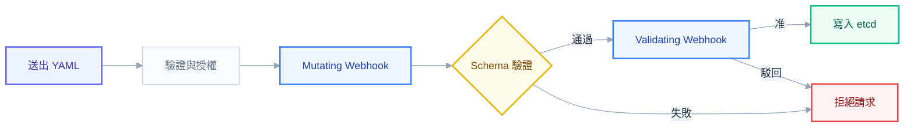
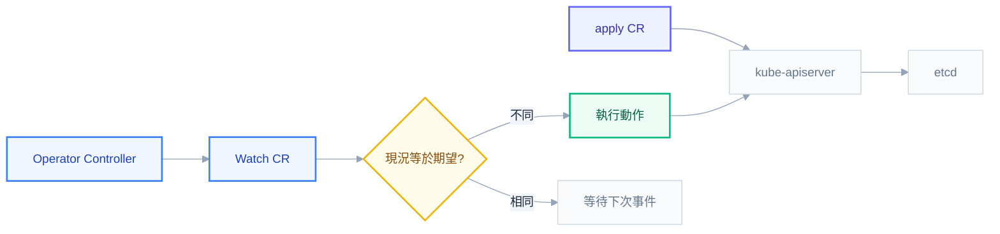
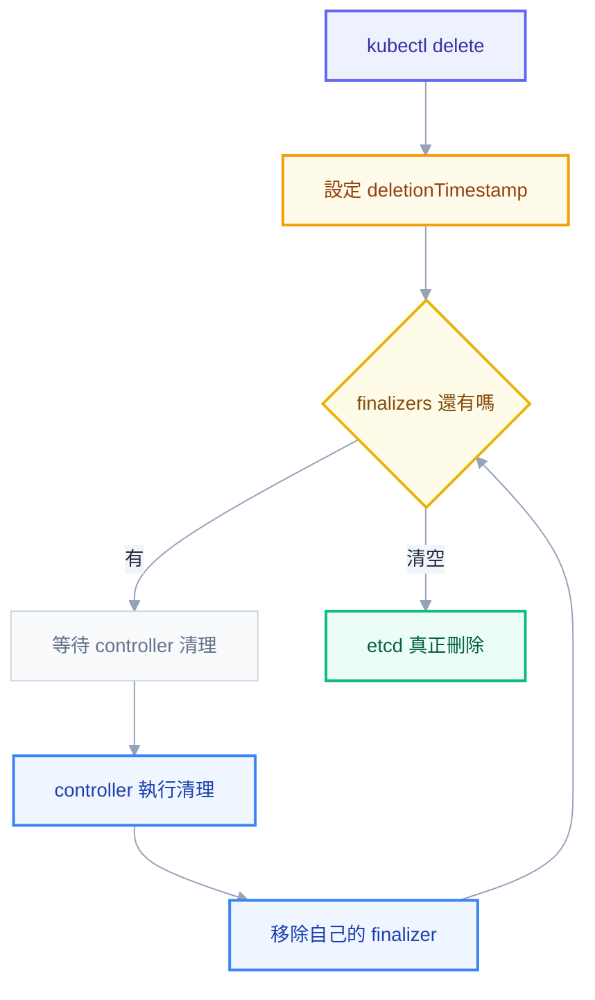
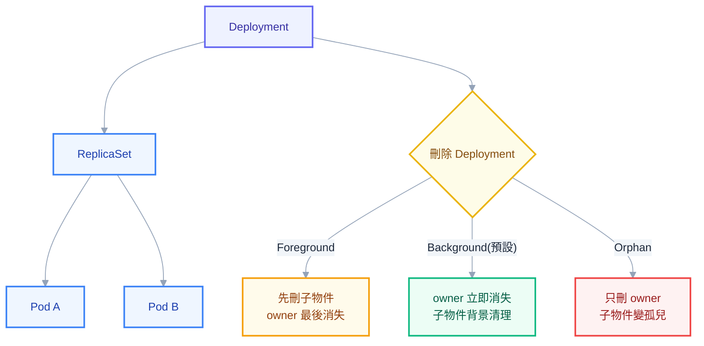

# 第九章：擴充機制——當 K8s 自己不夠用時

## 為什麼 K8s 要能被擴充

如果你只把 Kubernetes 當成「一個很會排程 Container 的系統」，前八章的內容已經足夠讓你把服務跑起來、活下去、擴出去。但只要在真實團隊裡待得夠久，一定會撞見幾件怎麼想都想不通的事：明明自己送出去的 Deployment YAML 裡沒寫 sidecar，Pod 起來後卻多了一個 istio-proxy container；明明 `kubectl delete namespace` 已經執行，終端機卻回來告訴你 namespace 還「活著」，而且怎麼等都不會消失；明明只下了一個 `kubectl delete deploy`，底下十幾個 Pod 竟然全部乾淨俐落地消失，沒有任何人手動去刪 Pod。這些現象背後沒有魔法，也不是 K8s 的 bug，而是同一組設計哲學的不同展現：**K8s 從一開始就不打算把所有功能做完，它只提供一組「可以長出功能」的介面，剩下的交給生態系去填**。

這個哲學的具體體現，就是本章要拆解的六種擴充機制：在請求寫入 etcd 之前插隊的 admission webhook；讓自訂資源長得跟原生資源一樣的 CRD；賦予 CRD 行為的 controller 與 operator；卡住刪除流程的 finalizer；記錄父子關係並驅動垃圾回收的 ownerReference；以及讓容器執行、網路、儲存都可以抽換廠商的 CRI/CNI/CSI 三大介面。理解這些機制不是為了炫技，而是因為 ArgoCD、Istio、cert-manager、OPA Gatekeeper 這些遲早要維運的工具，全部都是靠這幾根柱子撐起來的——它們沒有被寫進 K8s 原始碼的任何一行，卻能表現得像原生功能一樣自然。看穿這一層，才算真正從「會用 K8s 的人」畢業成「懂 K8s 的人」。

## Admission Controller 鏈：你的 YAML 到底經過了誰的手

每一個透過 `kubectl apply` 送出去的物件，在真正落地存進 etcd 之前，其實要先走過一條看不見的流水線，叫做 admission chain。這條流水線的順序絕對不是隨便排的：**先是可以動手修改請求內容的 Mutating admission，接著是 kube-apiserver 內建的 OpenAPI schema 驗證，最後才是只能舉手表決「准」或「駁回」、完全不能動手改東西的 Validating admission**。



為什麼一定要 Mutating 先跑？因為 Validating webhook 檢查的是「這個物件現在的樣子合不合規」，如果讓它先跑，它看到的只會是使用者原始送出的半成品——這時候 sidecar 還沒被注入、預設的 resource limits 還沒被填上、ServiceAccount token 還沒被掛上去。等 Mutating webhook 把該補的欄位都補完，物件才算「定稿」，Validating webhook 這時候檢查的才是最終真正會寫進 etcd 的內容。順序反過來，等於在校稿前就先審稿，審完的結果毫無意義。

如上圖所示，這也直接回答了一個新手常見的靈異現象：「為什麼我的 YAML 被改了？」答案是——它本來就會被改，而且是設計上的常態，不是意外。Istio 的 sidecar 自動注入，靠的就是一個 Mutating webhook 監聽 Pod 的建立請求，只要 Pod 所在 namespace 掛了 `istio-injection=enabled` 標籤，webhook 就會在 Pod spec 裡塞入一個 istio-proxy container，外加對應的 initContainer；kube-apiserver 內建的 defaulting 邏輯（本質上也是一種 admission 行為）會幫忙把沒寫的欄位補上預設值，例如沒指定 `imagePullPolicy` 就自動補 `IfNotPresent`;ServiceAccount admission controller 則會自動幫 Pod 掛上對應的 token volume。這些行為全部發生在 Mutating 階段，使用者送出去的 YAML 跟 etcd 裡實際存的內容，中間可能已經隔了好幾層改寫。

一個典型的 Mutating webhook 註冊起來大致長這樣：

```yaml
apiVersion: admissionregistration.k8s.io/v1
kind: MutatingWebhookConfiguration
metadata:
  name: sidecar-injector
webhooks:
  - name: sidecar-injector.istio.io
    clientConfig:
      service:
        name: istiod
        namespace: istio-system
        path: /inject
    rules:
      - operations: ["CREATE"]
        apiGroups: [""]
        apiVersions: ["v1"]
        resources: ["pods"]
    failurePolicy: Fail
    sideEffects: None
    admissionReviewVersions: ["v1"]
```

`failurePolicy` 這個欄位平時毫不起眼，出事的時候卻能讓整個叢集當機。它決定的是「當 webhook server 連不上、逾時、或回傳錯誤時該怎麼辦」：設成 `Ignore`,admission 流程會放行請求，等於這次沒經過該 webhook 檢查；設成 `Fail`,admission 流程會直接拒絕請求。問題在於，如果這個掛掉的 webhook 剛好攔截的是 Pod 或 Deployment 這類核心資源的 CREATE/UPDATE，而它的 failurePolicy 又是 Fail，那麼一旦 webhook 的 Pod 本身掛了、或它所在的 Service 網路不通，**叢集會進入一種近乎鎖死的狀態：任何人想建立任何新資源都會被擋下來，因為 kube-apiserver 連要問的 webhook 都問不到**。更陰險的是，如果掛掉的 webhook 又是靠 K8s 自己管理的 Deployment 跑起來的，救援它的動作本身（重建 Pod）也可能被自己造成的 admission 阻擋卡死，形成死鎖。這是真實世界事故報告裡反覆出現的劇本，也是為什麼所有 admission webhook 的設計都應該預設保守：非核心、非安全關鍵的檢查用 `Ignore`，並且務必替 webhook 本身設定寬鬆的 `namespaceSelector`，排除 `kube-system` 等關鍵 namespace，避免自己把自己鎖死。

> **常見誤解**：很多人以為 admission webhook 只是「多一層驗證」，可用性要求跟一般應用程式一樣。實際上 admission webhook 是同步阻塞在 kube-apiserver 請求路徑上的，它的可用性直接等於整個叢集寫入操作的可用性。維護 webhook 的團隊需要用管理核心基礎設施的規格對待它，包含高可用部署、快速的 readiness probe、以及保守的 `timeoutSeconds`。

到了近幾個版本，K8s 給了一條新的路：**ValidatingAdmissionPolicy**。它同樣掛在 admission chain 的 Validating 階段，但不需要額外起一個 webhook server、不需要處理 TLS 憑證、也不必擔心 webhook 本身的可用性問題——因為驗證邏輯是用 CEL（Common Expression Language）直接寫成宣告式規則，由 kube-apiserver 內部直接求值：

```yaml
apiVersion: admissionregistration.k8s.io/v1
kind: ValidatingAdmissionPolicy
metadata:
  name: require-run-as-nonroot
spec:
  failurePolicy: Fail
  matchConstraints:
    resourceRules:
      - apiGroups: [""]
        apiVersions: ["v1"]
        resources: ["pods"]
  validations:
    - expression: "object.spec.securityContext.runAsNonRoot == true"
      message: "Pod 必須設定 runAsNonRoot"
```

對於「禁止 latest tag」「必須設定 resource limits」這類不需要外部狀態、純粹檢查物件欄位的規則，ValidatingAdmissionPolicy 是比自建 webhook 更輕量、更少故障點的選擇；但如果驗證邏輯需要查詢叢集外部資料（例如打一個內部 API 確認 image 有沒有通過掃描），還是得回到傳統 webhook 的路。這個取捨會在後面 Policy as Code 那節再展開。

## CRD：讓自訂資源長得跟原生資源一樣

如果 admission chain 解決的是「進來的東西要不要被攔下來、改成什麼樣子」，那麼下一個問題是：K8s 原生只認得 Pod、Deployment、Service 這些內建詞彙，那 ArgoCD 的 `kubectl get application`、cert-manager 的 `kubectl get certificate` 又是怎麼一回事？它們用起來跟原生資源幾乎沒有差別——一樣可以 apply、get、describe、加 label、用 selector 篩選——這背後靠的正是 CRD。

CRD 全名 CustomResourceDefinition，它做的事情本質上很單純：**向 kube-apiserver 註冊一個新的詞彙**，讓 API server 認得這個新的 kind，知道它的 schema 長什麼樣、該存在哪個 API group 底下、支援哪些 version、要不要區分 namespace。註冊完成之後，這個新資源就跟原生資源享有完全相同的待遇——一樣經過前面講的 admission chain、一樣存進 etcd、一樣可以被 RBAC 控管、一樣可以被 kubectl 用同一套語法操作。

```yaml
apiVersion: apiextensions.k8s.io/v1
kind: CustomResourceDefinition
metadata:
  name: applications.argoproj.io
spec:
  group: argoproj.io
  scope: Namespaced
  names:
    kind: Application
    plural: applications
    singular: application
    shortNames: [app]
  versions:
    - name: v1alpha1
      served: true
      storage: true
      schema:
        openAPIV3Schema:
          type: object
          properties:
            spec:
              type: object
              properties:
                source:
                  type: object
                  properties:
                    repoURL:
                      type: string
                    path:
                      type: string
                destination:
                  type: object
                  properties:
                    namespace:
                      type: string
            status:
              type: object
              properties:
                sync:
                  type: object
      subresources:
        status: {}
```

幾個關鍵欄位值得逐一拆開看。`scope` 決定這個資源是 `Namespaced` 還是 `Cluster`：像 ArgoCD 的 Application 通常是 Namespaced，因為它描述的是「某個環境要部署什麼」，天然跟 namespace 綁定；而像 ClusterRole 這種全域性質的資源就該用 Cluster scope。`spec.versions` 是一個陣列，代表同一個 kind 可以同時支援多個 API 版本（例如 v1alpha1 跟 v1beta1 並存）,`served` 決定這個版本是否對外開放存取，`storage` 決定 etcd 實際上用哪個版本的格式儲存——同一時間只能有一個 version 的 storage 是 true，這也是 CRD 版本演進、做 conversion webhook 的基礎。

`openAPIV3Schema` 則是 CRD 真正「長得像原生資源」的關鍵：有了這份 schema，kube-apiserver 就能在 admission chain 的 schema 驗證階段，直接檢查使用者送進來的 Application YAML 有沒有符合格式——缺欄位、型別錯誤，在物件真正被建立之前就會被擋下來，使用者體驗跟建立一個填錯欄位的 Deployment 被拒絕完全一致。

最後 `subresources.status: {}` 這一行看似不起眼，意義卻很大。它讓這個自訂資源多出一個獨立的 `/status` 子路徑，意味著**更新 spec（使用者的期望）跟更新 status（controller 回報的實際狀態）是兩條分開的寫入路徑，各自有各自的權限控管**。沒有這個 subresource，任何有權限 update 這個資源的人都可以順手竄改 status 欄位，讓 controller 回報的「目前是否同步成功」變得不可信；有了它，可以用 RBAC 讓一般使用者只能改 spec，只有 controller 的 ServiceAccount 才能寫 status，這正是 K8s「期望狀態 vs 實際狀態」哲學能夠被信任的基礎。

## Operator Pattern：把維運人員的腦袋寫成程式

CRD 到這裡為止，其實只做了一件事——讓 kube-apiserver 認得一個新名詞，並且知道怎麼把它存進 etcd。但一個只能被 apply、get、delete 的 Application 物件本身什麼事都不會做，它就是一份靜態的宣告書，跟一份純文字的設定檔沒有本質差異。真正讓 `kubectl apply -f application.yaml` 之後「ArgoCD 就開始幫忙把 git repo 同步到叢集」的，是另外一個獨立跑著的程式，持續盯著這個資源，把 spec 跟現實世界的落差找出來、動手把現實拉回 spec 描述的樣子。這個模式就叫 **Operator**:CRD 定義「名詞」，controller 賦予「動詞」。

controller 的核心邏輯幾乎都逃不出同一個迴圈，叫做 **reconcile loop**:watch 這個資源的變化（新增、修改、刪除，甚至它管理的子資源的變化）、把目前實際狀態跟 spec 描述的期望狀態做比較、如果不一致就執行動作把兩者拉近、然後回到第一步繼續等下一次事件。



這個模式之所以被稱為 Operator，是因為它把原本需要一個真人維運人員坐在電腦前才能做的判斷，寫成了程式碼裡的條件判斷跟 API 呼叫。舉一個常被拿來當範例的資料庫 Operator：一般維運人員管理一套 PostgreSQL 叢集，腦袋裡裝的是「主節點掛了要怎麼選新主、備份要固定排程做、做 failover 時連線字串要怎麼切」這些知識；資料庫 Operator 做的事情一模一樣，只是這些知識被寫成了 controller 程式碼，一旦偵測到主節點的健康檢查連續失敗，它會自動觸發選舉、更新 Service 的 selector 指向新主節點、甚至自動建立新的備份任務。ArgoCD 本身也是同樣的道理：Application 這個 CRD 描述「哪個 git repo 的哪個 path 要同步到哪個叢集的哪個 namespace」，而 ArgoCD 的 application-controller 則是那個持續 watch Application 物件、去 git repo 拉最新內容、跟叢集現況做 diff、決定要不要 apply 或要不要 prune 的 operator。

寫這類 controller 通常會用到 `controller-runtime`（由 kubebuilder 專案維護）這類框架，它把 watch、queue、informer cache、leader election 這些樣板邏輯都包好了，開發者只需要專注寫 `Reconcile` 這一個函式的業務邏輯。這部分屬於開發 Operator 的人才需要深入的細節；作為叢集管理者，不需要會寫這段程式碼，但必須理解**任何一個看起來像原生功能的自訂資源，背後幾乎一定坐著一個這樣的 reconcile loop**——當 Application 卡住不同步、當 Certificate 遲遲拿不到憑證，該查的不是 CRD 的 YAML 對不對，而是那個 controller 的 log 在抱怨什麼。

> **這題怎麼答**：如果被問「Operator 跟一般的 Deployment 應用程式有什麼不同」，關鍵差異不在於它跑在 Pod 裡這件事（Operator 本身也是一個跑在 Pod 裡的程式），而在於它**透過 K8s API 對其他資源做 watch 跟 reconcile**，把 K8s 自己當成一個持久化的狀態儲存跟事件匯流排來用，而不是單純提供對外服務。

## Finalizers：為什麼 namespace 一直卡在 Terminating

如果曾經手滑刪掉一個掛了很多資源的 namespace，多半見過這個畫面：`kubectl get ns` 顯示 STATUS 是 Terminating，然後不管等五分鐘還是五十分鐘，它都文風不動。這不是 K8s 卡住了，也不是 etcd 壞了，而是 finalizer 正在盡忠職守——它的存在意義，就是要在資源被真正抹除之前，逼某個 controller 出來把該做的清理做完。

要理解這個機制，得先打破一個直覺：在 K8s 裡，delete 從來不是一個原子動作，而是**兩階段流程**。第一階段，kube-apiserver 收到 delete 請求後，並不會馬上把物件從 etcd 移除，而是在物件的 `metadata.deletionTimestamp` 填上一個時間戳，同時檢查 `metadata.finalizers` 陣列——只要這個陣列不是空的，物件就會停留在「正在刪除但還沒真的刪除」的狀態，`kubectl get` 依然看得到它，只是狀態顯示 Terminating。第二階段，各個宣告了 finalizer 的 controller 會 watch 到 deletionTimestamp 被設定，各自跑自己的清理邏輯（例如釋放雲端上的 LoadBalancer、刪除底層的儲存磁區、通知外部系統這個資源要下線了），做完之後把自己的字串從 `finalizers` 陣列裡移除。只有當這個陣列**完全清空**,kube-apiserver 才會真正把物件從 etcd 抹除。



```yaml
apiVersion: v1
kind: Namespace
metadata:
  name: my-app
  finalizers:
    - kubernetes
  # deletionTimestamp 由 API server 在收到 delete 後自動填入,不是手動寫的欄位
```

namespace 卡住的經典成因，多半是它底下還有資源掛著自己的 finalizer 沒被清乾淨——例如某個 CRD 實例（像一個 Application 物件）帶著自訂 finalizer，理論上該由 ArgoCD 的 controller 負責移除，但如果這個時候 controller 本身已經被解除安裝、Pod 已經不在了，就再也沒有任何程式會去把這個 finalizer 拿掉，這個資源、連帶整個 namespace，就會永遠卡在 Terminating。同樣的邏輯放大到任何資源都成立：**finalizer 的擁有者若消失，資源就會被那個永遠不會再有人移除的字串鎖住**。

遇到這種情況，社群裡流傳最廣的解法是直接把卡住資源的 `finalizers` 欄位改成空陣列，強制放行：

```powershell
kubectl patch application my-app -n my-namespace `
  --type=merge `
  -p '{"metadata":{"finalizers":[]}}'
```

這個指令確實能讓資源瞬間消失，但**這是貨真價實的最後手段，不是常規操作**。理由很直接：finalizer 存在的唯一目的就是保證清理邏輯一定會被執行過一次，強制移除它等於告訴 kube-apiserver「不用等清理完成了，直接刪」。如果這個資源背後真的還掛著雲端 LoadBalancer、還有 PV 底層的實體儲存、還有外部系統的 webhook 訂閱，這些東西不會因為 K8s 裡的物件消失就自動被清乾淨——它們會變成孤兒，繼續在雲端帳單上收費、繼續佔用儲存空間、繼續讓外部系統以為這個資源還存在。正確的處理順序永遠應該是先查清楚是哪個 controller 該負責移除這個 finalizer、為什麼它沒有動作（controller 是不是掛了、是不是 crash loop、是不是權限被收回），把根因排除讓它自然完成清理；只有在確認清理邏輯本身已經不可能再執行（例如整套系統都要報廢重建）的情況下，才考慮強制移除當作停損。

> **常見誤解**：很多人以為 finalizer 是「防止誤刪」的保護機制，類似 `kubectl delete --dry-run`。實際上完全相反——finalizer 從不阻止刪除指令本身被接受，它阻止的是「刪除指令生效之前，清理工作沒有機會執行完」。它是清理保證，不是誤刪保護。

## OwnerReferences 與垃圾回收：為什麼刪 Deployment 會連帶清光 Pod

finalizer 管的是「這個資源自己被刪之前該做什麼」，那另一個常見疑問剛好相反：明明只下了 `kubectl delete deploy my-app`，為什麼底下自動生出來的 ReplicaSet、Pod 全部都跟著不見，沒人手動一個一個刪？答案藏在每個由其他資源建立出來的物件身上，都會被自動蓋上的一個欄位：`metadata.ownerReferences`。

```yaml
apiVersion: v1
kind: Pod
metadata:
  name: my-app-7d9f8c6b5-x2k9p
  ownerReferences:
    - apiVersion: apps/v1
      kind: ReplicaSet
      name: my-app-7d9f8c6b5
      uid: 3f2a1b0c-1234-5678-9abc-def012345678
      controller: true
      blockOwnerDeletion: true
```

`ownerReferences` 記錄的是「我是誰生出來的」，反過來從 Deployment 的角度看，就形成一條清楚的擁有鏈：Deployment 建立並擁有 ReplicaSet，ReplicaSet 建立並擁有底下每一個 Pod。K8s 內建的 garbage collector controller 持續在背景 watch 這條鏈，一旦某個資源被刪除，它就會沿著鏈往下找出所有把它列為 owner 的物件，逐一處理。



上圖的三條分支，對應刪除時可以指定的三種 **propagation policy**:

| Policy | 行為 | 適用情境 |
| --- | --- | --- |
| `Foreground` | 先把子資源全部刪完，owner 自己最後才消失（owner 會先進入 deletionTimestamp 狀態等待） | 需要確保子資源清乾淨後才視為整個刪除完成 |
| `Background`（預設） | owner 立刻被刪除，子資源交給 GC controller 在背景非同步清掉 | 一般刪除操作，追求刪除指令快速返回 |
| `Orphan` | 只刪 owner 自己，子資源的 ownerReferences 被移除，變成獨立資源留下來 | 想保留底下已經在跑的資源，只是不想再讓上層物件管理它們 |

```powershell
kubectl delete deployment my-app --cascade=orphan
```

這行指令示範的就是 Orphan 策略：Deployment 消失了，但它底下的 ReplicaSet 跟 Pod 不會被牽連，只是從此變成沒有主人的孤兒資源，需要有人手動接管或清理。

這套機制跟 ArgoCD 的關係非常直接。ArgoCD 的 `prune` 功能——也就是「git repo 裡已經拿掉的資源，sync 的時候要不要順便從叢集刪掉」——本質上就是站在 ownerReferences 跟 GC 這套底層機制之上做的應用層邏輯：ArgoCD 透過 label 跟 annotation 記錄「這個資源是我這個 Application 管理的」，sync 時比對 git 內容跟叢集現況，找出叢集裡多出來、git 裡已經沒有宣告的資源，對它們下刪除指令；而實際的連鎖清理（例如刪掉一個不在 git 裡的 Deployment，底下 ReplicaSet 跟 Pod 怎麼消失）走的正是這裡講的 ownerReferences 與 GC 流程。理解這一層，在 debug「為什麼 ArgoCD prune 之後這個資源沒有被清乾淨」時，才知道該去查 ownerReferences 有沒有被正確設定、是不是用了 Orphan 語意處理過的資源，而不是回頭懷疑 ArgoCD 本身壞掉。

## 三大可插拔介面：CRI、CNI、CSI

前面談的 admission、CRD、operator、finalizer、GC，都是 K8s 用來擴充「資源與行為」的方式；但還有一整塊更底層的擴充，藏在 K8s 故意「不做」的三件事情裡——怎麼真正跑一個容器、怎麼讓 Pod 之間能夠通訊、怎麼把儲存空間掛進 Pod。K8s 對這三件事的態度出奇一致：**自己完全不實作，只定義一份標準介面，然後讓廠商各自去實作**。這個設計讓 K8s 得以在容器執行環境、網路方案、儲存系統快速演進的年代，不用被綁死在任何一種實作上。

**CRI(Container Runtime Interface)**負責「怎麼真正把一個容器跑起來」這件事。kubelet 自己不知道怎麼建立容器，它只透過 CRI 這組 gRPC 介面跟一個外部的 runtime 溝通，說「幫忙用這個 image 建一個容器」。早期 K8s 直接依賴 Docker，後來為了不被單一實作綁死才切出這層介面，目前最常見的實作是 `containerd`（Docker 底層其實也是靠它）跟 `CRI-O`。這也是為什麼近年 Docker 被移出 K8s 支援清單這件事沒有想像中嚴重——只要 runtime 實作了 CRI，換掉底層的容器引擎對上層的 Pod、Deployment 完全無感。

**CNI(Container Network Interface)**負責「Pod 之間、Pod 跟外部怎麼通訊」。K8s 只規定每個 Pod 必須拿到一個叢集內唯一的 IP，Pod 之間必須能夠不經過 NAT 直接互通，至於這個網路要用 overlay、用 BGP、還是靠雲端廠商的原生網路實作，完全交給 CNI plugin 決定。常見實作包括 `Calico`（擅長 network policy）、`Cilium`（基於 eBPF，近年在效能與可觀測性上很受歡迎）、`Flannel`（設定簡單，常見於小型或教學環境，minikube 預設就帶一個簡化的網路方案）。

**CSI(Container Storage Interface)**負責「儲存怎麼掛進 Pod」。PVC 描述的是使用者對儲存的需求（多大容量、什麼存取模式），真正去雲端 API 或儲存陣列申請一塊實體空間、掛載進 Node、再掛進 Pod 的動作，是由對應的 CSI driver 完成的。每家雲端廠商都有自己的 CSI driver(`ebs.csi.aws.com`、`disk.csi.azure.com`、`pd.csi.storage.gke.io`)，地端環境常見 `Ceph CSI`、`Longhorn` 等。

三者共同的價值在於：**K8s 核心程式碼永遠不需要因為新的容器引擎、新的網路方案、新的儲存系統出現而修改**，升級或抽換的成本被壓在介面實作這一層，不會擴散到整個叢集控制平面。

## Policy as Code：把治理規則架在 admission webhook 上

回到本章第一節的 admission chain——它不只是拿來讓 Istio 塞 sidecar，對一個要管理多團隊、多環境叢集的管理員來說，admission webhook 更重要的身份是**組織治理的執行點**。這正是 OPA Gatekeeper 跟 Kyverno 這類 Policy as Code 工具存在的理由。

它們的運作方式，說穿了就是註冊一組 Validating（有時也做 Mutating）webhook，把「這個組織允許什麼、禁止什麼」寫成宣告式規則，架在每一次資源建立與更新的路徑上。常見的治理規則像是：強制每個 Pod 都要打上 `team` 跟 `cost-center` 標籤，方便帳務歸屬跟資源盤點；禁止 image 使用 `latest` tag，逼團隊寫明確版本號，避免「上次還好好的，這次重啟就壞了」這種因為 tag 漂移造成的詭異事故；強制每個 container 都要宣告 `resources.requests` 跟 `resources.limits`，避免沒設限的容器把整個 Node 資源榨乾，拖垮同一個 Node 上其他團隊的服務。

```yaml
apiVersion: kyverno.io/v1
kind: ClusterPolicy
metadata:
  name: disallow-latest-tag
spec:
  validationFailureAction: Enforce
  rules:
    - name: require-image-tag
      match:
        resources:
          kinds: [Pod]
      validate:
        message: "image 不可使用 latest tag,必須指定明確版本"
        pattern:
          spec:
            containers:
              - image: "!*:latest"
```

管理員之所以需要這一層，是因為單靠人力 code review 沒辦法保證每一份 YAML 都符合規範——團隊一多，總會有人漏看、有人抄舊範本沿用壞習慣。把規則寫成 admission policy，等於把治理標準從「靠人記得檢查」變成「不符合規定的資源根本進不了叢集」，而且這個強制力跟 K8s 原生驗證發生在同一個時間點，使用者體驗跟被 kube-apiserver 內建驗證擋下來完全一致。

## API Aggregation Layer：CRD 之外的另一條路

CRD 不是讓 K8s API 長出新資源的唯一方式。**API Aggregation Layer** 提供另一種做法：讓一個獨立的 API server 直接接管某個 API path 的請求，kube-apiserver 收到符合條件的請求時，不自己處理，而是把請求轉發給這個外部 API server 去回應。最常見的例子是 `metrics-server`——`kubectl top node`、`kubectl top pod` 背後查詢的 `metrics.k8s.io` 這個 API group，並不是存在 etcd 裡的資源，而是 metrics-server 即時從各個 kubelet 收集資源使用量之後，現場組裝出來的回應。

這跟 CRD 的取捨很清楚：CRD 適合「這是一份需要被持久化、需要版本控制、需要走完整 admission 與 RBAC 流程的宣告式資料」，例如 ArgoCD 的 Application；Aggregation Layer 適合「這是即時計算出來、不需要存進 etcd 的資料」，例如當下的 CPU、記憶體使用量。多數情況下，自訂資源會走 CRD，Aggregation Layer 主要留給少數需要高度客製化 API 行為、或資料本質上是即時查詢而非持久狀態的場景。

## 小結

回頭看本章一開始丟出的幾個靈異現象——YAML 被改、namespace 卡死、Pod 連坐消失——現在都有了明確的機制可以解釋，不再是「反正 K8s 就是這樣」的模糊印象。更重要的是，這六種擴充機制彼此不是孤立的：ArgoCD 的 Application 是一個 CRD，它的 controller 是一個 operator，它的 sync 與 prune 站在 ownerReferences 跟 GC 之上運作，它自己也可能掛 admission webhook 做額外驗證。下一章分析 ArgoCD 的行為與內部運作時，會不斷回頭用到本章建立的這套心智模型。

## 連結

- [[67-scaling-limits]] — 附錄 AS：不用 informer 的 controller 如何打垮 API Server
- [[65-inheriting-a-cluster]] — 附錄 AQ：失效的 webhook 是接手時最容易被埋伏的一項
- [[k8s-mastery]]
- [[02-cluster-internals]]
- [[11-argocd]]
- [[13-troubleshooting]]
- [[argocd]]
- [[kubernetes]]
- [[istio]]
- [[40-operators-and-stateful]] — 附錄 R：什麼時候該寫 Operator、reconcile 六原則
- [[62-stateful-workloads-decision]] — 附錄 AN：operator 在資料庫場景補上的正是 StatefulSet 的五個空缺
