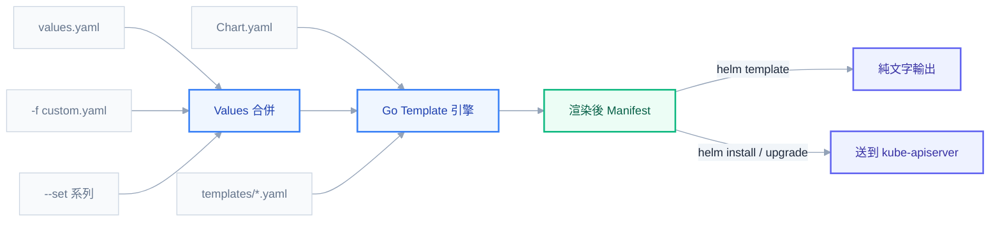
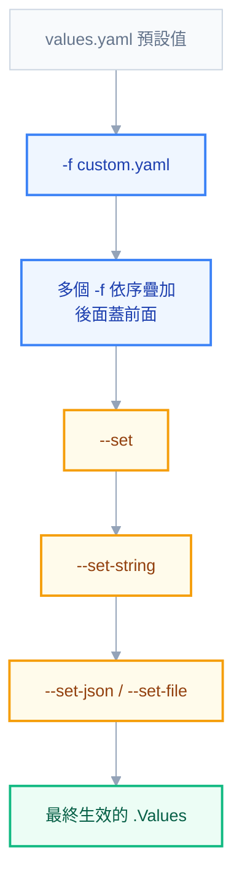
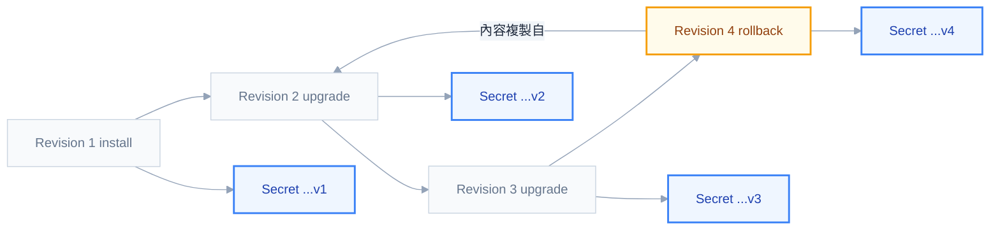

# 第十章：Helm——從一堆 YAML 到可版本化的交付單位

## 為什麼需要 Helm

前面九章建立的心智模型，最終都要落地成一份份 YAML 送進 `kubectl apply`。只要環境單純——一個服務、一個環境、長期不變——手寫 YAML 完全夠用，甚至比任何工具都直觀。問題出在規模：一旦服務數量超過個位數，且同一份服務要跑在 dev、staging、prod 三種環境，維護 YAML 的方式會迅速從「寫程式」退化成「複製貼上再祈禱沒改錯」。

具體會撞見的痛點通常是這幾種。第一種是**參數漂移**：同一份 `deployment.yaml` 複製成三份分別給三個環境用，某次要把 `resources.limits.memory` 從 `256Mi` 調到 `512Mi`，改的人只記得改 prod 那份，dev 跟 staging 悄悄地落後，半年後沒人記得三份檔案現在到底哪裡不一樣。第二種是**重複結構**：Deployment、Service、ConfigMap、Ingress 這幾個資源的骨架九成相同，只有 image tag、replica 數、標籤這些欄位在變，卻因為沒有參數化機制，每個服務都得重新複製一次完整骨架，多一個服務就多一份幾乎一樣的 YAML 要維護。第三種也是最要命的——**沒有版本邊界**：手寫 YAML 直接 `kubectl apply -f`，沒有「這次部署是哪個版本」「上一個能動的版本是什麼」的概念，出事想回滾，只能翻 Git log 找出上一個 commit 手動 revert，而且完全沒有工具幫你確認「回滾到的那份 YAML 跟叢集裡現在跑的東西是否一致」。

Helm 解決的正是這兩層問題：**參數化**與**打包成可版本化的交付單位**。參數化讓一份模板配上不同的參數檔就能生出 dev、staging、prod 三種輸出，改動集中在參數檔而不是到處找骨架檔案改；打包則是把一整組相關的 YAML、預設參數、依賴關係全部收進一個叫 **Chart** 的單位裡，這個單位可以標版本號、可以推上 registry、可以被安裝（`helm install`）、升級（`helm upgrade`）、回滾（`helm rollback`），行為模式跟 apt、npm 這類套件管理工具幾乎一模一樣。裝過一次的東西不必再靠記憶重建，只要一句 `helm install my-release ./my-chart` 就能重現。

這一章之所以排在 ArgoCD 之前，是因為順序反過來會很痛苦。ArgoCD 部署的東西十之八九是 Helm Chart——Application 資源裡的 `source.helm` 欄位、valueFiles 覆蓋、ArgoCD 怎麼決定要不要重新渲染，這些全部建立在本章的機制之上。沒有先搞懂 Chart 怎麼被渲染、values 怎麼疊加、release 的版本觀念是什麼，直接跳去看 ArgoCD 只會在半路上不斷回頭查 Helm 的文件。

## Chart 結構

一個 Chart 就是一個依照固定慣例排列的資料夾，Helm 認得這套慣例，才能知道哪裡放模板、哪裡放預設值、哪裡放依賴。完整結構長這樣：

```text
my-chart/
├── Chart.yaml # 套件元資料：名稱、版本、依賴宣告（必要）
├── Chart.lock # 依賴版本鎖定檔（helm dependency update 自動產生，應納入版控）
├── values.yaml # 預設參數值
├── values.schema.json # 參數的 JSON Schema 驗證（選用）
├── charts/ # 依賴的子 chart（.tgz 或展開的資料夾）
├── crds/ # CRD 定義，會在 templates 之前、且不經過模板引擎直接套用
├── templates/ # Go template 模板目錄
│   ├── deployment.yaml
│   ├── service.yaml
│   ├── ingress.yaml
│   ├── configmap.yaml
│   ├── secret.yaml
│   ├── hpa.yaml
│   ├── pdb.yaml
│   ├── serviceaccount.yaml
│   ├── _helpers.tpl # 共用具名模板，不會單獨產生輸出
│   ├── NOTES.txt # 安裝／升級後顯示給使用者的提示訊息
│   └── tests/
│       └── test-connection.yaml
├── .helmignore # 打包時要排除的檔案（語法同 .gitignore）
└── README.md
```

幾個容易被忽略但實務上會踩到的細節值得單獨拆開講。`templates/` 底下所有檔案都會經過 Go template 引擎處理，唯獨檔名以底線開頭的 `_helpers.tpl` 是例外——Helm 的慣例是底線開頭的檔案不會被當成獨立的 K8s manifest 輸出，只用來存放給其他模板呼叫的具名模板（下一節細講）。`NOTES.txt` 則相反，它會被模板引擎處理，而且處理完的內容不是拿去 apply，而是直接印在終端機給操作者看，很適合放「服務裝好了，用這個指令測試連線」這類提示。

`crds/` 是最容易被誤解的目錄。很多人以為 CRD 也是普通的 YAML，放進 `templates/` 就好，但 CRD 有一個特殊性質——它必須在所有依賴它的自訂資源之前就存在於叢集，而且理論上一個 CRD 全叢集只能有一份，不該因為多個 release 各自渲染一次而衝突。因此 Helm 特別把 `crds/` 獨立出來：裡面的檔案**不會經過模板引擎**（不能用 `{{ .Values.xxx }}`，只能是純 YAML），會在其他 templates 之前被安裝，而且 **Helm 不會在 `helm upgrade` 時更新 `crds/` 裡的內容，`helm uninstall` 也不會刪除它**。這個「不會自動更新」的設計常常讓人誤以為是 bug，其實是刻意的保守選擇——CRD 的變更影響全叢集，Helm 不想在你毫無防備的情況下悄悄改動或刪除它，需要更新 CRD 版本時，官方建議手動 `kubectl apply` 或另外用獨立的升級流程處理。

最後 `.helmignore` 跟 `.gitignore` 語法一致，決定 `helm package` 打包 `.tgz` 時要排除哪些檔案（例如 `.git/`、`*.swp`、本機測試用的 values 檔），避免無關檔案混進正式發佈的套件裡。

## 模板語法核心

`templates/` 底下的檔案本質上是「加了 `{{ }}` 標記的 K8s YAML」，`{{ }}` 內是 Go template 的動作（action）語法，Helm 在渲染階段把這些動作求值、替換成實際文字，最後才把結果當成一份普通 YAML 拿去解析。理解這件事很重要：**Helm 模板引擎完全不懂 YAML 的結構**，它只是純文字替換，縮排對不對、冒號後面有沒有空格，是渲染完之後 YAML 解析器才會在意的事，這也是後面「常見錯誤」那節會反覆回來談的根源。

把整個渲染過程畫出來會更清楚：`Chart.yaml`、`values.yaml` 的預設值、`-f`／`--set` 系列的覆蓋，全部先合併成最終的 `.Values`，再跟 `templates/` 底下的檔案一起丟進 Go template 引擎求值，產出的結果就是一份純文字的 manifest——這份 manifest 走哪條路，取決於下的是 `helm template`（純輸出到終端機）還是 `helm install`／`upgrade`（送去 kube-apiserver）：



渲染時，模板拿到的頂層 context 是一個物件，裡面掛了幾個內建物件，各自能拿到不同層面的資訊：

- **`.Values`**：所有可覆寫的參數，來源是 `values.yaml` 疊加所有 `-f`、`--set` 系列覆蓋之後合併出來的最終結果。這是寫模板時打交道最頻繁的物件。
- **`.Release`**：這次部署本身的資訊，常用的有 `.Release.Name`（release 名稱，例如 `helm install my-app ./chart` 裡的 `my-app`）、`.Release.Namespace`、`.Release.IsInstall`、`.Release.IsUpgrade`、`.Release.Revision`（第幾次修訂）。
- **`.Chart`**：`Chart.yaml` 本身的內容，例如 `.Chart.Name`、`.Chart.Version`（Chart 版本）、`.Chart.AppVersion`（應用程式版本，兩者是分開追蹤的兩個概念）。
- **`.Capabilities`**：目前叢集的能力資訊，例如 `.Capabilities.KubeVersion` 是叢集的 K8s 版本，`.Capabilities.APIVersions.Has "batch/v1/CronJob"` 可以判斷叢集是否支援某個 API 版本，用來寫出能同時相容新舊叢集的模板。
- **`.Files`**：讀取 Chart 內**非模板**的原始檔案內容，例如 `.Files.Get "config/app.conf"` 讀一份不想被模板引擎處理的設定檔原文，`.Files.Glob "configs/*.conf"` 搭配 `.AsConfig` 可以把一整個資料夾的檔案一次轉成 ConfigMap 的 `data` 欄位。

實務上最常用的是前三個，舉例對照著看：

```yaml
# templates/deployment.yaml
apiVersion: apps/v1
kind: Deployment
metadata:
  name: {{ .Release.Name }}-deployment
  labels:
    app.kubernetes.io/version: {{ .Chart.AppVersion | quote }}
spec:
  replicas: {{ .Values.replicaCount }}
  template:
    spec:
      containers:
        - name: {{ .Chart.Name }}
          image: "{{ .Values.image.repository }}:{{ .Values.image.tag }}"
```

`.Release.Name` 決定資源命名前綴，`.Values` 決定可調整的參數，`.Chart` 則是 Chart 自身的靜態描述——三者各司其職，不要混著用，例如不該用 `.Values` 去存 Chart 版本，那本來就該讀 `.Chart.Version`。

## 函式與 Pipeline

Go template 支援 Unix shell 那種管線寫法：把一個值丟進去，經過一串函式依序處理，最後得到結果。語法是 `{{ 值 | 函式1 | 函式2 }}`，讀起來跟寫起來的方向一致，是 Helm 模板裡最常見的寫法。

**`default`**：提供預設值，當值是空的時候頂上去。

```yaml
replicas: {{ .Values.replicaCount | default 1 }}
```

這裡藏著一個經典陷阱：`default` 判斷的是 Go 語言意義上的「空值」——空字串、`0`、`false`、`nil`、空陣列/空 map，通通算「空」。這代表如果使用者在 `values.yaml` 裡明確寫了 `replicaCount: 0`（想暫時把服務縮到零），`default 1` 還是會把它當成「沒設定」而蓋成 `1`，使用者的意圖被悄悄吃掉。需要允許「合法的零值」時，不能用 `default`，得改用 `if` 明確判斷這個 key 存不存在。

**`quote`**：把值包上雙引號，常用在數字、布林值要塞進本來期待字串的欄位時，避免 YAML 把它解析成非字串型別：

```yaml
appVersion: {{ .Chart.AppVersion | quote }}
```

**`indent` 與 `nindent`**——這是整章模板語法裡最多人寫錯的一組函式，值得把差異講透。`indent N` 做的事情很單純：把傳入字串的**每一行**（包含第一行）前面加上 N 個空格。`nindent N` 則是「先換行，再 indent」——多做了一步，在最前面插入一個換行字元。兩者的差別只有這一個換行，但在 YAML 模板裡影響巨大。

看下面兩種寫法的實際輸出差異：

```yaml
# 寫法一:用 nindent(正確)
metadata:
  labels:
    {{- include "mychart.labels" . | nindent 4 }}
```

渲染結果：

```yaml
metadata:
  labels:
    app.kubernetes.io/name: mychart
    app.kubernetes.io/instance: my-release
```

`labels:` 後面接著換行，下面每一行都乖乖縮排 4 格，是一個合法的 YAML map。

```yaml
# 寫法二:誤用 indent(錯誤)
metadata:
  labels:
    {{- include "mychart.labels" . | indent 4 }}
```

因為 `{{-` 已經把前面的換行吃掉，`indent` 本身又不會補上換行，結果變成：

```yaml
metadata:
  labels:    app.kubernetes.io/name: mychart
    app.kubernetes.io/instance: my-release
```

`labels:` 後面直接黏著 `app.kubernetes.io/name: mychart`，YAML 解析器看到一個 scalar 裡面又出現冒號，會直接丟出 `mapping values are not allowed in this context` 這種錯誤，或者更陰險地被解析成一個奇怪的字串值，渲染看起來沒報錯但套用到叢集完全不是預期的資源。實務上的判斷原則很簡單：**只要輸出接在某個 key 後面要另起一行縮排，一律用 `nindent`；`indent` 幾乎只有在字串本來就已經在新行開頭時才用得上**，九成情況下你要的都是 `nindent`。

**`toYaml`**：把一個 map 或 list 轉成 YAML 文字，搭配 `nindent` 是讓使用者自由傳入複雜結構（例如 `resources`、`nodeSelector`、`tolerations`）最乾淨的寫法：

```yaml
resources:
  {{- toYaml .Values.resources | nindent 4 }}
```

**`required`**：強制某個 value 必須被提供，沒提供就直接中止渲染並印出自訂錯誤訊息，比讓它一路跑到 `nil pointer` 報錯友善得多：

```yaml
image: {{ required "image.repository 必須提供" .Values.image.repository }}
```

**`b64enc`**：Base64 編碼，K8s Secret 的 `data` 欄位規定必須是 Base64 過的字串，寫 Secret 模板幾乎一定會用到：

```yaml
apiVersion: v1
kind: Secret
type: Opaque
data:
  password: {{ .Values.password | b64enc }}
```

## 流程控制

除了函式管線，模板還需要條件判斷跟迴圈，才能因應「這個功能要不要開」「這組清單要展開成幾條資源」這類需求。

**`if / else`**——最直接的條件輸出，搭配前一章 Ingress 範例：

```yaml
{{- if .Values.ingress.enabled }}
apiVersion: networking.k8s.io/v1
kind: Ingress
{{- else }}
# ingress 未啟用,不產生任何資源
{{- end }}
```

**`range`**——遍歷 list 或 map，常見於「一組 port、一組環境變數」這類重複結構：

```yaml
ports:
  {{- range .Values.ports }}
  - port: {{ .port }}
    targetPort: {{ .targetPort }}
  {{- end }}
```

`range` 區塊內的 `.` 會變成當前迭代到的元素，如果原本的 `.Values.ports` 是一組物件陣列，這裡的 `.port` 指的就是當前這個物件的 `port` 欄位。

**`with`**——本質是一種「順便改變 scope 的 if」，常用來簡化多層巢狀存取：

```yaml
{{- with .Values.ingress }}
host: {{ .host }}
{{- end }}
```

進入 `with` 區塊後，`.` 從原本的根 context 換成了 `.Values.ingress`，少打了一層 `.Values.ingress.` 前綴，寫起來確實乾淨。但這正是 `with` 最容易踩到的陷阱：**`.` 被改變之後，原本能存取的 `.Release`、`.Chart` 等根層級物件，在區塊裡直接寫是拿不到的**，因為它們根本不存在於 `.Values.ingress` 底下。

```yaml
{{- with .Values.ingress }}
host: {{ .host }}
release: {{ .Release.Name }}
{{- end }}
```

上面這段在 `with` 區塊裡直接寫 `.Release.Name` 會出錯或拿到空值，因為此刻的 `.` 已經變成 `ingress` 這個子物件，它底下沒有 `Release` 這個欄位。正確寫法要用 `$`：

```yaml
{{- with .Values.ingress }}
host: {{ .host }}
release: {{ $.Release.Name }}
{{- end }}
```

`$` 是一個特殊變數，**永遠指向模板最外層的根 context，不受 `with`、`range` 改變 scope 的影響**。這是實務上寫 Helm 模板最常見的除錯關鍵字——只要在 `with` 或 `range` 區塊裡看到「明明外面能存取的欄位，進來就拿不到了」，十之八九是忘記在需要根物件的地方補上 `$`。

> **同事會來問你的問題**：「為什麼在 `range` 迴圈裡面存取 `.Release.Name` 拿到空的？」——答案就是這一節講的 scope 問題。`range` 跟 `with` 一樣會把 `.` 換成當前迭代的元素，迴圈裡要拿根層級的資訊，一律改用 `$.Release.Name`。

## `_helpers.tpl` 與 `define`：`template` 與 `include` 的關鍵差異

多個模板檔案裡難免會重複用到同一段邏輯——最典型的就是資源命名規則跟標準標籤集，每個 Deployment、Service、ConfigMap 都要貼一樣的 `app.kubernetes.io/name`、`app.kubernetes.io/instance` 這組標籤。把這些邏輯抽成「具名模板」，寫在 `_helpers.tpl` 裡，是 Helm Chart 幾乎沒有例外的標準做法。

具名模板用 `define` 宣告，本身不輸出任何內容，只是註冊一段可以被呼叫的邏輯：

```yaml
{{- define "mychart.fullname" -}}
{{- if .Values.fullnameOverride }}
{{- .Values.fullnameOverride | trunc 63 | trimSuffix "-" }}
{{- else }}
{{- printf "%s-%s" .Release.Name .Chart.Name | trunc 63 | trimSuffix "-" }}
{{- end }}
{{- end }}
```

```yaml
{{- define "mychart.labels" -}}
app.kubernetes.io/name: {{ .Chart.Name }}
app.kubernetes.io/instance: {{ .Release.Name }}
app.kubernetes.io/version: {{ .Chart.AppVersion | quote }}
helm.sh/chart: {{ printf "%s-%s" .Chart.Name .Chart.Version }}
{{- end }}
```

呼叫具名模板有兩種方式，`template` 跟 `include`，新手第一次看範例大概率會被 `{{- include "mychart.labels" . | nindent 4 }}` 這行卡住——為什麼不是更直覺的 `template`？

答案在於兩者的語言性質完全不同。**`template` 是一個動作（action），是一個語句（statement），它把結果直接印出來，沒有回傳值，因此不能被放進 pipeline 裡接其他函式。`include` 則是一個函式呼叫，它會把具名模板的渲染結果當成一個字串回傳，既然是回傳字串，就能像任何其他值一樣被丟進 pipeline，接 `| nindent 4` 做縮排處理。**

```yaml
# template:能跑,但沒辦法接 nindent 調整縮排
{{ template "mychart.labels" . }}

# include:回傳字串,可以接 pipeline
{{- include "mychart.labels" . | nindent 4 }}
```

而標籤這種多行輸出，幾乎必然要塞進某個 key 底下、需要正確縮排，這正是為什麼實務上幾乎所有正式的 Chart 都用 `include` 而不是 `template`——不是習慣問題，是語法能力的落差。`template` 唯一還算派得上用場的場合，是那種不在乎縮排、單純想在某處插入一段固定文字的情境，但這種情境在 K8s YAML 裡其實非常少見。

另外一個常被忽略的細節是呼叫時傳入的第二個參數——`include "mychart.labels" .` 裡的這個 `.`。具名模板內部要用到 `.Release`、`.Chart` 這些根物件，前提是呼叫時把當前完整的 context（也就是 `.`）傳進去。如果手滑只傳了 `.Values`，具名模板裡所有 `.Release.Name`、`.Chart.Name` 都會變成空值——這是另一個經典的「明明 helper 寫得沒錯，套用起來卻全部空白」的踩坑點。

## Values 覆蓋優先序

一個 Chart 要能同時服務 dev、staging、prod 三種環境，靠的就是同一份模板配上不同層次的 values 疊加。理解疊加的優先順序，是安全地跨環境部署的基礎，順序記錯，最常見的後果就是「我明明改了 values 檔，結果吃到的還是舊值」。

從最低優先到最高優先，依序是：



`values.yaml` 是 Chart 自帶的預設值，最先被套用、優先度最低。`-f`（或 `--values`）傳入的自訂檔案疊在它上面，而且**可以疊加多個 `-f`，疊加規則是後面指定的檔案覆蓋前面**——`helm upgrade my-app ./chart -f values-base.yaml -f values-prod.yaml`，如果兩個檔案都寫了同一個 key，以 `values-prod.yaml` 為準，這也是為什麼慣例上會把「共用預設」放前面、「環境專屬覆蓋」放後面。再上面是 `--set`，直接在指令列覆蓋單一或少數幾個值，優先度高於任何 `-f` 檔案，適合 CI/CD 管線裡動態塞入的值（例如這次建置產生的 image tag）。`--set-string` 跟 `--set` 幾乎一樣，差別是它強制把值當成字串處理，不做數字或布林的自動型別推斷——沒有它，`--set replicaCount="3"` 裡的 `"3"` 可能被自動轉成數字型別的 `3`，如果你就是需要一個字面上的字串（常見於某些第三方 Chart 要求版本號必須是字串而非數字），就得靠 `--set-string` 保底。

子 chart 的情境還有一個額外規則值得記住：父 chart 的 `values.yaml` 裡如果有一個 `global` 區塊，這個區塊會**自動傳遞給所有子 chart**，子 chart 裡用 `.Values.global.xxx` 就能存取，不需要額外設定。這是跨多個子 chart 共用設定（例如統一的 image registry 位址、統一的環境標籤）最乾淨的方式：

```yaml
# 父 chart 的 values.yaml
global:
  imageRegistry: harbor.internal/library
  environment: prod

my-subchart:
  replicaCount: 2
```

```yaml
# 子 chart 的 templates/deployment.yaml 內可以直接讀
image: "{{ .Values.global.imageRegistry }}/my-app:{{ .Values.image.tag }}"
```

## Chart 依賴

當一個服務需要搭配資料庫、快取這類基礎設施一起部署，與其手動維護一份 PostgreSQL 的 YAML，不如直接宣告依賴，讓 Helm 幫忙抓現成的 Chart。依賴宣告寫在 `Chart.yaml` 的 `dependencies` 欄位（這是取代舊版 Helm 2 獨立 `requirements.yaml` 的寫法）：

```yaml
apiVersion: v2
name: my-app
version: 0.1.0
dependencies:
  - name: postgresql
    version: "12.x.x"
    repository: "https://charts.bitnami.com/bitnami"
    condition: postgresql.enabled
    tags:
      - database
```

`condition` 對應 `values.yaml` 裡的一個布林路徑，決定這個依賴要不要被實際渲染進去——等同幫整個子 chart 包了一層 `if`，`postgresql.enabled: false` 時整個 postgresql 子 chart 完全不會產生任何資源。`tags` 則是讓多個依賴共用同一個開關，例如把好幾個屬於「資料庫類」的依賴都掛上 `database` 這個 tag，一次用 `--set tags.database=false` 全部關掉，不用一個一個找各自的 `condition` 路徑。

宣告完之後要跑 `helm dependency update`，它會依照 `dependencies` 裡的版本規則（例如 `12.x.x` 這種語意化版號範圍），去對應的 `repository` 解析出實際符合的版本、下載 `.tgz` 放進 `charts/` 目錄，同時寫出（或更新）`Chart.lock`——這份鎖定檔記錄的是**這一次解析出來的確切版本**，概念上跟 `package-lock.json`、`Cargo.lock`是同一件事：`Chart.yaml` 允許寫版本範圍讓依賴保有彈性，但 `Chart.lock` 保證團隊裡每個人、CI 裡每一次建置，重建出來的依賴版本完全一致，不會因為上游又發了新版而悄悄跑出不同的解析結果。

`helm dependency build` 是另一個容易被忽略但正式環境更該用的指令——它不像 `update` 會重新對照 `dependencies` 的版本範圍去解析，而是直接照 `Chart.lock` 裡已經鎖定的版本下載，如果 `Chart.yaml` 跟 `Chart.lock` 的內容對不上（有人改了 `dependencies` 卻沒重新 `update`），它會直接報錯提醒你先跑 `update`。CI 流程裡應該用 `build` 而不是 `update`，才能確保每次建置都是可重現的，不會因為上游剛好推了一個新的相容版本就悄悄裝到不同東西。

## Release 生命週期

Chart 是靜態的定義，**Release** 才是它被實際安裝到叢集之後、持續存在的運行實例。同一個 Chart 可以被安裝很多次，產生很多個各自獨立的 Release，這也是為什麼指令都要求先給一個 release 名稱。

日常操作圍繞著幾個指令：`helm install <release> <chart>` 是第一次部署；`helm upgrade <release> <chart>` 更新一個已存在的 release；實務上幾乎不會分開寫這兩個指令，而是統一用 `helm upgrade --install <release> <chart>`——這個寫法是冪等的，release 不存在就等同 install，存在就等同 upgrade，CI/CD pipeline 裡不需要額外寫「先判斷這個 release 有沒有裝過」的分支邏輯，一行指令打天下。

每一次 `install` 或 `upgrade` 都會產生一個新的 **revision**，`helm history <release>` 可以看到每個 revision 的狀態、對應的 Chart 版本、App 版本跟操作描述。當某次上線出問題，`helm rollback <release> <revision>` 可以回到指定版本——這裡有個常被誤解的地方：**rollback 不是把歷史抹掉重來，而是產生一個全新的 revision，內容等於目標版本的複製**。也就是說 revision 編號只會一路往上加，不會因為 rollback 而倒退，`helm history` 上永遠看得到完整的操作軌跡。



想卸載一個服務用 `helm uninstall <release>`，預設會把這個 release 的整段歷史一併清掉；如果只是想暫時下線、但保留完整歷史方便日後查閱或重新安裝回同一個狀態，要加上 `--keep-history`。

這些歷史紀錄實際存在哪裡？Helm 3 的預設做法是存進 **Secret**（Helm 2 時代存的是 ConfigMap），每一個 revision 對應一個獨立的 Secret，命名規則是 `sh.helm.release.v1.<release 名稱>.v<revision 編號>`，存放在這個 release 所在的 namespace 底下，內容是壓縮編碼過的完整 release 資訊（包含渲染後的 manifest、當時套用的 values、Chart 描述）。也因此 `kubectl get secret -n <namespace>` 能看到一堆 `sh.helm.release.v1...` 開頭的項目，那些都是 Helm 自己在管理的狀態，不需要手動處理，但了解它存在，遇到「release 資訊怪怪的」時才知道該去哪裡查根源。

## 除錯三件套

寫模板的過程中免不了反覆試錯，Helm 提供三個層次的除錯手段，分別對應不同的檢查深度與成本，搞清楚何時用哪個能省下大量往返時間。

**`helm template <release> <chart>`**——純本地渲染，完全不連叢集，不需要 kubeconfig，只是把模板跟 values 套進 Go template 引擎跑出最終文字。這是成本最低、回饋最快的一種，寫模板的當下應該隨時拿它確認縮排、變數替換有沒有跑掉。

**`helm install <release> <chart> --dry-run --debug`**（或 `helm upgrade ... --dry-run --debug`）——這一步會實際連上叢集，把渲染完的 manifest 送到 kube-apiserver 走一輪 server-side 的 dry-run 驗證，但不會真的把資源寫進 etcd。它能抓到 `helm template` 抓不到的問題——語法正確但 K8s API 不接受的內容，例如欄位打錯字、少了必要欄位、apiVersion 選錯——因為這一層驗證是 kube-apiserver 自己的 OpenAPI schema 在把關。`--debug` 額外會印出計算過程中合併出來的 values，方便確認「這次到底吃到了哪些值」。

**`helm lint <chart>`**——反過來是最淺、但也最該放進 CI 第一關的檢查，純粹靜態分析 Chart 本身的結構是否符合慣例（必要欄位有沒有缺、格式有沒有明顯問題），不需要渲染出完整 manifest，速度最快，適合在 commit 或 PR 階段就攔下最基本的疏漏。

實務上的順序通常是：寫模板時隨手 `helm template` 看輸出；確定要送去真實叢集前用 `--dry-run --debug` 抓 API 層級的錯；CI/CD pipeline 裡把 `helm lint` 當成第一道自動化關卡，擋掉最基本的格式問題，再讓後面的流程去做更完整的驗證。

## Hooks

有些操作沒辦法單純用「渲染一份 manifest 交給 K8s」來表達，例如「在新版本的 Deployment 真正上線前，先跑一個 Job 把資料庫 schema migrate 好」。這類「在 release 生命週期的某個時間點插入一段額外動作」的需求，由 **Hooks** 機制負責。

Hook 本質上是一個一般的 K8s 資源（通常是 Job），差別只在 `metadata.annotations` 上多掛了幾個特殊欄位：

```yaml
apiVersion: batch/v1
kind: Job
metadata:
  name: {{ .Release.Name }}-db-migrate
  annotations:
    "helm.sh/hook": pre-upgrade,pre-install
    "helm.sh/hook-weight": "-5"
    "helm.sh/hook-delete-policy": before-hook-creation,hook-succeeded
spec:
  template:
    spec:
      containers:
        - name: migrate
          image: my-app-migrate:1.0
          command: ["./migrate.sh"]
      restartPolicy: Never
```

`helm.sh/hook` 決定這個資源要在哪個時機點被套用，常見的有 `pre-install`、`post-install`、`pre-upgrade`、`post-upgrade`、`pre-rollback`、`post-rollback`、`pre-delete`、`post-delete`，還有專屬 `helm test` 指令用的 `test`。同一個時機點如果掛了不只一個 hook 資源，`helm.sh/hook-weight` 決定執行順序——字串形式的整數，數字越小越早執行，上面範例的 `-5` 確保這個 migration job 會在同一階段的其他 hook 之前跑。`helm.sh/hook-delete-policy` 則決定 hook 資源執行完之後什麼時候被清掉：`before-hook-creation` 代表下一次同樣的 hook 要被觸發之前，先把上一次殘留的資源清掉（避免舊的 migration job 一直堆積）；`hook-succeeded` 代表這次執行成功後立刻刪除；還有一個較少用的 `hook-failed`——失敗也刪除，實務上通常不建議設這個，因為失敗的 hook 資源如果被馬上清掉，連 log 都來不及查就消失了，除錯會變得非常痛苦。

上面這段 DB migration 的範例完整串起來就是：`helm upgrade` 時，`pre-upgrade` 階段先跑這個 Job，確保新版本代碼期待的資料庫 schema 已經就緒，job 成功結束之後，主體的 Deployment 升級才真正套用——避免出現「新代碼已經在跑，但資料庫還是舊 schema」這種危險的過渡窗口。

> **預告**：ArgoCD 自己也有一套 Sync Hooks（`PreSync`/`Sync`/`PostSync`/`SyncFail`），用的 annotation 是 `argocd.argoproj.io/hook`，語法看起來很像，但跟這裡講的 Helm Hooks 是兩套完全獨立的機制——如果 ArgoCD 透過渲染 Helm Chart 部署，`helm.sh/hook` 這個 annotation 在 ArgoCD 眼裡只是一段普通文字，不會觸發任何 Helm 的 hook 邏輯，因為壓根不是 `helm install`/`upgrade` 在執行這次部署。這兩套 hook 系統要怎麼配合、什麼情境該用哪一套，留到下一章 ArgoCD 細講。

## 常見錯誤

以下這幾個錯誤幾乎是每個寫過 Helm Chart 的人都踩過的坑，提前認得錯誤訊息長什麼樣、成因是什麼，能省下大量瞎猜的時間。

**`nil pointer evaluating interface {}`**：這是最常見也最讓新手困惑的錯誤，通常發生在存取一個不存在的巢狀欄位，例如模板寫 `.Values.ingress.tls.secretName`，但 `values.yaml` 裡根本沒有 `tls` 這個 key，Go template 在解析到 `ingress.tls` 這一層就已經拿到 `nil`，再往下取 `.secretName` 自然爆炸。解法有兩種思路：如果這個欄位本來就必填，用 `required` 讓錯誤訊息從難懂的 nil pointer 變成一句清楚的提示；如果欄位是選填的，先用 `if` 判斷這個上層物件存不存在，再進去存取更深的欄位，而不是直接一路點下去賭它一定存在。

**縮排錯誤**：前面提過，Helm 模板是先做純文字替換、事後才被當 YAML 解析，`{{-` 跟 `-}}` 裡的減號是用來吃掉相鄰的空白與換行的，忘記加減號，常見後果是 `range` 或 `if` 區塊渲染完多出一堆空行，或者縮排量整個跑掉。出錯時第一步永遠是回到上一節講的 `helm template`，直接看渲染後的實際內容，而不是盯著模板原始碼猜——模板本身語法正確，不代表渲染出來的 YAML 也正確。

**改了 Secret／ConfigMap 但 Pod 沒吃到新值**：這是搭配 Vault、External Secrets 這類方案時最常被回報的「怪異行為」。`helm upgrade` 把 Secret 的內容改了，`kubectl get secret` 也看得到新值，但 Pod 裡的應用程式讀到的還是舊值——原因是 K8s 的 rolling update 機制，觸發條件是 Deployment 的 **pod template** 內容改變，而 pod template 通常只寫了 `secretKeyRef`／`volumeMounts` 這種「引用方式」，Secret 本身的內容變了，pod template 這段引用文字完全沒變，自然不會觸發任何新 Pod 的建立。社群慣用的解法是刻意讓 pod template 跟著 Secret 內容一起變，做法是在 annotations 裡塞一個內容雜湊值：

```yaml
spec:
  template:
    metadata:
      annotations:
        checksum/secret: {{ include (print $.Template.BasePath "/secret.yaml") . | sha256sum }}
```

Secret 內容一變，這段 `sha256sum` 算出來的雜湊值就跟著變，pod template 的雜湊值因此改變，K8s 才會認定「這是一次新的版本」而觸發滾動更新。即使解決了觸發問題，還有第二層時間差要留意：如果 Secret 是用**檔案掛載**（而不是環境變數）的方式給 Pod，就算 Pod 完全沒有重啟，Secret 內容更新後，kubelet 對掛載進去的檔案也不是立即同步——實務上大約**一分鐘**左右才會自動反映新內容，這段等待期常常讓人誤以為升級失敗、忍不住手動重啟 Pod，其實只是還沒等到 kubelet 下一輪同步而已。

**`--set` 的逗號與點跳脫**：`--set` 用逗號分隔多組 `key=value`、用點表示巢狀層級，這代表 value 裡如果本身含有逗號，或者 key 裡本身有一個字面上的點，都需要額外處理。要在 key 裡放一個字面上的點，得用反斜線跳脫，例如 `--set "annotations.nginx\.ingress\.kubernetes\.io/proxy-body-size=10m"`；要設定一個 list，語法是用大括號，例如 `--set ports={80,443}`；value 本身就帶逗號、或者結構比較複雜時，與其跟跳脫符號纏鬥，不如直接改用 `-f` 檔案或 `--set-json`，可讀性跟穩定性都好得多。

**Repo URL 失效**：第三方 Chart repo 不是永久契約，維護方隨時可能搬遷或直接關掉舊網址。近期最典型的案例是 Bitnami——原本免費開放的傳統 chart repo（`https://charts.bitnami.com/bitnami`）被下線之後，`helm repo update` 會開始回報：

```text
Error: looks like "https://charts.bitnami.com/bitnami" is not a valid chart repository or cannot be reached
```

當下能立刻解決的做法，是改用官方釋出的**歸檔索引 URL**（archive index）頂替舊網址，先移除失效的 repo 再指向新位置：

```powershell
helm repo remove bitnami
helm repo add bitnami https://raw.githubusercontent.com/bitnami/charts/archive-full-index/bitnami
helm repo update
```

更長期的做法是直接改走 **OCI-based** 的發佈管道，不再依賴傳統 index.yaml 這種 repo 型態：

```powershell
helm install my-release oci://registry-1.docker.io/bitnamicharts/nginx
```

這個踩坑背後有個更值得記住的教訓：**只要 Chart.yaml 的 `dependencies` 或 CI 流程直接指向外部維護的 repo，對方一旦下線服務，整條部署流程就會連帶斷掉**，而且往往是在最不方便的時機（例如緊急上線時）才發現。這也是不少團隊選擇把常用的第三方 Chart 直接 vendor 進自己私有 registry（例如 Harbor）的原因——用一次性的成本換掉一個長期的外部相依風險。

## 實務主題

**推上 OCI Registry**：Helm 3.8 之後，Chart 可以直接發佈到任何相容 OCI 標準的 registry，不再局限於傳統「一個 index.yaml 網頁」型態的 repo。Harbor 原生支援 OCI chart 儲存，操作起來跟推 Docker image 幾乎一致：

```powershell
helm package ./my-chart
helm push my-chart-0.1.0.tgz oci://harbor.internal/library
helm install my-release oci://harbor.internal/library/my-chart --version 0.1.0
```

這樣做的好處是 Chart 跟 image 共用同一套認證機制、同一套權限管理、同一套生命週期治理，不需要另外維護一個靜態網頁當 chart repo。ArgoCD 也原生支援把 OCI registry 當成 Application 的 source，第十一章會延續用到這一點。

**Library Chart**：`Chart.yaml` 裡把 `type` 設成 `library` 的 Chart，不會產生任何實際的 K8s 資源，存在的唯一目的是提供 `_helpers.tpl` 裡那些共用的具名模板，讓組織內其他 application chart 直接 `include` 呼叫。這個做法能避免每個團隊各自重造一遍 `fullname`、`labels` 這類 helper 的輪子，把命名規則、標籤規範這種「組織共識」收斂到單一來源。

**Umbrella Chart 與 Monorepo 的取捨**：Umbrella chart 是用一個父 chart，透過 `dependencies` 把多個微服務的子 chart 打包在一起，一句 `helm install` 就能整組上線。聽起來很吸引人，但代價也不小——父子 chart 的 `values.yaml` 彼此耦合，某個子服務想單獨升版本、單獨回滾，都得牽動父 chart 的 `Chart.lock`，「牽一發動全身」的問題會隨著子服務數量增加而愈發明顯。多數團隊實務上更傾向讓每個微服務維持獨立的 Chart、獨立的 release、獨立的 CI 流程，真正需要「一組服務一起上線」的編排需求，交給 GitOps 層（例如 ArgoCD 的 App-of-Apps 或 ApplicationSet）去處理，而不是在 Helm 這一層硬把多個服務綁死在同一個 Chart.lock 裡。這個取捨會在下一章對照 ArgoCD 的 App-of-Apps 模式時再展開一次。

## 小結

本章把「一堆手寫 YAML」升級成「可參數化、可版本化的交付單位」所需要的機制走了一遍：Chart 的目錄慣例、模板語法核心與函式管線、`with`/`range` 的 scope 陷阱、`include` 相對 `template` 的優勢、values 的多層覆蓋順序、依賴管理、release 的版本觀念，以及三層除錯手段。這些機制彼此環環相扣——`_helpers.tpl` 的 `include` 要接 `nindent` 才能正確縮排，values 覆蓋順序決定了 `helm upgrade --install` 每次到底吃到什麼參數，而 Hooks 又建立在 release 生命週期的時間點之上。下一章要看的 ArgoCD，做的事情本質上是把這裡的 `helm template`/`helm upgrade` 自動化、GitOps 化——它怎麼決定該不該重新渲染、怎麼處理自己的 Sync Hooks 跟這裡的 Helm Hooks 之間的關係，全部要站在本章建立的心智模型上才看得懂。

## 連結

- [[k8s-mastery]]
- [[11-argocd]]
- [[03-api-and-yaml]]
- [[13-troubleshooting]]
- [[helm]]
- [[kubernetes]]
