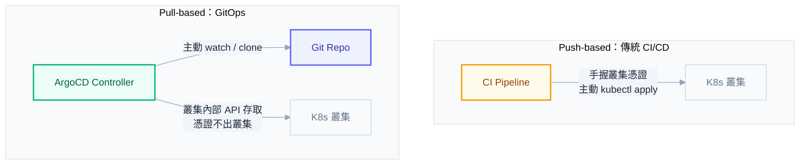
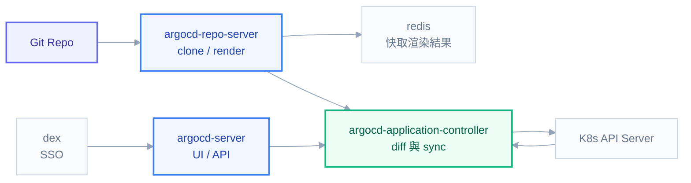
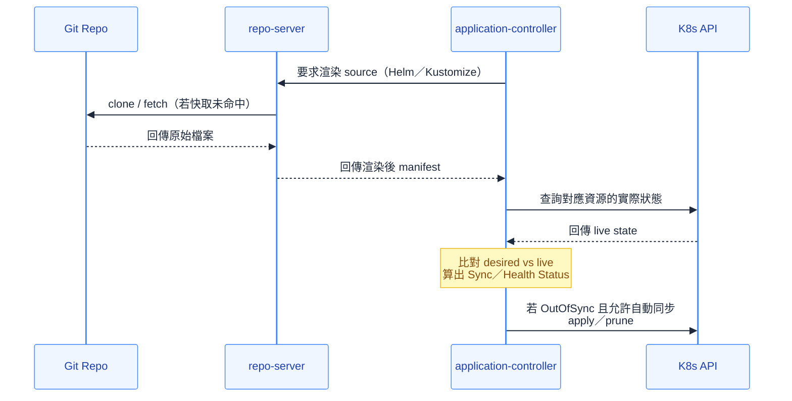
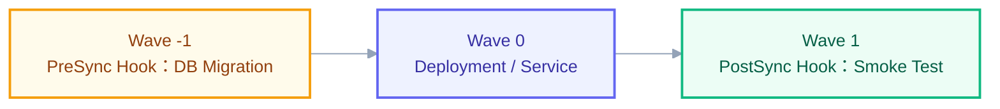

# 第十一章：ArgoCD——讓 GitOps 真正落地的 Operator

如果你已經在 ArgoCD 的 UI 上點過無數次那顆藍色的 Sync 按鈕，看過畫面從橘色的 OutOfSync 跳成綠色的 Synced，你已經會「用」ArgoCD 了。但同事真正會來問你的問題，從來不是「怎麼點同步」，而是「為什麼這個明明看起來一樣卻顯示 OutOfSync」「為什麼 selfHeal 開著我改不動叢集」「ApplicationSet 為什麼沒有生出 Application」。這些問題背後都有明確的機制可以回答，本章的目標，就是把 ArgoCD 從一個會點按鈕的黑箱，拆解成一套你能推理、能診斷、能對別人解釋清楚的心智模型。

在正式拆解之前，先講清楚 ArgoCD 在整個 K8s 知識體系裡的位置。第九章拆過 K8s 的擴充機制——CRD 讓 kube-apiserver 認得新詞彙，controller／operator 賦予這個詞彙行為，finalizer 卡住刪除流程直到清理完成，ownerReference 與垃圾回收讓刪除父物件時子物件跟著清乾淨。ArgoCD 不是脫離這套機制之外的另一套系統，它就是這套機制最典型的產物：Application 是一個 CRD，application-controller 是操作它的 operator，它的 prune 站在 ownerReference 與 GC 之上運作，它的 sync 結果甚至會被 admission webhook 攪亂。第十章拆過 Helm，本章會處理 ArgoCD 怎麼吃 Helm chart、以及 Helm 自己的 hook 機制跟 ArgoCD 的 hook 機制撞在一起時該怎麼理解。把這兩章的心智模型接上，才是完整看懂 ArgoCD 的路徑。

## 為什麼需要 GitOps——從 Push 到 Pull 的典範轉移

在還沒有 ArgoCD 之前，多數團隊的部署流程長這樣：CI pipeline 跑完測試、build 完 image，最後一步執行 `kubectl apply` 或 `helm upgrade`，把新版本直接推進叢集。這個模式有個名字，叫 push-based：CI 系統是主動出手的一方，叢集是被動挨打的一方。要讓這件事成立，CI pipeline 手上必須握著一組能夠寫入生產叢集的憑證——可能是一份 kubeconfig，可能是一個 service account token。這組憑證平時安安靜靜躺在 CI 系統的 secret 設定裡，直到某次 pipeline 被觸發才拿出來用。

問題就出在這裡。CI 系統的安全邊界，天生就比叢集內部更難守。它要接外部觸發（webhook、PR、schedule），要跑第三方 action、第三方 image，攻擊面遠大於一個只對內服務的叢集。只要 CI 系統本身被入侵，攻擊者拿到的不是「一次性的權限」，而是那組能長驅直入寫入生產叢集的憑證本身。稽核性也是麻煩事：誰在什麼時候把什麼東西部署上去，這份歷史分散在 CI 的執行紀錄、可能還混著手動下的 `kubectl apply`，想要事後拼湊出一條完整時間線並不容易。

GitOps 把這個方向整個反過來。叢集內部跑著一個 controller（也就是 ArgoCD），它主動連出去問 Git repo：「現在期望狀態是什麼？」，自己把答案拉回來、自己跟叢集現況做比對、自己決定要不要 apply。CI 系統這時候的角色被削減到只剩下「把新版本的 image build 出來、把版本號寫進部署 repo 的 values 檔案」，它從此再也不需要持有任何一把能直接寫入叢集的鑰匙，甚至不需要知道叢集長什麼樣、部署在哪裡。



這個安全上的優勢極其具體：能寫入叢集的憑證，從此只存在於叢集內部（ArgoCD 的 ServiceAccount），永遠不需要外流到 CI 系統手上；CI 系統對 Git repo 通常也只需要讀取權限，就算 CI 被攻破，攻擊者拿到的頂多是「讀 repo」的能力，而不是「寫叢集」的能力。稽核性也一併解決了：Git 的 commit history 本身就是完整的、不可竄改的、天然帶著作者與時間戳記的部署歷史，想知道「誰在什麼時候把什麼部署上去」，`git log` 就是答案，不需要另外拼湊。

這其實不是一個全新的發明，而是把 K8s 自己內部早就在用的哲學，往外推了一層。第二章講過，kubelet 從來不是被 apiserver 呼叫去做事，而是主動 watch「有沒有指派給我的新 Pod」；controller 也不是被誰下令，而是各自 watch 自己關心的資源，自己決定要不要動手。這一整套「誰該主動」的邏輯，原本的邊界劃在 apiserver 與叢集內部元件之間；GitOps 只是把這條邊界往外推，讓 Git repo 變成叢集之外的另一個唯一真相來源，而 ArgoCD——本質上也是一個 controller——一樣用主動拉取的方式去追這份真相。

GitOps 的定義通常會歸納成四條原則。第一，宣告式：整個系統的期望狀態，用宣告式的 YAML、Helm、Kustomize 描述，而不是一串告訴系統「該做什麼動作」的命令式腳本。第二，版本化且不可變：期望狀態存在 Git，天然獲得版本歷史、可回退、可比對、可稽核，任何一次變更都對應一個明確的 commit。第三，自動拉取：軟體代理（ArgoCD）自動從宣告的來源拉取期望狀態，不需要外部系統主動推送。第四，持續調和：軟體代理持續比對實際狀態與期望狀態，一旦出現落差，自動或半自動地把落差修正回去——這一條，其實就是第二章講的 reconciliation loop，只是這次比對的一端從「etcd 裡的 spec」換成了「Git 裡的 manifest」。

## ArgoCD 的元件解剖與一次 Sync 的資料流

ArgoCD 不是單一一個程式，而是一組各司其職的元件協作出來的系統。`argocd-server` 是對外的門面，提供 Web UI、REST／gRPC API，所有你點的按鈕最終都是打向這裡。`argocd-repo-server` 負責跟 Git 打交道：clone 或 fetch repo、如果是 Helm chart 就執行 `helm template`、如果是 Kustomize 就執行 `kustomize build`，把倉庫裡的原始檔案渲染成一份純粹的 K8s YAML，這一步完全不碰叢集，單純是「把 Git 裡的東西變成 K8s 看得懂的манifest」。`argocd-application-controller` 才是整套系統的心臟，它持續比對「repo-server 渲染出來的期望狀態」與「透過 K8s API 查到的叢集實際狀態」，計算出 sync status 與 health status，並在條件允許時執行實際的 apply 與 prune。`redis` 扮演快取層，把渲染結果、叢集資源清單這些昂貴的計算結果暫存起來，避免每次比對都要重新 clone、重新渲染、重新查詢一輪。`dex` 是 SSO 認證的翻譯層，讓 GitHub、Google、LDAP 這些外部身分提供者發出的憑證，能夠轉換成 ArgoCD 自己認得的 token。除此之外，`argocd-applicationset-controller` 專門處理批次產生 Application 的邏輯，`argocd-notifications-controller` 負責在 sync 完成、失敗等事件發生時推送通知。



把這幾個元件串成一次完整的 sync，資料流大致是這樣：application-controller 先發現某個 Application 需要重新比對（可能是 3 分鐘的 polling 到了，也可能是 webhook 通知有新 commit），於是向 repo-server 要「這個 source 在這個 revision 下渲染出來的 manifest」；repo-server 檢查 redis 裡有沒有對應的快取，沒有的話才真正 clone repo、執行 Helm 或 Kustomize 渲染，把結果連同快取一起回傳；application-controller 拿到期望的 manifest 之後，反過來查詢 K8s API，取得這些資源目前在叢集裡的實際樣子；兩份資料逐一做 diff，決定每個資源、乃至整個 Application 的 sync status；同時間，controller 也會檢查每個資源本身的健康狀態，算出 health status；如果 syncPolicy 允許自動同步，而目前確實是 OutOfSync，controller 就會依照後面會談到的 sync wave 順序執行實際的 apply、視需要觸發 hook、對已經在 Git 裡消失的資源執行 prune；最後把這一輪算出的 sync status、health status、上一次成功 sync 的 revision，全部寫回 Application 物件的 `status` 欄位——這正是第九章講過的「spec 與 status 分離」的具體案例，一般使用者只該碰 `spec`，`status` 永遠是 controller 觀察後寫回的報告。



## Application CRD 完整解剖

前面提過 Application 本質上是一個 CRD，它的 group 是 `argoproj.io`，scope 是 Namespaced。一份完整一點的定義大致長這樣：

```yaml
apiVersion: argoproj.io/v1alpha1
kind: Application
metadata:
  name: nginx-web-app
  namespace: argocd
spec:
  project: default
  source:
    repoURL: https://github.com/example-org/k8s-demo.git
    targetRevision: v1.2.0
    path: charts/nginx-web-app
    helm:
      releaseName: nginx-web-app
      valueFiles:
        - values.yaml
        - values-prod.yaml
  destination:
    server: https://kubernetes.default.svc
    namespace: default
  syncPolicy:
    automated:
      prune: true
      selfHeal: true
      allowEmpty: false
    syncOptions:
      - CreateNamespace=true
      - ServerSideApply=true
      - PruneLast=true
      - ApplyOutOfSyncOnly=true
    retry:
      limit: 5
      backoff:
        duration: 5s
        factor: 2
        maxDuration: 3m
  ignoreDifferences:
    - group: apps
      kind: Deployment
      jsonPointers:
        - /spec/replicas
```

`source` 描述期望狀態從哪裡來：`repoURL` 是 Git 倉庫位址，`targetRevision` 指定要追蹤的 branch、tag 或 commit SHA（`HEAD` 代表永遠追最新，這件事會在最後一節談到它在正式環境的風險），`path` 是倉庫內的子目錄。如果這個目錄是 Helm chart，就用 `helm` 區塊指定 `releaseName` 與要疊加的 `valueFiles`；如果是 Kustomize，則改用 `kustomize` 區塊指定要覆寫的 image 版本、namePrefix 等，渲染邏輯一樣發生在 repo-server，只是底層執行的命令從 `helm template` 換成 `kustomize build`。`destination` 決定期望狀態要落地到哪裡：`server` 指向目標叢集的 API 位址（`https://kubernetes.default.svc` 代表 ArgoCD 自己所在的叢集），`namespace` 是目標 namespace。`project` 把這個 Application 歸屬到某個 AppProject，決定它能用哪些 repo、能部署到哪些地方，這是下面第八節的主題。`syncPolicy` 底下的 `automated`、`syncOptions`、`retry` 會在第五節逐一拆開，`ignoreDifferences` 則是診斷 OutOfSync 的關鍵武器，留到第七節深入。

## Sync Status 與 Health Status——兩條互相獨立的軸線

這是新手最容易混淆、老手也常常被問倒的一節，值得慢慢講清楚。Sync Status 回答的問題是：「Git 裡描述的期望狀態，跟叢集裡的實際狀態，欄位對得起來嗎？」它比對的兩端都跟資源「是否健康」完全無關，純粹是 desired manifest 與 live object 的字段級 diff，結果只有 `Synced`（對得起來）與 `OutOfSync`（有落差），計算尚未完成時會短暫顯示 `Unknown`。Health Status 回答的是完全不同的問題：「這個資源本身，現在健不健康？」這跟它是不是跟 Git 一致毫無關係，結果分成 `Healthy`、`Progressing`（正在啟動或更新中）、`Degraded`（明確壞掉了）、`Missing`（該存在但找不到）、`Suspended`（被暫停）幾種。

正因為這兩條軸線互相獨立，一個 Application 完全可能落在四種組合的任何一格：`Synced` 加 `Healthy` 是最理想的狀態，manifest 已套用且資源運作正常；`Synced` 加 `Degraded` 代表 manifest 確實已經照著 Git 套用下去了，但資源本身跑不起來，例如 image pull 失敗、liveness probe 一直不過，這種情況常常讓人誤以為「都 Synced 了怎麼還有問題」，答案是 Sync 只保證「套用了」，不保證「套用之後真的健康」；`OutOfSync` 加 `Healthy` 代表 Git 上有新版本還沒被同步下去，但叢集目前跑的舊版本本身完全正常，只是單純落後，不代表任何東西壞了；`OutOfSync` 加 `Degraded` 則是兩個問題同時發生。

同事最常見的誤解，正是把橘色的 OutOfSync 直接等同於「東西壞了」，或者把綠色的 Synced 直接等同於「沒事了」。前者的正確理解是「還沒同步，不代表現況不健康」，後者的正確理解是「套用完成，不代表 Pod 真的活著」。

Health Status 的判定邏輯，對每一種內建資源類型都有各自的規則：Deployment 檢查 `status.availableReplicas` 是否達到期望數量、且沒有殘留正在被淘汰的舊 ReplicaSet；Service 在 `type: LoadBalancer` 時檢查外部 IP 是否已經分配；Ingress 邏輯類似；Job 看 `Succeeded` 或 `Failed` 這兩個 condition；PVC 看是否 `Bound`。但很多第三方 CRD（例如 cert-manager 的 Certificate）沒有內建判定邏輯，ArgoCD 允許你在 `argocd-cm` 這個 ConfigMap 裡用 Lua 腳本自訂 health check，註冊在 `resource.customizations.health.<group_kind>` 底下，讀取該資源 `status` 欄位裡的欄位，自己判斷回傳 `Healthy`、`Progressing` 或 `Degraded` 加上一段說明訊息。理解這一層，才知道為什麼某些自訂資源在 ArgoCD 上永遠顯示 `Healthy`——沒有自訂 health check 的 CRD，ArgoCD 預設就只能回報 `Healthy`，不代表它真的健康，只代表沒人教它怎麼判斷。

## syncPolicy 深入：automated、prune、selfHeal 與 syncOptions

`automated` 底下的三個開關，各自對應不同層次的風險。`prune: true` 讓 ArgoCD 在 sync 時，把「Git 裡已經拿掉、但叢集裡還在」的資源刪除掉。這件事的本質，正是第九章講過的 ownerReference 與垃圾回收在應用層的延伸：ArgoCD 用 label（`app.kubernetes.io/instance`）記錄「這個資源是我這個 Application 在管」，sync 時比對 Git manifest 清單跟自己追蹤的 live 資源清單，找出多出來的執行刪除；而實際刪除一個 Deployment 之後，底下 ReplicaSet 與 Pod 怎麼跟著消失，走的正是 ownerReference 與 GC controller 那條路，ArgoCD 自己並不需要重新發明一套子資源清理邏輯。`selfHeal: true` 則是把「有人手動改了叢集」這件事，當成一次需要被修正的漂移：只要偵測到 live 狀態偏離 Git，不用等下一次 Git 有新 commit，立刻主動把叢集拉回 Git 描述的樣子。`allowEmpty` 預設是 `false`，這是一道刻意設下的保險——如果 Git source 因為某種原因（例如 path 打錯、branch 被誤刪）解析出空的 manifest 清單，`allowEmpty: false` 會拒絕把這個「空」當成合法的期望狀態去執行 prune，避免一次設定錯誤就把整個 namespace 清空。

`syncOptions` 是另一組更細緻的行為開關。`CreateNamespace=true` 讓 ArgoCD 在 sync 前自動建立 `destination.namespace` 指定的 namespace，沒有這個選項，目標 namespace 不存在時 sync 會直接失敗。`ServerSideApply=true` 讓套用方式改用第九章與第十章都提過的 server-side apply，而不是預設的、把整份設定塞進 `last-applied-configuration` annotation 的 client-side 語意——這對欄位特別多的大型 CRD 特別重要，避免 annotation 撐爆單一 annotation 的大小上限。`Replace=true` 改用「整個替換」而非「三方合併」的語意，適合某些資源在被其他 webhook 改動過欄位後，一般的 apply 會產生無法合併的衝突，用 Replace 直接蓋過去；代價是任何不在 manifest 裡但曾被別人寫入的欄位都會一併消失，要謹慎使用。`PruneLast=true` 讓所有刪除動作排在其他 sync 動作之後才執行，避免「先刪掉一個還被別的資源依賴的東西」造成套用順序錯亂，例如某個 CRD 被移除，但引用它的自訂資源實例還沒處理完。`ApplyOutOfSyncOnly=true` 讓 ArgoCD 只對真正 OutOfSync 的資源送出 apply，跳過已經 Synced 的資源，在一個 Application 底下管理幾百個資源時，能明顯減少不必要的 API 呼叫、加快整體 sync 速度。

## Sync Waves 與 Resource Hooks

一個 Application 底下往往不只一種資源，而資源之間常常有先後順序的要求——資料庫的 schema migration 必須在應用程式的 Pod 啟動之前跑完，不然應用程式一開機就因為表不存在而報錯崩潰。`argocd.argoproj.io/sync-wave` 這個 annotation 就是用來控制這種順序的：數字越小的 wave 越先執行，同一個 wave 內的資源會平行套用，而且必須等前一個 wave 裡所有資源都達到 healthy（或所有 hook 都執行完成），才會進入下一個 wave，預設值是 `0`。

除了排序，ArgoCD 還提供更精細的生命週期掛勾，叫做 resource hooks，用 `argocd.argoproj.io/hook` annotation 標注在一個資源（通常是 Job）上：`PreSync` 在套用主要 manifest 之前執行，典型用途就是資料庫 migration；`Sync` 在套用主要資源的同時執行；`PostSync` 等所有資源都 sync 完且 healthy 之後才執行，適合發送部署完成通知、跑一次 smoke test；`SyncFail` 只在整個 sync 失敗時才觸發，適合告警或輔助回滾的動作。搭配 `argocd.argoproj.io/hook-delete-policy` 可以控制 hook 資源何時被清掉：`HookSucceeded` 在成功後刪除，`HookFailed` 在失敗後刪除，`BeforeHookCreation` 則是在下一次 sync 要建立新的 hook 資源之前，先把上一次殘留的舊資源刪掉，避免 Job 名稱衝突導致新一輪 sync 失敗。

```yaml
apiVersion: batch/v1
kind: Job
metadata:
  name: db-migration
  annotations:
    argocd.argoproj.io/hook: PreSync
    argocd.argoproj.io/hook-delete-policy: HookSucceeded
    argocd.argoproj.io/sync-wave: "-1"
spec:
  template:
    spec:
      restartPolicy: Never
      containers:
        - name: migrate
          image: example/migrate:v1.2.0
          command: ["./migrate", "up"]
```



第十章講過 Helm 自己也有一套 hook 機制，用 `helm.sh/hook: pre-install`、`post-install` 這類 annotation 標注。這裡容易搞混的地方在於：ArgoCD 管理 Helm chart 的方式，並不是真的呼叫 `helm install` 或 `helm upgrade` 去執行部署，而是執行 `helm template` 把 chart 純粹渲染成一份靜態的 YAML——因為 ArgoCD 必須自己完全掌控套用的時機與 diff 邏輯，不能把控制權交給 Helm CLI 自己的 release 管理。這代表如果 chart 裡有 Helm hook annotation，repo-server 在渲染時會自動識別並轉譯成對應的 Argo hook：`pre-install`／`pre-upgrade` 轉成 `PreSync`，`post-install`／`post-upgrade` 轉成 `PostSync`，以此類推。需要提防的坑是：Helm 自己的 `helm.sh/hook-weight` 跟 Argo 的 `sync-wave` 是兩套獨立的排序系統，同一份 chart 直接用 `helm install` 部署、跟被 ArgoCD 接管部署，執行順序可能因此不一致。實務上的建議是：一旦一個 chart 決定要被 ArgoCD 管理，就統一用 `sync-wave` 的思維去設計順序，不要同時依賴兩套排序邏輯，減少心智負擔。

## OutOfSync 診斷——為什麼看起來一樣卻顯示不同步

這是被同事追問頻率最高的情境，也是本章必須講透的重點。典型場景是：你盯著 ArgoCD 的 Diff 畫面，左右兩邊的 YAML 看起來一模一樣，頂端卻依然刺眼地顯示橘色的 OutOfSync；你反覆確認自己沒有手動改過任何東西，Git 的 commit history 也乾乾淨淨。多數人第一直覺是懷疑 ArgoCD 壞了，但十次有九次，答案藏在下面幾種情況裡。

第一種情況，是 mutating admission webhook 補上了 Git manifest 裡本來就沒有的欄位——這正是第九章講過的 admission chain 在起作用。最典型的例子是 Istio 的 sidecar injector：它在 Pod 建立時注入一個 `istio-proxy` container，但 Git 裡的 manifest 從來沒寫過這個 container，ArgoCD 比對「Git 期望的樣子（沒有 sidecar）」跟「叢集實際的樣子（有 sidecar）」時，自然會標記出差異。類似的還有 ServiceAccount admission controller 自動掛上的 token volume、K8s 內建 defaulting 邏輯自動補上的 `imagePullPolicy: IfNotPresent`。第二種情況，是別的 controller 在事後持續修改了同一個欄位。最常見的例子是 HorizontalPodAutoscaler：它會持續調整 Deployment 的 `spec.replicas`，如果 Git manifest 裡寫死 `replicas: 3`，但 HPA 把它動態調整成 5，ArgoCD 每次比對都會看到「Git 說 3，叢集說 5」，於是永遠停留在 OutOfSync——這是兩個 controller 各自認定自己才是權威來源，互相打架的經典案例。第三種情況，是 `last-applied-configuration` annotation 與 server-side apply 的 field manager 之間出現落差：不同工具用不同的 apply 方式寫入同一個欄位，造成欄位的「擁有者」歸屬混亂，比對時產生預期外的差異。

解法是 `ignoreDifferences`，寫在 Application 的 `spec.ignoreDifferences` 陣列裡，針對特定資源指定要忽略比對的欄位路徑，支援三種寫法：

```yaml
spec:
  ignoreDifferences:
    - group: apps
      kind: Deployment
      name: my-app
      jsonPointers:
        - /spec/replicas
    - group: ""
      kind: ConfigMap
      jqPathExpressions:
        - '.data["dynamic-key"]'
    - group: apps
      kind: Deployment
      managedFieldsManagers:
        - kube-controller-manager
```

`jsonPointers` 用 RFC 6902 的 JSON Pointer 語法直接點出要忽略的欄位，例如 `/spec/replicas`；`jqPathExpressions` 用 jq 語法表達更靈活的路徑，適合需要條件篩選陣列元素的情境；`managedFieldsManagers` 則是連該欄位路徑都不用寫，直接忽略「某個特定 field manager 寫入過的所有欄位」，例如把 HPA 對應的 manager 整個排除在比對範圍之外，這對「一整組欄位本來就不該由 ArgoCD 管」的情境特別方便，不需要一個一個欄位手動列舉。

最後一定要講清楚 hard refresh 的原理與時機。ArgoCD 為了效能，repo-server 會把 Git clone 的結果、Helm／Kustomize 渲染的結果快取起來，正常的 sync 或 refresh 只比對「Git 有沒有新 commit」來決定要不要重新渲染。如果 webhook 沒有正確觸發（設定錯誤、網路不通），或者剛好卡在預設每三分鐘一次的 polling 間隔中間，ArgoCD UI 顯示的 Revision 可能還停留在舊的 commit，讓人誤以為「明明改了卻沒反應」。使用者自己的環境就實際踩過這個坑：ArgoCD 顯示的 Revision 不是最新 commit，畫面看起來一切正常，但其實根本沒同步到剛推上去的版本。這時候該做的是強制 hard refresh，忽略所有快取，重新 clone、重新渲染、重新 diff：

```bash
kubectl annotate application <app-name> -n argocd argocd.argoproj.io/refresh=hard --overwrite
```

hard refresh 用的是「犧牲效能換取絕對新鮮的比對結果」，適合在明確懷疑「快取騙了我」的時候使用，不該當成每次都要做的常規操作——如果每次都 hard refresh，等於徹底放棄了快取原本要換來的效能優勢。第十三章的troubleshooting 案例庫裡也收錄了這個案例作為速查用的診斷表，本章這裡講的是它背後真正的機制原因。

## AppProject——不只是分組，是安全邊界

AppProject 常被誤會成單純的「資料夾」，用來把一堆 Application 分類擺放。它真正的作用是劃出一條權限與來源的邊界：`sourceRepos` 是白名單，決定這個 project 底下的 Application 只能從哪些 Git repo 拉取內容；`destinations` 是另一份白名單，決定只能部署到哪些叢集、哪些 namespace 的組合；`clusterResourceWhitelist` 與 `namespaceResourceBlacklist` 分別控制允許管理哪些 cluster-scoped 資源種類、禁止管理哪些 namespace-scoped 資源種類；`roles` 則定義搭配 SSO 群組使用的 RBAC 角色，決定誰能對這個 project 底下的 Application 執行 sync、override 等操作。

```yaml
apiVersion: argoproj.io/v1alpha1
kind: AppProject
metadata:
  name: infra
  namespace: argocd
spec:
  sourceRepos:
    - https://github.com/example-org/infra-deploy.git
  destinations:
    - server: https://kubernetes.default.svc
      namespace: infra
  sourceNamespaces:
    - infra
  clusterResourceWhitelist:
    - group: ""
      kind: Namespace
  namespaceResourceBlacklist:
    - group: ""
      kind: ResourceQuota
  roles:
    - name: infra-admin
      groups:
        - infra-team
      policies:
        - p, proj:infra:infra-admin, applications, sync, infra/*, allow
```

`sourceNamespaces` 是使用者自己真實踩過的坑，值得完整攤開講。ArgoCD 預設只信任、只會去 watch `argocd` 這個 namespace 底下建立的 Application 資源，這是一個刻意設下的安全設計——如果任何 namespace 都能建立 Application 並讓 ArgoCD 執行，等於任何一個有權限在自己 namespace 裡建資源的團隊，都能間接透過 Application 的 `destination` 去操作叢集裡任何一個角落，namespace 隔離會形同虛設。使用者自己的環境裡，把 `vault-app.yaml`、`harbor-app.yaml` 這些 Application 定義放在 `infra` namespace，而不是預設的 `argocd`，結果是這些 Application 完全不會出現在 `kubectl get application -n argocd` 的結果裡——ArgoCD 根本「不認識這個 namespace 來的 app」，直接無視。

完整的解法分三步，缺一不可。第一步，告訴 argocd-server 與 controller，除了 `argocd` namespace 之外，也去監控 `infra` namespace：

```bash
kubectl patch configmap argocd-cmd-params-cm -n argocd `
  --type merge --patch '{"data":{"application.namespaces":"infra"}}'
```

第二步，光讓 controller 去監控還不夠，還必須讓 `default` 這個 AppProject 明確允許「來自 `infra` namespace 的 Application」使用它，這兩個設定必須同時存在，少一個都不會生效：

```bash
kubectl patch appproject default -n argocd `
  --type merge -p '{"spec":{"sourceNamespaces":["infra"]}}'
```

第三步，也是最容易被忽略的一步：`argocd-cmd-params-cm` 的改動不會讓已經在跑的 controller 進程立刻重新讀取生效，必須重啟對應的 controller，新的 namespace 權限才會真正吃到：

```bash
kubectl rollout restart deployment argocd-applicationset-controller -n argocd
kubectl rollout restart statefulset argocd-application-controller -n argocd
```

## ApplicationSet——批次產生 Application

當同一份應用需要部署到 dev、stg、prod 三個環境，或是同一份 chart 要撒到好幾個叢集，一個一個手寫 Application 既繁瑣又容易漏改參數。ApplicationSet 用 generator 產生一份參數清單，再用 template 把每一組參數套進同一份 Application 模板，一次性批次產生多個 Application。

generator 的種類相當豐富：`list` 是最直接的手動列舉，把一組固定的元素（例如 `env: dev/stg/prod`）寫死在 spec 裡；`cluster` 根據 ArgoCD 已經註冊的外部叢集清單自動展開，適合「同一份 manifest 要部署到所有已知叢集」；`git` 底下的 `directories` 模式會掃描倉庫裡符合 glob 的目錄，每個目錄產生一個 Application，適合 monorepo 裡「每個服務一個資料夾」的結構，`files` 模式則是掃描符合 glob 的設定檔案，讀取檔案內容當作模板參數；`matrix` 把兩個（或以上）generator 的輸出做笛卡爾積，例如 `list`（三個環境）乘上 `cluster`（三個叢集）能一次產生九個 Application；`merge` 用共同的 key 合併多個 generator 的輸出，類似 SQL 的 join，適合「同一組環境清單要合併兩份不同來源的參數」；`pullRequest` 監聽指定 repo 的 open PR，每個 PR 自動產生一個臨時的預覽環境，PR 關閉後自動清除；`scmProvider` 掃描整個 GitHub organization 或 GitLab group 底下所有符合條件的 repo，每個 repo 產生一個 Application，適合平台團隊要對上百個微服務 repo 一次套用同一份 CI/CD 骨架。

```yaml
apiVersion: argoproj.io/v1alpha1
kind: ApplicationSet
metadata:
  name: microservices
  namespace: argocd
spec:
  goTemplate: true
  generators:
    - git:
        repoURL: https://github.com/example-org/microservices.git
        revision: HEAD
        directories:
          - path: services/*
  template:
    metadata:
      name: '{{.path.basename}}'
    spec:
      project: default
      source:
        repoURL: https://github.com/example-org/microservices.git
        targetRevision: HEAD
        path: '{{.path.path}}'
      destination:
        server: https://kubernetes.default.svc
        namespace: '{{.path.basename}}'
```

`template` 區塊定義最終產生出來的 Application 長相，用 `{{參數}}` 做字串插值；`goTemplate: true` 會切換成 Go template 語法（`{{ .path.basename }}` 而非 `{{path.basename}}`），支援條件判斷、range 迴圈等更複雜的邏輯，官方建議新專案一律開啟，舊式的 `{{var}}` 語法已進入維護模式，只為相容舊設定保留。

使用者自己也踩過「ApplicationSet 完全沒有產生任何 Application」的坑，排查表值得完整收進來：

| 原因 | 排查方式 |
| --- | --- |
| Repo 沒有設定認證 | `kubectl get secret -n argocd -l argocd.argoproj.io/secret-type=repository` 確認 repo credential secret 存在且 type 正確 |
| ArgoCD 沒有目標 namespace 的權限 | 確認 `argocd-cmd-params-cm` 有設定 `application.namespaces`，涵蓋 ApplicationSet 或它產生的 Application 要放的 namespace |
| ApplicationSet controller log 有錯 | `kubectl logs -n argocd deployment/argocd-applicationset-controller`，查看是不是某個 generator 本身在報錯，例如 git generator 抓不到符合 glob 的路徑、pullRequest generator 的 API token 過期 |

## 私有 Repo 與 Registry 認證

私有 Git repo 需要先建立一份 repo credential secret，讓 repo-server 有權限 clone：

```yaml
apiVersion: v1
kind: Secret
metadata:
  name: repo-microservices
  namespace: argocd
  labels:
    argocd.argoproj.io/secret-type: repository
stringData:
  type: git
  url: https://github.com/example-org/microservices.git
  username: example-user
  password: ghp_xxxxxxxxxxxxxxxxxxxx
```

SSH 與 HTTPS 兩種方式都能用，但 SSH 需要額外處理 `SSH_AUTH_SOCK` 與 known_hosts，使用者自己就在 minikube 環境裡真實遇過 `SSH agent requested but SSH_AUTH_SOCK not-specified` 這個錯誤，多數情境下直接用 HTTPS 搭配 personal access token 更省事，不需要處理 SSH agent 的額外設定。另外要記住 `kubectl create secret` 不支援 `-l` flag，label 必須分開加：

```bash
kubectl label secret repo-microservices -n argocd argocd.argoproj.io/secret-type=repository
```

這份 repo credential secret，跟 Pod 拉取 image 時用的 imagePullSecret（例如連 Harbor 這類 private registry）是兩個完全獨立的認證機制，容易被搞混。前者發生在 repo-server 渲染 manifest 階段，管的是「怎麼讀 Git」；後者發生在 kubelet 呼叫 CRI 去 pull image 的階段，管的是「怎麼讀 registry」，設定位置也不同——imagePullSecret 是存在目標 namespace 裡，被 `Deployment.spec.template.spec.imagePullSecrets` 引用。兩者即使背後用的是同一組 Harbor robot account 憑證，也必須分別配置在兩個地方，漏配任何一邊都會導致不同階段失敗：Git 認證失敗會讓整個 Application 卡在 `Unknown`；imagePullSecret 沒配對，則會讓 Pod 卡在 `ImagePullBackOff`，這正好是第四節提過的「Synced 但 Degraded」的典型案例——manifest 確實套用下去了，Pod 卻因為拉不到 image 而起不來。

## App of Apps 與 ApplicationSet 的取捨

App of Apps 是另一種批次管理的模式：建立一個「根」Application，它的 Git source 底下放的不是應用程式本身的 manifest，而是一堆別的 Application 定義，sync 這個根 Application 的效果，就是把底下這些子 Application 一次性建立起來。本質上是用 Application 管理 Application，是一種顯式列舉、手寫每一份定義的批次建立方式。

跟 ApplicationSet 的取捨很清楚：App of Apps 適合「這組 Application 彼此結構差異很大，沒辦法套用同一份 template」的情境，例如一個團隊要一次部署十個完全不同的基礎設施元件，Vault、Harbor、cert-manager、Ingress Controller 各自的參數天差地遠，沒有共通模板可言；ApplicationSet 適合「這組 Application 結構高度相似，只是參數不同」的情境，例如同一個應用要部署到 dev、stg、prod。實務上兩者經常混用：用 ApplicationSet 產生同結構的多環境 Application，再用一個 App of Apps 當作整個平台的「根」，底下同時管理數個 ApplicationSet 與若干手寫的獨立 Application。

## 多叢集管理

ArgoCD 不限於只管理自己所在的那個叢集。透過 `argocd cluster add <context-name>`，可以把本地 kubeconfig 裡的某個 context 註冊進 ArgoCD——這個動作本質上是在 `argocd` namespace 裡建立一份 `type: cluster` 的 secret，存著目標叢集的 API server 位址，以及 ArgoCD 在目標叢集建立的 ServiceAccount token。註冊完成後，application-controller 除了預設的 `https://kubernetes.default.svc`，也能連到這個外部叢集執行 diff 與 apply，Application 的 `destination.server` 就能指向這個已註冊叢集的 API 位址。第九節提過的 `cluster` generator，正是讀取這份註冊清單自動展開的，這也是為什麼多叢集管理要先做 `cluster add`，ApplicationSet 的 cluster generator 才有東西可以列舉。

## 實戰維運

日常維運最常用到的是 `argocd` CLI 而不是 UI。`argocd app diff` 在本地端比對 Git 與 live 狀態，不會真的觸發 sync，適合在 PR 審查階段先看清楚這次會變動什麼；`argocd app sync` 手動觸發同步，可以加 `--prune` 明確要求連帶清理；`argocd app history` 列出這個 Application 過去每一次成功 sync 對應的 Git revision；`argocd app rollback <id>` 回退到 history 裡某一次的 revision——這裡要注意，rollback 本質上是產生一次新的 sync，把叢集狀態拉回舊 commit 對應的 manifest，並不會把 Git repo 本身回退，等於「叢集狀態往回走，但 Git 記錄仍然往前」，適合當作緊急補救，長遠應該回到 Git 上做正式的 revert，再走一次正常的 sync 流程。

`argocd admin export` 能把 ArgoCD 自己管理的所有 CR（Application、AppProject、ApplicationSet）匯出成一份 YAML，`argocd admin import` 負責還原，適合在 ArgoCD 自己升級或搬遷叢集時，備份「ArgoCD 怎麼管理這些 App」的設定本身——注意這備份的不是被管理應用程式的資料，而是 ArgoCD 自身的組態。

初始密碼存在 `argocd-initial-admin-secret` 裡，帳號固定是 `admin`，Windows PowerShell 底下不能像 Linux 直接用 `base64 -d`，要改用 .NET 的方式解碼：

```powershell
kubectl -n argocd get secret argocd-initial-admin-secret -o jsonpath="{.data.password}" | ForEach-Object { [System.Text.Encoding]::UTF8.GetString([System.Convert]::FromBase64String($_)) }
```

登入後應該立刻到 User Info、Update Password 改掉這組密碼，並考慮直接刪除這份 initial secret（`kubectl delete secret argocd-initial-admin-secret -n argocd`）——ArgoCD 不會自動清除它，長期留著等於留了一個位置固定、內容已知的密碼來源。

port-forward 斷線也是操作上反覆會撞到的小麻煩，使用者自己遇過 `error creating forwarding stream for port 8080 -> 8080: Timeout occurred`，Windows 環境下通常是前一個 port-forward 程序沒有乾淨結束，還占著本機 port：

```powershell
netstat -ano | findstr :8080
taskkill /PID <PID> /F
kubectl port-forward svc/argocd-server -n argocd 8080:443
```

長期使用建議改走 Ingress 或 Cloudflare Tunnel 之類的方式對外暴露 argocd-server，而不是每次都手動開一次 port-forward。第十三章的案例庫也收錄了這兩個操作性問題作為速查表，這裡講的是完整的操作步驟與背後為什麼會發生。

災難復原方面，如果 ArgoCD 自己整個掛掉（例如誤刪了它自己的 namespace），只要底層 etcd 沒有損毀，重新 apply 一次 ArgoCD 自身的安裝 manifest，所有 Application、AppProject 這些 CR 依然完好地存在 etcd 裡，application-controller 重新啟動後會重新 watch 到它們，自動恢復 reconcile——這跟第二章講過的「叢集元件都是無狀態的，etcd 才是唯一真相來源」完全同一個原理，只是這次套用在 ArgoCD 自己身上一樣成立。真正的風險是 etcd 本身也一併損毀，這時候就得靠額外的備份機制，例如 Velero 或前面提到的 `argocd admin export`，才有辦法完整復原。

## 常見誤解與陷阱總整理

`selfHeal` 開啟之後最直接的痛，是它會讓臨時的手動調整變得徒勞。假設你在生產環境臨時想調大某個 Deployment 的 replica 數做測試，手動下了 `kubectl scale`，如果這個 Application 的 syncPolicy 開了 `selfHeal`，幾十秒內它就會被打回 Git 裡寫的數字，讓人誤以為指令沒有生效——實際上是 selfHeal 正確地執行了它被設計要做的事：把任何未經 Git 的改動都視為漂移並修正回去。除錯時該做的是先暫時移除這個 Application 的 automated sync policy（或用 `argocd app set --sync-policy none`），做完實驗記得改回來，而不是反覆懷疑自己的指令是不是打錯了。

> **常見誤解**：很多人以為 `prune` 只是「清理垃圾」的無害功能。實際上它是一把雙面刃——如果 Git repo 裡一份 manifest 因為重新命名、重構而不小心從 working tree 裡消失，而 syncPolicy 又同時開了 `prune` 與 `automated`，ArgoCD 會忠實地認定「Git 說要移除」，直接把叢集上對應的資源刪掉，可能是一個還在使用中的 PVC 或 Secret，造成資料遺失。正式環境對關鍵資源，建議額外加上 `argocd.argoproj.io/sync-options: Prune=false` 這個 annotation 當作保險，即使整個 Application 開了自動 prune，這個特定資源也不會被自動刪除。

Git 與叢集同時被改動時的衝突，行為也不直覺。如果同一時間有人在 Git 提交、又有人手動 `kubectl edit`，selfHeal 觸發的回滾跟 Git 驅動的正常 sync，兩個方向的 reconcile 可能互相追打，最終結果取決於哪個動作觸發的 sync 先執行完，難以預測。團隊層級的約定應該是：叢集資源一律只透過 Git 改動，手動改動只允許在明確的除錯情境下短暫進行，而且做完就該恢復 automated sync policy。

> **同事會來問你的問題**：「`targetRevision: HEAD` 在正式環境為什麼是個問題？」`HEAD` 代表永遠追蹤某個 branch 的最新 commit，只要有人 push 到那個 branch，開了 automated sync 的 ArgoCD 幾秒內就會把新版本部署到叢集，這在開發環境很方便，卻在正式環境等於失去了「部署是一個明確決策」這道把關——沒有人「按下部署」這個動作，純粹是一次 git push 就觸發了正式環境的變更。使用者自己的環境走的是 GitHub Actions 的 tag-based deployment 流程，tag 格式固定是 `V.X.X.X.X.X`，正確的做法是讓 `targetRevision` 釘死在明確的 tag 或 commit SHA 上，由 CI 在打完 tag 之後才去更新部署 repo 裡對應的版本號；即使 `targetRevision` 本身維持追蹤某個穩定 branch，也要確保實際部署的 image 版本是被明確釘死的。核心原則只有一句：叢集裡跑的到底是哪個版本，必須永遠能在 Git 歷史裡指出一個明確的時間點，而不是一個隨時在浮動的 `HEAD`。

回頭看整章：GitOps 把「誰主動」的方向反過來，換來憑證不外流與天然可稽核的部署歷史；ArgoCD 的每一個元件、每一個 CRD 字段，最終都是為了讓「Git 是唯一真相來源」這句話能夠被機器誠實地執行；而所有讓人卡關的疑難雜症——OutOfSync 診斷、sourceNamespaces、ApplicationSet 不產生 Application——追根究底，都是第九章那套 CRD、Operator、admission、ownerReference 心智模型在 ArgoCD 這個具體案例上的展開。下一次同事問起任何一個 ArgoCD 的異常，你該做的不是重新學一次 ArgoCD，而是回到這套心智模型裡，問自己：這是 Git 跟叢集的落差，還是資源本身不健康？這是 admission 在搗亂，還是權限邊界沒設對？答案幾乎都能在這幾個問題裡找到。

## 連結

- [[71-schema-migration]] — 附錄 AW：`PreSync` hook 拿來跑 migration 的完整實務——為何要 `backoffLimit: 0`
- [[68-registry-operations]] — 附錄 AT：`latest` 為何讓期望狀態失去意義，改用 digest 釘死
- [[k8s-mastery]]
- [[10-helm]]
- [[09-extending-kubernetes]]
- [[02-cluster-internals]]
- [[13-troubleshooting]]
- [[argocd]]
- [[kubernetes]]
- [[helm]]
