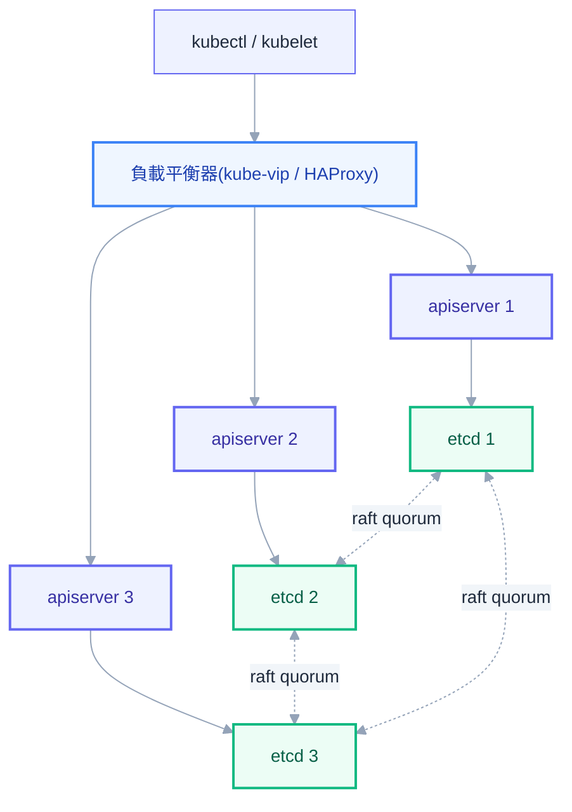
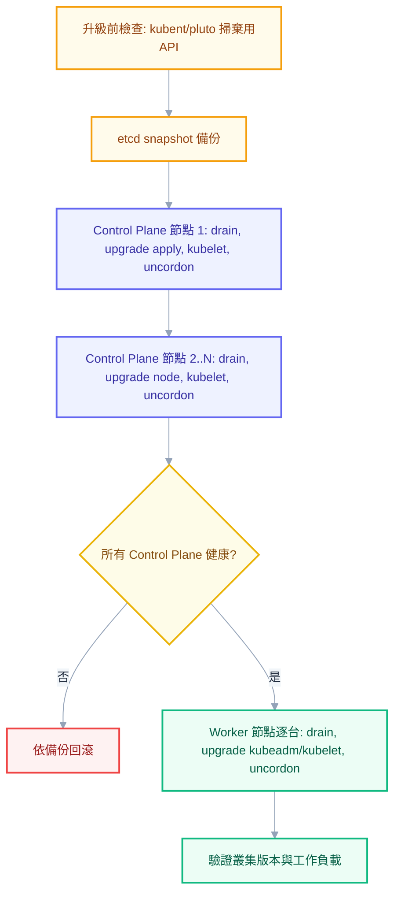
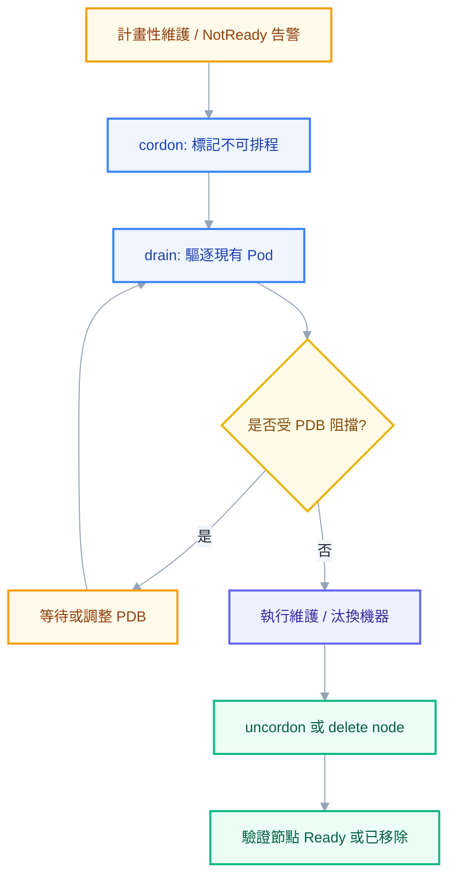
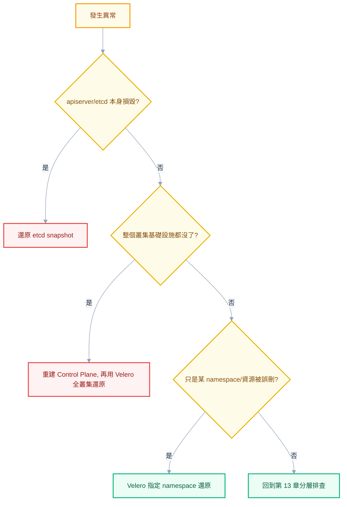

# 第十二章：叢集維運——讓叢集活下去的責任

前面十一章教的都是「怎麼用叢集」：怎麼寫一份正確的 YAML、怎麼讓封包從外部走到容器裡、怎麼讓 ArgoCD 幫你把 Git 裡的意圖同步成叢集裡的現實。這些技能讓你成為一個能把服務部署上去的人，但還不足以讓你對這個叢集的存續負責。這一章要談的是另一件事——當你的職稱從「用叢集的人」變成「管叢集的人」，你要面對的不再是「這個 Pod 為什麼沒排上去」，而是「這個叢集為什麼整個不見了，我能不能把它救回來」。

這個分野之所以重要，是因為維運操作的犯錯代價和開發操作完全不對稱。寫錯一個 Deployment 的 YAML，最壞情況是這個服務掛掉，重新 `kubectl apply` 就能修正。但還原 etcd 的手法錯了、憑證輪替的順序錯了、版本升級跳了一個小版本，最壞情況是全公司所有服務同時中斷，而且不是重新 apply 就能解決的那種中斷。這一章會依序走過叢集的生命週期、etcd 備份還原、憑證管理、版本升級、節點維護、災難復原、容量規劃、可觀測性、稽核合規，最後收斂成一份可以真正照著做的維運 SOP。你目前的實戰環境是 minikube on WSL2，一台機器上什麼角色都自己扮演，這和正式環境裡多節點、多元件互相牽制的世界有不小落差，所以每一節談完原理之後，我們都會回頭確認一次「這件事在你的 minikube 上能不能真的動手做一次」。

## 叢集的組成與生命週期

第二章已經拆解過 Control Plane 的四個元件與 Node 上的三個元件如何靠 watch 互相協作，但那一章預設的是叢集已經存在、正常運作中的狀態。這裡要往前退一步，看看一個叢集從無到有是怎麼被建出來的，以及當它需要撐起正式環境的可用性要求時，架構上要多做哪些事。

用 `kubeadm` 建立叢集的骨幹流程可以濃縮成三個動作。第一步在被選定的第一台 Control Plane 機器上執行 `kubeadm init`，這個指令會產生一整套 PKI 憑證（CA、apiserver、etcd 各自的憑證）、把 etcd 與 apiserver 等元件以 static pod 的形式起在這台機器上、寫出給其他節點加入用的 `kubeadm join` 指令與 token。第二步是安裝 CNI 網路插件（例如 Calico、Cilium），這一步不能省略——`kubeadm init` 完成後 Node 會停在 `NotReady`，因為 kubelet 找不到任何網路插件可以幫 Pod 配置虛擬網卡，這是新手第一次自建叢集最常卡住的地方。第三步是讓其餘機器分別以 `kubeadm join` 的方式加入，加入時帶 `--control-plane` 參數的會成為額外的 Control Plane 節點，不帶的則成為 Worker Node。

```bash
# 第一台 control plane：--control-plane-endpoint 指向前面的負載平衡器
kubeadm init \
  --control-plane-endpoint "cp-lb.internal:6443" \
  --upload-certs \
  --pod-network-cidr=192.168.0.0/16

# 安裝 CNI（以 Calico 為例）
kubectl apply -f https://raw.githubusercontent.com/projectcalico/calico/v3.28.0/manifests/calico.yaml

# 其餘 control plane 節點加入（--certificate-key 來自 init 輸出的 --upload-certs 結果）
kubeadm join cp-lb.internal:6443 --token <token> \
  --discovery-token-ca-cert-hash sha256:<hash> \
  --control-plane --certificate-key <key>

# worker 節點加入
kubeadm join cp-lb.internal:6443 --token <token> \
  --discovery-token-ca-cert-hash sha256:<hash>
```

單一 Control Plane 節點在學習環境裡完全夠用，但正式環境不能只有一台，原因很直白——這一台機器如果重開機、硬碟壞掉、網路斷線，整個叢集的決策大腦瞬間消失，即使所有 Worker Node 上的容器都還健康地跑著，也沒有任何元件能替換掉故障的 Pod、回應新的 `kubectl` 請求。正式環境的高可用架構因此會準備多台（通常 3 台）Control Plane 節點，前面架一個負載平衡器（可能是雲端的 LB、也可能是 `kube-vip`、`HAProxy + keepalived` 這類方案）承接所有 `kubectl` 與 kubelet 的連線，並在背後把流量分散到還存活的 apiserver 上。

而 etcd 的高可用性，正是回到第二章結尾那個結論的地方——**etcd 節點數必須是奇數，因為 raft 共識機制靠的是過半數（quorum）決議**。3 台 etcd 允許任意 1 台失聯仍能達成多數決繼續寫入，5 台則能容忍 2 台失聯，而偶數台（例如 4 台）並不會比少一台的奇數配置更耐用，只是白白增加協調成本卻沒換到對應的容錯提升。這套 etcd 叢集可以用「stacked」拓樸（跟 Control Plane 節點一對一共存在同一台機器上，`kubeadm` 預設就是這種）或「external」拓樸（etcd 獨立部署成一組專用機器，跟 Control Plane 分開）建置，後者把 etcd 的故障域從 Control Plane 節點切開，複雜度更高，但也更適合把 etcd 的維運（備份、擴容、監控）獨立管理。



最後要釐清的是責任分界。如果用的是 EKS、GKE、AKS 這類託管叢集，雲端服務商包辦的是 Control Plane 這一層——apiserver 的高可用、etcd 的備份與 raft 維護、Control Plane 元件的版本升級，全部由服務商負責，通常也有 SLA 背書，你甚至連 etcd 都碰不到。但這不代表管理員什麼都不用做：Worker Node 的作業系統與 kubelet 版本（除非用的是 GKE Autopilot、EKS Fargate 這種連 Node 都全代管的模式）、叢集內資源的 Velero 備份、RBAC 與 Audit 設定、資源配額與成本控管，這些全部還是你的責任。理解這條分界線，才不會在事故發生時搞錯該打電話給誰、也不會誤以為「反正是託管的，什麼都不用備份」。

## etcd 備份與還原——做錯就是全滅

回到第二章講過的那句話：etcd 是叢集唯一的真實來源，它掛了不是「效能變差」，而是整個叢集**失憶**——Node 還在，容器還活著，但 Control Plane 完全不知道它們是誰、該做什麼。這句話在這裡要再往前推一步：如果 etcd 的資料**遺失**（不是暫時連不上，而是真的沒了），那失憶就變成永久性的。所有 Deployment、Secret、RBAC 規則、Service 定義，只要不在你的 Git repo 裡（也就是沒有走 GitOps），就是真的、徹底地消失了。這正是為什麼 etcd 備份在所有維運項目裡優先級最高——它做錯或做漏的後果，不是某個服務掛掉，而是整個叢集的記憶蒸發。

備份的指令並不複雜，複雜的是還原時的細節。備份用 `etcdctl snapshot save`，需要帶上 etcd 自己的 TLS 憑證（不是 apiserver 的憑證，這是新手很常搞混的地方）：

```bash
ETCDCTL_API=3 etcdctl snapshot save /backup/etcd-snapshot-$(date +%Y%m%d%H%M).db \
  --endpoints=https://127.0.0.1:2379 \
  --cacert=/etc/kubernetes/pki/etcd/ca.crt \
  --cert=/etc/kubernetes/pki/etcd/server.crt \
  --key=/etc/kubernetes/pki/etcd/server.key

# 備份完務必驗證檔案完整性，而不是只看指令有沒有噴錯
ETCDCTL_API=3 etcdctl snapshot status /backup/etcd-snapshot-*.db --write-out=table
```

> **只備份 etcd 是不夠的——`/etc/kubernetes/pki` 必須一起備。**
>
> ```bash
> tar -czf /backup/pki-$(date +%F).tar.gz /etc/kubernetes/pki
> ```
>
> 還原 etcd 之後，如果憑證不是原本那一組（尤其是 CA），所有元件無法互相驗證、叢集起不來。而**錯誤訊息全是一堆 x509 相關的內容，完全不會指向「你忘了備份憑證」**——這是還原演練最常卡住的地方，也是「備份存在但還不回來」的頭號成因。完整的演練程序見 [[34-multicluster-and-dr]]。

還原是這一節真正的重點，因為它跟大多數人直覺想像的「用備份檔蓋掉現在的資料」完全不是同一件事。**etcd 的還原本質上是「用快照重建一個全新的資料目錄」，不是「就地覆蓋既有資料目錄」**。實際流程是先把 kube-apiserver 停下來——做法是把 `/etc/kubernetes/manifests/kube-apiserver.yaml`（以及通常也一併處理的 etcd static pod manifest）暫時移出這個目錄，kubelet 偵測到 manifest 消失就會把對應的 static pod 停掉。接著對每一個 etcd 成員執行 `etcdctl snapshot restore`，指定一個全新的 `--data-dir`：

```bash
ETCDCTL_API=3 etcdctl snapshot restore /backup/etcd-snapshot-20260801.db \
  --data-dir=/var/lib/etcd-restore \
  --name=etcd-node-1 \
  --initial-cluster="etcd-node-1=https://10.0.0.1:2380,etcd-node-2=https://10.0.0.2:2380,etcd-node-3=https://10.0.0.3:2380" \
  --initial-cluster-token=etcd-cluster-restore \
  --initial-advertise-peer-urls=https://10.0.0.1:2380
```

還原完成後，把 etcd static pod manifest 裡的 `--data-dir` 與對應 volume 掛載路徑改成指向這個新目錄，再把 apiserver 的 manifest 移回 `/etc/kubernetes/manifests/`，kubelet 會依序把 etcd 與 apiserver 重新拉起來。如果是多節點的 etcd 叢集，這件事必須在**所有成員上一致地執行**——每個成員各自對同一份快照做 restore，`--name` 各自對應自己的成員名稱，`--initial-cluster` 這串成員列表在所有節點上必須完全一致，任何一個節點漏做或做錯，都會讓這個新建的 etcd 叢集達不成 raft 共識，卡在無法選出 leader 的狀態。

> **出事當下先做什麼**：發現 etcd 出事（apiserver 開始大量報 `etcdserver: request timed out` 或連不上）時，第一件事不是急著動手 restore，而是先確認「這是暫時性的（磁碟滿了、網路分區、單一節點故障但 quorum 還在）還是真的資料損毀」。前者通常修好底層問題（清磁碟、修網路）就能自己恢復，不需要動用備份；只有在確定資料已經損毀、且 quorum 真的丟失時，才進入還原流程。搞錯順序、對著一個其實還健康的叢集做 restore，反而會製造出真正的資料遺失。

備份策略上有三件事同樣重要，卻常常被做一半。第一是頻率與異地保存——備份檔案不能跟 etcd 資料放在同一台機器、同一個機房，否則機房級的事故會讓「備份」跟「正本」一起消失，實務上通常是排程把快照上傳到物件儲存（S3、MinIO）並跨區保存。第二，也是最容易被忽略的一件事：**沒有演練過的還原，等於沒有備份**。備份檔案能不能真的還原成一個可用的叢集，如果從來沒有實際測試過，你手上握著的只是一個「看起來心安」的檔案，而不是真正的保障——很多災難現場的真相是「備份確實每天在跑，但直到事故當下第一次嘗試還原，才發現快照檔案損毀、憑證路徑寫錯、或流程本身就有一個沒人發現的步驟漏掉」。定期（例如每季）在一個隔離環境裡完整跑一次還原演練，是這條備份策略裡不能省略的一環。第三，**備份 etcd 不等於備份一切**——etcd 裡存的是 K8s 物件的定義（Deployment 說了要跑什麼、PVC 說了要多大），但 PV 實際承載的資料（資料庫檔案、使用者上傳的檔案）並不在 etcd 裡，而是活在儲存後端（雲端硬碟、NFS、Ceph）上。只備份 etcd，能救回「叢集的骨架」，救不回「叢集裡裝的資料」，這正是下面 Velero 那一節要補上的缺口。

## 憑證管理——第二常見的災難

K8s 內部元件之間幾乎全靠 mTLS 互相驗證身分：kubelet 連 apiserver 要憑證，apiserver 連 etcd 要憑證，controller-manager、scheduler 各自也有一份。這些憑證預設有效期是一年，而一年是一個很容易被人遺忘的週期——維運團隊換手、專案交接、或者單純沒人把「憑證還有多久到期」放進日常巡檢，都會讓這個一年期悄悄地跑到底。

憑證過期的症狀非常有欺騙性。它不會慢慢劣化，而是在某個時間點**瞬間全面爆發**——`kubectl` 突然回報 `Unauthorized` 或 `x509: certificate has expired or is not yet valid`，看起來像是整個叢集掛掉了，但實際上所有 Node 上的容器都還在正常運作，只是所有元件之間互相驗證身分的握手全部失敗，Control Plane 對外呈現出「叢集已死」的假象。這是一個值得刻在腦子裡的心智模型：**憑證過期是叢集失去「互信」，不是叢集失去「運算能力」**，你不需要驚慌到以為要整組重建，需要做的只是把過期的憑證換掉。

檢查與輪替的指令由 `kubeadm` 內建支援：

```bash
# 檢查所有 control plane 元件憑證的到期時間
kubeadm certs check-expiration

# 一次輪替所有憑證（在每一台 control plane 節點各自執行一次）
kubeadm certs renew all
```

`kubeadm certs renew all` 只是把新憑證檔案寫到磁碟上，**它不會自動重啟使用這些憑證的元件**，而未重啟的 apiserver、controller-manager、scheduler、etcd 進程仍然握著記憶體裡舊的憑證內容繼續運作。輪替後必須讓這些 static pod 重新啟動——最直接的做法是把對應的 manifest 檔案移出 `/etc/kubernetes/manifests/` 再移回去，kubelet 偵測到變化就會重建 static pod：

```bash
sudo mv /etc/kubernetes/manifests/kube-apiserver.yaml /tmp/
sudo mv /tmp/kube-apiserver.yaml /etc/kubernetes/manifests/
# controller-manager、scheduler、etcd 依樣處理
```

> **常見誤解**：「憑證過期只要 renew 就好」——renew 只完成一半，忘記重啟 static pod 是實務上最常見的踩坑，會讓管理員以為問題已經解決，過幾分鐘卻發現症狀完全沒變，因為進程根本沒讀到新憑證。

kubelet 的憑證則走一條不同的路——它支援**自動輪替**，只要 kubelet 設定裡開啟 `rotateCertificates: true`，kubelet 會在自己的用戶端憑證接近到期前，主動對 apiserver 發出新的憑證簽署請求（CSR），且 kubeadm 建置的叢集預設已經設好自動核准這類 kubelet client CSR 的 RBAC 規則，全程不需要人工介入。kubelet 對外服務用的 server 憑證輪替則不是預設行為，需要額外開啟 `serverTLSBootstrap` 並搭配一個會自動核准的 approver（例如社群的 kubelet-csr-approver）才能一併自動化。

比起這些一年一輪替的葉憑證，真正棘手的是**CA 憑證**——它是簽發所有其他憑證的根，有效期通常設定到十年，正常情況下你的職業生涯裡可能都不必碰它一次。但如果真的需要輪替 CA（例如懷疑私鑰外洩），複雜度會跳一個量級：所有由這個 CA 簽出的葉憑證都必須跟著重新簽發，所有信任這個 CA 的元件都必須同時更新信任錨點，任何一個環節的時間差都會造成元件之間互相不信任、叢集大面積失聯。這種操作在正式環境裡幾乎都需要一份專門的分階段遷移計畫，而不是套一條指令了事，多數團隊面對 CA 輪替時，寧可規劃成一次有版本控制、有回滾點的叢集遷移專案，而不是當成一次例行維運操作。

> **出事當下先做什麼**：`kubectl` 突然全面 `Unauthorized`，先別懷疑叢集壞了，第一步是 `kubeadm certs check-expiration` 確認是不是憑證到期；如果所有憑證看起來都還在有效期內，第二個該懷疑的是**節點時間不同步**——mTLS 驗證憑證的有效期是比對雙方系統時間，NTP 沒同步好也會讓憑證看起來「尚未生效」或「已過期」，症狀跟真的過期一模一樣。

最後，把憑證到期這件事交給人腦記憶是不可靠的，正確做法是把它變成一條監控告警——定期跑 `kubeadm certs check-expiration` 或用 exporter 把憑證剩餘天數暴露成 Prometheus 指標，設一條「剩餘天數低於 30 天」就觸發告警的規則。這部分會在可觀測性那一節與第 14 章的 Alertmanager 一起收尾，讓憑證到期從「靠記憶」變成「系統主動提醒」。

## 版本升級——最需要 SOP 的操作

K8s 版本升級是所有維運操作裡步驟最多、也最需要嚴格照著 SOP 走的一件事，因為它牽涉到叢集裡好幾個獨立元件必須維持彼此相容，而相容性規則本身就有明確的官方紅線。

第一條紅線是**version skew（版本傾斜）政策**：kube-apiserver 必須是叢集裡版本最新的元件，其他人都不能比它新。`kubectl` 容許跟 apiserver 差一個小版本（可以新一版也可以舊一版）；kube-proxy 不能比 apiserver 新；kubelet 是這條規則裡容忍度最大的一個——早期政策只容許落後兩個小版本（n-2），Kubernetes 1.28 之後官方把這個容忍度放寬到三個小版本（n-3），但不管容忍度是兩版還是三版，有一條底線從未鬆動：**kubelet 版本永遠不能比 kube-apiserver 新**。第二條紅線是**不能跨小版本跳升**——`kubeadm` 的設計只保證相鄰小版本之間的升級路徑經過驗證，想從 1.28 升到 1.30，必須先老老實實升過 1.29，直接跳兩版在官方支援範圍之外，出問題時也難以排查是哪一步造成的。

升級順序上，永遠是 **Control Plane 先、而且一台一台來，全部確認健康後才輪到 Worker Node**。原因是 Control Plane 節點之間本來就允許短暫的版本差異（HA 部署下多台 apiserver 之間的版本差距被允許最多一個小版本，這正是為了支撐「一台一台升級」這個滾動過程本身），但如果先升 Worker Node、Control Plane 還停在舊版，可能出現新版 kubelet 用了舊版 apiserver 不認得的 API 欄位而互相看不懂的窘境。

每一台節點（不管是 Control Plane 還是 Worker）的升級步驟本身是同一套模式：

```bash
# 1. 先把這台節點的工作負載安全遷走
kubectl drain <node-name> --ignore-daemonsets --delete-emptydir-data

# 2. 升級 kubeadm 本身（以 apt 為例，其他套件管理器邏輯相同）
apt-mark unhold kubeadm && apt-get update && apt-get install -y kubeadm=1.29.6-1.1 && apt-mark hold kubeadm

# 3a. 第一台 control plane 節點：實際執行升級
kubeadm upgrade plan
kubeadm upgrade apply v1.29.6

# 3b. 其餘 control plane 節點：只需要套用已規劃好的升級
kubeadm upgrade node

# 4. 升級 kubelet 與 kubectl，重啟 kubelet
apt-mark unhold kubelet kubectl && apt-get install -y kubelet=1.29.6-1.1 kubectl=1.29.6-1.1 && apt-mark hold kubelet kubectl
systemctl daemon-reload && systemctl restart kubelet

# 5. 確認這台節點恢復 Ready 後才解除排程限制
kubectl uncordon <node-name>
```

在動手升級之前，還有一件容易被跳過、卻能救命的檢查——**API 棄用掃描**。K8s 每個大版本都會移除一批舊的 `apiVersion`（第三章談過 GVK 與棄用機制），如果叢集裡還有 YAML 用著即將被移除的 API（常見於老舊的 Helm chart 或手寫多年沒更新的資源），升級後這些資源可能直接讀寫失敗。`kubent`（kube-no-trouble）與 `pluto` 都是專門做這件事的工具，能在升級前掃出整個叢集裡即將失效的 apiVersion：

```bash
# kubent：直接對目前連線的叢集掃描
kubent

# pluto：一樣是對目前叢集掃描，並列出目標版本會受影響的資源
pluto detect-all-in-cluster --target-versions k8s=v1.29.0
```

掃出來的清單要在升級前處理掉，而不是升級完才發現某個服務的資源定義讀不回來。除了 API 掃描，升級前也必須先完成一次 etcd 備份（回到上一節的流程），並且明確想清楚萬一升級中途出問題，回滾計畫是什麼——`kubeadm` 本身不支援大版本降級，真正的回滾手段往往就是「還原升級前的 etcd 快照，配合把 Control Plane 節點還原到升級前的套件版本」，這也是為什麼備份與升級永遠是綁在一起討論的原因。

託管叢集在這件事上省掉了 Control Plane 那一段的複雜度——EKS/GKE/AKS 通常只要在主控台點一下「升級」，服務商就會處理 Control Plane 的版本遷移與健康檢查，你不用自己跑 `kubeadm upgrade`。但 Worker Node 的升級（除非用的是全代管節點群組）通常還是要你自己觸發，而且一樣得遵守相同的 version skew 規則——雲端幫你把 Control Plane 那一半的風險吃掉了，Node 這一半的紀律仍然是你的責任。



## 節點維護——cordon、drain、uncordon 的分寸

前面的升級流程裡反覆出現 `drain` 這個指令，這裡要把它跟 `cordon`、`uncordon` 放在一起講清楚，因為三者的差異正是很多人第一次手動維護節點時會搞混的地方。**`cordon` 只是把節點標記為不可排程**——新 Pod 不會再被排到這台機器上，但目前已經在上面跑的 Pod 完全不受影響，繼續正常運作。**`drain` 則是在 cordon 的基礎上，進一步把這台機器上現有的 Pod 都驅逐走**，讓它們的控制器（Deployment、StatefulSet）在其他節點上重建對應的副本。**`uncordon` 是解除不可排程的標記**，讓這台機器重新回到排程候選名單。

`drain` 的實際行為比字面上看起來複雜得多，這也是第 7 章 `PodDisruptionBudget` 那一節埋下的伏筆真正兌現的地方。`drain` 對每個要驅逐的 Pod，走的都是 Eviction API，而不是粗暴的 delete——這代表它會**尊重 PDB**：如果驅逐某個 Pod 會讓對應服務的可用副本數跌破 PDB 設下的門檻，這次驅逐會被拒絕，`drain` 只能等待或重試，如果 PDB 的門檻設定到根本不可能被滿足（例如 `minAvailable` 等於總副本數），`drain` 會卡在原地無限等待，這時候需要人工介入，暫時調整 PDB 或先手動縮減副本。

```bash
kubectl drain <node-name> \
  --ignore-daemonsets \
  --delete-emptydir-data \
  --grace-period=60 \
  --timeout=300s
```

`--ignore-daemonsets` 幾乎是每次 `drain` 都必須加的參數，原因很單純：DaemonSet 的 Pod 是綁定在節點身分上的，`drain` 就算把它驅逐掉，DaemonSet controller 也會立刻在同一台機器上重新建立一個一模一樣的 Pod（只要這台機器還沒真的下線），所以驅逐它沒有任何意義，若不加這個參數，`drain` 遇到 DaemonSet 管理的 Pod 會直接拒絕執行整個操作。`--delete-emptydir-data` 則是一個帶著風險的參數——`emptyDir` volume 的資料是綁在節點本地磁碟上的，Pod 被驅逐到別的節點後不會帶著這份資料一起走，如果不加這個參數，`drain` 遇到用了 `emptyDir` 的 Pod 會拒絕繼續，加了則代表你已經確認這份資料可以捨棄，一旦加錯地方（例如某個 Pod 其實把重要暫存狀態放在 emptyDir 裡），就是真實的資料損失。`--force` 則是用來對付沒有任何控制器管理的裸 Pod——這類 Pod 被刪除後不會有人重建它，`drain` 預設會拒絕處理它們以避免你不小心弄丟一個服務，`--force` 是明確告訴系統「我知道，就是要刪」。

節點進入 `NotReady` 時的排查，可以沿著幾個常見病灶依序檢查：先看 kubelet 進程本身還活不活著（`systemctl status kubelet`、`journalctl -u kubelet -f`），再看 `kubectl describe node <name>` 裡的 Condition 區塊——`MemoryPressure`、`DiskPressure`、`PIDPressure`、`NetworkUnavailable` 各自對應不同的病因，磁碟被日誌塞滿、記憶體被榨乾、Node 上 process 數量頂到上限，都會反映在對應的 condition 上；接著檢查 container runtime 是否健康（`crictl ps` 能不能正常回應）；最後檢查 CNI 網路插件的狀態，網路層出問題往往也會讓 kubelet 回報連不上 apiserver。這裡要回指第 7 章講過的機制——一旦節點被判定 `NotReady` 或 `Unreachable`，node lifecycle controller 會自動替它打上 `NoExecute` 的系統 taint，並給一段 `tolerationSeconds`（預設 300 秒）的寬限期，超過寬限期還沒恢復，上面沒有對應 toleration 的 Pod 就會被自動清空、到別的節點重生——這正是為什麼「節點短暫斷線」有時候會自己觸發一波 Pod 遷移，不需要人手動介入。

汰換一台節點的完整流程，則是把 `cordon`／`drain` 跟基礎設施層的操作串起來：先 `cordon` 讓它停止接新 Pod，再 `drain` 清空現有工作負載，確認這台機器上已經沒有任何業務 Pod 之後，才去雲端主控台或虛擬化平台上真正關閉、刪除這台機器，最後別忘了執行 `kubectl delete node <name>` 把這個已經不存在的 Node 物件從叢集狀態裡清掉——這一步很容易被漏掉，漏掉的後果是叢集的 Node 清單裡留著一台永遠 `NotReady`、卻再也不會回來的幽靈節點，干擾容量規劃與告警判讀。新機器加入則是回到本章第一節的 `kubeadm join` 流程，或者在雲端環境裡透過節點群組自動完成註冊。



## 備份與災難復原：Velero 補上 etcd 沒管到的那一半

前面 etcd 那一節已經先埋了伏筆——**備份 etcd 救得回叢集的骨架，救不回骨架裡裝的資料**。一個 PostgreSQL Deployment 的 YAML 定義存在 etcd 裡，但這個 PostgreSQL 實際寫進 PV 裡的資料庫檔案不在 etcd 裡。如果只做 etcd 備份，還原之後你會得到一個「長得一模一樣」的 Deployment，連著一個空的、或者跟現實脫節的資料庫。這正是 Velero 存在的理由——它備份的範圍是**K8s 資源定義加上 PV 實際承載的資料**這兩者的總和，而且能選擇性地只還原某個 namespace、甚至還原到一個完全不同的叢集上，這是 etcd 快照做不到的彈性（etcd 還原永遠是整個叢集層級的全有或全無）。

Velero 的架構由幾個部分組成：跑在叢集裡的 Velero server（一個 Deployment）、`BackupStorageLocation`（定義備份的中繼資料與資源清單要存到哪個物件儲存，例如 S3、MinIO）、`VolumeSnapshotLocation`（定義 PV 資料要透過哪個雲端快照 API 備份）。當儲存後端本身不支援快照 API（例如自架的 NFS、或某些本地磁碟方案），Velero 提供 `node-agent`（前身是 restic，現在同時支援 restic 與 kopia 兩種備份引擎）作為退路，用檔案層級逐一讀取 volume 內容做備份，而不依賴底層儲存系統的快照能力。

```bash
# 針對指定 namespace 建立一次性備份
velero backup create backup-team-a-20260801 --include-namespaces team-a

# 建立排程備份，每天凌晨 2 點執行
velero schedule create daily-full-backup --schedule="0 2 * * *" --include-namespaces '*'

# 還原，並可以把 namespace 名稱重新映射到另一個叢集/命名空間
velero restore create --from-backup backup-team-a-20260801 \
  --namespace-mappings team-a:team-a-restored
```

當儲存後端沒有原生快照能力時，替 Pod 加上一個 annotation 就能讓 Velero 改用檔案層級備份這個 volume：

```yaml
metadata:
  annotations:
    backup.velero.io/backup-volumes: data-volume
```

決定備份頻率的兩個核心概念是 **RTO（Recovery Time Objective，可容忍的停機時長）** 與 **RPO（Recovery Point Objective，可容忍的資料遺失時長）**。如果業務端能接受「最壞情況下遺失一小時的資料」，代表 RPO 是一小時，備份排程就必須至少每小時跑一次；如果只能接受幾乎不遺失資料，就得考慮更頻繁的備份甚至搭配應用層自己的持續複寫。RTO 則決定了你的還原流程本身需要多快——如果 RTO 是三十分鐘，那一份「理論上能還原，但實際跑起來要六小時」的備份策略，不管 RPO 設計得多漂亮都不合格。

> **常見誤解**：「我有做 Velero 備份，就不用管 etcd 備份了」——兩者不是互相替代的關係。etcd 備份救的是整個叢集的控制層（包括 Velero 自己賴以運作的那些 CRD 與 Deployment），Velero 備份救的是業務資源與資料。真正健全的災難復原計畫兩者都要有，而且要清楚定義「什麼情境用哪一個」。

災難復原演練要模擬的是最壞情況——整個叢集（不只是某個 namespace）都不存在了，怎麼從零開始重建出一個能服務的環境。完整劇本大致是：用 `kubeadm` 或雲端服務重新建出一個乾淨的叢集 Control Plane，安裝好與原本相同的 CNI、Ingress Controller 等基礎元件，設定好新叢集能存取原本的 Velero `BackupStorageLocation`，再用 `velero restore create` 把最近一次全叢集備份還原進來。這個劇本沒有實際跑過一次，你永遠不知道「基礎元件的安裝順序有沒有依賴關係」「還原出來的 Ingress 規則能不能立刻生效」這些魔鬼細節，跟 etcd 還原演練是同一個道理——沒演練過的復原計畫，一樣只是一份看起來心安的文件。



## 容量規劃與擴縮

第 7 章介紹過 HPA 調整 Pod 數量、VPA 調整單一 Pod 的資源大小，這一節要補上第三塊拼圖——**Cluster Autoscaler 調整的是 Node 數量本身**。它的運作邏輯是持續監看有沒有 Pod 因為所有現有節點資源都不夠而卡在 `Pending`，一旦發現，就呼叫雲端 API（對接 AWS Auto Scaling Group、GCP Managed Instance Group 等）替對應的節點群組增加機器；反過來，如果某台節點長期資源用量偏低、上面的 Pod 挪到其他節點也綽綽有餘，它會先 `cordon`、`drain` 這台機器（同樣受 PDB 約束），確認安全後再把它從雲端刪除。HPA/VPA 動的是「需求端」，Cluster Autoscaler 動的是「供給端」，三者合起來才是一套完整的自動擴縮鏈路。

節點規格的選擇上，有一個經典取捨——少量大機器，還是大量小機器。少量大機器的好處是系統層級的固定開銷（kubelet、監控 agent、DaemonSet）攤提在較少的節點份數上，整體資源利用率較高，但壞處是故障域變大——一台機器出事影響的 Pod 數量更多，也更容易遇到單一 Pod 需求超過單台機器容量上限的窘境。大量小機器的取捨完全相反：故障影響範圍小，更容易做到副本分散（呼應第 7 章的 `topologySpreadConstraints`），但每台機器都要重複付出系統層開銷，整體資源利用率會下降，也更容易出現資源碎片化——明明總量夠，卻因為分散在太多台小機器上而排不進某個吃資源較重的 Pod。

容量規劃還有一個經常讓人意外的細節：**節點的可分配容量（allocatable）永遠小於它的實體容量（capacity）**。這個差距來自三塊保留：`kube-reserved` 保留給 kubelet、container runtime 這些 K8s 系統自身元件使用；`system-reserved` 保留給作業系統層級的行程（sshd、systemd 等）；`eviction-hard` 則是 kubelet 主動觸發驅逐的門檻，這塊緩衝區的存在是為了確保 Node 資源真正見底前，kubelet 有機會先清空一些 Pod，而不是讓 kernel OOM Killer 在毫無預警下介入。`kubectl describe node` 同時列出 Capacity 與 Allocatable 兩行數字，兩者的差距就是這三塊保留的總和——如果你在做容量規劃時只看 Capacity、忘了扣掉這些保留，算出來的「這台機器還能塞多少 Pod」永遠會偏樂觀。

最後，資源使用率追蹤與成本管理在多團隊共用叢集的場景裡越來越重要——`kubecost` 這類工具的核心概念，是把雲端帳單的實際費用，依照 Node 上實際跑的 Pod、namespace、label，按比例分攤回各個團隊，讓「這個團隊的服務這個月花了多少錢」變成一個可以查詢的數字，而不是一筆混在一起、誰都說不清楚的雲端帳單總額。

## 維運可觀測性——管理員該盯著哪些指標

第 14 章談的是怎麼用 PromQL 問出問題的答案，這裡要接著談的是「作為叢集管理員，你該預先設好哪些儀表板與告警」，把視角從「應用層」拉高到「Control Plane 與 Node 本身」。

Control Plane 健康的核心觀察點有三組。**apiserver** 要看的是請求延遲（`apiserver_request_duration_seconds` 這類直方圖指標）與錯誤率（`code` 標籤落在 5xx 的請求占比），延遲飆高通常代表 etcd 回應變慢或請求量突然暴增。**etcd** 要看寫入延遲（磁碟 fsync 耗時的直方圖）與資料庫大小——etcd 有一個預設的儲存配額（`--quota-backend-bytes`，預設約 2GB），資料庫大小逼近這個配額時 etcd 會拒絕寫入，這個逼近過程通常有徵兆可以提前抓到，而不是等到寫入被拒絕才發現。**scheduler** 要看排程延遲與待排程 Pod 數量，持續增長的待排程佇列往往是叢集容量吃緊的早期訊號，比使用者感受到「服務排不上去」更早出現。

Node 層級除了熟悉的 CPU/記憶體使用率，也該留意 kubelet 自身的健康指標，例如 PLEG（Pod Lifecycle Event Generator）處理延遲異常拉長，通常代表這台節點上 kubelet 本身開始吃緊，是 Node 即將出現一連串奇怪症狀（Pod 狀態回報延遲、探針誤判）的前兆。

把這些觀察點收斂成一份**必設的告警清單**：節點進入 `NotReady` 超過合理時間、etcd 資料庫大小逼近配額、憑證剩餘有效期低於一個安全天數（例如 30 天，呼應本章憑證管理那一節）、PVC 使用率超過門檻（例如 85%，避免應用端寫入失敗才發現磁碟早已滿了）、Pod 重啟率異常飆升（可能是新版本有問題，也可能是資源設定不足導致頻繁 OOMKilled，呼應第 7 章）。這份清單設計的初衷，是讓管理員在使用者感受到問題之前就先收到訊號，而不是永遠在事後救火。

## 叢集稽核與合規

第 8 章談過 RBAC 決定「誰被允許做什麼」，但 RBAC 只回答授權問題，不回答「事後想查誰在什麼時候實際做了什麼」——這正是 **Audit Log** 存在的理由。apiserver 透過 `--audit-policy-file` 定義的策略檔，決定哪些請求要被記錄、記錄到什麼細緻程度（`None` 完全不記、`Metadata` 只記誰在何時對什麼資源做了什麼動作、`Request` 額外記下請求內容、`RequestResponse` 連回應內容都記），再用 `--audit-log-path`、`--audit-log-maxage`、`--audit-log-maxbackup`、`--audit-log-maxsize` 這幾個參數控制寫到哪裡、保留多久、輪替大小。即使一次操作完全在 RBAC 授權範圍內、沒有觸發任何錯誤，Audit Log 仍然完整留下這筆紀錄，這是事後追查「這個 Secret 是被誰在什麼時間點讀取過」這類問題唯一可靠的證據來源。

`kube-bench` 則是把 CIS（Center for Internet Security）針對 Kubernetes 訂出的基準檢查表自動化，定期掃描叢集設定是否符合這些安全基準——例如 apiserver 有沒有意外開放匿名存取、kubelet 的設定檔權限是否過於寬鬆，建議排程成 CronJob 定期跑，而不是只在上線前跑一次就再也沒管過。

```bash
# 以官方映像檔在 control plane 節點上跑一次基準掃描
docker run --rm --pid=host -v /etc:/etc:ro -v /var:/var:ro \
  aquasec/kube-bench:latest run --targets=master
```

變更管理上，這套教材從第 11 章開始反覆強調的原則在這裡要再次收斂成一條硬性規定：**所有對叢集的變更都應該走 GitOps，而不是手動 `kubectl apply` 或 `kubectl edit`**。手動變更即使當下有效，一旦 ArgoCD 的 `selfHeal` 被啟用，下一次同步就會把手動改動悄悄復原，讓人誤以為「明明改了怎麼又跳回去」；即使沒開 `selfHeal`，手動變更也會讓 Git 裡記錄的意圖與叢集實際狀態產生落差，這正是第 11 章反覆提醒的 OutOfSync 根源。實務上的做法，是透過 RBAC 把生產環境命名空間的直接寫入權限收得極窄，只留給 ArgoCD 自己的 ServiceAccount，人類使用者的變更一律得先進 Git、經過 review、再由 GitOps 控制器同步下去。

## 維運 SOP 與 Runbook——寫下來、演練過，才叫維運

這一章談了很多獨立的操作——備份、憑證、升級、節點維護、災難復原，但如果這些知識只存在管理員的腦子裡，遇到真正的事故時，壓力之下很容易漏掉步驟、搞錯順序。**寫下來、並且演練過的流程才叫維運，只記在腦子裡的叫運氣**——這句話值得貼在每個維運團隊的牆上。以下是幾份最基本的 Runbook 骨架，實務上應該依自己的環境補上具體指令與聯絡窗口。

**日常巡檢清單**：

- 所有節點是否處於 `Ready` 狀態，有沒有非預期的 `NotReady`
- etcd 資料庫大小與寫入延遲是否在正常範圍
- 憑證剩餘有效天數是否低於告警門檻
- 是否有 Pod 長時間卡在 `Pending`，或重啟次數異常增加
- 昨夜的排程備份（etcd snapshot、Velero backup）是否成功完成

**升級 SOP 檢查清單**：

- 確認目標版本與目前版本只差一個小版本
- 執行 `kubent`/`pluto` 掃描棄用 API 並處理完畢
- 執行一次完整 etcd 備份，並確認備份檔案可被驗證
- 依「Control Plane 逐台、再 Worker 逐台」的順序執行升級
- 每台節點升級後先確認 `Ready` 再繼續下一台
- 全部完成後執行一次核心服務的健康檢查

**故障應變第一步**：

- 先分辨「症狀在哪一層」——回到第 13 章的分層定位方法論
- 憑證相關症狀（全面 `Unauthorized`）→ 檢查憑證到期與節點時間同步
- etcd 相關症狀（apiserver 大量 timeout）→ 先判斷是暫時性還是資料損毀，只有後者才啟動還原流程
- 節點相關症狀（`NotReady`）→ 檢查 kubelet、container runtime、CNI 是否存活

**On-call 交接清單**：

- 目前是否有已知但尚未解決的告警，處理進度到哪裡
- 最近一次 etcd 備份與 Velero 備份的時間與狀態
- 近期是否有排定中的升級或維護窗口
- 有沒有任何手動介入過、還沒走回 GitOps 流程的變更

## minikube 與正式環境的差異——回到你現在的練習場

你目前實際操作的環境是 minikube on WSL2，這一節要把前面談到的每個維運操作，標註清楚哪些能在這個環境裡真的動手練，哪些只能靠理解原理來補足。

minikube 最根本的限制是**單一節點**——它沒有真正的高可用可言，你在裡面看到的 Control Plane 元件與 Worker 元件其實共存在同一台機器（或同一個容器）裡，關掉這台機器，叢集的每一個角色一次死光，這跟正式環境「多台 Control Plane 分散故障域」的設計目標正好相反。minikube 用 `minikube tunnel` 模擬 `LoadBalancer` 類型的 Service——在正式環境裡，`LoadBalancer` 會去呼叫雲端 API 建立一個真正的四層負載平衡器，在 minikube 裡則是靠這個指令在你的主機上建立路由規則來模擬同樣的行為，兩者在網路層的實作完全不同。它內建的 addon（`metrics-server`、`dashboard`、`ingress`）也只是正式環境對應元件的簡化版——`metrics-server` 沒有 Prometheus 那套完整的長期儲存與告警能力，`dashboard` 也遠不如 Grafana 能組出跨資料源的儀表板。

哪些操作可以老實地在 minikube 上練一次手：`cordon`/`drain`/`uncordon` 的指令語法與行為完全一樣可以練，只是要留意一件事——因為只有一個節點，`drain` 掉它就等於把整個叢集的計算容量清空，效果會比正式環境裡「其中一台被抽走、其他節點照常運作」更劇烈，值得親自感受一次這種「唯一節點被抽走」的即時衝擊。**etcd 的 snapshot save 與 restore 也完全可以練**——minikube 底層一樣是用 `kubeadm` 風格佈署 etcd，憑證路徑與指令語法都一致，跑一次完整的備份與還原，能建立起紮實的手感。`kubeadm certs check-expiration` 同樣可以直接在 `minikube ssh` 進去的節點上執行。`kube-bench` 可以對這台單節點跑一次完整掃描。Velero 也可以完整安裝在 minikube 上，搭配一個本機 MinIO 當作 `BackupStorageLocation`，整套備份還原的操作流程與指令都能在本機走一遍。

哪些事情在 minikube 上模擬不出來、只能靠理解原理來補：**多節點的版本升級順序**——因為根本沒有第二台 Control Plane 節點可以練「先升第一台、確認健康再升下一台」這個滾動過程；**etcd 的 quorum 容錯行為**——單一 etcd 成員談不上「過半數」這個概念，真正體會「兩台失聯、剩下三台還能撐住」的 raft 行為，只能在多節點環境裡發生；**跨可用區的容錯設計**（`topologySpreadConstraints` 跨 zone 分散、跨 AZ 的網路延遲與計費差異）；**Cluster Autoscaler 對接真實雲端 API 的擴縮行為**，minikube 沒有真正的節點群組可以擴。這些項目沒有捷徑，只能先把原理理解到位，等未來真的接手正式叢集時，用同樣的心智模型去對照現場發生的事情。

## 本章回顧

這一章把「怎麼讓叢集活下去」拆成了幾條線：etcd 的備份與還原是最高優先級，因為它是唯一真實來源，做錯就是全滅；憑證管理處理的是元件之間的互信，過期時症狀嚇人但本質可控；版本升級靠嚴格的 version skew 規則與逐台滾動的紀律，把一個高風險操作變成可預期的流程；節點維護把 `cordon`/`drain`/`uncordon` 的分寸與 PDB 的互動講清楚；Velero 補上了 etcd 備份管不到的資料層；容量規劃、可觀測性、稽核合規則是把這一切收斂成日常該盯的指標與該遵守的變更紀律。貫穿全章唯一的一句話值得帶走：**寫下來、演練過的流程才叫維運，記在腦子裡的叫運氣**。下一章會把視角切回「出事的當下」，用一套分層定位的方法論，帶你從模糊的症狀一路推理到具體根因。

## 連結

- [[70-node-lifecycle-and-ha]] — 附錄 AV：節點**壞掉**（非計畫性）時的時間線、etcd quorum 與汰換 SOP
- [[67-scaling-limits]] — 附錄 AS：etcd 容量、壓縮與「叢集唯讀」這個最硬的故障
- [[65-inheriting-a-cluster]] — 附錄 AQ：剛接手一座別人建的叢集時，這些維運能力該用什麼順序建立
- [[k8s-mastery]]
- [[02-cluster-internals]]
- [[07-scheduling-and-resources]]
- [[08-security-and-rbac]]
- [[13-troubleshooting]]
- [[14-prometheus-grafana]]
- [[minikube]]
- [[kubernetes]]
- [[34-multicluster-and-dr]] — 附錄 L：三種還原演練腳本與多叢集拓撲選型
- [[27-upgrades-and-deprecations]] — 附錄 E：升級前的 API 棄用掃描與檢查清單
