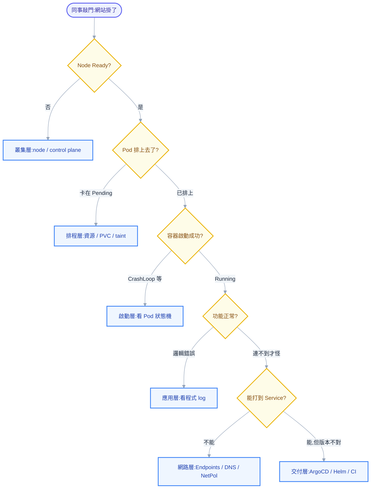
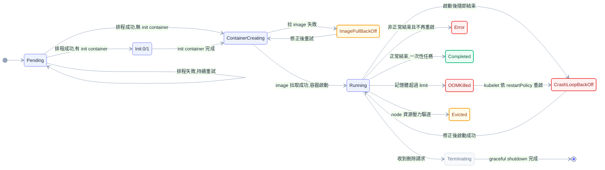
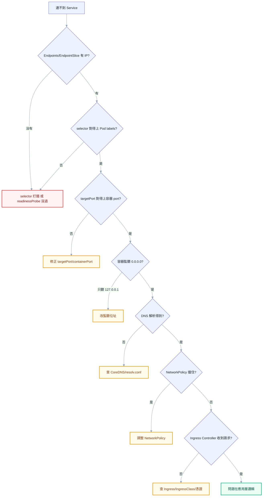
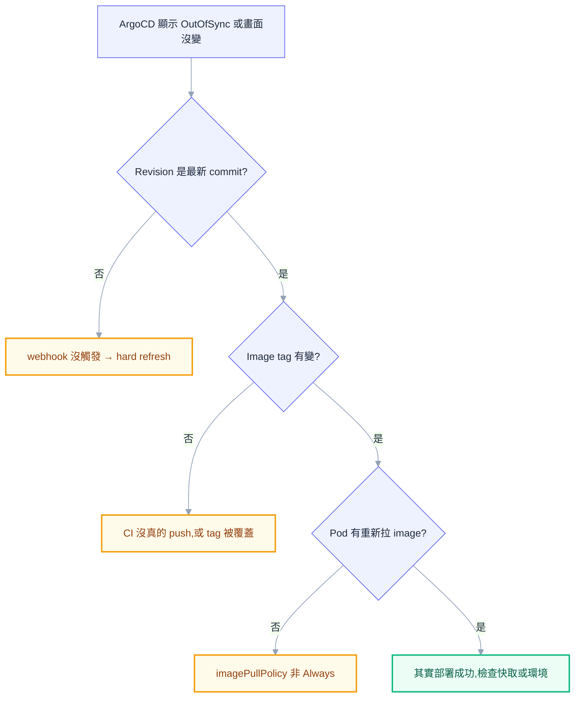

# 第十三章：疑難排解方法論

## 前言：字典查不到的問題，才是真正的問題

網路上找得到的 K8s troubleshooting 文章，九成是同一種結構：症狀在左欄，解法在右欄，查得到就複製貼上，查不到就卡住。這種字典式清單不是沒有用——本章最後的案例庫附錄就是這種形式——但有一個致命限制：它只能回答「別人已經踩過的坑」，你們團隊自己寫的 Helm chart 產生的怪錯誤、自己 CI pipeline 特有的 tag 命名邏輯出的包，字典永遠查不到，因為那個坑只有你們公司有。

同事來敲你桌子時，他要的不是一份清單，而是一個會推理的人。他會丟給你一句「網站打不開」或一張截圖裡的紅字，你必須從這句話反推出問題出在 K8s 這座疊了六層積木的哪一層，再一路鑽到真正的根因。這個反推的過程，才是這一章要教的東西。案例本身——TLS secret 找不到、Helm nil pointer、CrashLoopBackOff——只是示範方法論怎麼在真實環境運作的教材，不是本章的重點。

方法論部分建立好之後，案例庫附錄會把使用者自己環境裡踩過的十九個真實坑，依照本章的分層框架歸類進去，每一條都保留原始錯誤訊息與實際解法。讀完這章，你應該做到的不是「記住這十九條」，而是「遇到第二十條、第一百條沒看過的錯誤時，知道該往哪個方向查」。

## 分層定位：先問「壞在哪一層」，再動手

K8s 系統從下到上大致疊了六層：最底下是叢集本身（node 是否健康、control plane 是否有回應），往上是排程層（K8s scheduler 有沒有把 Pod 分配到某個 node 上），再往上是啟動層（容器有沒有真的跑起來），再往上是應用層（程式碼自己的邏輯有沒有出錯），平行於這幾層之外還有網路層（服務之間、服務與外部之間連不連得到）以及交付層（ArgoCD/Helm/CI 有沒有把「你以為送出去的東西」真的送到叢集裡）。

新手拿到一個錯誤的直覺反應，通常是立刻對著症狀本身做動作——`ImagePullBackOff` 就重啟 Pod、`CrashLoopBackOff` 就加大 replica 數——這種「頭痛醫頭」的嘗試，運氣好時偶爾湊巧解決，運氣不好時會把時間耗在完全不相干的地方，甚至把原本單純的問題越弄越複雜。分層定位的價值在於它把「這個問題可能出在哪」的範圍，用幾個是非題快速砍掉一大半。你不需要一開始就知道答案，你只需要知道現在該問哪一層的問題。

下面這張圖把整個定位流程畫成一條決策鏈，從「同事說網站掛了」開始，每個菱形都是一個可以用一兩條指令回答的是非題：



> **同事來問你時，先問他這三個問題**：「從什麼時候開始壞的」「是只有這個服務壞，還是全部都壞」「你（或 CI）剛剛動了什麼」。第一題幫你判斷是不是剛部署觸發的（交付層嫌疑最大）；第二題幫你判斷是叢集層/網路層這種共通問題，還是單一服務的啟動層/應用層問題；第三題常常直接把答案講出來——十九個真實案例裡至少有一半，起因都是「剛剛改了什麼」。

### 叢集層：node 和 control plane 健康嗎

這是最底層，也是最容易被忽略的一層，因為大部分時間它是穩定的，你會下意識跳過它直接懷疑自己的 Pod。判斷方式很直接：

```bash
kubectl get nodes
kubectl describe node minikube
```

如果 node 的 STATUS 不是 `Ready`，後面所有分析都不用做了——先把 node 修好。但更隱蔽的情況是 node 本身回報 `Ready`，底層的宿主機資源卻已經瀕臨崩潰，這在 minikube on WSL2 這種本機開發環境特別常見，因為 WSL2 預設最多會吃掉宿主機記憶體的 80%。使用者自己就踩過這個坑：工作管理員裡的 `VmmemWSL` process 記憶體用量持續飆高，minikube 又跑在 WSL2 裡，兩層疊加讓 Windows 本機變慢、kubectl 回應開始逾時。解法不在 K8s 裡，而是 Windows 這一層：建立 `C:\Users\<user>\.wslconfig`

```ini
[wsl2]
memory=2GB
processors=2
swap=512MB
```

設定完之後執行 `wsl --shutdown` 生效。這提醒我們：「叢集層」不能只理解成 K8s node 資源夠不夠，本機開發環境裡還包含「跑 node 的虛擬化層本身健不健康」——K8s 自己完全不知道底下宿主機正在缺記憶體。

### 排程層：Pod 有沒有被排上去

Node 沒問題之後，下一個要問的是「K8s scheduler 有沒有把這個 Pod 分配到某個 node 上」。判斷方式是看 Pod 的 STATUS 是不是卡在 `Pending`，以及 `kubectl describe pod` 的 Events 裡有沒有 `FailedScheduling`。這一層最常見的根因就是資源不足，而且 K8s 給的錯誤訊息其實已經講得很白話，只是很多人沒仔細看：

```text
0/1 nodes are available: 1 Insufficient cpu
```

這句話直翻就是「叢集裡的 1 個 node，沒有一個滿足這個 Pod 要求的 CPU」。使用者自己的環境是單節點 minikube，預設只有 2 顆 CPU，當多個服務的 `resources.requests.cpu` 加總超過這個上限，新的 Pod 就會卡在 Pending 動彈不得。診斷的第一步是確認到底是誰把資源吃光的：

```bash
kubectl describe nodes minikube | grep -A 10 "Allocated resources"
kubectl get pods -A
```

`Allocated resources` 這個區塊會列出目前 node 上所有 Pod 的 requests/limits 加總與剩餘可分配量，一眼就能看出是不是真的滿了。解法有三個方向：把 CPU requests 從動輒 `100m` 調低到 `25m` 這種更貼近實際用量的數字、降低不需要高可用的服務的 replicas、或乾脆把非必要功能關掉（例如開發環境不需要的 Vault injection、CronJob）。記憶體不足的訊息長得幾乎一樣：

```text
0/1 nodes are available: 1 Insufficient memory
```

使用者的環境曾經 dev、stg、prod 三個環境同時開著跑，三倍的 Pod 數量疊加在同一顆 minikube node 上，記憶體直接見底。這種情況沒有真正的「修法」，只有取捨——把暫時不需要的環境整個關掉：

```bash
kubectl scale deployment --all -n dev --replicas=0
kubectl scale deployment --all -n stg --replicas=0
```

PVC 綁不到（`FailedScheduling` 訊息裡出現 `pod has unbound immediate PersistentVolumeClaims`）以及 node taint 沒有對應 toleration，同樣會讓 Pod 卡在 Pending，診斷邏輯一致——先看 Events，再對照是資源、儲存、還是排程限制式。排程層的核心心法是：`Pending` 幾乎必定指向「scheduler 找不到滿足條件的 node」，你只需要從 Events 裡找出「條件是什麼」。

### 啟動層：容器有沒有真的跑起來

Pod 排上 node 之後，下一個問題是容器有沒有成功啟動並保持運作。這一層的診斷完全依賴 Pod 狀態機——`ContainerCreating`、`ImagePullBackOff`、`CrashLoopBackOff`、`OOMKilled` 各自指向不同方向，值得獨立成下一節展開。這裡先點出一件事：啟動層出的問題，有極高比例根因不在啟動層本身，而在交付層——Helm chart 少寫了條件判斷、CI 標錯了 image tag、或 Secret 根本沒被建立。啟動層看到的症狀，常常只是交付層錯誤的下游表現，〈交付層〉一節會回頭把好幾個案例接回這裡討論。

### 應用層：程式自己的錯

如果容器穩定 Running，Pod 狀態也正常，但功能就是不對——回傳錯誤的資料、某個 API 500、畫面空白——這就跨出了 K8s 平台能回答的範圍，進入應用層。這一層的診斷工具還是 `kubectl logs`，但你看的不再是「容器有沒有啟動」，而是應用程式自己印出來的業務邏輯錯誤、例外堆疊、SQL 錯誤。K8s 只負責讓容器跑起來，跑起來之後程式對不對是另一個世界的事——很多人會把應用層錯誤誤判成 K8s 問題，浪費時間在 `describe pod`、`get events` 裡找不存在的答案，把這一層明確劃出來，本身就是節省時間的判斷。

### 網路層與交付層：各自獨立成章

「連得到嗎」與「東西有沒有被正確送出去」分別在〈網路排查〉與〈交付層〉兩節詳細討論。這裡只需記住它們的位置：網路層通常在「容器已經 Running，但呼叫端連不上」時介入；交付層通常在「畫面上的東西跟你以為推上去的版本對不起來」時介入，而且交付層的問題經常偽裝成前面任何一層的症狀——這正是它容易被漏掉的原因。

## Pod 狀態機：讀懂 K8s 想告訴你的路標

如果分層定位是地圖，Pod 的狀態（status/phase）就是地圖上的路標。K8s 不會直接告訴你「你的程式碼第 42 行寫錯了」，但它會透過 Pod 狀態排除掉一大堆不可能的方向。把每個狀態當成一句「這件事一定不是這樣、方向請往那邊查」的提示，而不是單純的名詞定義，是讀懂它的關鍵。



**`Pending`** 指向的方向只有兩個：scheduler 還沒把 Pod 分配到任何 node，或者 Pod 依賴的資源（最常見是 PVC）還綁不到。它排除掉的可能性是——容器本身的問題完全還沒發生，因為容器連被建立的機會都還沒有。看到 `Pending` 就去查容器內部的邏輯，是白費工夫的方向。

**`ContainerCreating`** 代表 Pod 已經排上 node，K8s 正在做啟動前的準備工作——最常見是拉取 image、掛載 volume。這個狀態如果卡住不動，通常不是容器本身壞了，而是「啟動前的準備動作」卡住了，例如 volume 掛載失敗。使用者自己的案例就是活生生的例子：

```text
MountVolume.SetUp failed for volume "tls-volume": secret "web-app-tls" not found
```

根因是 Deployment 的 volume 掛載寫死了 TLS secret 的引用，完全沒有條件判斷，但 DEV 環境根本沒有建立這個 TLS secret。Pod 因此永遠卡在 `ContainerCreating`，因為 kubelet 連掛載這一步都完成不了，容器連啟動的機會都沒有。這個案例的修法示範了「交付層問題偽裝成啟動層症狀」的典型模式——真正該修的地方不是 Pod，而是 Helm template 本身要加上條件判斷：

```yaml
{{- if .Values.ingress.tls.enabled }}
- name: tls-volume
  ...
{{- end }}
```

並在 `values.yaml` 給預設值 `ingress.tls.enabled: false`，讓 DEV 環境不會被迫掛載一個不存在的 secret。

**`Init:0/1`**（或 `Init:1/2` 等）代表 Pod 有設定 init containers，而目前卡在第一個還沒跑完的那一個。它指向的方向很窄：主應用容器根本還沒開始執行，問題一定出在 init container 本身，`kubectl logs <pod> -c <init-container-name>` 才是該看的地方，看主容器的 log 只會是空的。

**`ImagePullBackOff` / `ErrImagePull`** 幾乎總是三個原因之一：registry 認證失敗、image tag 不存在、或網路連不到 registry。使用者環境的真實案例是 tag 根本不存在：

```text
manifest for <image>:<tag> not found: manifest unknown
```

追下去發現是 CI 在 image 真正 build & push 成功之前就已更新 deployment repo 的 tag，或是 CI job 中途失敗但 repo 已被改。診斷關鍵是回頭確認「對應那個 commit 的 CI job，有沒有真的跑完 build & push 這一步」，而不是在 K8s 側繼續查——`ImagePullBackOff` 只是下游症狀，上游根因在交付層，〈交付層〉一節會詳細展開。另一真實案例是 CI 用全域 `sed` 改 tag，把不相干服務的 tag 一起覆蓋，導致某服務出現 `ImagePullBackOff`,tag 卻是另一服務的版本號——光盯著 `describe pod` 看不出問題，得跳出 K8s 去看 CI 產生的 values 檔案內容。

**`CrashLoopBackOff`** 這個名字容易誤導——它不是一種錯誤，而是一種**症狀**：容器啟動了、然後死了、K8s 重啟它、又死了。真正的錯誤在容器死掉前那幾行 log 裡，而那個容器已經不在了，所以你需要 `kubectl logs <pod> --previous` 去看上一次崩潰時留下的輸出，而不是 `kubectl logs <pod>`（那只會顯示當前這次啟動、可能還沒印出東西的 log）。另外 `CrashLoopBackOff` 有退避（exponential backoff）機制，重試間隔從 10 秒逐次翻倍到最高 5 分鐘，剛修完設定卻遲遲看不到重啟不代表沒生效，可能只是還沒排到下一次重試——直接 `kubectl delete pod` 讓它立刻重建，比乾等退避週期快。使用者自己的案例是 nginx 容器的 CrashLoopBackOff：

```text
cannot load certificate "/etc/nginx/certs/tls.crt": No such file or directory
```

根因是 nginx 的 ConfigMap 裡硬寫了 SSL 憑證路徑，DEV 環境沒有這個檔案，nginx process 一啟動去讀憑證就直接退出，K8s 認定容器異常結束，依 restartPolicy 反覆重啟，於是進入 CrashLoopBackOff。修法跟前一個 TLS secret 案例同源：ConfigMap 也要用條件判斷產生兩種 server block，有憑證時走 443，沒憑證時走 80。同一個根因（「沒有處理 DEV 環境沒有 TLS」）在啟動層製造了兩種症狀——volume 掛載失敗讓 Pod 卡在 `ContainerCreating`，憑證檔案不存在讓容器進入 `CrashLoopBackOff`——症狀會變，但抓對根因所在的層，就不會被表面差異誤導。

**`OOMKilled`** 是最明確的一種，K8s 直接告訴你容器使用的記憶體超過了 `resources.limits.memory`，被 kernel 的 OOM killer 強制終止。它排除掉的可能性是「程式邏輯錯誤」——這通常不是 bug，而是資源設定與實際負載不匹配，要嘛調高 limit，要嘛去找程式裡的記憶體洩漏。

**`Error`** 是一個相對籠統的狀態，代表容器以非零的 exit code 結束，且根據 restartPolicy 判定不需要（或不再）重啟。看到這個狀態時，`kubectl describe pod` 裡的 `Last State` 區塊會告訴你 exit code 是多少，再配合 `--previous` 的 log 去對應這個 exit code 代表的意義。

**`Terminating`** 代表 Pod 收到刪除請求，正在等待 graceful shutdown 完成或 finalizer 被清除。如果一個 Pod 長時間卡在 `Terminating` 不消失，方向通常是兩個：容器沒有正確處理 `SIGTERM` 訊號，導致必須等滿 `terminationGracePeriodSeconds` 才被強制殺掉；或是資源上掛著 finalizer，而負責清除該 finalizer 的 controller 出了問題。這種情況用 `kubectl get pod <name> -o yaml` 看 `metadata.finalizers` 欄位往往能直接看出卡點。

**`Evicted`** 代表 kubelet 在 node 資源壓力（記憶體、磁碟）過大時，主動把優先權較低的 Pod 驅逐出去以保護 node 本身。它指向的方向是 node 層級的資源壓力，而不是這個 Pod 自己的配置錯誤——如果你發現多個不相干的 Pod 同時被 Evicted，幾乎可以確定是 node 資源整體吃緊，回頭去查〈分層定位〉一節的叢集層與排程層。

**`Completed`** 是唯一「正常」的終止狀態，代表容器以 exit code 0 結束，常見於 Job 或 CronJob。看到這個狀態不需要緊張，但如果一個原本該是常駐服務的 Deployment 出現 `Completed`，那就代表主程式自己提前結束了（例如忘記寫一個阻塞主線程的迴圈），方向要轉去應用層查程式邏輯，而不是 K8s 設定。

另外要單獨提一個容易被忽略的案例：`Secret` 不存在導致的啟動失敗不一定會反映在前面提到的 volume 掛載上，如果你的 Deployment 是用 `envFrom.secretRef` 把 Secret 注入成環境變數，而這個 Secret 沒有被建立，K8s 給的訊息是：

```text
Error: secret "<secret-name>" not found
```

這種情況的根因跟前面的 TLS secret 案例本質相同——Secret 不屬於 Helm chart 管理範圍，`helm install` 不會自動幫你建立它，每個需要用到的 namespace 都要手動建立一份：

```bash
kubectl create secret generic <secret-name> -n <namespace> \
  --from-literal=<KEY>="<value>"
```

這也是為什麼很多團隊會進一步導入 Vault + External Secrets 這類工具，把 Secret 的建立自動化，而不是每次開新環境都手動補一次。

## 診斷指令工具箱：怎麼問對問題

有了分層定位的方向感、也認得 Pod 狀態機的路標之後，接下來是把正確的指令用在正確的時機。這些指令大部分你可能已經用過，但用對「先看什麼、再看什麼」的順序，診斷效率會差非常多。

`kubectl describe pod <name>` 是幾乎所有 Pod 問題的第一站，但很多人只看上半部的 Spec/Status，卻略過最下面的 **Events** 區塊——這其實才是第一現場。Events 是時間序列的事件流，會誠實記錄「scheduler 說了什麼」「kubelet 做了什麼動作、成功還是失敗」，`FailedScheduling`、`Failed to pull image`、`Back-off restarting failed container` 都會出現在這裡，且帶著更完整的原始錯誤文字。養成「先滾到 Events」的習慣，往往比對著上半段 YAML 憑空猜測快得多。

Events 有一個容易踩的陷阱：預設只保留約一小時內的事件，超過這個時間窗的紀錄會被清除。如果同事一小時前跟你反應問題、你現在才去查，`describe pod` 裡可能已經看不到當初的 Events 了。這種情況要改用叢集層級的事件查詢並依時間排序：

```bash
kubectl get events --sort-by=.lastTimestamp -A
```

`--sort-by=.lastTimestamp` 很重要，不排序的話 events 會依照建立順序而非發生時間顯示，在事件量大的叢集裡很容易錯過關鍵的那一條。但如果事件已經超過一小時的保留期，這個指令一樣救不回來——這正是為什麼正式環境通常會另外接一套集中式 log/event 收集系統，不能只靠 `kubectl` 現查現看。

`kubectl logs` 系列指令是應用層排查的核心，但 `CrashLoopBackOff` 的情境下必須換一個心法：容器已經死掉重啟了，`kubectl logs <pod>` 顯示的是新一輪啟動至今的輸出，通常還沒印到出錯的那一行。這時候要用：

```bash
kubectl logs <pod> --previous
```

`--previous` 會去讀「上一個已終止的容器實例」留下的 log，這才是真正藏著崩潰原因的地方。如果 Pod 裡有多個容器，別忘了加 `-c <container-name>` 指定要看哪一個。

`kubectl exec -it <pod> -- sh` 讓你直接進到容器內部查看檔案系統、環境變數、跑診斷指令，是最直覺的排查方式，但前提是容器裡有 shell 可以進去。近年流行的 distroless image 為了縮小攻擊面與體積，刻意不包含任何 shell，這時 `exec` 會直接失敗。解法是 `kubectl debug`，它建立一個 ephemeral container 附掛到目標 Pod 上，共用同一個 network namespace，讓你用帶有完整工具集的臨時容器去診斷原本什麼工具都沒有的 distroless 容器：

```bash
kubectl debug -it <pod> --image=busybox --target=<container-name>
```

這個 ephemeral container 不會影響原本 Pod 的重啟計數，用完也不會留下痕跡，是排查 distroless 容器問題的標準做法。

`kubectl get <resource> -o yaml` 讓你看到資源「實際生效」的完整 spec 與 status，這跟你手上的 Helm template 或 kustomize 來源檔案不一定一樣——admission webhook、mutating webhook、defaulting 邏輯都可能在套用過程中偷偷改動欄位。當你懷疑「我以為我設定的值，是不是根本沒生效」，直接用 `-o yaml` 去看叢集裡真正的那一份，永遠比回頭看原始檔案可靠。

`kubectl top pods` / `kubectl top nodes` 提供即時的 CPU/記憶體用量，是判斷排程層資源不足、或應用層是否逼近 OOM 邊界的第一手數據，但它依賴叢集裡有部署 metrics-server，minikube 預設不會裝，需要額外啟用 `minikube addons enable metrics-server`。

`kubectl auth can-i` 用來檢查權限，細節留到下一節的 RBAC 專題展開。

## 網路排查：連得到 Service，不代表連得到 Pod

「連不到」是所有症狀裡最讓人沮喪的一種，因為它牽涉的環節最多，而且每一環單獨看都很正常。K8s 的 Service 抽象把「呼叫某個服務」和「這個服務背後實際跑在哪個 Pod 上」解耦開來，解耦帶來彈性，但也代表故障點可能出現在解耦鏈的任何一環。排查網路問題最有效的方式，是沿著流量實際會經過的路徑，一段一段往下驗證，而不是憑感覺亂猜。



第一步永遠是確認 Service 背後的 Endpoints（或新版的 EndpointSlice）有沒有實際的 Pod IP：

```bash
kubectl get endpoints <service-name> -n <namespace>
kubectl get endpointslice -n <namespace> -l kubernetes.io/service-name=<service-name>
```

如果這裡看到的是空的——`ENDPOINTS` 欄位顯示 `<none>`——那麼問題根本還沒進到「網路」層面，Service 從頭到尾就沒有任何後端可以轉發流量。這是網路類問題裡**出現頻率最高的根因**，原因通常只有兩個：一是 Service 的 `selector` 跟 Pod 的 `labels` 對不起來（打錯字、忘記更新、複製貼上漏改），二是 labels 雖然對，但 `readinessProbe` 一直沒通過，K8s 因此故意不把這個 Pod 納入 Endpoints——Pod 明明 `Running` 卻連不上，新手最容易卡在這裡，因為沒想到 readiness 檢查是獨立於 Running 狀態之外的另一道關卡。診斷做法是比對 Service 的 selector 與 Pod 實際的 labels：

```bash
kubectl get service <service-name> -n <namespace> -o yaml | grep -A 5 selector
kubectl get pods -n <namespace> --show-labels
```

兩邊一字不差地對照，包含大小寫與拼字，絕大多數空 Endpoints 案例到這一步就能抓到。selector 沒問題就查 readinessProbe:`describe pod` 的 Conditions 區塊會顯示 `Ready` 是 `True` 還是 `False`，搭配 Events 的 `Unhealthy` 訊息通常能看出探測失敗的原因（路徑寫錯、port 不對、`initialDelaySeconds` 不夠）。

Endpoints 有 IP 之後，確認 `targetPort` 有沒有對上容器實際監聽的 port——常見手誤是 Service 寫 `targetPort: 8080`，容器卻聽在 `3000`，兩邊各自看起來合理，放一起比對才會發現不一致。再確認容器監聽位址是不是 `0.0.0.0` 而非 `127.0.0.1`——只綁 loopback 的話，即使 port 正確，叢集內其他 Pod 依然連不進來。

再往下是 DNS：K8s 靠 CoreDNS 讓 Pod 用 `<service-name>.<namespace>.svc.cluster.local` 互相尋址，連線失敗發生在解析階段時，`kubectl exec` 進 Pod 用 `nslookup <service-name>` 是最直接的驗證。再往下是 NetworkPolicy：即使前面每步都正確，規則沒開放的來源一樣被擋下，症狀通常是「連線逾時」而非「立即拒絕」，容易誤判成別的問題，值得單獨查一次 `kubectl get networkpolicy -n <namespace>`。最後看 Ingress Controller 有沒有真的收到請求，直接看它自己的 log 確認。

### 特別篇：當你的服務長在 Cloudflare Tunnel 後面

上面這條排查鏈是標準 K8s 網路模型的路徑，但使用者的實際環境還多疊了一層——外部使用者要經過 Cloudflare Tunnel 才能碰到 minikube 裡的 Ingress，這一層不在標準 K8s 文件的討論範圍內，卻是真實環境裡最容易出事的地方。

真實案例是手機打開 `https://viclai.idv.tw` 顯示 Cloudflare Error 1016。這個錯誤代表 Cloudflare 收到了請求，但轉不進真正的服務——追查下去發現是 `minikube tunnel` 沒有在背景執行，導致本機的 `127.0.0.1:80` 根本沒有任何程式在聽。cloudflared 本身跟 Cloudflare 的連線是正常的，問題出在流量從 cloudflared 進到本機之後，缺了 `minikube tunnel` 這一段把流量轉進 K8s Ingress。診斷方式很直接：

```bash
tasklist | findstr cloudflared
minikube tunnel
```

如果 `minikube tunnel` 顯示已經有另一個實例在跑而報錯，那反而是正常訊號；如果它順利啟動，那就是根因所在。這個案例提醒：當排查鏈條比教科書標準模型多一段自建基礎設施（這裡是 Cloudflare Tunnel + minikube tunnel），必須把這段也納入心智模型，否則會一直卡在「Ingress Controller 收到請求了嗎」，因為問題發生在更前面、教科書不會提到的地方。重開機後這兩個 tunnel（`minikube tunnel` 與 `cloudflared tunnel run k8s-tunnel`）都需要重啟，所以使用者準備了 `start.bat` 一次拉起來。

同一層基礎設施還藏著另一個案例，表面上看是 Docker push 失敗，本質上也是 Cloudflare Proxy 這一層造成的：

```text
error parsing HTTP 413 response body
```

原因是 Cloudflare 免費方案對經過 Proxy（橘色雲朵）的 HTTP 請求有 100MB request body 上限，Docker image 某一層（layer）超過這個大小時，push 到 Harbor 的請求在 Cloudflare edge 就被擋下，回傳 413。這個問題無法在 Docker 或 Harbor 側解決，因為問題不在它們身上，而在流量經過的 Cloudflare 層有隱性上限。解法是把該 DNS record 改成「DNS only（灰色雲朵）」不經 Proxy，自行用 cert-manager + Let's Encrypt 取得有效憑證，路由器開 port 443 轉發到本機，讓 push 直接連本機、繞過 Proxy 大小限制。

兩個案例的教訓一致：架構疊了 Cloudflare Tunnel 這種第三方邊界，標準網路排查鏈要在頭尾各加一段——外部進來前先確認 tunnel 有沒有在跑，大流量請求則要留意 Proxy 層是否有隱藏的體積限制。

## 權限問題：RBAC 403 從哪裡查起

RBAC 造成的錯誤通常長得很一致：操作被拒絕，錯誤訊息裡帶著 `forbidden` 或 HTTP 403，並且明確點名是哪個 verb（get/list/create/delete 等）對哪個 resource 被拒絕。這類錯誤最大的陷阱在於「操作者的身份」常常不是你以為的那個——當你自己用 `kubectl` 手動操作時，身份是你的 kubeconfig 使用者；但當一個 Pod 內的程式呼叫 K8s API 失敗時，身份是這個 Pod 掛載的 ServiceAccount，兩者的權限集合可能完全不同。

`kubectl auth can-i` 是這一層最直接的診斷工具，它不會真的執行操作，只回答「如果執行，會不會被允許」：

```bash
kubectl auth can-i get pods --namespace=<namespace>
```

但真正有用的是加上 `--as` 模擬別的身份，尤其是模擬某個 ServiceAccount 去驗證它的實際權限，而不是驗證你自己的：

```bash
kubectl auth can-i list secrets \
  --as=system:serviceaccount:<namespace>:<serviceaccount-name> \
  --namespace=<namespace>
```

這一行指令基本上就是把「這個 Pod 到底能不能做它想做的事」直接問出答案，不需要真的把 Pod 跑起來再從 log 裡猜。如果答案是 `no`，下一步是找出這個 ServiceAccount 到底綁定了哪些 Role/ClusterRole：

```bash
kubectl get rolebinding,clusterrolebinding -A -o wide | grep <serviceaccount-name>
```

找到對應的 (Cluster)RoleBinding 之後，再去看它引用的 (Cluster)Role 裡實際列出的 `rules`，通常就能看出缺了哪一個 verb 或哪一個 resource 沒被涵蓋。RBAC 排查的心法跟前面幾層一致：先問「以誰的身份、對什麼資源、做什麼操作」這三個座標，再去對照權限設定裡實際涵蓋的範圍，而不是直接去改 Role 亂加權限碰運氣。

## 交付層：ArgoCD / Helm / CI 有沒有把東西正確送出去

前面幾層處理的都是「叢集裡已經存在的東西」為什麼不對，但很多時候真正的問題發生在更早——東西根本沒有被正確送進叢集，或送進去的版本跟你以為的不一樣。交付層的問題特別狡猾，因為它的症狀會偽裝成前面任何一層——`ImagePullBackOff` 看起來像啟動層問題，`ContainerCreating` 卡住看起來像資源問題，但根因其實在 CI 或 Helm 這一段。



### ArgoCD：OutOfSync 但看起來一樣

ArgoCD 的核心工作是持續比對 git repo 裡宣告的狀態跟叢集裡實際的狀態，兩者不一致就標示 `OutOfSync`。使用者遇過的真實情境是 ArgoCD 頁面上顯示的 Revision 並不是最新的 commit，也就是「畫面看起來一切正常，但其實根本沒同步到你剛推上去的版本」。這種情況通常是 webhook 沒有正確觸發、或是 ArgoCD 的 polling 間隔還沒到，最直接的排查方式是先確認 Revision 欄位，一旦確定卡在舊 commit，直接強制觸發 hard refresh：

```bash
kubectl annotate application <app-name> -n argocd \
  argocd.argoproj.io/refresh=hard --overwrite
```

hard refresh 跟一般 sync 不一樣，它強制 ArgoCD 重新從 git 拉取最新狀態並重新計算 diff，而不信任快取結果，適合用在「明明推了新 commit，ArgoCD 卻好像沒發現」這種情境。

順帶一提，操作 ArgoCD 還有兩個純操作性的小麻煩。其一是 `kubectl port-forward` 連 ArgoCD server 時偶爾斷線，報 `error creating forwarding stream for port 8080 -> 8080: Timeout occurred`，在 Windows 上通常是前一個 port-forward 程序沒乾淨結束、還佔著 port，用 `netstat -ano | findstr :8080` 找 PID,`taskkill /PID <PID> /F` 關掉後重新 `kubectl port-forward svc/argocd-server -n argocd 8080:443` 即可。其二是查 ArgoCD 初始密碼，Windows PowerShell 不能像 Linux 一樣直接用 `base64 -d`，要改用 .NET 方式解：

```powershell
kubectl -n argocd get secret argocd-initial-admin-secret -o jsonpath="{.data.password}" | ForEach-Object { [System.Text.Encoding]::UTF8.GetString([System.Convert]::FromBase64String($_)) }
```

這兩個雖然不是「錯誤排查」，但都是操作 ArgoCD 時反覆會用到、容易忘記細節的地方。

### 孤兒資源：刪掉 Application 不代表刪掉底下的資源

另一個使用者踩過的坑跟 ArgoCD 的資源生命週期管理有關。當一個 ArgoCD Application 被刪除（例如 Helm chart 資料夾重新命名之後，舊的 Application 定義被移除），它底下曾經建立的 K8s 資源不一定會跟著被清除乾淨，尤其是在沒有正確設定 cascade 刪除的情況下。殘留的舊資源接著會跟新建立的資源打架，典型症狀是新的 Ingress 部署失敗，admission webhook 直接擋下：

```text
admission webhook "validate.nginx.ingress.kubernetes.io" denied the request:
host "<host>" and path "/" is already defined in ingress <namespace>/<name>
```

這個錯誤訊息其實已經講得很清楚：同一個 host 加 path 的組合已經被另一個 Ingress 定義過了。診斷方式是直接列出該 namespace 底下所有資源，找出那個「已經不該存在」的舊 Ingress：

```bash
kubectl get all -n <namespace>
kubectl delete ingress <ingress-name> -n <namespace>
```

GitOps 工具讓部署變得宣告式、可回溯，但「刪除」這個動作從來不是無腦安全的——刪除定義檔案不等於刪除底下建立的實體資源，這中間的落差正是孤兒資源的來源。

### Helm 模板炸裂：nil pointer 與必須存在的預設值

Helm template 渲染失敗最常見的一種錯誤是：

```text
nil pointer evaluating interface {}.enabled
```

根因幾乎總是同一件事——template 裡存取了 `.Values.某個路徑.enabled`，但 `values.yaml` 裡完全沒有定義這個路徑，Helm 在渲染階段拿到的是 `nil`，對 `nil` 呼叫 `.enabled` 自然會爆炸。這正是本章前面〈Pod 狀態機〉一節提到的 TLS secret 與 nginx CrashLoop 兩個案例背後共通的根因——`values.yaml` 沒有把 `ingress.tls` 這個區塊事先定義出來。這個案例值得從 Helm 這一側單獨再強調一次寫法上的紀律：**`values.yaml` 必須把 template 會存取到的每一個欄位都明確寫出來，即使值只是 `false`**，不能仰賴「反正沒設定應該就是空的、應該不會爆」這種僥倖心態：

```yaml
ingress:
  enabled: false
  tls:
    enabled: false
```

這條紀律看似瑣碎，卻是 Helm chart 能否在多環境（dev/stg/prod）間穩定切換的關鍵——只要有一個環境的 `values-xxx.yaml` 漏寫了某個巢狀欄位，渲染就會在那個環境炸掉，而錯誤訊息只會告訴你「哪個欄位是 nil」，不會告訴你「哪個環境漏寫了」，得自己往回推。

### CI 標錯版本：tag 互蓋與 ImagePullBackOff 的真正根因

〈Pod 狀態機〉一節提過 `ImagePullBackOff` 常常是交付層問題的下游症狀，這裡展開它在 CI 端的真實成因。第一種情況是 CI 用全域 `sed` 替換 values 檔案裡的 `tag:` 欄位：

```bash
sed -i "s|tag: .*|tag: \"$SHA\"|" values-prod.yaml
```

當這份 values 檔案同時給多個服務共用（例如同一檔案裡有 `serviceA.image.tag` 跟 `serviceB.image.tag`），這條指令會把**所有**符合 `tag:` 這個 pattern 的行全部改掉，服務 A 部署時，服務 B 的 tag 也被一起改成服務 A 的版本，兩者互相污染。線索是：某服務 Pod 出現 `ImagePullBackOff`，顯示的 tag 卻是另一服務的版本號——單看 K8s 側無法理解為什麼，答案在 CI script。修法是把全域替換改成 sed 的位址範圍（address range）限定特定區塊：

```bash
sed -i "/^sectionA:/,/^sectionB:/ s|tag: .*|tag: \"$TAG\"|" values.yaml
```

第二種情況是 tag 根本不存在於 registry：

```text
manifest for <image>:<tag> not found: manifest unknown
```

根因是 CI pipeline 在 image 真正 build & push 成功「之前」就先更新了 deployment repo 裡的 tag 欄位，或者 build/push 那個 job 本身失敗了，但更新 deployment repo 的 job 卻沒有連動失敗、照樣把新 tag 寫了進去。診斷方式是回頭確認對應那個 commit 的 CI pipeline，build & push image 那個 step 是不是真的執行成功。修法是把 values 檔案的 tag 改回上一個確定成功的版本，重新 commit + push，再觸發 ArgoCD sync。這兩個案例的教訓是：CI 對 values 檔案的任何自動化修改都要假設「檔案裡可能還有別的東西」，寫死的字串替換在單服務環境下安全，一旦多服務共用同一份設定檔，就變成隨時會炸的地雷。

### Registry 認證與憑證：Harbor 那些事

Harbor 作為 private registry，常見的坑集中在憑證與認證這兩塊。第一個案例是瀏覽器打開 Harbor 網頁介面時出現：

```text
net::ERR_CERT_AUTHORITY_INVALID
目前無法造訪,因為這個網站使用 HSTS
```

追根究柢，是 Harbor 的 `externalURL` 設成 `https://`，但 `expose.tls.enabled` 卻是 `false`，矛盾的結果是 Harbor 回應裡依然帶著 HSTS header。瀏覽器一旦快取這個 domain 的 HSTS 政策，之後只要 hosts 檔把 domain 指向本機 IP（繞過 Cloudflare），瀏覽器就會強制走 HTTPS 直連 Harbor，而 Harbor 用的是自簽憑證，HSTS 不允許手動略過警告，於是卡死。短期解法是清掉 Chrome 對該 domain 快取的 HSTS 政策（`chrome://net-internals/#hsts` 輸入 domain 後 Delete，再到 `chrome://net-internals/#dns` 清 host cache）；根本解法是移除 hosts 裡繞過 Cloudflare 的那條設定，或給 Harbor 設定 cert-manager 取得真正有效的憑證。

第二個案例是 CI 執行 `docker login` 推送 image 到 Harbor 時，帳密都正確卻回報 `unauthorized`。根因是 Harbor 的 robot account 名稱帶 `$` 符號，例如 `robot$project+name`,PowerShell 雙引號字串裡 `$project` 會被當成變數展開——若當下沒有叫 `project` 的變數，就展開成空字串，實際送出的帳號變成 `robot+name`。bash 雙引號字串同樣會展開，道理一致。解法是 PowerShell 改用單引號字串（不觸發展開）:

```powershell
echo "token" | docker login registry -u 'robot$project+name' --password-stdin
```

在 CI YAML 裡則透過環境變數傳遞帳號密碼，而不是把帳號直接寫死在指令字串裡，從根本上避開 shell 展開的問題：

```yaml
env:
  HARBOR_USERNAME: ${{ secrets.HARBOR_USERNAME }}
run: |
  echo "$HARBOR_PASSWORD" | docker login $HARBOR_URL -u "$HARBOR_USERNAME" --password-stdin
```

這個案例的教訓很有普遍性：任何帳號、密碼、token 裡含有 shell 特殊字元（`$`、反引號、雙引號）時，都應該先假設「這串字會不會被目前的 shell 展開」，而不是等到認證失敗才回頭懷疑帳密本身打錯。

### Windows / WSL2 特有陷阱

最後這組案例都跟「CI 或本機開發環境跑在 Windows 上」這個特殊條件有關，標準的 Linux CI/CD 文件不會提到，但在使用者的環境裡真實發生過。

第一個是 self-hosted runner 在 Windows 上執行 `shell: bash` 的 workflow step 時報錯：

```text
shell: C:\Windows\system32\bash.EXE --noprofile --norc -e -o pipefail {0}
<3>WSL (xxxxx) ERROR: CreateProcessEntryCommon:505: execvpe /bin/bash failed 2
```

原因是 GitHub Actions 的 `shell: bash` 宣告，在 Windows runner 上預設會找 `C:\Windows\System32\bash.exe`——這其實是 WSL 內建的 bash 轉接器，不是 Git Bash。若 WSL 預設 distro（例如 `docker-desktop`）沒裝 bash、只有 `sh`，執行就直接失敗。修法是在第一個 bash step 前插入 PowerShell step，把 Git Bash 路徑塞進 PATH 最前面，讓後續 `shell: bash` 優先解析到 Git Bash：

```yaml
- name: Use Git Bash (not WSL bash)
  shell: powershell
  run: |
    $gitBin = "C:\Program Files\Git\bin"
    $gitUsr = "C:\Program Files\Git\usr\bin"
    "$gitBin`n$gitUsr" | Out-File -FilePath $env:GITHUB_PATH -Encoding utf8 -Append
```

如果 workflow 裡確實需要呼叫 `wsl.exe` 本身，那個 step 要單獨明確指定 `shell: powershell`，避免被前面這段 PATH 調整影響。

第二個是 Docker Desktop 的 daemon 連不到 registry，錯誤訊息帶著一段內部 IPv6：

```text
Error response from daemon: Get "https://<registry>/v2/": dial tcp [fd10:aec2:5dae::]:443: connect: network is unreachable
```

根因藏得比較深：Docker Desktop 的 daemon 跑在自己獨立的 mount/network namespace 裡，DNS 解析走這個 namespace 專屬的 resolver，而不是你在 WSL2 主 namespace 修改的 `/etc/hosts`。連線的 hostname 是 Cloudflare Tunnel domain 時，這個獨立 resolver 解析出私有 IPv6(`fd10::/16`)，但 daemon 所在 namespace 沒有對應路由，連線因此失敗。診斷需要進到 daemon 實際所在的 namespace 才看得到問題：

```bash
wsl -d docker-desktop -- ps | grep dockerd
wsl -d docker-desktop -- cat /proc/<pid>/root/etc/resolv.conf
```

修法是用 `nsenter` 進入 daemon 的 mount namespace，直接修改它看得到的那份 `/etc/hosts`，寫入 Cloudflare 回傳的公開 IPv4（而不是 `127.0.0.1`——因為 daemon namespace 裡的 `127.0.0.1` 是它自己的 loopback，不是 Windows 主機的 loopback）:

```bash
wsl -d docker-desktop -- nsenter --target <dockerd-pid> --mount --uts -- sh -c \
  "grep -q '<hostname>' /etc/hosts || echo '104.x.x.x <hostname>' >> /etc/hosts"
```

這個修改在 Docker Desktop 重啟後會消失，必須寫進啟動腳本裡每次自動套用。這個案例跟〈分層定位〉一節的 WSL2 記憶體案例、以及前面 Cloudflare Tunnel 案例放在一起看，有個共通模式：在 Windows + WSL2 + minikube + Docker Desktop 這種疊了好幾層虛擬化與 namespace 的環境裡，「同一份設定在不同 namespace 看到的不一樣」是反覆出現的根因類型，排查時要養成「這個設定是哪一個 namespace 在看」的習慣性追問。

## 案例庫：十九個真實踩坑速查表

以下把使用者自己環境裡踩過的十九個真實案例，依照前面幾節的分層框架整理成速查表，保留原始錯誤訊息與實際解法，方便日後直接查閱對照。

| # | 症狀 / 錯誤訊息 | 根因 | 解法 | 所屬層 |
| --- | --- | --- | --- | --- |
| 1 | `MountVolume.SetUp failed for volume "tls-volume": secret "web-app-tls" not found` | Deployment 無條件掛載 TLS volume，DEV 環境沒有對應 secret | Helm template 加 `{{- if .Values.ingress.tls.enabled }}` 條件判斷，values.yaml 給預設值 `false` | 啟動層 |
| 2 | `nil pointer evaluating interface {}.enabled` | values.yaml 沒定義 template 會存取的欄位，拿到 nil 呼叫 .enabled | values.yaml 明確寫出所有會被存取的欄位，即使是 false | 交付層（Helm） |
| 3 | `cannot load certificate "/etc/nginx/certs/tls.crt": No such file or directory` | nginx ConfigMap 寫死 SSL 憑證路徑，DEV 環境無憑證 | ConfigMap 加條件判斷，無憑證時走 80 port | 啟動層 |
| 4 | `0/1 nodes are available: 1 Insufficient cpu` | 所有 Pod CPU requests 加總超過 minikube 上限（預設 2 CPU） | 降低 CPU requests、降低 replicas、關閉非必要功能 | 排程層 |
| 5 | `admission webhook ... denied: host "<host>" and path "/" is already defined in ingress <ns>/<name>` | 舊 ArgoCD Application 被刪除，底下資源未 cascade 清除，與新 Ingress 衝突 | `kubectl delete ingress <name> -n <ns>`，並用 `kubectl get all -n <ns>` 確認無其他殘留 | 交付層（ArgoCD） |
| 6 | ArgoCD 顯示的 Revision 不是最新 commit | webhook 未觸發或 polling 間隔未到 | `kubectl annotate application <app> -n argocd argocd.argoproj.io/refresh=hard --overwrite` | 交付層（ArgoCD） |
| 7 | `error creating forwarding stream for port 8080 -> 8080: Timeout occurred` | 前一個 port-forward 程序未乾淨結束，佔用 port | `netstat -ano \| findstr :8080` 找 PID,`taskkill /PID <PID> /F` 後重新 port-forward | 交付層（操作） |
| 8 | `VmmemWSL` 記憶體用量持續飆高 | WSL2 預設可用宿主機記憶體上限達 80% | 建立 `.wslconfig` 限制 memory/processors/swap,`wsl --shutdown` 生效 | 叢集層 |
| 9 | 外網存取顯示 Cloudflare Error 1016 | `minikube tunnel` 未啟動，cloudflared 連得到 Cloudflare 但轉不進本機 Ingress | 執行 `minikube tunnel`（或 `start.bat` 同時拉起 minikube tunnel 與 cloudflared） | 網路層 |
| 10 | 服務 Pod 出現 `ImagePullBackOff`,tag 是別的服務版本 | CI 用全域 `sed` 替換 values 檔案 `tag:` 欄位，多服務共用檔案時全部被覆蓋 | 用 sed address range 限定只替換特定 section | 交付層（CI） |
| 11 | `manifest for <image>:<tag> not found: manifest unknown` | CI 在 build/push 成功前就更新 deployment repo tag，或 push job 失敗但 repo 已更新 | 確認對應 commit 的 CI job 是否成功 push；將 tag 改回上一個成功版本並重新觸發 sync | 交付層（CI） |
| 12 | `Error: secret "<secret-name>" not found` | Helm template 用 secretRef 載入環境變數，但 Secret 不屬於 chart 管理範圍，未被建立 | `kubectl create secret generic <name> -n <ns> --from-literal=<KEY>="<value>"` | 啟動層 |
| 13 | `0/1 nodes are available: 1 Insufficient memory` | dev/stg/prod 多環境同時運作，超過 minikube 記憶體上限 | 暫時關閉不需要的環境：`kubectl scale deployment --all -n <ns> --replicas=0` | 排程層 |
| 14 | 需要查詢 ArgoCD 初始密碼 | Windows PowerShell 無法直接用 `base64 -d` | 用 `[System.Convert]::FromBase64String` 搭配 `[System.Text.Encoding]::UTF8.GetString` 解碼 | 交付層（操作） |
| 15 | `net::ERR_CERT_AUTHORITY_INVALID` + 頁面顯示因 HSTS 無法造訪 | Harbor `externalURL` 設 https 但 `expose.tls.enabled: false`，回應帶 HSTS，瀏覽器快取後又因 hosts 覆蓋直連自簽憑證 | 清除 Chrome HSTS/DNS 快取（短期）；移除 hosts 覆蓋或設定 cert-manager 取得有效憑證（根本） | 交付層（Registry） |
| 16 | `error parsing HTTP 413 response body` | Cloudflare 免費方案對 Proxied 請求有 100MB body 上限，擋下大型 image layer 的 push | DNS record 改為 DNS only（灰色雲朵），自建 cert-manager + Let's Encrypt，路由器轉發 443 | 網路層 |
| 17 | `shell: C:\Windows\system32\bash.EXE ...` / `execvpe /bin/bash failed 2` | Windows runner 的 `shell: bash` 優先解析到無 bash 的 WSL distro，而非 Git Bash | workflow 前段加 PowerShell step，把 Git Bash 路徑塞進 PATH 最前面 | 交付層（CI） |
| 18 | `dial tcp [fd10:aec2:5dae::]:443: connect: network is unreachable` | Docker Desktop daemon 在獨立 namespace，resolver 對 Cloudflare Tunnel domain 回傳私有 IPv6,daemon namespace 無對應路由 | `nsenter` 進 daemon mount namespace 修改其 `/etc/hosts`，寫入公開 IPv4 | 交付層（CI/本機） |
| 19 | `docker login` 回 unauthorized，帳密皆正確 | Harbor robot account 名稱含 `$`（如 `robot$project+name`）,PowerShell/bash 雙引號展開成空字串 | PowerShell 用單引號包住帳號；CI 中透過環境變數傳遞，避免字串展開 | 交付層（Registry） |

## 連結

- [[k8s-mastery]]
- [[02-cluster-internals]]
- [[07-scheduling-and-resources]]
- [[09-extending-kubernetes]]
- [[11-argocd]]
- [[kubectl]]