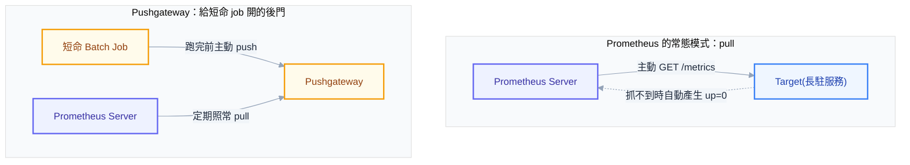
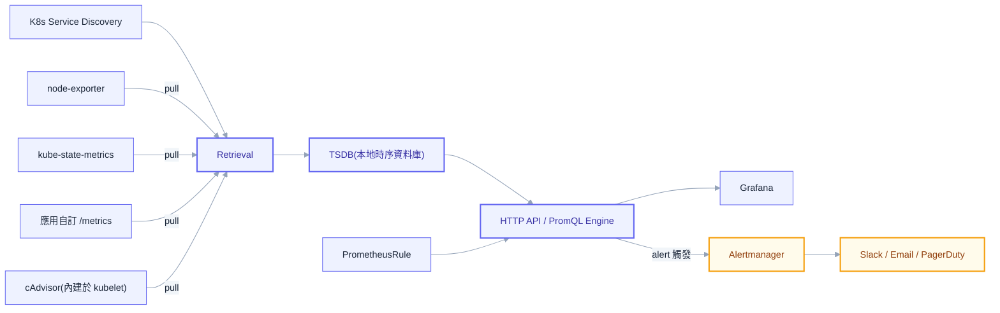
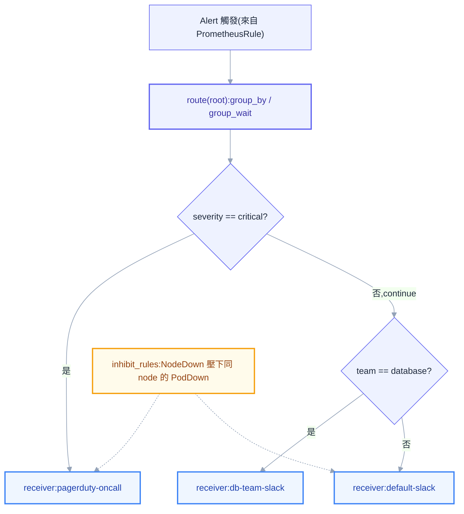
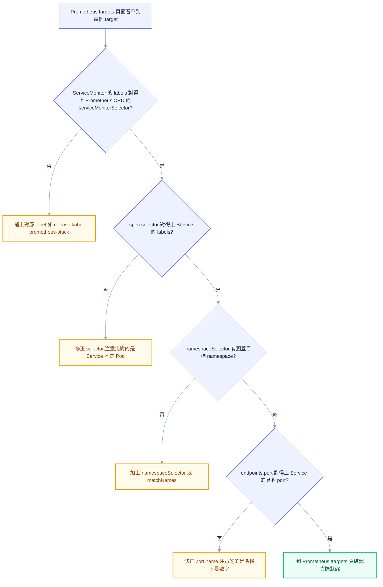

# 第十四章：Prometheus 與 Grafana

## 前言：從猜到有數據可查

第十三章講的疑難排解方法論，本質上是一種事後反應——同事敲門說「網站怪怪的」，你才開始一層一層往下查。但如果同事問的問題換一種形式：「這個服務為什麼比昨天慢？」「這個 Pod 上禮拜重啟了幾次？」「CPU limit 設多少才夠？」，`kubectl describe`、`kubectl logs` 這些工具就顯得力不從心了——它們給你的是「現在這一刻」的快照，而這些問題問的是趨勢、是歷史、是「跟過去比起來怎麼樣」。

這正是監控系統存在的理由。監控不是為了讓儀表板好看，而是為了讓管理員在被問到「為什麼」的時候，答案來自數據而不是直覺。一個沒有監控的叢集，管理員能做的只有猜測加上臨場補救；一個監控做得好的叢集，管理員在同事開口之前，告警就已經先響了，而且响起來的時候手上已經有一張圖表可以指出問題出在哪一層、從什麼時候開始惡化。這一章的目標，就是讓讀者具備設計監控、寫 PromQL、設告警、做 dashboard 這一整套能力。

## 可觀測性三支柱：什麼問題該用什麼工具回答

監控系統的世界有三種互補、但用途完全不同的資料型態，合稱可觀測性（observability）的三支柱：Metrics、Logs、Traces。分不清這三者的用途，最常見的後果是把不該塞進 Metrics 的東西硬塞進去，或者遇到問題不知道該去查哪一種資料。

Metrics 是數值型態的時間序列，例如「這一秒有幾個請求」「目前用了多少記憶體」。它的優勢是便宜——一個數字加上時間戳記，儲存成本遠低於一整段文字，因此可以用很高的頻率（例如每十五秒一次）長期保存，非常適合畫趨勢圖與設定告警閾值。它的代價是「粗」——Metrics 只告訴你「發生了規模多大的事」，不會告訴你「這一次請求具體發生了什麼」。

Logs 是事件的明細紀錄，一行 log 可能包含完整的錯誤堆疊、request body、SQL 陳述式。它的優勢是「細」，能回答「這一個特定的請求到底經歷了什麼」；代價是貴——文字量大、需要索引才能搜尋，長期保存一大堆 log 的儲存與運算成本遠高於 Metrics。當 Metrics 已經告訴你「錯誤率上升了」，真正想知道「錯誤訊息寫了什麼」，就得換到 Logs 這一層。下一章會接著處理這一塊，把散落在叢集各個容器裡的 log 集中起來搜尋與分析。

Traces 記錄的是一個請求跨越多個服務時，因果與時間上的完整路徑——使用者按下按鈕之後，請求先進了 API Gateway，再呼叫服務 A，服務 A 又呼叫服務 B 跟資料庫，每一段各花了多久、哪一段是瓶頸，Traces 都看得到。在微服務架構下，光靠 Metrics 只知道「服務 A 變慢了」，但沒辦法知道「服務 A 變慢是不是因為它呼叫的服務 B 卡住了」，這種跨服務的因果關係正是 Traces 存在的理由。

三者的分工可以濃縮成一句話記憶法：Metrics 告訴你「發生了什麼規模的問題」，Logs 告訴你「具體發生了什麼」，Traces 告訴你「問題出在調用鏈的哪一段」。本章專注在 Metrics 這一支柱，也就是 Prometheus 與 Grafana 的領域。

## Prometheus 的設計哲學：為什麼是 Pull，不是 Push

理解 Prometheus 之前，必須先理解它做了一個乍看反直覺的設計選擇：Prometheus server 是主動跑去問每個服務「你現在狀態如何」，而不是等服務自己把數據送過來。這種模式叫 pull-based scraping——Prometheus 定期（scrape interval，常見設定是十五秒或三十秒一次）對每個 target 發一次 HTTP GET 請求，打到它暴露出來的 `/metrics` 端點，把回應內容整批讀回來存進資料庫。



選擇 pull 而不是 push，有三個實際的理由。第一是服務發現天然整合——K8s API 本身就是一份動態的「現在有誰存在」清單，Prometheus 只要透過 service discovery 機制去問 K8s API，就能自動找出所有該抓取的 target，Pod 增減、重新調度都不需要手動更新設定。第二是應用端保持無狀態——應用只需要老實把自己的狀態攤在 `/metrics` 這個端點上供人查詢，完全不需要知道監控系統長什麼樣子、部署在哪裡；如果反過來讓應用主動 push，應用就多了一個「必須知道 Prometheus 位址」的外部依賴，這個依賴一旦變慢或不可用，可能反過來拖累應用本身。第三個理由最容易被忽略，卻是 pull 模型真正精妙的地方：target 的健康度本身就是一個指標。Prometheus 每次去抓一個 target，不管抓不抓得到，都會自動產生一個叫 `up` 的 metric——`up == 1` 代表這次抓取成功，`up == 0` 代表沒抓到。這是主動去問才會有的天然副產品：正因為是我去問的，問不到本身就是一個明確信號。Push 模型沒有這種天生的「不出聲就是死了」信號，因為系統永遠無法確定「它沒送資料」是因為它掛了，還是因為它剛好沒事發生所以沒送。

Pull 也有它的限制，最典型的是短命的 batch job。Prometheus 只在 scrape interval 那一刻去問，如果一個 Job 在兩次抓取之間就完整跑完然後消失了（例如一個 CronJob 三十秒就結束），Prometheus 根本來不及抓到它存在過。這種場景需要 Pushgateway 這個中介：短命 job 在結束前主動把最終結果 push 給 Pushgateway，Pushgateway 把這些值快取住，等 Prometheus 定期來抓 Pushgateway 時再讀走。要注意 Pushgateway 只是給 pull 模型開的一道後門，用來處理無法配合 pull 生命週期的場景，不該拿來給正常的長駐服務使用——因為那樣一來 `up` 這個指標永遠是 `1`（Pushgateway 本身一直都在），反而掩蓋了背後真正的服務是死是活。

## 架構全貌：抓誰、存哪、誰負責通知

看懂 pull 模型之後，Prometheus 的整體架構其實就是圍繞著「該抓誰」「抓來的資料存哪裡」「發現異常後通知誰」這三個問題展開。



Prometheus server 本身由三個部分組成：Retrieval 模組依照 service discovery 找到的 target 清單與 scrape 設定，定期發出抓取請求；TSDB（time series database）把抓回來的樣本以 append-only 的方式寫入本地磁碟並壓縮成 chunk；HTTP API 搭配 PromQL 查詢引擎則對外接受查詢，供 Grafana 或告警規則使用。這三者是同一個 process 裡的三個模組，不是三個獨立部署的服務。

真正暴露 `/metrics` 給 Prometheus 抓的對象叫 exporter，最常見的三種是 node-exporter（跑在每個 node 上的 DaemonSet，暴露宿主機的 CPU、記憶體、磁碟、網路使用量）、kube-state-metrics（把 K8s API 裡各種物件的狀態轉譯成 metrics）、以及應用自己用 Prometheus client library（Go、Java、Python 都有對應套件）埋進程式碼裡的自訂 metrics。Alertmanager 是獨立於 Prometheus 之外的元件，Prometheus 本身只負責依照告警規則算出「現在符合告警條件」，實際「要通知誰、怎麼合併、要不要暫時抑制」這些決策完全交給 Alertmanager 處理。

### 三個最常被混為一談的名字：cAdvisor、kube-state-metrics、metrics-server

這三者的名字都跟「取得叢集裡的數字」有關，也因此是新手最容易混淆、老手也偶爾會講錯的地方。使用者自己在 minikube 上就踩過相關的坑——啟用 `metrics-server` 之後，`kubectl top` 回報「Metrics API not available」，原因是 minikube 底下 kubelet 用的是自簽憑證，metrics-server 預設會驗證 TLS，驗證失敗就直接連不上，需要幫 metrics-server 的 Deployment 加上 `--kubelet-insecure-tls` 這個參數跳過驗證（正式環境應該處理好憑證鏈，而不是長期跳過驗證）。這個坑很適合拿來釐清一件事：**metrics-server 跟 Prometheus 完全是兩回事**，很多人以為裝了 metrics-server 就等於有監控系統了，其實不然。

metrics-server 的存在理由只有一個：服務 `kubectl top` 這個指令與 HPA（HorizontalPodAutoscaler）。它定期跟每個 node 的 kubelet 要一份「現在這一刻」的資源用量快照，刻意做成輕量、無狀態——它完全不存歷史，Pod 重啟一次，過去的用量數字就全部消失，因為 HPA 要做的決策只需要「現在」這個瞬間的數字，不需要歷史趨勢。

cAdvisor（Container Advisor）其實是內嵌在 kubelet 裡面的一個子模組，它才是「這個容器實際用了多少 CPU、記憶體、網路、磁碟 I/O」這個問題最原始的資料來源，靠讀取 cgroups 拿到數字。cAdvisor 自己會在 kubelet 的 `/metrics/cadvisor` 端點上，用 Prometheus 格式暴露這些資料，metric 名稱通常以 `container_` 開頭，例如 `container_cpu_usage_seconds_total`、`container_memory_working_set_bytes`。metrics-server 給 `kubectl top` 看到的數字，源頭其實也是從 kubelet（背後就是 cAdvisor）讀出來的，只是包裝成了一個無歷史的即時快照 API；Prometheus 則是直接去抓 cAdvisor 暴露的完整 metrics，把歷史留下來，才能畫圖、算 P95、設告警。

kube-state-metrics 盯的完全是另一個維度——它不碰資源使用量，它盯的是 K8s API server 裡每個物件「宣告的狀態」跟「觀察到的狀態」對不對得起來。舉例來說，一個 Deployment 宣告 `replicas=3`，kube-state-metrics 會同時告訴你 `kube_deployment_spec_replicas`（宣告值）跟 `kube_deployment_status_replicas`（實際值），兩者對不上就代表有 Pod 沒排起來。它也涵蓋 Pod 的 phase、PVC 物件本身的容量狀態（不是磁碟實際用量）、Node 的可分配資源、Job 的完成數量。

一句話記憶法：cAdvisor 看的是「容器吃了多少資源」，kube-state-metrics 看的是「K8s 物件現在長什麼樣子」，metrics-server 則是把 cAdvisor 的資源數字包裝成一個給 HPA 與 `kubectl top` 用的即時 API，故意不留歷史。三者經常同時部署在同一個叢集裡各司其職，缺了任何一個，都會有一整類問題完全看不到。

| 元件 | 資料來源 | 存不存歷史 | 主要用途 |
| --- | --- | --- | --- |
| cAdvisor | 容器 cgroups（內嵌於 kubelet） | 否（原始數據由 Prometheus 抓走存歷史） | 容器 CPU / 記憶體 / 網路 / I/O 使用量 |
| kube-state-metrics | K8s API server | 否（同上，由 Prometheus 抓走存歷史） | K8s 物件宣告狀態 vs 實際狀態 |
| metrics-server | kubelet（即時快照） | 否，且不對外提供歷史查詢 | `kubectl top`、HPA 決策 |

## 資料模型：Metric Name 加 Label，以及 Cardinality 這顆地雷

Prometheus 裡每一條時間序列（time series），都是由一個 metric name 加上一組 label 組合唯一決定的。例如 `http_requests_total{method="GET", status="200", handler="/api/users"}` 跟 `http_requests_total{method="POST", status="200", handler="/api/users"}` 是兩條完全獨立的序列，即使它們共用同一個 metric name。Prometheus 內部會為每一種不同的 label 組合各自開一條獨立的序列存起來，這代表每多一個 label、每多一種這個 label 可能出現的值，序列數量就以近似乘法的方式往上疊。

這種序列數量的規模稱為 cardinality（基數）。舉一個真實會讓人中招的例子：如果在 `http_requests_total` 上加了一個叫 `user_id` 的 label，而系統有十萬個使用者，等於憑空多出十萬條獨立序列，而且這十萬條還會跟原本的 `method`、`status`、`handler` 交叉組合，序列數量呈爆炸式成長。這是壓垮 Prometheus 最常見的第一名原因——TSDB 的記憶體與磁碟用量跟 active series 數量幾乎是線性關係，序列數量一旦失控，Prometheus 就會被自己撐爆而 OOM，整套監控系統死掉，諷刺的是「用來監控別人死活的系統，自己先掛了」。

這裡有一條該記住的鐵律：**不要把 user id、request id、session id，或是理論上沒有上限的完整 URL path（帶 query string）這種高基數的值塞進 label**。這些東西該去的地方是 Logs，不是 Metrics——這正好呼應前面可觀測性三支柱那一節的分工：明細與身份用 Logs 記錄，聚合與趨勢才交給 Metrics。

## 四種 Metric 類型：Counter、Gauge、Histogram、Summary

Prometheus 的每一條時間序列都屬於四種類型之一，選錯類型會讓後面的 PromQL 查詢完全寫不出想要的答案。

Counter 是只增不減的計數器，重啟時會歸零重新累積，典型例子是 `http_requests_total`（累積至今總共處理過幾個請求）。把 Counter 直接畫成圖，你只會看到一條無聊的斜線往右上爬，因為它記的是「總共發生了幾次」，而你真正想知道的通常是「現在每秒發生幾次」——這正是後面 PromQL 章節裡 `rate()` 的工作，Counter 幾乎沒有例外都需要包上 `rate()` 才有實際意義，原因會在下一節詳細展開。

Gauge 是可增可減的量測值，代表「當下的狀態」，例如 `node_memory_MemAvailable_bytes`（目前可用記憶體）、目前的 Pod 數量、當下溫度。Gauge 可以直接看瞬時值，也可以用 `avg_over_time()` 之類的函數看一段時間內的平均。

Histogram 把觀測值分桶（bucket）做累積計數。客戶端（也就是應用程式本身）只需要事先決定好幾個桶的邊界（例如 0.1 秒、0.5 秒、1 秒、5 秒），每次觀測到一個值，就把「所有大於等於這個值的桶」計數都加一——這是一種累積分布。Prometheus 會自動幫每個 Histogram metric 產生三種序列：`_bucket{le="..."}`（每個桶的累積計數，`le` 是 less-than-or-equal 的縮寫）、`_sum`（所有觀測值的加總）、`_count`（觀測次數）。因為原始的桶資料完整保留在 Prometheus 這一側，查詢當下可以用 `histogram_quantile()` 算出任意分位數，也可以把多個 instance 的 Histogram 直接加總起來，算出一個全叢集的整體分位數——這種「桶計數可以互相相加」的特性，正是 Histogram 可以跨實例聚合的關鍵。

Summary 則是客戶端 library 自己在本地先把分位數（例如 P50、P95、P99）算好，Prometheus 這一側直接讀到算好的結果。這樣做看似省事，但代價是**不可跨實例聚合**——分位數本質上不是可以相加的統計量，十台機器各自算出的 P95，沒有任何數學方法可以把它們合併還原成「這十台機器整體的 P95」，因為分位數的計算過程已經丟失了原始的完整分布資訊。這是 Histogram 與 Summary 之間最關鍵的差別：只要服務有多個 replica，幾乎總是該選 Histogram，除非你確定這個指標永遠只需要看單一實例的視角，Summary 才是合理選擇。

## PromQL：真正把監控數據問出答案的地方

前面幾節建立的是「資料怎麼被收集、怎麼被存」的心智模型，這一節開始要處理的是「怎麼把資料問出答案」——PromQL 是 Prometheus 的查詢語言，也是這整個系統裡最需要花時間練習的部分，因為同一份資料，寫對跟寫錯往往連語法都不會報錯，只是算出來的數字是垃圾。

### Instant Vector 與 Range Vector

直接查詢一個 metric name，例如 `http_requests_total`，得到的是 instant vector——在某一個時間點上，每一條符合條件的序列各自的最新值。這種查詢可以直接畫成圖或看數字。

如果在 metric 後面加上中括號寫一段時間長度，例如 `http_requests_total[5m]`，得到的是 range vector——過去五分鐘內，這條序列所有被抓到的樣本點，是一整串帶著時間戳記的數列，而不是單一個值。range vector 不能直接畫圖，也不能直接看數字，它是原始素材，必須交給 `rate()`、`increase()` 這類函數進一步運算，直接把一個 range vector 丟進 Grafana 通常只會得到錯誤或空白畫面。

### Selector 與 Label Matcher

```promql
up
up{job="node-exporter"}
http_requests_total{status!="200"}
http_requests_total{handler=~"/api/.*"}
http_requests_total{handler!~"/health|/ready"}
```

`=` 是精確匹配，`!=` 是不等於，`=~` 是正則匹配（regex match），`!~` 是正則不匹配。`!~"/health|/ready"` 這種寫法在實務上很常用來排除健康檢查端點——這些端點呼叫頻率極高，如果不排除掉，會在計算整體 QPS 或延遲分布時被稀釋，看不出真正業務流量的樣貌。

### `rate()`、`irate()`、`increase()`：三者的差別與為什麼 Counter 一定要包 `rate()`

Counter 一定要包 `rate()` 的根本原因，是 Counter reset 的問題——Pod 重啟後 Counter 會歸零重新累積，如果直接看原始 Counter 數字畫成的曲線，Pod 一重啟，數字會瞬間從很大掉回接近零，看起來像是流量瞬間崩盤，但實際上只是重啟。`rate()` 函數聰明的地方在於，它偵測到數值不合理地下降時，會自動判定這是一次 counter reset，用「reset 前的最後一個值視為已消耗掉的量」去修正計算，不會讓一次重啟污染整條速率曲線。

```promql
rate(http_requests_total[5m])
```

`rate()` 計算的是過去五分鐘內平均每秒的增長率，它會對區間內所有樣本點做類似線性回歸的平均，結果比較平滑，適合用在告警條件或低頻指標——如果窗口太短、樣本點不夠，算出來的速率容易失真或出現極端值。

```promql
irate(http_requests_total[5m])
```

`irate()` 是 instant rate，只用區間內**最後兩個**樣本點算出瞬時速率，對突然的尖峰非常敏感，能反映出「最近這一瞬間」發生的變化。但拿它畫長時間趨勢圖，會因為過度敏感而變得鋸齒狀、難以閱讀，也不適合寫進 alerting rule——因為它只看最後兩個點，容易因為單一次抖動就誤觸發，也容易因為抖動剛好落在兩次抓取之間而漏掉真正該抓的持續性異常。經驗法則：畫圖看細節尖峰、除錯單一事件用 `irate`；寫告警條件、看長期趨勢用 `rate`。

```promql
increase(http_requests_total[5m])
```

`increase()` 等同於 `rate()` 乘上區間秒數，回傳的是「這段時間內總共增加了多少」，而不是「平均每秒增加多少」，同樣具備 reset 偵測能力。常用在「過去一小時總共發生幾次錯誤」這種以次數為單位的報表或告警場景，而不是「每秒幾次」這種速率場景。

### 聚合運算子與 `by` / `without`

`sum()`、`avg()`、`max()`、`min()`、`count()`、`topk(n, ...)`、`bottomk(n, ...)` 是最常用的一批聚合函數。`by (label1, label2)` 只保留列出的 label 維度做分組，其餘 label 被丟棄；`without (label1)` 則相反，除了列出的 label 以外全部保留作為分組維度。

```promql
sum(rate(http_requests_total[5m])) by (status)

topk(5, sum(rate(container_cpu_usage_seconds_total[5m])) by (pod))
```

第一行依照 status code 分組，算出每個 status code 目前每秒有幾個 request，適合看錯誤佔比；第二行找出目前 CPU 使用率前五名的 Pod，是日常抓資源大戶最實用的一行查詢。

### `histogram_quantile()`：算 P95/P99 的正確寫法

```promql
histogram_quantile(0.95, sum(rate(http_request_duration_seconds_bucket[5m])) by (le))
```

這裡 `by (le)` 絕對不能漏。`histogram_quantile()` 需要知道每個桶邊界（`le` 這個 label，也就是 less-than-or-equal）對應的累積計數，才能用線性插值法反推出分位數所在的位置。如果聚合時不小心把 `le` 這個 label 也丟掉——例如少寫成 `sum(rate(...[5m]))` 而沒有 `by (le)`——所有桶會被通通加總成一條序列，讓 `histogram_quantile()` 完全失去分桶資訊，算出來的結果不是報錯就是一個沒有意義的數字。這是新手寫 Histogram 查詢最常犯、也最難自己發現的錯誤，因為語法完全合法，只是答案是錯的。如果還想再依照其他維度分開算（例如按 service 分開算 P95）：

```promql
histogram_quantile(0.95, sum(rate(http_request_duration_seconds_bucket[5m])) by (le, service))
```

`le` 永遠要留著，其他想切的維度往後加即可。

### 陷阱：`sum(rate(...))` 與 `rate(sum(...))` 順序不能顛倒

```promql
sum(rate(http_requests_total[5m])) by (service)
```

正確的順序是先對每一條序列（每個 instance/Pod 各自）算出 `rate`，再把這些速率加總起來，得到「這個 service 整體現在每秒有幾個 request」，這才是符合直覺的答案。如果順序顛倒——先把多個 instance 的原始 Counter 加總，再對加總後的結果算 `rate`——問題就出現了：任何一個 instance 重啟歸零，都會讓這個「加總後的 Counter」在某個時間點憑空產生一次斷崖式下跌。`rate()` 的 counter reset 偵測機制是設計給單一序列使用的，一旦把多個 instance 的數字先混在一起加總，`rate()` 已經無法正確判斷這究竟是某個 instance 重啟，還是真的整體流量下降，算出來的速率會被污染出錯誤的骤降或骤升。這個錯誤在資料量小、instance 很少重啟的情況下可能完全看不出來，等到正式環境流量變大、Pod 因為 HPA 或滾動更新而常態性重啟時才會浮現，非常隱蔽。記憶口訣：**先 rate、再 sum**，順序反過來就會出錯。

### Offset 與子查詢

```promql
http_requests_total[5m] offset 1d
```

`offset 1d` 查詢的是「一天前的同一個五分鐘窗口」，常用於跟昨天同一時段比較，判斷「現在這個時間點的流量是不是異常」。

子查詢（subquery）讓你可以對一個已經聚合過的 instant vector 再取一段時間的 range，語法是在後面加上 `[<range>:<resolution>]`：

```promql
max_over_time(sum(rate(http_requests_total[5m]))[1h:1m])
```

這一行先算出每分鐘的「整體 request rate」，再對過去一小時內這些每分鐘的值取最大值，用來抓「過去一小時內的瞬間高峰」，而不只是「過去一小時的平均」。子查詢的運算成本較高，不建議大量用在常態 dashboard，比較適合臨時調查，或者預先寫進 recording rule 裡算好。

## Recording Rules 與 Alerting Rules

Recording rule 的用途是把常用又昂貴的查詢（例如前面那種要掃過大量 bucket 資料的 `histogram_quantile`）預先算好，定期存成一條新的時間序列，之後 dashboard 或告警直接查這條「預算好」的結果，不必每次重新掃一次原始資料，能明顯減輕 Prometheus 的查詢負擔，尤其是在同一個 dashboard 被多人同時打開、或者告警規則每十五秒就要重新評估一次的情況下。

```yaml
groups:
  - name: api-slo
    rules:
      - record: job:http_request_duration_seconds:p95
        expr: |
          histogram_quantile(0.95, sum(rate(http_request_duration_seconds_bucket[5m])) by (le, job))
```

命名慣例是 `level:metric:operation`，例如 `job:http_request_duration_seconds:p95`，一看名字就知道這是依 job 聚合、對 `http_request_duration_seconds` 算 P95 的結果。

```yaml
groups:
  - name: api-alerts
    rules:
      - alert: HighErrorRate
        expr: |
          sum(rate(http_requests_total{status=~"5.."}[5m])) by (service)
          /
          sum(rate(http_requests_total[5m])) by (service)
          > 0.05
        for: 10m
        labels:
          severity: warning
        annotations:
          summary: "{{ $labels.service }} 錯誤率超過 5%"
          description: "過去 10 分鐘 5xx 錯誤率持續高於 5%，目前為 {{ $value | humanizePercentage }}"
```

`for: 10m` 的作用是避免抖動（flapping）——條件符合的瞬間不會立刻發出告警，要連續滿足十分鐘才真正觸發，用來過濾那種「錯誤率瞬間飆高一下又馬上恢復」的雜訊。沒有 `for` 的告警會因為一次性抖動就瘋狂發送又立刻 resolve，讓收告警的人逐漸對告警系統失去信任（alert fatigue）——這跟第十三章提過的 `CrashLoopBackOff` 退避機制精神相通，都是「給系統一點時間自己恢復，別在瞬間抖動時就大驚小怪」。`labels` 會被帶到 Alertmanager 用來做路由判斷，`annotations` 則是給人看的說明文字，`{{ $labels.xxx }}` 與 `{{ $value }}` 是 Prometheus 的樣板語法，能把觸發當下的實際 label 值與算出來的數字動態插入通知內容。

## Alertmanager：告警觸發之後，誰決定怎麼送

Alertmanager 不負責判斷「要不要告警」，那是 alerting rule 的工作；它負責的是「已經觸發的告警要怎麼送、送給誰、什麼時候送、要不要先合併或壓下」。



Alertmanager 把所有進來的告警丟進一棵路由樹（route tree）做判斷，每個節點可以設定 `match`（或 `match_re`）條件，符合條件的告警會走進這個節點底下；預設情況下，一旦匹配到某個節點就會停止繼續比對其他兄弟節點，但可以加上 `continue: true` 讓告警即使匹配了也繼續往下一個節點比對。

```yaml
route:
  receiver: default-slack
  group_by: ["alertname", "service"]
  group_wait: 30s
  group_interval: 5m
  repeat_interval: 4h
  routes:
    - match:
        severity: critical
      receiver: pagerduty-oncall
      continue: true
    - match:
        team: database
      receiver: db-team-slack
```

`group_by` 決定哪些告警該被合併成一則通知——例如十個 Pod 同時因為同一個後端資源出問題而觸發一模一樣的 `alertname` 與 `service`，不需要收到十則一模一樣的通知，合併成一則列出十個 instance 反而更好讀。`group_wait` 是「這一組第一個告警進來後，先等這麼久看還有沒有同伙一起來，再一次送出」，避免同一個事件在幾秒內觸發好幾個告警卻被拆成好幾則通知。`group_interval` 是同一組已經發過一次之後，如果又有新成員加入，要再等多久才發下一次更新。`repeat_interval` 是告警持續沒有 resolve 時，間隔多久重複提醒一次，避免值班人員以為已經處理過就不再理會。

抑制（`inhibit_rules`）是另一個重要機制，處理「上游先壞，下游一定跟著壞」這種因果關係明確的場景：

```yaml
inhibit_rules:
  - source_match:
      alertname: NodeDown
    target_match:
      alertname: PodDown
    equal: ["node"]
```

意思是如果 `NodeDown` 已經觸發，那麼所有 `equal` 列出的 label（這裡是 `node`）相同的 `PodDown` 告警就會被自動壓下不發送——邏輯很直覺：node 都已經死了，上面的 Pod 當然全部連不上，再收到十幾則 `PodDown` 通知只是雜訊，真正該處理的是 node 本身。這跟第十三章強調的「分層定位、先問最底層」是同一種思路，抑制規則只是把這個診斷順序直接編碼進了告警系統裡。靜默（silence）則是運維手動操作，用於計劃性維護窗口（例如要重啟某個 node 做升級，先手動設一個 silence 讓維護期間的告警不要打擾任何人）——跟抑制不同的地方在於，靜默是人手動設定的臨時豁免，抑制則是規則常態運行、自動依因果關係壓制。Receiver 就是告警最終送達的地方，Slack webhook、Email、PagerDuty、企業內部 Webhook API 都算 receiver，一個告警最終會走到路由樹上匹配到的那個 receiver。

## K8s 部署方式：kube-prometheus-stack 與 Prometheus Operator 的 CRD

在裸機或 VM 上裝 Prometheus，通常得自己維護一份很長的 scrape config，列出每個要抓的 target。但在 K8s 裡，Pod 會不斷新增、刪除、重新調度，如果每次都要手動改 scrape config 再重啟 Prometheus，完全違背 K8s 宣告式、自動化的精神——這正是第九章講過的 Operator pattern 再度出現的地方。Prometheus Operator 把「怎麼抓取」變成幾個 CRD，讓開發團隊在自己的 namespace 裡宣告「我這個 Service 要被監控」，Operator 會自動把這些宣告翻譯成真正的 scrape config 並熱重載進 Prometheus。

`kube-prometheus-stack` 是目前最主流的 Helm chart，一次裝好 Prometheus Operator、Prometheus 本身、Alertmanager、Grafana、node-exporter、kube-state-metrics，以及一整包預先寫好的 dashboard 與 alerting rule，是幾乎所有團隊在 K8s 上導入監控的起手式，不建議自己從零手動組裝每一個元件。

四個核心 CRD 各自的角色是：`Prometheus` 宣告「我要一個什麼樣的 Prometheus 實例」，包括透過 label selector 挑選哪些 `ServiceMonitor` / `PodMonitor` / `PrometheusRule` 要被它採用、retention 設多久、資源限制等，Operator 看到這個 CRD 就會產生對應的 StatefulSet 部署真正的 Prometheus；`ServiceMonitor` 宣告「哪些 Service 背後的 Pod 要被抓取」，透過 label selector 選中 Service，再指定要抓 Service 底下哪個具名 port；`PodMonitor` 跟 `ServiceMonitor` 類似，差別是直接透過 label selector 選中 Pod 本身，不必經過 Service 這一層，適合那些沒有對應 Service、只需要暴露 metrics 的 daemon；`PrometheusRule` 宣告 recording rule 與 alerting rule 的內容，取代直接寫 rule 檔案掛載進 Prometheus 容器的舊做法。

```yaml
apiVersion: monitoring.coreos.com/v1
kind: ServiceMonitor
metadata:
  name: my-app
  namespace: my-app
  labels:
    release: kube-prometheus-stack
spec:
  selector:
    matchLabels:
      app: my-app
  namespaceSelector:
    matchNames:
      - my-app
  endpoints:
    - port: metrics
      interval: 30s
      path: /metrics
```

`ServiceMonitor` 抓不到 target，是幾乎每個團隊第一次接觸 Operator 都會踩的坑，排查流程依序是：



第一步檢查 `ServiceMonitor` 的 `labels` 有沒有對上 `Prometheus` CRD 裡的 `serviceMonitorSelector`——多數 `kube-prometheus-stack` 預設只認自己安裝時打上的 release label，自己新建的 `ServiceMonitor` 如果沒打這個 label，Operator 根本不會把它納入考慮。第二步確認 `spec.selector.matchLabels` 對得上目標 Service 的 labels，而不是 Pod 的 labels——`ServiceMonitor` 選的對象是 Service，不是 Pod 本身，這是很容易搞混的一點。第三步確認 `spec.namespaceSelector` 有沒有涵蓋到目標 Service 所在的 namespace，預設只看自己所在的 namespace，跨 namespace 需要額外宣告。第四步、也是最容易忽略的一步：`endpoints[].port` 吃的是 **Service 裡具名的 port 名稱**，不是數字 port 號——如果 Service 定義的 port 沒有給名字，或者名字跟 `ServiceMonitor` 裡寫的對不上，會完全抓不到，這一點特別容易被忽略，因為容器的 `containerPort` 跟 Service 的 `port` 數字對得上時，人很容易忘記 port name 這一層還要再對一次。最後一步到 Prometheus 自己的 `/targets` 頁面確認這個 target 到底有沒有出現、狀態是 `up` 還是帶著錯誤訊息，這一步能直接看到 Prometheus 這一側收集到的診斷線索，比盲猜前面四步哪裡錯更快。

## 該監控什麼：USE 與 RED 方法論

面對一個全新的服務，「到底該埋哪些指標」是新手最常卡住的地方。這裡有兩套互補的經驗法則，一套看資源、一套看服務本身。

USE method 用於資源類別的監控對象，例如 node、CPU、磁碟、網路：Utilization（這個資源目前用掉多少比例）、Saturation（這個資源有多少排隊中或等待中的額外工作，代表資源已經不夠用而開始塞車）、Errors（這個資源層級本身發生了多少錯誤，例如磁碟 I/O error）。

RED method 用於對外提供請求回應的服務：Rate（每秒處理多少請求）、Errors（這些請求裡有多少比例失敗）、Duration（這些請求花了多久，通常關心的是分布而非平均值，這就是為什麼要用前面講的 Histogram 與 `histogram_quantile`）。

兩套方法論合起來看，一個健康叢集的儀表板至少要涵蓋：每個 node 的 CPU / 記憶體 / 磁碟使用率與飽和度（USE）、每個關鍵服務的 QPS / 錯誤率 / 延遲分布（RED）、Pod 重啟次數（`kube_pod_container_status_restarts_total` 異常飆升代表有東西在 CrashLoop）、PVC 使用率（容量快滿會造成應用寫入失敗，這是很多團隊唯一沒設告警、結果半夜被叫醒的項目）、API server 延遲（`apiserver_request_duration_seconds`，control plane 本身變慢會拖慢整個叢集的調度與部署速度）、etcd 健康狀況（`etcd_server_has_leader`、`etcd_disk_wal_fsync_duration_seconds`，etcd 是整個叢集狀態唯一的真相來源，它出問題的嚴重性高於任何單一應用）、以及憑證到期時間（`certmanager_certificate_expiration_timestamp_seconds`，忘記輪替會讓整個叢集突然停擺，這類「很少發生但一發生就是大事」的項目特別適合設成一條提前數週就會響的獨立告警）。

這裡也正好呼應第七章討論過的 resources / QoS / CPU throttling——當時是從 `kubectl describe` 的靜態角度看 requests/limits 怎麼決定 QoS Class，現在有了 Prometheus，可以直接用 PromQL 把「這個 Pod 到底有沒有在被 throttle」量化成一條時序線：

```promql
rate(container_cpu_cfs_throttled_seconds_total{pod="my-app-xxx"}[5m])
```

這條線只要大於零，就代表這個 Pod 的 CPU limit 設得比實際需求低，容器已經被 cgroups 強制限速——這比「服務感覺變慢」這種模糊的抱怨精確得多，能直接拿數字去跟設定 limit 的人對話。類似地，`OOMKilled`（第十三章 Pod 狀態機提過）也能提前在真正被殺掉之前，從記憶體使用率逼近 limit 的趨勢線上看出來：

```promql
container_memory_working_set_bytes{pod="my-app-xxx"} / container_spec_memory_limit_bytes{pod="my-app-xxx"}
```

這個比值持續逼近 1，就是「這個 Pod 快要被 OOMKill」的前兆信號，比等到真的被殺掉、進 `CrashLoopBackOff` 才用 `kubectl describe` 回頭確認要提前得多。

## Grafana：把 PromQL 的答案畫成人看得懂的圖

Prometheus 自己內建的 Expression Browser只適合臨時下 query 驗證，長期給人看的儀表板要交給 Grafana。Grafana 本身不存資料，它是一層可視化與查詢編排介面，透過 datasource 連去 Prometheus（或其他後端如 Loki、Elasticsearch），把 PromQL 的查詢結果畫成圖表。

Datasource 設定只需要指向 Prometheus 的 HTTP API 位址（例如 `http://kube-prometheus-stack-prometheus.monitoring:9090`），一個 Grafana 可以同時接多個 datasource，甚至同一張 dashboard 底下不同 panel 可以查詢不同來源的資料。Dashboard 由多個 panel 組成，每個 panel 對應一條或多條查詢，加上一種視覺呈現方式——時序線圖、熱力圖、單一數值卡片、表格都是常見選擇。

Variable 與 templating 是讓一張 dashboard 能重複套用在多個對象上的關鍵功能。舉例來說，在 dashboard 設定裡新增一個變數 `$namespace`，其查詢設成：

```promql
label_values(kube_pod_info, namespace)
```

`label_values()` 不是給 PromQL 引擎算圖表用的函數，而是 Grafana 自己模板變數專用的語法，意思是「去抓這個 metric 底下 namespace 這個 label 出現過的所有不重複值」，Grafana 會把這些值變成 dashboard 右上角的一個下拉選單，使用者選了某個 namespace 之後，所有引用 `$namespace` 的 panel 查詢會自動帶入這個篩選條件，同一張 dashboard 不用為每個 namespace 各做一份。Repeat panel 則是讓同一個 panel 模板依照某個變數（例如 `$pod`）的每一個值自動重複畫出多份——一次看到該 namespace 底下每個 Pod 各自的 CPU 曲線，不用手動為每個 Pod 複製一次 panel。

Grafana 本身也能設定 alerting（較新版本內建 unified alerting），但多數成熟團隊還是習慣把告警邏輯留在 Prometheus 的 `PrometheusRule` 裡，讓 Grafana 單純負責視覺呈現，避免告警邏輯分散在兩個地方難以維護。

Provisioning 是配合 GitOps 工作流程特別重要的一塊——不透過手動在 Grafana 網頁介面點選存檔，而是把 dashboard 的 JSON 定義、datasource 設定都寫成檔案，存進 git repo，讓 ArgoCD（呼應前面 GitOps 章節提過的工作流）把這些檔案同步進 Grafana 的 provisioning 目錄，Grafana 啟動或偵測到檔案變化時自動載入。這樣一來 dashboard 本身也變成「dashboard as code」——可以 code review、可以回溯歷史，不會因為某人手滑在網頁上亂改而沒人知道是誰改的。`kube-prometheus-stack` 的 Helm chart 對這塊也有原生支援，可以直接把 dashboard JSON 放進 ConfigMap，用特定 label 讓 Grafana 自動掛載。

## 儲存與規模：為什麼 Prometheus 不是萬能藥

Prometheus 的 TSDB 預設 retention（保留期限）通常是十五天，可以透過 `--storage.tsdb.retention.time` 調整，但這不代表調大這個數字就能無限延伸——Prometheus 從設計之初就是單機（single binary）架構，所有資料都存在本地磁碟，沒有原生的高可用（HA）或水平擴展機制。這跟本章一路強調的「Prometheus 擅長做什麼」是一體兩面：它把架構做得簡單、可靠、自給自足（不依賴外部資料庫），代價就是長期儲存與跨機房高可用這兩件事，從來不在它的設計目標裡。

如果只是單純想多留幾個月的歷史資料以便季度檢討，最直接但也最脆弱的做法是硬調大 retention 再掛更大的磁碟——脆弱在於這台機器本身沒有備援，一旦它掛了，這幾個月的歷史全部消失，而且隨著資料量變大，單機查詢長時間 range 的效能會持續劣化。

`remote_write` 是 Prometheus 內建、專門為了解決這個限制而設計的機制——讓 Prometheus 在本地照常運作（本地依然保留短期資料用於告警評估與近期查詢）的同時，把抓到的樣本即時轉發一份到遠端的長期儲存系統，讀寫關注點因此被拆開：Prometheus 自己專心做「抓取 + 短期查詢 + 告警」，長期儲存與跨叢集聚合交給專門為此設計的系統。

Thanos 與 Mimir、VictoriaMetrics 就是這類專門系統的代表，它們的定位不是取代 Prometheus，而是在多個 Prometheus 實例（例如多個叢集各自一個 Prometheus）之上再疊一層，提供全域查詢視圖（一次查所有叢集的資料，不用一個一個連過去）、長期儲存（通常接到物件儲存如 S3 / GCS，理論上可以留無限久）、以及去重（deduplication，常見做法是同一份 Prometheus 部署兩個 replica 做 HA，靠上層系統對重複資料去重，而不是靠 Prometheus 自己做 HA）。三者之間的差異主要在架構複雜度與維運成本：Thanos 元件較多（Sidecar、Store Gateway、Compactor、Query 等各自獨立部署）但生態成熟；Mimir 與 VictoriaMetrics 則朝「更少元件、更容易上手」的方向設計，適合不想維護一整套微服務化監控基礎設施的團隊。選型細節超出本章範圍，這裡只需要建立正確的心智模型：**單一 Prometheus 實例負責的是「新鮮」資料與告警評估，長期歸檔與跨叢集視圖是另一層專門系統的責任，不要期待一套 Prometheus 包辦所有時間尺度的需求**。

## 常見誤解，以及同事會來問你的問題

Prometheus 不是日誌系統——它存的是數值型時間序列，不是拿來存一大段文字的錯誤堆疊或 debug 輸出。想查「這個請求到底發生了什麼」該去查 Logs（下一章談的正是這一塊），不要試圖把整段錯誤訊息塞進 Prometheus 的 label 裡，那樣做會直接撞上前面講過的 cardinality 爆炸問題。

`up == 0` 不代表服務真的死了，它只代表「這次 scrape 沒有成功抓到回應」——可能是網路瞬斷、target 正在重啟、scrape 本身逾時，也可能是 Prometheus 自己資源不夠導致抓取跟不上。看到 `up == 0` 該做的第一件事是去查這個 target 實際的健康狀態（例如 `kubectl get pod` 看它是不是真的在跑），而不是直接假設服務已經宕機就發最高等級的告警。

指標一定有延遲，延遲的下限就是 scrape interval——如果設十五秒抓一次，代表看到的任何數字最新也是十五秒前的狀態，不可能拿 Prometheus 的圖表去做毫秒級的即時判斷，這也是為什麼真正需要極低延遲反應的場景（例如自動交易熔斷）不會只依賴 Prometheus。

同事最常來問的問題大概長這樣：「為什麼這個告警半夜跳了又自己好了？」（多半是沒設 `for` 或 `for` 設太短導致抖動）；「為什麼 Grafana 這張圖是空的？」（先查 datasource 連線，再查 PromQL 語法本身是不是打錯了 metric name 或 label，常見是大小寫或底線打錯）；「為什麼 P99 看起來比 P95 還低？」（幾乎肯定是 `histogram_quantile` 忘記 `by (le)`，把不同分桶的資料混在一起算出不合理的結果）；「CPU limit 設多少才夠？」（帶他去看 `container_cpu_cfs_throttled_seconds_total` 的實際資料，而不是憑感覺猜一個數字）。

## 結語，也是下一章的開始

本章建立的監控體系，回答的始終是「數值上發生了什麼」——CPU 飆高、錯誤率上升、P99 延遲變長，這些都是「是什麼」層級的信號。想知道「為什麼」、想看到某一個具體請求在系統裡到底經過了哪些環節、卡在哪一步、印出了什麼錯誤細節，需要的是可觀測性另外兩支柱：Logs 與 Traces。下一章會接著處理 Logs 這一塊，把集中散落在叢集各處容器裡的 log 集中起來搜尋與分析，這正是 Metrics 無法取代的能力，兩者搭配才是完整的可觀測性拼圖。

## 連結

- [[k8s-mastery]]
- [[15-elk-elastic]]
- [[07-scheduling-and-resources]]
- [[09-extending-kubernetes]]
- [[13-troubleshooting]]
- [[kubernetes]]
