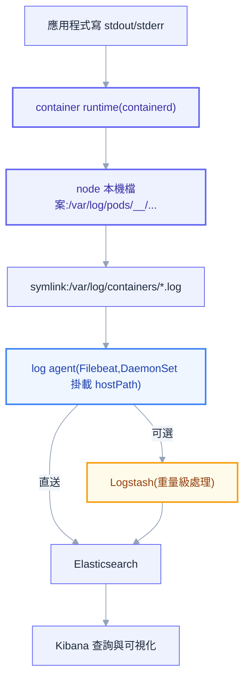
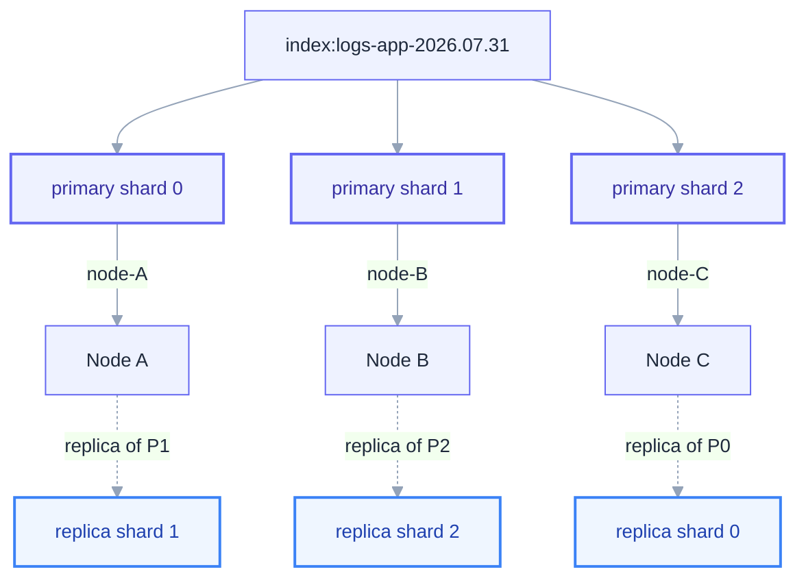
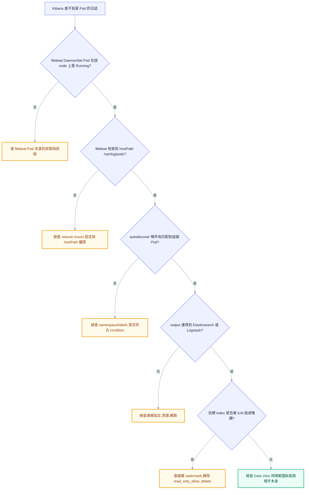

# 第十五章：ELK / Elastic Stack 集中式日誌

## 前言：Metrics 答不出來的那句話

第十四章建立的監控體系，能告訴你「錯誤率上升了」「P99 延遲變長了」，但當同事追問下一句「這個錯誤具體是什麼時候開始的、影響了哪些使用者、錯誤訊息寫了什麼」，Prometheus 整套系統會突然啞口無言——它從設計之初就不是拿來存文字的，一個數字加上時間戳記回答不了「發生了什麼」這種需要細節的問題。這正是可觀測性三支柱裡 Logs 的用武之地，也是本章要處理的主題。

管理員被問到最多次、也最難用猜的方式蒙混過去的問題，往往長得像「這個 bug 什麼時候開始的」「除了這個使用者，還有沒有別人也遇到」。這兩句話背後真正需要的能力是跨時間、跨副本地搜尋大量文字紀錄，而 K8s 內建的工具在這件事上先天不足。`kubectl logs` 有三個致命限制：第一，Pod 被刪除或被重新排程之後，它容器裡的日誌就跟著容器的檔案系統一起消失，連第十三章提過的 `--previous` 都救不回來——`--previous` 只能拿到「上一次」那個已終止容器的日誌，如果 Pod 已經被整個刪除重建，連「上一次」都不存在了。第二，`kubectl logs` 一次只能看一個 Pod，服務只要開了三個副本，想知道某個請求打到哪一台、哪一台在報錯，就得一個一個手動切換命令查看，而現代 K8s 環境動輒十幾二十個副本，這種做法完全不現實。第三，`kubectl logs` 沒有跨時間搜尋的能力，你沒辦法問它「把過去七天所有帶著 `NullReferenceException` 字串的紀錄都找出來」，它只會把日誌一股腦印在終端機上，剩下的搜尋工作全部丟給人眼。

集中式日誌系統存在的理由，正是把這三個限制一次解決：日誌被主動搬離容器、搬到一個獨立於 Pod 生命週期之外的地方長期保存；所有副本的日誌匯流進同一個可搜尋的地方，不必再一台一台切換；具備真正的全文搜尋與時間範圍查詢能力，讓「什麼時候開始的、影響多少人」變成一句查詢就能回答的問題，而不是一場考古。

## 容器日誌是怎麼被收集的

在動手裝任何工具之前，有必要先搞懂日誌從應用程式印出的那一刻，到最後能在 Kibana 搜尋框裡被找到，中間到底經過了哪些關卡——這一段底層機制，恰好是很多天天用 ELK 的人從來沒真正搞清楚的部分。



應用程式本身完全不需要知道日誌最後會被誰收走，它只需要把訊息寫到 stdout（標準輸出）或 stderr（標準錯誤輸出）。container runtime（例如 containerd）會接手這些輸出，把它們寫進 node 本機檔案系統的固定位置，路徑格式是 `/var/log/pods/<namespace>_<pod-name>_<pod-uid>/<container-name>/0.log`，每個容器一份。為了方便舊工具相容，runtime 還會在 `/var/log/containers/` 底下建立一份對應的 symlink，檔名帶著人類可讀的 pod 名稱與 container 名稱。log agent（最常見是 Filebeat）以 DaemonSet 的形式部署——這正好呼應第四章會談到的 workload 型態：DaemonSet 保證每個 node 都會有恰好一個 agent 實例在跑，agent 透過 `hostPath` volume 把 node 上的 `/var/log/pods` 掛進自己的容器裡，逐行讀取這些檔案，再依照設定送往 Logstash 或直接送進 Elasticsearch。

這裡有一個新手很少細想、但問到底才會恍然大悟的問題：為什麼容器化應用的最佳實踐一直強調「寫 stdout，不要寫檔案」？答案是責任分離。應用如果自己把日誌寫進容器內部的某個檔案，這份日誌就被鎖死在這個容器的生命週期裡——容器一旦被刪除或重新排程到別的 node，檔案跟著消失，沒有任何外部系統來得及讀走它。寫 stdout 則是把「產生日誌」與「收集日誌」這兩件事徹底解耦：應用只負責產生，node 層級的 runtime 負責落地成檔案，log agent 負責搬運，三者各司其職，也才能讓所有容器共用同一套收集機制，不必為每個應用客製化日誌路徑。

但即使日誌乖乖寫進了 stdout，還是有一個容易被忽略的遺失風險——log rotation。node 上的容器日誌檔案不會無限成長，kubelet 會依照設定的大小與數量上限做輪替（rotation），超過門檻的舊檔案會被壓縮或直接刪除。如果 log agent 讀取的速度跟不上日誌產生的速度、或者 agent 本身重啟了一段時間沒在讀，這段空窗期裡被輪替掉的日誌就永久遺失了，沒有任何補救機會。這也是為什麼 log agent 的健康狀態本身值得被監控——它一旦落後或掛掉，遺失的不是「現在」的日誌，而是那個時間窗口內發生過的所有紀錄，而且永遠拿不回來。

## Elastic Stack 的組成

搞懂日誌怎麼從容器搬出來之後，接下來要認識的是接手這些日誌的整套系統。Elastic Stack（早期通稱 ELK，取自 Elasticsearch、Logstash、Kibana 三個字首）分工非常清楚：Elasticsearch 負責儲存與搜尋，是整個 stack 的核心資料庫；Kibana 是坐在 Elasticsearch 上層的可視化與查詢介面，讓人不需要手寫 API 就能搜尋、畫圖、建儀表板；Logstash 是重量級的伺服端資料處理管線，擅長把雜亂的非結構化文字轉換成結構化欄位；Beats 則是一系列輕量級採集器的統稱，Filebeat（採集日誌檔案）、Metricbeat（採集系統與服務指標）、Packetbeat（採集網路封包）都屬於這個家族，共通特色是資源佔用小、專注做好一件事，不像 Logstash 那樣什麼都能做但也吃資源。

近幾年 Elastic 官方也在推廣一套更現代化的部署方式：Elastic Agent 加 Fleet。傳統做法是每一台機器上各自裝 Filebeat、Metricbeat 等好幾支 Beats，各自維護一份設定檔；Elastic Agent 則是把這些採集能力統一包進單一個 agent 裡，透過 Fleet 這個集中管理介面在 Kibana 端統一下發設定、統一升級版本，不必再一台一台改設定檔重啟。對於中小型團隊或者剛起步的 K8s 環境，傳統的 Filebeat DaemonSet 依然是最直接、社群資源最多的做法，本章後面的 K8s 整合也會以 Filebeat 為主軸展開，但讀者應該知道 Elastic Agent／Fleet 這條路線的存在，因為它是 Elastic 官方目前主推的長期方向。

## Elasticsearch 核心：資料怎麼存、為什麼查得快

Elasticsearch 是整個 stack 裡最值得花時間搞懂原理的一塊，因為多數人只會拿它當一個「什麼都能搜」的黑盒子使用，一旦遇到效能問題或搜尋結果不如預期，完全不知道該從哪裡下手。

### Index、Document、Field，與關聯式資料庫的類比

Elasticsearch 裡最基本的資料單位是 document——一筆資料，以 JSON 格式儲存，例如一行日誌就是一個 document。多個相似用途的 document 會被放進同一個 index，document 裡的每一個屬性叫 field。拿關聯式資料庫來類比會比較好上手：index 大致對應到一張 table，document 對應到一列 row，field 對應到一個 column。但這個類比只能幫助初期理解，不能全盤套用，因為 Elasticsearch 骨子裡是一個搜尋引擎而不是一個交易型資料庫——它沒有 JOIN，沒有強交易保證，沒有外鍵約束，同一個 index 底下的 document 理論上可以有完全不同的欄位組合（這正是下面要談的 dynamic mapping 帶來的彈性與危險）。

### Inverted Index：全文搜尋為什麼能這麼快

如果 Elasticsearch 只是把每一筆 document 原封不動存起來，搜尋的時候就得把每一筆資料整份掃過一遍比對關鍵字有沒有出現——資料量一旦到了千萬筆、億筆等級，這種做法完全不可行。Elasticsearch（底層引擎其實是 Lucene）之所以能在海量文字裡瞬間找到答案，靠的是一個反過來想的資料結構：inverted index（倒排索引）。

一般人直覺會想「給一個 document，列出它包含哪些字」，inverted index 做的是完全相反的事——「給一個字，列出哪些 document 包含它」。假設有三筆日誌訊息分別是「connection timeout」「connection refused」「read timeout」，Elasticsearch 建立索引時會把每筆訊息拆成單字（這個拆字的過程叫 tokenize，下面會展開），然後為每一個出現過的單字建一份清單，記錄它出現在哪些 document 裡：`connection` 對應到第一、二筆，`timeout` 對應到第一、三筆，`refused` 對應到第二筆，`read` 對應到第三筆。之後查詢「timeout」的時候，Elasticsearch 不需要掃過任何一筆原始資料，直接去查這份反向對照表，瞬間就能拿到「第一筆跟第三筆」這個答案。這正是整個 Elasticsearch 全文搜尋能力的靈魂——把「搜尋」這個操作，轉換成一次近乎字典查找的動作，而不是逐筆比對。

### Shard：為什麼要切、切了為什麼不能改

一個 index 動輒存放幾十億筆日誌，單一台機器不管是磁碟空間還是查詢運算能力都撐不住，所以 Elasticsearch 會把一個 index 切成好幾塊，分散到叢集裡不同的節點上——這一塊就叫 shard。切分本身解決了兩個問題：資料量太大單機裝不下，以及查詢運算可以平行分散到多台機器上同時進行，而不是壓在一台機器上排隊處理。



Shard 分成 primary shard 與 replica shard 兩種角色。Primary shard 是真正承接寫入的那一份，一個 document 寫入時只會落到某一個固定的 primary shard 上；replica shard 是某個 primary shard 的完整複本，內容跟對應的 primary 完全一致，並且 Elasticsearch 會刻意把 replica 放到跟自己 primary 不同的 node 上。Replica 存在的理由有兩個：一是高可用，某個 node 掛掉的時候，它上面的 primary shard 會由存放在別的 node 上的 replica 頂替升格成新的 primary，資料不會遺失；二是讀取吞吐——查詢可以同時打到 primary 或任何一份 replica，replica 數量越多，能同時處理的並行查詢就越多。

真正麻煩、也是最容易讓人在正式環境踩坑的地方是：primary shard 的數量在 index 建立的那一刻就定死了，之後想要調整，沒有原地修改這個選項，只能透過 reindex（把資料整批讀出來、寫進一個新設定的 index，再把應用指過去）重新建立一個 primary shard 數量不同的 index。這代表一開始規劃 shard 數量的時候，必須把未來的資料量成長一併考慮進去——切太少，資料成長之後單一 shard 過大、查詢變慢；切太多，又會遇到後面容量規劃那一節要談的「shard 過多過小」問題，兩個極端都不好。相對地，replica 的數量是可以隨時動態調整的設定，不受這個限制，因為調整 replica 只是「多複製或少複製幾份」，不牽涉資料重新分佈的根本邏輯。

> **常見誤解**：不少人以為「shard 數量設多一點總是比較保險」，實際上每個 shard 都有固定的記憶體與 cluster state 開銷，shard 數量不是越多越好，後面容量規劃一節會具體說明合理區間。

### Mapping：欄位怎麼定型，以及 text 與 keyword 這個最高頻的坑

Mapping 是 index 裡每個 field 的資料型態定義，功能上類似關聯式資料庫的 schema，但 Elasticsearch 預設走的是 dynamic mapping——第一次看到一個新欄位時，會自動猜測它的型態並建立對應的 mapping，不需要事先手動宣告任何欄位。這個特性在快速開發、日誌欄位還沒完全定型的階段非常方便，寫進去就能查，不必先跑一次 migration。

但 dynamic mapping 的方便是有代價的，最常見的地雷叫欄位爆炸（mapping explosion）：如果送進來的 document 結構不穩定，每一筆都夾帶一些新的、獨一無二的欄位名稱（例如把一個動態的 key 當成欄位名稱，而不是把它當成某個固定欄位底下的值），Elasticsearch 會不斷自動新增新的 mapping 定義，index 的 mapping 欄位數量最終可能膨脹到成千上萬個，拖垮 cluster state 的同步效率，嚴重時甚至讓整個 index 無法正常運作。正式環境的做法是搭配 explicit mapping——透過 index template 在 index 建立之前就把預期會出現的欄位型態明確寫死，只讓真正需要彈性的欄位（如果有的話）保留 dynamic 行為，其餘一律鎖定。

在所有 mapping 型態的選擇裡，`text` 與 `keyword` 之間的差異是全網踩過最多次的坑，值得完整說一遍原理。`text` 型態的欄位在寫入時會經過 analyzer 處理，被拆解成一個一個獨立的詞（token）——例如 `"Connection timeout to database"` 會被拆成 `connection`、`timeout`、`to`、`database` 這幾個獨立的詞分別建進 inverted index，這正是為了支援前面提到的全文搜尋，讓使用者可以用「timeout」這種片段就搜到整句話。`keyword` 型態則完全相反，寫入時**不做任何拆解**，整個字串原封不動當成一個不可分割的值存起來，只能拿去做精確比對、排序、聚合（aggregation）。

這個差異直接決定了兩件事能不能做。第一，精確比對——`text` 欄位存的根本不是原始字串而是拆散後的一堆詞，沒辦法拿它做「值恰好等於某個完整字串」這種精確匹配；反過來拿 `keyword` 欄位做全文搜尋（例如只搜其中一個片段）也匹配不到，因為它整個字串是不可分割的單位。第二，聚合——`text` 欄位預設完全不能拿來做 aggregation，因為聚合需要一個明確、唯一的值去分組，而它背後其實是一堆拆散的詞，語意上根本不存在「這個欄位值是什麼」這種單一答案。實務上最常見的解法是同時建立兩份：欄位主體設成 `text` 供全文搜尋，再搭配一個 `.keyword` 的 multi-field 子欄位（dynamic mapping 對字串欄位預設就會自動生成）供精確比對與聚合使用，查詢時依需求選擇要打 `message` 還是 `message.keyword`。

> **同事會來問你的問題**：「為什麼我在 Kibana 對 `host.name` 做聚合，結果每個主機名稱都被拆成好幾筆，數字對不起來？」——答案幾乎一定是聚合打錯了欄位，用了 `host.name`（`text`）而不是 `host.name.keyword`，導致像 `web-server-01` 被拆成 `web`、`server`、`01` 三個獨立的詞分別計數。

### Analyzer 處理流程：Tokenizer 與 Filter

`text` 欄位寫入時經過的處理流程叫 analysis，由一個 analyzer 完成，而 analyzer 本身又拆成幾個階段：先由 character filter 做一些字元層級的前處理（例如去掉 HTML 標籤），再由 tokenizer 依照規則把整段文字切成一個一個獨立的詞（英文最常見的做法是依空白與標點斷詞），最後由一連串 token filter 對每個詞做進一步加工，例如全部轉小寫（讓 `Timeout` 與 `timeout` 能被視為同一個詞）、去除停用詞（`the`、`is` 這類沒有搜尋價值的常見詞）、做詞幹還原（`running` 還原成 `run`）。預設的 standard analyzer 已經能應付大多數英文場景，但中文或其他不以空白分詞的語言需要額外安裝像 IK 分詞這類專門的 analyzer 插件，否則中文整句可能被當成單一個 token 處理，完全搜不到片段。

### Near Real-Time：為什麼不是 Real-Time

Elasticsearch 常被形容成 near real-time（近乎即時）而不是真正的 real-time，這裡有一個具體的機制原因。文件寫入之後不會立刻可以被搜尋到，中間有一個叫 refresh 的動作，把記憶體裡暫存的變更真正寫進可被搜尋的 segment 結構，這個動作預設每一秒自動觸發一次（`refresh_interval` 預設 `1s`）。也就是說，一筆日誌從送進 Elasticsearch 到真正能被 Kibana 搜尋到，中間有最多接近一秒的延遲，這是設計上刻意的取捨——如果每次寫入都立即 refresh，寫入吞吐量會被嚴重拖累，因為 refresh 本身有實際的 I/O 與運算成本。對於日誌這種允許秒級延遲的場景，這個代價完全值得，也是為什麼大量寫入密集的場景（例如批次匯入）常會把 `refresh_interval` 暫時調大甚至關閉，寫完再調回來，換取更高的寫入吞吐。

## 查詢：KQL 與 Query DSL

搞懂資料怎麼存之後，接下來是怎麼把資料問出來。Elastic Stack 在查詢這一層提供兩種介面：Kibana 搜尋框用的 KQL（Kibana Query Language），面向終端使用者，語法簡單直覺；底層真正驅動 Elasticsearch 的是 Query DSL，一份完整的 JSON 結構，威力更強，也是 Logstash、應用程式、任何要用程式化方式查詢 Elasticsearch 時真正會寫的東西。KQL 最終也是被翻譯成 Query DSL 送進 Elasticsearch 執行，兩者不是互斥的兩套系統，而是同一套引擎的兩層介面。

### KQL：Kibana 搜尋框的語言

KQL 是一個以純文字為基礎的搜尋語言，專門用於篩選文件，語法核心是 `<欄位>:<條件>` 這個結構。它刻意做得簡單，代價是能力有限——KQL 沒辦法做資料彙總、轉換或排序，這些需要 Query DSL 的 aggregation 或 Kibana 自己的 Lens/Discover 排序功能才能完成，KQL 純粹只負責回答「哪些文件符合這個條件」。

最基本的用法是欄位加冒號加值：

```text
http.request.method: GET
```

欄位其實是可省略的（optional），如果不指定欄位，KQL 會在所有欄位裡搜尋這個值：

```text
Hello
```

比對規則要特別注意兩種欄位型態的差異，這正好呼應前面 `text` 與 `keyword` 的分野——查詢數字、日期、布林值，或者 `keyword` 型態的欄位時，值必須完全一致（包含大小寫與標點）；查詢 `text` 型態的欄位時，則是依照這個欄位的 mapping 設定去做分詞比對，值的順序並不重要，例如：

```text
http.request.body.content: null pointer
```

由於 `http.request.body.content` 是 `text` 型態，即使文件裡寫的是「pointer null」順序顛倒，一樣會被搜到，因為底層比對的是「這兩個詞都出現在這個欄位裡」，而不是整句字串比對。如果要求嚴格依照指定順序搜尋（也就是片語查詢，exact phrase query），把值用引號括起來：

```text
http.request.body.content: "null pointer"
```

判斷某個欄位是否存在（包含空字串），使用萬用字元 `*`：

```text
http.request.method: *
```

萬用字元同樣可以用來模糊比對值的一部分，目前只支援 `*`，代表零個或多個字元：

```text
machine.os: win*
```

也可以拿萬用字元同時匹配多個欄位，常見在巢狀結構的欄位群組：

```text
datastream.*: logs
```

排除某組文件用 `not`（不分大小寫）：

```text
not http.request.method: GET
```

多個查詢條件用 `and` / `or` 組合（同樣不分大小寫），並可用括號控制優先順序：

```text
http.request.method: GET or http.response.status_code: 400
http.request.method: GET and http.response.status_code: 400
(http.request.method: GET and http.response.status_code: 200) or (http.request.method: POST and http.response.status_code: 400)
```

同一個欄位比對多個值時，括號可以簡化寫法，不必重複寫欄位名稱：

```text
http.request.method: (GET or POST or DELETE)
```

範圍查詢（range query）用比較運算子，可以對數字、字串、IP 位址與時間戳記使用，並可結合多個條件：

```text
account_number >= 100 and items_sold <= 200
http.response.bytes > 10000 and http.response.bytes <= 20000
@timestamp < now-2w
```

`@timestamp < now-2w` 這種相對時間寫法背後是 Elasticsearch 的 date math 語法（`now` 代表當下，`-2w` 代表往前推兩週），在日誌查詢裡極度常用，例如查「過去 15 分鐘」寫成 `@timestamp > now-15m`。要特別注意多值欄位（multi-value field）上的範圍查詢有一個違反直覺的陷阱：`number > 300 and number < 400` 這個條件，對一份 `"number": [500, 10]` 的文件依然會匹配成功，因為 500 滿足了第一個條件，10 滿足了第二個條件，KQL 是分別對陣列裡每一個值各自判斷條件，而不是要求同一個數值同時滿足所有條件。如果需要「必須是同一個值同時落在範圍內」這種更嚴謹的語意，要改用 Query DSL 的 range query，才能保證只有真正落在區間內的單一數值會被匹配。

跳脫字元是另一個容易忽略的細節。當查詢值本身包含 `\ ( ) : < > " *` 這些具有語法意義的字元時，除非已經被引號包住，否則必須用反斜線跳脫，例如搜尋一個包含冒號的網址：

```text
http.request.referrer: "https://example.com"
http.request.referrer: https\://example.com
```

巢狀欄位（nested field）需要專門的語法。假設一份文件的 `user` 欄位是一個陣列，每個元素各自帶 `first` 與 `last`：

```json
{
  "user": [
    { "first": "John", "last": "Smith" },
    { "first": "Alice", "last": "White" }
  ]
}
```

要找出 `user` 陣列裡「同一個元素」的 `first` 是 Alice 且 `last` 是 White 的文件（而不是隨便哪個元素叫 Alice、隨便哪個元素姓 White 這種鬆散比對），語法是把條件包在花括號裡：

```text
user: { first: "Alice" and last: "White" }
```

如果巢狀欄位本身還包在另一層巢狀欄位底下，必須寫出完整路徑，例如 `user.names` 是巢狀在 `user` 裡的巢狀欄位：

```text
user.names: { first: "Alice" and last: "White" }
```

### Lucene 語法與 KQL 的差別

Kibana 早期版本（以及 Elasticsearch 本身的 `query_string` 查詢）用的是 Lucene query syntax，跟 KQL 長得像但細節不同，容易混淆。Lucene 語法裡邏輯運算子要大寫（`AND`、`OR`、`NOT`），支援模糊搜尋 `~`（例如 `timeout~` 容許拼字誤差）、權重加成 `^`（例如 `error^2` 讓這個詞在算分時權重加倍）、以及用方括號 `[]` 表示包含邊界、大括號 `{}` 表示不包含邊界的範圍語法（例如 `count:[1 TO 5]`）。KQL 是 Elastic 後來設計出來取代 Lucene 語法的介面，刻意簡化掉評分權重、模糊搜尋這類進階功能，換取更直覺、更不容易寫錯的語法，同時原生理解 KQL 欄位背後的 mapping 型態（知道該用精確比對還是分詞比對），這是 Lucene 語法做不到的。現在 Kibana 的搜尋框預設就是 KQL，只有在需要 Lucene 語法才能表達的進階場景，才需要切換回 Lucene 模式。

### Query DSL：match 與 term 的分野，呼應 text 與 keyword

Query DSL 是一份完整的 JSON，用來描述查詢的結構、條件、聚合。`match` 與 `term` 是最基礎、也最容易搭配錯誤的一對查詢：

```json
{ "query": { "match": { "message": "connection timeout" } } }
```

```json
{ "query": { "term": { "status.keyword": "error" } } }
```

`match` 查詢會先用這個欄位的 analyzer 把查詢字串做分詞，再去匹配 inverted index 裡的詞，天生適合搭配 `text` 型態的欄位；`term` 查詢完全不做分詞，拿查詢值去跟索引裡儲存的原始值做精確比對，天生適合搭配 `keyword` 型態的欄位。如果拿 `term` 去查一個 `text` 欄位，通常會查不到任何結果，因為索引裡實際存的是拆散的詞，而不是完整字串——這個錯誤現象跟前面 KQL 一節、以及 mapping 一節反覆強調的 `text`/`keyword` 分野是同一件事，只是換了一層 API 表現出來。

`bool` 查詢是組合多個條件的核心結構，底下有四種子句：

```json
{
  "query": {
    "bool": {
      "must": [ { "match": { "message": "timeout" } } ],
      "filter": [ { "term": { "status.keyword": "error" } } ],
      "should": [ { "match": { "service": "payment" } } ],
      "must_not": [ { "term": { "environment.keyword": "test" } } ]
    }
  }
}
```

`must` 是必須符合且參與相關性算分；`filter` 也是必須符合，但不參與算分，純粹做是非篩選；`should` 在 `bool` 底下沒有 `must` 時代表「符合越多分數越高」的加分項，在有 `must` 時通常只影響排序不影響是否命中；`must_not` 是排除條件，同樣不參與算分。

聚合（aggregation）讓你能對搜尋結果做分組統計，例如依 `status.keyword` 分組計算數量，並對命中的文件同時取一段時間範圍的計數分布：

```json
{
  "size": 0,
  "query": { "range": { "@timestamp": { "gte": "now-1h" } } },
  "aggs": {
    "by_status": {
      "terms": { "field": "status.keyword" }
    },
    "over_time": {
      "date_histogram": { "field": "@timestamp", "fixed_interval": "5m" }
    }
  }
}
```

`terms` aggregation 依照 `status.keyword` 這個欄位的每一個不同值分組計數——這裡再次只能用 `.keyword` 版本，原因跟前面完全一致；`date_histogram` 則是依時間桶分組，是畫時間序列趨勢圖時最常用的聚合方式。`size: 0` 代表這次查詢只關心聚合結果，不需要把原始命中文件也一併回傳，能省下不必要的資料傳輸。

### Query Context 與 Filter Context：一樣是條件，效能天差地遠

`bool` 查詢裡的 `must` 與 `should` 屬於 query context，每一筆命中的文件都要額外計算一個相關性分數（`_score`），分數越高代表這份文件跟查詢條件的匹配程度越高，常用在需要「排出最相關結果」的全文搜尋場景。`filter` 與 `must_not` 屬於 filter context，只回答「符合還是不符合」這個是非題，完全不計算分數。

這個差異不是語意上的偏好問題，而是直接影響效能。Filter context 因為只是布林是非題，結果可以被 Elasticsearch 快取起來，同樣的過濾條件下次查詢直接命中快取，不需要重新計算；query context 因為每次都要重新計算相關性分數，無法簡單快取。實務上的準則很清楚：只要這個條件是「符合或不符合」這種硬性篩選（例如篩選特定 `status`、特定時間範圍、特定 `namespace`），一律放進 `filter`；只有真正需要「越相關排越前面」的自由文字搜尋，才放進 `must` 或 `should`。很多人習慣把所有條件都塞進 `must`，平白損失了大量本可以被快取、且不需要算分的效能。

## Logstash：重量級的資料處理管線

Beats 系列（尤其是 Filebeat）擅長把資料從來源搬到目的地，但它們刻意做得輕量，不擅長複雜的資料轉換。當日誌本身是非結構化的一整行文字（例如傳統應用印出的 `2026-07-31 10:00:00 ERROR Connection refused`），而不是天生就是 JSON 結構，就需要 Logstash 這種專門的處理管線，把雜亂的文字解析成一個個有名稱、有型態的欄位。

Logstash 的設定檔固定分成三段：`input`（資料從哪裡進來，例如 Beats 協定、Kafka、檔案）、`filter`（資料在這裡被解析、轉換、豐富化）、`output`（處理完的資料送到哪裡去，通常是 Elasticsearch）：

```text
input {
  beats {
    port => 5044
  }
}

filter {
  grok {
    match => { "message" => "%{TIMESTAMP_ISO8601:log_timestamp} %{LOGLEVEL:level} %{GREEDYDATA:log_message}" }
  }
  date {
    match => [ "log_timestamp", "yyyy-MM-dd HH:mm:ss" ]
    target => "@timestamp"
  }
  mutate {
    remove_field => [ "log_timestamp" ]
  }
}

output {
  elasticsearch {
    hosts => ["http://elasticsearch:9200"]
    index => "logs-app-%{+YYYY.MM.dd}"
  }
}
```

`grok` filter 是 Logstash 解析非結構化文字最核心的工具，本質是包裝過的正規表示式，搭配一批預先定義好、可以直接引用的命名 pattern（`%{TIMESTAMP_ISO8601}`、`%{LOGLEVEL}`、`%{GREEDYDATA}` 都是內建 pattern），把一整行文字拆成有名稱的欄位。上面這行 grok 把一行日誌拆成 `log_timestamp`、`level`、`log_message` 三個獨立欄位，而不是繼續當成一整段沒有結構的字串塞在 `message` 裡。grok 除錯是新手最容易卡關的地方，實務上會借助 Kibana 內建的 Grok Debugger（在 Dev Tools 底下），貼上一行真實日誌與寫好的 pattern，即時看到解析成功或失敗、失敗在哪個位置，不必反覆改設定檔重啟 Logstash 去試錯。

`date` filter 把解析出來的時間字串，依照指定的格式轉換成真正的日期型態，並覆寫到 `@timestamp` 這個 Elasticsearch 保留欄位上——這一步非常關鍵，如果不做，Elasticsearch 會用「這筆資料實際被寫入的時間」當作 `@timestamp`，跟日誌實際發生的時間產生落差，尤其是在管線有積壓延遲時，這個落差會讓時間範圍查詢跟事實脫節。`mutate` filter 是最常用的通用工具，能改欄位名稱（`rename`）、刪欄位（`remove_field`，像上面刪掉已經沒用的原始時間字串欄位）、轉型態（`convert`，把字串轉數字）、字串取代（`gsub`）。`json` filter 用在欄位本身是一段 JSON 字串的情況，把它整段展開成真正的結構化欄位，而不是留著一整包沒辦法個別查詢的字串。`geoip` filter 則是拿 IP 位址去比對內建的地理資料庫，自動補上國家、城市、經緯度等欄位，常見在需要視覺化「請求來自哪裡」的場景。

Conditionals 讓不同來源或不同格式的日誌可以在同一個 pipeline 裡走不同的處理路徑：

```text
filter {
  if [fields][service] == "nginx" {
    grok {
      match => { "message" => "%{COMBINEDAPACHELOG}" }
    }
  } else if [fields][service] == "app" {
    json {
      source => "message"
    }
  }
}
```

Persistent queue 是 Logstash 為了防止資料遺失而設計的機制——預設情況下，如果 Logstash 處理不過來或者下游 Elasticsearch 暫時無法寫入，積壓的資料只存在記憶體裡，Logstash 程序一旦異常終止，這些還沒送出去的資料就整批遺失。啟用 persistent queue 之後，進來的資料會先落地寫進本機磁碟，確認安全落地才回覆 upstream 已收到，即使 Logstash 中途重啟，也能從磁碟佇列繼續處理未完成的部分，用磁碟 I/O 的額外成本換取資料不遺失的保證。

Logstash 為什麼吃資源？因為它是跑在 JVM 上的完整處理引擎，每條 grok 規則本質上是一次正規表示式比對，規則越複雜、日誌量越大，CPU 消耗越明顯，還要同時維護多個 worker 執行緒平行處理，記憶體用量也不小。這帶出一個實務判斷：日誌若本來就是結構化的 JSON（現代微服務常見做法），欄位已在應用端切好，並不需要 Logstash 這種重量級解析，直接讓 Filebeat 送進 Elasticsearch 即可，省下一整層運算與維運成本；真正該引入 Logstash 的時機，是日誌來源本身雜亂、非結構化、需要複雜轉換或多來源整合（例如同時處理 nginx access log、傳統應用純文字 log、還要補上 geoip）——這種場景下，Filebeat 做不到的解析深度，才是 Logstash 該出場的地方。

## Filebeat 與 K8s 整合

Filebeat 在 K8s 環境裡的標準部署方式是 DaemonSet，原因跟前面容器日誌收集機制那一節提到的一致：每個 node 都需要恰好一個 agent 實例，掛載該 node 的 `/var/log/pods`（或相容的 `/var/log/containers`）路徑，才能讀到跑在這個 node 上所有 Pod 的日誌。

```yaml
apiVersion: apps/v1
kind: DaemonSet
metadata:
  name: filebeat
  namespace: logging
spec:
  selector:
    matchLabels:
      app: filebeat
  template:
    metadata:
      labels:
        app: filebeat
    spec:
      containers:
        - name: filebeat
          image: docker.elastic.co/beats/filebeat:8.13.0
          volumeMounts:
            - name: varlogcontainers
              mountPath: /var/log/containers
            - name: varlogpods
              mountPath: /var/log/pods
            - name: varlibdockercontainers
              mountPath: /var/lib/docker/containers
              readOnly: true
      volumes:
        - name: varlogcontainers
          hostPath:
            path: /var/log/containers
        - name: varlogpods
          hostPath:
            path: /var/log/pods
        - name: varlibdockercontainers
          hostPath:
            path: /var/lib/docker/containers
```

Autodiscover 是 Filebeat 在 K8s 環境裡最實用的功能——它透過 watch K8s API，自動感知 Pod 的新增與刪除，依照設定好的規則動態產生對應的採集設定，不需要為每一種服務手動寫死一份設定檔。最常見的用法是依照 Pod annotation 決定要不要採集、以及採集時套用哪種格式：

```yaml
filebeat.autodiscover:
  providers:
    - type: kubernetes
      hints.enabled: true
      templates:
        - condition:
            equals:
              kubernetes.namespace: production
          config:
            - type: container
              paths:
                - "/var/log/containers/*${data.kubernetes.container.id}.log"
```

`add_kubernetes_metadata` processor 讓每一行送出去的日誌，自動被貼上這個 Pod 所屬的 namespace、pod 名稱、labels、node 名稱等 K8s metadata，這正是集中式日誌真正好用的關鍵——Kibana 裡才能依照 `kubernetes.namespace` 或 `kubernetes.labels.app` 這種欄位篩選，而不是只看到一堆分不清楚是誰印出來的原始文字。

Multiline 設定是所有人在 K8s 上用 ELK 都會踩到的經典問題：一行真正的日誌事件，實際輸出時可能橫跨很多實體行，最典型的例子是 Java 的例外堆疊（stack trace）。預設情況下 log agent 是逐行讀取，如果不特別處理，一個完整的例外會被拆成幾十筆獨立的 document，每一筆都只是堆疊裡的一行，不但破碎失去上下文，搜尋時也完全對不上原本那次錯誤事件的全貌。解法是設定 multiline pattern，告訴 Filebeat 怎麼判斷「這一行是新事件的開始，還是上一個事件的延續」：

```yaml
multiline.pattern: '^\d{4}-\d{2}-\d{2}'
multiline.negate: true
multiline.match: after
```

這段設定的意思是：凡是符合「開頭是 `YYYY-MM-DD` 日期格式」這個 pattern 的行，才視為一則新事件的開始（`negate: true` 代表「不符合這個 pattern 的行」才要被併到前一則事件後面）；任何不符合這個開頭格式的行（例如 Java stack trace 裡 `at com.example.Foo.bar` 這種延續行），都會被併進前一行，直到遇到下一個符合日期開頭格式的行為止。沒設定這個，Java 服務的錯誤日誌在 Kibana 裡會變成一片支離破碎、完全沒有上下文的雜訊。

最後是直送 Elasticsearch 還是經過 Logstash 的取捨，這一點在前一節已經談過原則，這裡從 Filebeat 的視角重申：日誌若已經結構化（JSON 格式，欄位齊全），Filebeat 直接用 `output.elasticsearch` 送出即可，架構簡單、延遲低、維運負擔小；日誌若需要 grok 解析、多來源合併、複雜的欄位轉換，才需要讓 Filebeat 先送到 Logstash（`output.logstash`），由 Logstash 完成加工後再寫進 Elasticsearch。

## 索引生命週期管理（ILM）

日誌是典型的「隨時間累積、舊資料價值遞減」的資料型態——一天前的錯誤日誌可能是排查現在事故的關鍵，一年前的日誌多半只是佔用磁碟空間。如果不對日誌設定任何保存期限，index 會無限成長，遲早把叢集的磁碟塞爆，這正是後面故障排查一節要談的磁碟 watermark 危機最常見的根本原因。ILM（Index Lifecycle Management）就是為了系統化管理這個生命週期而設計的機制，把 index 的一生分成幾個階段。


Hot 階段是正在被主動寫入的 index，通常放在效能最好的儲存（SSD），寫入壓力全都集中在這裡。當條件被觸發（rollover），資料轉移到 warm 階段——index 不再接受新寫入、查詢頻率降低，可搬到較便宜的儲存並縮減 replica 數量。Cold 階段查詢頻率更低，通常進一步壓縮或降低資源配置。Frozen 階段把資料完全 offload 到低成本的物件儲存（如 S3），平常不佔用叢集記憶體，只有真正被查詢時才即時載回，代價是查詢會明顯變慢。最後是 delete 階段，超過保存期限，index 被直接刪除、徹底釋放空間。

Rollover 是連接 hot 與後續階段的關鍵動作，判斷條件可以是達到某個大小上限、經過某段時間、或累積到某個文件數量，只要滿足其中一個條件就會觸發——建立一個全新的 index 承接後續寫入，舊的 index 則不再變動，轉入下一階段流程。之所以不讓一個 index 無限成長下去，而要靠 rollover 切成一連串大小可控的 index，是因為前面 shard 一節提過的教訓：單一 index 的 primary shard 數量建立後不能改，如果讓它無限長大，某一天終將撐爆事先規劃好的 shard 容量，而 rollover 提供的解法就是「與其硬撐一個 index，不如定期切出新的一個」。

要讓 rollover 真正自動運作，需要搭配 index template（宣告新建立的 index 該套用哪些 mapping、setting、以及對應的 ILM policy）與 data stream（一種把一連串依照時間切分、背後由多個實際 index 組成，但對外表現成單一個邏輯資料流的抽象，讓應用端只需要往一個固定名稱寫入，不必自己管理 rollover 出來的一堆實際 index 名稱）。現代 Elastic Stack 的 Filebeat 預設輸出目標，走的正是這一套 `logs-*-*` 命名慣例的 data stream，而不是手動管理一堆按日期命名的 index。

## Kibana 實務

Kibana 是 Elastic Stack 對外的臉面，前面所有的 mapping、shard、query 概念，最終都是為了讓使用者能在 Kibana 上順暢地搜尋與可視化。要在 Kibana 裡查詢一個 index，第一步是建立 Data View（舊版本稱為 Index Pattern），本質上是告訴 Kibana「我要查哪一批 index（可以用萬用字元同時涵蓋多個），以及哪個欄位是時間欄位」，Kibana 之後所有的搜尋與可視化都建立在這個 Data View 之上。

Discover 是最日常使用的畫面，把符合搜尋條件（可直接輸入 KQL）的原始文件依時間排序列出來，搭配左側欄位篩選、右上角時間範圍選擇器，是「先摸清楚現在發生什麼事」最常用的第一站。Dashboard 把多個獨立的視覺化元件（panel）組合到同一個畫面上，概念上跟第十四章的 Grafana Dashboard 幾乎一致。Lens 是 Kibana 目前主推的拖曳式視覺化工具，不必手寫 Query DSL，靠拖曳欄位到畫布上就能組出長條圖、折線圖、資料表。Alerting 讓你針對某個查詢條件設門檻，例如「過去五分鐘內 `level: ERROR` 的文件數超過一百筆」就觸發通知，概念上跟第十四章的 Alertmanager 類似，只是評估對象是 Elasticsearch 查詢結果而不是 PromQL。

Kibana 與 Grafana 的定位常讓人混淆，尤其 Grafana 本身也能加 Elasticsearch 當 datasource。實務判準是：團隊若已用 Grafana 統一管理 Metrics 儀表板，只是偶爾要在同一張 dashboard 疊一個簡單的日誌計數或錯誤趨勢面板，直接讓 Grafana 接 Elasticsearch datasource 就足夠；但若需求是深度全文搜尋、逐筆檢視原始內容、或安全分析（SIEM）這類 Elastic 生態原生深度整合的場景，Kibana 的 Discover 與相關工具鏈遠比 Grafana 順手——Grafana 對 Elasticsearch 終究只是「眾多 datasource 之一」。

## 容量與效能規劃

規劃一套 ELK 部署，繞不開幾個實際的數字問題。日誌量估算的基本公式是「每日日誌位元組數 × 保存天數 × （1 + replica 數量）」再加上索引本身的額外開銷（inverted index、mapping 中繼資料通常會讓實際佔用比原始文字大），抓一個粗略的安全係數（例如乘以 1.3 到 1.5）是常見的做法。

Shard 大小官方建議落在 10GB 到 50GB 這個區間，這不是一個隨意的數字，而是在兩種極端之間找平衡。Shard 太大，單一 shard 內部的合併（merge）與查詢運算會變慢，故障恢復時需要搬移的資料量也更大，拖慢 recovery 速度。Shard 太小太多同樣有問題——每一個 shard 都有固定的記憶體與 cluster state 開銷，即使這個 shard 裡只有幾百筆資料，它依然要佔用一份 Lucene 段落結構的固定成本，shard 數量一多，這些固定成本疊加起來，會顯著拖慢 cluster state 的同步與整體叢集的穩定性，這正是為什麼前面 shard 一節強調「不是切越多越好」。實務上常見的失誤是把 rollover 的時間週期設得太短（例如每小時一個新 index），導致每個 index 底下的資料量遠遠達不到 10GB，長期下來就是無數個過小 shard 疊加拖垮叢集。

JVM heap 大小的設定藏著一個經典的底層知識：Elasticsearch 建議的 heap 上限是 31GB，而不是看起來更整齊的 32GB 或更大，原因是 JVM 的 compressed oops（compressed ordinary object pointers）機制——當 heap 小於某個門檻（大約 32GB）時，JVM 可以用 32 位元的壓縮指標表示物件參照，一份參照只佔 4 個 bytes；一旦 heap 超過這個門檻，JVM 被迫切回未壓縮的 64 位元指標，每個參照佔用空間直接翻倍，效果反而比設成 31GB 更差。這就是為什麼幾乎所有 Elasticsearch 維運指南都寫「heap 不要超過 31GB」，留一點安全邊界避免卡在 32GB 這個臨界點上下浮動。另一個同樣重要卻常被忽略的原則是 heap 不該超過節點實體記憶體的一半——Lucene 大量依賴作業系統的檔案系統快取（page cache）加速讀取索引段落，記憶體都分給 JVM heap 只會壓縮 OS cache 空間、讓查詢效能反而下降。

## 替代方案：什麼情境不需要整套 ELK

ELK 不是集中式日誌唯一的答案，了解替代方案才能做出正確的選型判斷。

Loki 搭配 Promtail 是 Grafana Labs 推出的另一套日誌方案，設計哲學跟 Elasticsearch 截然不同——它刻意「只對 label 建索引，不對日誌的完整內容做全文索引」，查詢時是先靠 label（例如 `namespace`、`pod`、`app`）快速定位到對應的日誌區塊，再對這個區塊做一次字串掃描比對（LogQL 的語法故意設計得跟 PromQL 神似）。因為省去了對全文內容建立 inverted index 這筆最貴的成本，Loki 的儲存與運算開銷比 Elasticsearch 便宜非常多，而且它天生就是為了跟 Grafana、Prometheus 搭配設計的，同一張 dashboard 上可以無縫切換 Metrics 面板與 Logs 面板，操作體感高度一致，這對已經用 Grafana 監控 Metrics 的團隊格外有吸引力。

OpenSearch 是另一條路——2021 年 Elastic 把 Elasticsearch 與 Kibana 的授權從 Apache 2.0 改成限制更多的 SSPL / Elastic License，AWS 基於「維持真正開源」的立場，把授權變更前最後一版 Apache 2.0 程式碼 fork 出來，獨立發展成 OpenSearch 與 OpenSearch Dashboards。兩者早期高度相容、幾乎同源，但隨時間推進，roadmap 已逐漸分岔，新功能不再同步。

選型判準可以濃縮成一句話：如果日誌的價值在於「能對任意內容做全文搜尋、支援複雜查詢與分析、甚至要做安全事件關聯分析」，並且團隊有餘力維運一套相對重量級的系統，ELK（或 OpenSearch）是合理選擇；如果查詢模式主要是「依照已知的 label 維度（服務名稱、namespace、Pod）去篩選一段時間內的日誌，再肉眼或簡單字串比對找答案」，並不真的需要對日誌全文本身建索引，且團隊已經有 Prometheus/Grafana 這套監控基礎設施，Loki 用遠低得多的成本就能滿足需求，不必為了偶爾用到的全文搜尋能力，背負一整套 Elasticsearch 叢集的維運負擔。

## 常見問題排查

叢集健康狀態（cluster health）分成三種顏色，是每天都要看懂的第一道指標。Green 代表所有 primary shard 與 replica shard 都成功分配；yellow 代表所有 primary shard 都正常，但有部分 replica 沒有分配到節點——這代表叢集依然能正常讀寫，只是暫時失去了部分備援與讀取吞吐，常見於單節點的開發環境（因為 replica 規則要求放在不同節點，單節點環境的 replica 永遠分配不出去，是正常現象而非事故）；red 則嚴重得多，代表有 primary shard 沒有被分配，這批資料當下無法讀寫，必須立刻查明原因——常見動作是呼叫 `_cluster/allocation/explain` API，它會明確告訴你某個 shard 為什麼分配不出去。

磁碟 watermark 導致索引被迫唯讀，是所有 Elasticsearch 維運者遲早都會遇到、而且事故頻率極高的一個坑，值得完整說一次機制。Elasticsearch 對每個節點的磁碟使用率設有三道防線：低水位（預設 85%）之後，不再往這個節點分配新的 shard；高水位（預設 90%）之後，會嘗試把這個節點上的 shard 主動搬移到其他還有空間的節點；flood stage 水位（預設 95%）是最嚴重的一道，一旦觸發，Elasticsearch 會直接把這個節點上所有相關 index 強制設成唯讀（`index.blocks.read_only_allow_delete: true`），任何寫入請求都會立刻被拒絕並回報 `cluster_block_exception`。這正是為什麼很多團隊第一次遇到「日誌怎麼突然全部寫不進去」時百思不得其解——表面症狀是寫入失敗，根因卻是磁碟空間問題，兩者乍看毫無關聯。修復時必須先真正騰出磁碟空間（刪除不需要的舊 index、擴充磁碟），絕對不能只是手動解除唯讀鎖定就以為結束了——如果沒有先解決磁碟空間問題就把 block 拿掉，寫入會立刻讓磁碟用量重新衝上 flood stage 門檻，block 馬上又被自動加回去，問題原地打轉。確認空間騰出來之後，才透過 API 明確解除鎖定：

```http
PUT logs-app-2026.07.31/_settings
{
  "index.blocks.read_only_allow_delete": null
}
```

Mapping conflict 是另一個常見狀況——同一個 index 底下，如果不同時間送進來的文件對同一個欄位名稱給出不相容的資料型態（例如某天這個欄位送的是數字，隔天卻送成字串），寫入會直接被拒絕並拋出 mapping 相關的錯誤。這正是前面 mapping 一節強調 explicit mapping 重要性的實際後果——依賴 dynamic mapping 猜型態，一旦上游應用改了欄位型態卻沒人注意到，寫入就會開始大量失敗。解法是透過 index template 把關鍵欄位的型態明確鎖定，從源頭杜絕型態被意外猜錯的可能。

日誌延遲的排查，要沿著資料流的路徑一段一段確認——先看 Filebeat 端有沒有堆積（`filebeat.harvester` 相關的內部 metrics 能看出讀取進度），再看有沒有經過 Logstash，如果有，檢查 Logstash 的佇列是否堆積、CPU 是否吃滿（grok 過度複雜的規則常是元兇），最後檢查 Elasticsearch 這一側的寫入延遲與 refresh interval 設定，任何一段出現瓶頸都會反映成使用者端「Kibana 上看不到最新日誌」的症狀。

Filebeat 沒收到日誌是最常見、也最需要按部就班排查的一類問題。



第一步先確認 Filebeat DaemonSet Pod 本身是不是 `Running`——排不上去或不斷 CrashLoop 自然什麼都收不到，這一步可以直接套用第十三章的分層定位方法論。第二步確認 `hostPath` volume 有沒有正確掛載到 `/var/log/pods`、權限是否允許讀取。第三步若用了 autodiscover，確認 condition（namespace 或 label）是否真的匹配到這個 Pod，條件寫錯是最常見的疏忽。第四步確認輸出端連線是否正常，認證與網路連通性逐一排除。第五步——也是最容易被忽略、影響面卻最大的一步——檢查目標 index 是不是已經因為磁碟 watermark 被鎖成唯讀，這種情況下即使 Filebeat 一切正常，寫入依然會被 Elasticsearch 直接拒絕。最後如果以上都正常，回頭檢查 Data View 時間範圍與查詢條件本身——日誌有時其實已經寫進去了，只是人在 Kibana 上看錯時間範圍或篩選條件。

## 結語

本章把 Logs 這一支柱從第十四章的 Metrics 手上接了過來，補齊了可觀測性的另一半——Metrics 告訴你「發生了什麼規模的問題」，Logs 則負責回答「具體發生了什麼」，兩者搭配，才能真正應付「這個錯誤什麼時候開始的、影響多少人」這類同事最愛丟過來的問題。從容器 stdout 一路到 Kibana 搜尋框，中間經過的每一層——DaemonSet 採集、inverted index、shard 分佈、mapping 型態、ILM 生命週期——都是為了讓海量文字資料依然能在秒級內被搜尋出來。至於 Traces（可觀測性最後一支柱，回答「問題卡在調用鏈的哪一段」）則是另一個獨立的主題，留給後續章節或讀者依需求自行延伸。

## 連結

- [[k8s-mastery]]
- [[14-prometheus-grafana]]
- [[04-workloads]]
- [[13-troubleshooting]]
- [[kubernetes]]
