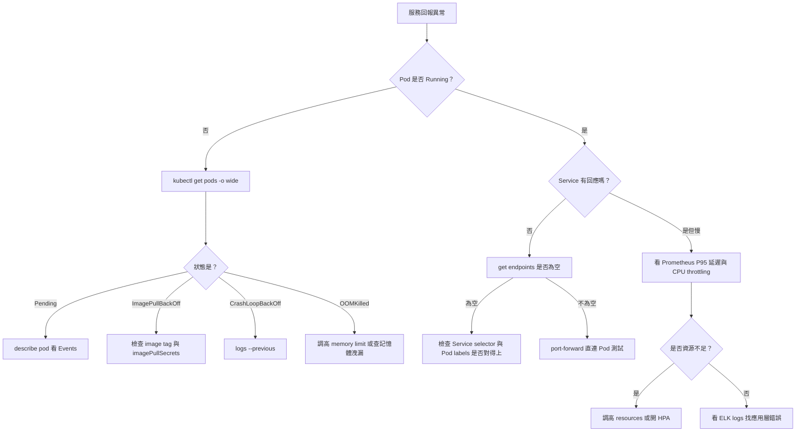

# 附錄 B：速查表

本頁是 16 章教材的速查配套，只給「怎麼做」，不重複解釋原理。平常放第二螢幕，出事故時直接用瀏覽器搜尋關鍵字定位到對應區塊；寫 YAML 時直接複製骨架，把 `<角括號>` 換成實際值即可用。

> **這份速查表寫於教材只有 16 章時**，涵蓋 kubectl／Docker／Helm／ArgoCD／PromQL／KQL。後來附錄 E–AK 引入的工具（`trivy`／`cosign`／`istioctl`／`hubble`／`velero`／`kubeconform`／`pluto`／KEDA／Kueue 等）收在 [[60-advanced-cheatsheet]]。

## 目錄

- [緊急排錯十連發](#緊急排錯十連發)
- [Pod 狀態速查表](#pod-狀態速查表)
- [kubectl 指令速查](#kubectl-指令速查)
- [kubectl 寫入動詞決策表](#kubectl-寫入動詞決策表)
- [YAML 骨架模板庫](#yaml-骨架模板庫)
- [資源單位速查](#資源單位速查)
- [Docker 速查](#docker-速查)
- [Helm 速查](#helm-速查)
- [ArgoCD 速查](#argocd-速查)
- [PromQL 速查](#promql-速查)
- [KQL / Elasticsearch 速查](#kql-elasticsearch-速查)
- [叢集維運指令](#叢集維運指令)
- [RBAC 速查](#rbac-速查)
- [minikube / 本機環境](#minikube-本機環境)
- [一頁式決策樹](#一頁式決策樹)

---

## 緊急排錯十連發

服務掛掉時，從第一步照著跑到第十步，不用想下一步該下什麼指令。

1. **看整體狀態**
   ```
   kubectl get pods -o wide -n <namespace>
   ```
   看什麼：`STATUS`、`RESTARTS`、`NODE`、`IP`，先鎖定是哪個 Pod、卡在哪個 node。

2. **看事件細節**
   ```
   kubectl describe pod <pod-name> -n <namespace>
   ```
   看什麼：最下方 `Events` 區塊（依時間排序）、`Conditions`、`Image`、`Limits`/`Requests`。

3. **看上一次崩潰的日誌**
   ```
   kubectl logs <pod-name> -n <namespace> --previous
   ```
   看什麼：CrashLoopBackOff 必用，這是「上一次」容器死掉前印出的錯誤，不是目前這次重啟後的空白日誌。

4. **看整個 namespace 的事件時間線**
   ```
   kubectl get events -n <namespace> --sort-by=.lastTimestamp
   ```
   看什麼：`FailedScheduling`、`Unhealthy`、`BackOff`、`FailedMount` 等關鍵字。

5. **看 Service 有沒有配到 Pod**
   ```
   kubectl get endpoints <service-name> -n <namespace>
   ```
   看什麼：`ENDPOINTS` 欄位是否為 `<none>`；為空代表 Service 的 selector 沒配對到任何 Running 且 Ready 的 Pod。

6. **看資源使用量**
   ```
   kubectl top pods -n <namespace>
   ```
   看什麼：CPU／Memory 是否逼近 limit，配合 OOMKilled 判斷是不是資源不足。

7. **看是不是權限問題**
   ```
   kubectl auth can-i <verb> <resource> --as=<user-or-serviceaccount>
   ```
   看什麼：回傳 `no` 代表 RBAC 擋下操作，去查對應的 Role／RoleBinding。

8. **看滾動更新卡在哪**
   ```
   kubectl rollout status deployment/<name> -n <namespace>
   ```
   看什麼：目前幾個 replica 已經 ready，是否卡住不動（配合 `describe` 看新 Pod 起不來的原因）。

9. **看完整物件定義**
   ```
   kubectl get pod <pod-name> -n <namespace> -o yaml
   ```
   看什麼：完整 `spec` 與 `status`，抓 image tag 打錯、env 漏設、sidecar 有沒有真的注入進去。

10. **對沒有 shell 的容器注入除錯工具**
    ```
    kubectl debug -it <pod-name> --image=busybox --target=<container-name>
    ```
    看什麼：distroless／scratch image 沒有 `/bin/sh` 時，用 ephemeral container 進去跑 `curl`、`nslookup`、`ps` 檢查連線與進程。

---

## Pod 狀態速查表

看到 `STATUS` 欄位第一個念頭該做什麼，全部列在這張表。

| 狀態 | 最可能原因 | 第一個該下的指令 |
| --- | --- | --- |
| Pending | Node 資源不足、PVC 未綁定、nodeSelector／affinity 找不到符合的 node | `kubectl describe pod <pod> -n <ns>`，看 Events 的 `FailedScheduling` |
| ContainerCreating | Image 還在拉、Volume mount 失敗、CNI 尚未就緒 | `kubectl describe pod <pod> -n <ns>`，看 Events |
| ImagePullBackOff | Image tag 打錯、Registry 認證失敗（Harbor robot account 密碼錯）、私有 registry 未設 `imagePullSecrets` | `kubectl describe pod <pod> -n <ns>`，看 `Failed to pull image` 的完整訊息 |
| CrashLoopBackOff | 應用程式啟動即崩潰、entrypoint 指令打錯、依賴服務（DB／中介軟體）連不到 | `kubectl logs <pod> -n <ns> --previous` |
| OOMKilled | Memory limit 設太低、應用程式記憶體洩漏 | `kubectl describe pod <pod> -n <ns>`，看 `Last State` 的 `Reason` 與 `Exit Code: 137` |
| Init:N/M | 第 N 個 init container 尚未跑完，卡在等待依賴（DB migration、下載 config） | `kubectl logs <pod> -n <ns> -c <init-container-name>` |
| Terminating | Finalizer 卡住、kubelet 沒回報刪除完成、grace period 還沒到 | `kubectl get pod <pod> -n <ns> -o yaml`，看 `metadata.finalizers` |
| Evicted | Node 資源壓力（disk pressure／memory pressure）被驅逐 | `kubectl describe node <node>`，看 `Conditions` |
| Completed | Job／CronJob 或一次性 Pod 正常執行完畢，非錯誤狀態 | `kubectl logs <pod> -n <ns>`，確認輸出是否符合預期 |

---

## kubectl 指令速查

依「你現在想做什麼」分類，不按字母排序；每組挑最常用的幾個。

### 查詢

```
kubectl get all -n <namespace>
kubectl get pods -A
kubectl get pods -l app=<label-value>
kubectl get pods --field-selector=status.phase=Running
kubectl get <resource> --show-labels
kubectl explain <resource>.spec
kubectl api-resources
```

### 除錯

```
kubectl exec -it <pod> -n <ns> -- /bin/sh
kubectl exec -it <pod> -n <ns> -c <container> -- /bin/sh
kubectl exec -it <pod> -n <ns> -- env
kubectl port-forward pod/<pod> 8080:80 -n <ns>
kubectl port-forward svc/<service> 8080:80 -n <ns>
kubectl cp <ns>/<pod>:/path/in/container ./local-path
kubectl debug <pod> -it --image=busybox --target=<container>
```

### 修改

```
kubectl scale deployment/<name> --replicas=<N> -n <ns>
kubectl set image deployment/<name> <container>=<image>:<tag> -n <ns>
kubectl label pod <pod> <key>=<value> -n <ns>
kubectl label pod <pod> <key>- -n <ns>
kubectl annotate pod <pod> <key>=<value> -n <ns>
kubectl taint nodes <node> <key>=<value>:NoSchedule
```

### rollout

```
kubectl rollout status deployment/<name> -n <ns>
kubectl rollout history deployment/<name> -n <ns>
kubectl rollout history deployment/<name> --revision=<N> -n <ns>
kubectl rollout undo deployment/<name> -n <ns>
kubectl rollout undo deployment/<name> --to-revision=<N> -n <ns>
kubectl rollout restart deployment/<name> -n <ns>
kubectl rollout pause deployment/<name> -n <ns>
kubectl rollout resume deployment/<name> -n <ns>
```

### node 維護

```
kubectl cordon <node>
kubectl drain <node> --ignore-daemonsets --delete-emptydir-data
kubectl uncordon <node>
kubectl taint nodes <node> node-role.kubernetes.io/maintenance=true:NoSchedule
```

### context／namespace 切換

```
kubectl config get-contexts
kubectl config current-context
kubectl config use-context <context-name>
kubectl config set-context --current --namespace=<namespace>
kubectl config view --minify
```

PowerShell 注意：`kubectx`／`kubens` 是第三方工具，Windows 需另外安裝（`choco install kubectx-kubens`）或直接在 WSL2 內使用；沒裝時用 `config set-context --current --namespace` 頂替。

### 輸出格式

```
kubectl get pods -o wide
kubectl get pods -o name
kubectl get pods -o json
kubectl get pods -o yaml
kubectl get pods -o jsonpath='{.items[*].metadata.name}'
kubectl get pods -o jsonpath='{range .items[*]}{.metadata.name}{"\t"}{.status.phase}{"\n"}{end}'
kubectl get nodes -o custom-columns='NAME:.metadata.name,CPU:.status.capacity.cpu,MEM:.status.capacity.memory'
kubectl get pods -o jsonpath='{.items[*].spec.containers[*].image}'
```

PowerShell 注意：jsonpath 字串一律用**單引號**包住；用雙引號的話 PowerShell 會嘗試解析內部的 `{}` 與變數，導致指令壞掉。

---

## kubectl 寫入動詞決策表

五個寫入動詞長得像，行為差很多，選錯會整份物件被覆蓋掉。

| 動詞 | 何時用 | 會不會覆蓋未列欄位 |
| --- | --- | --- |
| `create` | 建立全新資源，物件已存在會直接報錯 | 不適用（只能新建，不會碰到既有物件） |
| `apply` | 宣告式更新，GitOps／CI 的標準做法，可重複執行 | 不會，採 3-way merge（比對 `last-applied-configuration` annotation），未列出的欄位維持原值 |
| `replace` | 用整份 YAML 完整取代（通常先 `get` 出目前版本、帶上 `resourceVersion` 再改） | 會，未列出的欄位全部被清掉，等同整份覆蓋 |
| `patch` | 只想改單一或少數欄位，不想寫整份 YAML | 不會，只動 patch 裡指定的欄位，其餘欄位維持原值 |
| `edit` | 開啟預設編輯器手動改一兩個欄位，存檔即套用，適合緊急處置 | 依存檔內容整份送出，效果同 `apply`，沒改到的欄位維持原值 |

補充：資源第一次建立就用 `apply`（而非 `create`）才會寫入 `last-applied-configuration`，之後才能持續用 `apply` 做 3-way merge；若先用 `create` 建立、之後才改用 `apply`，第一次 `apply` 沒有比對基礎，可能出現非預期的欄位覆蓋。

---

## YAML 骨架模板庫

本節列出 17 種最常用資源的最小可用骨架，只放必要欄位與最常用選項，複製後把 `<角括號>` 換成實際值即可套用；縮排一律 2 空格遞增，冒號後恰好一個空格。

### Pod

```yaml
apiVersion: v1
kind: Pod
metadata:
  name: <pod-name>
  namespace: <namespace>
  labels:
    app: <app-name>
spec:
  containers:
    - name: <container-name>
      image: <image>:<tag>
      ports:
        - containerPort: 8080
      resources:
        requests:
          cpu: 100m
          memory: 128Mi
        limits:
          cpu: 500m
          memory: 256Mi
  restartPolicy: Always
```

### Deployment

含 probe、resources、滾動更新策略。

```yaml
apiVersion: apps/v1
kind: Deployment
metadata:
  name: <deployment-name>
  namespace: <namespace>
  labels:
    app: <app-name>
spec:
  replicas: 3
  revisionHistoryLimit: 5
  strategy:
    type: RollingUpdate
    rollingUpdate:
      maxSurge: 1 # 更新時最多多開幾個 Pod
      maxUnavailable: 0 # 更新時最多允許幾個 Pod 不可用，0 代表零停機
  selector:
    matchLabels:
      app: <app-name>
  template:
    metadata:
      labels:
        app: <app-name>
    spec:
      containers:
        - name: <container-name>
          image: <image>:<tag>
          ports:
            - containerPort: 8080
          resources:
            requests:
              cpu: 100m
              memory: 128Mi
            limits:
              cpu: 500m
              memory: 256Mi
          startupProbe: # 應用程式啟動較慢時用，通過前 liveness/readiness 不會生效
            httpGet:
              path: /healthz
              port: 8080
            failureThreshold: 30
            periodSeconds: 5
          readinessProbe: # 決定要不要把流量導進來
            httpGet:
              path: /healthz
              port: 8080
            initialDelaySeconds: 5
            periodSeconds: 10
          livenessProbe: # 決定要不要重啟容器
            httpGet:
              path: /healthz
              port: 8080
            initialDelaySeconds: 15
            periodSeconds: 20
```

### Service

ClusterIP、NodePort、LoadBalancer、Headless 四種變體。

```yaml
# ClusterIP：預設型別，僅供叢集內部存取
apiVersion: v1
kind: Service
metadata:
  name: <service-name>
  namespace: <namespace>
spec:
  type: ClusterIP
  selector:
    app: <app-name>
  ports:
    - port: 80
      targetPort: 8080
```

```yaml
# NodePort：透過任一 node IP + 固定 port 對外，多用於測試
apiVersion: v1
kind: Service
metadata:
  name: <service-name>
  namespace: <namespace>
spec:
  type: NodePort
  selector:
    app: <app-name>
  ports:
    - port: 80
      targetPort: 8080
      nodePort: 30080
```

```yaml
# LoadBalancer：雲端環境會配發外部 IP，minikube 需搭配 minikube tunnel
apiVersion: v1
kind: Service
metadata:
  name: <service-name>
  namespace: <namespace>
spec:
  type: LoadBalancer
  selector:
    app: <app-name>
  ports:
    - port: 80
      targetPort: 8080
```

```yaml
# Headless：clusterIP 設 None，搭配 StatefulSet 做 Pod 級別 DNS 直連
apiVersion: v1
kind: Service
metadata:
  name: <service-name>
  namespace: <namespace>
spec:
  clusterIP: None
  selector:
    app: <app-name>
  ports:
    - port: 80
      targetPort: 8080
```

### Ingress

含 TLS。

```yaml
apiVersion: networking.k8s.io/v1
kind: Ingress
metadata:
  name: <ingress-name>
  namespace: <namespace>
  annotations:
    nginx.ingress.kubernetes.io/rewrite-target: /
spec:
  ingressClassName: nginx
  tls:
    - hosts:
        - <domain-name>
      secretName: <tls-secret-name>
  rules:
    - host: <domain-name>
      http:
        paths:
          - path: /
            pathType: Prefix
            backend:
              service:
                name: <service-name>
                port:
                  number: 80
```

### ConfigMap

```yaml
apiVersion: v1
kind: ConfigMap
metadata:
  name: <configmap-name>
  namespace: <namespace>
data:
  <key>: <value>
  app.properties: | # 多行內容用區塊純量，整段照原樣保留換行
    key1=value1
    key2=value2
```

### Secret

```yaml
# 一般用途：stringData 讓你直接寫明文，K8s 會自動 base64 編碼
apiVersion: v1
kind: Secret
metadata:
  name: <secret-name>
  namespace: <namespace>
type: Opaque
stringData:
  <key>: <plain-text-value>
```

```yaml
# Harbor 私有 registry 認證：實務上用 kubectl create secret docker-registry 產生，不手寫 base64
apiVersion: v1
kind: Secret
metadata:
  name: <secret-name>
  namespace: <namespace>
type: kubernetes.io/dockerconfigjson
data:
  .dockerconfigjson: <base64-encoded-docker-config>
```

產生指令：
```
kubectl create secret docker-registry <secret-name> --docker-server=<harbor-host> --docker-username='<robot-account-name>' --docker-password='<robot-account-secret>' -n <namespace>
```

### PVC

```yaml
apiVersion: v1
kind: PersistentVolumeClaim
metadata:
  name: <pvc-name>
  namespace: <namespace>
spec:
  accessModes:
    - ReadWriteOnce # 單一 node 讀寫，最常見；共享儲存才需要 ReadWriteMany
  storageClassName: <storage-class-name>
  resources:
    requests:
      storage: 10Gi
```

### StatefulSet

```yaml
apiVersion: apps/v1
kind: StatefulSet
metadata:
  name: <statefulset-name>
  namespace: <namespace>
spec:
  serviceName: <headless-service-name>
  replicas: 3
  selector:
    matchLabels:
      app: <app-name>
  template:
    metadata:
      labels:
        app: <app-name>
    spec:
      containers:
        - name: <container-name>
          image: <image>:<tag>
          ports:
            - containerPort: 5432
          volumeMounts:
            - name: data
              mountPath: /var/lib/data
  volumeClaimTemplates: # 每個 replica 各自拿到一份獨立 PVC，命名為 data-<statefulset-name>-<N>
    - metadata:
        name: data
      spec:
        accessModes:
          - ReadWriteOnce
        storageClassName: <storage-class-name>
        resources:
          requests:
            storage: 10Gi
```

### DaemonSet

```yaml
apiVersion: apps/v1
kind: DaemonSet
metadata:
  name: <daemonset-name>
  namespace: <namespace>
spec:
  selector:
    matchLabels:
      app: <app-name>
  template:
    metadata:
      labels:
        app: <app-name>
    spec:
      tolerations: # 沒有這段就不會排到 control-plane node 上
        - key: node-role.kubernetes.io/control-plane
          effect: NoSchedule
      containers:
        - name: <container-name>
          image: <image>:<tag>
```

### Job

```yaml
apiVersion: batch/v1
kind: Job
metadata:
  name: <job-name>
  namespace: <namespace>
spec:
  backoffLimit: 3
  completions: 1
  parallelism: 1
  template:
    spec:
      restartPolicy: Never # Job 只能用 Never 或 OnFailure，不能用 Always
      containers:
        - name: <container-name>
          image: <image>:<tag>
          command: ["<binary>", "<arg1>"]
```

### CronJob

```yaml
apiVersion: batch/v1
kind: CronJob
metadata:
  name: <cronjob-name>
  namespace: <namespace>
spec:
  schedule: "*/30 * * * *"
  concurrencyPolicy: Forbid # 上一次還沒跑完就跳過這次排程
  successfulJobsHistoryLimit: 3
  failedJobsHistoryLimit: 3
  jobTemplate:
    spec:
      backoffLimit: 2
      template:
        spec:
          restartPolicy: OnFailure
          containers:
            - name: <container-name>
              image: <image>:<tag>
              command: ["<binary>", "<arg1>"]
```

### HPA

```yaml
apiVersion: autoscaling/v2
kind: HorizontalPodAutoscaler
metadata:
  name: <hpa-name>
  namespace: <namespace>
spec:
  scaleTargetRef:
    apiVersion: apps/v1
    kind: Deployment
    name: <deployment-name>
  minReplicas: 2
  maxReplicas: 10
  metrics:
    - type: Resource
      resource:
        name: cpu
        target:
          type: Utilization
          averageUtilization: 70
```

### NetworkPolicy

```yaml
apiVersion: networking.k8s.io/v1
kind: NetworkPolicy
metadata:
  name: <networkpolicy-name>
  namespace: <namespace>
spec:
  podSelector:
    matchLabels:
      app: <app-name>
  policyTypes: # 只列 Ingress 就只管進站流量，出站不受限
    - Ingress
    - Egress
  ingress:
    - from:
        - podSelector:
            matchLabels:
              app: <allowed-app-name>
      ports:
        - protocol: TCP
          port: 8080
  egress:
    - to:
        - namespaceSelector: {}
      ports:
        - protocol: TCP
          port: 53
```

### ResourceQuota

```yaml
apiVersion: v1
kind: ResourceQuota
metadata:
  name: <resourcequota-name>
  namespace: <namespace>
spec:
  hard:
    requests.cpu: "4"
    requests.memory: 8Gi
    limits.cpu: "8"
    limits.memory: 16Gi
    pods: "20"
```

### LimitRange

```yaml
apiVersion: v1
kind: LimitRange
metadata:
  name: <limitrange-name>
  namespace: <namespace>
spec:
  limits:
    - type: Container
      default: # Pod 沒寫 limits 時套用的預設值
        cpu: 500m
        memory: 256Mi
      defaultRequest: # Pod 沒寫 requests 時套用的預設值
        cpu: 100m
        memory: 128Mi
      max:
        cpu: "2"
        memory: 1Gi
```

### PDB（PodDisruptionBudget）

```yaml
apiVersion: policy/v1
kind: PodDisruptionBudget
metadata:
  name: <pdb-name>
  namespace: <namespace>
spec:
  minAvailable: 1 # 也可改用 maxUnavailable，兩者擇一
  selector:
    matchLabels:
      app: <app-name>
```

### ServiceAccount + Role + RoleBinding

```yaml
apiVersion: v1
kind: ServiceAccount
metadata:
  name: <serviceaccount-name>
  namespace: <namespace>
---
apiVersion: rbac.authorization.k8s.io/v1
kind: Role
metadata:
  name: <role-name>
  namespace: <namespace>
rules:
  - apiGroups: [""]
    resources: ["pods", "pods/log"]
    verbs: ["get", "list", "watch"]
---
apiVersion: rbac.authorization.k8s.io/v1
kind: RoleBinding
metadata:
  name: <rolebinding-name>
  namespace: <namespace>
subjects:
  - kind: ServiceAccount
    name: <serviceaccount-name>
    namespace: <namespace>
roleRef:
  kind: Role
  name: <role-name>
  apiGroup: rbac.authorization.k8s.io
```

---

## 資源單位速查

CPU／Memory 單位換算，避免配置時單位打錯造成資源分配錯誤。

- CPU `m`：millicore，`1000m` = 1 顆完整 CPU core；`100m` = 0.1 核心。
- Memory `Mi` vs `M`：`Mi`（Mebibyte）= 1024² bytes（二進位）；`M`（Megabyte）= 1000² bytes（十進位）。K8s 建議統一用 `Mi`／`Gi`，避免與 `M`／`G` 混用造成誤差累加。
- 換算：`1Gi` = `1024Mi`；`1G` = `1000M`。
- 只設 `limits` 不設 `requests`，scheduler 會誤判可用資源；只設 `requests` 不設 `limits`，該 Pod 可能吃光 node 資源、影響同 node 的其他 Pod。

常見配置參考值：

| 應用類型 | requests.cpu | requests.memory | limits.cpu | limits.memory |
| --- | --- | --- | --- | --- |
| 輕量 API（Node.js／簡單 CRUD） | 100m | 128Mi | 500m | 256Mi |
| 一般 Java／Spring Boot 服務 | 250m | 512Mi | 1000m | 1Gi |
| 資料庫（PostgreSQL 小型） | 500m | 1Gi | 2000m | 4Gi |
| 批次運算／ETL Job | 500m | 512Mi | 2000m | 2Gi |
| 監控 agent（node-exporter 等） | 50m | 64Mi | 100m | 128Mi |

---

## Docker 速查

容器建置與除錯的常用指令，含 `CMD`／`ENTRYPOINT` 行為表與多階段建置骨架。

常用指令：

```
docker build -t <image-name>:<tag> .
docker build --no-cache -t <image-name>:<tag> .
docker run -d --name <container-name> -p 8080:80 <image>:<tag>
docker run -it --rm <image>:<tag> /bin/sh
docker exec -it <container-name> /bin/sh
docker logs -f <container-name>
docker logs --since 10m <container-name>
docker ps -a
docker images
docker rmi <image-id>
docker system prune -a --volumes
docker inspect <container-name>
docker tag <local-image>:<tag> <harbor-host>/<project>/<image>:<tag>
docker push <harbor-host>/<project>/<image>:<tag>
docker login <harbor-host> -u '<robot-account-name>' -p '<robot-account-secret>'
```

PowerShell 注意：Harbor robot account 名稱常見格式含 `$`（如 `robot$project+ci`），在 PowerShell 雙引號字串中 `$` 會被當變數展開，務必用**單引號**包住帳密；bash 下建議同樣習慣用單引號。

`CMD` vs `ENTRYPOINT` 四種組合結果表：

| Dockerfile 寫法 | `docker run <image>`（不帶參數） | `docker run <image> <args>`（帶參數） |
| --- | --- | --- |
| 只有 `CMD ["exec1","p1"]` | 執行 `exec1 p1` | 整個 CMD 被取代，執行 `<args>` |
| 只有 `ENTRYPOINT ["exec1","p1"]` | 執行 `exec1 p1` | 執行 `exec1 p1 <args>`（args 附加在後面） |
| `ENTRYPOINT ["exec1"]` + `CMD ["p1"]` | 執行 `exec1 p1` | 執行 `exec1 <args>`（CMD 被覆蓋，只留 ENTRYPOINT） |
| `ENTRYPOINT` 用 shell form（`ENTRYPOINT exec1 p1`） | 執行 `/bin/sh -c "exec1 p1"` | 帶入的 `<args>` 被忽略，shell form 不接收額外參數 |

多階段建置骨架：

```dockerfile
# ---- build stage ----
FROM node:20-alpine AS build
WORKDIR /app
COPY package*.json ./
RUN npm ci
COPY . .
RUN npm run build

# ---- runtime stage ----
FROM node:20-alpine
WORKDIR /app
ENV NODE_ENV=production
COPY --from=build /app/dist ./dist
COPY --from=build /app/node_modules ./node_modules
EXPOSE 8080
USER node
ENTRYPOINT ["node", "dist/main.js"]
```

`.dockerignore` 範本：

```
node_modules
npm-debug.log
.git
.gitignore
.env
*.md
dist
.vscode
Dockerfile
.dockerignore
```

---

## Helm 速查

常用指令、模板語法、values 覆蓋優先序、除錯三件套。以下模板語法區塊含 Go template 語法，非純 YAML，不納入 PyYAML 驗證範圍。

常用指令：

```
helm create <chart-name>
helm install <release-name> <chart-path> -n <namespace> --create-namespace
helm upgrade <release-name> <chart-path> -n <namespace>
helm upgrade --install <release-name> <chart-path> -n <namespace>
helm uninstall <release-name> -n <namespace>
helm list -n <namespace>
helm list -A
helm rollback <release-name> <revision-number> -n <namespace>
helm history <release-name> -n <namespace>
helm show values <chart-path>
helm dependency update <chart-path>
helm lint <chart-path>
```

模板語法速查：

- `.Values.<key>`：讀取 `values.yaml` 或 `--set` 傳入的值。
  ```yaml
  image: "{{ .Values.image.repository }}:{{ .Values.image.tag }}"
  ```
- `.Release.Name`／`.Release.Namespace`：目前 release 名稱與部署的 namespace。
  ```yaml
  name: {{ .Release.Name }}-<suffix>
  ```
- `include` + `nindent`：呼叫 `_helpers.tpl` 定義的共用模板，`nindent` 順便修正縮排層級。
  ```yaml
  labels:
    {{- include "<chart-name>.labels" . | nindent 4 }}
  ```
- `default`：欄位沒設時給預設值。
  ```yaml
  replicas: {{ .Values.replicaCount | default 1 }}
  ```
- `required`：欄位必填，沒給就讓 `helm install` 直接失敗並印出指定訊息。
  ```yaml
  image: {{ required "values.image.repository 必須設定" .Values.image.repository }}
  ```
- `toYaml`：把一整個 map／list 值原樣轉成 YAML 區塊，常用在 `resources`、`annotations`、`nodeSelector`。
  ```yaml
  resources:
    {{- toYaml .Values.resources | nindent 4 }}
  ```
- `if` / `range` / `with`：條件判斷、迴圈、切換當前 context scope。
  ```yaml
  {{- if .Values.ingress.enabled }}
  ingressClassName: {{ .Values.ingress.className }}
  {{- end }}
  {{- range .Values.env }}
  - name: {{ .name }}
    value: {{ .value | quote }}
  {{- end }}
  {{- with .Values.nodeSelector }}
  nodeSelector:
    {{- toYaml . | nindent 4 }}
  {{- end }}
  ```

values 覆蓋優先序（由低到高，後者覆蓋前者）：

1. chart 內建 `values.yaml`
2. 父 chart 對 subchart 的 `values.yaml` 設定（dependency 情境）
3. `-f <custom-values.yaml>`（可疊多個 `-f`，後面的覆蓋前面的）
4. `--set <key>=<value>`（指令列，優先權最高）

除錯三件套：

```
helm template <release-name> <chart-path> -f <values.yaml>
helm install <release-name> <chart-path> --dry-run --debug
helm get manifest <release-name> -n <namespace>
```

`helm template` 純本地渲染、不連叢集；`--dry-run --debug` 會連 API server 做 server-side 驗證但不真的建立資源；`helm get manifest` 看叢集上目前實際套用的版本。三者搭配可以定位「哪一層」渲染出錯。

---

## ArgoCD 速查

CLI 常用指令、Application YAML 骨架、`syncPolicy` 與 `syncOptions` 選項表、Sync Wave、`ignoreDifferences`、OutOfSync 排查三步。

CLI 常用：

```
argocd login <argocd-server> --username <user> --grpc-web
argocd app list
argocd app get <app-name>
argocd app sync <app-name>
argocd app sync <app-name> --prune
argocd app diff <app-name>
argocd app history <app-name>
argocd app rollback <app-name> <revision-id>
argocd app set <app-name> --sync-policy automated
argocd app logs <app-name> --container <container-name>
argocd repo add <repo-url> --username <user> --password <token>
```

Application YAML 骨架：

```yaml
apiVersion: argoproj.io/v1alpha1
kind: Application
metadata:
  name: <app-name>
  namespace: argocd
spec:
  project: default
  source:
    repoURL: <git-repo-url>
    targetRevision: <branch-or-tag>
    path: <path-in-repo>
  destination:
    server: https://kubernetes.default.svc
    namespace: <target-namespace>
  syncPolicy:
    automated:
      prune: true
      selfHeal: true
    syncOptions:
      - CreateNamespace=true
    retry:
      limit: 3
      backoff:
        duration: 5s
        factor: 2
        maxDuration: 3m
```

`syncPolicy` 與 `syncOptions` 選項表：

| 選項 | 作用 |
| --- | --- |
| `automated.prune` | 自動刪除 Git 裡已移除、但叢集仍存在的資源 |
| `automated.selfHeal` | 偵測到手動改動叢集資源（drift）時自動改回 Git 內容 |
| `automated.allowEmpty` | 允許同步結果為空（預設 false，避免誤刪全部資源） |
| `syncOptions: CreateNamespace=true` | 目標 namespace 不存在時自動建立 |
| `syncOptions: PrunePropagationPolicy=foreground` | 刪除資源時採前景模式，等子資源刪完才算刪除完成 |
| `syncOptions: Replace=true` | 用 `kubectl replace` 取代 `apply`，遇到 immutable 欄位變更時用 |
| `syncOptions: ApplyOutOfSyncOnly=true` | 只同步真正 OutOfSync 的資源，加速大型 Application 的 sync |

Sync Wave 註解：

```yaml
metadata:
  annotations:
    argocd.argoproj.io/sync-wave: "-1"
```

數字越小越先部署（可為負數），同一 wave 內資源平行部署，等該 wave 全部 healthy 才進下一個 wave；常用來確保 CRD／Secret 先於使用它們的 Deployment 部署。

`ignoreDifferences` 寫法：

```yaml
spec:
  ignoreDifferences:
    - group: apps
      kind: Deployment
      jsonPointers:
        - /spec/replicas
    - group: ""
      kind: ConfigMap
      name: <configmap-name>
      jqPathExpressions:
        - .data.generatedField
```

用途：忽略 HPA 動態調整的 `replicas`、或被其他 controller（如 Vault Agent Injector）動態改寫的欄位，避免一直顯示 OutOfSync。

OutOfSync 排查三步：

1. `argocd app diff <app-name>` — 看 Git 期望值與叢集實際值差在哪個欄位。
2. `argocd app get <app-name> -o yaml` — 確認是 Sync Wave 卡住還是純粹 spec 不一致。
3. `kubectl get <resource> <name> -n <namespace> -o yaml` — 直接看叢集現況是否被別的 controller（Vault Agent Injector、HPA、webhook）動態改寫，若是則補 `ignoreDifferences`。

---

## PromQL 速查

以下查詢式可直接貼進 Grafana 的 Query 欄位使用。

CPU 使用率（container）：
```promql
sum(rate(container_cpu_usage_seconds_total{namespace="<namespace>", pod=~"<pod-prefix>.*"}[5m])) by (pod)
```

CPU throttling（節流比例）：
```promql
sum(rate(container_cpu_cfs_throttled_periods_total{namespace="<namespace>"}[5m])) by (pod)
/
sum(rate(container_cpu_cfs_periods_total{namespace="<namespace>"}[5m])) by (pod)
```

Memory 使用量（bytes）：
```promql
sum(container_memory_working_set_bytes{namespace="<namespace>", pod=~"<pod-prefix>.*"}) by (pod)
```

Pod 重啟次數：
```promql
increase(kube_pod_container_status_restarts_total{namespace="<namespace>"}[1h])
```

P95 延遲（需 histogram 型指標，如 `http_request_duration_seconds_bucket`）：
```promql
histogram_quantile(0.95, sum(rate(http_request_duration_seconds_bucket{job="<job-name>"}[5m])) by (le))
```

錯誤率（5xx 佔比）：
```promql
sum(rate(http_requests_total{job="<job-name>", status=~"5.."}[5m]))
/
sum(rate(http_requests_total{job="<job-name>"}[5m]))
```

磁碟使用率：
```promql
1 - (node_filesystem_avail_bytes{mountpoint="/"} / node_filesystem_size_bytes{mountpoint="/"})
```

`up`（目標存活，回傳 0 代表目標下線）：
```promql
up{job="<job-name>"} == 0
```

`rate`／`irate`／`increase` 選用表：

| 函式 | 適用情境 |
| --- | --- |
| `rate` | 慢速變化、告警規則、儀表板趨勢圖；對範圍內樣本做線性回歸，平滑但反應較慢 |
| `irate` | 需要看瞬間尖峰、臨場 debug；只取最後兩個樣本點算變化率，敏感但雜訊多，**不建議用在告警規則** |
| `increase` | 直接算「這段時間內累積增加多少」，如重啟次數；本質是 `rate` 乘以時間區間 |

聚合運算子：`sum`、`avg`、`max`、`min`、`count`、`topk(N, ...)`、`bottomk(N, ...)`；搭配 `by (label)` 依標籤分組、`without (label)` 排除標籤。

告警規則骨架：

```yaml
groups:
  - name: <group-name>
    rules:
      - alert: <alert-name>
        expr: up{job="<job-name>"} == 0
        for: 5m
        labels:
          severity: critical
        annotations:
          summary: "<job-name> 目標下線超過 5 分鐘"
          description: "instance {{ $labels.instance }} 已離線"
```

---

## KQL / Elasticsearch 速查

Kibana KQL 語法對照、Query DSL 常用結構、`_cat` 健檢指令、ILM policy 骨架。

KQL 語法對照表：

| 語法 | 範例 | 說明 |
| --- | --- | --- |
| 欄位比對 | `status:500` | 精確比對欄位值 |
| AND | `status:500 and service:"api"` | 兩條件同時成立 |
| OR | `status:500 or status:502` | 任一條件成立 |
| NOT | `not status:200` | 排除條件 |
| 範圍 | `response_time >= 1000` | 數值範圍比較 |
| 萬用字元 | `message:*timeout*` | 模糊比對，效能較差，避免大量使用 |
| 巢狀欄位 | `http.response.status_code:500` | 點記號存取巢狀欄位 |
| 存在檢查 | `_exists_:error.stack` | 檢查欄位是否存在 |

Query DSL 常用結構：

```json
{
  "query": {
    "bool": {
      "must": [
        { "match": { "service": "api" } },
        { "range": { "@timestamp": { "gte": "now-1h" } } }
      ],
      "filter": [
        { "term": { "status": 500 } }
      ]
    }
  },
  "sort": [
    { "@timestamp": "desc" }
  ],
  "size": 100
}
```

`_cat` 系列健康檢查指令：

```
GET _cat/health?v
GET _cat/indices?v&s=store.size:desc
GET _cat/nodes?v&h=name,heap.percent,ram.percent,cpu,load_1m
GET _cat/shards?v&h=index,shard,prirep,state,unassigned.reason
GET _cat/allocation?v
```

ILM policy 骨架：

```json
{
  "policy": {
    "phases": {
      "hot": {
        "min_age": "0ms",
        "actions": {
          "rollover": {
            "max_size": "50gb",
            "max_age": "7d"
          }
        }
      },
      "warm": {
        "min_age": "7d",
        "actions": {
          "shrink": { "number_of_shards": 1 },
          "forcemerge": { "max_num_segments": 1 }
        }
      },
      "delete": {
        "min_age": "30d",
        "actions": {
          "delete": {}
        }
      }
    }
  }
}
```

---

## 叢集維運指令

etcd 備份還原、憑證檢查與輪替、node drain 完整參數、升級前 API 棄用掃描、Velero 常用指令。

etcd 備份還原（含憑證參數）：

```
ETCDCTL_API=3 etcdctl snapshot save /tmp/etcd-backup-<date>.db --endpoints=https://127.0.0.1:2379 --cacert=/etc/kubernetes/pki/etcd/ca.crt --cert=/etc/kubernetes/pki/etcd/server.crt --key=/etc/kubernetes/pki/etcd/server.key

ETCDCTL_API=3 etcdctl snapshot restore /tmp/etcd-backup-<date>.db --data-dir=/var/lib/etcd-restore --initial-cluster=<node-name>=https://<node-ip>:2380 --initial-advertise-peer-urls=https://<node-ip>:2380
```

憑證檢查與輪替：

```
kubeadm certs check-expiration
kubeadm certs renew all
openssl x509 -in /etc/kubernetes/pki/apiserver.crt -noout -dates
```

node drain／cordon 完整參數：

```
kubectl cordon <node>
kubectl drain <node> --ignore-daemonsets --delete-emptydir-data --force --grace-period=60 --timeout=5m
kubectl uncordon <node>
```

參數說明：`--ignore-daemonsets` 忽略無法驅逐的 DaemonSet Pod；`--delete-emptydir-data` 允許刪除使用 `emptyDir` 的 Pod（資料會遺失，drain 前先確認）；`--force` 允許驅逐沒有 controller 管理的裸 Pod；`--grace-period` 覆蓋 Pod 的 `terminationGracePeriodSeconds`。

升級前 API 棄用掃描：

```
kubectl krew install deprecations
kubectl deprecations --k8s-version=<target-version>
pluto detect-all-in-cluster -o wide
```

Velero 常用指令：

```
velero backup create <backup-name> --include-namespaces <namespace>
velero backup create <backup-name> --selector app=<app-name>
velero backup get
velero backup describe <backup-name>
velero restore create --from-backup <backup-name>
velero schedule create <schedule-name> --schedule="0 2 * * *" --include-namespaces <namespace>
```

---

## RBAC 速查

verb 清單、常用 role 範本（唯讀／部署／除錯）、`auth can-i --as` 用法。

Verb 清單：`get`、`list`、`watch`、`create`、`update`、`patch`、`delete`、`deletecollection`、`*`（全部權限）。

常用 role 範本：

```yaml
# 唯讀
apiVersion: rbac.authorization.k8s.io/v1
kind: Role
metadata:
  name: <role-name>-readonly
  namespace: <namespace>
rules:
  - apiGroups: ["", "apps", "batch"]
    resources: ["pods", "deployments", "services", "configmaps", "jobs"]
    verbs: ["get", "list", "watch"]
```

```yaml
# 部署：可改 Deployment/ConfigMap/Service，不可動 Secret 與 RBAC 物件
apiVersion: rbac.authorization.k8s.io/v1
kind: Role
metadata:
  name: <role-name>-deployer
  namespace: <namespace>
rules:
  - apiGroups: ["apps"]
    resources: ["deployments"]
    verbs: ["get", "list", "watch", "update", "patch"]
  - apiGroups: [""]
    resources: ["configmaps", "services"]
    verbs: ["get", "list", "watch", "create", "update", "patch"]
```

```yaml
# 除錯：含 exec 與 logs，不能改任何資源
apiVersion: rbac.authorization.k8s.io/v1
kind: Role
metadata:
  name: <role-name>-debugger
  namespace: <namespace>
rules:
  - apiGroups: [""]
    resources: ["pods", "pods/log"]
    verbs: ["get", "list", "watch"]
  - apiGroups: [""]
    resources: ["pods/exec"]
    verbs: ["create"]
```

`auth can-i --as` 用法：

```
kubectl auth can-i delete deployments -n <namespace> --as=<user-or-serviceaccount>
kubectl auth can-i '*' '*' --as=system:serviceaccount:<namespace>:<serviceaccount-name>
kubectl auth can-i --list --as=<user>
kubectl auth can-i create pods --as-group=<group-name>
```

---

## minikube / 本機環境

啟停與 addon、`minikube tunnel`、資源配置、PowerShell 注意事項。

```
minikube start --cpus=4 --memory=8192 --driver=docker
minikube stop
minikube delete
minikube status
minikube addons list
minikube addons enable ingress
minikube addons enable metrics-server
minikube tunnel
minikube dashboard
minikube ssh
minikube ip
minikube service <service-name> -n <namespace> --url
```

`minikube tunnel` 需保持在**獨立且不關閉的終端機視窗**執行，用來讓 `LoadBalancer` 類型的 Service 在本機取得可存取的 external IP；在 Windows 上通常需要以系統管理員權限開啟該終端機視窗，否則會卡在密碼提示看不到畫面。

PowerShell 注意事項：

- WSL2 內的 `minikube` 與 Windows 端的 `minikube` 是兩份獨立安裝，`kubectl config` 也各自獨立，混用會出現 context 對不上的狀況，建議固定只用其中一邊。
- PowerShell 對 `$` 開頭字串會嘗試變數展開，Harbor robot account、含 `$` 的密碼一律用單引號 `'...'` 包住。
- PowerShell 的續行符號是反引號 `` ` ``，不是 bash 的 `\`；跨行指令建議改寫成單行，或改用 WSL2 內的 bash。

---

## 一頁式決策樹

服務有問題時，從這張圖決定第一步查哪裡。



---

## 連結

- [[k8s-mastery]]
- [[16-self-assessment]]
- [[13-troubleshooting]]
- [[04-workloads]]
- [[10-helm]]
- [[11-argocd]]
- [[14-prometheus-grafana]]
- [[15-elk-elastic]]
- [[34-multicluster-and-dr]] — 附錄 L：備份還原的完整演練程序
- [[27-upgrades-and-deprecations]] — 附錄 E：pluto／kubent 與升級檢查清單
