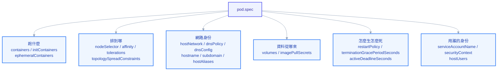

# 附錄 C-1：Pod 與 Container 全欄位

前面 16 章教的是「為什麼」，附錄 B 給的是「怎麼開始寫」。這份附錄 C 補的是第三件事：**到底有哪些欄位可以寫**。

差別在於使用時機。教學章節帶你理解機制，速查表讓你複製骨架開工，而這份百科是給你在下面這幾種時刻用的——review 別人的 YAML 看到一個沒見過的欄位、想做某件事但不確定有沒有現成欄位、或是懷疑某個預設值不是你以為的那樣。它按「資源 → 欄位分組 → 逐欄位」組織，每個欄位都標了型別、預設值與版本門檻。

**版本基準是 Kubernetes v1.33。** 標註 alpha / beta 的欄位在不同叢集可能沒開，落地前一律用下一節的 `kubectl explain` 在**你自己的叢集**上驗證一次——這是唯一不會騙人的來源。

---

## 先學會自己查：三個永遠不過期的指令

在背任何欄位之前，先學會這件事：K8s 的 API schema 是叢集自己帶著的，你不需要記，只需要會問。

```
kubectl explain pod.spec
kubectl explain pod.spec.containers.livenessProbe --recursive
kubectl explain deployment.spec.strategy.rollingUpdate
```

`kubectl explain` 直接讀你這座叢集的 OpenAPI schema，所以它回答的永遠是「**這個版本、這座叢集**支援什麼」，不是文件上的通則。加 `--recursive` 會把整棵子樹攤平列出來，是找「有沒有這個欄位」最快的方式。要看指定 API 版本則用 `--api-version`：

```
kubectl explain hpa.spec --api-version=autoscaling/v2
```

第二個指令是列出叢集認得的所有資源類型與它們的 GVK：

```
kubectl api-resources
kubectl api-resources --api-group=networking.k8s.io
kubectl api-versions
```

第三個是反過來——已經有一個活著的物件，想知道 K8s 幫你補了哪些預設值：

```
kubectl get pod <name> -o yaml
kubectl apply -f pod.yaml --dry-run=server -o yaml
```

`--dry-run=server` 特別有用：它把 YAML 送進 API Server 走完 defaulting 與 admission，但不真的寫進 etcd，回傳的就是「這份 YAML 實際會變成什麼樣子」。你寫了 10 行，它回你 60 行，多出來的 50 行就是預設值與 webhook 塞進去的東西（第 9 章解釋過為什麼你的 YAML 會被改）。

---

## 型別詞彙表：讀懂欄位說明的前提

`kubectl explain` 的輸出會用一組固定的型別名稱，先認得它們，後面的表格才讀得順。

| 型別 | 意義 | 寫法範例 |
| --- | --- | --- |
| `string` | 字串 | `image: nginx:1.25` |
| `integer` / `int32` / `int64` | 整數 | `replicas: 3` |
| `boolean` | 布林 | `privileged: false` |
| `Quantity` | 帶單位的數量 | `memory: 128Mi`、`cpu: 250m` |
| `IntOrString` | 整數或字串二選一 | `maxSurge: 1` 或 `maxSurge: "25%"`、`port: 8080` 或 `port: http` |
| `Duration`（多為 `int32` 秒數） | 時間長度 | `periodSeconds: 10` |
| `LabelSelector` | 標籤選擇器物件 | 見下方 |
| `ObjectReference` / `LocalObjectReference` | 指向另一個物件 | `secretRef: {name: my-secret}` |
| `map[string]string` | 字串對映 | `nodeSelector: {disktype: ssd}` |
| `Condition` | 狀態條目（唯讀） | `status.conditions[]` |

`Quantity` 的單位規則值得單獨記，因為這是最常寫錯的地方：

| 情境 | 正確 | 常見錯誤 | 後果 |
| --- | --- | --- | --- |
| CPU | `250m`（= 0.25 核）、`2` | `250M` | 直接被拒絕或解讀成天文數字 |
| 記憶體（二進位） | `128Mi` = 128 × 1024² | `128M` = 128 × 10⁶ | 少約 5%，壓線的服務被 OOMKill |
| 儲存 | `10Gi` | `10G` | 同上，容量比預期小 |

`LabelSelector` 有兩種寫法，兩者同時出現時是 **AND** 關係：

```yaml
selector:
  matchLabels:
    app: my-app
  matchExpressions:
    - key: tier
      operator: In # In | NotIn | Exists | DoesNotExist
      values: [frontend, backend]
```

`Exists` 與 `DoesNotExist` **不可以**帶 `values`，寫了會被 API Server 拒絕。空的 selector（`{}`）意義是「選中全部」，而 `null`（沒寫）在多數欄位意義是「不選任何東西」——這兩者在 NetworkPolicy 裡差別大到會直接造成事故（附錄 C-3 會展開）。

---

## metadata：每個物件都有的身分證

`metadata` 的欄位對**所有** kind 都一樣，值得一次記熟。分成兩類：你寫的，與系統填的。

### 你寫的欄位

| 欄位 | 型別 | 預設 | 說明 |
| --- | --- | --- | --- |
| `name` | string | 無（必填） | 同 namespace 同 kind 內唯一。須符合 DNS-1123：小寫英數與 `-`，最多 253 字元 |
| `generateName` | string | — | 前綴，由 API Server 補隨機字尾。**只對 `create` 有效，`apply` 無效** |
| `namespace` | string | `default` | cluster-scoped 資源寫了會被拒絕 |
| `labels` | map | — | 給 selector 用，可被查詢。key 最長 63 字元，可帶 DNS 前綴 |
| `annotations` | map | — | 給人與工具讀，**不能**被 selector 選中，但可存大字串 |
| `finalizers` | []string | — | 非空則刪除會卡在 `Terminating`，等 controller 清完才真的消失（第 9 章） |
| `ownerReferences` | []object | — | 建立 GC 從屬關係，父物件刪掉時子物件跟著被回收 |

`ownerReferences` 通常由 controller 自動填，但手寫也合法，重點欄位如下：

```yaml
ownerReferences:
  - apiVersion: apps/v1
    kind: ReplicaSet
    name: my-app-7d9f
    uid: 3c8f... # 必填，且必須與現存物件的 uid 相符
    controller: true # 標示「這是主控者」，一個物件只能有一個
    blockOwnerDeletion: true # 父物件的前景刪除會等這個子物件先消失
```

### 系統填的欄位（唯讀，但要看得懂）

| 欄位 | 意義 | 什麼時候你會需要它 |
| --- | --- | --- |
| `uid` | 全叢集唯一 ID | 同名物件刪掉重建後 uid 會變，用來分辨「是不是同一個」 |
| `resourceVersion` | 樂觀鎖版本號 | `replace` 衝突、watch 續接的依據 |
| `generation` | spec 變更次數 | 與 `status.observedGeneration` 比對，判斷 controller 是否已看到最新 spec |
| `creationTimestamp` | 建立時間 | 排查「這個 Pod 是什麼時候被重建的」 |
| `deletionTimestamp` | 刪除請求時間 | 有值＝正在刪除中，配合 finalizer 判斷卡住原因 |
| `deletionGracePeriodSeconds` | 剩餘寬限秒數 | 診斷刪除卡住 |
| `managedFields` | 各 field manager 擁有哪些欄位 | server-side apply 搶欄位衝突時的關鍵證據（第 3 章） |

> `generation` 與 `observedGeneration` 的比對是判斷「controller 到底看到我的改動沒」最可靠的方法。兩者不等，代表 controller 還沒處理完；兩者相等但 status 還是不對，代表問題出在 controller 執行過程而不是它沒收到。

---

## PodSpec 全欄位地圖

PodSpec 的欄位有四十幾個，平鋪直敘地背沒有意義。照「它在回答什麼問題」分成六組來記，實際查找時也快得多。



### 組一：跑什麼

| 欄位 | 型別 | 預設 | 說明 |
| --- | --- | --- | --- |
| `containers` | []Container | 必填 | 至少一個。同 Pod 內 `name` 不可重複，port 也不可衝突 |
| `initContainers` | []Container | — | 依序執行，全部成功才啟動主容器。加上 `restartPolicy: Always` 就變成原生 sidecar |
| `ephemeralContainers` | []EphemeralContainer | — | 只能用 `kubectl debug` 注入，不能寫在 YAML 裡 apply；沒有 probe 與 resources |

### 組二：排到哪（完整語法見第 7 章）

| 欄位 | 型別 | 預設 | 說明 |
| --- | --- | --- | --- |
| `nodeName` | string | — | 寫死 Node，**直接跳過 scheduler**。除錯用，正式環境不要 |
| `nodeSelector` | map | — | 最簡單的硬條件，全部 label 都要符合 |
| `affinity.nodeAffinity` | object | — | 硬條件 `requiredDuringSchedulingIgnoredDuringExecution` + 軟偏好 `preferredDuring...`（帶 `weight` 1–100） |
| `affinity.podAffinity` / `podAntiAffinity` | object | — | 以「同一個 topologyKey 域內有沒有符合的 Pod」決定，必填 `topologyKey` |
| `tolerations` | []Toleration | — | 容忍 Node 的 taint，見下表 |
| `topologySpreadConstraints` | []object | — | 打散副本，欄位見下表 |
| `schedulerName` | string | `default-scheduler` | 指定自訂 scheduler |
| `priorityClassName` | string | — | 對應 PriorityClass，決定搶佔順序 |
| `priority` | int32 | 由上者推導 | **不要手寫**，admission 會覆蓋 |
| `preemptionPolicy` | string | `PreemptLowerPriority` | 或 `Never`（不搶佔別人，但仍照優先序排隊） |
| `schedulingGates` | []object | — | 有 gate 就一直 `SchedulingGated` 不排程，等外部移除。GA (1.30+) |
| `runtimeClassName` | string | — | 指定 container runtime（如 `gvisor`、`kata`） |
| `overhead` | map[Quantity] | 由 RuntimeClass 填 | sandbox 本身的資源開銷，計入排程與 quota |
| `resourceClaims` | []object | — | Dynamic Resource Allocation（GPU 等），1.33 為 beta |

`tolerations` 逐欄位：

```yaml
tolerations:
  - key: "dedicated"
    operator: "Equal" # Equal（比對 value）| Exists（只看 key 存在）
    value: "gpu"
    effect: "NoSchedule" # NoSchedule | PreferNoSchedule | NoExecute；留空＝容忍全部 effect
    tolerationSeconds: 300 # 只對 NoExecute 有意義：被驅逐前還能待多久
```

> 一個空的 `- operator: "Exists"`（連 key 都不寫）＝容忍**所有** taint，包含 Node 失聯與磁碟壓力。DaemonSet 這樣寫合理，一般應用這樣寫等於自願跟著壞掉的 Node 一起沉。

`topologySpreadConstraints` 逐欄位：

| 欄位 | 預設 | 說明 |
| --- | --- | --- |
| `maxSkew` | 必填 | 各域之間 Pod 數量差距的上限，最小 1 |
| `topologyKey` | 必填 | 以哪個 Node label 當「域」，常見 `kubernetes.io/hostname`、`topology.kubernetes.io/zone` |
| `whenUnsatisfiable` | `DoNotSchedule` | 或 `ScheduleAnyway`（軟約束） |
| `labelSelector` | 必填 | 算誰的數量 |
| `minDomains` | — | 域數不足時視為不滿足，避免全擠在唯一一個 zone |
| `nodeAffinityPolicy` / `nodeTaintsPolicy` | `Honor` / `Ignore` | 計算時要不要把不符合 affinity/taint 的 Node 算進來 |
| `matchLabelKeys` | — | 用 pod label 的值自動補進 selector，讓不同 revision 各自算各自的（1.27+，滾動更新時很關鍵） |

### 組三：網路身份

| 欄位 | 型別 | 預設 | 說明 |
| --- | --- | --- | --- |
| `hostNetwork` | bool | `false` | 直接用 Node 的網路 namespace，Pod IP＝Node IP，port 直接佔用 Node port |
| `hostPID` / `hostIPC` | bool | `false` | 共用 Node 的 PID / IPC namespace，等同放棄隔離 |
| `shareProcessNamespace` | bool | `false` | 同 Pod 內容器彼此看得到對方 process，除錯 sidecar 常用；與 `hostPID` 互斥 |
| `dnsPolicy` | string | `ClusterFirst` | `ClusterFirst`｜`ClusterFirstWithHostNet`（開 hostNetwork 時要用這個）｜`Default`（沿用 Node 的 resolv.conf）｜`None`（完全自訂，必須配 `dnsConfig`） |
| `dnsConfig` | object | — | `nameservers` / `searches` / `options`（可調 `ndots`，見第 5 章的 ndots 陷阱） |
| `hostname` | string | Pod 名 | 容器內 `hostname` 指令看到的值 |
| `subdomain` | string | — | 配合 headless Service 得到 `<hostname>.<subdomain>.<ns>.svc.cluster.local` |
| `setHostnameAsFQDN` | bool | `false` | 讓 `hostname` 回傳完整 FQDN |
| `hostAliases` | []object | — | 寫進容器 `/etc/hosts`，繞過 DNS 的臨時手段 |
| `enableServiceLinks` | bool | `true` | 把同 namespace 的 Service 以環境變數注入。Service 一多會塞爆環境變數，建議關掉 |

```yaml
hostAliases:
  - ip: "10.0.0.10"
    hostnames: ["legacy-db", "legacy-db.internal"]
```

### 組四：資料從哪來

| 欄位 | 型別 | 說明 |
| --- | --- | --- |
| `volumes` | []Volume | Pod 層級宣告，容器再用 `volumeMounts` 掛。全類型見本頁最後一節 |
| `imagePullSecrets` | []LocalObjectReference | 拉私有 registry 的憑證，型別須為 `kubernetes.io/dockerconfigjson` |

### 組五：怎麼生、怎麼死

| 欄位 | 型別 | 預設 | 說明 |
| --- | --- | --- | --- |
| `restartPolicy` | string | `Always` | `Always`（Deployment 只能用這個）｜`OnFailure`｜`Never`（後兩者用於 Job） |
| `terminationGracePeriodSeconds` | int64 | `30` | 收到 SIGTERM 後到被 SIGKILL 的秒數；`preStop` 也吃這段預算 |
| `activeDeadlineSeconds` | int64 | — | Pod 活過這個秒數就被標記失敗，多用於 Job |
| `readinessGates` | []object | — | 額外的就緒條件，須由外部 controller 在 `status.conditions` 標記為 True |

> `terminationGracePeriodSeconds` 是 `preStop` 與應用收 SIGTERM 之後**共用**的總預算，不是各自一份。`preStop` 睡 25 秒、應用需要 20 秒排乾連線，總預算 30 秒就一定會有請求被砍掉。

### 組六：用誰的身份

| 欄位 | 型別 | 預設 | 說明 |
| --- | --- | --- | --- |
| `serviceAccountName` | string | `default` | Pod 的 API 身份 |
| `serviceAccount` | string | — | **已棄用**的舊別名，不要再寫 |
| `automountServiceAccountToken` | bool | `true` | 不需要打 API Server 的應用一律設 `false` |
| `securityContext` | PodSecurityContext | — | Pod 層級安全設定，見下方對照表 |
| `hostUsers` | bool | `true` | 設 `false` 啟用 user namespace，容器內的 root 對映到 Node 上的非特權 UID（1.33 為 beta，需確認叢集有開） |
| `os.name` | string | — | `linux` 或 `windows`，混合叢集中協助排程與欄位驗證 |
| `resources` | ResourceRequirements | — | **Pod 層級**資源（1.33 為 alpha），不是容器層級那個 |

---

## Container 全欄位

`containers[]` 與 `initContainers[]` 用的是同一個結構，差別只在 init container 不支援 `lifecycle` 與三種 probe（加了 `restartPolicy: Always` 變 sidecar 之後才支援）。

### 映像與啟動

| 欄位 | 型別 | 預設 | 說明 |
| --- | --- | --- | --- |
| `name` | string | 必填 | 同 Pod 內唯一，DNS-1123 標籤格式 |
| `image` | string | 必填 | 一律鎖版本或 digest，別用 `latest` |
| `imagePullPolicy` | string | 見說明 | `IfNotPresent`｜`Always`｜`Never`。tag 是 `latest` 或沒寫 tag 時預設 `Always`，其餘預設 `IfNotPresent` |
| `command` | []string | 映像的 ENTRYPOINT | 覆蓋 ENTRYPOINT，**不經過 shell**，所以 `$VAR`、`\|`、`&&` 不會被解析 |
| `args` | []string | 映像的 CMD | 覆蓋 CMD |
| `workingDir` | string | 映像設定 | 覆蓋工作目錄 |
| `ports` | []ContainerPort | — | **純文件用途**，不寫也照樣通；例外是命名 port 給 Service 的 `targetPort` 參照 |
| `stdin` / `stdinOnce` / `tty` | bool | `false` | 對應 `kubectl run -it`，一般部署不需要 |
| `terminationMessagePath` | string | `/dev/termination-log` | 容器把死因寫這裡，會出現在 `status.containerStatuses[].lastState` |
| `terminationMessagePolicy` | string | `File` | 設 `FallbackToLogsOnError` 可在檔案沒東西時改抓最後幾行 log，排查 crash 很有用 |

`command` 不經 shell 是最常見的踩雷點：

```yaml
# 錯：$(DB_HOST) 之外的 shell 語法完全不會被解析
command: ["echo $HOME && ./app"]

# 對：真的需要 shell 就明確叫 shell
command: ["/bin/sh", "-c"]
args: ["echo $HOME && ./app"]
```

`ports` 逐欄位：

```yaml
ports:
  - name: http # 最長 15 字元，供 Service targetPort 與 probe 參照
    containerPort: 8080 # 必填
    protocol: TCP # TCP（預設）| UDP | SCTP
    hostPort: 0 # 直接佔用 Node 的 port，會限制每台 Node 只能跑一份，非必要不用
    hostIP: "" # 搭配 hostPort
```

### 環境變數：四種來源

```yaml
env:
  - name: LOG_LEVEL # 1. 直接給值
    value: "debug"
  - name: DB_PASSWORD # 2. 從 Secret / ConfigMap 取單一 key
    valueFrom:
      secretKeyRef:
        name: db-secret
        key: password
        optional: false # true = 找不到也讓 Pod 起來（預設 false，會卡在 CreateContainerConfigError）
  - name: POD_IP # 3. Downward API：取 Pod 自己的欄位
    valueFrom:
      fieldRef:
        fieldPath: status.podIP # metadata.name/namespace/uid/labels['k']、spec.nodeName、status.hostIP 等
  - name: CPU_LIMIT # 4. Downward API：取自己的資源設定
    valueFrom:
      resourceFieldRef:
        containerName: app # 省略＝目前容器
        resource: limits.cpu # requests.cpu / limits.memory / requests.memory / limits.ephemeral-storage
        divisor: "1m" # 換算單位，預設 1

envFrom: # 整包注入，key 直接變成環境變數名
  - configMapRef:
      name: app-config
  - secretRef:
      name: app-secret
    prefix: APP_ # 可加前綴避免撞名
```

兩個容易中招的細節：`env` 的優先序高於 `envFrom`，同名時 `env` 勝出；而 `envFrom` 來源裡若有不合法的環境變數名（例如含 `.`），該 key 會被**靜默跳過**，只在 Pod event 留一行訊息。

`resourceFieldRef` 是把 limit 餵給 JVM `-XX:MaxRAMPercentage`、Node.js `--max-old-space-size` 這類「應用要自己知道上限」場景的標準做法，比在映像裡寫死好得多。

### 資源

```yaml
resources:
  requests: # 排程依據 + QoS 判定依據
    cpu: "250m"
    memory: "256Mi"
    ephemeral-storage: "1Gi"
  limits: # 執行期上限
    cpu: "1" # 超過 → 被 throttle（變慢，不會死）
    memory: "512Mi" # 超過 → OOMKilled（直接死）
    ephemeral-storage: "2Gi" # 超過 → Pod 被驅逐
  claims: # 對應 pod.spec.resourceClaims，DRA 用
    - name: gpu-claim
```

只寫 `limits` 不寫 `requests` 時，K8s 會自動把 `requests` 補成與 `limits` 相同（於是變成 Guaranteed QoS）；反過來只寫 `requests` 則沒有上限。QoS 三級與驅逐順序見第 7 章。

擴充資源（GPU 等）直接寫在同一層，且**必須 requests＝limits**：

```yaml
resources:
  limits:
    nvidia.com/gpu: 1
```

`resizePolicy` 讓部分資源變更可以不重啟容器（In-place resize，1.33 為 beta）：

```yaml
resizePolicy:
  - resourceName: cpu
    restartPolicy: NotRequired # CPU 改了不用重啟
  - resourceName: memory
    restartPolicy: RestartContainer # 記憶體改了要重啟才生效
```

### volumeMounts

| 欄位 | 預設 | 說明 |
| --- | --- | --- |
| `name` | 必填 | 對應 `pod.spec.volumes[].name` |
| `mountPath` | 必填 | 容器內路徑。**掛上去會蓋掉原本目錄的內容** |
| `readOnly` | `false` | 能唯讀就唯讀 |
| `subPath` | — | 只掛 volume 裡的某個檔案或子目錄，**用了就收不到 ConfigMap 的自動更新** |
| `subPathExpr` | — | 同上但支援 `$(ENV)` 展開，例如 `subPathExpr: "$(POD_NAME)"` 讓每個副本各自一個子目錄 |
| `mountPropagation` | `None` | `None`｜`HostToContainer`｜`Bidirectional`（需 privileged） |
| `recursiveReadOnly` | `Disabled` | 讓唯讀真的遞迴生效，避免子掛載點仍可寫（1.31+） |

`subPath` 與 ConfigMap 熱更新互斥這件事，是第 6 章那個「改了 ConfigMap 為什麼沒生效」的頭號元兇。要掛單一設定檔又想要熱更新，做法是掛整個目錄，讓應用自己讀目錄下的檔案。

### Probe：三種用途、同一組欄位

```yaml
livenessProbe: # 失敗 → 殺掉容器重啟
  httpGet:
    path: /healthz
    port: 8080 # 數字或 ports[].name
    scheme: HTTP # HTTP | HTTPS
    host: "" # 預設 Pod IP
    httpHeaders:
      - name: Custom-Header
        value: probe
  initialDelaySeconds: 0 # 預設 0
  periodSeconds: 10 # 預設 10
  timeoutSeconds: 1 # 預設 1，慢啟動服務常敗在這
  successThreshold: 1 # 預設 1；liveness/startup 只能是 1
  failureThreshold: 3 # 預設 3
  terminationGracePeriodSeconds: 30 # probe 失敗殺容器時單獨用的寬限期
```

四種探測手段擇一：

| 手段 | 寫法 | 判定成功 |
| --- | --- | --- |
| `httpGet` | 見上 | 回應碼 200–399 |
| `tcpSocket` | `tcpSocket: {port: 8080}` | TCP 連得上 |
| `exec` | `exec: {command: ["cat", "/tmp/ready"]}` | exit code 0。**每次探測都開一個 process**，週期太短會吃掉 CPU |
| `grpc` | `grpc: {port: 9000, service: ""}` | gRPC health checking protocol 回 SERVING |

三種 probe 的分工：

| Probe | 失敗後果 | 該檢查什麼 |
| --- | --- | --- |
| `startupProbe` | 重啟容器；成功前**暫停**另兩種 probe | 只問「起來了沒」，慢啟動服務靠它保護 |
| `readinessProbe` | 從 Service endpoints 摘除，**不重啟** | 含下游依賴也合理（我現在能不能服務） |
| `livenessProbe` | 重啟容器 | **只檢查自己**。把下游資料庫寫進 liveness，資料庫一抖全部應用一起重啟 |

慢啟動服務的正確解法是 `startupProbe` 開大 `failureThreshold`（例如 `failureThreshold: 30, periodSeconds: 10` ＝最多容忍 5 分鐘），而不是把 `livenessProbe.initialDelaySeconds` 設成 300——後者在容器重啟後同樣要再空等 5 分鐘才開始保護。

### lifecycle

```yaml
lifecycle:
  postStart: # 與主程式「同時」啟動，不保證先後
    exec:
      command: ["/bin/sh", "-c", "echo started"]
  preStop: # 收到終止訊號後、SIGTERM 送給主程式前執行，是阻塞的
    exec:
      command: ["/bin/sh", "-c", "sleep 5"]
  stopSignal: SIGTERM # 自訂終止訊號（1.33 新增，需 OS 欄位配合）
```

`preStop` 最常見的正當用途是「睡幾秒」，讓 kube-proxy／Ingress 有時間把這個 Pod 從轉發表移除，避免關閉瞬間仍有新請求進來（第 5 章的完整封包路徑解釋了為什麼會有這個時間差）。

### 容器層 securityContext

Pod 層與容器層有各自的 `securityContext`，重疊欄位以**容器層為準**。

| 欄位 | 層級 | 預設 | 說明 |
| --- | --- | --- | --- |
| `runAsUser` / `runAsGroup` | Pod + 容器 | 映像設定 | 指定 UID/GID |
| `runAsNonRoot` | Pod + 容器 | `false` | `true` 時映像若以 root 啟動，直接拒絕啟動 |
| `allowPrivilegeEscalation` | 容器 | 見說明 | 一律設 `false`；`privileged: true` 或有 `CAP_SYS_ADMIN` 時預設為 true |
| `privileged` | 容器 | `false` | 等於把 Node 交出去 |
| `readOnlyRootFilesystem` | 容器 | `false` | 強烈建議 `true`，可寫路徑用 `emptyDir` 補 |
| `capabilities` | 容器 | — | `drop: ["ALL"]` 後再 `add` 必要的，如 `NET_BIND_SERVICE` |
| `procMount` | 容器 | `Default` | 少用 |
| `fsGroup` | Pod | — | volume 掛載後把檔案群組改成這個 GID，解決非 root 寫不進 PVC |
| `fsGroupChangePolicy` | Pod | `Always` | 大量檔案時設 `OnRootMismatch` 可大幅縮短啟動時間 |
| `supplementalGroups` | Pod | — | 附加群組 |
| `supplementalGroupsPolicy` | Pod | `Merge` | 設 `Strict` 只用指定的群組，忽略映像 `/etc/group`（1.31+） |
| `seccompProfile` | Pod + 容器 | — | `type: RuntimeDefault` 是最低成本的加固 |
| `appArmorProfile` | Pod + 容器 | — | 1.30 起為正式欄位，取代舊 annotation 寫法 |
| `seLinuxOptions` | Pod + 容器 | — | SELinux 標籤 |
| `sysctls` | Pod | — | 只能設安全清單內的，其餘要 kubelet 明確允許 |
| `windowsOptions` | Pod + 容器 | — | Windows 節點專用 |

一份可以直接抄的加固基線：

```yaml
spec:
  securityContext:
    runAsNonRoot: true
    runAsUser: 10001
    fsGroup: 10001
    seccompProfile:
      type: RuntimeDefault
  containers:
    - name: app
      securityContext:
        allowPrivilegeEscalation: false
        readOnlyRootFilesystem: true
        capabilities:
          drop: ["ALL"]
```

這組設定同時滿足 Pod Security Admission 的 `restricted` 等級（第 8 章）。

---

## 原生 Sidecar：1.33 的正式解法

以往 sidecar 是「習慣用法」——把 Envoy、Filebeat 之類的容器塞進 `containers[]`，然後長期忍受兩個老問題：Job 的主容器跑完了，sidecar 還活著，整個 Job 永遠不會結束；以及主容器已經開始跑，sidecar 還沒就緒，開頭幾個請求直接失敗（第 13 章的 Istio race condition 案例）。

v1.33 起，正式解法是把 sidecar 寫進 `initContainers[]` 並加上 `restartPolicy: Always`：

```yaml
spec:
  initContainers:
    - name: log-agent
      image: filebeat:8.13
      restartPolicy: Always # 這一行讓它變成 sidecar，而不是一般 init container
      volumeMounts:
        - name: logs
          mountPath: /var/log/app
  containers:
    - name: app
      image: my-app:1.4.0
```

語意變成：它照 init container 的順序**先啟動**、啟動後**不等它結束**就繼續下一個、全程與主容器並存、主容器結束後才被終止。也因為它是 init container，Job 用它不會卡住不結束。加了 `restartPolicy: Always` 之後，這個 init container 才可以有 `livenessProbe`、`readinessProbe`、`startupProbe` 與 `lifecycle`。

---

## Volume 全類型

`pod.spec.volumes[]` 每個項目都是「一個 `name` + 一種來源」，來源型別決定資料從哪來。

| 類型 | 生命週期 | 典型用途 | 關鍵欄位 |
| --- | --- | --- | --- |
| `emptyDir` | 隨 Pod 消失 | 容器間共享暫存、快取、可寫路徑 | `sizeLimit`、`medium: Memory`（走 tmpfs，**計入記憶體 limit**） |
| `configMap` | 隨 Pod | 掛設定檔 | `name`、`items[]`（挑 key 並改檔名）、`defaultMode`、`optional` |
| `secret` | 隨 Pod | 掛憑證 | `secretName`、`items[]`、`defaultMode: 0400`、`optional` |
| `persistentVolumeClaim` | 獨立於 Pod | 真正要保存的資料 | `claimName`、`readOnly` |
| `ephemeral` | 隨 Pod（但走 CSI） | 需要 StorageClass 的暫存空間 | `volumeClaimTemplate` |
| `downwardAPI` | 隨 Pod | 把自己的 labels/annotations 變成檔案 | `items[].fieldRef` / `resourceFieldRef` |
| `projected` | 隨 Pod | 把多個來源合掛同一個目錄 | `sources[]`：`configMap` / `secret` / `downwardAPI` / `serviceAccountToken` |
| `csi` | 依驅動 | 第三方儲存、Vault CSI Provider | `driver`、`volumeAttributes`、`nodePublishSecretRef` |
| `hostPath` | 與 Node 同在 | **儘量避免**，等於在 Pod 上開一個逃逸口 | `path`、`type`（`Directory`/`File`/`Socket`/`DirectoryOrCreate`…） |
| `image` | 隨 Pod | 直接把 OCI artifact 掛成唯讀目錄（1.33 beta） | `reference`、`pullPolicy` |
| `nfs` / `iscsi` / `fc` | 外部 | 傳統儲存直掛 | 各自的伺服器參數 |

> 過去的 in-tree 雲端儲存欄位（`gcePersistentDisk`、`awsElasticBlockStore`、`azureDisk` 等）已陸續被移除，一律改用對應的 CSI driver。看到舊 YAML 還在用這些欄位，就是該現代化的訊號。

`projected` 是實務上最容易被低估的一個——ServiceAccount token 的短期輪替憑證就是靠它：

```yaml
volumes:
  - name: combined
    projected:
      defaultMode: 0444
      sources:
        - serviceAccountToken:
            path: token
            expirationSeconds: 3600 # 短期 token，到期自動輪替
            audience: vault
        - configMap:
            name: app-config
            items:
              - key: app.yaml
                path: app.yaml
        - downwardAPI:
            items:
              - path: labels
                fieldRef:
                  fieldPath: metadata.labels
```

`defaultMode` 用的是八進位，YAML 裡寫 `0400` 會被當成八進位解析、寫 `400` 則是十進位 400（＝八進位 0620），這個差異在憑證檔權限上會直接造成應用拒絕讀取。

---

## 常見誤設十連

| # | 誤設 | 症狀 | 正解 |
| --- | --- | --- | --- |
| 1 | `memory: 512M` 當成 512Mi | 壓線服務被 OOMKilled | 二進位一律用 `Mi`/`Gi` |
| 2 | `livenessProbe` 檢查下游資料庫 | 資料庫抖一下，全部應用滾動重啟 | liveness 只檢查自己 |
| 3 | 慢啟動用 `initialDelaySeconds: 300` | 重啟後又空等 5 分鐘 | 改用 `startupProbe` + 大 `failureThreshold` |
| 4 | ConfigMap 用 `subPath` 掛單檔 | 改了 ConfigMap 永遠不更新 | 掛整個目錄 |
| 5 | `preStop` sleep 25 但寬限期 30 | 應用只剩 5 秒排乾連線 | 兩者加總不得超過 `terminationGracePeriodSeconds` |
| 6 | `command` 裡寫 `&&`、`$VAR` | 整串被當成執行檔名，`exec format error` | 明確 `["/bin/sh", "-c"]` |
| 7 | 只寫 `limits` 不寫 `requests` | 意外成為 Guaranteed，排程變擠 | 兩者都明確寫 |
| 8 | `emptyDir.medium: Memory` 沒算進 limit | 寫檔案寫到 OOMKilled | tmpfs 用量計入記憶體上限 |
| 9 | `automountServiceAccountToken` 沒關 | 每個容器都揣著一張可打 API 的票 | 不需要就設 `false` |
| 10 | `defaultMode: 400` 少寫前導 0 | 憑證權限變成 0620，應用拒讀 | 寫 `0400` |

---

## 連結

- [[68-registry-operations]] — 附錄 AT：`imagePullPolicy` 依 tag 決定預設值的隱含規則與後果
- [[19-yaml-fields-workloads]] — 附錄 C-2：Workload 與擴縮全欄位
- [[20-yaml-fields-network-storage]] — 附錄 C-3：網路與儲存全欄位
- [[21-yaml-fields-cluster-security]] — 附錄 C-4：叢集與安全全欄位
- [[22-yaml-fields-ecosystem]] — 附錄 C-5：生態系 CRD 全欄位
- [[23-yaml-fields-rare-builtins]] — 附錄 C-6：冷門內建資源與元件設定檔
- [[03-api-and-yaml]] — 這些欄位背後的 API 機制與 apply 語意
- [[04-workloads]] — Pod 與 Probe 的「為什麼」
- [[06-config-and-storage]] — ConfigMap/Secret/Volume 的更新語意
- [[07-scheduling-and-resources]] — 排程欄位與 QoS 的完整推演
- [[08-security-and-rbac]] — securityContext 與 Pod Security Admission
- [[17-cheatsheet]] — 附錄 B：可直接複製的骨架
- [[k8s-mastery]] — 教材總目錄
