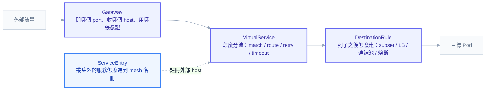

# 附錄 C-7：Istio 全欄位

[[istio]] 那一頁把 sidecar 注入、流量攔截、啟動 race condition 與 dual-stack 偵錯寫得很深——那些是「Envoy 為什麼沒起來」的知識。但它幾乎沒碰另外一半：**Envoy 起來之後，你要拿什麼 YAML 去指揮它**。

這一份補的就是那一半。Istio 的 CRD 有個特性讓它比內建 API 更容易寫錯：**規則之間有隱含的依賴與順序**。`VirtualService` 引用的 subset 必須先在 `DestinationRule` 定義好，否則流量直接 503；`RequestAuthentication` 單獨存在時完全不會擋任何請求；`AuthorizationPolicy` 一旦出現一條 ALLOW，該工作負載就從「全通」變成「白名單制」。這些語意寫在文件裡，但踩到的時候症狀都是「500 / 503 / 403」，看不出跟哪個欄位有關。

API group 以 Istio 1.22 之後的 `networking.istio.io/v1` 與 `security.istio.io/v1` 為準（`v1beta1` 仍相容）。

---

## 心智模型：四個問題，四種物件



一句話分工：**Gateway 管入口、VirtualService 管路由、DestinationRule 管連線品質、ServiceEntry 管名冊**。安全那三個（PeerAuthentication / RequestAuthentication / AuthorizationPolicy）則是垂直切過所有流量的另一組。

---

## Gateway

只描述「在 ingress gateway 上開什麼門」，不描述流量去哪——去哪是 VirtualService 的事。

```yaml
apiVersion: networking.istio.io/v1
kind: Gateway
metadata:
  name: public-gateway
  namespace: istio-system # 通常放 gateway 所在的 namespace
spec:
  selector:
    istio: ingressgateway # 選中哪個 gateway Deployment 的 label
  servers:
    - port:
        number: 443
        name: https
        protocol: HTTPS # HTTP | HTTPS | GRPC | HTTP2 | MONGO | TCP | TLS
      hosts:
        - "example.com"
        - "prod/*.internal.example.com" # 可用 <namespace>/<host> 限制誰能綁
      tls:
        mode: SIMPLE # SIMPLE | PASSTHROUGH | MUTUAL | ISTIO_MUTUAL | AUTO_PASSTHROUGH
        credentialName: example-tls # 讀的是 Secret，**必須與 gateway Pod 同 namespace**
        minProtocolVersion: TLSV1_2
        cipherSuites: []
    - port:
        number: 80
        name: http
        protocol: HTTP
      hosts: ["example.com"]
      tls:
        httpsRedirect: true # 80 直接 301 到 443
```

最常見的兩個坑：`credentialName` 指的 Secret 沒放在 gateway Pod 的 namespace（通常是 `istio-system`，不是應用的 namespace），以及 `hosts` 寫了 `example.com` 但 VirtualService 的 `hosts` 寫成 `*`——兩邊必須有交集才會生效。

---

## VirtualService

欄位最多、也最常寫的一個。

```yaml
apiVersion: networking.istio.io/v1
kind: VirtualService
metadata:
  name: reviews
  namespace: prod
spec:
  hosts:
    - reviews # 叢集內短名，等同 reviews.prod.svc.cluster.local
    - example.com # 對外時要與 Gateway 的 hosts 對得上
  gateways:
    - mesh # 保留字：叢集內部所有 sidecar
    - istio-system/public-gateway # 外部入口
  http:
    - name: canary-by-header
      match:
        - uri:
            prefix: /api # exact | prefix | regex 三擇一
          headers:
            x-canary:
              exact: "true"
          method:
            exact: GET
          queryParams:
            debug:
              exact: "1"
          sourceLabels:
            app: frontend
          gateways: ["mesh"] # 這條 match 只在內部流量生效
      route:
        - destination:
            host: reviews
            subset: v2 # **必須在 DestinationRule 先定義**
            port:
              number: 9080
          weight: 100
          headers:
            request:
              set:
                x-env: canary
            response:
              remove: ["x-internal"]
      timeout: 10s
      retries:
        attempts: 3
        perTryTimeout: 2s
        retryOn: "5xx,reset,connect-failure,retriable-status-codes"
        retryRemoteLocalities: false
      fault: # 混沌測試用
        delay:
          percentage:
            value: 10
          fixedDelay: 5s
        abort:
          percentage:
            value: 1
          httpStatus: 503
      mirror:
        host: reviews
        subset: v3
      mirrorPercentage:
        value: 5 # 影子流量，回應被丟棄
      corsPolicy:
        allowOrigins:
          - exact: https://example.com
        allowMethods: [GET, POST]
        allowHeaders: [authorization, content-type]
        allowCredentials: true
        maxAge: 24h
    - name: default # 沒 match 的 catch-all，**必須放最後**
      route:
        - destination:
            host: reviews
            subset: v1
  tls: # SNI 層路由（PASSTHROUGH 時用）
    - match:
        - sniHosts: ["secure.example.com"]
      route:
        - destination:
            host: secure-svc
  tcp:
    - match:
        - port: 3306
      route:
        - destination:
            host: mysql
  exportTo: ["."] # "." 只在本 namespace 可見，"*" 全叢集（預設）
```

| 欄位 | 說明 |
| --- | --- |
| `hosts` | 這條規則管誰的流量。短名會依 VirtualService 自己的 namespace 展開 |
| `gateways` | 不寫預設是 `["mesh"]`，也就是**只管內部流量**——這是「規則寫了但外部進來沒生效」的頭號原因 |
| `http[]` | **由上而下第一個 match 命中就決定**，所以 catch-all 必須放最後 |
| `route[].weight` | 同一組 route 的權重總和必須是 100 |
| `redirect` / `rewrite` / `directResponse` | 與 `route` 互斥，一個 http 規則只能選一種行為 |
| `timeout` | Istio 預設**沒有**逾時，長尾請求會一直掛著，正式服務建議明確設 |
| `retries` | 預設就有 2 次重試（`retryOn` 為連線層錯誤），要關掉得明確設 `attempts: 0` |

> `retries` 的預設值是隱形的陷阱：上游看到一次失敗，實際打到下游可能是三次。下游若是非冪等的寫入端點，重試會造成重複扣款這類事故。寫入類路由請明確關閉重試。

---

## DestinationRule

VirtualService 決定「去哪」，DestinationRule 決定「怎麼連」，以及 subset 的定義。

```yaml
apiVersion: networking.istio.io/v1
kind: DestinationRule
metadata:
  name: reviews
spec:
  host: reviews.prod.svc.cluster.local # 建議寫 FQDN，避免跨 namespace 解析歧義
  trafficPolicy:
    loadBalancer:
      simple: LEAST_REQUEST # ROUND_ROBIN | LEAST_REQUEST | RANDOM | PASSTHROUGH
      # 或改用一致性雜湊做黏著
      consistentHash:
        httpCookie:
          name: session
          ttl: 3600s
        # 或 httpHeaderName / useSourceIp / httpQueryParameterName
        minimumRingSize: 1024
    connectionPool:
      tcp:
        maxConnections: 100
        connectTimeout: 3s
        tcpKeepalive:
          time: 7200s
          interval: 75s
      http:
        http1MaxPendingRequests: 100
        http2MaxRequests: 1000
        maxRequestsPerConnection: 0 # 設 1 等於關閉 keep-alive
        maxRetries: 3
        idleTimeout: 30s
        h2UpgradePolicy: DEFAULT
    outlierDetection: # 熔斷：把壞掉的實例踢出負載池
      consecutive5xxErrors: 5
      interval: 10s
      baseEjectionTime: 30s
      maxEjectionPercent: 50 # 最多踢掉一半，避免全踢光
      minHealthPercent: 40
    tls:
      mode: ISTIO_MUTUAL # DISABLE | SIMPLE | MUTUAL | ISTIO_MUTUAL
    portLevelSettings:
      - port:
          number: 9080
        connectionPool:
          tcp:
            maxConnections: 10
  subsets:
    - name: v1
      labels:
        version: v1 # 對應 Pod 的 label
    - name: v2
      labels:
        version: v2
      trafficPolicy: # subset 可以覆蓋上面的全域設定
        loadBalancer:
          simple: ROUND_ROBIN
  exportTo: ["*"]
```

`outlierDetection` 是 mesh 相對於原生 K8s Service 最實質的加值：K8s 的 readinessProbe 是「Pod 自己說我不行」，而 outlier detection 是「呼叫方發現你一直回 5xx，那我先不打你」。兩者互補，都要有。

> 最常見的 503 原因：VirtualService 寫了 `subset: v2`，但 DestinationRule 裡沒有 v2，或是 v2 的 labels 選不到任何 Pod。診斷用 `istioctl proxy-config cluster <pod> | grep reviews`——看不到對應的 cluster 就是 subset 沒生效。

---

## ServiceEntry 與 Sidecar

`ServiceEntry` 把叢集外的服務加進 mesh 的名冊，之後就能對它套 VirtualService / DestinationRule（做逾時、重試、熔斷）。

```yaml
apiVersion: networking.istio.io/v1
kind: ServiceEntry
metadata:
  name: external-payment-api
spec:
  hosts: ["api.payment.com"]
  ports:
    - number: 443
      name: https
      protocol: HTTPS
  location: MESH_EXTERNAL # MESH_EXTERNAL | MESH_INTERNAL
  resolution: DNS # DNS | STATIC | NONE | DNS_ROUND_ROBIN
  endpoints: # resolution: STATIC 時才需要
    - address: 203.0.113.10
      locality: ap-northeast-1/ap-northeast-1a
  exportTo: ["."]
```

`Sidecar` 則是相反方向：**限縮**每個 Envoy 拿到的設定範圍。預設每個 sidecar 都拿到全叢集所有服務的設定，服務一多，光是 Envoy 的記憶體就很可觀。

```yaml
apiVersion: networking.istio.io/v1
kind: Sidecar
metadata:
  name: default
  namespace: prod
spec:
  workloadSelector:
    labels:
      app: my-app # 不寫＝整個 namespace 適用
  egress:
    - hosts:
        - "./*" # 只看得到本 namespace
        - "istio-system/*"
        - "prod/reviews.prod.svc.cluster.local"
      port:
        number: 9080
      captureMode: DEFAULT # DEFAULT | IPTABLES | NONE
  ingress:
    - port:
        number: 8080
        protocol: HTTP
        name: http
      defaultEndpoint: 127.0.0.1:8080
  outboundTrafficPolicy:
    mode: REGISTRY_ONLY # 只允許連名冊上有的服務；ALLOW_ANY 是預設
```

`outboundTrafficPolicy: REGISTRY_ONLY` 是把 mesh 當作 egress 白名單用的開關——打開之後，任何沒有 ServiceEntry 的外部連線都會被擋，症狀是連外部 API 回 502。這個設定值得知道，因為它同時是安全加固手段與事故來源。

---

## PeerAuthentication：工作負載之間的 mTLS

```yaml
apiVersion: security.istio.io/v1
kind: PeerAuthentication
metadata:
  name: default
  namespace: prod
spec:
  selector:
    matchLabels:
      app: my-app # 不寫＝整個 namespace
  mtls:
    mode: STRICT # UNSET | DISABLE | PERMISSIVE | STRICT
  portLevelMtls:
    8080:
      mode: DISABLE # 特定 port 開後門，例如給 Prometheus 抓 metrics
```

作用範圍由「放在哪個 namespace」決定：放在 Istio 根 namespace（通常是 `istio-system`）且無 selector ＝全 mesh 生效；放在一般 namespace ＝該 namespace 生效；有 selector ＝只作用於選中的工作負載。

導入順序永遠是 `PERMISSIVE` → 觀察 → `STRICT`。直接上 STRICT 的話，任何還沒注入 sidecar 的工作負載（含健康檢查來源、舊系統）會立刻被拒，症狀是連線被 reset 而不是明確的 403。

---

## RequestAuthentication：驗 JWT

這一個跟你的 Google OAuth + JWT 架構直接相關，也是全 Istio 最容易誤解的物件。

```yaml
apiVersion: security.istio.io/v1
kind: RequestAuthentication
metadata:
  name: google-jwt
  namespace: prod
spec:
  selector:
    matchLabels:
      app: api
  jwtRules:
    - issuer: "https://accounts.google.com"
      jwksUri: "https://www.googleapis.com/oauth2/v3/certs"
      audiences: ["<your-client-id>.apps.googleusercontent.com"]
      forwardOriginalToken: true # 驗完之後仍把原始 token 傳給應用
      fromHeaders:
        - name: Authorization
          prefix: "Bearer "
      fromParams: ["access_token"]
      outputClaimToHeaders: # 把 claim 轉成 header 給應用直接用
        - header: x-user-email
          claim: email
      forwardOriginalToken: true
```

**關鍵語意：`RequestAuthentication` 只驗「有帶 token 的請求」，完全不擋「沒帶 token 的請求」。** 它的作用是「如果有 token，就必須是有效的，否則 401」。沒帶 token 的請求會被視為匿名流量直接放行。

要真的擋下匿名請求，必須再加一條 `AuthorizationPolicy` 要求 `requestPrincipals`：

```yaml
apiVersion: security.istio.io/v1
kind: AuthorizationPolicy
metadata:
  name: require-jwt
  namespace: prod
spec:
  selector:
    matchLabels:
      app: api
  action: ALLOW
  rules:
    - from:
        - source:
            requestPrincipals: ["https://accounts.google.com/*"] # <issuer>/<sub>
```

這兩個物件必須成對出現，是 Istio 最常見的安全誤設——只寫 `RequestAuthentication` 就以為 API 被保護了，實際上把 `Authorization` header 拿掉反而暢行無阻。

---

## AuthorizationPolicy：誰可以呼叫誰

```yaml
apiVersion: security.istio.io/v1
kind: AuthorizationPolicy
metadata:
  name: api-access
  namespace: prod
spec:
  selector:
    matchLabels:
      app: api
  action: ALLOW # ALLOW | DENY | AUDIT | CUSTOM
  rules:
    - from:
        - source:
            principals: ["cluster.local/ns/prod/sa/frontend"] # mTLS 身份（SA）
            namespaces: ["prod"]
            requestPrincipals: ["https://accounts.google.com/*"] # JWT 身份
            notPrincipals: []
            ipBlocks: ["10.0.0.0/8"]
            remoteIpBlocks: ["203.0.113.0/24"] # 走 X-Forwarded-For 的真實來源
      to:
        - operation:
            methods: ["GET", "POST"]
            paths: ["/api/*"]
            notPaths: ["/api/admin/*"]
            ports: ["8080"]
      when:
        - key: request.auth.claims[email]
          values: ["*@example.com"]
        - key: request.headers[x-env]
          values: ["prod"]
```

三條必須記住的判定規則：

1. **DENY 先評估，ALLOW 後評估。** 任何 DENY 命中就直接拒絕，不看 ALLOW。
2. **只要有任何一條 ALLOW policy 選中這個工作負載，該工作負載就變成白名單制**——沒被任何規則允許的請求一律 403。這是「加了一條規則之後，其他所有呼叫全掛」的原因。
3. **空的 `rules: [{}]` 配 `action: ALLOW` ＝全部放行**；而 `action: ALLOW` 加上 `rules: []`（空陣列）＝什麼都不允許，等於全擋。一個中括號的差別。

`action: CUSTOM` 搭配 `provider.name` 可把授權決策外包給外部 ext-authz 服務（例如 OPA），適合複雜的商業規則。

---

## Telemetry 與 EnvoyFilter

```yaml
apiVersion: telemetry.istio.io/v1
kind: Telemetry
metadata:
  name: mesh-default
  namespace: istio-system
spec:
  tracing:
    - providers:
        - name: otel
      randomSamplingPercentage: 1.0 # 正式環境別開 100%
      customTags:
        env:
          literal:
            value: prod
  metrics:
    - providers:
        - name: prometheus
      overrides:
        - match:
            metric: REQUEST_COUNT
            mode: CLIENT_AND_SERVER
          tagOverrides:
            request_host:
              operation: REMOVE # 移除高基數 tag，救 Prometheus
  accessLogging:
    - providers:
        - name: envoy
      filter:
        expression: "response.code >= 400" # 只記錄錯誤，省日誌量
```

`tagOverrides` 移除高基數標籤這一招值得記：Istio 預設產生的 metric 標籤很多，`request_host`、`source_workload` 之類的組合會讓 Prometheus 的 series 數量爆炸（第 14 章談過基數問題）。

`EnvoyFilter` 是最後手段——直接對 Envoy 的設定打補丁：

```yaml
apiVersion: networking.istio.io/v1alpha3
kind: EnvoyFilter
metadata:
  name: add-header
spec:
  workloadSelector:
    labels:
      app: api
  configPatches:
    - applyTo: HTTP_FILTER
      match:
        context: SIDECAR_INBOUND
        listener:
          filterChain:
            filter:
              name: envoy.filters.network.http_connection_manager
      patch:
        operation: INSERT_BEFORE
        value: {}
```

它綁定的是 Envoy 的內部設定結構，**Istio 升級時很容易靜默失效或直接讓 Envoy 拒絕設定**。能用其他 CRD 解決就不要用它；真的用了，要在升級檢查清單裡列為必驗項目。

---

## 注入相關 annotation

寫在 Pod template 的 `metadata.annotations`（機制與 race condition 的完整分析見 [[istio]]）：

| annotation | 用途 |
| --- | --- |
| `sidecar.istio.io/inject: "false"` | 單一 Pod 不注入 |
| `proxy.istio.io/config: '{"holdApplicationUntilProxyStarts": true}'` | 等 Envoy 就緒才啟動應用，解啟動 race |
| `sidecar.istio.io/proxyCPU` / `proxyMemory` / `proxyCPULimit` | 覆蓋 sidecar 資源設定 |
| `traffic.sidecar.istio.io/excludeOutboundPorts` | 某些 port 不走攔截（如資料庫直連） |
| `traffic.sidecar.istio.io/excludeOutboundIPRanges` | 整段網段不攔截 |
| `traffic.sidecar.istio.io/includeInboundPorts` | 只攔截指定入站 port |
| `sidecar.istio.io/rewriteAppHTTPProbers: "true"` | 讓 kubelet 的 HTTP probe 繞過 mTLS |

namespace 層級用 label 開啟注入：`kubectl label namespace prod istio-injection=enabled`（或修訂版標籤 `istio.io/rev=<revision>`，金絲雀升級時用）。

---

## 診斷指令與常見誤設

```
istioctl analyze -n prod                       # 靜態檢查設定衝突，上線前先跑
istioctl proxy-status                          # 各 sidecar 與 istiod 的同步狀態
istioctl proxy-config route <pod> -n prod      # 這個 Pod 實際拿到的路由表
istioctl proxy-config cluster <pod> -n prod    # subset 有沒有生效看這裡
istioctl proxy-config listener <pod> -n prod
istioctl x describe pod <pod> -n prod          # 這個 Pod 被哪些規則影響
```

| # | 誤設 | 症狀 | 正解 |
| --- | --- | --- | --- |
| 1 | VirtualService 沒寫 `gateways` | 外部流量完全不受規則影響 | 明確列出 gateway，內部也要保留 `mesh` |
| 2 | 引用不存在的 `subset` | 503 no healthy upstream | subset 必須先在 DestinationRule 定義且 labels 選得到 Pod |
| 3 | catch-all 規則放在最前面 | 後面的 canary 規則永遠不會命中 | 由上而下第一個命中決定，catch-all 放最後 |
| 4 | 只寫 `RequestAuthentication` | 沒帶 token 反而暢行無阻 | 必須配 AuthorizationPolicy 的 `requestPrincipals` |
| 5 | 直接上 `mtls: STRICT` | 未注入的工作負載連線被 reset | 先 `PERMISSIVE` 觀察 |
| 6 | 加了第一條 ALLOW policy | 其他所有呼叫突然 403 | ALLOW 一出現即轉白名單制，要補齊所有合法來源 |
| 7 | `credentialName` 的 Secret 放錯 namespace | TLS 交握失敗 | 必須與 gateway Pod 同 namespace |
| 8 | 沒關寫入端點的重試 | 重複扣款 | 非冪等路由設 `retries.attempts: 0` |
| 9 | 沒設 `timeout` | 長尾請求堆積直到連線池耗盡 | 明確設定逾時 |
| 10 | 用 EnvoyFilter 解決可用 CRD 解的事 | 升級後靜默失效 | 列入升級驗證清單，能不用就不用 |

---

## 連結

- [[73-long-lived-connections]] — 附錄 AY：什麼時候真的需要 L7 負載平衡來解長連線
- [[72-cascading-failure]] — 附錄 AX：`outlierDetection` 與重試欄位背後該有的設計判斷
- [[32-istio-ingress-gateway]] — 附錄 J：Ingress Gateway 專章，選型取捨與 503 旗標判讀
- [[istio]] — sidecar 注入、流量攔截機制、啟動 race condition 與 dual-stack 偵錯
- [[18-yaml-fields-pod]] — 附錄 C-1：Pod 與 Container 全欄位（原生 sidecar 寫法）
- [[20-yaml-fields-network-storage]] — 附錄 C-3：Service/Ingress/Gateway API 全欄位
- [[22-yaml-fields-ecosystem]] — 附錄 C-5：生態系 CRD 全欄位
- [[25-yaml-fields-pipeline]] — 附錄 C-8：交付鏈上的非 K8s YAML
- [[05-networking]] — 網路四鐵律與完整封包路徑
- [[14-prometheus-grafana]] — metric 基數問題與 PromQL
- [[k8s-mastery]] — 教材總目錄
