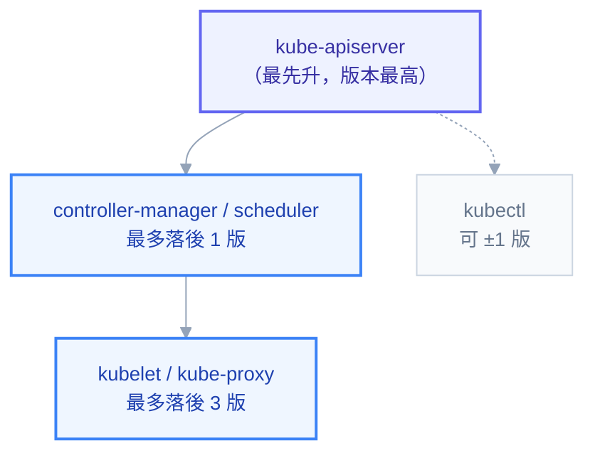

# 附錄 E：版本升級與 API 棄用

Kubernetes 每年出三個小版本，每個版本支援大約十四個月。這意味著一件對管理員很現實的事：**你每年至少要升級兩次，而且沒有「不升級」這個選項**——落後太多之後，安全修補拿不到、雲端供應商停止支援、社群 chart 開始要求更新的 API 版本。

升級本身不難，難的是升級**之前**該檢查什麼。真正會出事的從來不是 `kubeadm upgrade apply` 那一行指令，而是三類提前埋好的地雷：叢集裡還有人在用即將被移除的 API、某個 webhook 的 `failurePolicy: Fail` 在升級過程中把整個叢集鎖死、或是 PDB 讓 Node 永遠 drain 不完。這一份就是把這三類地雷的排查方法寫清楚。

第 12 章講的是升級的**流程**（怎麼備份 etcd、怎麼輪憑證、怎麼一台台換）。這一份講的是升級的**相容性**：什麼東西會壞、怎麼提前知道、壞了怎麼修。

---

## 版本與支援週期的基本規則

| 規則 | 內容 |
| --- | --- |
| 發版節奏 | 每年約三個小版本（1.31 → 1.32 → 1.33） |
| 支援期 | 每版約 14 個月（12 個月修補 + 2 個月維護） |
| 升級跨度 | **一次只能跳一個小版本**。1.30 → 1.33 必須走 1.31、1.32、1.33 三次 |
| 修補版 | patch 版（1.33.1 → 1.33.4）可以直接跳，不受上面限制 |

「一次只能跳一版」是硬限制，因為 K8s 只保證相鄰版本之間的資料轉換與相容性。強行跨版升級的後果不是報錯，而是 etcd 裡的物件可能無法被新版正確讀取。

### Version Skew：哪個元件可以落後多少



由此推導出**升級順序是固定的**：先 control plane（etcd → apiserver → controller-manager/scheduler），再 worker node 的 kubelet 與 kube-proxy，最後才是各人的 kubectl。反過來做——先升 kubelet——會讓 kubelet 比 apiserver 新，這是明確不支援的組合。

---

## 已移除 API 對照表

這張表是升級前最該對的一份清單。左欄是舊寫法，右欄是替代品；「移除版本」代表**從該版起 apply 會直接失敗**。

### 影響最廣的兩次：1.22 與 1.25

| 舊 API | 新 API | 移除於 |
| --- | --- | --- |
| `extensions/v1beta1` Ingress | `networking.k8s.io/v1` | 1.22 |
| `networking.k8s.io/v1beta1` Ingress / IngressClass | `networking.k8s.io/v1` | 1.22 |
| `apiextensions.k8s.io/v1beta1` CRD | `apiextensions.k8s.io/v1`（**schema 變必填**） | 1.22 |
| `admissionregistration.k8s.io/v1beta1` Webhook | `admissionregistration.k8s.io/v1` | 1.22 |
| `rbac.authorization.k8s.io/v1beta1` | `rbac.authorization.k8s.io/v1` | 1.22 |
| `certificates.k8s.io/v1beta1` CSR | `certificates.k8s.io/v1`（**`signerName` 變必填**） | 1.22 |
| `storage.k8s.io/v1beta1` CSIDriver/CSINode/StorageClass | `storage.k8s.io/v1` | 1.22 |
| `scheduling.k8s.io/v1beta1` PriorityClass | `scheduling.k8s.io/v1` | 1.22 |
| `coordination.k8s.io/v1beta1` Lease | `coordination.k8s.io/v1` | 1.22 |
| `policy/v1beta1` **PodSecurityPolicy** | Pod Security Admission 或 OPA/Kyverno | 1.25 |
| `batch/v1beta1` CronJob | `batch/v1` | 1.25 |
| `policy/v1beta1` PodDisruptionBudget | `policy/v1` | 1.25 |
| `discovery.k8s.io/v1beta1` EndpointSlice | `discovery.k8s.io/v1` | 1.25 |
| `events.k8s.io/v1beta1` Event | `events.k8s.io/v1` | 1.25 |
| `autoscaling/v2beta1` HPA | `autoscaling/v2` | 1.25 |
| `node.k8s.io/v1beta1` RuntimeClass | `node.k8s.io/v1` | 1.25 |

PodSecurityPolicy 的移除是這幾年影響最大的一次——它沒有直接的 API 替代品，必須改寫成 Pod Security Admission 的 namespace label（附錄 C-4）或引入 Kyverno / OPA Gatekeeper。從 1.24 以下升級的叢集，這一項通常是整個升級專案裡工作量最大的部分。

### 1.26 之後

| 舊 API | 新 API | 移除於 |
| --- | --- | --- |
| `autoscaling/v2beta2` HPA | `autoscaling/v2` | 1.26 |
| `flowcontrol.apiserver.k8s.io/v1beta1` | `flowcontrol.apiserver.k8s.io/v1` | 1.26 |
| `storage.k8s.io/v1beta1` CSIStorageCapacity | `storage.k8s.io/v1` | 1.27 |
| `flowcontrol.apiserver.k8s.io/v1beta2` | `flowcontrol.apiserver.k8s.io/v1` | 1.29 |
| in-tree `cephfs` / `rbd` volume | 對應的 CSI driver | 1.31 |
| `flowcontrol.apiserver.k8s.io/v1beta3` | `flowcontrol.apiserver.k8s.io/v1` | 1.32 |

到 1.33 為止，`Endpoints` 已標記為棄用（改用 `EndpointSlice`，但仍可使用），`gitRepo` volume 預設停用。這兩項現在不會壞，但值得列進技術債清單。

### 不是 API 移除、但同樣會咬人的三個變更

| 版本 | 變更 | 你會遇到的症狀 |
| --- | --- | --- |
| 1.24 | 移除 dockershim | 節點的 container runtime 若還是 Docker Engine，kubelet 起不來（要換 containerd／CRI-O，或裝 cri-dockerd） |
| 1.24 | ServiceAccount 不再自動產生長期 token Secret | 依賴那個 Secret 的舊系統認證失敗 |
| 1.25+ | `seccompProfile` 與 AppArmor 從 annotation 改為正式欄位 | 舊 annotation 靜默失效，安全設定形同虛設 |

第三項特別陰險：**它不會報錯**。你的 Pod 照樣起來，只是原本以為生效的 seccomp 保護沒了。升級後值得用 `kubectl get pod -o yaml` 抽驗幾個 Pod，確認 `securityContext.seccompProfile` 真的存在。

---

## 怎麼提前知道叢集裡有沒有地雷

有四個互補的手段，建議全部都做——它們各自看得到的東西不一樣。

### 1. 問 API Server：誰在用棄用 API

```
kubectl get --raw /metrics | grep apiserver_requested_deprecated_apis
```

這個 metric 是 K8s 內建的，每一筆會標出 `group`、`version`、`resource` 與 `removed_release`（哪一版會移除）。它的價值在於**看得到真實流量**，包含那些不在你 git repo 裡的呼叫者（例如某個 controller 或人工操作）。

搭配 audit log 可以進一步查出**是誰**在呼叫：在 audit policy 針對這些 resource 開 `Metadata` 級別，就能看到 user agent 與 SA 名稱。

### 2. 掃 git repo 裡的 YAML

```
# pluto：掃檔案與 Helm release
pluto detect-files -d ./manifests --target-versions k8s=v1.33.0
pluto detect-helm --target-versions k8s=v1.33.0

# kubent（kube-no-trouble）：直接掃活著的叢集
kubent --target-version 1.33
```

這兩個工具解決的是不同問題：`pluto detect-files` 掃的是**還沒部署的**檔案（catch 在 CI 裡最有價值），`kubent` 掃的是**叢集裡已經存在的**物件。兩邊都要掃，因為 git 裡乾淨不代表叢集裡乾淨——有些東西是手動 apply 進去的。

### 3. 轉換舊 YAML

```
kubectl convert -f old-ingress.yaml --output-version networking.k8s.io/v1
```

`kubectl convert` 從 1.20 起變成獨立 plugin，要另外安裝。它能處理大部分機械性的欄位搬移（例如 Ingress 從 `backend.serviceName` 改成 `backend.service.name`），但**不會**幫你處理語意變更（例如 CRD 從 v1beta1 升到 v1 必須補上 schema）。

### 4. 檢查生態系相容性

這一項沒有工具能全自動，要人工對：

- **Helm chart 的 `kubeVersion` 限制**：`helm show chart <chart> | grep kubeVersion`
- **CRD 與 Operator 的支援版本**：cert-manager、Istio、Prometheus Operator 都有自己的相容矩陣，通常需要**先升它們、再升 K8s**
- **CNI 版本**：Calico/Cilium 對 K8s 版本有明確要求
- **CSI driver 版本**
- **container runtime 版本**：containerd 與 K8s 有對應關係

> Istio 特別要注意：它的支援視窗比 K8s 短，而且 `EnvoyFilter`（附錄 C-7）綁在 Envoy 的內部設定結構上，Istio 升級時最容易靜默失效。有用 EnvoyFilter 的叢集，升級檢查清單裡要專門列一項驗證它。

---

## 升級前檢查清單

按這個順序跑，每一項都要有明確的「通過」證據，不要憑印象。

**相容性**

- [ ] `apiserver_requested_deprecated_apis` 為空，或已知每一筆的來源並確認無害
- [ ] `pluto` / `kubent` 掃描結果為零
- [ ] Helm chart 的 `kubeVersion` 允許目標版本
- [ ] CNI / CSI / Operator（cert-manager、Istio、Prometheus）確認支援目標版本
- [ ] container runtime 版本相容
- [ ] 目標版本的 release note 中「Urgent Upgrade Notes」逐條看過

**可回復性**

- [ ] etcd 快照已建立**並實際還原驗證過**（沒驗過的備份等於沒有備份）
- [ ] 控制平面節點有 VM 層級的快照或可重建的 IaC
- [ ] `/etc/kubernetes` 與憑證目錄已備份
- [ ] 有 Velero 之類的工作負載層備份

**升級過程不會卡住**

- [ ] 所有 webhook 的 `failurePolicy` 已檢視，`Fail` 的有排除 `kube-system` 且 webhook 本身多副本
- [ ] PDB 不會讓任何 Node 永遠 drain 不完（單副本 + `minAvailable: 1` 的組合要先處理）
- [ ] 叢集有足夠餘裕容納 drain 出來的 Pod（節點數 × 使用率算過）
- [ ] 有狀態服務確認過重排程時的資料安全（RWO PVC 的 Multi-Attach）

**觀測**

- [ ] 監控與告警正常，升級中有人盯著
- [ ] 有明確的中止條件與回滾決策點

webhook 那一項值得再強調一次：**升級過程中 API Server 會重啟**，如果此時某個 `failurePolicy: Fail` 的 webhook 服務剛好也在被驅逐，所有符合它 rules 的請求都會被拒絕。若那條 rule 涵蓋 Pod 的 CREATE，你會得到一個無法建立任何 Pod、因此也無法自救的叢集。這是升級事故裡最經典的一種死鎖。

---

## kubeadm 升級流程

```
# 1. 第一台 control plane
kubeadm upgrade plan # 列出可升到哪些版本與需注意事項
apt-mark unhold kubeadm && apt-get install -y kubeadm=1.33.x-*
kubeadm upgrade apply v1.33.x

# 2. 其餘 control plane 節點
kubeadm upgrade node

# 3. 每個節點的 kubelet（含 control plane 自己）
kubectl drain <node> --ignore-daemonsets --delete-emptydir-data
apt-get install -y kubelet=1.33.x-* kubectl=1.33.x-*
systemctl daemon-reload && systemctl restart kubelet
kubectl uncordon <node>
```

`kubeadm upgrade plan` 是免費的健康檢查，就算還不打算升級也值得定期跑——它會告訴你憑證還有多久到期、目前版本落後多少。

每台節點升完之後、進行下一台之前，確認這三件事：`kubectl get nodes` 顯示新版本且 `Ready`、該節點上的 Pod 都回到 Running、監控沒有新告警。**不要為了快而平行 drain 多台**，那是把「一台出問題」放大成「叢集容量不足」的標準做法。

---

## 升級後驗證

```
kubectl get nodes -o wide # 版本一致且全部 Ready
kubectl get pods -A | grep -v Running | grep -v Completed
kubectl get apiservice | grep -v True # 聚合 API 是否正常（metrics-server 常在這裡出事）
kubectl top nodes # 驗證 metrics 管線
kubectl get events -A --sort-by=.metadata.creationTimestamp | tail -30
```

再加上三個容易被忘記的抽驗：確認 `securityContext` 之類的欄位沒有靜默消失、跑一次實際的部署（`kubectl rollout restart` 一個測試服務）確認完整鏈路通、以及檢查憑證有效期（`kubeadm certs check-expiration`）。

---

## 建立一份自己的版本檔案

管理員該維護一張表，記錄叢集現況與升級歷史。內容至少包含：

| 項目 | 目前值 | 目標版本相容性 | 上次驗證 |
| --- | --- | --- | --- |
| Kubernetes | 1.33.2 | — | 2026-08-14 |
| container runtime | containerd 2.0 | ✅ | 2026-08-14 |
| CNI | Calico 3.28 | 待確認 | — |
| CSI driver | ebs-csi 1.35 | ✅ | — |
| cert-manager | v1.15 | ✅ | — |
| Istio | 1.22 | ⚠️ 需先升到 1.24 | — |
| Prometheus Operator | 0.75 | ✅ | — |
| Helm charts | 見 CI 掃描 | 每次 PR 檢查 | 自動 |

把 `pluto detect-files` 加進 CI，讓「有人提交了使用棄用 API 的 YAML」在 PR 階段就被擋下來——這比升級前一次性大掃除有效得多，因為債務不會累積。

---

## 連結

- [[12-cluster-operations]] — etcd 備份還原、憑證輪替、升級的實際操作流程
- [[03-api-and-yaml]] — GVK 與 API 版本成熟度規則
- [[21-yaml-fields-cluster-security]] — Webhook `failurePolicy` 與 PSA 設定
- [[19-yaml-fields-workloads]] — PDB 欄位與 drain 卡死
- [[23-yaml-fields-rare-builtins]] — kubeadm / kubelet 設定檔
- [[28-ingress-nginx-annotations]] — 附錄 F：ingress-nginx annotation 百科
- [[13-troubleshooting]] — 升級後異常的分層定位
- [[k8s-mastery]] — 教材總目錄
