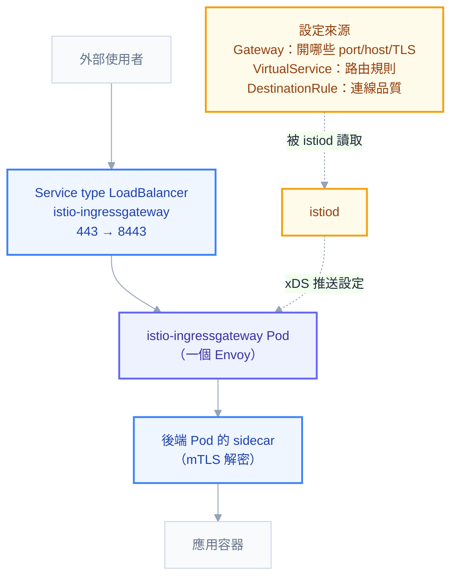

# 附錄 J：Istio Ingress Gateway

附錄 C-7 攤平了 Istio 的所有 CRD 欄位，附錄 F 講了 ingress-nginx 的 annotation。但有一個東西夾在中間、兩邊都沒交代清楚：**當你的叢集裝了 Istio，外部流量到底該從哪裡進來？**

答案是 Istio Ingress Gateway（常簡稱 IGW）。它跟 ingress-nginx 是**互相取代的關係**，不是疊加——兩者都能當叢集的對外入口，但設定方式、能力邊界、失敗模式完全不同。這一份把它講清楚，並且給你一張「什麼時候該用哪個」的決策表。

## 它到底是什麼

**Istio Ingress Gateway 就是一個 Envoy Pod，只是不當 sidecar 用，而是獨立部署在叢集邊界。**

這句話包含兩個關鍵。第一，它跟你 Pod 旁邊那個 `istio-proxy` 是**同一個程式**（Envoy），差別只在扮演的角色——sidecar 攔截單一 Pod 的進出流量，gateway 則是接收整個叢集的外來流量。第二，它跟 ingress-nginx controller 一樣是「一個代理 + 一組設定來源」的組合，只是設定來源不同：

| | ingress-nginx | Istio Ingress Gateway |
| --- | --- | --- |
| 代理程式 | nginx | Envoy |
| 設定從哪來 | Ingress 物件 + annotation | Gateway + VirtualService + DestinationRule |
| 設定怎麼下發 | controller 產生 `nginx.conf` 後 reload | istiod 透過 **xDS 動態推送**，不需要 reload |
| 進階能力 | 靠 controller 專屬 annotation | 寫在 CRD 規格裡，有 schema 驗證 |
| 打錯欄位 | **靜默失效** | API Server 直接拒絕 |
| mTLS 延伸到後端 | 不支援 | 原生支援（gateway 到 Pod 走 mTLS） |
| 學習與維運成本 | 低 | 高（要先有整套 Istio） |

「打錯欄位會不會被拒絕」這一項是實務上最有感的差異。附錄 F 的常見誤設第一條就是「annotation key 打錯字完全靜默失效」——在 Istio 這邊，`VirtualService` 的欄位是 CRD schema 定義的，打錯直接被 API Server 擋下來。

## 流量的完整路徑



有一個容易混淆的地方值得先講清楚：**`istio-ingressgateway` 前面仍然有一個 `Service`（型別通常是 LoadBalancer 或 NodePort）**。Gateway 這個 CRD **不會**幫你開對外的 port——它只是告訴那個 Envoy「你要監聽哪些 port、接受哪些 host、用哪張憑證」。實際把流量從叢集外導進來的，還是那個 Service。

這解釋了一個新手常見的困惑：Gateway 裡寫 `port: 443`，但 gateway Pod 的容器實際聽的是 **8443**。因為 gateway 以非 root 執行，不能綁 1024 以下的 port（入門第二章的 Linux 權限規則），所以 Service 做了 443 → 8443 的轉換。

## 三個物件怎麼搭

這是 Istio 流量管理最容易出錯的地方——**三個物件必須互相對得上，錯一個就是 404 或 503**。

```yaml
apiVersion: networking.istio.io/v1
kind: Gateway
metadata:
  name: public-gateway
  namespace: istio-system # 通常跟 gateway Pod 放一起
spec:
  selector:
    istio: ingressgateway # 必須符合 gateway Deployment 的 label
  servers:
    - port:
        number: 443
        name: https
        protocol: HTTPS
      hosts:
        - "demo.example.com" # ← 記住這裡
      tls:
        mode: SIMPLE
        credentialName: demo-tls # ← Secret 必須在 istio-system
    - port:
        number: 80
        name: http
        protocol: HTTP
      hosts:
        - "demo.example.com"
      tls:
        httpsRedirect: true # 80 直接 301 導到 443
---
apiVersion: networking.istio.io/v1
kind: VirtualService
metadata:
  name: demo
  namespace: demo # 可以跟 Gateway 不同 namespace
spec:
  hosts:
    - "demo.example.com" # ← 必須與 Gateway 的 hosts 有交集
  gateways:
    - istio-system/public-gateway # ← 跨 namespace 要寫 <ns>/<name>
  http:
    - name: api
      match:
        - uri:
            prefix: /api
      route:
        - destination:
            host: api-svc.demo.svc.cluster.local
            port:
              number: 80
      timeout: 10s
    - name: default
      route:
        - destination:
            host: web-svc.demo.svc.cluster.local
            port:
              number: 80
```

三條綁定規則，任何一條沒對上流量就不通：

1. **Gateway 的 `selector`** 必須選中實際的 gateway Deployment 的 label（預設安裝是 `istio: ingressgateway`）
2. **VirtualService 的 `gateways`** 必須指到那個 Gateway；跨 namespace 一定要寫 `<namespace>/<name>`，只寫名字會被當成同 namespace 而找不到
3. **兩邊的 `hosts` 必須有交集**——Gateway 開的是 `demo.example.com`，VirtualService 卻寫 `*` 或別的網域，就對不上

> **最常見的單一錯誤：VirtualService 沒寫 `gateways` 欄位。** 它的預設值是 `["mesh"]`，也就是「只管叢集內部流量」。結果是你的規則對內生效、對外完全沒作用，而且不會有任何錯誤訊息——外部請求直接 404。

需要在同一份 VirtualService 同時管內外流量時，兩個都列：

```yaml
gateways:
  - mesh # 叢集內部
  - istio-system/public-gateway # 外部入口
```

## Port 對照表

排錯時會遇到一堆 15xxx 的 port，記住它們各自的用途：

| port | 用途 | 你什麼時候會碰到 |
| --- | --- | --- |
| `15021` | 健康檢查（`/healthz/ready`） | gateway 的 readinessProbe 打這裡；連不上就是 Ready 不了 |
| `15090` | Envoy 的 Prometheus metrics | 設 ServiceMonitor 抓 gateway 指標時 |
| `15000` | Envoy admin 介面（僅 localhost） | `kubectl exec` 進去看實際設定 |
| `15001` | sidecar 的 outbound 攔截 | 出站流量排錯 |
| `15006` | sidecar 的 inbound 攔截 | 入站流量排錯 |
| `15012` | istiod 的 xDS + CA | gateway 連不到它就拿不到設定 |
| `8080` / `8443` | gateway 容器實際監聽的服務 port | Service 從 80/443 轉過來 |

`15021` 特別值得記：Istio 相關的 issue 裡「gateway 一直不 Ready」有相當比例是這個 port 連不上，根因通常在 CNI 或網路策略（[[istio]] 那頁有一則對應的 upstream issue）。

## 503 的四種面貌：Envoy response flags

這是這一份最實用的一節。Envoy 回 503 時會在存取日誌裡帶一個**回應旗標**，直接指出是哪一段出問題——不看它的話，四種完全不同的故障看起來一模一樣。

先把日誌撈出來：

```powershell
kubectl logs -n istio-system deploy/istio-ingressgateway --tail=50
```

日誌格式裡那個兩到三個字母的欄位就是旗標：

| 旗標 | 意思 | 真正的原因 |
| --- | --- | --- |
| `NR` | **No Route** | Gateway 與 VirtualService 沒綁上：`gateways` 沒寫、hosts 沒交集、或跨 namespace 沒寫 `<ns>/<name>` |
| `UH` | **No healthy Upstream** | 後端沒有健康的 Pod：Pod 沒 Ready、Service selector 對不上、或 DestinationRule 的 subset labels 選不到任何 Pod |
| `UF` | **Upstream Failure** | 連得到但握手失敗：**最常見是 mTLS 設定衝突**（下面詳述）、port 寫錯、後端只聽 `127.0.0.1` |
| `NC` | **No Cluster** | VirtualService 指向的 `host` 不存在——Service 名稱打錯，或跨 namespace 沒寫完整 FQDN |
| `UO` | Upstream Overflow | 觸發了 DestinationRule 的 `connectionPool` 上限（熔斷），不是壞掉是被限流 |
| `URX` | 重試次數用盡 | 後端持續失敗 |
| `UT` | Upstream Timeout | 後端太慢，超過 VirtualService 的 `timeout` |
| `DC` | Downstream Connection termination | 客戶端自己斷線 |
| `RBAC: access denied` | 403 而非 503 | AuthorizationPolicy 擋下了 |

**`NR` 與 `UH` 的區分是最有價值的一組**：`NR` 代表流量根本沒被路由（問題在 Gateway/VirtualService 的設定），`UH` 代表路由對了但後端沒人（問題在 Service/Pod）。這一個字母就把排查範圍砍半。

### `UF` 與 mTLS 衝突

`UF` 最常見的根因值得單獨說明，因為它的設定分散在兩個物件、看起來都沒錯：

```yaml
# PeerAuthentication 要求後端只收 mTLS
spec:
  mtls:
    mode: STRICT
---
# 但 DestinationRule 卻告訴 gateway 用明文連過去
spec:
  trafficPolicy:
    tls:
      mode: DISABLE # ← 衝突
```

兩份 YAML 單獨看都合法，合起來就是「一邊只收加密、一邊只送明文」，握手直接失敗。**排查 `UF` 時，一定要同時看這兩個物件。**

另一個常見的 `UF` 情境是後端 Pod 沒有 sidecar（namespace 沒開注入），而 mesh 設定是 STRICT——gateway 想建立 mTLS，對面卻是一個純粹的應用程式。

## 診斷指令

```powershell
# 1. 靜態檢查設定衝突（部署前先跑，能擋掉大半問題）
istioctl analyze -n demo

# 2. 這個 Pod 被哪些規則影響
istioctl x describe pod <pod> -n demo

# 3. gateway 實際拿到的路由表——NR 的時候看這個
istioctl proxy-config route deploy/istio-ingressgateway -n istio-system

# 4. gateway 認得哪些後端叢集——NC 的時候看這個
istioctl proxy-config cluster deploy/istio-ingressgateway -n istio-system

# 5. 後端端點是否健康——UH 的時候看這個
istioctl proxy-config endpoint deploy/istio-ingressgateway -n istio-system

# 6. 監聽器與 TLS 設定——憑證問題看這個
istioctl proxy-config listener deploy/istio-ingressgateway -n istio-system

# 7. 所有 sidecar 與 istiod 的同步狀態
istioctl proxy-status
```

`istioctl proxy-status` 的輸出裡如果看到 `STALE` 或 `NOT SENT`，代表設定沒推下去——**這時候你改的 YAML 根本還沒生效**，先解決同步問題再繼續查。

排錯的固定順序：`analyze` 找設定錯誤 → 看日誌旗標定位層次 → 用 `proxy-config` 確認 Envoy 實際拿到什麼。**不要跳過最後一步**——「我 YAML 寫了」跟「Envoy 真的收到了」是兩件事。

## 憑證：最常見的三個坑

**坑一：Secret 放錯 namespace。** `credentialName` 指的 Secret **必須與 gateway Pod 同 namespace**（通常是 `istio-system`），不是應用的 namespace。這跟 ingress-nginx 的規則（Secret 要跟 Ingress 同 namespace）不一樣，從 nginx 換過來的人幾乎必踩。

用 cert-manager 自動簽發時，`Certificate` 也要建在 `istio-system`：

```yaml
apiVersion: cert-manager.io/v1
kind: Certificate
metadata:
  name: demo-tls
  namespace: istio-system # 跟 gateway 同 namespace
spec:
  secretName: demo-tls
  dnsNames: ["demo.example.com"]
  issuerRef:
    name: letsencrypt-prod
    kind: ClusterIssuer
```

**坑二：用 HTTP-01 驗證但 80 port 沒開。** cert-manager 的 HTTP-01 挑戰需要 `/.well-known/acme-challenge/` 走 80 port 進來。Gateway 只開 443、或 80 全部 `httpsRedirect: true` 的話，驗證永遠過不了。解法是為挑戰路徑開一條例外的 VirtualService，或改用 DNS-01。

**坑三：萬用字元憑證只能用 DNS-01。** HTTP-01 無法驗證 `*.example.com`。

## 什麼時候用哪一個

| 情境 | 建議 |
| --- | --- |
| 沒有裝 Istio，只要 HTTP 路由 | **ingress-nginx**。為了 Ingress 而裝整套 Istio 不划算 |
| 已經有 Istio，且要用它的流量管理 | **Istio Ingress Gateway**。兩套入口並存只是徒增複雜度 |
| 需要 mTLS 一路延伸到後端 | Istio IGW |
| 需要細緻的流量分流（權重、header、鏡像） | Istio IGW 或 Gateway API |
| 需要跨 controller 可攜的設定 | **Gateway API**（Istio 也實作了它） |
| 團隊沒有 Istio 維運能力 | ingress-nginx。**Istio 的維運成本是真實的** |

最後一列值得誠實面對：Istio 帶來的能力很強，但它也帶來 sidecar 注入的 race condition、升級時 `EnvoyFilter` 靜默失效、多一層 Envoy 的延遲與資源開銷（[[istio]] 那頁記錄的踩坑都是真實成本）。**沒有明確理由需要 service mesh 的話，ingress-nginx 是更務實的選擇。**

### 與 Gateway API 的關係

Istio 現在同時支援兩套 API：自己的 `Gateway` + `VirtualService`，以及 K8s 標準的 Gateway API（`Gateway` + `HTTPRoute`，附錄 C-5）。**注意兩者的 `Gateway` 是不同的 kind，同名但 API group 不同**（`networking.istio.io` vs `gateway.networking.k8s.io`），這在查文件時很容易搞混。

新專案值得直接評估 Gateway API：它是社群標準、換 controller 不用重寫、而且權重分流與 header 改寫都寫在規格裡。既有的 Istio 設定則沒有急迫理由遷移。

## 檢查清單

- [ ] Gateway 的 `selector` 符合實際 gateway Deployment 的 label
- [ ] VirtualService **有寫 `gateways`**，跨 namespace 用 `<ns>/<name>`
- [ ] Gateway 與 VirtualService 的 `hosts` 有交集
- [ ] TLS Secret 建在 **gateway 所在的 namespace**
- [ ] 80 port 有處理（redirect 或保留 ACME 挑戰路徑）
- [ ] 後端 namespace 有開 sidecar 注入，且 mTLS 模式與 DestinationRule 不衝突
- [ ] VirtualService 有設 `timeout`（Istio 預設不逾時）
- [ ] 非冪等的寫入路由關掉重試（`retries.attempts: 0`）
- [ ] gateway 多副本 + PDB
- [ ] 上線前跑過 `istioctl analyze`

## 連結

- [[66-ingress-to-gateway-api]] — 附錄 AR：已在用 Istio 時，Gateway API 的定位重疊問題
- [[istio]] — sidecar 注入、流量攔截、啟動 race condition 與 dual-stack 偵錯
- [[24-yaml-fields-istio]] — 附錄 C-7：Istio 所有 CRD 的逐欄位參考
- [[28-ingress-nginx-annotations]] — 附錄 F：ingress-nginx 的對應能力
- [[22-yaml-fields-ecosystem]] — 附錄 C-5：Gateway API 與 cert-manager 全欄位
- [[05-networking]] — 正文：封包從外部到容器的完整路徑
- [[29-status-and-conditions]] — 附錄 G：狀態判讀
- [[k8s-mastery]] — 教材總目錄
