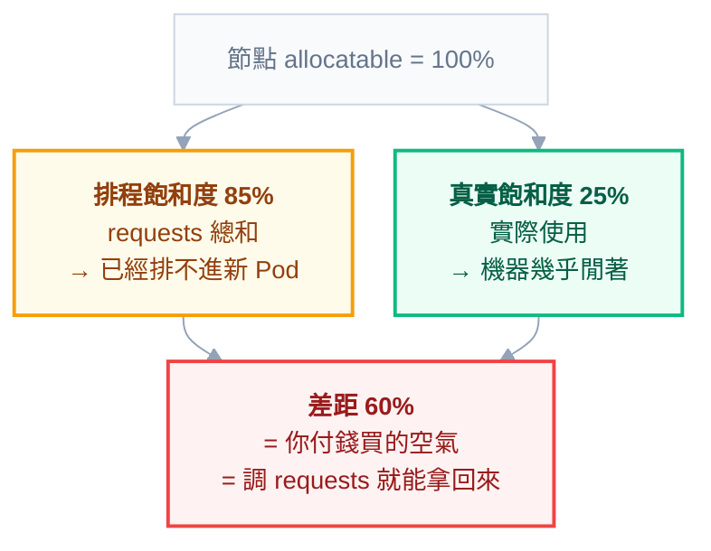

# 附錄 K：成本優化與資源調校

多數 K8s 叢集的資源利用率在 **20% 到 35%** 之間。也就是說，你付的錢裡有三分之二在買空氣。

這不是因為團隊懶惰，而是**結構性的**。原因很具體：`requests` 是開發者在寫 YAML 那天拍腦袋填的，填太小服務會被 OOMKill，填太大只是帳單變醜——所以理性的個人選擇永遠是往大填。而且填完之後沒有人會回頭改，因為沒有人負責這件事，也沒有人知道正確值是多少。

這一份給的是**可執行的方法**：怎麼算出正確的 requests、什麼時候該設 CPU limit、節點規格怎麼選、以及那些沒人記得刪的東西怎麼找出來。附錄 H 談的是「該做什麼」，這裡談「怎麼做」。

## 先看清楚三個數字

任何優化開始之前，先確認你在看的是哪個數字。這三個經常差很多，混淆它們會導致完全錯誤的結論：

| 數字 | 意義 | 怎麼查 |
| --- | --- | --- |
| **allocatable** | 節點扣掉系統保留後真正能分配的量 | `kubectl get node -o jsonpath='{.status.allocatable}'` |
| **requests 總和** | scheduler 認為用掉了多少 | `kubectl describe node` 的 Allocated resources |
| **實際使用** | 真的用了多少 | `kubectl top node` / Prometheus |

由此得到兩個關鍵比率：

- **排程飽和度** = requests 總和 ÷ allocatable —— 這個到 100% 就再也排不進新 Pod
- **真實飽和度** = 實際使用 ÷ allocatable

**兩者的差距就是你在買的空氣。** 典型的叢集是排程飽和度 85%、真實飽和度 25%——機器看起來滿了，實際上幾乎閒著。優化的目標不是把真實飽和度拉到 100%（那樣毫無韌性），而是把兩者的差距壓到合理範圍。



**這也是為什麼「加節點」常常是錯的第一反應**——機器不是不夠，是 requests 開太大。

一行看出全叢集現況：

```powershell
kubectl describe nodes | Select-String -Pattern "Name:|Allocated resources|cpu |memory " -Context 0,2
```

---

## Part 1：requests 調校

### 為什麼 requests 是成本的核心

scheduler 排程時看的是 `requests`，**不是實際用量**。一個 request 4Gi 但實際只用 300Mi 的 Pod，會佔掉節點 4Gi 的額度，讓其他 Pod 排不進來——即使那 4Gi 有 3.7Gi 是空的。

所以「加節點」這個動作，往往不是因為機器真的不夠，而是因為 requests 開太大。**先調 requests，再考慮加機器**，這個順序能省下最多錢。

### 記憶體與 CPU 要用不同的分位數

這一點是方法論的核心，理由來自兩者**超限時的行為完全不同**：

| 資源 | 超限會怎樣 | 該用哪個分位數 | 理由 |
| --- | --- | --- | --- |
| 記憶體 | **OOMKilled，立刻死** | P99 甚至 max | 猜低的代價是服務中斷 |
| CPU | 被 throttle，變慢但不死 | P90 左右 | 猜低的代價只是尖峰時慢一點 |

換句話說：**記憶體要保守，CPU 可以積極。** 把兩者用同一套標準處理，是最常見的方法論錯誤。

### 找出過度配置的容器

用 Prometheus 直接算「實際用量 ÷ requests」，比率很低的就是調整對象：

```promql
# 記憶體：過去 7 天的 P99 用量 ÷ requests
quantile_over_time(0.99,
  container_memory_working_set_bytes{container!="",container!="POD"}[7d]
)
/ on(namespace,pod,container) group_left
kube_pod_container_resource_requests{resource="memory"}
```

```promql
# CPU：過去 7 天的 P90 用量 ÷ requests
quantile_over_time(0.90,
  rate(container_cpu_usage_seconds_total{container!="",container!="POD"}[5m])[7d:5m]
)
/ on(namespace,pod,container) group_left
kube_pod_container_resource_requests{resource="cpu"}
```

判讀方式：

| 比率 | 意義 | 動作 |
| --- | --- | --- |
| < 0.3 | 嚴重過度配置 | 調降，優先處理 |
| 0.3 – 0.7 | 偏高但還算合理 | 有餘裕再調 |
| 0.7 – 1.0 | 剛好 | 不動 |
| > 1.0 | **配置不足**，正在超用 | 調升（CPU 代表一直被 throttle） |

**觀察窗口至少七天**，才能涵蓋週末與週間的差異。有月結、月初報表這類週期的服務，要看整整一個月。

### 用 VPA 拿免費的建議值

不想自己寫 PromQL 的話，VPA 開在**只建議不動作**的模式，讓它幫你算（附錄 C-5 有全欄位）：

```yaml
apiVersion: autoscaling.k8s.io/v1
kind: VerticalPodAutoscaler
metadata:
  name: api-recommender
spec:
  targetRef:
    apiVersion: apps/v1
    kind: Deployment
    name: api
  updatePolicy:
    updateMode: "Off" # 只算不改
```

```powershell
kubectl describe vpa api-recommender
```

輸出裡的 `Target` 就是它建議的 requests，`Uncapped Target` 是不受 min/max 限制的原始建議。

**強烈建議停在 `Off` 模式。** `Auto` 模式目前實作上會殺掉 Pod 重建才能套用新值，對線上服務是不必要的擾動。把它當成一個持續運行的建議引擎就好。

### 調整的紀律

三條，都是為了不要優化出事故：

**一次調一個服務，觀察一週。** 同時調十個，出事了你不知道是哪個。

**留安全邊際：建議值 × 1.2。** 分位數是歷史資料，未來的尖峰可能更高。

**記憶體只降不到激進值。** 從 4Gi 降到 512Mi 這種幅度，先降到 1Gi 觀察兩週，再考慮下一步。**降記憶體的錯誤代價是 OOMKilled，不是變慢。**

### 什麼時候不該調

有三種情況，低使用率是正常的，硬調會出事：

- **明顯尖峰型**：平常 5%、月結那天 90%。要看的是尖峰不是平均
- **啟動時吃大量記憶體**：JVM 預熱、載入模型的服務，穩態用量遠低於啟動用量
- **本身就是備援**：主備架構的備用副本平常本來就閒著

---

## Part 2：CPU limit 該不該設

這是社群裡少數真有爭議的題目，值得給判準而不是給答案。

**不設 CPU limit 的理由**：CPU 是可壓縮資源，超用只會被排隊而不會傷害別人。不設的話，Pod 在尖峰時能借用節點上閒置的 CPU，同樣的機器能撐更多流量。設了 limit 等於「即使機器閒著也不准你用」，白白浪費。

**設 CPU limit 的理由**：行為可預測，測試環境的表現跟正式環境一致；防止某個失控的 Pod（無窮迴圈）拖慢整台節點上的鄰居。

實務上的判準：

| 情況 | 建議 |
| --- | --- |
| 線上服務，節點由自己團隊掌控 | **不設 CPU limit**，只設 requests |
| 多團隊共用叢集，需要防呆 | 設 limit，但給 requests 的 2–4 倍 |
| 批次工作 | 設 limit，避免它把節點吃光影響線上服務 |
| 延遲敏感、要求行為完全可預測 | 設 limit = requests（Guaranteed QoS） |

**記憶體 limit 則是永遠要設的**，因為它不可壓縮——沒有上限的話，一個記憶體洩漏的 Pod 會把整台節點拖垮，連 kubelet 都活不下去。

實戰第二章那份 manifest 刻意「只設記憶體 limit 不設 CPU limit」，就是套用了這張表的第一列。

---

## Part 3：節點層的浪費

### 碎片化：為什麼 70% 就排不進去

節點層有一種隱形浪費叫碎片化。每台節點剩 1.5 CPU，但你的 Pod 要 2 CPU——**加起來明明夠，就是排不進去**。

碎片化的程度取決於「Pod 大小 ÷ 節點大小」的比值。Pod 越接近節點容量，碎片越嚴重。粗略的經驗法則是：**單一 Pod 的 requests 不要超過節點 allocatable 的 1/4**，這樣碎片損失通常能控制在 10% 以內。

### 節點規格的取捨

| | 大節點（少而大） | 小節點（多而小） |
| --- | --- | --- |
| 裝箱效率 | 好 | 差（碎片多） |
| 系統保留佔比 | 低（每台只扣一份） | **高**（每台都要扣 `systemReserved` + `kubeReserved`） |
| 爆炸半徑 | 大，一台掛掉影響多 | 小 |
| 單一 Pod 資源上限 | 高 | 受限 |
| 升級／drain 的難度 | 難（要搬很多 Pod） | 容易 |

系統保留那一列常被忽略：假設每台保留 1 CPU + 2Gi，用 20 台小機器就是白白扣掉 20 CPU + 40Gi。

常見的折衷：**單一節點不超過總容量的 10%，且能容納最大 Pod 的三到四倍**。

### 該留多少緩衝

不要把排程飽和度推到 95%。合理的目標是**長期維持在 70% 左右**，理由是要能同時承受兩件事：一台節點意外掛掉，以及一次滾動更新的 surge。

超過 85% 就該加節點了——這時候加是計畫內的，等到 100% 才加是救火。

### 自動調節節點數

節點數也可以自動化：**cluster-autoscaler**（看到 Pending 的 Pod 就加節點、節點閒置就縮）或 **Karpenter**（更進一步，直接依照待排程 Pod 的形狀挑最合適的機型）。

自動縮節點要能真的生效，前提是 Pod 要能被搬走。以下任何一項都會讓節點永遠縮不掉：

- 沒有 controller 管理的裸 Pod
- PDB 不允許驅逐（單副本 + `minAvailable: 1`）
- 使用 `emptyDir` 的 Pod（預設不會被驅逐）
- 有 local storage 或 node affinity 綁死的 Pod

**「開了 autoscaler 但節點數從來沒降過」的排查方向就是這四項。**

### Spot / 搶佔式節點

價格通常是隨選的 1/3 到 1/5，代價是可能被隨時收回（通常給兩分鐘通知）。

適合放上去的：無狀態且多副本的服務、批次工作、CI runner、開發測試環境。
不適合的：有狀態服務、單副本、對中斷敏感的工作。

要用的話，配套是：`topologySpreadConstraints` 讓副本不要全擠在 spot 節點、PDB 保底、以及應用本身要能承受隨時被終止（也就是優雅關閉要做對，實戰第二章的 `preStop`）。

---

## Part 4：把沒人記得刪的東西找出來

這一節是投入產出比最高的部分——通常一個下午就能砍掉可觀的帳單，而且風險低。

```powershell
# 1. Released 狀態的 PV：PVC 已刪但磁碟還在，持續計費
kubectl get pv --field-selector=status.phase==Released

# 2. 沒有被任何 Pod 掛載的 PVC
kubectl get pvc -A -o json | ConvertFrom-Json |
  ForEach-Object { $_.items } | ForEach-Object { "$($_.metadata.namespace)/$($_.metadata.name)" }
# 再對照 kubectl get pods -A -o json 裡實際引用的 claimName

# 3. 已完成但沒被清掉的 Job（沒設 ttlSecondsAfterFinished 的後果）
kubectl get jobs -A --field-selector=status.successful=1

# 4. 沒有任何 endpoint 的 Service（多半是已下線服務的殘留）
kubectl get endpointslice -A -o json | ConvertFrom-Json |
  ForEach-Object { $_.items } | Where-Object { -not $_.endpoints }

# 5. 副本數為 0 的舊 ReplicaSet 堆積（revisionHistoryLimit 設太大）
kubectl get rs -A | Where-Object { $_ -match "\s0\s+0\s+0\s" }

# 6. LoadBalancer 型別的 Service —— 雲端上每一個都在計費
kubectl get svc -A --field-selector=spec.type=LoadBalancer

# 7. 長期 Pending 的 Pod（佔著 quota 卻不做事）
kubectl get pods -A --field-selector=status.phase=Pending
```

再加上幾個叢集外的常見浪費：**registry 裡累積的舊映像**（Harbor 設定保留策略，例如「每個 repo 保留最近 10 版 + 所有 tag 含 `V.` 的」）、**日誌與 metrics 的保留期**（Elasticsearch 的 ILM、Prometheus 的 retention，附錄 C-5 提過用 `metricRelabelings` 丟掉不看的指標）、以及**跨可用區流量**（Service 設 `trafficDistribution: PreferClose` 讓流量優先走同區，附錄 C-3）。

孤兒 PV 值得特別提醒：StatefulSet 縮容時**預設不會刪 PVC**（這是刻意的資料保護），所以「縮容之後帳單沒降」是標準現象。要自動清理就設 `persistentVolumeClaimRetentionPolicy.whenScaled: Delete`，但**確認資料真的不需要之後再開**。

---

## Part 5：讓成本可歸屬

砍完一輪之後，真正的挑戰是「不要再長回來」。而要讓成本被持續管理，前提是**知道錢花在誰身上**。

做法是強制所有工作負載帶上歸屬標籤：

```yaml
metadata:
  labels:
    app.kubernetes.io/name: api
    app.kubernetes.io/part-of: demo-app
    team: platform
    cost-center: rd-001
```

有了標籤之後，可以用 PromQL 直接算出各團隊佔用的資源：

```promql
sum by (label_team) (
  kube_pod_container_resource_requests{resource="cpu"}
  * on(namespace,pod) group_left(label_team) kube_pod_labels
)
```

想要更完整的成本報表，OpenCost / Kubecost 可以把節點價格攤到每個 namespace 與工作負載上。但**在導入工具之前，先把標籤規範建立起來**——沒有一致的標籤，任何成本工具都算不出有意義的歸屬。

要讓標籤真的被填，靠的是強制而不是宣導：用 `ValidatingAdmissionPolicy`（附錄 C-4）擋掉沒有 `team` 標籤的工作負載，或在 CI 用 `kube-linter` 檢查。

---

## Part 6：把它變成節奏

一次性的清理會在幾個月後打回原形。要讓它持續，需要固定的節奏（呼應附錄 H）：

| 頻率 | 做什麼 |
| --- | --- |
| **每週** | 看排程飽和度與真實飽和度的差距趨勢 |
| **每月** | 跑一次孤兒資源盤點；檢視 VPA 建議值與現況的差距最大的前十個服務 |
| **每季** | 節點規格與數量檢討；registry / 日誌 / metrics 保留策略檢討 |
| **每次新服務上線** | requests 必須有依據（壓測數字或類似服務的實測），不能是拍腦袋 |

最後一列是最有效的一條——**在源頭要求依據，比事後追著調有效得多**。

---

## 常見誤區

| # | 誤區 | 為什麼錯 |
| --- | --- | --- |
| 1 | 「利用率越高越好」 | 100% 沒有韌性，一台掛掉就雪崩。目標是 70% 左右 |
| 2 | 用平均值調 requests | 平均會掩蓋尖峰，記憶體要看 P99 |
| 3 | 記憶體與 CPU 用同一套標準 | 超限行為完全不同，一個死一個慢 |
| 4 | 一次調整所有服務 | 出事無法歸因 |
| 5 | 為了省錢移除記憶體 limit | 一個洩漏的 Pod 能拖垮整台節點 |
| 6 | 開了 VPA `Auto` 模式 | Pod 被重建造成不必要的擾動 |
| 7 | 以為縮容就會省錢 | StatefulSet 的 PVC 預設留著，繼續計費 |
| 8 | 只看 CPU 與記憶體 | 儲存、跨區流量、LoadBalancer、日誌儲存常常更貴 |
| 9 | 裝了成本工具就算做了 FinOps | 沒有標籤規範，報表無法歸屬也就無法行動 |
| 10 | 節點開很大以為比較划算 | 碎片化與爆炸半徑的代價可能超過裝箱效率的收益 |

## 檢查清單

- [ ] 知道叢集目前的排程飽和度與真實飽和度，以及兩者的差距
- [ ] requests 有依據（壓測或實測分位數），不是拍腦袋
- [ ] 記憶體用 P99、CPU 用 P90，且留 1.2 倍安全邊際
- [ ] 記憶體 limit 一律有設
- [ ] CPU limit 的設或不設是**有意識的決定**，不是預設值
- [ ] VPA 以 `Off` 模式運行，作為持續的建議來源
- [ ] 單一 Pod 的 requests 不超過節點 allocatable 的 1/4
- [ ] 排程飽和度長期維持在 70% 左右，超過 85% 就加節點
- [ ] autoscaler 縮不掉節點的四個原因都檢查過
- [ ] 每月跑一次孤兒資源盤點
- [ ] 所有工作負載帶成本歸屬標籤，且由 admission policy 強制
- [ ] registry、日誌、metrics 都有保留策略

## 連結

- [[67-scaling-limits]] — 附錄 AS：孤兒物件不只花錢，還佔 etcd
- [[07-scheduling-and-resources]] — 正文：requests/limits 真義、QoS、三種 Autoscaler
- [[30-production-readiness]] — 附錄 H：容量規劃與維運節奏
- [[22-yaml-fields-ecosystem]] — 附錄 C-5：VPA 與 ServiceMonitor 全欄位
- [[19-yaml-fields-workloads]] — 附錄 C-2：HPA、PDB、Quota、LimitRange 全欄位
- [[14-prometheus-grafana]] — 正文：PromQL 深入
- [[practice-6-observability]] — 實戰 6：把這些指標做成儀表板
- [[k8s-mastery]] — 教材總目錄
