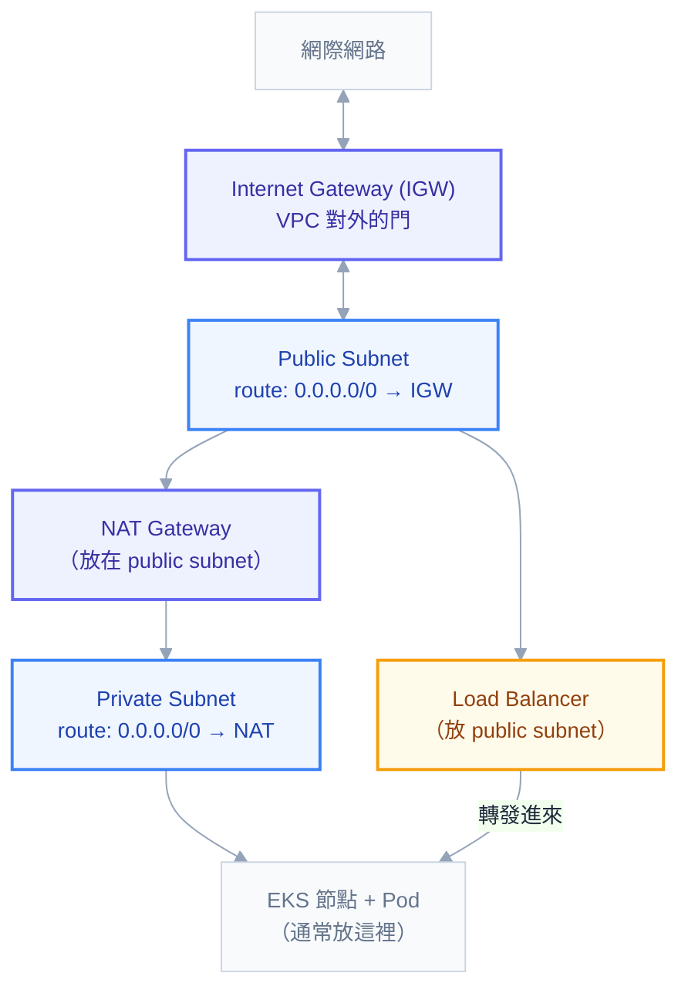

# 附錄 M：雲端網路與託管 K8s

整套教材到目前為止都預設地端環境：minikube、自建叢集、自己的網路。但只要有一天要上雲，你會發現一個尷尬的落差——**K8s 的部分你都懂了，卡住的全是雲端網路的東西**：Pod 明明 Running 卻連不到外網、`LoadBalancer` 型別的 Service 永遠 `<pending>`、Pod 排不進去但節點資源明明還很多。

這些的答案不在 K8s 裡，在 VPC 裡。這一份補上那一層，並且回答那個具體的問題：**IGW 是什麼、它在整個流量路徑的哪個位置**。

以 AWS 為主軸（EKS 最常見，名詞也最具體），GCP 與 Azure 的對應概念會一併標註。

---

## Part 1：VPC 五件套

雲端網路的基礎只有五個東西。理解它們的組合方式，比背名詞重要得多。



| 元件 | 是什麼 | GCP / Azure 對應 |
| --- | --- | --- |
| **VPC** | 你在雲上的私有網路，有一段 CIDR（如 `10.0.0.0/16`） | VPC / VNet |
| **Subnet** | VPC 內的一段 CIDR，**綁定在單一可用區（AZ）** | Subnet |
| **Route Table** | 「去哪個網段要走哪個出口」的規則表，掛在 subnet 上 | Routes |
| **Internet Gateway（IGW）** | VPC 對外網的門，**雙向** | Cloud NAT 之外的預設路由 / Internet |
| **NAT Gateway** | 讓私有網段能出去但外面進不來，**單向** | Cloud NAT / NAT Gateway |

### IGW：public subnet 的定義來源

這是最常被誤解的一點：**「public subnet」不是一個設定選項，而是一個推論結果**。

一個 subnet 之所以是 public，唯一的定義是：**它的 route table 裡有一條 `0.0.0.0/0 → igw-xxxxx`**。沒有這條路由，不管你怎麼命名，它就是 private。

```
Public Subnet 的 route table
├─ 10.0.0.0/16   → local        （VPC 內部互通，自動存在）
└─ 0.0.0.0/0     → igw-0a1b2c   ← 這條讓它成為 public
```

IGW 有三個特性要記住：

1. **一個 VPC 只能掛一個 IGW**，它是 VPC 層級的資源，不是 subnet 層級
2. **它是雙向的**——出得去，外面也進得來（前提是安全群組允許）
3. **只有路由還不夠**：實例還必須有公有 IP（或 Elastic IP），封包才回得來。這是「route table 明明對了但還是連不出去」的常見原因

### NAT Gateway：出得去、進不來

私有 subnet 裡的節點需要下載映像、呼叫外部 API，但你不希望外面能主動連進來。NAT Gateway 解決這件事：

```
Private Subnet 的 route table
├─ 10.0.0.0/16   → local
└─ 0.0.0.0/0     → nat-0d4e5f   ← 走 NAT 出去，回程能回來，但外面無法主動發起
```

**NAT Gateway 本身要放在 public subnet**（它需要 IGW 才能真的出去），而私有 subnet 的路由指向它。這個「NAT 在 public、節點在 private」的組合是雲端 K8s 的標準佈局。

兩個實務重點：**NAT Gateway 是單一 AZ 的資源**，高可用要每個 AZ 各放一個（跨 AZ 走 NAT 除了單點風險，還會產生跨區流量費）。而且**它按小時計費再加上每 GB 的資料處理費**——大量拉映像、送日誌到外部服務的叢集，NAT 的資料處理費常常是帳單上排名很前面的項目（Part 7 會回到這點）。

### Security Group 與 NACL

兩層防火牆，差異很重要：

| | Security Group | Network ACL |
| --- | --- | --- |
| 作用層級 | 實例／ENI | Subnet |
| 有狀態？ | **有狀態**——放行進來，回程自動允許 | **無狀態**——進與出要各寫一條 |
| 規則類型 | 只有 allow | allow 與 deny 都有 |
| 預設 | 全部拒絕 | 全部允許 |

**九成的情況你只需要動 Security Group。** NACL 是無狀態的，很容易寫出「請求進得來但回應出不去」的規則——這是 NACL 相關問題最常見的形態，而且症狀是逾時而不是拒絕。

概念上 Security Group 之於雲端，就像 NetworkPolicy 之於 K8s（附錄 C-3）——兩者都是白名單，而且**在雲端 K8s 上這兩層是疊加的**：Security Group 放行了，NetworkPolicy 還是可能擋掉，反之亦然。連不通時兩層都要查。

---

## Part 2：託管 K8s 的責任分界

託管服務（EKS / GKE / AKS）幫你顧的是**控制平面**。這帶來一個心智模型上的轉變：附錄 C-6 那些 kubeadm、etcd 快照、apiserver 參數，你**看不到也改不了**。

| 誰負責 | 內容 |
| --- | --- |
| **雲端** | apiserver、etcd（含備份）、scheduler、controller-manager 的可用性與升級執行 |
| **你** | 節點群組、CNI/CSI 外掛版本、**何時升級**、所有工作負載、IAM 與網路設計 |

值得注意的是：**「雲端幫你備份 etcd」不代表你不需要備份**。誤刪 namespace、應用資料損毀這些情境（附錄 L 的情境 A、B）雲端不會幫你救，Velero 與資料庫備份還是要自己做。

節點層則是「節點群組（node group / node pool）」的概念——一組相同機型與設定的節點。實務上常見的分法：一組給一般工作負載、一組 spot 給批次、一組大機型給特殊需求，各自打上 taint 與 label 讓工作負載對號入座（附錄 C-1）。

---

## Part 3：Pod 的 IP 從哪來——兩種模型

這是雲端 K8s 與地端最根本的差異，而且它會直接造成「節點資源還很多但 Pod 排不進去」。

### 模型一：Overlay（地端常見）

Calico VXLAN、Flannel 這類。Pod 的 IP 來自一個**虛擬網段**（如 `10.244.0.0/16`），跟底層 VPC 無關，封包在節點之間被封裝後傳送。

優點是 IP 用不完、跟底層網路解耦。缺點是封裝有額外開銷，而且 VPC 裡的其他資源**無法直接連到 Pod IP**。

### 模型二：VPC 原生（EKS 預設）

AWS VPC CNI 讓 **Pod 直接拿到 VPC subnet 裡的真實 IP**。GKE 的 VPC-native 用 alias IP 達到類似效果。

好處很實際：VPC 裡的其他資源（例如那台 Oracle）能直接連到 Pod、安全群組能套用在 Pod 層級、封包不需要封裝所以效能好、VPC Flow Logs 看得到 Pod 層的流量。

代價是 **IP 會用完**，而且用完的方式有兩種：

**第一種：subnet 的 IP 不夠。** 一個 `/24` 只有 251 個可用 IP。每個 Pod 一個 IP 的話，這個 subnet 最多就 200 出頭個 Pod。**規劃 EKS 的 subnet 要用 `/20` 甚至 `/18`，而且要預留成長空間**——subnet 的 CIDR 建立後不能改。

**第二種：單一節點的 IP 上限。** 每台 EC2 能掛的 ENI 數量與每個 ENI 的 IP 數由**機型**決定，兩者相乘就是這台機器能容納的 Pod 數上限。小機型可能只有 8 到 17 個 Pod 的額度——**這個上限跟 CPU/記憶體無關**，所以你會看到「節點 CPU 只用了 20%，但 Pod 就是排不進去」。

```powershell
# 看節點實際的 Pod 容量上限
kubectl get nodes -o custom-columns='NODE:.metadata.name,MAX_PODS:.status.allocatable.pods'
```

三個解法：換 ENI 額度大的機型、開啟 **prefix delegation**（讓每個 ENI 配發一整段 /28 而非單一 IP，大幅提高上限）、或用 secondary CIDR 加 custom networking 把 Pod 放到另一段網段。

**這一節是地端經驗最容易失準的地方。** 在 minikube 上你從來不必想 IP 的問題；在 EKS 上，IP 規劃錯誤是要重建叢集才能修的。

---

## Part 4：`type: LoadBalancer` 背後發生什麼

在 minikube 上這個型別要靠 `minikube tunnel` 才會有位址。在雲端它會真的去建一台負載平衡器——這件事由 **cloud-controller-manager** 完成：它 watch 到一個 `LoadBalancer` 型別的 Service，就呼叫雲端 API 建 LB、設定後端目標，然後把配到的位址寫回 `service.status.loadBalancer.ingress`。

所以 `EXTERNAL-IP` 一直 `<pending>` 的原因通常是這三個，按順序查：

1. **cloud-controller-manager 或 LB controller 沒裝／沒權限**（地端叢集裝 MetalLB 才會有這能力）
2. **subnet 沒有正確的標籤**——EKS 靠 `kubernetes.io/role/elb`（public）與 `kubernetes.io/role/internal-elb`（private）這兩個標籤決定要在哪些 subnet 建 LB
3. **配額用完**或子網 IP 不足

### NLB、ALB 與 Ingress Controller 怎麼分工

| 選擇 | 在哪一層 | 適合 |
| --- | --- | --- |
| **NLB**（`Service type: LoadBalancer`） | L4 | TCP/UDP、需要極低延遲、非 HTTP 協定 |
| **ALB**（`Ingress` + AWS LB Controller） | L7 | HTTP 路由，但每條規則都在雲端計費 |
| **NLB + ingress-nginx**（推薦） | L4 → 叢集內 L7 | **一個 LB 收斂所有 HTTP 服務**，路由邏輯留在叢集內、可攜 |

最後一種是實務上最常見的組合，理由是成本與可攜性：**每一個 `type: LoadBalancer` 的 Service 都是一個獨立計費的雲端資源**。三十個服務各開一個 LB，帳單很可觀，而且管理分散。用一個 NLB 打進 ingress-nginx，再由 Ingress 規則分流到三十個服務，只需要一個計費資源（附錄 F 講的所有 annotation 都用得上）。

### `externalTrafficPolicy` 在雲端的具體後果

附錄 C-3 講過這個欄位的語意，在雲端它的影響更具體：

- `Cluster`（預設）：LB 把流量送到任一節點，該節點可能再轉給別台 → **來源 IP 被 SNAT 掉**，而且多一跳（可能跨 AZ，產生流量費）
- `Local`：只送到本機有 Pod 的節點 → **保留真實來源 IP**，沒有額外跳轉，但要求 Pod 分佈均勻，否則流量傾斜

用 `Local` 時，LB 的健康檢查會打 `healthCheckNodePort`，藉此得知哪些節點上有 Pod。**沒有 Pod 的節點會被健康檢查判定為不健康，這是正常且必要的行為**，不是故障。

現代的做法可以更進一步：AWS LB Controller 的 **IP 目標模式**讓 NLB 直接把流量送到 Pod IP（因為 VPC 原生 CNI 讓 Pod IP 在 VPC 裡可路由），完全跳過節點這一跳——來源 IP 保留、沒有額外跳轉、也不受 Pod 分佈影響。

---

## Part 5：IAM 與 K8s 身分的接合

應用要存取 S3、Secrets Manager 這類雲端服務時，權限怎麼給？

**錯誤但常見的做法**：把權限掛在節點的 instance profile 上。這樣**節點上的每一個 Pod 都拿到那份權限**，包含不該有的那些——等於把 RBAC 的努力全部繞過。

**正確做法**是把 K8s 的 ServiceAccount 對應到雲端的 IAM 角色：

```yaml
apiVersion: v1
kind: ServiceAccount
metadata:
  name: app-sa
  namespace: demo
  annotations:
    eks.amazonaws.com/role-arn: arn:aws:iam::123456789012:role/demo-app-role
```

背後的機制是 **OIDC 信任鏈**：叢集有一個 OIDC provider，IAM 角色的信任政策指定「只信任這個叢集的這個 namespace 的這個 ServiceAccount」，Pod 拿到投影進去的 SA token（附錄 C-4 講的短期 token），用它去換取臨時的雲端憑證。

這個結構跟 Vault 的信任鏈（正文第 8 章）本質相同——**都是用 K8s 的 SA 身分去換取外部系統的憑證**，而不是把長期憑證塞進 Secret。理解了其中一個，另一個就通了。

| 雲 | 名稱 | SA annotation |
| --- | --- | --- |
| AWS | IRSA / EKS Pod Identity | `eks.amazonaws.com/role-arn` |
| GCP | Workload Identity | `iam.gke.io/gcp-service-account` |
| Azure | Workload Identity | `azure.workload.identity/client-id` |

另一個方向的接合是「誰能操作這座叢集」。EKS 早期用 `aws-auth` ConfigMap 把 IAM 身分映射到 K8s 的 user/group（改壞了會把所有人鎖在外面，是有名的地雷），現在建議改用 **Access Entries** API，管理起來安全得多。

---

## Part 6：儲存的可用區綁定

雲端區塊儲存有一個地端很少遇到的限制：**EBS volume 綁在單一可用區**。

後果很直接：一個 Pod 掛著 AZ-a 的 EBS，如果它被重排程到 AZ-c 的節點上，**永遠掛不上去，卡在 Pending**。

所以多可用區的叢集，StorageClass 必須設 `volumeBindingMode: WaitForFirstConsumer`（附錄 C-3）——等 Pod 被排到某個節點之後，才在**那個節點所在的 AZ** 建立磁碟。用預設的 `Immediate` 會先隨機挑一個 AZ 建磁碟，然後 Pod 因為 nodeAffinity 排不到其他 AZ，直接卡死，而錯誤訊息指向排程失敗，很難聯想到 StorageClass 設定。

需要跨 AZ 或多個 Pod 同時讀寫的話，要用檔案型儲存（EFS / Filestore / Azure Files），它們支援 `ReadWriteMany`，代價是延遲較高、成本較高。

**這也是實戰第五章「資料庫留在叢集外」建議的另一個支撐理由**：有狀態服務在多 AZ 環境的複雜度，比無狀態服務高一個量級。

---

## Part 7：雲端特有的成本陷阱

附錄 K 談的是資源配置的浪費，這裡補的是**雲端網路特有的**，而且它們常常不在你的監控裡：

| 項目 | 為什麼會爆 | 怎麼處理 |
| --- | --- | --- |
| **跨 AZ 流量** | Pod 之間的呼叫隨機跨區，兩個方向都計費 | Service 設 `trafficDistribution: PreferClose`（附錄 C-3） |
| **NAT Gateway 資料處理費** | 拉映像、送日誌、呼叫外部 API 全部走它 | VPC Endpoint 讓 S3/ECR 流量不經 NAT；映像用區域內 registry |
| **LoadBalancer 數量** | 每個 `type: LoadBalancer` 都是一個計費資源 | 收斂成一個 NLB + ingress-nginx |
| **未刪除的 EBS** | PV 是 `Retain` 或 PVC 沒清 | 附錄 K 的孤兒資源盤點 |
| **跨區資料傳輸** | 備份、日誌送到另一個 region | 確認儲存桶與叢集同區 |

**NAT Gateway 的資料處理費特別值得檢查一次**：如果你的節點在私有 subnet，而映像從外部 registry 拉、日誌送到外部服務，那所有這些流量都在計費。加上 ECR 與 S3 的 VPC Endpoint 通常能省下可觀的金額，而且設定是一次性的。

---

## Part 8：地端搬上雲的檢查清單

- [ ] VPC CIDR 與 subnet 大小預留了成長空間（**建立後不能改**）
- [ ] 確認 CNI 模型，若是 VPC 原生則算過**每節點的 Pod 上限**與 subnet 的 IP 總量
- [ ] 節點放 private subnet，NAT Gateway 每個 AZ 各一個
- [ ] subnet 有正確的 ELB 標籤，否則 `LoadBalancer` 會一直 pending
- [ ] LoadBalancer 收斂：一個 NLB + ingress-nginx，而不是每個服務一個
- [ ] 應用的雲端權限走 IRSA / Workload Identity，**不是節點的 instance profile**
- [ ] StorageClass 設 `WaitForFirstConsumer`
- [ ] 需要 RWX 的改用檔案型儲存
- [ ] Security Group 與 NetworkPolicy 兩層都檢查過
- [ ] 加上 ECR / S3 的 VPC Endpoint
- [ ] 跨 AZ 流量有評估，必要時設 `trafficDistribution: PreferClose`
- [ ] 即使託管服務有備份，**Velero 與資料庫備份仍然要自己做**

## 常見誤區

| # | 誤區 | 真相 |
| --- | --- | --- |
| 1 | 以為有個開關叫「public subnet」 | 它是「route table 有指向 IGW」的推論結果 |
| 2 | 有 IGW 路由就能連外 | 還需要公有 IP，否則封包回不來 |
| 3 | NAT Gateway 可以讓外面連進來 | 它是單向的，對外服務要用 LB |
| 4 | 用 NACL 做主要防護 | 無狀態，很容易寫出「進得來出不去」 |
| 5 | Pod 排不進去 = 資源不夠 | VPC 原生 CNI 下常常是 **IP 額度**用完 |
| 6 | 每個服務開一個 LoadBalancer | 每個都是獨立計費資源，該收斂 |
| 7 | 權限掛在節點上比較方便 | 那台節點上所有 Pod 都拿到，等於繞過 RBAC |
| 8 | 多 AZ 用預設的 `Immediate` 綁定 | 磁碟建在錯的 AZ，Pod 永遠 Pending |
| 9 | 託管服務有備份所以不用做 | 誤刪與資料損毀救不回來 |
| 10 | 只監控 CPU 與記憶體成本 | 跨 AZ 流量與 NAT 處理費常常更貴 |

## 連結

- [[intro-3-network-basics]] — 入門 3：IP、私有網段、DNS 的基礎（這一份的前置知識）
- [[05-networking]] — 正文：K8s 網路四鐵律與完整封包路徑
- [[20-yaml-fields-network-storage]] — 附錄 C-3：Service 全欄位、`externalTrafficPolicy`、StorageClass
- [[28-ingress-nginx-annotations]] — 附錄 F：把 LB 收斂成 Ingress 之後的設定
- [[33-cost-optimization]] — 附錄 K：資源層的成本優化
- [[34-multicluster-and-dr]] — 附錄 L：託管叢集仍然要做的備份
- [[08-security-and-rbac]] — 正文：Vault 信任鏈（與 IRSA 同構）
- [[k8s-mastery]] — 教材總目錄
