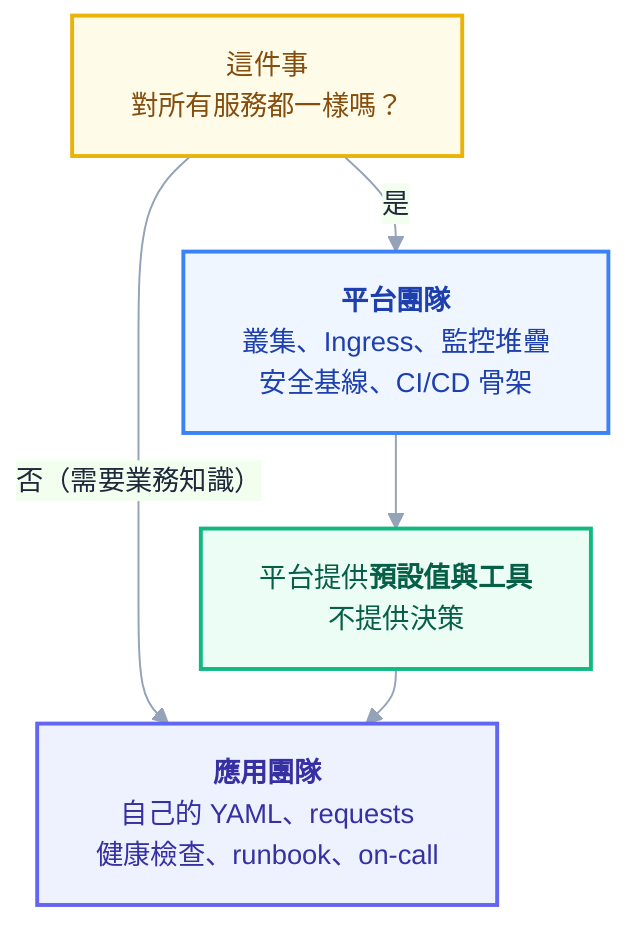

# 附錄 O：平台工程與多團隊治理

整套教材到這裡為止，都是從「我負責這座叢集、我部署這些服務」的視角寫的。但當你真的成為公司的 K8s 管理員，會遇到一個性質完全不同的問題：**不是你要部署什麼，而是另外五個團隊要部署，而他們不會 K8s。**

這時候有三條路。第一條是你幫他們寫 YAML——**你會變成瓶頸**，每次上線都要排隊等你。第二條是叫他們自己學——教材放給他們讀，結果是五個團隊各自摸索出五種寫法，安全基線參差不齊，出事的時候你還是得去救。第三條是**做一個平台**：把正確的做法變成預設值，讓他們不必懂 K8s 也能安全地上線。

這一份講第三條路。它的內容比較少技術、比較多制度設計，但這正是「K8s 管理員」與「K8s 使用者」的分界線。

---

## Part 1：先劃清責任邊界

平台工作的第一件事，是把「誰負責什麼」寫下來。沒有這條線，結果永遠是「出事都找平台團隊」。

| 項目 | 平台團隊 | 應用團隊 |
| --- | --- | --- |
| 叢集本身（升級、節點、CNI、控制平面） | ✅ | |
| Ingress Controller、cert-manager、監控堆疊 | ✅ | |
| 安全基線與政策 | ✅ 定義並強制 | 遵守 |
| CI/CD 管線的骨架 | ✅ 提供範本 | 使用並填入自己的參數 |
| **應用的 YAML** | 提供範本與 review | ✅ 擁有 |
| **應用的 requests/limits** | 提供工具與建議值 | ✅ 決定 |
| **應用的健康檢查端點** | 定義規格 | ✅ 實作 |
| **應用的 runbook 與 on-call** | 提供模板 | ✅ 擁有 |
| 應用出事時的第一線 | | ✅ |
| 平台出事時的第一線 | ✅ | |



三條劃線原則：

**應用團隊必須擁有自己的 YAML。** 平台代寫的話，出事時沒有人真正理解那份設定，而且你會被鎖死在維護幾十份別人的 manifest 上。

**平台提供預設值，不提供決策。** requests 該設多少是應用團隊的決定，但平台要給他們算出來的工具（附錄 K 的 PromQL 與 VPA 建議值）。

**能自動強制的就不要靠 review。** 人工 review 不可靠、不可擴展，而且讓平台團隊變成審批瓶頸。能寫成 admission policy 的規則就寫成 policy（Part 5）。

---

## Part 2：Golden Path

**Golden path 是「最好走的那條路」，不是「唯一的路」。**

這個區別很重要。強制所有人用同一套會壓死特殊需求，最後大家繞道而行；完全放任則回到五種寫法的問題。正確的定位是：**走 golden path 的團隊什麼都不用想，偏離的團隊要自己承擔額外工作**——不禁止，但有成本。

一條完整的 golden path 應該包含：

| 元件 | 內容 |
| --- | --- |
| **應用範本** | 一份 Helm chart 或 Kustomize base，內建安全基線、probe、資源設定的合理預設 |
| **CI 範本** | 可重用的 workflow：build → 掃描 → 推 registry → 更新 manifest |
| **監控** | 自動附帶 ServiceMonitor 與基礎告警，不需要每個團隊各設一次 |
| **文件** | 「從零到上線」的一頁式指南，含常見問題 |
| **範例專案** | 一個真的能跑的完整範例，比文件有用 |

實作上最實用的是一份**內部 Helm chart**，把重複的東西全部收進去：

```yaml
# 應用團隊只需要寫這些
image:
  repository: harbor.example.com/team-a/my-api
  tag: "1.4.0"

replicaCount: 3

resources:
  requests:
    cpu: 100m
    memory: 256Mi
  limits:
    memory: 512Mi

ingress:
  enabled: true
  host: my-api.example.com
  path: /api

healthPath: /healthz
readyPath: /readyz

env:
  ASPNETCORE_ENVIRONMENT: Production

secretRefs:
  - api-secret
```

Chart 內部則自動產生：完整的 securityContext（`runAsNonRoot`、`drop: ALL`、`readOnlyRootFilesystem`）、三種 probe、`preStop` 與寬限期、標準 labels、PDB、ServiceMonitor、NetworkPolicy 骨架。

**這份 chart 就是你的安全基線的載體。** 應用團隊拿到的預設值已經是對的，他們不需要讀完附錄 C 才能安全上線——而你要升級基線時，改一次 chart，所有服務下次部署就跟上。

> 一個實務提醒：**內部 chart 要有版本策略與變更公告**。它是所有服務的共同依賴，改壞了會同時影響所有人。當成正式產品維護，不要當成內部工具隨手改。

---

## Part 3：Namespace 自助化

新團隊要一個 namespace，不該是「開票等三天」。但也不能是「隨便你 `kubectl create namespace`」——一個裸的 namespace 沒有配額、沒有安全等級、沒有網路隔離。

正解是**把「一個 namespace 該長什麼樣」變成程式碼**，申請流程變成一個 PR：

```yaml
# platform-repo/tenants/team-a.yaml
name: team-a
owner: team-a@example.com
costCenter: rd-001
environments: [dev, prod]
quota:
  cpu: "20"
  memory: 40Gi
  pods: "100"
```

CI 或 controller 讀這份宣告，自動產生一整組資源：

```yaml
apiVersion: v1
kind: Namespace
metadata:
  name: team-a-prod
  labels:
    team: team-a
    cost-center: rd-001
    pod-security.kubernetes.io/enforce: restricted
    pod-security.kubernetes.io/enforce-version: v1.33
    pod-security.kubernetes.io/warn: restricted
---
apiVersion: v1
kind: ResourceQuota
metadata:
  name: default
  namespace: team-a-prod
spec:
  hard:
    requests.cpu: "20"
    requests.memory: 40Gi
    limits.memory: 80Gi
    pods: "100"
    services.loadbalancers: "0" # 強制走共用 Ingress
---
apiVersion: v1
kind: LimitRange
metadata:
  name: default
  namespace: team-a-prod
spec:
  limits:
    - type: Container
      default:
        cpu: 500m
        memory: 512Mi
      defaultRequest:
        cpu: 100m
        memory: 128Mi
      max:
        cpu: "4"
        memory: 8Gi
---
apiVersion: networking.k8s.io/v1
kind: NetworkPolicy
metadata:
  name: default-deny-ingress
  namespace: team-a-prod
spec:
  podSelector: {}
  policyTypes: [Ingress]
---
apiVersion: rbac.authorization.k8s.io/v1
kind: RoleBinding
metadata:
  name: team-a-admin
  namespace: team-a-prod
subjects:
  - kind: Group
    name: team-a@example.com
    apiGroup: rbac.authorization.k8s.io
roleRef:
  kind: ClusterRole
  name: edit # 內建角色，不含 RBAC 修改權
  apiGroup: rbac.authorization.k8s.io
```

幾個設計上的決定值得說明：

**`LimitRange` 與 `ResourceQuota` 必須成對出現**（附錄 C-2）。只設 quota 的話，開發者忘了寫 requests 的 Pod 會被直接拒絕，而錯誤訊息藏在 ReplicaSet 的 condition 裡（附錄 G），對新手非常不友善。LimitRange 補上預設值就沒這個問題。

**`services.loadbalancers: "0"`** 強制大家走共用的 Ingress，而不是各開一個雲端 LB（附錄 M 的成本陷阱）。

**用內建的 `edit` ClusterRole 而不是 `admin`。** `edit` 不含修改 RBAC 的權限——這讓團隊無法自行提權，是多租戶的重要邊界。

**PSA label 從 `warn` 開始、確認沒問題再切 `enforce`**（附錄 C-4）。

實作這套自動化的選項：Terraform（如果叢集本來就是 IaC 管的）、ArgoCD ApplicationSet 的 git generator（讀 `tenants/` 目錄自動生成）、或寫一個小 operator。**ApplicationSet 通常是成本最低的做法**，因為 ArgoCD 你已經有了。

---

## Part 4：隔離要做到什麼程度

「多租戶」不是一個開關，是好幾個維度各自的強度選擇。

| 維度 | 軟隔離（namespace） | 硬隔離（叢集） |
| --- | --- | --- |
| **權限** | RBAC ✅ 夠 | |
| **資源** | ResourceQuota ✅ 夠 | |
| **網路** | NetworkPolicy ✅ 夠 | |
| **節點** | Taint + affinity（可繞過） | ✅ 真正分開 |
| **控制平面** | ❌ 共用，一個團隊打爆 API Server 大家一起慢 | ✅ |
| **kernel** | ❌ 共用，容器逃逸影響全體 | ✅ |
| **CRD 與叢集層資源** | ❌ 共用，版本衝突 | ✅ |

**多數內部團隊用 namespace 隔離就夠了。** 需要拆叢集的情況很具體：

- 執行**不受信任的程式碼**（客戶上傳的、第三方的）
- 法規要求實體隔離
- 需要不同的 K8s 版本或衝突的 CRD 版本
- 某個團隊的負載會影響控制平面（大量 API 呼叫、超多物件）
- 環境隔離（dev / prod 應該分開，附錄 L 說過理由）

一個中間選項是**共用叢集但分開節點池**：用 taint 讓不同團隊的工作負載跑在不同節點上，控制平面共用。這解決了「吵鬧鄰居」的資源問題，但不解決 kernel 層的安全隔離。

> 別忘了共用叢集的隱形共用資源：**CoreDNS、Ingress Controller、API Server**。一個團隊的服務發瘋狂打 DNS，會拖慢所有人。API Priority and Fairness（附錄 C-6）可以限制單一 ServiceAccount 的 API 請求配額，這是共用叢集值得設定的一項。

---

## Part 5：政策即程式碼

Review 不可擴展。你不可能 review 五個團隊每天幾十次的部署，而且人會漏看。**能自動擋的就自動擋。**

三層工具，按複雜度遞增：

| 工具 | 能做什麼 | 何時用 |
| --- | --- | --- |
| **Pod Security Admission** | 內建三級安全基線 | **一定要開**，成本最低 |
| **ValidatingAdmissionPolicy** | 用 CEL 寫自訂規則，跑在 API Server 內 | 簡單的檢查，不需要額外元件 |
| **Kyverno / OPA Gatekeeper** | 複雜規則、變更（mutate）、產生資源 | 需要 mutation 或跨資源邏輯時 |

一個實際的例子（附錄 C-4 有完整欄位）：

```yaml
apiVersion: admissionregistration.k8s.io/v1
kind: ValidatingAdmissionPolicy
metadata:
  name: require-cost-labels
spec:
  failurePolicy: Fail
  matchConstraints:
    resourceRules:
      - apiGroups: ["apps"]
        apiVersions: ["v1"]
        operations: ["CREATE", "UPDATE"]
        resources: ["deployments", "statefulsets"]
  validations:
    - expression: "has(object.metadata.labels) && 'team' in object.metadata.labels"
      message: "必須有 team 標籤（成本歸屬用）"
    - expression: "object.spec.template.spec.containers.all(c, has(c.resources.limits) && has(c.resources.limits.memory))"
      message: "每個容器都必須設定 resources.limits.memory"
    - expression: "object.spec.template.spec.containers.all(c, !c.image.endsWith(':latest'))"
      message: "不允許使用 latest 標籤"
```

### 該擋什麼

從高價值到低價值排序，前四項幾乎每個環境都該有：

1. **以 root 執行、`privileged`、`hostNetwork`／`hostPID`／`hostPath`** —— PSA `restricted` 直接涵蓋
2. **沒有 `resources.limits.memory`** —— 一個洩漏的 Pod 能拖垮整台節點
3. **`latest` 標籤** —— 無法追溯與回滾
4. **缺少成本歸屬標籤** —— 沒有標籤就無法歸屬也就無法治理（附錄 K）
5. 沒有 readinessProbe、沒有 PDB（正式環境）、沒有指定 `ingressClassName`

### 導入順序

**永遠是 `audit` → `warn` → `enforce`。**

直接上 `enforce` 的結果是整批既有工作負載被擋、大家的部署突然全掛、而且錯誤訊息出現在 ReplicaSet 而不是 Pod（附錄 G 的 `ReplicaFailure`），對還不熟 K8s 的團隊是災難級的體驗。

務實的節奏是：先開 audit 跑兩週看有多少違規 → 開 warn 讓開發者在 `kubectl apply` 時就看到警告 → 給一個明確的截止日與遷移指南 → 最後才 enforce。**而且新建的 namespace 可以直接 enforce**，只有既有的需要過渡期。

---

## Part 6：怎麼讓自己不是瓶頸

這是平台工程最實際的目標。三個具體做法：

### 三次法則

**同一個問題被問第三次，就該做成自助。** 做成什麼取決於問題的性質：

| 問題性質 | 做成什麼 |
| --- | --- |
| 「怎麼做 X」 | 文件的一段，或範例專案 |
| 「幫我建 X」 | 自助流程（PR 範本 / 腳本 / 表單） |
| 「X 為什麼壞了」 | 更好的錯誤訊息，或儀表板上加一格 |
| 「我沒權限做 X」 | 檢視 RBAC 邊界是否劃錯 |

第三列值得展開：如果大家反覆來問「我的 Pod 為什麼起不來」，答案通常不是寫一份 FAQ，而是**讓他們自己看得到答案**——給他們一個能看自己 namespace 的 Grafana 儀表板、教他們 `kubectl describe` 的 Events 區塊（入門第六章）、或把常見錯誤做成告警直接通知該團隊。

### 支援的分層

- **第 0 層**：文件與範例（永遠先問「這在文件裡嗎」，不在就補）
- **第 1 層**：共用聊天頻道，其他團隊也能互相回答
- **第 2 層**：平台團隊介入
- **第 3 層**：真正的事故流程（附錄 H）

刻意不設一對一的私訊支援管道——**在公開頻道回答的價值是下一個人搜尋得到**。

### 平台自己也要有 SLO

平台團隊常常要求應用團隊定 SLO，自己卻沒有。至少定這幾個：叢集 API 的可用性、CI 管線的平均時間、新 namespace 的交付時間、平台事故的回應時間。

**有了 SLO，平台團隊才能拒絕無止盡的臨時請求**——因為你能指出這會影響承諾的服務水準。

---

## Part 7：怎麼知道平台有沒有用

不要用「我們做了幾個功能」衡量。用結果衡量：

| 指標 | 為什麼重要 |
| --- | --- |
| **前置時間**（commit 到上線） | DORA 指標之一，直接反映摩擦 |
| **部署頻率** | 平台好用的話，部署會變頻繁 |
| **變更失敗率** | 基線有效的話，這個數字會降 |
| **平均復原時間（MTTR）** | 可觀測性與 runbook 的成效 |
| **Golden path 採用率** | 多少服務走範本？低就代表範本不好用 |
| **自助完成率** | 多少請求不需要平台介入？ |
| **新團隊上手時間** | 從零到第一次上線要多久？ |

**Golden path 採用率低是最有價值的訊號**——它代表你做的東西不好用，而不是團隊不配合。這時候該做的是去問他們為什麼繞道，而不是強制。

---

## Part 8：常見失敗模式

| # | 失敗模式 | 症狀 | 解法 |
| --- | --- | --- | --- |
| 1 | **過度平台化** | 做了一堆內部工具沒人用 | 從真實的痛點開始，先用文件與範本驗證需求 |
| 2 | **平台變成工單中心** | 每天處理「幫我建 X」 | 三次法則，把重複的做成自助 |
| 3 | **抽象漏水** | 平台包一層，但出事還是要懂底層 | 抽象不能藏住錯誤訊息；讓底層資訊可查 |
| 4 | **強制單一路徑** | 特殊需求被卡住，團隊繞道 | Golden path 不是唯一路 |
| 5 | **政策一次到位** | 直接 enforce，全體部署掛掉 | audit → warn → enforce |
| 6 | **平台代寫 YAML** | 平台維護幾十份別人的設定 | 應用團隊必須擁有自己的 manifest |
| 7 | **沒有責任邊界** | 所有事都找平台 | 明確寫下分界表並公告 |
| 8 | **只做技術不做溝通** | 團隊不知道平台有什麼 | 定期展示、變更公告、上手引導 |
| 9 | **內部 chart 隨手改** | 改一次影響所有服務 | 當正式產品維護，有版本與公告 |
| 10 | **用產出衡量而非結果** | 「我們做了五個功能」 | 用 DORA 與採用率衡量 |

第 3 項值得展開：**抽象漏水是內部平台最常見的長期問題**。你用 Helm chart 把 K8s 包起來，開發者不必懂 Pod——直到 Pod 起不來，錯誤訊息卻是 K8s 的原生訊息，他完全看不懂。

處理方式不是「做更厚的抽象」，而是**接受抽象一定會漏，並為漏水做準備**：給他們入門第六章那種錯誤訊息翻譯、給他們能看自己 namespace 的儀表板、教他們 `kubectl describe` 的 Events。**好的平台不是讓人永遠不必懂底層，而是讓他們在不需要懂的時候不必懂、需要懂的時候查得到。**

---

## 檢查清單

- [ ] 責任邊界表已寫下並公告
- [ ] 有一份內部 Helm chart / Kustomize base 作為 golden path，且內建安全基線
- [ ] 有一個能跑的完整範例專案
- [ ] Namespace 建立是自助的（PR-based 或表單），且自動附帶 quota、LimitRange、PSA label、NetworkPolicy、RBAC
- [ ] ResourceQuota 與 LimitRange 成對出現
- [ ] 團隊拿到的是 `edit` 而不是 `admin`（不能自行提權）
- [ ] 安全基線由 PSA 強制，不是靠 review
- [ ] 至少擋掉：root、無記憶體 limit、`latest` 標籤、缺成本標籤
- [ ] 政策導入走 audit → warn → enforce
- [ ] 有分層的支援管道，且優先在公開頻道回答
- [ ] 平台自己有 SLO
- [ ] 有在量測 golden path 採用率與自助完成率

## 連結

- [[70-node-lifecycle-and-ha]] — 附錄 AV：kernel 共用那一列的解方——專用節點池與沙箱執行時的取捨
- [[67-scaling-limits]] — 附錄 AS：「一個團隊打爆 API Server」的具體機制與防線
- [[66-ingress-to-gateway-api]] — 附錄 AR：Gateway API 是責任邊界在網路層的實作
- [[63-ci-in-cluster]] — 附錄 AO：CI 搬進叢集＝把新的關鍵路徑接進平台團隊的責任範圍
- [[30-production-readiness]] — 附錄 H：上線檢查、runbook 模板、事故流程
- [[21-yaml-fields-cluster-security]] — 附錄 C-4：PSA、RBAC、ValidatingAdmissionPolicy 全欄位
- [[19-yaml-fields-workloads]] — 附錄 C-2：ResourceQuota 與 LimitRange
- [[33-cost-optimization]] — 附錄 K：成本歸屬標籤與資源治理
- [[34-multicluster-and-dr]] — 附錄 L：什麼時候該拆叢集
- [[intro-6-error-messages]] — 入門 6：給應用團隊的錯誤訊息翻譯（處理抽象漏水）
- [[practice-2-deploy-real-app]] — 實戰 2：golden path chart 該產生的內容
- [[k8s-mastery]] — 教材總目錄
- [[42-helm-chart-design]] — 附錄 T：golden path 那份內部 chart 怎麼設計
- [[44-knowledge-transfer]] — 附錄 V：平台的人的那一面
- [[22-yaml-fields-ecosystem]] — 附錄 C-5：ServiceMonitor 等生態系 CRD 全欄位
- [[61-compliance-and-audit]] — 附錄 AM：policy as code 同時是強制執行與稽核證據，省下的是兩份工作
