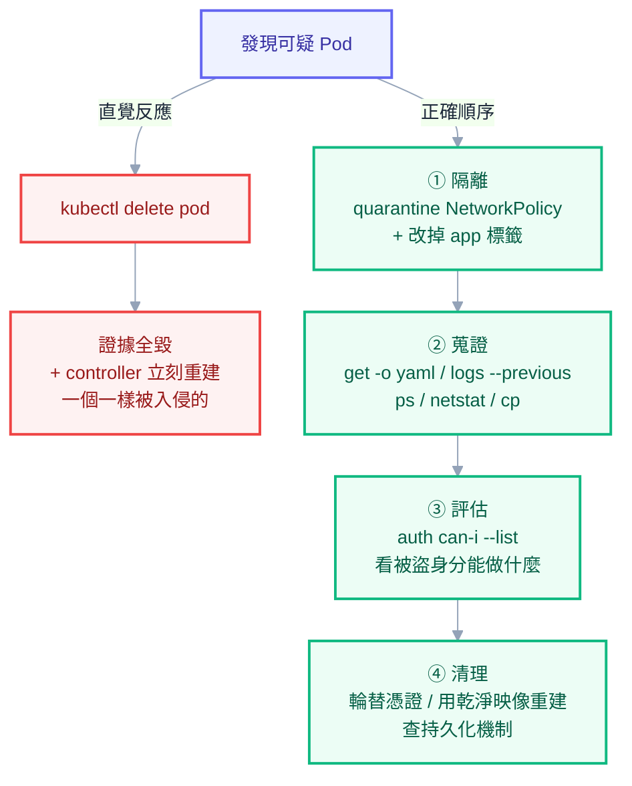

# 附錄 P：安全事故應變與供應鏈

正文第 8 章講的是預防——認證、授權、准入這三道關卡怎麼擋住不該進來的東西。但預防不會百分之百有效，而**這套教材完全沒有講「已經出事了怎麼辦」**。

這一份補上那一半，加上預防裡最後一塊沒講的：供應鏈。順序刻意如此——供應鏈是「壞東西怎麼進來的」，事故應變是「進來之後怎麼辦」。

一個先講的原則：**安全事故當下最大的敵人是慌張造成的證據破壞**。多數人的第一反應是 `kubectl delete pod`，那會同時毀掉證據、而且 controller 會立刻重建一個一樣（一樣被入侵）的 Pod。這一份的 Part 3 會給正確的順序。

---

## Part 1：供應鏈——壞東西從哪裡進來

你的映像裡有幾百個你沒寫過的套件。供應鏈安全處理的就是這件事。

### 選對基底映像

| 選擇 | 大小 | 攻擊面 | 適合 |
| --- | --- | --- | --- |
| `ubuntu` / `debian` | 大 | 大（完整 shell、套件管理器） | 需要大量系統工具時 |
| `alpine` | 小 | 中 | 一般情況，但 musl libc 偶有相容性問題 |
| `*-slim` | 中 | 中 | .NET / Python 的官方精簡版 |
| **distroless** | 小 | **最小**（連 shell 都沒有） | 正式環境的理想選擇 |

distroless 的價值不只是體積：**沒有 shell 就大幅提高了入侵者的成本**——他拿到執行權限也沒有 `bash`、`curl`、`wget` 可以用來下載工具或橫向移動。代價是不能 `kubectl exec` 進去看，除錯要改用臨時容器（附錄 C-1 的 `ephemeralContainers`）。

**釘選 digest 而不是 tag。** tag 是可變的——`nginx:1.25` 今天和下個月可能是不同的內容。要真正可重現就用 digest：

```yaml
image: harbor.example.com/demo/my-api@sha256:3f2a9c...
```

實務上折衷做法是：開發用 tag、正式環境由 CI 解析成 digest 寫進 manifest。

### 掃描：掃什麼、什麼時候掃

```powershell
# 映像掃描（OS 套件 + 語言依賴）
trivy image --severity HIGH,CRITICAL harbor.example.com/demo/my-api:1.0.0

# 原始碼掃描（在 CI 早期就跑，比等映像建好快）
trivy fs --scanners vuln,secret,misconfig .

# K8s manifest 的設定檢查
trivy config ./k8s/
```

`--scanners secret` 值得特別注意：它會抓出誤入原始碼的 API key 與密碼。**這一項的投資報酬率極高**，因為機密外洩的成本遠高於一個中危漏洞。

掃描該放在三個位置，各自的目的不同：

| 位置 | 目的 | 要不要擋 |
| --- | --- | --- |
| **PR 階段**（`trivy fs`） | 及早發現，改起來便宜 | 機密要擋，漏洞先報 |
| **建置後**（`trivy image`） | 確認最終產物 | CRITICAL 擋，HIGH 依情況 |
| **registry 定期重掃** | **今天乾淨不代表明天乾淨** | 報警不擋 |

第三項最容易被忽略：漏洞是持續被發現的，你半年前建的映像今天可能已經有 CRITICAL。Harbor 內建定期掃描，值得打開。

關於「擋還是報」的判斷：**一律擋 CRITICAL 會讓管線頻繁卡死**（很多 CVE 沒有修補版本可用），一律不擋則形同虛設。務實做法是擋「有修補版本的 CRITICAL」，並對其餘的建立豁免清單與到期日——**豁免必須有到期日**，否則它會變成永久的。

### SBOM：Log4Shell 那天的問題

SBOM（Software Bill of Materials）是一份「這個映像裡有什麼元件、什麼版本」的清單。

它的價值在一個具體情境：**當下一個 Log4Shell 級別的漏洞公布，你能在幾分鐘內回答「我們有沒有用到、用在哪幾個服務」嗎？** 沒有 SBOM 的答案是「我們要一個一個查」，那可能是好幾天。

```powershell
trivy image --format cyclonedx --output sbom.json harbor.example.com/demo/my-api:1.0.0
```

把 SBOM 當成建置產物存起來（附在 release、或推到 registry 當 artifact），之後就能對整批映像做查詢。

### 簽章：確認映像真的是你建的

掃描確認「內容安全」，簽章確認「來源正確」——防的是有人往 registry 推了一個同名的惡意映像。

```powershell
# CI 中簽章（keyless，用 OIDC 身分，不必管理金鑰）
cosign sign harbor.example.com/demo/my-api@sha256:3f2a9c...

# 驗證
cosign verify --certificate-identity-regexp ".*" --certificate-oidc-issuer-regexp ".*" harbor.example.com/demo/my-api@sha256:3f2a9c...
```

進階做法是在叢集用 admission policy 強制「只允許執行有效簽章的映像」（Kyverno 的 `verifyImages` 或 sigstore policy-controller）。**這是供應鏈防護的最後一道閘門**，但導入前要確認所有映像來源都能簽——包含第三方的 chart 帶進來的那些。

---

## Part 2：機密外洩了怎麼辦

### 三種洩漏管道

| 管道 | 怎麼發生 | 怎麼偵測 |
| --- | --- | --- |
| **git** | 密碼寫進 `appsettings.json`、Secret YAML 進 repo | GitHub secret scanning、`trivy fs --scanners secret`、gitleaks |
| **映像層** | `COPY` 把設定檔帶進去、`ENV` 寫死密碼 | `trivy image --scanners secret` |
| **日誌** | 記了完整請求 body、例外訊息帶著連線字串 | 日誌平台的規則告警 |

映像層那一項特別陰險：**映像層是唯讀且疊加的，後面的層刪不掉前面層的東西**（正文第 0 章）。你在 Dockerfile 裡 `COPY secret.json` 之後又 `RUN rm secret.json`，那個檔案**仍然在前一層裡，任何人都能取出來**。唯一的修法是重建映像。

### 處置順序：先輪替，再清理

**這是最重要的一條，而且多數人的直覺是反的。**

發現密碼進了 git，第一反應通常是「趕快把 commit 清掉」。但清 git 歷史需要時間、要協調所有人重新 clone，而且**在這段期間那個密碼仍然有效**。更重要的是：你無法確定沒有人已經看過——repo 可能被 fork、被 CI 快取、被搜尋引擎索引。

**正確順序是：**

1. **立刻輪替憑證**（讓外洩的那份失效）——這一步做完，事故的嚴重性就大幅下降
2. 評估影響範圍：這份憑證能做什麼？有沒有被使用的跡象（查存取日誌）
3. 清理來源（git 歷史、重建映像、清日誌）
4. 補上偵測（掃描器、pre-commit hook）
5. 修正流程（為什麼它會進去？是不是缺一個安全的替代路徑）

**「清乾淨了就沒事」是錯的心智模型。應該是「外洩即已失效」。**

### 各類憑證的輪替方式

| 憑證 | 怎麼輪替 | 注意 |
| --- | --- | --- |
| 資料庫密碼 | 資料庫端改密碼 → 更新 Secret → 重啟 Pod | 用 `env` 注入的**必須重啟**才生效（正文第 6 章） |
| ServiceAccount token | **刪除該 ServiceAccount 並重建** | 投影 token 綁定在 SA 上，刪掉即全部失效 |
| Registry robot 帳號 | 在 Harbor 停用並重建 → 更新 imagePullSecret | 名稱含 `$` 要走 secret（正文第 13 章） |
| 雲端金鑰（IAM） | 停用金鑰 → 建新的 → 更新 | **更好的長期解是改用 IRSA**，根本不需要長期金鑰（附錄 M） |
| TLS 私鑰 | 重新簽發並**撤銷舊憑證** | cert-manager 刪掉 Secret 會自動重簽 |
| Vault token / role | 撤銷 token、輪替 role 的憑證 | 檢查 audit log 看被用過沒 |

輪替之後，**去查那份憑證的存取紀錄**：資料庫的連線日誌、雲端的 CloudTrail、K8s 的 audit log。有沒有來自陌生 IP 的使用，決定這是「虛驚」還是「真的事故」。

---

## Part 3：叢集被入侵了

### 偵測訊號

多數 K8s 入侵事件的第一個症狀不是安全警報，而是**帳單或效能異常**：

| 訊號 | 可能是什麼 |
| --- | --- |
| CPU 用量無故飆高、持續滿載 | 挖礦 |
| 出站流量暴增、連往陌生 IP | 挖礦礦池、資料外洩 |
| 出現沒人部署的 Pod / Job / CronJob | 攻擊者建立的持久化機制 |
| `kubectl get events` 出現陌生 SA 的操作 | 憑證被盜用 |
| 節點上有非預期的 process | 容器逃逸 |
| API Server 出現大量 403 | 有人在探測權限邊界 |

**挖礦是目前最常見的形態**，因為它變現最直接。它的特徵很好認：CPU 持續 100%、對外連線到礦池的固定 port、而且常常偽裝成看起來正常的名稱（`kube-controller`、`nginx-worker` 之類）。

### 第一個小時：不要毀掉證據

```
❌ kubectl delete pod <可疑的 pod>
```

**這是最常見的錯誤反應**，它同時做了兩件壞事：毀掉記憶體與檔案系統裡的證據，而且如果那個 Pod 有 controller 管理，**controller 會立刻重建一個一模一樣的**——包含被入侵的狀態。



正確的順序是**隔離 → 蒐證 → 評估 → 清理**：

**步驟 1：隔離，但保留 Pod**

用 NetworkPolicy 切斷它的所有網路，Pod 還活著但動不了：

```yaml
apiVersion: networking.k8s.io/v1
kind: NetworkPolicy
metadata:
  name: quarantine
  namespace: <ns>
spec:
  podSelector:
    matchLabels:
      quarantine: "true" # 給可疑 Pod 打上這個標籤
  policyTypes: [Ingress, Egress]
  # 沒有任何 ingress/egress 規則 = 全部拒絕
```

```powershell
# 給可疑 Pod 貼標籤觸發隔離
kubectl label pod <pod> quarantine=true -n <ns>

# 同時把它從 Service 摘除（改掉 app 標籤，controller 會補一個新的健康 Pod）
kubectl label pod <pod> app- -n <ns>
```

第二個指令是一個有用的技巧：**改掉標籤之後，Deployment 的 selector 就選不到它，於是 controller 認為副本數不足而補一個新的**，服務恢復正常，而可疑的 Pod 被留下來供調查（它變成一個沒有 controller 管理的孤兒 Pod）。

**步驟 2：蒐證**

```powershell
# 完整物件定義（含 SA、掛載、映像 digest）
kubectl get pod <pod> -n <ns> -o yaml > evidence-pod.yaml

# 目前的 process
kubectl exec <pod> -n <ns> -- ps aux > evidence-ps.txt

# 網路連線
kubectl exec <pod> -n <ns> -- netstat -antp > evidence-net.txt

# 可疑檔案
kubectl cp <ns>/<pod>:/tmp ./evidence-tmp/

# 日誌（含之前的容器）
kubectl logs <pod> -n <ns> --all-containers --previous > evidence-logs-prev.txt
kubectl logs <pod> -n <ns> --all-containers > evidence-logs.txt

# 這個 namespace 的 events（只有一小時，先存下來）
kubectl get events -n <ns> --sort-by=.metadata.creationTimestamp > evidence-events.txt
```

distroless 映像沒有 `ps` 這些工具，用臨時容器：

```powershell
kubectl debug -it <pod> -n <ns> --image=busybox:1.36 --target=<container>
```

**步驟 3：評估影響範圍**

關鍵問題是：**被入侵的那個身分能做什麼？**

```powershell
# 這個 Pod 用的 ServiceAccount
kubectl get pod <pod> -n <ns> -o jsonpath='{.spec.serviceAccountName}'

# 它的權限（這決定了災情大小）
kubectl auth can-i --list --as=system:serviceaccount:<ns>:<sa>

# 有沒有掛載 token（沒掛載的話 API 這條路是斷的）
kubectl get pod <pod> -n <ns> -o jsonpath='{.spec.automountServiceAccountToken}'
```

如果那個 SA 只能讀自己 namespace 的 ConfigMap，災情有限；如果它是 `cluster-admin`，你要假設**整座叢集都已失守**。

接著查 audit log 看有沒有橫向移動的跡象（Part 5）。

**步驟 4：清理**

- 撤銷相關憑證（Part 2 的輪替流程）
- 用**已知乾淨的映像**重建工作負載，不要只是重啟
- 檢查有沒有持久化機制：陌生的 CronJob、DaemonSet、mutating webhook、被改過的 ServiceAccount 或 RoleBinding
- 節點若可能被逃逸影響，**重建節點而不是清理節點**

最後一項的理由：一旦攻擊者取得節點的 root，你無法確信清乾淨了。**重建比檢查便宜也可靠。**

---

## Part 4：容器逃逸

「容器被入侵」與「節點被入侵」是兩個嚴重性級別，中間隔著容器逃逸。

常見的逃逸路徑，全部都是**設定給的**而不是漏洞給的：

| 設定 | 為什麼危險 |
| --- | --- |
| `privileged: true` | 幾乎等同節點 root，可直接掛載主機裝置 |
| `hostPath` 掛 `/` 或 `/etc` | 直接讀寫主機檔案系統 |
| 掛載 `/var/run/docker.sock` | 可以叫 runtime 幫你開一個 privileged 容器 |
| `hostPID: true` | 看得到主機所有 process，配合工具可進入其 namespace |
| `CAP_SYS_ADMIN` | 極廣的能力，等同半個 root |
| `allowPrivilegeEscalation: true` | 允許透過 setuid 提權 |

**好消息是：Pod Security Admission 的 `restricted` 等級把上面全部擋掉**（正文第 8 章、附錄 C-4）。這是投資報酬率最高的單一安全設定——一個 namespace label 就消滅了絕大多數逃逸路徑。

剩下的是 kernel 漏洞造成的逃逸，那靠的是**及時更新節點**與 runtime 層的偵測（Falco 這類工具用 eBPF 監看系統呼叫，對「容器內出現 shell」「寫入敏感路徑」這類行為告警）。導入 runtime 偵測是進階議題，但**至少要知道 PSA 涵蓋不了 kernel 漏洞這件事**。

盤點目前叢集裡的高風險 Pod：

```powershell
# 找出所有 privileged 容器
kubectl get pods -A -o json | ConvertFrom-Json |
  ForEach-Object { $_.items } |
  Where-Object { $_.spec.containers.securityContext.privileged -contains $true } |
  ForEach-Object { "$($_.metadata.namespace)/$($_.metadata.name)" }

# 找出掛了 hostPath 的 Pod
kubectl get pods -A -o json | ConvertFrom-Json |
  ForEach-Object { $_.items } |
  Where-Object { $_.spec.volumes.hostPath } |
  ForEach-Object { "$($_.metadata.namespace)/$($_.metadata.name)" }
```

跑一次這兩個指令，你大概會找到幾個「當初為了方便」而留下來的東西。

---

## Part 5：稽核日誌

事故調查時，audit log 是唯一能回答「**誰、在什麼時候、對什麼做了什麼**」的來源。沒開的話，你在事後只能猜。

設定見附錄 C-6 的 `Policy` 範例。實務上的最小配置是：對 Secret 相關操作記 `RequestResponse`、其餘記 `Metadata`、把 `system:kube-proxy` 這類雜訊設為 `None`。

調查時常用的查詢方向：

| 想知道 | 找什麼 |
| --- | --- |
| 這個 SA 做過什麼 | `user.username` = `system:serviceaccount:<ns>:<sa>` |
| 誰讀過這個 Secret | `objectRef.resource=secrets` 且 `objectRef.name=<name>`，`verb=get/list` |
| 有沒有人在探測權限 | 大量 `responseStatus.code=403` 來自同一身分 |
| 誰建立了那個陌生的 CronJob | `verb=create` 且 `objectRef.resource=cronjobs` |
| 有沒有人改過 RBAC | `objectRef.apiGroup=rbac.authorization.k8s.io` 且 `verb` 是寫入類 |

**audit log 必須送到叢集外。** 留在節點上的話，攻擊者取得節點權限後第一件事就是清掉它。

---

## Part 6：事故之後

照附錄 H 的事故流程走完之後，安全事故還有兩件特有的事：

**通報義務。** 涉及個資或客戶資料時，多數地區有法定的通報時限。這件事必須事前確認清楚並寫進 runbook，不是事故當下才查。

**檢討的重點是「為什麼防線沒擋住」而不是「誰犯錯」。** 具體要回答四個問題：

1. 攻擊者從哪裡進來？那條路徑現在關上了嗎？
2. 為什麼沒有更早發現？該補什麼偵測？
3. 影響範圍為什麼那麼大？權限邊界該收到哪裡？
4. 同一類問題還有哪些地方存在？（**這一題最有價值**——修好一個實例但沒修好整類，下次會再來一次）

---

## 檢查清單

**供應鏈**

- [ ] 基底映像有明確的選擇標準，正式環境考慮 distroless
- [ ] CI 有 `trivy fs --scanners secret`（機密掃描一律擋）
- [ ] 建置後掃描映像，CRITICAL 有修補版本的擋下
- [ ] registry 有定期重掃
- [ ] 豁免清單有到期日
- [ ] 產出並保存 SBOM
- [ ] 正式環境的映像有簽章（進階：admission 強制驗章）

**機密**

- [ ] git 有 secret scanning 與 pre-commit hook
- [ ] 團隊知道**先輪替再清理**的順序
- [ ] 各類憑證的輪替步驟已寫成 runbook
- [ ] 長期雲端金鑰已改為 IRSA / Workload Identity

**應變準備**

- [ ] 有隔離用的 NetworkPolicy 範本（quarantine）
- [ ] 團隊知道**不要直接 delete 可疑 Pod**
- [ ] 蒐證指令已寫成 runbook
- [ ] audit log 已開啟並送到叢集外
- [ ] 已盤點叢集內的 privileged / hostPath Pod
- [ ] 所有 namespace 至少有 PSA `warn`，正式環境 `enforce: restricted`
- [ ] 節點有定期更新（kernel 漏洞）
- [ ] 通報義務已確認並寫進 runbook

## 連結

- [[68-registry-operations]] — 附錄 AT：registry 端的存取控制、來源限制與掃描 gate
- [[08-security-and-rbac]] — 正文：認證授權准入三道關卡、PSA、Vault 信任鏈（預防面）
- [[21-yaml-fields-cluster-security]] — 附錄 C-4：PSA、RBAC、audit policy 全欄位
- [[23-yaml-fields-rare-builtins]] — 附錄 C-6：EncryptionConfiguration 與 Audit Policy 設定檔
- [[30-production-readiness]] — 附錄 H：事故分級與第一小時流程
- [[00-docker-foundations]] — 正文：映像層為何刪不掉東西
- [[35-cloud-networking]] — 附錄 M：IRSA 取代長期金鑰
- [[37-platform-engineering]] — 附錄 O：把安全基線變成強制政策
- [[61-compliance-and-audit]] — 附錄 AM：同一份 audit log，事故時用來調查，平時用來當合規證據
- [[k8s-mastery]] — 教材總目錄
