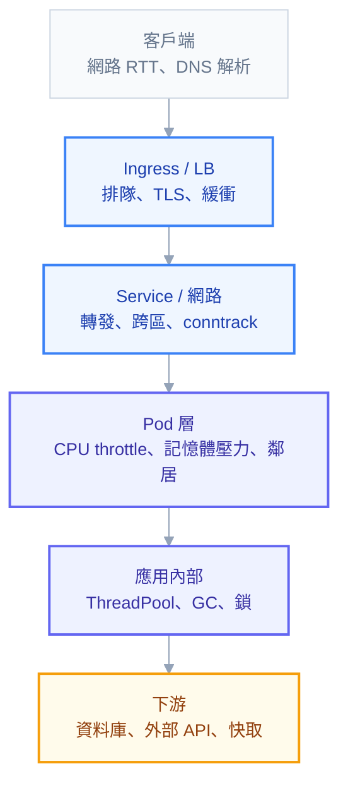

# 附錄 Q：效能問題定位

「服務掛了」很好查——Pod 變紅、告警響、日誌有例外。**「服務變慢了」是完全不同性質的問題**：所有健康檢查都是綠的、Pod 全部 Running、日誌乾淨，但使用者在抱怨。

這一類問題難查的原因是**它可能發生在任何一層**，而且每一層看起來都正常。教材裡相關的內容散在第 13 章（分層排查）、第 14 章（PromQL）與附錄 K（資源配置），但沒有一份把「慢」當成主題，從使用者的感受一路往下拆到根因。這一份補上。

核心方法只有一句話：**先確認慢在哪一段，再深入那一段。** 跳過定位直接猜測，是查效能問題最常見的時間浪費。

---

## Part 1：延遲是由哪些段落組成的

使用者感受到的「一次請求花了 800ms」，實際上是這條鏈的總和：



每一段都有對應的量測方式。**如果你只有「總共 800ms」這一個數字，你什麼都查不出來**——所以第一步永遠是把它拆開：

| 段落 | 怎麼量 |
| --- | --- |
| 客戶端到 Ingress | 瀏覽器 DevTools、外部撥測 |
| Ingress 內部排隊 | nginx 的 `$request_time` **減去** `$upstream_response_time` |
| Ingress 到 Pod（含應用） | nginx 的 `$upstream_response_time` |
| 應用內部處理 | 應用自己的 metric（`http_server_request_duration_seconds`） |
| 應用到下游 | 應用的 DB／HTTP client metric、分散式追蹤 |

**`$request_time` 與 `$upstream_response_time` 的差值特別有價值**（附錄 F 建議把兩者都寫進 log format 就是為了這個）：差值大代表時間花在 nginx 自己——排隊、TLS 交握、或回應緩衝，而不是後端慢。

---

## Part 2：先問四個問題

深入任何一層之前，先用這四個問題把範圍縮小。**它們花不到五分鐘，但常常直接指出方向。**

### 1. 全部慢，還是部分慢？

```promql
# 依路由拆開看 P95，找出是哪些端點慢
histogram_quantile(0.95,
  sum by (le, http_route) (rate(http_server_request_duration_seconds_bucket{job="api"}[5m]))
)
```

- **全部路由都慢** → 共用資源問題：CPU throttle、節點、連線池、下游資料庫
- **只有特定路由慢** → 那段程式碼或它的查詢
- **只有特定使用者／租戶慢** → 資料量差異（某個租戶的表特別大）

### 2. 一直慢，還是尖峰才慢？

尖峰才慢通常是容量問題（副本不足、連線池滿、資料庫連線排隊）；一直慢通常是程式或查詢本身。

### 3. 什麼時候開始的？

**這是最有效率的一個問題。** 把延遲曲線跟變更事件對齊：

```powershell
kubectl rollout history deployment/api
kubectl get events -A --sort-by=.metadata.creationTimestamp | Select-String -Pattern "Scaled|Killing|Started"
```

如果變慢的時間點對得上某次部署、某次擴縮、或某個設定變更，你已經找到嫌疑犯了。**先驗證這個假設，再考慮其他方向。**

### 4. 平均慢，還是尾端慢？

```promql
histogram_quantile(0.50, sum by (le) (rate(http_server_request_duration_seconds_bucket[5m])))
histogram_quantile(0.95, sum by (le) (rate(http_server_request_duration_seconds_bucket[5m])))
histogram_quantile(0.99, sum by (le) (rate(http_server_request_duration_seconds_bucket[5m])))
```

**這兩者的根因完全不同：**

- **P50 也高** → 每個請求都在做同樣多的工作 → 程式邏輯、查詢效率、下游本來就慢
- **P50 正常但 P99 高** → 多數請求很快，少數卡住 → **排隊、GC、throttle、鎖競爭**（Part 4 專門處理）

只看平均值會完全錯過第二種——而第二種正是使用者抱怨最多的那種。

---

## Part 3：逐層排查

### L0：DNS

叢集內最容易被忽略的延遲來源。`ndots:5` 讓每次外部網域查詢都先試四五個叢集內後綴（入門第三章、正文第 5 章）。

```powershell
kubectl exec deploy/api -- sh -c "time nslookup api.payment.com"
```

單次查詢超過幾十毫秒、或 CoreDNS 的 CPU 偏高，就往這個方向查。修法是外部網域結尾加點、或設 `dnsConfig.options` 把 `ndots` 調成 2。

### L1：Ingress 層

```promql
# ingress-nginx 的 P95（包含它自己 + 後端）
histogram_quantile(0.95, sum by (le, ingress) (rate(nginx_ingress_controller_request_duration_seconds_bucket[5m])))

# 只看後端回應時間
histogram_quantile(0.95, sum by (le, ingress) (rate(nginx_ingress_controller_response_duration_seconds_bucket[5m])))
```

兩者差距大就是 nginx 自己在排隊。可能是 controller 副本不足、worker 連線數上限、或 `proxy-buffering` 造成的延遲（附錄 F）。

### L2：Service 與網路

三個具體的檢查點：

**跨區流量**（雲端）：Pod 呼叫另一個服務時隨機跨可用區，每次多幾毫秒。設 `trafficDistribution: PreferClose`（附錄 C-3）可消除。

**conntrack 表滿了**：連線追蹤表滿的症狀是**隨機丟包與逾時**，非常難查，因為它不對應任何應用層錯誤。

```powershell
kubectl get nodes -o name | ForEach-Object { kubectl debug $_ -it --image=busybox -- sh -c "cat /proc/sys/net/netfilter/nf_conntrack_count /proc/sys/net/netfilter/nf_conntrack_max" }
```

`count` 接近 `max` 就要調高 `nf_conntrack_max`（kube-proxy 設定，附錄 C-6）。

**kube-proxy 同步延遲**：Service 數量大時規則同步變慢，Pod 變動後流量可能短暫送到不存在的後端（附錄 N）。

### L3：Pod 層——CPU throttle 是頭號嫌疑犯

**這一項值得單獨強調，因為它是「所有東西看起來都正常但服務就是慢」的最常見答案。**

```promql
sum by (pod) (rate(container_cpu_cfs_throttled_periods_total{namespace="demo"}[5m]))
/ sum by (pod) (rate(container_cpu_cfs_periods_total{namespace="demo"}[5m]))
```

比率超過 0.25 就值得處理。但這裡有一個**反直覺的關鍵**：

> **平均 CPU 用量遠低於 limit，仍然可能被大量 throttle。**

原因是 CFS 以 100ms 為一個週期分配額度。`limit: 500m` 表示每 100ms 只能用 50ms 的 CPU 時間。一個請求如果需要密集運算 80ms，它會在 50ms 時被凍結，**等到下一個週期才繼續**——這一個請求就平白多了 50ms 延遲。而從一分鐘平均來看，CPU 用量可能只有 20%。

所以「CPU 使用率不高所以不是 CPU 問題」是錯的推論。**要看的是 throttle 比率，不是使用率。**

其他 Pod 層的檢查點：

```promql
# 記憶體逼近 limit（GC 壓力大、可能即將 OOM）
container_memory_working_set_bytes{namespace="demo"}
/ on(pod,container) kube_pod_container_resource_limits{resource="memory"}

# 節點整體壓力（吵鬧鄰居）
node_load1 / on(instance) machine_cpu_cores

# 磁碟 IO 等待（PVC 慢）
rate(node_disk_io_time_seconds_total[5m])
```

**吵鬧鄰居**值得一提：你的 Pod 沒問題，但同節點另一個 Pod 把 CPU 或磁碟吃滿。判斷方法是比較「同一個 Deployment 的不同副本」——如果只有某幾個副本慢，而它們剛好在同一台節點上，答案就出來了。

```promql
histogram_quantile(0.95, sum by (le, pod) (rate(http_server_request_duration_seconds_bucket{job="api"}[5m])))
```

**依 Pod 拆開看延遲**是這類問題的專用武器。

### L4：應用內部

到這一層就離開 K8s 了，但有幾個容器環境特有的陷阱：

| 問題 | 症狀 | 檢查 |
| --- | --- | --- |
| **ThreadPool 飢餓**（.NET） | 延遲階梯式上升，CPU 不高 | `dotnet-counters` 看 ThreadPool 佇列長度 |
| **GC pause** | P99 尖刺，週期性 | GC 相關 metric、暫停時間 |
| **GC 模式不對** | 容器裡記憶體用量異常 | Server GC 在小容器裡可能不適合 |
| **鎖競爭** | 併發上升時延遲非線性惡化 | 追蹤、剖析工具 |
| **連線池排隊** | 延遲上升但 CPU 與 DB 都不忙 | 連線池的等待時間 metric |

**連線池排隊是最容易誤判的一個**：應用不忙、資料庫不忙，但請求在等一條可用連線。實戰第五章那個「Pod 數 × 池大小」的計算，反過來也成立——**池開太小會造成排隊延遲**。兩個方向都要算。

### L5：下游

```promql
# 依下游服務拆開看延遲（OpenTelemetry 的 HTTP client instrumentation）
histogram_quantile(0.95, sum by (le, server_address) (rate(http_client_request_duration_seconds_bucket[5m])))
```

資料庫的話，直接去資料庫端看慢查詢（Oracle 的 AWR、`v$sql`）。**這時候問題已經不在 K8s 了**——但重要的是你**證明**了它不在 K8s，這本身就是有價值的結論。

---

## Part 4：尾端延遲（P99 高但 P50 正常）

這一類最難查，因為「多數請求都很快」讓人以為系統健康。六個常見原因：

| 原因 | 特徵 | 驗證方式 |
| --- | --- | --- |
| **GC pause** | 週期性尖刺，間隔規律 | 延遲尖刺與 GC 事件時間對齊 |
| **CPU throttle** | 尖刺間隔接近 100ms 的倍數 | throttle 比率 |
| **連線池排隊** | 尖峰時出現，離峰消失 | 池的等待時間、活躍連線數 |
| **冷啟動** | 新 Pod 剛起來時的請求慢 | 尖刺與擴縮／部署時間對齊 |
| **重試放大** | 下游一抖，延遲加倍或三倍 | 重試設定（Istio 預設就有重試！） |
| **慢節點** | 只有某些副本慢 | 依 Pod 拆開看延遲 |

**重試放大值得特別注意。** 附錄 C-7 提過 Istio 預設就會重試——上游看到一次失敗，實際上可能已經打了三次。下游稍微變慢時，重試會把負載放大，讓它更慢，形成正回饋。查尾端延遲時，**先確認整條鏈上有幾層在重試**。

冷啟動與 HPA 的互動也值得一提：HPA 擴容 → 新 Pod 啟動 → 這些 Pod 前幾秒特別慢 → 拉高 P99。設好 `startupProbe` 與 `minReadySeconds`（實戰第二章）可以避免流量太早進到還沒暖起來的 Pod。

---

## Part 5：三個完整推演

### 案例一：部署之後 P95 從 200ms 變 800ms

**觀察**：P50 幾乎沒變（180 → 200ms），P95 大幅上升。時間點正好對上一次部署。

**推論**：P50 沒變代表程式邏輯本身沒變慢，是少數請求被卡住 → 往尾端延遲的方向查。

**驗證**：查 throttle 比率，發現從 2% 升到 40%。回頭看那次部署的 diff——`resources.limits.cpu` 從 `2` 改成 `500m`。

**根因**：有人為了「節省資源」調降了 CPU limit，平均用量看起來確實還夠，但尖峰時的請求被 CFS 凍結。

**修法**：調回或移除 CPU limit（附錄 K 的判準表）。

### 案例二：只有早上九點慢

**觀察**：每天 09:00–09:30 P95 是平時的五倍，其餘時間正常。

**推論**：尖峰型 → 容量問題。

**驗證**：看 HPA——`ScalingLimited` 為 True、`reason: TooManyReplicas`，已頂到 `maxReplicas: 5`。但同時檢查資料庫，發現連線數也接近上限。

**根因**：兩個問題疊在一起。單純調高 `maxReplicas` 會讓資料庫連線爆掉（實戰第五章的乘法）。

**修法**：先調小每個 Pod 的連線池、再調高 `maxReplicas`；並考慮讓 HPA 提前擴容（用 `behavior.scaleUp` 縮短穩定視窗，或用排程式擴容在 08:45 先擴好）。

### 案例三：偶發性超慢，找不到規律

**觀察**：P99 偶爾出現 5 秒以上，但沒有明顯時間規律，CPU、記憶體、資料庫都正常。

**推論**：沒有規律 + 資源正常 → 往網路與 DNS 方向查。

**驗證**：依 Pod 拆開看延遲，發現尖刺分佈在所有 Pod。用 `time nslookup` 測，發現偶爾要 5 秒——CoreDNS 的請求量遠高於預期。

**根因**：`ndots:5` 讓每次呼叫外部 API 都產生四五次無效查詢，CoreDNS 過載，偶爾逾時後重試。

**修法**：外部網域用 FQDN 結尾加點，或調 `ndots`；同時擴充 CoreDNS 副本並設定自動擴縮。

**這三個案例的共同結構是：先用四個問題定位，再針對那一層深入驗證。** 沒有一個是靠「猜」找到的。

---

## Part 6：把量測做進系統

事後查很辛苦，事前準備能讓下次快十倍。四件事：

**日誌帶上延遲分解。** ingress 的 log format 加 `$request_time` 與 `$upstream_response_time`（附錄 F），應用的 log 帶上下游呼叫耗時。

**儀表板固定有這五格**：P50/P95/P99 三條線放同一張圖（一眼看出是整體慢還是尾端慢）、依路由的延遲排行、**throttle 比率**、依 Pod 拆開的延遲、下游依賴的延遲。

**導入分散式追蹤。** 有 trace 之後，「800ms 花在哪一段」是一個畫面而不是一場調查（實戰第六章）。

**記錄基線。** 知道「正常時候 P95 是多少」，才有辦法說現在是不是變慢了。**沒有基線的話，你連「有沒有變慢」都證明不了。**

---

## 常見誤區

| # | 誤區 | 為什麼錯 |
| --- | --- | --- |
| 1 | 「CPU 使用率不高所以不是 CPU 問題」 | 要看 **throttle 比率**，不是使用率 |
| 2 | 只看平均延遲 | 完全錯過尾端問題，而那正是使用者抱怨的 |
| 3 | 一發現慢就先擴容 | 可能把資料庫壓垮；先定位再處理 |
| 4 | 沒有基線就說「變慢了」 | 無法證明，也無法驗證修好了沒 |
| 5 | 跳過「什麼時候開始」直接深入 | 這個問題常常五分鐘就給出答案 |
| 6 | 以為 Pod 全部 Running 就沒事 | 慢的服務健康檢查全綠 |
| 7 | 忽略重試的放大效應 | Istio 預設就有重試，一次失敗變三次請求 |
| 8 | 沒有依 Pod 拆開看 | 錯過「只有某幾個副本慢」這個強訊號 |
| 9 | 認為連線池越大越好 | 太大壓垮資料庫，太小造成排隊；兩個方向都要算 |
| 10 | 查到「是資料庫慢」就停手 | 那只是換一層，繼續往下查慢查詢 |

## 檢查清單

**排查時**

- [ ] 先問四個問題（全部/部分、持續/尖峰、何時開始、平均/尾端）
- [ ] 把延遲拆成各段，確認慢在哪一層再深入
- [ ] 檢查 throttle 比率（不是 CPU 使用率）
- [ ] 依 Pod 拆開看延遲，排除吵鬧鄰居與慢節點
- [ ] 對照最近的部署與設定變更
- [ ] 確認整條鏈上有幾層在重試

**平時準備**

- [ ] 儀表板有 P50/P95/P99 三條線
- [ ] 儀表板有 throttle 比率
- [ ] ingress log 有 `$request_time` 與 `$upstream_response_time`
- [ ] 應用有下游呼叫的延遲 metric
- [ ] 有分散式追蹤
- [ ] 有記錄正常時期的基線數字

## 連結

- [[74-distributed-tracing]] — 附錄 AZ：這裡反覆推薦的「導入分散式追蹤」，實際上怎麼做
- [[72-cascading-failure]] — 附錄 AX：變慢為何會往上傳染成全站故障——重試放大與超時預算
- [[64-slo-and-alerting]] — 附錄 AP：什麼樣的「變慢」該叫醒人，什麼樣的只該開工單
- [[13-troubleshooting]] — 正文：分層定位方法論與 19 個真實案例
- [[14-prometheus-grafana]] — 正文：PromQL 深入、`rate` vs `irate`、histogram 算 P95
- [[07-scheduling-and-resources]] — 正文：requests/limits 真義與 CPU throttle 機制
- [[33-cost-optimization]] — 附錄 K：CPU limit 該不該設的判準
- [[practice-6-observability]] — 實戰 6：把這些指標做成儀表板與告警
- [[practice-5-database-and-state]] — 實戰 5：連線池的兩個方向
- [[28-ingress-nginx-annotations]] — 附錄 F：逾時、緩衝與 log format
- [[k8s-mastery]] — 教材總目錄
