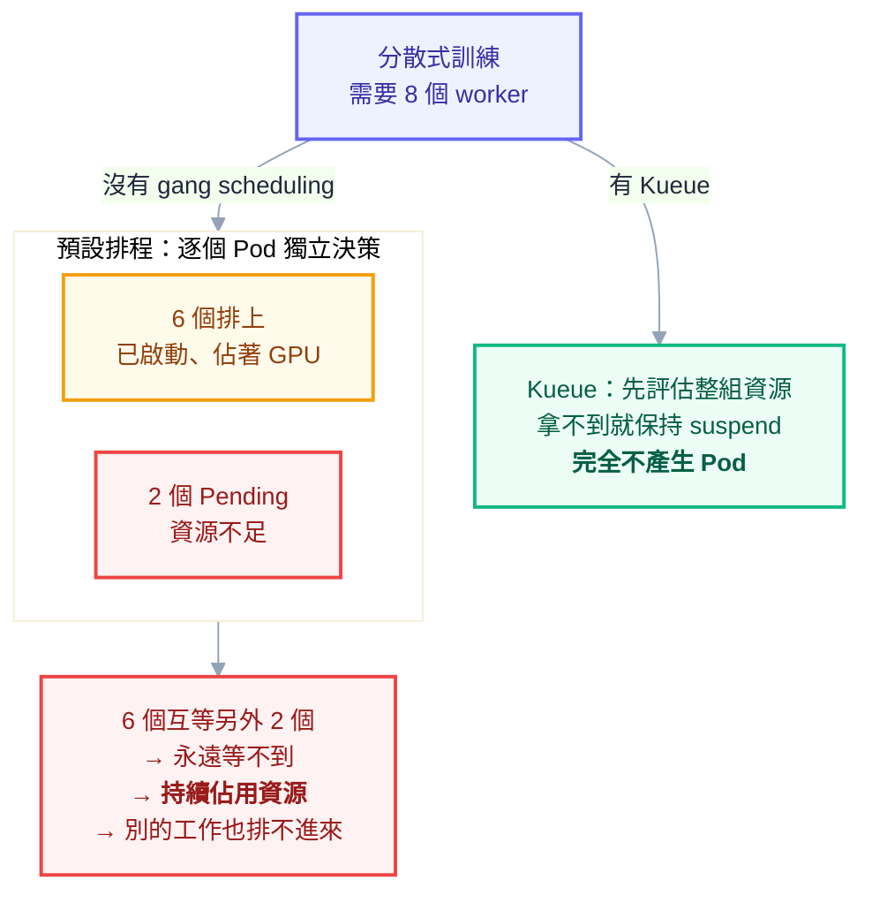

# 附錄 S：進階排程與批次工作負載

正文第 7 章講清楚了排程的機制：scheduler 怎麼過濾與評分、affinity 與 taint 怎麼影響決策、requests 為什麼是排程的依據。但它預設的場景是**線上服務**——長期運行、副本互相對等、隨時要能接請求。

一旦叢集裡開始跑別的東西，這套假設就不夠用了：批次工作可以等但要吞吐、分散式訓練要嘛全部一起跑要嘛不要跑、GPU 貴到不能閒置、spot 節點會隨時被收回。這一份處理這些「非典型」工作負載。

---

## Part 1：兩種工作負載的根本差異

| | 線上服務 | 批次工作 |
| --- | --- | --- |
| 對延遲的要求 | 毫秒級，不能等 | 可以排隊等幾小時 |
| 生命週期 | 長期運行 | 跑完就結束 |
| 被中斷的代價 | 高（使用者受影響） | 低（重跑就好，前提是設計成可重跑） |
| 資源需求 | 相對穩定 | 常常是大量、突發 |
| 該不該被搶佔 | 不該 | **應該** |

**這張表決定了它們該用不同的排程策略**。混在同一座叢集是可行的，而且對成本有利——批次工作可以填滿線上服務的閒置資源。但前提是要有明確的優先級與資源邊界，否則一次大批次任務就會把線上服務的容量吃光。

---

## Part 2：優先級與搶佔

### 分層設計

`PriorityClass` 的數字是自由的，但**應該事先規劃層級而不是每次隨手取值**。一個可用的分配：

| 層級 | 數字 | 用途 |
| --- | --- | --- |
| `system-node-critical` | 2000001000 | K8s 保留，別用 |
| `system-cluster-critical` | 2000000000 | K8s 保留，別用 |
| `platform-critical` | 1000000 | Ingress、CoreDNS、監控這類叢集元件 |
| `production-high` | 100000 | 核心線上服務 |
| `production-default` | 10000 | 一般線上服務（設為 `globalDefault`） |
| `batch-normal` | 1000 | 一般批次 |
| `batch-low` | 100 | 可以被隨意搶佔的工作 |

```yaml
apiVersion: scheduling.k8s.io/v1
kind: PriorityClass
metadata:
  name: batch-low
value: 100
globalDefault: false
preemptionPolicy: Never # 自己排隊等，但不趕走別人
description: "低優先批次工作，可被搶佔，且不搶佔他人"
```

`preemptionPolicy: Never` 這個組合值得注意：它讓工作**在排隊時享有優先序**（比更低優先的先排），**但不會為了自己而驅逐已經在跑的 Pod**。這對批次工作通常是正確的設定——你希望它有機會跑，但不希望它去打斷別人。

### 搶佔的副作用

啟用搶佔之前要知道三件事：

**被搶佔的 Pod 會被驅逐，不是暫停。** 它會收到終止訊號、走完 `terminationGracePeriodSeconds`、然後消失。如果它是 Job 的一部分且沒有 checkpoint，那段工作就白做了。

**PDB 不是硬保證。** scheduler 在挑選犧牲者時會**盡量**避免違反 PDB，但如果找不到其他方案，它仍然會違反。PDB 對 `kubectl drain` 是硬約束，對搶佔只是偏好——這個差異很少人知道。

**搶佔可能連鎖。** 高優先 Pod 搶佔了中優先 Pod，中優先 Pod 被重新排程時又可能搶佔低優先 Pod。層級設計得太密集會讓這種連鎖變常見。

### 避免優先級通膨

**如果每個團隊都能自己設定優先級，最後所有東西都會是最高優先級。** 這是可預測的結果，跟人性有關而不是紀律問題。

兩個防護手段：用 RBAC 限制誰能建立 `PriorityClass`；用 `ResourceQuota` 的 `scopeSelector` 限制高優先級的用量（附錄 C-2）：

```yaml
apiVersion: v1
kind: ResourceQuota
metadata:
  name: high-priority-limit
  namespace: team-a
spec:
  hard:
    requests.cpu: "4"
    requests.memory: 8Gi
  scopeSelector:
    matchExpressions:
      - scopeName: PriorityClass
        operator: In
        values: [production-high]
```

意思是「你可以用 `production-high`，但總量不能超過 4 CPU」。這比禁止使用更務實。

---

## Part 3：Gang Scheduling（全有全無）

### 問題長什麼樣

假設一個分散式訓練需要 8 個 worker 互相通訊。K8s 的預設排程是**逐個 Pod 獨立決策**的，所以可能發生：

```
8 個 worker → 排上 6 個，剩 2 個資源不足卡在 Pending
            → 那 6 個啟動後互相等待另外 2 個
            → 永遠等不到，但持續佔用資源
```



**這是死鎖**，而且會因為佔著資源而讓其他工作也排不進來。兩個這樣的任務同時來，就會互相卡死。

### 解法：Kueue

K8s 原生沒有 gang scheduling。目前的主流方案是 **Kueue**（CNCF 專案），它的實作方式很巧妙——**利用 Job 的 `suspend` 欄位**（附錄 C-2）：

1. Job 建立時預設 `suspend: true`，不產生任何 Pod
2. Kueue 評估佇列與可用資源，確認**整組資源都拿得到**
3. 拿得到才把 `suspend` 設為 `false`，讓 Pod 一次全部產生
4. 拿不到就繼續排隊，**完全不佔用資源**

這個設計的好處是它不需要取代 scheduler，只是在前面加一道「准入」關卡。

三個核心物件：

```yaml
# 1. ResourceFlavor：描述一類資源（例如「有 GPU 的節點」）
apiVersion: kueue.x-k8s.io/v1beta1
kind: ResourceFlavor
metadata:
  name: gpu-nodes
spec:
  nodeLabels:
    accelerator: nvidia-a100
---
# 2. ClusterQueue：叢集層級的資源池與配額
apiVersion: kueue.x-k8s.io/v1beta1
kind: ClusterQueue
metadata:
  name: training-queue
spec:
  namespaceSelector: {}
  resourceGroups:
    - coveredResources: ["cpu", "memory", "nvidia.com/gpu"]
      flavors:
        - name: gpu-nodes
          resources:
            - name: cpu
              nominalQuota: 100
            - name: memory
              nominalQuota: 400Gi
            - name: nvidia.com/gpu
              nominalQuota: 8
---
# 3. LocalQueue：namespace 層級的入口，指向 ClusterQueue
apiVersion: kueue.x-k8s.io/v1beta1
kind: LocalQueue
metadata:
  name: team-a-queue
  namespace: team-a
spec:
  clusterQueue: training-queue
```

之後 Job 只要加一個標籤就進入佇列：

```yaml
apiVersion: batch/v1
kind: Job
metadata:
  name: train
  namespace: team-a
  labels:
    kueue.x-k8s.io/queue-name: team-a-queue
spec:
  suspend: true # Kueue 會在准入時改成 false
  parallelism: 8
  completions: 8
  template: {}
```

Kueue 還提供**佇列間借用**（一個佇列閒置時把額度借給另一個）與**公平分享**，這在多團隊共用 GPU 時特別有價值。

其他選項：**Volcano**（功能更多，含更複雜的排程策略，但也更重）、**scheduler-plugins 的 coscheduling**（輕量，但功能較陽春）。

---

## Part 4：GPU 工作負載

### 基本規則

GPU 是**擴充資源**，規則跟 CPU/記憶體不同：

```yaml
resources:
  limits:
    nvidia.com/gpu: 1 # 只寫 limits，K8s 自動補上相同的 requests
```

三條硬規則：

1. **必須 `requests` = `limits`**（不能超賣）
2. **不能是小數**——`0.5` 不合法，一張卡就是一張卡
3. **不能只寫 `requests`**

第 2 條是很多人的第一個困惑：**預設情況下一張 GPU 只能給一個容器用**，即使那個容器只用了 10% 的算力。

### GPU 共享

要讓多個 Pod 共用一張卡，有兩條路：

| 方式 | 原理 | 隔離性 | 適合 |
| --- | --- | --- | --- |
| **Time-slicing** | 由 driver 輪流分配時間片 | 無記憶體隔離，會互相影響 | 推論服務、開發環境 |
| **MIG**（A100 以上） | 硬體層切分成多個獨立實例 | 有隔離 | 正式環境的多租戶 |

time-slicing 設定後，一張卡會回報成多張（例如 `nvidia.com/gpu: 4`），但**它們共享同一份顯存**——一個 Pod 吃光顯存，其他 Pod 一起失敗。用在開發或推論還可以，訓練工作不建議。

### 節點分組

GPU 節點很貴，要防止一般工作負載排上去：

```yaml
# 節點加 taint
# kubectl taint nodes gpu-node-1 nvidia.com/gpu=present:NoSchedule

# GPU 工作負載加 toleration + nodeSelector
spec:
  tolerations:
    - key: nvidia.com/gpu
      operator: Exists
      effect: NoSchedule
  nodeSelector:
    accelerator: nvidia-a100
```

**這個 taint 幾乎是必要的**——沒有它，一個沒設 nodeSelector 的普通服務可能佔住 GPU 節點的 CPU 額度，讓真正需要 GPU 的工作排不進去。

### 監控使用率

GPU 的成本結構讓「買了沒用滿」變成很貴的問題。裝 DCGM exporter 之後至少看兩個指標：**GPU 使用率**（`DCGM_FI_DEV_GPU_UTIL`）與**顯存使用率**（`DCGM_FI_DEV_FB_USED`）。

常見的發現是：GPU 分配率 100%（所有卡都被 Pod 佔住）但實際使用率 20%——這時候該做的是 time-slicing 或 MIG，而不是買更多卡。**這是附錄 K 那個「排程飽和度 vs 真實飽和度」在 GPU 上的版本，而且金額大得多。**

---

## Part 5：在 Spot 節點上跑批次

Spot 節點便宜（附錄 K），但會被隨時收回。**批次工作是它最合適的用途**——前提是配套要做齊。

### 五個配套

**1. 節點打 taint，工作明確容忍**

```yaml
tolerations:
  - key: cloud.google.com/gke-spot # 或對應雲端的標籤
    operator: Exists
    effect: NoSchedule
```

**2. 處理終止通知。** 雲端通常給約兩分鐘的通知。裝一個 node termination handler，它會在收到通知時把節點 cordon 並開始驅逐 Pod，讓工作有機會優雅結束。

**3. 應用要能承受隨時終止。** 具體來說：收到 SIGTERM 時儲存進度（checkpoint）、下次啟動時從 checkpoint 繼續。**沒有 checkpoint 的長時間訓練放上 spot，等於在賭它不會被收回。**

**4. Job 設好重試。**

```yaml
spec:
  backoffLimit: 6
  podFailurePolicy:
    rules:
      - action: Ignore # 被搶佔造成的失敗不計入 backoffLimit
        onPodConditions:
          - type: DisruptionTarget
```

這個 `podFailurePolicy` 很關鍵（附錄 C-2）：**被 spot 回收而失敗，不該算是工作本身失敗**。不設的話，幾次回收就把 `backoffLimit` 用完，Job 被判定失敗。

**5. 不要全放 spot。** 用 `topologySpreadConstraints` 讓工作分散在 spot 與隨選節點上，或保留一定比例的隨選容量作為底線。

### 不適合放 spot 的東西

有狀態服務、單副本服務、對中斷敏感的工作、以及**沒有做 checkpoint 的長時間任務**。

---

## Part 6：分散策略的選擇

正文第 7 章介紹了 `podAntiAffinity` 與 `topologySpreadConstraints`，這裡給選擇的判準：

| | podAntiAffinity | topologySpreadConstraints |
| --- | --- | --- |
| 表達能力 | 「不要跟 X 在一起」 | 「均勻分佈在各域，差距不超過 N」 |
| 精細度 | 硬性或軟性偏好 | 可指定容許的傾斜度 |
| 大叢集效能 | 較差（兩兩比對） | **較好** |
| 建議 | 舊寫法，維護既有設定用 | **新設計優先用這個** |

```yaml
topologySpreadConstraints:
  - maxSkew: 1
    topologyKey: topology.kubernetes.io/zone
    whenUnsatisfiable: DoNotSchedule
    labelSelector:
      matchLabels:
        app.kubernetes.io/name: api
    matchLabelKeys:
      - pod-template-hash # ← 這一行很關鍵
```

**`matchLabelKeys: [pod-template-hash]` 在滾動更新時是必要的。** 沒有它的話，計算分佈時會把舊版與新版的 Pod 混在一起算——更新過程中舊版還在、新版要排，很容易誤判成「已經不均勻了」而拒絕排程，導致更新卡住。加上這一行讓每個 revision 各自計算，問題就消失了。

**這是一個很難自己想到、但踩到就很難查的設定**（附錄 C-1 有欄位說明）。

節點親和性則用於硬體特性：

```yaml
affinity:
  nodeAffinity:
    requiredDuringSchedulingIgnoredDuringExecution:
      nodeSelectorTerms:
        - matchExpressions:
            - key: node.kubernetes.io/instance-type
              operator: In
              values: [m6i.4xlarge, m6i.8xlarge]
    preferredDuringSchedulingIgnoredDuringExecution:
      - weight: 100
        preference:
          matchExpressions:
            - key: topology.kubernetes.io/zone
              operator: In
              values: [ap-northeast-1a]
```

注意 `IgnoredDuringExecution` 這個後綴：**條件只在排程當下檢查，之後節點標籤改變不會導致 Pod 被驅逐**。想要「執行期也維持」的效果，目前只能靠 taint 的 `NoExecute`。

---

## Part 7：排程失敗的診斷

```powershell
kubectl describe pod <pod> | Select-String -Pattern "FailedScheduling" -Context 0,5
```

訊息格式是「總共 N 個節點，各自為什麼不行」：

```
0/12 nodes are available:
  3 Insufficient cpu,
  4 node(s) had untolerated taint {gpu: present},
  2 node(s) didn't match Pod's node affinity/selector,
  3 node(s) didn't match pod topology spread constraints.
```

**這段訊息幾乎總是直接給出答案**，只要看得懂關鍵字：

| 關鍵字 | 意思 | 處理 |
| --- | --- | --- |
| `Insufficient cpu/memory` | requests 太大或節點滿了 | 調小 requests 或加節點 |
| `untolerated taint` | 缺 toleration | 加 toleration，或確認該不該上那類節點 |
| `didn't match node affinity/selector` | nodeSelector / affinity 條件無解 | 檢查標籤是否存在 |
| `didn't match pod topology spread` | 分散約束無法滿足 | 檢查 `maxSkew` 與 `matchLabelKeys` |
| `had volume node affinity conflict` | PV 在別的 AZ | StorageClass 用 `WaitForFirstConsumer`（附錄 M） |
| `Insufficient nvidia.com/gpu` | GPU 都被佔住 | 看 GPU 實際使用率，考慮共享 |
| `too many pods` | 到達節點的 Pod 數上限 | VPC 原生 CNI 常見（附錄 M） |

叢集層級的排程健康度看兩個指標：

```promql
# 待排程的 Pod 數量（持續大於 0 就是有東西排不進去）
scheduler_pending_pods

# 排程一個 Pod 花多久（大叢集要注意）
histogram_quantile(0.99, rate(scheduler_scheduling_attempt_duration_seconds_bucket[5m]))
```

---

## 檢查清單

**優先級**

- [ ] PriorityClass 有事先規劃的層級，不是隨手取值
- [ ] 有一個 `globalDefault`
- [ ] 批次工作用 `preemptionPolicy: Never`
- [ ] 用 RBAC 或 quota `scopeSelector` 防止優先級通膨
- [ ] 知道 **PDB 對搶佔只是偏好、不是硬保證**

**批次**

- [ ] 需要 gang scheduling 的工作有用 Kueue（或同類方案）
- [ ] Job 有 `backoffLimit`、`activeDeadlineSeconds`、`ttlSecondsAfterFinished`
- [ ] 被搶佔造成的失敗用 `podFailurePolicy` 排除在 backoffLimit 之外
- [ ] 長時間工作有 checkpoint

**GPU**

- [ ] GPU 節點有 taint
- [ ] 監控 GPU **實際使用率**而不只是分配率
- [ ] 低使用率的情況已評估 time-slicing 或 MIG

**Spot**

- [ ] 裝了 node termination handler
- [ ] 應用能處理 SIGTERM 並儲存進度
- [ ] 沒有把有狀態或單副本服務放上去
- [ ] 保留一定比例的隨選容量

**分散**

- [ ] 新設計用 `topologySpreadConstraints` 而非 `podAntiAffinity`
- [ ] 有加 `matchLabelKeys: [pod-template-hash]`

## 常見誤區

| # | 誤區 | 真相 |
| --- | --- | --- |
| 1 | 設高優先級就一定排得進去 | 沒有可搶佔的對象時照樣 Pending |
| 2 | PDB 能保護 Pod 不被搶佔 | 對 drain 是硬約束，對搶佔只是偏好 |
| 3 | 被搶佔的 Pod 會被暫停 | 是被驅逐，沒 checkpoint 就白做了 |
| 4 | K8s 原生支援 gang scheduling | 沒有，要靠 Kueue / Volcano |
| 5 | GPU 可以請求 0.5 張 | 不行，要共享得靠 time-slicing 或 MIG |
| 6 | GPU 分配滿了就是不夠用 | 先看**實際使用率**，常常只有 20% |
| 7 | spot 便宜所以什麼都放 | 沒 checkpoint 的長任務等於賭博 |
| 8 | 分散約束設了就會均勻 | 滾動更新時要 `matchLabelKeys` 才正確 |
| 9 | `IgnoredDuringExecution` 會持續生效 | 只在排程當下檢查 |
| 10 | 排不進去要靠猜 | `FailedScheduling` 訊息幾乎總是直接給答案 |

## 連結

- [[63-ci-in-cluster]] — 附錄 AO：CI 中斷容忍度高，是 spot 機器與低優先級的理想使用者
- [[07-scheduling-and-resources]] — 正文：scheduler 決策、affinity、taint、QoS 與驅逐
- [[19-yaml-fields-workloads]] — 附錄 C-2：Job/CronJob、PriorityClass、Quota `scopeSelector` 全欄位
- [[18-yaml-fields-pod]] — 附錄 C-1：tolerations、topologySpreadConstraints、擴充資源全欄位
- [[33-cost-optimization]] — 附錄 K：spot 節點、裝箱效率、真實 vs 排程飽和度
- [[35-cloud-networking]] — 附錄 M：節點 Pod 數上限與 volume 的 AZ 綁定
- [[29-status-and-conditions]] — 附錄 G：Pending 狀態的判讀
- [[k8s-mastery]] — 教材總目錄
